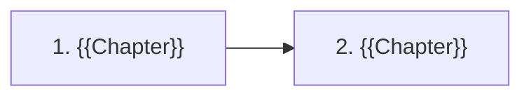

# {{Title}}, {{Edition}} Edition

**Open [`index.html`](index.html) in a browser** for the interactive version: one lesson per chapter with simulations and self-checks.

## About

{{Two or three factual sentences: what the book covers and how it is organized.}}

## What's in this folder

| Path | What it is |
|---|---|
| `chapters/NN-*.md` | Chapter notes — the source of truth; each has a generated `.html` lesson next to it |
| `widgets/` | Hand-built simulations, embedded in the lessons |
| `lab/` | Runnable experiments with expected output |
| `index.html` | The book hub — generated from this README and the chapters |

## How the book fits together

## Chapters

| # | Chapter | Pages |
|---:|---|---|
| 1 | [{{Chapter 1}}](chapters/01-slug.md) | {{1–30}} |

Page ranges are printed pages.

## Key concepts

| Concept | Definition | Chapters |
|---|---|---|

## Companion resources

<!-- Optional: talks, readings, courses that complement the book. Say what each covers (e.g. which edition). Delete the section if there are none. -->

- **[{{Resource}}]({{url}})** — {{what it covers and how it relates to this edition}}

## How these notes work

- Everything above *Beyond the book* in a chapter note restates the book, with printed page references; the rest is labelled as the vault's.
- Simulations and experiments are the vault's own implementations of mechanisms the book describes.

## Source

- {{Where the TOC and page numbers were verified; the PDF-to-printed page offset.}}
- {{What could not be verified.}}
