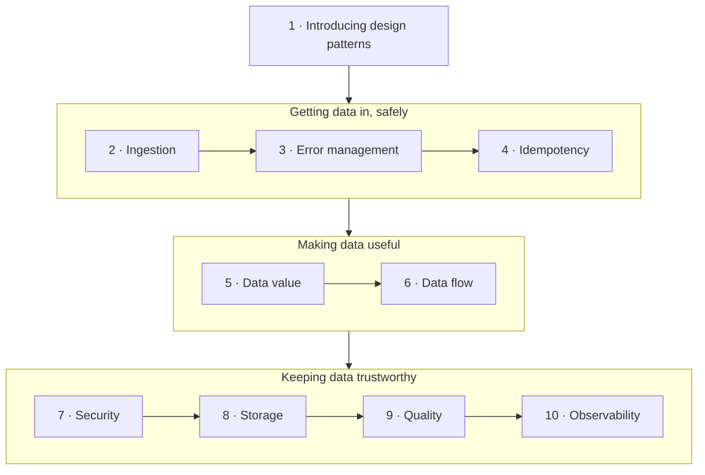

# Data Engineering Design Patterns

**Open [`index.html`](index.html) in a browser** for the interactive version: one slide-by-slide lesson per chapter with embedded simulations and self-checks. Everything here also reads fine on GitHub.

## About

A catalogue of about 70 reusable solutions to recurring data engineering problems — subtitled *Recipes for Solving the Most Common Data Engineering Problems*. Each pattern follows the same shape: a **problem**, a **solution**, its **consequences** and runnable **examples** (mostly Apache Spark, Delta Lake, Apache Kafka, Apache Airflow, PostgreSQL and the major clouds). The chapters follow data through a platform: ingestion, error management, idempotency, adding value, orchestrating flows, security, storage, quality and observability. A blog analytics platform serves as the running case study.

## What's in this folder

| Path | What it is |
|---|---|
| [`chapters/NN-*.md`](chapters/01-introducing-data-engineering-design-patterns.md) | Chapter notes — **the source of truth**. Each `.md` has a generated `.html` lesson next to it. |
| [`widgets/`](widgets/03-watermark.html) | Hand-built simulations, embedded in the lessons (open any of them on its own too) |
| [`lab/`](lab/02-incremental-window/README.md) | Runnable Python experiments with expected output |
| `index.html` | The book hub — generated from this README and the chapters |

## How the book fits together

The book has no part divisions. Chapter 1 orders the pattern chapters along a typical data flow, and this map follows that order. The grouping into three stages is **the vault's own**.

Some threads run across the groups:

- Partitioning (8) underpins the Fast Metadata Cleaner (4) and incremental loading (2).
- The Dead-Letter (3) returns as data dispatching in AWAP (9).
- The Vertical Partitioner appears for removal (7) and for storage (8).
- The Readiness Marker (2) gates the Skew Detector (10).
- The Fine-Grained Tracker (10) supports the Schema Migrator (9).

## Chapters

| # | Chapter | Pages |
|---:|---|---|
| 1 | [Introducing Data Engineering Design Patterns](chapters/01-introducing-data-engineering-design-patterns.md) | 1–6 |
| 2 | [Data Ingestion Design Patterns](chapters/02-data-ingestion-design-patterns.md) | 7–38 |
| 3 | [Error Management Design Patterns](chapters/03-error-management-design-patterns.md) | 39–78 |
| 4 | [Idempotency Design Patterns](chapters/04-idempotency-design-patterns.md) | 79–114 |
| 5 | [Data Value Design Patterns](chapters/05-data-value-design-patterns.md) | 115–164 |
| 6 | [Data Flow Design Patterns](chapters/06-data-flow-design-patterns.md) | 165–196 |
| 7 | [Data Security Design Patterns](chapters/07-data-security-design-patterns.md) | 197–232 |
| 8 | [Data Storage Design Patterns](chapters/08-data-storage-design-patterns.md) | 233–272 |
| 9 | [Data Quality Design Patterns](chapters/09-data-quality-design-patterns.md) | 273–304 |
| 10 | [Data Observability Design Patterns](chapters/10-data-observability-design-patterns.md) | 305–330 |

Page ranges are printed pages. The book also has an Afterword (p. 331) and an appendix, *Summary of Patterns* (p. 333), which lists every pattern's use case and gotchas.

## Key concepts

These ideas recur across chapters; each row lists the chapters that discuss it. Definitions are the vault's summaries of the book's explanations.

| Concept | Definition | Chapters |
|---|---|---|
| Backfilling | Reprocessing past data, for example after fixing a bug or adding a consumer. Many patterns are judged by what they do when old runs are replayed. | [2](chapters/02-data-ingestion-design-patterns.md) · [4](chapters/04-idempotency-design-patterns.md) · [6](chapters/06-data-flow-design-patterns.md) |
| Dead-letter storage | A separate place for records that fail processing, so the pipeline keeps going and the failures can be inspected and replayed. | [1](chapters/01-introducing-data-engineering-design-patterns.md) · [3](chapters/03-error-management-design-patterns.md) · [9](chapters/09-data-quality-design-patterns.md) |
| Idempotency | Getting the same result however many times a job runs for the same input, whether through overwrites, merges, keys, transactions or proxies. | [3](chapters/03-error-management-design-patterns.md) · [4](chapters/04-idempotency-design-patterns.md) · [7](chapters/07-data-security-design-patterns.md) · [8](chapters/08-data-storage-design-patterns.md) |
| Late data | Events that arrive after the system expected them, measured against a watermark. Late events can be dropped, integrated statically or integrated dynamically. | [3](chapters/03-error-management-design-patterns.md) · [5](chapters/05-data-value-design-patterns.md) · [10](chapters/10-data-observability-design-patterns.md) |
| Medallion architecture | Organizing data in Bronze (raw), Silver (cleaned, enriched) and Gold (business-ready) layers. The case study uses it throughout. | [1](chapters/01-introducing-data-engineering-design-patterns.md) · [2](chapters/02-data-ingestion-design-patterns.md) · [5](chapters/05-data-value-design-patterns.md) |
| Partitioning | Splitting a dataset into separate storage locations by rows (horizontal) or columns (vertical), so readers and cleaners touch only what they need. | [2](chapters/02-data-ingestion-design-patterns.md) · [4](chapters/04-idempotency-design-patterns.md) · [7](chapters/07-data-security-design-patterns.md) · [8](chapters/08-data-storage-design-patterns.md) |
| Personal data (PII) | Information that identifies a person, which privacy laws let users have removed and which must be protected or (pseudo-)anonymized before it is shared. | [2](chapters/02-data-ingestion-design-patterns.md) · [7](chapters/07-data-security-design-patterns.md) |
| Schema evolution | Changes to a dataset's structure over time. Compatibility rules and grace periods keep consumers working through those changes. | [9](chapters/09-data-quality-design-patterns.md) · [10](chapters/10-data-observability-design-patterns.md) |
| Shuffle | Moving data across the network so that records with the same key meet in one task, as aggregations and joins require. It is often the costliest step. | [5](chapters/05-data-value-design-patterns.md) · [8](chapters/08-data-storage-design-patterns.md) |
| Slowly changing dimension | A way of keeping the history of reference data that changes over time, so facts join with the version valid at their time. | [5](chapters/05-data-value-design-patterns.md) · [8](chapters/08-data-storage-design-patterns.md) |
| Small files problem | Many tiny files cost more in listing and metadata than they hold in data. Compaction, partition choice and manifests address it. | [2](chapters/02-data-ingestion-design-patterns.md) · [8](chapters/08-data-storage-design-patterns.md) · [10](chapters/10-data-observability-design-patterns.md) |
| Table file formats | Delta Lake, Apache Iceberg and Apache Hudi: Parquet files plus a commit log that adds transactions, time travel, statistics and file manifests. | [2](chapters/02-data-ingestion-design-patterns.md) · [4](chapters/04-idempotency-design-patterns.md) · [7](chapters/07-data-security-design-patterns.md) · [8](chapters/08-data-storage-design-patterns.md) |
| Watermark | A pipeline's estimate of how far event time has progressed. It decides when windows close and which events count as late. | [3](chapters/03-error-management-design-patterns.md) · [5](chapters/05-data-value-design-patterns.md) |

## How these notes work

- **Everything above *Beyond the book* in a chapter note restates the book**, with printed page references. Supplementary material — outside sources, the vault's interpretation — lives under *Beyond the book* or in `> **Vault note:**` callouts.
- Pattern sections keep the book's own shape: **Problem → Solution → Consequences → Examples**. Code examples are summarized rather than reproduced; the book's full code is in its GitHub repository.
- Section outlines are the book's own nested table of contents, generated from the PDF's bookmarks.
- *Check yourself* questions and answers are the vault's, written from the notes; answers cite pages.
- Simulations and experiments are the vault's own implementations of mechanisms the book describes; each says which pages it illustrates and what it simplifies.

## Source

- **Primary source:** the publisher's PDF of the first edition, April 2025 (375 PDF pages). The printed page number is the PDF page number minus 18. The PDF is kept outside version control (see `.gitignore`).
- **Table of contents:** taken from the PDF's bookmark outline, which gives each chapter's sections and patterns with page numbers.
- **Structure:** a preface, 10 chapters, an Afterword, an appendix (*Summary of Patterns*) and an index. There are no part divisions.
- **Coverage:** all 10 chapters are covered.
