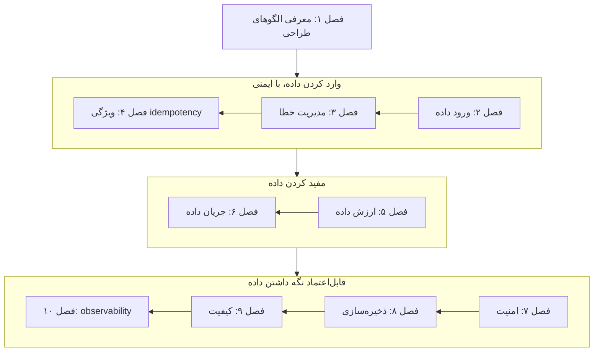

# Data Engineering Design Patterns

**نسخه‌ی تعاملی را با باز کردن [`index.html`](index.html) در مرورگر ببینید**: برای هر فصل یک درس اسلاید‌به‌اسلاید، با شبیه‌سازی‌های جاسازی‌شده و خودسنجی. همین متن روی GitHub هم خوب خوانده می‌شود.

## درباره‌ی کتاب

فهرستی از حدود ۷۰ راه‌حل قابل‌استفاده‌ی دوباره برای مسئله‌های تکرارشونده‌ی مهندسی داده، با عنوان فرعی *Recipes for Solving the Most Common Data Engineering Problems*. هر الگو همان شکل ثابت را دارد: یک **مسئله**، یک **راه‌حل**، **پیامدها**یش و **نمونه‌ها**ی اجراشدنی، که بیشترشان با Apache Spark و Delta Lake و Apache Kafka و Apache Airflow و PostgreSQL و cloudهای بزرگ‌اند. فصل‌ها داده را در یک platform دنبال می‌کنند: ورود داده، مدیریت خطا، idempotency، ارزش افزودن، هماهنگ کردن جریان‌ها، امنیت، ذخیره‌سازی، کیفیت و observability. یک platform تحلیل وبلاگ هم مطالعه‌ی موردیِ جاری کتاب است.

## محتوای این پوشه

| مسیر | چیست |
|---|---|
| [`chapters/NN-*.md`](chapters/01-introducing-data-engineering-design-patterns.md) | یادداشت فصل‌ها، **منبع اصلی**. کنار هر `.md` یک درس `.html` ساخته می‌شود |
| [`widgets/`](widgets/03-watermark.html) | شبیه‌سازی‌های دست‌ساز که در درس‌ها جاسازی شده‌اند؛ هر کدام جداگانه هم باز می‌شوند |
| [`lab/`](lab/02-incremental-window/README.md) | آزمایش‌های اجراشدنی Python با خروجی مورد انتظار |
| `index.html` | صفحه‌ی کتاب که از همین README و فصل‌ها ساخته می‌شود |

## کتاب چطور به هم وصل است

کتاب بخش‌بندی ندارد. فصل ۱ فصل‌های الگو را در امتداد یک جریان داده‌ی معمول می‌چیند و این نقشه همان ترتیب را دنبال می‌کند. گروه‌بندی به سه مرحله **مال خود vault** است.

چند رشته در همه‌ی گروه‌ها کشیده شده‌اند:

- پارتیشن‌بندی (۸) زیربنای Fast Metadata Cleaner (۴) و بارگذاری افزایشی (۲) است.
- الگوی Dead-Letter (۳) در قالب توزیع داده در AWAP (۹) برمی‌گردد.
- الگوی Vertical Partitioner هم برای حذف (۷) و هم برای ذخیره‌سازی (۸) می‌آید.
- الگوی Readiness Marker (۲) دروازه‌ی Skew Detector (۱۰) است.
- الگوی Fine-Grained Tracker (۱۰) از Schema Migrator (۹) پشتیبانی می‌کند.

## فصل‌ها

| # | فصل | صفحه‌ها |
|---:|---|---|
| ۱ | [معرفی الگوهای طراحی مهندسی داده](chapters/01-introducing-data-engineering-design-patterns.md) | ۱–۶ |
| ۲ | [الگوهای طراحی ورود داده](chapters/02-data-ingestion-design-patterns.md) | ۷–۳۸ |
| ۳ | [الگوهای طراحی مدیریت خطا](chapters/03-error-management-design-patterns.md) | ۳۹–۷۸ |
| ۴ | [الگوهای طراحی idempotency](chapters/04-idempotency-design-patterns.md) | ۷۹–۱۱۴ |
| ۵ | [الگوهای طراحی ارزش داده](chapters/05-data-value-design-patterns.md) | ۱۱۵–۱۶۴ |
| ۶ | [الگوهای طراحی جریان داده](chapters/06-data-flow-design-patterns.md) | ۱۶۵–۱۹۶ |
| ۷ | [الگوهای طراحی امنیت داده](chapters/07-data-security-design-patterns.md) | ۱۹۷–۲۳۲ |
| ۸ | [الگوهای طراحی ذخیره‌سازی داده](chapters/08-data-storage-design-patterns.md) | ۲۳۳–۲۷۲ |
| ۹ | [الگوهای طراحی کیفیت داده](chapters/09-data-quality-design-patterns.md) | ۲۷۳–۳۰۴ |
| ۱۰ | [الگوهای طراحی observability داده](chapters/10-data-observability-design-patterns.md) | ۳۰۵–۳۳۰ |

شماره‌ها صفحه‌ی چاپی‌اند. کتاب یک مؤخره در ص. ۳۳۱ و یک پیوست با عنوان *Summary of Patterns* در ص. ۳۳۳ هم دارد که کاربرد و دام‌های هر الگو را فهرست می‌کند.

## مفهوم‌های کلیدی

این ایده‌ها در چند فصل تکرار می‌شوند و هر ردیف فصل‌هایی را که به آن می‌پردازند فهرست می‌کند. تعریف‌ها خلاصه‌ی vault از توضیح کتاب‌اند.

| مفهوم | تعریف | فصل‌ها |
|---|---|---|
| backfill کردن | پردازش دوباره‌ی داده‌ی گذشته، مثلاً بعد از رفع یک باگ یا اضافه شدن یک consumer. خیلی از الگوها با رفتارشان هنگام اجرای دوباره‌ی runهای قدیمی سنجیده می‌شوند. | [۲](chapters/02-data-ingestion-design-patterns.md) · [۴](chapters/04-idempotency-design-patterns.md) · [۶](chapters/06-data-flow-design-patterns.md) |
| ذخیره‌سازی dead-letter | جایی جدا برای رکوردهایی که پردازششان شکست می‌خورد، تا pipeline ادامه بدهد و بشود شکست‌ها را بررسی و دوباره اجرا کرد. | [۱](chapters/01-introducing-data-engineering-design-patterns.md) · [۳](chapters/03-error-management-design-patterns.md) · [۹](chapters/09-data-quality-design-patterns.md) |
| ویژگی idempotency | گرفتن نتیجه‌ی یکسان هر چند بار که یک job روی همان ورودی اجرا شود، چه با بازنویسی، چه merge، چه کلید، چه تراکنش، چه proxy. | [۳](chapters/03-error-management-design-patterns.md) · [۴](chapters/04-idempotency-design-patterns.md) · [۷](chapters/07-data-security-design-patterns.md) · [۸](chapters/08-data-storage-design-patterns.md) |
| late data | رویدادهایی که دیرتر از انتظار سیستم می‌رسند و با watermark سنجیده می‌شوند. late event را می‌شود دور انداخت یا ایستا یا پویا وارد کرد. | [۳](chapters/03-error-management-design-patterns.md) · [۵](chapters/05-data-value-design-patterns.md) · [۱۰](chapters/10-data-observability-design-patterns.md) |
| معماری medallion | سازمان دادن داده در لایه‌های Bronze برای خام، Silver برای تمیز و غنی‌شده، و Gold برای آماده‌ی کسب‌وکار. مطالعه‌ی موردی کتاب از اول تا آخر همین را به کار می‌برد. | [۱](chapters/01-introducing-data-engineering-design-patterns.md) · [۲](chapters/02-data-ingestion-design-patterns.md) · [۵](chapters/05-data-value-design-patterns.md) |
| پارتیشن‌بندی | شکستن یک مجموعه‌داده به جایگاه‌های ذخیره‌سازی جدا، چه بر پایه‌ی ردیف که افقی است و چه بر پایه‌ی ستون که عمودی است، تا خواننده‌ها و پاک‌کننده‌ها فقط به چیزی دست بزنند که لازم دارند. | [۲](chapters/02-data-ingestion-design-patterns.md) · [۴](chapters/04-idempotency-design-patterns.md) · [۷](chapters/07-data-security-design-patterns.md) · [۸](chapters/08-data-storage-design-patterns.md) |
| داده‌ی شخصی یا PII | اطلاعاتی که یک آدم را می‌شناساند، که قانون‌های حریم خصوصی به کاربر اجازه می‌دهند حذفش کند و پیش از به اشتراک گذاشتن باید محافظت یا ناشناس شود. | [۲](chapters/02-data-ingestion-design-patterns.md) · [۷](chapters/07-data-security-design-patterns.md) |
| تکامل schema | تغییر ساختار یک مجموعه‌داده در طول زمان. قاعده‌های سازگاری و دوره‌های مهلت، consumerها را در دل این تغییرها سر پا نگه می‌دارند. | [۹](chapters/09-data-quality-design-patterns.md) · [۱۰](chapters/10-data-observability-design-patterns.md) |
| shuffle | جابه‌جا کردن داده روی شبکه تا رکوردهای با کلید یکسان در یک task کنار هم بیایند، همان چیزی که aggregation و join لازم دارند. اغلب گران‌ترین مرحله است. | [۵](chapters/05-data-value-design-patterns.md) · [۸](chapters/08-data-storage-design-patterns.md) |
| بُعد کندتغییر | راهی برای نگه داشتن تاریخچه‌ی داده‌ی مرجعی که در طول زمان عوض می‌شود، تا factها با همان نسخه‌ای join شوند که در زمانشان معتبر بوده. | [۵](chapters/05-data-value-design-patterns.md) · [۸](chapters/08-data-storage-design-patterns.md) |
| مسئله‌ی فایل‌های کوچک | فایل‌های ریز زیاد، در فهرست کردن و metadata بیشتر از خود داده هزینه می‌برند. فشرده‌سازی و انتخاب پارتیشن و manifest به آن می‌پردازند. | [۲](chapters/02-data-ingestion-design-patterns.md) · [۸](chapters/08-data-storage-design-patterns.md) · [۱۰](chapters/10-data-observability-design-patterns.md) |
| قالب‌های فایل جدولی | ابزارهای Delta Lake و Apache Iceberg و Apache Hudi: فایل‌های Parquet به‌علاوه‌ی یک log از commitها که تراکنش و سفر در زمان و آمار و manifest فایل‌ها را اضافه می‌کند. | [۲](chapters/02-data-ingestion-design-patterns.md) · [۴](chapters/04-idempotency-design-patterns.md) · [۷](chapters/07-data-security-design-patterns.md) · [۸](chapters/08-data-storage-design-patterns.md) |
| watermark | تخمین pipeline از این‌که زمان رویداد تا کجا جلو رفته. تعیین می‌کند پنجره‌ها کِی بسته می‌شوند و کدام رویدادها late حساب می‌شوند. | [۳](chapters/03-error-management-design-patterns.md) · [۵](chapters/05-data-value-design-patterns.md) |

## این یادداشت‌ها چطور نوشته شده‌اند

- **هر چیزی که در یادداشت یک فصل بالای *فراتر از کتاب* است، خود کتاب را بازگو می‌کند**، با ارجاع به صفحه‌ی چاپی. مطالب مکمل، یعنی منابع بیرونی و خوانش vault، زیر *فراتر از کتاب* یا در کادرهای `> **Vault note:**` می‌آیند.
- بخش‌های الگو همان شکل خود کتاب را نگه می‌دارند: **مسئله ← راه‌حل ← پیامدها ← نمونه‌ها**. نمونه‌های کد خلاصه می‌شوند نه بازتولید؛ کد کامل کتاب در repository GitHub آن است.
- فهرست بخش‌ها همان فهرست مطالب تودرتوی خود کتاب است که از bookmarkهای PDF ساخته شده.
- پرسش‌های *خودتان را بسنجید* و پاسخ‌هایشان مال vault است و از روی همین یادداشت‌ها نوشته شده؛ پاسخ‌ها به صفحه ارجاع می‌دهند.
- شبیه‌سازی‌ها و آزمایش‌ها پیاده‌سازی خود vault از سازوکارهایی‌اند که کتاب شرح می‌دهد؛ هر کدام می‌گویند کدام صفحه‌ها را نشان می‌دهند و چه چیزی را ساده کرده‌اند.

## منبع

- **منبع اصلی:** نسخه‌ی PDF ناشر از ویراست اول، آوریل ۲۰۲۵، با ۳۷۵ صفحه‌ی PDF. شماره‌ی صفحه‌ی چاپی برابر شماره‌ی صفحه‌ی PDF منهای ۱۸ است. این PDF بیرون از version control نگه داشته می‌شود؛ `.gitignore` را ببینید.
- **فهرست مطالب:** از bookmarkهای PDF برداشته شده، که بخش‌ها و الگوهای هر فصل را با شماره‌ی صفحه می‌دهد.
- **ساختار:** یک پیش‌گفتار، ۱۰ فصل، یک مؤخره، یک پیوست با عنوان *Summary of Patterns*، و یک index. بخش‌بندی ندارد.
- **پوشش:** هر ۱۰ فصل پوشش داده شده‌اند.
