# 1. Introducing Data Engineering Design Patterns

[Book](../README.md) · [2. Data Ingestion Design Patterns →](02-data-ingestion-design-patterns.md)

## Summary

The opening chapter defines a **design pattern** through a recipe analogy — a predefined, customizable template that answers a specific problem, can be reused, has consequences, and gives a shared vocabulary — and maps each part of the analogy onto a data engineering example, the **Dead-Letter** pattern. It argues that the Gang of Four's software patterns are not enough for data work, which also has to deal with failures, backfilling, idempotency and correctness. It then lays out the book's nine pattern chapters along a typical data flow, from ingestion to observability, and introduces the case study used throughout: a **blog analytics platform** with online and offline ingestion, a real-time layer, and a data organization layer based on the **Medallion architecture** (Bronze, Silver, Gold).

## Key takeaways

- **A pattern is a predefined, customizable template for a problem in context**: it is reusable, has consequences, and gives teams a common language (pp. 1–2).
- **Patterns are not to be followed blindly**: even the Dead-Letter pattern adds code and complexity you must be ready to accept (p. 2).
- **Software patterns aren't enough for data engineering**: data work also needs failure management, backfilling, idempotency and data correctness (p. 3).
- **The book follows the data flow**: ingestion → error management → idempotency → data value → data flow → security → storage → quality → observability (pp. 3–4).
- **The case study is a blog analytics platform** whose datasets live in Bronze (raw), Silver (cleansed, enriched) or Gold (consumer-ready) layers (pp. 5–6).

## Section outline

*From the book’s own table of contents (PDF bookmarks); printed page numbers.*

- What Are Design Patterns? — p. 1
- Yet More Design Patterns? — p. 3
- Common Data Engineering Patterns — p. 3
- Case Study Used in This Book — p. 5
- Summary — p. 6

## Notes

The author notes that design patterns are well established in software engineering but have only recently begun to gain traction in data engineering, so the chapter starts by defining them (p. 1).

### What are design patterns?

A recipe — the author's example is **flan** — is a good picture of a design pattern: *a predefined and customizable template for solving a problem* (p. 1). Each part of the analogy has a data engineering counterpart (pp. 1–2):

| Property of a pattern | Flan recipe | Data engineering example |
|---|---|---|
| **Predefined template**, customizable | Ingredients and steps; brown sugar instead of white | Wrap the risky transformation in try-catch and write bad records elsewhere — or just count them |
| **Contextualization** — answers a specific problem | Share a dessert with family, or sell it for a living | A continuous job on semi-structured data must not stop because of one malformed record |
| **Reusability** | Reuse the recipe that worked before | Apply the same logic in a different context, e.g. an ELT pipeline transforming inside a warehouse |
| **Consequences** | Flan every day leaves less time for sport | Extra logic adds complexity to the codebase |
| **Saves time + common vocabulary** | “Flan” is easier to search for than “caramel custard” | The pattern has a name: **dead-lettering** (Chapter 3) |

The example's name is the **Dead-Letter** pattern, one of the error management patterns of Chapter 3. A pattern represents a holistic picture of a solution, and its name simplifies discussions with teammates (p. 2).

### Yet more design patterns?

The Gang of Four patterns — 23 patterns from *Design Patterns: Elements of Reusable Object-Oriented Software* (Gamma et al., 1994) — keep a codebase maintainable and recognizable; Singleton, for instance, avoids allocating unnecessary objects. Maintainable code matters in data projects too, but it isn't enough: data engineering also needs patterns for **failure management, backfilling, idempotency and data correctness** (p. 3).

### Common data engineering patterns

The book follows a typical data flow, from ingestion to exposition with monitoring and alerting (pp. 3–4):

```mermaid
flowchart LR
    I["2 · Ingestion<br/>bring data in"] --> E["3 · Error management<br/>bad data, late data"]
    E --> ID["4 · Idempotency<br/>safe retries, backfills"]
    ID --> V["5 · Data value<br/>enrich, aggregate"]
    V --> F["6 · Data flow<br/>how pipelines connect"]
    F --> S["7 · Security<br/>privacy, access"]
    S --> ST["8 · Storage<br/>faster reads"]
    ST --> Q["9 · Quality<br/>trustworthy data"]
    Q --> O["10 · Observability<br/>alerting"]
```

*The chapter sequence as the book presents it (pp. 3–4).*

| Chapter | Why it comes there (pp. 3–4) |
|---|---|
| 2 · Data ingestion | Bringing data in is always the first technical step — without it there is nothing to work on |
| 3 · Error management | Errors come from code but also from providers who break their engagements, e.g. omit required fields |
| 4 · Idempotency | Errors lead to automatic or manual retries; idempotency makes repeated runs produce unique outputs |
| 5 · Data value | Summarize or combine datasets to create value for business users |
| 6 · Data flow | How the pipeline generating value interacts with other data components |
| 7 · Data security | Store data securely and meet privacy requirements |
| 8 · Data storage | Use storage techniques to reduce processing latency |
| 9 · Data quality | Data is irrelevant if you don't remove quality issues — or don't even know about them |
| 10 · Data observability | Monitoring metrics that alert you when something bad happens or is about to |

**Backfilling** is the book's single term for any task that processes past data, whether it was processed before or not; strictly, reprocessing and backfilling differ, as explained in the book's GitHub glossary (p. 4).

### Case study used in this book

Patterns are domain-independent, but each is introduced through a case study: a **blog data analytics platform** (Figure 1-1) with three important parts (pp. 5–6):

| Part | What it holds |
|---|---|
| **Online and offline ingestion** | Online: events from users interacting with hosted blogs. Offline (“Data provider”): static external or internal datasets, such as referential data, produced less regularly (e.g. once an hour) |
| **Real-time layer** | Streaming jobs reading a streaming broker: business-facing jobs (real-time session aggregation) and technical enablers (synchronizing data to at-rest storage for ad hoc querying) |
| **Data organization layer** | The **Medallion architecture**: Bronze, Silver and Gold layers |

*Figure 1-1 (p. 5): the numbered boxes mark the three parts the book singles out; every later chapter's examples live somewhere on this map.*

The layers mirror the patterns' maturity: patterns that create business value mostly expose data in **Gold**, while the rest stay in Bronze or Silver. The figure deliberately omits technology so the focus stays on the patterns; each pattern's *Examples* section shows implementations (p. 6).

## Beyond the book

- The Medallion architecture is described in Chapter 4 of *Delta Lake: The Definitive Guide* (Lee et al., O'Reilly, 2024), which the author cites (p. 6); the layer names come from Databricks, where the term originated.
- Each pattern in the following chapters is presented the same way — problem, solution, consequences, examples — which is how the vault's notes for chapters 2–10 are organized too.

## Connections

- **Related chapters:** [2. Data Ingestion](02-data-ingestion-design-patterns.md) (the first step of the flow), [3. Error Management](03-error-management-design-patterns.md) (the Dead-Letter pattern used as this chapter's example), [4. Idempotency](04-idempotency-design-patterns.md) (backfilling).

## Check yourself

*Questions and answers are the vault's, written from the notes above; answers cite the book's pages.*

1. **In the recipe analogy, what corresponds to a pattern's “consequences”?**
   - [ ] The ingredients list
   - [x] Eating flan every day leaves less time for sport — just as dead-lettering adds complexity to the codebase
   - [ ] The fact that “flan” is easier to search for than “caramel custard”
   - [ ] Swapping white sugar for brown

   *Answer:* Consequences are the side effects you accept by applying a pattern; for the Dead-Letter pattern, extra logic and complexity (pp. 1–2).

2. **Why aren't the Gang of Four patterns enough for data engineering?**

   *Answer:* They keep code maintainable, but data projects also face data-specific problems — failure management, backfilling, idempotency and data correctness — that code-level patterns don't address (p. 3).

3. **Which Medallion layer do the patterns that create business value mostly expose data in?**
   - [ ] Bronze
   - [ ] Silver
   - [x] Gold

   *Answer:* Gold exposes data in the format final users expect (data marts, reference datasets); other patterns stay behind in Bronze or Silver (p. 6).

4. **What does the book mean by “backfilling”?**

   *Answer:* Any task that processes past data, whether that data was already processed or not — the book deliberately uses the one term even though reprocessing and backfilling technically differ (p. 4).
