```mermaid
flowchart LR
    I["2 · Ingestion<br/>bring data in"] --> E["3 · Error management<br/>bad data, late data"]
    E --> ID["4 · Idempotency<br/>safe retries, backfills"]
    ID --> V["5 · Data value<br/>enrich, aggregate"]
    V --> F["6 · Data flow<br/>how pipelines connect"]
    F --> S["7 · Security<br/>privacy, access"]
    S --> ST["8 · Storage<br/>faster reads"]
    ST --> Q["9 · Quality<br/>trustworthy data"]
    Q --> O["10 · Observability<br/>alerting"]
```

# فصل ۱: معرفی الگوهای طراحی مهندسی داده

[کتاب](../README.md) · [فصل ۲: الگوهای طراحی ورود داده ←](02-data-ingestion-design-patterns.md)

## خلاصه

فصل اول **الگوی طراحی** را با قیاس دستور پخت تعریف می‌کند، یعنی قالبی از پیش تعریف‌شده و قابل‌سفارشی‌سازی که به مسئله‌ای مشخص پاسخ می‌دهد، دوباره به کار می‌آید، پیامد دارد و واژگان مشترک می‌سازد، و بعد هر تکه‌ی این قیاس را روی یک نمونه‌ی مهندسی داده، یعنی الگوی **Dead-Letter**، map می‌کند. استدلال می‌کند که الگوهای نرم‌افزاری Gang of Four برای کار داده کافی نیستند، چون کار داده با شکست و backfill و idempotency و درستی داده هم سر و کار دارد. بعد نه فصل الگویی کتاب را در امتداد یک جریان داده‌ی معمول، از ورود داده تا observability، می‌چیند و مطالعه‌ی موردیِ سرتاسر کتاب را معرفی می‌کند: یک **platform تحلیل وبلاگ** با ورود داده‌ی برخط و غیربرخط، یک لایه‌ی بلادرنگ، و یک لایه‌ی سازمان‌دهی داده بر پایه‌ی **معماری medallion**، یعنی Bronze و Silver و Gold.

## نکته‌های کلیدی

- **الگو قالبی از پیش تعریف‌شده و قابل‌سفارشی‌سازی برای مسئله‌ای در یک زمینه است**: دوباره به کار می‌آید، پیامد دارد، و به تیم‌ها زبان مشترک می‌دهد (pp. 1–2).
- **الگوها را کورکورانه دنبال نکنید**: حتی الگوی Dead-Letter هم کد و پیچیدگی اضافه می‌کند که باید آماده‌ی پذیرشش باشید (p. 2).
- **الگوهای نرم‌افزاری برای مهندسی داده کافی نیستند**: کار داده به مدیریت شکست و backfill و idempotency و درستی داده هم نیاز دارد (p. 3).
- **کتاب جریان داده را دنبال می‌کند**: ورود داده ← مدیریت خطا ← idempotency ← ارزش داده ← جریان داده ← امنیت ← ذخیره‌سازی ← کیفیت ← observability (pp. 3–4).
- **مطالعه‌ی موردی یک platform تحلیل وبلاگ است** که مجموعه‌داده‌هایش در لایه‌های Bronze برای خام، Silver برای تمیزشده و غنی‌شده، و Gold برای آماده‌ی consumer زندگی می‌کنند (pp. 5–6).

## فهرست بخش‌ها

*از فهرست مطالب خود کتاب، از bookmarkهای PDF؛ شماره‌ها صفحه‌ی چاپی‌اند.*

- الگوهای طراحی چیست‌اند؟ — p. 1
- باز هم الگوی طراحی؟ — p. 3
- الگوهای رایج مهندسی داده — p. 3
- مطالعه‌ی موردی این کتاب — p. 5
- خلاصه — p. 6

## یادداشت‌ها

نویسنده می‌گوید الگوهای طراحی در مهندسی نرم‌افزار جاافتاده‌اند ولی تازه در مهندسی داده دارند جا باز می‌کنند، پس فصل با تعریف کردنشان شروع می‌شود (p. 1).

### الگوهای طراحی چیست‌اند؟

یک دستور پخت، که نمونه‌ی نویسنده **فلان** است، تصویر خوبی از الگوی طراحی می‌دهد: *قالبی از پیش تعریف‌شده و قابل‌سفارشی‌سازی برای حل یک مسئله* (p. 1). هر تکه‌ی این قیاس همتایی در مهندسی داده دارد (pp. 1–2):

| ویژگی یک الگو | دستور پخت فلان | نمونه‌ی مهندسی داده |
|---|---|---|
| **قالب از پیش تعریف‌شده** و قابل‌سفارشی‌سازی | مواد و مرحله‌ها؛ شکر قهوه‌ای به‌جای سفید | تبدیل پرریسک را در try-catch بپیچید و رکوردهای خراب را جای دیگری بنویسید، یا فقط بشماریدشان |
| **زمینه‌مندی**، یعنی به مسئله‌ای مشخص پاسخ می‌دهد | شیرینی را با خانواده قسمت کنید، یا برای امرار معاش بفروشیدش | jobی پیوسته روی داده‌ی نیمه‌ساختاریافته نباید به‌خاطر یک رکورد خراب بایستد |
| **قابل‌استفاده‌ی دوباره** | همان دستوری را که قبلاً جواب داده دوباره به کار ببرید | همان منطق را در زمینه‌ای دیگر به کار ببرید؛ مثلاً pipeline نوع ELT که تبدیل را داخل انبار انجام می‌دهد |
| **پیامدها** | هر روز فلان خوردن وقت کمتری برای ورزش می‌گذارد | منطق اضافه، پیچیدگی کد را بیشتر می‌کند |
| **صرفه‌جویی وقت و واژگان مشترک** | جست‌وجوی «فلان» از «کاستارد کاراملی» آسان‌تر است | الگو اسم دارد: **dead-lettering** (فصل ۳) |

اسم این نمونه الگوی **Dead-Letter** است، یکی از الگوهای مدیریت خطا در فصل ۳. الگو تصویری کل‌نگر از یک راه‌حل است و اسمش گفت‌وگو با هم‌تیمی‌ها را ساده می‌کند (p. 2).

### باز هم الگوی طراحی؟

الگوهای Gang of Four، یعنی ۲۳ الگو از کتاب *Design Patterns: Elements of Reusable Object-Oriented Software* نوشته‌ی Gamma و همکاران در سال ۱۹۹۴، کد را قابل‌نگه‌داری و آشنا نگه می‌دارند؛ مثلاً Singleton از ساختن objectهای بی‌مورد جلوگیری می‌کند. کد قابل‌نگه‌داری در پروژه‌های داده هم مهم است، ولی کافی نیست: مهندسی داده به الگوهایی برای **مدیریت شکست و backfill و idempotency و درستی داده** هم نیاز دارد (p. 3).

### الگوهای رایج مهندسی داده

کتاب یک جریان داده‌ی معمول را دنبال می‌کند، از ورود داده تا نمایش، همراه با monitoring و هشدار (pp. 3–4):

*ترتیب فصل‌ها همان‌طور که کتاب ارائه‌اش می‌دهد (pp. 3–4).*

| فصل | چرا همان‌جا می‌آید (pp. 3–4) |
|---|---|
| ۲ · ورود داده | وارد کردن داده همیشه اولین قدم فنی است؛ بدون آن چیزی برای کار کردن نیست |
| ۳ · مدیریت خطا | خطاها هم از کد می‌آیند و هم از تأمین‌کننده‌هایی که تعهدشان را می‌شکنند، مثلاً فیلدهای لازم را نمی‌فرستند |
| ۴ · ویژگی idempotency | خطا به تلاش دوباره‌ی خودکار یا دستی می‌انجامد؛ idempotency باعث می‌شود اجراهای مکرر خروجی یکتا بدهند |
| ۵ · ارزش داده | مجموعه‌داده‌ها را خلاصه یا ترکیب کنید تا برای کاربرهای کسب‌وکار ارزش بسازید |
| ۶ · جریان داده | این‌که pipelineِ ارزش‌ساز چطور با بقیه‌ی مؤلفه‌های داده تعامل می‌کند |
| ۷ · امنیت داده | داده را امن ذخیره کنید و الزام‌های حریم خصوصی را برآورده کنید |
| ۸ · ذخیره‌سازی داده | با تکنیک‌های ذخیره‌سازی تأخیر پردازش را کم کنید |
| ۹ · کیفیت داده | داده بی‌ربط است اگر مسئله‌های کیفیت را برندارید، یا اصلاً از آن‌ها خبر نداشته باشید |
| ۱۰ · observability داده | monitoring متریک‌هایی که وقتی چیز بدی می‌افتد یا نزدیک است بیفتد هشدار می‌دهند |

کتاب **backfill** را اصطلاح واحدی برای هر کاری می‌داند که داده‌ی گذشته را پردازش می‌کند، چه قبلاً پردازش شده باشد چه نه؛ به‌طور دقیق، پردازش دوباره و backfill فرق دارند، همان‌طور که واژه‌نامه‌ی GitHub کتاب توضیح می‌دهد (p. 4).

> **In practice:** هر دسته‌ی الگوی کتاب در reference stack جایی دارد: loader با dlt همان ingestion است، لایه‌های Bronze و Silver و Gold همان data value، و alertهای Grafana همان observability.
>
> **Your turn:** همکار تازه‌ای می‌پرسد «وقتی Airflow خودش retry دارد، چرا باید به idempotency فکر کنیم؟» چه جوابی می‌دهید؟
>
> *Answer:* یک retry فقط کار را دوباره اجرا می‌کند؛ اگر نوشتن idempotent نباشد، هر retry ردیف تکراری به Bronze می‌افزاید. برای همین کتاب مدیریت خطا و idempotency را دو دسته‌ی جدا می‌گذارد که با هم کار می‌کنند (pp. 3–4).

### مطالعه‌ی موردی این کتاب

الگوها مستقل از دامنه‌اند، ولی هر کدام از دل یک مطالعه‌ی موردی معرفی می‌شوند: یک **platform تحلیل داده‌ی وبلاگ** (شکل ۱-۱) با سه بخش مهم (pp. 5–6):

| بخش | چه چیزی دارد |
|---|---|
| **ورود داده‌ی برخط و غیربرخط** | برخط: رویدادهای کاربرهایی که با وبلاگ‌های میزبانی‌شده کار می‌کنند. غیربرخط، یعنی «data provider»: مجموعه‌داده‌های ایستای بیرونی یا داخلی، مثل داده‌ی مرجع، که کم‌تکرارتر تولید می‌شوند؛ مثلاً ساعتی یک‌بار |
| **لایه‌ی بلادرنگ** | jobهای streaming که از یک broker می‌خوانند: jobهای رو به کسب‌وکار مثل تجمیع بلادرنگ session، و توانمندسازهای فنی مثل synchronous کردن داده با ذخیره‌سازی ساکن برای کوئری موردی |
| **لایه‌ی سازمان‌دهی داده** | همان **معماری medallion**: لایه‌های Bronze و Silver و Gold |

*Figure 1-1 (p. 5): کادرهای شماره‌دار همان سه بخشی را نشان می‌دهند که کتاب جدا می‌کند؛ نمونه‌های هر فصل بعدی جایی روی همین نقشه زندگی می‌کنند.*

لایه‌ها بلوغ الگوها را آینه می‌کنند: الگوهایی که ارزش کسب‌وکاری می‌سازند بیشتر داده را در **Gold** در معرض دید می‌گذارند و بقیه در Bronze یا Silver می‌مانند. شکل عمداً فناوری را نمی‌گوید تا تمرکز روی خود الگوها بماند؛ بخش «نمونه‌ها»ی هر الگو پیاده‌سازی‌ها را نشان می‌دهد (p. 6).

> **In practice:** مطالعه‌ی موردی کتاب همان معماری medallion را دارد که warehouse ما دارد؛ فرقش این است که در stack ما هر سه لایه جدول‌های ClickHouse‌اند و transformationها SQL داخل warehouse.
>
> **Your turn:** یک داشبورد Metabase عدد اشتباه نشان می‌دهد. از کدام لایه شروع به گشتن می‌کنید؟
>
> *Answer:* از Silver به عقب: اگر Silver درست است، اشکال در منطق Gold است؛ اگر نه، Bronze را با منبع مقایسه کنید. چون Bronze کپی خام است، هر لایه‌ی بالاتر را می‌شود با اجرای دوباره‌ی SQL از نو ساخت (pp. 5–6).

## فراتر از کتاب

- معماری medallion در فصل ۴ کتاب *Delta Lake: The Definitive Guide* از Lee و همکاران، O'Reilly سال ۲۰۲۴، شرح داده شده که نویسنده به آن ارجاع می‌دهد (p. 6)؛ نام لایه‌ها از Databricks می‌آید که این اصطلاح از آن‌جا درآمده.
- هر الگو در فصل‌های بعدی به همان شکل ارائه می‌شود، یعنی مسئله و راه‌حل و پیامدها و نمونه‌ها، و یادداشت‌های vault برای فصل‌های ۲ تا ۱۰ هم همین‌طور سازمان یافته‌اند.

## پیوندها

- **فصل‌های مرتبط:** [فصل ۲: ورود داده](02-data-ingestion-design-patterns.md) که اولین قدم جریان است، [فصل ۳: مدیریت خطا](03-error-management-design-patterns.md) که الگوی Dead-Letter نمونه‌ی همین فصل از آن‌جاست، و [فصل ۴: ویژگی idempotency](04-idempotency-design-patterns.md) که backfill را می‌گوید.

## خودتان را بسنجید

*پرسش‌ها و پاسخ‌ها مال vault است و از روی یادداشت‌های بالا نوشته شده؛ پاسخ‌ها به صفحه‌های کتاب ارجاع می‌دهند.*

1. **در قیاس دستور پخت، چه چیزی با «پیامدها»ی یک الگو متناظر است؟**
   - [ ] فهرست مواد
   - [x] این‌که هر روز فلان خوردن وقت کمتری برای ورزش می‌گذارد، همان‌طور که dead-lettering پیچیدگی به کد اضافه می‌کند
   - [ ] این‌که جست‌وجوی «فلان» از «کاستارد کاراملی» آسان‌تر است
   - [ ] عوض کردن شکر سفید با قهوه‌ای

   *Answer:* پیامدها همان اثرهای جانبی‌اند که با به کار بردن یک الگو می‌پذیرید؛ برای الگوی Dead-Letter یعنی منطق اضافه و پیچیدگی (pp. 1–2).

2. **چرا الگوهای Gang of Four برای مهندسی داده کافی نیستند؟**

   *Answer:* کد را قابل‌نگه‌داری نگه می‌دارند، ولی پروژه‌های داده با مسئله‌های خاص داده هم روبه‌رویند، یعنی مدیریت شکست و backfill و idempotency و درستی داده، که الگوهای سطح کد به آن‌ها نمی‌پردازند (p. 3).

3. **الگوهایی که ارزش کسب‌وکاری می‌سازند بیشتر داده را در کدام لایه‌ی medallion در معرض دید می‌گذارند؟**
   - [ ] لایه‌ی Bronze
   - [ ] لایه‌ی Silver
   - [x] لایه‌ی Gold

   *Answer:* لایه‌ی Gold داده را در قالبی که کاربر نهایی انتظار دارد در معرض دید می‌گذارد، مثل data mart و مجموعه‌داده‌ی مرجع؛ بقیه‌ی الگوها در Bronze یا Silver می‌مانند (p. 6).

4. **کتاب از «backfill» چه منظوری دارد؟**

   *Answer:* هر کاری که داده‌ی گذشته را پردازش می‌کند، چه آن داده قبلاً پردازش شده باشد چه نه؛ کتاب عمداً همین یک اصطلاح را به کار می‌برد، هرچند پردازش دوباره و backfill از نظر فنی فرق دارند (p. 4).
