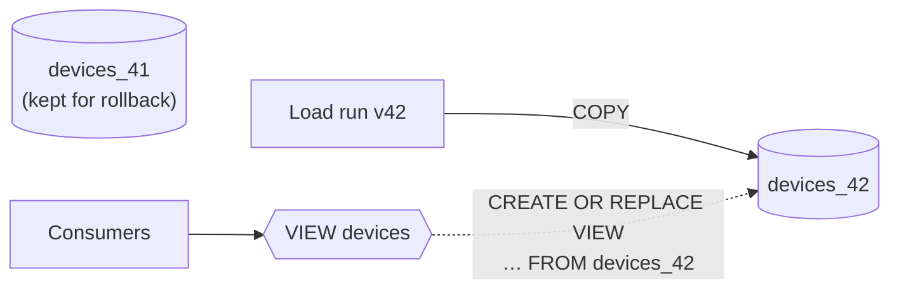
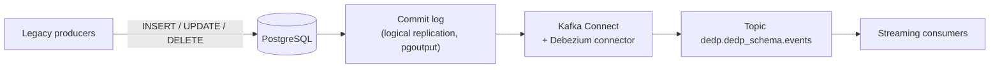
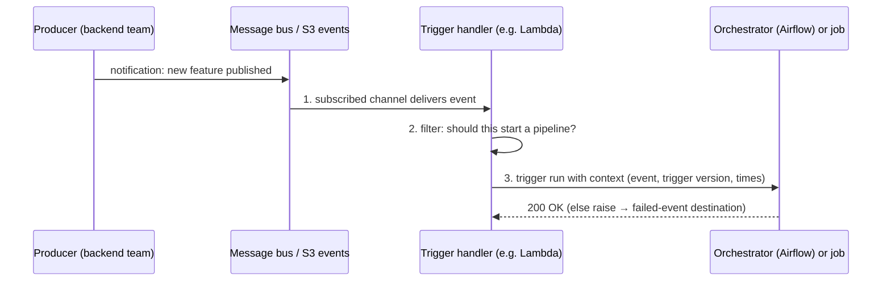

# 2. Data Ingestion Design Patterns

[← 1. Introducing Data Engineering Design Patterns](01-introducing-data-engineering-design-patterns.md) · [Book](../README.md) · [3. Error Management Design Patterns →](03-error-management-design-patterns.md)

## Summary

Data systems rarely generate data; they acquire it from producers whose constraints they must adapt to, and mistakes here surface days later as incomplete or broken datasets. The chapter gives eight patterns. **Full Loader** and **Incremental Loader** bring in a whole dataset or only its new part (by a *delta column* or by *time partitions*); **Change Data Capture** streams every change — hard deletes included — from the database commit log with low latency. **Passthrough Replicator** and **Transformation Replicator** copy data between environments, as is or with sensitive fields removed. **Compactor** fixes the small-files problem, **Readiness Marker** tells consumers when a dataset is complete, and **External Trigger** replaces polling schedules with event-driven ingestion. Each comes with its consequences: consistency during overwrites, backfill volumes, setup complexity, metadata, cost, and lack of enforcement.

## Key takeaways

- **Full loads need a consistent switch**: drop-and-insert exposes partial data, so use transactions or a view over versioned tables — which also keeps old versions for rollback (pp. 8–11).
- **Bound incremental windows** (`delta_column BETWEEN t AND t + 1 hour`) so a backfill doesn't turn into a full load, and so backfills can run concurrently (p. 14).
- **Delta-column loads miss hard deletes**; soft deletes, insert-only tables or **CDC** fix that — CDC reads the commit log, sees deletes, and gets latency down to seconds (pp. 13–18).
- **CDC turns data at rest into data in motion**: a JOIN without a match may just mean the other stream is late (p. 18).
- **Replicate simply, push from the owner, and keep metadata** (Delta logs, Kafka headers and order); strip PII with a transformation step driven by governance tags (pp. 20–26).
- **Compaction trades cost for read performance** and needs a separate `VACUUM` that limits time travel (pp. 27–30).
- **Readiness markers and triggers are conventions**: a `_SUCCESS` flag or the next partition can't be enforced; event-driven triggers should carry context and keep failed events (pp. 30–36).

## Section outline

*From the book’s own table of contents (PDF bookmarks); printed page numbers.*

- Full Load — p. 8
  - Pattern: Full Loader — p. 8
- Incremental Load — p. 12
  - Pattern: Incremental Loader — p. 12
  - Pattern: Change Data Capture — p. 16
- Replication — p. 20
  - Pattern: Passthrough Replicator — p. 20
  - Pattern: Transformation Replicator — p. 24
- Data Compaction — p. 27
  - Pattern: Compactor — p. 27
- Data Readiness — p. 30
  - Pattern: Readiness Marker — p. 30
- Event Driven — p. 33
  - Pattern: External Trigger — p. 33
- Summary — p. 37

## Notes

Data producers may be other pipelines in your team, other teams, or other organizations, each with its own technical and business constraints. Get ingestion wrong and consumers complain days later about incomplete datasets, inefficient organization, or broken data needing restoration and backfilling (p. 7). The chapter covers loading (full, incremental), replication (as is, transformed), and the technical side of ingestion: when to start (readiness), the small-files problem (compaction), and unpredictable arrivals (external trigger) (pp. 7–8).

| Pattern | Problem it solves | Core mechanism |
|---|---|---|
| Full Loader | Small, slowly changing dataset with no “last updated” attribute | Extract-load (or ETL) the whole dataset each run |
| Incremental Loader | Continuously growing dataset | Delta column or time partitions |
| Change Data Capture | Low latency, physical deletes | Stream the database commit log |
| Passthrough Replicator | Same data in another environment | Copy as is (code or infrastructure) |
| Transformation Replicator | Replicate, minus PII | Read → remove/alter fields → write |
| Compactor | Too many small files | Merge files; clean old ones |
| Readiness Marker | Consumers read incomplete data | Flag file or next-partition convention |
| External Trigger | Unpredictable arrivals | Subscribe → react → trigger |

*The vault's summary table of the chapter's patterns.*

### Full load

Works on the complete dataset each time — useful for bootstrapping a database or generating a reference dataset (p. 8).

#### Pattern: Full Loader (pp. 8–11)

**Problem.** A Silver-layer job needs device information from an external provider: it changes only a few times a week, never exceeds one million rows, and has no attribute to detect changed rows (p. 8).

**Solution.** Two steps, **extract and load (EL)**, using native export/import commands — ideal for homogeneous stores. EL jobs are also called **passthrough jobs**. Between heterogeneous stores, add a thin transformation and it becomes **ETL** (pp. 8–9).

**Consequences** (pp. 9–10):

| Risk | Mitigation |
|---|---|
| **Data volume**: a dataset that doubles overnight slows down or breaks a job on static hardware | Auto-scaling in the processing layer |
| **Consistency for readers**: drop-and-insert can expose partial or empty data while consumers read | Transactions; or a **single data exposition abstraction** — a view over hidden technical tables, switched atomically (Figure 2-1; see the Proxy pattern, Ch. 4) |
| **No way back**: a full overwrite loses the previous version | Time travel (Delta Lake, Apache Iceberg, BigQuery), or versioned tables behind a view |

*After Figure 2-1 and Examples 2-3/2-4 (pp. 10–11): consumers only ever see the view, which switches to a complete table.*

**Examples** (pp. 10–11): `aws s3 sync s3://input-bucket s3://output-bucket --delete` (removes objects missing in the source); Apache Spark writing JSON as a Delta Lake table, which adds scaling plus transactions and versioning; Apache Airflow + PostgreSQL — `COPY devices_${version} …` into a versioned table, then `CREATE OR REPLACE VIEW devices AS SELECT * FROM devices_${version}`.

### Incremental load

Full loads get costly for growing datasets; incremental patterns ingest smaller parts of a physically or logically divided dataset, often more frequently (p. 12).

#### Pattern: Incremental Loader (pp. 12–16)

**Problem.** Most visit events arrive from a streaming broker, but legacy producers still write some to a transactional database; bring only visits added since the last run into Bronze. Visits are immutable (p. 12).

**Solution** — two implementations (Figure 2-2) (pp. 12–13):

| | Delta column | Time-partitioned dataset |
|---|---|---|
| How new data is found | A column such as **ingestion time** | The partition for the execution date (a run at 11:00 takes the previous hour) |
| State to remember | The last ingested value | None — derived from the execution date |
| Readiness | — | Wait for the partition, e.g. with a **Readiness Marker** |

> **Vault note:** the book warns that using **event time** as the delta column is risky: late data for an already-processed event time is silently skipped (p. 12).

**Consequences** (pp. 13–14):

- **Hard deletes**: a delta column catches updates but not deletes — a deleted row simply disappears from the input. Fix with **soft deletes** (UPDATE instead of DELETE), or **insert-only (append-only) tables** that shift reconstruction of modified/deleted rows onto consumers.
- **Backfilling**: after two months of data, a backfill on an unbounded delta-column job becomes a *full load*. **Limit the ingestion window**: `delta_column BETWEEN ingestion_time AND ingestion_time + INTERVAL '1 HOUR'` gives predictable compute and lets several backfills run simultaneously. Partition-based jobs that take one partition at a time don't have this problem.

**Examples** (pp. 14–16): `aws s3 sync s3://input/date=2024-01-01 s3://output/date=2024-01-01 --delete` (omit the prefix on the right and the layout is flattened); an Airflow DAG `FileSensor` (mode `reschedule`) → `SparkKubernetesOperator` → `SparkKubernetesSensor`, where the job's input/output paths use the immutable `{{ ds }}` macro, which makes backfills simple; the delta-column variant drops the sensor and filters `ingestion_time BETWEEN date_from AND date_to`. Airflow also has partition sensors for AWS Glue, BigQuery and Databricks.

> **Try it:** [Incremental loading and backfills](../widgets/02-incremental-loader.html) — run hourly loads with a delta column or partitions, then delete rows, backfill, and see what each implementation ingests.

#### Pattern: Change Data Capture (pp. 16–20)

**Problem.** The legacy visits must now reach the streaming broker within **30 seconds** of each change, available to everyone on a central topic (p. 16).

**Solution.** Scheduling and query overhead rule out the Incremental Loader. **CDC** continuously reads modified rows straight from the database's **commit log** — an append-only record of every operation — and streams them to a broker; consumers may keep the full history or just the latest value per row. It also captures **hard deletes**, so producers needn't soft-delete (p. 17).

*After Figure 2-3 and Example 2-10 (pp. 18–19).*

**Consequences** (pp. 17–18):

| | |
|---|---|
| **Complexity** | Unlike the loaders, may need the operations team, e.g. to enable the commit log |
| **Data scope** | Some clients only see changes made after they start; combine with another pattern for history |
| **Payload** | Extra metadata — operation type, modification time, column types — that consumers may need to ignore |
| **Data semantics** | Data at rest becomes **data in motion**: a stream-stream JOIN with no match may succeed later, because one stream can lag the other |

**Examples** (pp. 18–20): **Debezium** (also available as Embedded Engine and Debezium Server) on Kafka Connect — a JSON config with connection settings, `schema.include.list` and `topic.prefix` writes `dedp_schema.events` changes to `dedp.dedp_schema.events`; PostgreSQL needs logical replication with the `pgoutput` plug-in and a privileged user. **Delta Lake's change data feed (CDF)** is simpler: enable `enableChangeDataFeed` (session or table property), throttle with `maxFilesPerTrigger`/`maxBytesPerTrigger`, start from a `startingVersion`; rows carry `_change_type`, `_commit_version`, `_commit_timestamp`, and updates appear as `update_preimage` and `update_postimage`.

### Replication

Copy data as is from one place to another — in an ideal world; in reality you often have to alter it, e.g. for regulatory compliance (p. 20). **Replication vs loading:** replication moves data between the *same type* of storage and ideally preserves metadata (primary keys, event positions); loading has no such homogeneity constraint (p. 20).

#### Pattern: Passthrough Replicator (pp. 20–23)

**Problem.** A device reference dataset is loaded daily in production from a third-party API that is **not idempotent** (the same call returns different results through the day). Development and staging need *the same data* as production, so replaying the pipeline won't do (pp. 20–21).

**Solution.** At the **compute level**, an EL job copying files or rows as is — any transformation risks quality issues such as string-to-date conversion or rounding. At the **infrastructure level**, a replication policy where the storage provider copies records for you (p. 21).

**Consequences** (pp. 21–22):

- **Keep it simple**: prefer the database's copy command; for JSON use the raw text API rather than the JSON API; avoid distributed frameworks if file count or names must be preserved.
- **Security and isolation**: use **push**, not pull — the environment owning the data copies it, controlling frequency and throughput. Even then a replicator can, say, take the subnet's last IP address and block other jobs.
- **PII**: use the Transformation Replicator instead.
- **Latency**: infrastructure replication adds latency — check the cloud provider's SLA.
- **Metadata**: copying only the Parquet files of a Delta table isn't enough; for Kafka, keep headers and per-partition order.

**Examples** (pp. 22–23): Spark `read.text` → `write.text` for JSON lines (doesn't preserve file count); a Kafka-to-Kafka stream that selects `key, value, partition, headers, offset`, then `sortWithinPartitions('offset')` and writes with `includeHeaders` inside `foreachBatch`; infrastructure options — **MirrorMaker** for Kafka, and an `aws_s3_bucket_replication_configuration` Terraform resource from a production to a staging bucket.

#### Pattern: Transformation Replicator (pp. 24–26)

**Problem.** Test a new job version against real production data (the provider's quality issues can't be simulated), but the dataset contains PII not allowed outside production (p. 24).

**Solution.** Read → **transform** → write, where the transformation is a custom mapping function (Spark, Flink) or a SQL `SELECT`, replacing sensitive attributes (e.g. with the **Anonymizer** pattern, Ch. 7) or removing them (p. 24).

**Consequences** (p. 25): custom logic raises the risk of breaking the data — e.g. a datetime format the framework doesn't parse silently drops timestamp columns; keep it simple by reading such columns as strings. **Desynchronization**: new PII fields can appear or be reclassified; tag sensitive fields in a **data catalog** or **data contract** and drive the transformation from them.

**Examples** (pp. 25–26):

| Technique | Example |
|---|---|
| Drop columns in SQL | `SELECT * EXCEPT (ip, latitude, longitude)` (Databricks, BigQuery) |
| Drop columns in code | PySpark `.drop('ip', 'latitude', 'longitude')` |
| Column-level access | `GRANT SELECT (visit_id, event_time, user_id) ON TABLE visits TO user_a` (Redshift) — see Fine-Grained Accessor |
| Column transformation | `SUBSTRING(full_name, 2, LENGTH(full_name))` |
| Row-level mapping | Scala `Dataset.as[Device].map(...)` rewriting `full_name` and `version` for versions starting with `1.` |

### Data compaction

As a dataset grows, metadata operations like listing files can take longer than the transformations themselves (p. 27).

#### Pattern: Compactor (pp. 27–30)

**Problem.** A real-time passthrough job syncs broker events to an object store, making data available to batch jobs within 10 minutes. After three months, batch jobs spend **70%** of their time listing files and only **30%** processing — costly on pay-as-you-go services (p. 27).

**Solution.** Combine many small files into fewer bigger ones (p. 27):

| Store | Compaction |
|---|---|
| Delta Lake | `OPTIMIZE` — a transactional job writing merged files as a new commit |
| Apache Iceberg | Rewrite data files action |
| Apache Hudi (merge-on-read) | Merges row-format change files into the columnar base files (pp. 27–28) |
| Apache Kafka | Log compaction keeps only the latest record per key — it *overwrites* data (p. 28) |
| PostgreSQL | `VACUUM` reclaims space from dead tuples (p. 29) |

**Consequences** (pp. 28–29):

- **Cost vs performance**: compaction is a compute-heavy job — rare runs (daily, off-hours, outside the ingestion pipeline) are cheaper but leave consumers reading uncompacted data; sometimes compacting inside ingestion is worth slower ingestion.
- **Consistency**: rewriting data in place is safe with ACID table formats (Delta Lake, Iceberg), hard with raw JSON/CSV.
- **Cleaning**: source files may remain; `VACUUM` reclaims them, but you can no longer restore versions built on deleted files.

**Examples** (pp. 29–30): `DeltaTable.forPath(...).optimize().executeCompaction()` reorganizes only the files present when it starts, so it doesn't conflict with readers or writers; `vacuum()` only removes files older than the retention threshold, so it never deletes uncommitted files being written. Kafka compaction is configured with `log.cleanup.policy` and the min/max compaction lag, and is **nondeterministic** — you can't count on seeing one record per key.

> **Try it:** [Small files and compaction](../widgets/02-compactor.html) — stream micro-batches into a table, watch listing overhead grow, and compare compaction schedules and vacuum.

### Data readiness

“When should I start the ingestion process?” (p. 30).

#### Pattern: Readiness Marker (pp. 30–33)

**Problem.** An hourly batch job prepares an enriched Silver dataset used by other teams for ML models and BI dashboards; they complain about incomplete data and want a signal (p. 30).

**Solution.** Pipelines owned by different teams can't trigger each other, so the producer marks the dataset ready (pp. 30–31):

- **Flag file** written after successful generation — natively Spark's `_SUCCESS` for raw formats, or a new Delta Lake commit; otherwise a final orchestration task.
- **Convention for partitions**: with hourly partitions, partition 10 is complete when the job starts writing partition 11.

**Consequences** (p. 31): it's **pull**-based and implicit, so there's **no enforcement** — agree the conventions with consumers and explain the risks. **Late data** breaks the partition convention: late events for 9:00 added to an already-closed partition won't be seen by consumers who processed it; treat closed partitions as immutable or share mutability rules (see Late Data, Ch. 3).

**Examples** (pp. 31–33): Spark writes data first and `_SUCCESS` last; an Airflow `FileSensor` on `…/_SUCCESS` with `mode='reschedule'` frees the worker slot between checks; an Airflow pipeline `delete_dataset() >> generate_dataset() >> create_readiness_file()` writes a `COMPLETED` marker — **always the last step**.

### Event driven

When arrival frequency is unpredictable, shift from static to event-driven ingestion (p. 33).

#### Pattern: External Trigger (pp. 33–36)

**Problem.** The backend team releases features at most once a week (Monday–Thursday); a daily refresh of the features reference dataset mostly reloads unchanged data. The team publishes a notification to a central message bus on every release (p. 33).

**Solution.** Instead of polling schedules, three actions (Figure 2-4) (p. 34):

*The vault's sequence for Figure 2-4 and Examples 2-27/2-28 (pp. 34–36).*

Without a job to trigger, the handler can ingest directly — event-driven ingestion (p. 33).

**Consequences** (pp. 34–35):

- **Push vs pull**: a pull-based trigger is a long-running job mostly pulling zero messages; prefer push, where each notification starts a short-lived consumer.
- **Execution context**: don't just “ping” the orchestrator; pass the trigger version, notification envelope, processing and event time for troubleshooting.
- **Error management**: never lose events — design the trigger for failure (e.g. Dead-Letter, Ch. 3).

**Examples** (pp. 35–36): an Airflow DAG with `schedule_interval=None` (only explicit triggers) and `max_active_runs=5`; an AWS Lambda handler posting to `/api/v1/dags/devices-loader/dagRuns` with the event, trigger metadata, file to load and `dag_run_id`, raising on non-200. Lambda's **failed-event destinations** provide resiliency. The hardcoded credentials are for readability only — see Chapter 7's patterns.

### Summary

Even moving data from A to B has pitfalls: without a Readiness Marker you ingest incomplete data; without a Compactor a lakehouse slows to a crawl on API calls. These patterns also serve the extract step of business ETL/ELT jobs (p. 37).

## Trade-offs at a glance

| | Full Loader | Incremental Loader | Change Data Capture |
|---|---|---|---|
| Data moved per run | Everything | New rows/partitions | Every change, continuously |
| Latency | Schedule | Schedule (+ query overhead) | Seconds |
| Hard deletes | Handled (full overwrite) | Missed (delta column) | Captured |
| Who can set it up | A data engineer | A data engineer | Often needs ops (commit log) |
| Main risk | Consistency during overwrite, volume growth | Backfill volume, late data | Complexity, streaming semantics |

| | Readiness Marker | External Trigger |
|---|---|---|
| Semantics | Pull: consumer checks | Push: producer notifies |
| Best for | Regular schedules | Unpredictable arrivals |
| Risk | Not enforceable; late data | Lost events; missing context |

## Beyond the book

- Kafka's log compaction keeps the latest value per key, which is what makes a compacted topic usable as a changelog for a table — the same idea DDIA calls the stream-table duality.
- The vault's [incremental-window experiment](../lab/02-incremental-window/README.md) measures how much a backfill reads with and without the bounded window from p. 14.

## Connections

- **Run it:** [Bounded vs unbounded incremental backfills](../lab/02-incremental-window/README.md) — rows read per run when replaying past executions.
- **Related chapters:** [3. Error Management](03-error-management-design-patterns.md) (late data, dead-lettering failed triggers), [4. Idempotency](04-idempotency-design-patterns.md) (Proxy pattern behind the view switch), [7. Data Security](07-data-security-design-patterns.md) (Anonymizer, Fine-Grained Accessor, secrets), [8. Data Storage](08-data-storage-design-patterns.md) (partitioning).

## Check yourself

*Questions and answers are the vault's, written from the notes above; answers cite the book's pages.*

1. **Why is a drop-and-insert full load dangerous for consumers, and what are the two mitigations?**

   *Answer:* While it runs, readers can see partial or no data. Use transactions, or a single data exposition abstraction — a view switched atomically to a fully loaded versioned table, which also preserves the previous version (pp. 9–11).

2. **A delta-column incremental loader is asked to backfill two months. What happens without a bounded window?**
   - [ ] It ingests nothing, because the delta column was already processed
   - [x] It effectively becomes a full load and needs far more resources
   - [ ] It ingests only the latest hour
   - [ ] It fails because delta columns can't be replayed

   *Answer:* Without an upper bound, each rerun reads everything after its start time. Limiting each run to `[t, t + 1 hour]` keeps volume predictable and allows concurrent backfills (p. 14).

3. **Which pattern captures hard deletes without asking producers to change anything?**
   - [ ] Incremental Loader with a delta column
   - [x] Change Data Capture
   - [ ] Readiness Marker
   - [ ] Passthrough Replicator

   *Answer:* CDC reads the commit log, which records deletes too; a delta column can't see a row that no longer exists (pp. 13, 17).

4. **Why should a Passthrough Replicator use push rather than pull?**

   *Answer:* So the environment owning the dataset (production) controls the replication's frequency and throughput, reducing the risk that a buggy job destabilizes production (pp. 21–22).

5. **Compaction ran, but listing is still slow. What is missing, and what does it cost?**

   *Answer:* A cleaning step (e.g. `VACUUM`) to remove the already-compacted small files; once removed, you can't restore table versions built on them (pp. 28–29).

6. **Why can't a consumer rely on the “next partition exists” convention if partitions are by event time?**

   *Answer:* Late events may be added to a partition after consumers treated it as closed; partitions should be immutable once closed, or the mutability rules must be shared (p. 31).
