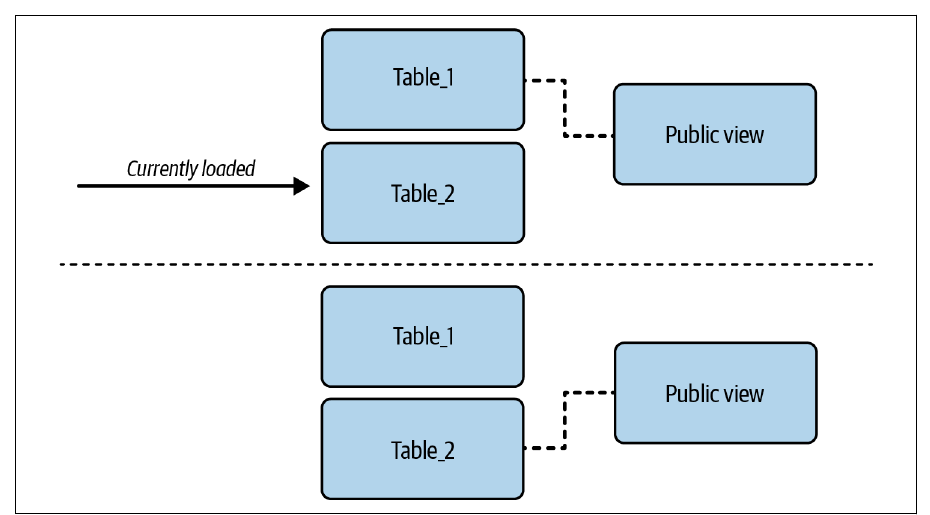
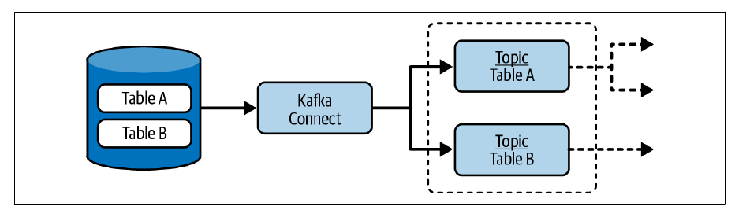
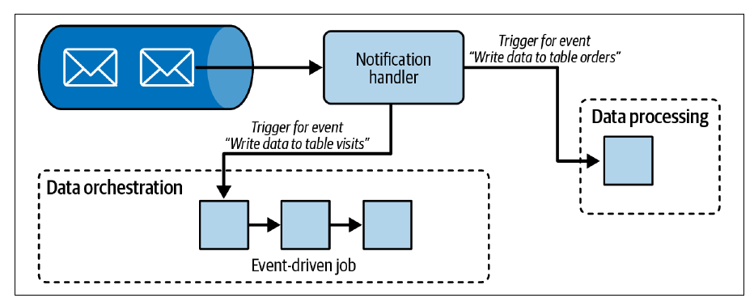
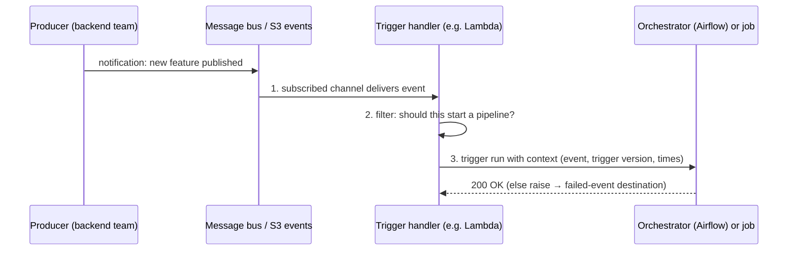

# فصل ۲: الگوهای طراحی ورود داده

[فصل ۱: معرفی الگوهای طراحی مهندسی داده →](01-introducing-data-engineering-design-patterns.md) · [کتاب](../README.md) · [فصل ۳: الگوهای طراحی مدیریت خطا ←](03-error-management-design-patterns.md)

## خلاصه

سیستم‌های داده به‌ندرت خودشان داده تولید می‌کنند؛ آن را از producerهایی می‌گیرند که باید با قیدهایشان کنار بیایند، و اشتباه در همین‌جا روزها بعد به شکل مجموعه‌داده‌ی ناقص یا خراب رو می‌شود. این فصل هشت الگو می‌دهد. الگوهای **Full Loader** و **Incremental Loader** یا کل مجموعه‌داده را می‌آورند یا فقط بخش تازه‌اش را، چه با یک *ستون delta* و چه با *پارتیشن‌های زمانی*؛ و **Change Data Capture** هر تغییری را، از جمله حذف فیزیکی، با تأخیر کم از log مربوط به commit دیتابیس استریم می‌کند. الگوهای **Passthrough Replicator** و **Transformation Replicator** داده را بین محیط‌ها کپی می‌کنند، یا همان‌طور که هست یا با حذف فیلدهای حساس. الگوی **Compactor** مسئله‌ی فایل‌های کوچک را حل می‌کند، **Readiness Marker** به consumerها می‌گوید مجموعه‌داده کِی کامل است، و **External Trigger** جای زمان‌بندی‌های polling را با ورود داده‌ی رویدادمحور می‌گیرد. هر کدام پیامدهای خودشان را دارند: سازگاری هنگام بازنویسی، حجم backfill، پیچیدگی راه‌اندازی، metadata، هزینه، و نبود ضمانت اجرا.

## نکته‌های کلیدی

- **بارگذاری کامل به یک جابه‌جایی سازگار نیاز دارد**: حذف‌و‌درج داده‌ی ناقص را رو می‌کند، پس از تراکنش یا یک view روی جدول‌های نسخه‌دار استفاده کنید، که نسخه‌های قدیمی را هم برای rollback نگه می‌دارد (pp. 8–11).
- **پنجره‌های افزایشی را bounded کنید**، مثل `delta_column BETWEEN t AND t + 1 hour`، تا backfill به بارگذاری کامل تبدیل نشود و backfillها بتوانند هم‌زمان اجرا شوند (p. 14).
- **بارگذاری با ستون delta حذف‌های فیزیکی را نمی‌بیند؛** حذف نرم یا جدول‌های فقط-درج یا **CDC** این را درست می‌کنند؛ CDC خود log مربوط به commit را می‌خواند، حذف‌ها را می‌بیند و تأخیر را به چند ثانیه می‌رساند (pp. 13–18).
- **روش CDC داده‌ی ساکن را به داده‌ی در حرکت تبدیل می‌کند**: JOINی که جور درنمی‌آید شاید فقط یعنی آن یکی stream عقب است (p. 18).
- **ساده replication کنید، از سمت صاحب داده push کنید، و metadata را نگه دارید**، یعنی logهای Delta و header و ترتیب Kafka؛ و PII را با یک مرحله‌ی تبدیل که برچسب‌های حاکمیتی می‌رانندش بردارید (pp. 20–26).
- **فشرده‌سازی هزینه را با performance خواندن معامله می‌کند** و به `VACUUM` جداگانه‌ای نیاز دارد که سفر در زمان را محدود می‌کند (pp. 27–30).
- **نشانگر آمادگی و trigger قرارداد‌ند**: پرچم `_SUCCESS` یا پارتیشن بعدی را نمی‌شود اجباری کرد؛ triggerهای رویدادمحور باید زمینه را حمل کنند و رویدادهای شکست‌خورده را نگه دارند (pp. 30–36).

## فهرست بخش‌ها

*از فهرست مطالب خود کتاب، از bookmarkهای PDF؛ شماره‌ها صفحه‌ی چاپی‌اند.*

- بارگذاری کامل — p. 8
  - الگو: Full Loader — p. 8
- بارگذاری افزایشی — p. 12
  - الگو: Incremental Loader — p. 12
  - الگو: Change Data Capture — p. 16
- replication — p. 20
  - الگو: Passthrough Replicator — p. 20
  - الگو: Transformation Replicator — p. 24
- فشرده‌سازی داده — p. 27
  - الگو: Compactor — p. 27
- آمادگی داده — p. 30
  - الگو: Readiness Marker — p. 30
- رویدادمحور — p. 33
  - الگو: External Trigger — p. 33
- خلاصه — p. 37

## یادداشت‌ها

همه‌ی producerهای داده می‌توانند pipelineهای دیگر تیم خودتان باشند، تیم‌های دیگر، یا سازمان‌های دیگر، که هر کدام قیدهای فنی و کسب‌وکاری خودشان را دارند. اگر ورود داده را خراب کنید، consumerها روزها بعد از مجموعه‌داده‌ی ناقص یا سازمان‌دهی ناکارآمد یا داده‌ی خرابی شکایت می‌کنند که به بازیابی و backfill نیاز دارد (p. 7). این فصل بارگذاری، یعنی کامل و افزایشی، و تکثیر، یعنی همان‌طور که هست یا تبدیل‌شده، و سمت فنی ورود داده را پوشش می‌دهد: کِی شروع کنیم که همان آمادگی است، مسئله‌ی فایل‌های کوچک که فشرده‌سازی است، و رسیدن‌های پیش‌بینی‌ناپذیر که trigger بیرونی است (pp. 7–8).

| الگو | چه مسئله‌ای را حل می‌کند | سازوکار اصلی |
|---|---|---|
| Full Loader | مجموعه‌داده‌ی کوچک و کندتغییر بدون ویژگی «آخرین به‌روزرسانی» | هر اجرا کل مجموعه‌داده را extract و load کنید، یا ETL |
| Incremental Loader | مجموعه‌داده‌ای که پیوسته بزرگ می‌شود | ستون delta یا پارتیشن‌های زمانی |
| Change Data Capture | تأخیر کم، حذف‌های فیزیکی | استریم کردن log مربوط به commit دیتابیس |
| Passthrough Replicator | همان داده در محیطی دیگر | کپی همان‌طور که هست، در کد یا زیرساخت |
| Transformation Replicator | تکثیر، منهای PII | خواندن ← حذف یا تغییر فیلدها ← نوشتن |
| Compactor | فایل‌های کوچک زیاد | merge فایل‌ها؛ پاک کردن قدیمی‌ها |
| Readiness Marker | consumerها داده‌ی ناقص می‌خوانند | فایل پرچم یا قرارداد پارتیشن بعدی |
| External Trigger | رسیدن‌های پیش‌بینی‌ناپذیر | اشتراک ← واکنش ← trigger |

*جدول جمع‌بندی vault از الگوهای این فصل.*

### بارگذاری کامل

هر بار روی کل مجموعه‌داده کار می‌کند؛ برای راه‌اندازی اولیه‌ی یک دیتابیس یا ساختن یک مجموعه‌داده‌ی مرجع به کار می‌آید (p. 8).

#### الگو: Full Loader (pp. 8–11)

**مسئله.** یک job در لایه‌ی Silver به اطلاعات دستگاه از یک تأمین‌کننده‌ی بیرونی نیاز دارد: هفته‌ای چند بار عوض می‌شود، هیچ‌وقت از یک میلیون ردیف بیشتر نمی‌شود، و ویژگی‌ای برای تشخیص ردیف‌های تغییرکرده ندارد (p. 8).

**راه‌حل.** دو مرحله، یعنی **extract و load**، با دستورهای بومی export و import؛ ایده‌آل برای انبارهای هم‌جنس. jobهای EL را **passthrough job** هم می‌نامند. بین انبارهای ناهم‌جنس یک تبدیل نازک اضافه کنید و همان **ETL** می‌شود (pp. 8–9).

**پیامدها** (pp. 9–10):

| ریسک | راه کاهش |
|---|---|
| **حجم داده**: مجموعه‌داده‌ای که یک‌شبه دو برابر شود روی سخت‌افزار ثابت job را کند می‌کند یا می‌شکند | مقیاس‌گیری خودکار در لایه‌ی پردازش |
| **سازگاری برای خواننده‌ها**: حذف‌و‌درج می‌تواند وسط خواندن consumerها داده‌ی ناقص یا خالی نشان بدهد | تراکنش؛ یا یک **انتزاع واحد نمایش داده**، یعنی یک view روی جدول‌های فنیِ پنهان که اتمی جابه‌جا می‌شود (شکل ۲-۱؛ الگوی Proxy در فصل ۴ را ببینید) |
| **راه برگشتی نیست**: بازنویسی کامل نسخه‌ی قبلی را از بین می‌برد | سفر در زمان در Delta Lake و Apache Iceberg و BigQuery، یا جدول‌های نسخه‌دار پشت یک view |

*Figure 2-1 (p. 10): consumerها همیشه فقط view را کوئری می‌زنند، و view وقتی به یک جدول سوییچ می‌کند که کاملاً بارگذاری شده باشد (نمونه‌های ۲-۳ و ۲-۴، صص. ۱۰–۱۱).*

**نمونه‌ها** (pp. 10–11): دستور `aws s3 sync s3://input-bucket s3://output-bucket --delete` که objectهای نبوده در مبدأ را حذف می‌کند؛ Apache Spark که JSON را به شکل جدول Delta Lake می‌نویسد و مقیاس‌گیری به‌علاوه‌ی تراکنش و نسخه‌بندی اضافه می‌کند؛ و Apache Airflow با PostgreSQL، یعنی `COPY devices_${version} …` در یک جدول نسخه‌دار و بعد `CREATE OR REPLACE VIEW devices AS SELECT * FROM devices_${version}`.

> **In practice:** جدول‌های کوچک مرجع، مثل فهرست merchantها یا دسته‌های خرج، با full load ساده‌ترند تا با incremental cursor.
>
> **Your turn:** یک full load هر شب جدول Bronze را `TRUNCATE` و دوباره پر می‌کند و داشبوردی در همان چند دقیقه صفر نشان می‌دهد. در ClickHouse چه می‌کنید؟
>
> *Answer:* در جدولی تازه بنویسید و بعد با `EXCHANGE TABLES` یا یک view به آن سوئیچ کنید، تا خواننده‌ها همیشه نسخه‌ای کامل ببینند؛ همان ایده‌ی کتاب که consumerها فقط view را کوئری می‌زنند (pp. 8–11).

### بارگذاری افزایشی

بارگذاری کامل برای مجموعه‌داده‌های در حال رشد گران می‌شود؛ الگوهای افزایشی بخش‌های کوچک‌تری از مجموعه‌داده‌ای را که فیزیکی یا منطقی تقسیم شده وارد می‌کنند، و اغلب پرتکرارتر (p. 12).

#### الگو: Incremental Loader (pp. 12–16)

**مسئله.** بیشتر رویدادهای بازدید از یک broker استریم می‌رسند، ولی producerهای قدیمی هنوز بعضی‌شان را در یک دیتابیس تراکنشی می‌نویسند؛ فقط بازدیدهای اضافه‌شده از اجرای قبلی را به Bronze بیاورید. بازدیدها تغییرناپذیرند (p. 12).

**راه‌حل**، با دو پیاده‌سازی (شکل ۲-۲) (pp. 12–13):

*Figure 2-2 (p. 13): یا بیشینه‌ی رسیده‌ی یک ستون delta را دنبال کنید، یا پارتیشن‌های کامل‌شده را یک‌جا کپی کنید.*

| | ستون delta | مجموعه‌داده‌ی پارتیشن‌بندی‌شده‌ی زمانی |
|---|---|---|
| داده‌ی تازه چطور پیدا می‌شود | ستونی مثل **زمان ورود داده** | پارتیشن مربوط به تاریخ اجرا؛ اجرایی در ۱۱:۰۰ ساعت قبل را برمی‌دارد |
| چه حالتی باید یادتان بماند | آخرین مقدار واردشده | هیچ؛ از تاریخ اجرا مشتق می‌شود |
| آمادگی | — | منتظر پارتیشن بمانید، مثلاً با یک **Readiness Marker** |

> **Vault note:** کتاب هشدار می‌دهد که به کار بردن **زمان رویداد** به‌عنوان ستون delta پرریسک است: late data برای زمان رویدادی که قبلاً پردازش شده بی‌صدا از قلم می‌افتد (p. 12).

**پیامدها** (pp. 13–14):

- **حذف‌های فیزیکی**: ستون delta به‌روزرسانی‌ها را می‌گیرد ولی حذف‌ها را نه؛ ردیف حذف‌شده صرفاً از ورودی غیب می‌شود. راه‌حلش **حذف نرم** است، یعنی UPDATE به‌جای DELETE، یا **جدول‌های فقط-درج** که بازسازی ردیف‌های تغییرکرده یا حذف‌شده را به دوش consumerها می‌اندازند.
- **عمل backfill کردن**: بعد از دو ماه داده، backfill روی jobی با ستون delta و بدون کران به *بارگذاری کامل* تبدیل می‌شود. **پنجره‌ی ورود داده را محدود کنید**: `delta_column BETWEEN ingestion_time AND ingestion_time + INTERVAL '1 HOUR'` محاسبه‌ی قابل‌پیش‌بینی می‌دهد و اجازه می‌دهد چند backfill هم‌زمان بروند. jobهای مبتنی بر پارتیشن که هر بار یک پارتیشن می‌گیرند این مسئله را ندارند.

**نمونه‌ها** (pp. 14–16): دستور `aws s3 sync s3://input/date=2024-01-01 s3://output/date=2024-01-01 --delete`، که اگر پیشوند سمت راست را بردارید چیدمان تخت می‌شود؛ یک DAG در Airflow با `FileSensor` در حالت `reschedule` و بعد `SparkKubernetesOperator` و `SparkKubernetesSensor`، که مسیرهای ورودی و خروجی job از ماکرو immutable `{{ ds }}` استفاده می‌کنند و backfill را ساده می‌کنند؛ و گونه‌ی ستون delta که sensor را برمی‌دارد و `ingestion_time BETWEEN date_from AND date_to` را فیلتر می‌کند. Airflow برای AWS Glue و BigQuery و Databricks هم sensor پارتیشن دارد.

> **Try it:** [بارگذاری افزایشی و backfillها](../widgets/02-incremental-loader.html)؛ بارگذاری‌های ساعتی را با ستون delta یا با پارتیشن اجرا کنید، بعد ردیف حذف کنید و backfill بزنید و ببینید هر پیاده‌سازی چه چیزی وارد می‌کند.

#### الگو: Change Data Capture (pp. 16–20)

**مسئله.** بازدیدهای قدیمی حالا باید ظرف **۳۰ ثانیه** از هر تغییر به broker استریم برسند و روی یک topic مرکزی در دسترس همه باشند (p. 16).

**راه‌حل.** سربار زمان‌بندی و کوئری، Incremental Loader را کنار می‌گذارد. روش **CDC** پیوسته ردیف‌های تغییرکرده را مستقیم از **log مربوط به commit** دیتابیس می‌خواند، یعنی رکوردی فقط-افزودنی از هر عملیات، و به یک broker استریمشان می‌کند؛ consumerها می‌توانند کل تاریخچه را نگه دارند یا فقط آخرین مقدار هر ردیف را. **حذف‌های فیزیکی** را هم می‌گیرد، پس producerها لازم نیست حذف نرم بکنند (p. 17).

*Figure 2-3 (p. 19): ابزار Debezium داخل Kafka Connect اجرا می‌شود، log مربوط به commit دیتابیس را می‌خواند و تغییرهای هر جدول را در topic خودش منتشر می‌کند (نمونه‌ی ۲-۱۰، صص. ۱۸–۱۹).*

**پیامدها** (pp. 17–18):

| | |
|---|---|
| **پیچیدگی** | برخلاف loaderها شاید به تیم عملیات نیاز داشته باشد، مثلاً برای فعال کردن log مربوط به commit |
| **دامنه‌ی داده** | بعضی کلاینت‌ها فقط تغییرهای بعد از شروع خودشان را می‌بینند؛ برای تاریخچه با الگوی دیگری ترکیبش کنید |
| **محتوای پیام** | metadata اضافه، مثل نوع عملیات و زمان تغییر و نوع ستون‌ها، که consumerها شاید لازم باشد نادیده بگیرند |
| **معنای داده** | داده‌ی ساکن به **داده‌ی در حرکت** تبدیل می‌شود: JOIN بین دو stream که جور درنمی‌آید شاید بعداً جور دربیاید، چون یک stream می‌تواند از آن یکی عقب باشد |

**نمونه‌ها** (pp. 18–20): ابزار **Debezium**، که به شکل Embedded Engine و Debezium Server هم هست، روی Kafka Connect؛ یک config JSON با تنظیم‌های اتصال و `schema.include.list` و `topic.prefix` تغییرهای `dedp_schema.events` را به `dedp.dedp_schema.events` می‌نویسد؛ و PostgreSQL به replication منطقی با افزونه‌ی `pgoutput` و کاربری با دسترسی بالا نیاز دارد. قابلیت **change data feed** در Delta Lake ساده‌تر است: `enableChangeDataFeed` را به‌عنوان ویژگی session یا جدول فعال کنید، با `maxFilesPerTrigger` یا `maxBytesPerTrigger` گلویش را تنگ کنید، و از یک `startingVersion` شروع کنید؛ ردیف‌ها `_change_type` و `_commit_version` و `_commit_timestamp` دارند و به‌روزرسانی‌ها به شکل `update_preimage` و `update_postimage` می‌آیند.

> **In practice:** loader ما با dlt همان Incremental Loader کتاب است، با cursor روی `update_date`؛ ردیفی که در منبع hard delete شود هیچ‌وقت cursor را جلو نمی‌برد و Bronze از حذفش خبردار نمی‌شود.
>
> **Your turn:** تیم منبع A می‌خواهد حذف‌ها هم به Bronze برسند. soft delete در منبع را پیشنهاد می‌کنید یا Change Data Capture را؟
>
> *Answer:* اگر صاحب منبع می‌تواند ستون `deleted_at` بیفزاید، همان cursor فعلی کافی است و ارزان‌تر است. وگرنه CDC، که commit log دیتابیس را می‌خواند، حذف‌ها را هم می‌بیند ولی به دسترسی به log و یک ابزار CDC نیاز دارد (pp. 12–20).

### replication

داده را همان‌طور که هست از جایی به جایی کپی کنید، البته در دنیای ایده‌آل؛ در واقعیت اغلب باید عوضش کنید، مثلاً برای انطباق با مقررات (p. 20). **replication در برابر بارگذاری:** replication داده را بین ذخیره‌سازی‌های *هم‌نوع* جابه‌جا می‌کند و در حالت ایده‌آل metadata مثل کلید اصلی و موقعیت رویداد را نگه می‌دارد؛ بارگذاری چنین قید هم‌جنسی ندارد (p. 20).

#### الگو: Passthrough Replicator (pp. 20–23)

**مسئله.** یک مجموعه‌داده‌ی مرجع دستگاه‌ها هر روز در production از یک API طرف سوم بارگذاری می‌شود که **idempotent نیست**، یعنی همان فراخوانی در طول روز نتیجه‌های متفاوتی می‌دهد. محیط توسعه و staging به *همان داده‌ی* production نیاز دارند، پس اجرای دوباره‌ی pipeline جواب نمی‌دهد (pp. 20–21).

**راه‌حل.** در **سطح محاسبات**، یک job نوع EL که فایل‌ها یا ردیف‌ها را همان‌طور که هستند کپی می‌کند؛ هر تبدیلی ریسک مسئله‌ی کیفیت دارد، مثل تبدیل رشته به تاریخ یا گرد کردن. در **سطح زیرساخت**، یک سیاست replication که در آن تأمین‌کننده‌ی ذخیره‌سازی رکوردها را برایتان کپی می‌کند (p. 21).

**پیامدها** (pp. 21–22):

- **ساده نگهش دارید**: دستور کپی خود دیتابیس را ترجیح بدهید؛ برای JSON به‌جای API مخصوص JSON از API متن خام استفاده کنید؛ و اگر تعداد یا نام فایل‌ها باید حفظ شود از frameworkهای توزیع‌شده پرهیز کنید.
- **امنیت و جداسازی**: از **push** استفاده کنید نه pull؛ یعنی محیطی که صاحب داده است کپی را انجام بدهد و تکرار و توان عبور را کنترل کند. حتی آن‌وقت هم یک replicator می‌تواند مثلاً آخرین نشانی IP زیرشبکه را بگیرد و جلوی jobهای دیگر را بگیرد.
- **مفهوم PII**: به‌جایش از Transformation Replicator استفاده کنید.
- **تأخیر**: replication در سطح زیرساخت تأخیر اضافه می‌کند؛ تعهد خدمت تأمین‌کننده‌ی cloud را وارسی کنید.
- **مفهوم metadata**: کپی کردن فقط فایل‌های Parquet یک جدول Delta کافی نیست؛ برای Kafka هم headerها و ترتیب هر پارتیشن را نگه دارید.

**نمونه‌ها** (pp. 22–23): در Spark از `read.text` به `write.text` برای خط‌های JSON، که تعداد فایل‌ها را حفظ نمی‌کند؛ یک stream از Kafka به Kafka که `key, value, partition, headers, offset` را انتخاب می‌کند و بعد `sortWithinPartitions('offset')` می‌زند و داخل `foreachBatch` با `includeHeaders` می‌نویسد؛ و گزینه‌های زیرساختی مثل **MirrorMaker** برای Kafka و یک منبع Terraform از نوع `aws_s3_bucket_replication_configuration` از یک bucket در production به یکی در staging.

#### الگو: Transformation Replicator (pp. 24–26)

**مسئله.** نسخه‌ی تازه‌ی یک job را با داده‌ی واقعی production بسنجید، چون مسئله‌های کیفیت تأمین‌کننده را نمی‌شود شبیه‌سازی کرد، ولی مجموعه‌داده PII دارد که اجازه ندارد از production بیرون برود (p. 24).

**راه‌حل.** خواندن، بعد **تبدیل**، بعد نوشتن، که تبدیل یک تابع mapping سفارشی در Spark یا Flink است یا یک `SELECT` در SQL، و ویژگی‌های حساس را جایگزین می‌کند، مثلاً با الگوی **Anonymizer** در فصل ۷، یا برشان می‌دارد (p. 24).

**پیامدها** (p. 25): منطق سفارشی خطر خراب کردن داده را بالا می‌برد؛ مثلاً قالبی از datetime که framework نمی‌تواند تجزیه‌اش کند بی‌صدا ستون‌های زمان را می‌اندازد؛ ساده نگهش دارید و چنین ستون‌هایی را به شکل رشته بخوانید. **asynchronousی**: فیلدهای PII تازه می‌توانند ظاهر شوند یا دوباره دسته‌بندی شوند؛ فیلدهای حساس را در یک **کاتالوگ داده** یا **قرارداد داده** برچسب بزنید و تبدیل را از روی همان‌ها بسازید.

**نمونه‌ها** (pp. 25–26):

| تکنیک | نمونه |
|---|---|
| حذف ستون در SQL | `SELECT * EXCEPT (ip, latitude, longitude)` در Databricks و BigQuery |
| حذف ستون در کد | در PySpark با `.drop('ip', 'latitude', 'longitude')` |
| دسترسی در سطح ستون | `GRANT SELECT (visit_id, event_time, user_id) ON TABLE visits TO user_a` در Redshift؛ الگوی Fine-Grained Accessor را ببینید |
| تبدیل ستون | `SUBSTRING(full_name, 2, LENGTH(full_name))` |
| mapping در سطح ردیف | در Scala با `Dataset.as[Device].map(...)` که `full_name` و `version` را برای نسخه‌هایی که با `1.` شروع می‌شوند بازنویسی می‌کند |

### فشرده‌سازی داده

همراه با بزرگ شدن مجموعه‌داده، عملیات metadata مثل فهرست کردن فایل‌ها می‌تواند بیشتر از خود تبدیل‌ها طول بکشد (p. 27).

#### الگو: Compactor (pp. 27–30)

**مسئله.** یک job بلادرنگِ passthrough رویدادهای broker را با ذخیره‌سازی object synchronous می‌کند تا داده ظرف ۱۰ دقیقه برای jobهای batch در دسترس باشد. بعد از سه ماه، jobهای batch **۷۰٪** وقتشان را صرف فهرست کردن فایل‌ها می‌کنند و فقط **۳۰٪** را صرف پردازش، که روی سرویس‌های پرداخت‌به‌اندازه‌ی‌مصرف گران تمام می‌شود (p. 27).

**راه‌حل.** فایل‌های کوچک زیاد را در فایل‌های بزرگ‌تر و کمتر ترکیب کنید (p. 27):

| انبار | فشرده‌سازی |
|---|---|
| Delta Lake | دستور `OPTIMIZE`، یعنی یک job تراکنشی که فایل‌های merge‌شده را به‌عنوان یک commit تازه می‌نویسد |
| Apache Iceberg | اقدام بازنویسی فایل‌های داده |
| Apache Hudi در حالت merge-on-read | فایل‌های تغییرِ ردیفی را در فایل‌های پایه‌ی ستونی merge می‌کند (pp. 27–28) |
| Apache Kafka | فشرده‌سازی log فقط آخرین رکورد هر کلید را نگه می‌دارد و داده را *بازنویسی* می‌کند (p. 28) |
| PostgreSQL | دستور `VACUUM` فضای tupleهای مرده را پس می‌گیرد (p. 29) |

**پیامدها** (pp. 28–29):

- **هزینه در برابر performance**: فشرده‌سازی jobی سنگین از نظر محاسباتی است؛ اجرای کم‌تکرار، مثلاً روزانه در ساعت‌های خلوت و بیرون از pipeline ورود داده، ارزان‌تر است ولی consumerها داده‌ی فشرده‌نشده می‌خوانند؛ گاهی فشرده‌سازی داخل خود ورود داده به قیمت کندتر شدنش می‌ارزد.
- **سازگاری**: بازنویسی داده در جای خودش با قالب‌های جدولی ACID مثل Delta Lake و Iceberg امن است و با JSON یا CSV خام سخت.
- **پاک‌سازی**: فایل‌های مبدأ ممکن است بمانند؛ `VACUUM` پسشان می‌گیرد، ولی بعدش دیگر نمی‌توانید نسخه‌هایی را که روی فایل‌های حذف‌شده ساخته شده‌اند بازیابی کنید.

**نمونه‌ها** (pp. 29–30): دستور `DeltaTable.forPath(...).optimize().executeCompaction()` فقط فایل‌هایی را که هنگام شروعش بوده‌اند سازمان می‌دهد، پس با خواننده‌ها و نویسنده‌ها تداخل نمی‌کند؛ و `vacuum()` فقط فایل‌های قدیمی‌تر از آستانه‌ی نگه‌داری را برمی‌دارد، پس هیچ‌وقت فایل‌های commit‌نشده‌ی در حال نوشته شدن را حذف نمی‌کند. فشرده‌سازی Kafka با `log.cleanup.policy` و کمینه و بیشینه‌ی تأخیر فشرده‌سازی تنظیم می‌شود و **قطعی نیست**؛ نمی‌توانید روی دیدن یک رکورد به ازای هر کلید حساب کنید.

> **Try it:** [فایل‌های کوچک و فشرده‌سازی](../widgets/02-compactor.html)؛ دسته‌های کوچک را در یک جدول استریم کنید، رشد سربار فهرست کردن را ببینید و زمان‌بندی‌های فشرده‌سازی و vacuum را مقایسه کنید.

> **In practice:** در ClickHouse کار Compactor را merge پس‌زمینه‌ی MergeTree انجام می‌دهد: هر insert یک part تازه می‌سازد و موتور partهای کوچک را به هم merge می‌کند.
>
> **Your turn:** loader برای هر جدول insertهای تک‌ردیفی زیادی می‌فرستد و Grafana هشدار «too many parts» می‌دهد. چه می‌کنید؟
>
> *Answer:* insertها را درشت‌تر کنید: هر بار یک batch کامل از فایل Parquet staging، یا async insert در ClickHouse. استدلال کتاب همین است: فایل‌های کوچک زیاد هزینه‌ی metadata و خواندن را بالا می‌برند و باید compact شوند (pp. 27–30).

### آمادگی داده

«کِی باید process ورود داده را شروع کنم؟» (p. 30).

#### الگو: Readiness Marker (pp. 30–33)

**مسئله.** یک job batch ساعتی یک مجموعه‌داده‌ی غنی‌شده‌ی Silver آماده می‌کند که تیم‌های دیگر برای مدل‌های ML و داشبوردهای BI به کارش می‌برند؛ آن‌ها از داده‌ی ناقص شکایت دارند و یک سیگنال می‌خواهند (p. 30).

**راه‌حل.** pipelineهایی که صاحب‌های متفاوتی دارند نمی‌توانند هم را trigger کنند، پس producer آماده بودن مجموعه‌داده را علامت می‌زند (pp. 30–31):

- **فایل پرچم** که بعد از تولید موفق نوشته می‌شود، به‌طور بومی همان `_SUCCESS` در Spark برای قالب‌های خام، یا یک commit تازه در Delta Lake؛ وگرنه یک task پایانی در هماهنگ‌سازی.
- **قرارداد برای پارتیشن‌ها**: با پارتیشن‌های ساعتی، پارتیشن ۱۰ وقتی کامل است که job شروع کند به نوشتن در پارتیشن ۱۱.

**پیامدها** (p. 31): مبتنی بر **pull** و ضمنی است، پس **ضمانت اجرا ندارد**؛ قراردادها را با consumerها توافق کنید و ریسک‌ها را توضیح بدهید. **late data** قرارداد پارتیشن را می‌شکند: late eventها برای ساعت ۹:۰۰ که به پارتیشن بسته‌شده اضافه می‌شوند، به چشم consumerهایی که پردازشش کرده‌اند نمی‌آیند؛ پارتیشن‌های بسته را immutable بدانید یا قاعده‌های mutability را اعلام کنید؛ بخش late data در فصل ۳ را ببینید.

**نمونه‌ها** (pp. 31–33): Spark اول داده را می‌نویسد و `_SUCCESS` را آخر از همه؛ یک `FileSensor` در Airflow روی `…/_SUCCESS` با `mode='reschedule'` بین وارسی‌ها جایگاه worker را آزاد می‌کند؛ و یک pipeline در Airflow به شکل `delete_dataset() >> generate_dataset() >> create_readiness_file()` یک نشانگر `COMPLETED` می‌نویسد، که **همیشه آخرین مرحله است**.

> **In practice:** منبع B را partner یک بار در شب پر می‌کند؛ DAGی که ساعت ثابتی اجرا شود ممکن است batch نیمه‌کاره را بخواند.
>
> **Your turn:** چه چیزی می‌گذارید تا DAG آن جدول فقط بعد از کامل شدن batch partner اجرا شود؟
>
> *Answer:* یک readiness marker، مثلاً جدولی کوچک که partner آخرین batch کامل را در آن ثبت می‌کند، و یک sensor در Airflow که منتظرش می‌ماند. consumer به‌جای ساعت به نشانه‌ی کامل بودن تکیه می‌کند (pp. 30–33).

### رویدادمحور

وقتی تکرار رسیدن داده پیش‌بینی‌پذیر نیست، از ورود داده‌ی ایستا به رویدادمحور بروید (p. 33).

#### الگو: External Trigger (pp. 33–36)

**مسئله.** تیم backend حداکثر هفته‌ای یک‌بار و بین دوشنبه تا پنجشنبه feature منتشر می‌کند؛ تازه‌سازی روزانه‌ی مجموعه‌داده‌ی مرجع featureها بیشتر وقت‌ها همان داده‌ی دست‌نخورده را دوباره بار می‌کند. آن تیم سر هر انتشار یک اعلان روی یک message bus مرکزی منتشر می‌کند (p. 33).

**راه‌حل.** به‌جای زمان‌بندی‌های polling، سه اقدام (شکل ۲-۴) (p. 34):

*Figure 2-4 (p. 34): این handler هر رویداد را به jobی map می‌کند که باید شروع شود، به‌جای این‌که jobها روی زمان‌بندی polling کنند.*

*دنباله‌ی vault برای شکل ۲-۴ و نمونه‌های ۲-۲۷ و ۲-۲۸ (pp. 34–36).*

اگر jobی برای trigger کردن نباشد، خود handler می‌تواند مستقیم داده را وارد کند، یعنی ورود داده‌ی رویدادمحور (p. 33).

**پیامدها** (pp. 34–35):

- **الگوی push در برابر pull**: triggerی مبتنی بر pull یک job طولانی‌عمر است که بیشتر وقت‌ها صفر پیام می‌گیرد؛ push را ترجیح بدهید، که در آن هر اعلان یک consumer کوتاه‌عمر را شروع می‌کند.
- **زمینه‌ی اجرا**: فقط coordinator را «تلنگر» نزنید؛ نسخه‌ی trigger و پاکت اعلان و زمان پردازش و زمان رویداد را برای عیب‌یابی بفرستید.
- **مدیریت خطا**: هیچ رویدادی را از دست ندهید؛ trigger را برای شکست طراحی کنید، مثلاً با Dead-Letter در فصل ۳.

**نمونه‌ها** (pp. 35–36): یک DAG در Airflow با `schedule_interval=None`، یعنی فقط trigger صریح، و `max_active_runs=5`؛ و یک handler در AWS Lambda که به `/api/v1/dags/devices-loader/dagRuns` درخواست می‌فرستد، با رویداد و metadata مربوط به trigger و فایلی که باید بار شود و `dag_run_id`، و اگر پاسخ ۲۰۰ نبود خطا می‌دهد. قابلیت **failed-event destination** در Lambda تاب‌آوری می‌دهد. اطلاعات اتصال سفت‌شده در کد فقط برای خوانایی‌اند؛ الگوهای فصل ۷ را ببینید.

### خلاصه

حتی جابه‌جا کردن داده از A به B هم دام دارد: بدون Readiness Marker داده‌ی ناقص وارد می‌کنید و بدون Compactor یک lakehouse روی فراخوانی‌های API به خزیدن می‌افتد. این الگوها به مرحله‌ی extract در jobهای ETL و ELT کسب‌وکاری هم می‌آیند (p. 37).

## بده‌بستان‌ها در یک نگاه

| | Full Loader | Incremental Loader | Change Data Capture |
|---|---|---|---|
| داده‌ی جابه‌جاشده در هر اجرا | همه چیز | ردیف‌ها یا پارتیشن‌های تازه | هر تغییری، پیوسته |
| تأخیر | زمان‌بندی | زمان‌بندی، به‌علاوه‌ی سربار کوئری | چند ثانیه |
| حذف فیزیکی | پوشش داده می‌شود، چون بازنویسی کامل است | با ستون delta از دست می‌رود | گرفته می‌شود |
| چه کسی می‌تواند راهش بیندازد | یک مهندس داده | یک مهندس داده | اغلب به عملیات نیاز دارد، برای log مربوط به commit |
| ریسک اصلی | سازگاری هنگام بازنویسی، رشد حجم | حجم backfill، late data | پیچیدگی، معنای streaming |

| | Readiness Marker | External Trigger |
|---|---|---|
| معنا | pull: consumer وارسی می‌کند | push: producer خبر می‌دهد |
| بهترین کاربرد | زمان‌بندی‌های منظم | رسیدن‌های پیش‌بینی‌ناپذیر |
| ریسک | ضمانت اجرا ندارد؛ late data | از دست رفتن رویداد؛ نبود زمینه |

## فراتر از کتاب

- فشرده‌سازی log در Kafka آخرین مقدار هر کلید را نگه می‌دارد، و همین باعث می‌شود یک topic فشرده‌شده به‌عنوان changelog یک جدول قابل‌استفاده باشد؛ همان ایده‌ای که DDIA دوگانگی stream و جدول می‌نامدش.
- [آزمایش پنجره‌ی افزایشی](../lab/02-incremental-window/README.md) در vault اندازه می‌گیرد یک backfill با و بدون پنجره‌ی bounded ص. ۱۴ چقدر می‌خواند.

## پیوندها

- **Run it:** [backfill افزایشی با کران و بدون کران](../lab/02-incremental-window/README.md)؛ تعداد ردیف‌های خوانده‌شده در هر اجرا هنگام اجرای دوباره‌ی اجراهای گذشته.
- **فصل‌های مرتبط:** [فصل ۳: مدیریت خطا](03-error-management-design-patterns.md) که late data و dead-letter کردن triggerهای شکست‌خورده را می‌گوید، [فصل ۴: ویژگی idempotency](04-idempotency-design-patterns.md) که الگوی Proxy پشت جابه‌جایی view را دارد، [فصل ۷: امنیت داده](07-data-security-design-patterns.md) که Anonymizer و Fine-Grained Accessor و راز‌ها را می‌گوید، و [فصل ۸: ذخیره‌سازی داده](08-data-storage-design-patterns.md) که پارتیشن‌بندی را دارد.

## خودتان را بسنجید

*پرسش‌ها و پاسخ‌ها مال vault است و از روی یادداشت‌های بالا نوشته شده؛ پاسخ‌ها به صفحه‌های کتاب ارجاع می‌دهند.*

1. **چرا بارگذاری کامل به شیوه‌ی حذف‌و‌درج برای consumerها خطرناک است و دو راه کاهشش چیست؟**

   *Answer:* تا وقتی اجرا می‌شود، خواننده‌ها می‌توانند داده‌ی ناقص یا هیچ داده‌ای نبینند. از تراکنش استفاده کنید، یا از یک انتزاع واحد نمایش داده، یعنی viewی که اتمی به یک جدول نسخه‌دارِ کاملاً بارگذاری‌شده سوییچ می‌کند و نسخه‌ی قبلی را هم نگه می‌دارد (pp. 9–11).

2. **از یک loader افزایشی با ستون delta خواسته می‌شود دو ماه را backfill کند. بدون پنجره‌ی bounded چه می‌شود؟**
   - [ ] هیچ چیز وارد نمی‌کند، چون ستون delta قبلاً پردازش شده
   - [x] عملاً به بارگذاری کامل تبدیل می‌شود و به منابع خیلی بیشتری نیاز دارد
   - [ ] فقط آخرین ساعت را وارد می‌کند
   - [ ] شکست می‌خورد، چون ستون delta قابل‌اجرای دوباره نیست

   *Answer:* بدون کران بالا، هر اجرای دوباره همه چیز بعد از زمان شروعش را می‌خواند. محدود کردن هر اجرا به بازه‌ی یک‌ساعته حجم را قابل‌پیش‌بینی می‌کند و اجازه‌ی backfill هم‌زمان می‌دهد (p. 14).

3. **کدام الگو حذف‌های فیزیکی را می‌گیرد بی‌آن‌که از producerها چیزی بخواهد؟**
   - [ ] سیستم Incremental Loader با ستون delta
   - [x] Change Data Capture
   - [ ] Readiness Marker
   - [ ] Passthrough Replicator

   *Answer:* روش CDC همان log مربوط به commit را می‌خواند که حذف‌ها را هم ثبت می‌کند؛ ستون delta نمی‌تواند ردیفی را ببیند که دیگر وجود ندارد (pp. 13, 17).

4. **چرا Passthrough Replicator باید به‌جای pull از push استفاده کند؟**

   *Answer:* تا محیطی که صاحب مجموعه‌داده است، یعنی production، تکرار و توان عبور replication را کنترل کند و ریسک بی‌ثبات شدن production با یک job باگ‌دار کم شود (pp. 21–22).

5. **فشرده‌سازی اجرا شد ولی فهرست کردن هنوز کند است. چه چیزی کم است و هزینه‌اش چیست؟**

   *Answer:* یک مرحله‌ی پاک‌سازی، مثل `VACUUM`، برای برداشتن فایل‌های کوچکِ از‌قبل‌فشرده‌شده؛ و بعد از برداشتنشان دیگر نمی‌توانید نسخه‌های جدولی را که رویشان ساخته شده‌اند بازیابی کنید (pp. 28–29).

6. **چرا consumer نمی‌تواند به قرارداد «پارتیشن بعدی وجود دارد» تکیه کند وقتی پارتیشن‌ها بر پایه‌ی زمان رویدادند؟**

   *Answer:* late eventها می‌توانند بعد از این‌که consumerها پارتیشنی را بسته فرض کرده‌اند به آن اضافه شوند؛ پارتیشن‌ها باید بعد از بسته شدن immutable باشند، یا قاعده‌های mutability باید اعلام شوند (p. 31).
