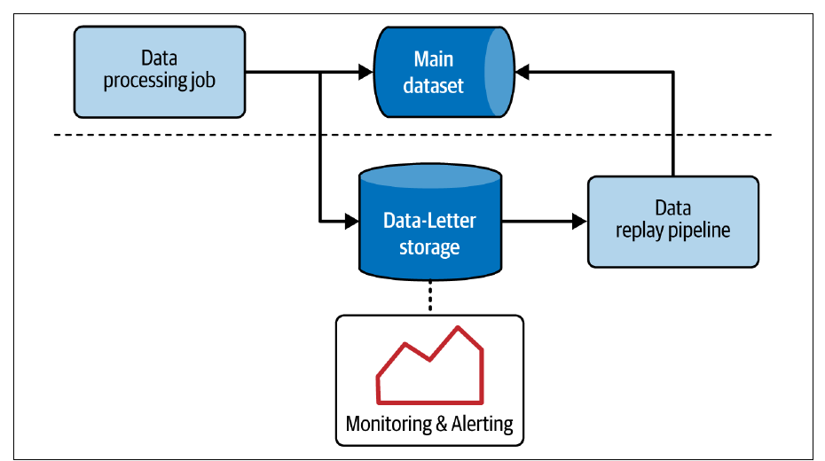
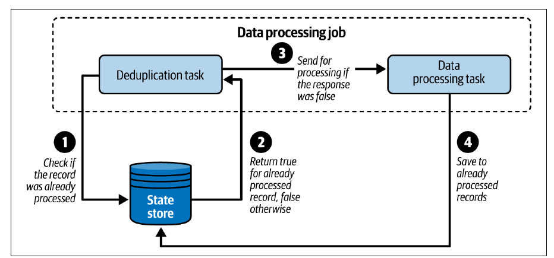
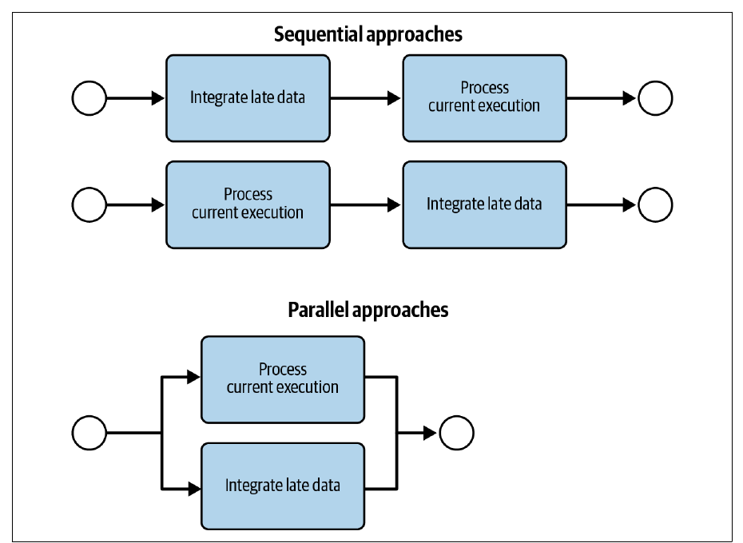
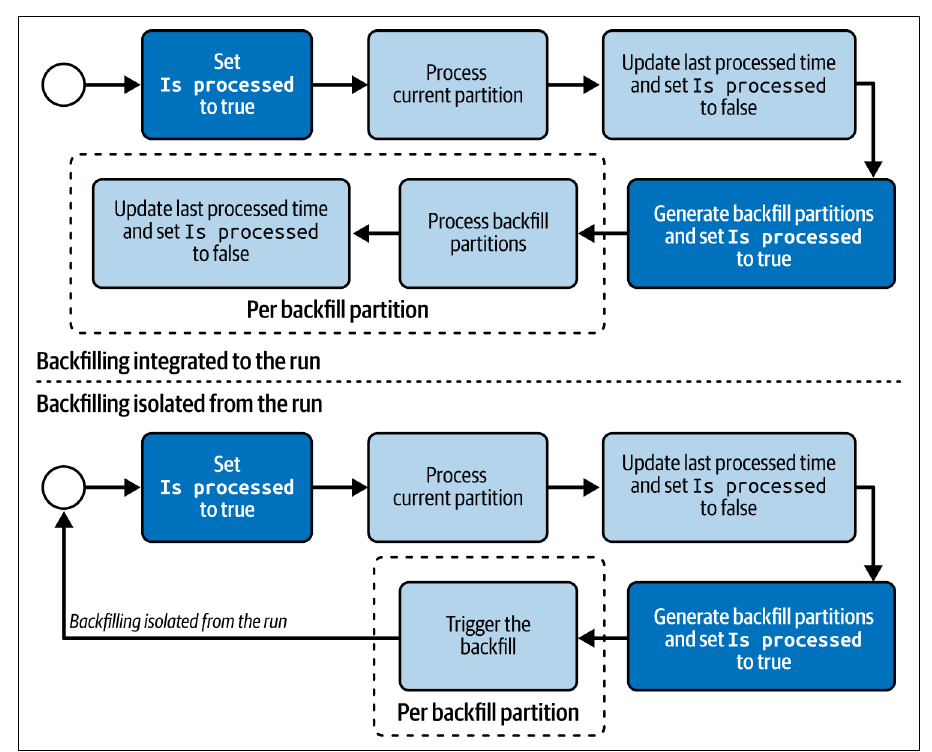
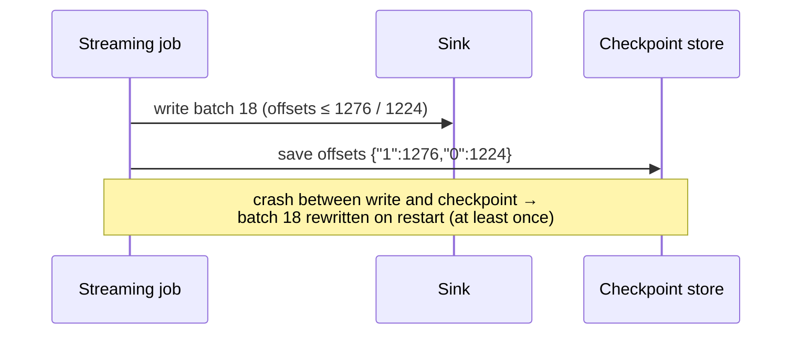

# 3. Error Management Design Patterns

[← 2. Data Ingestion Design Patterns](02-data-ingestion-design-patterns.md) · [Book](../README.md) · [4. Idempotency Design Patterns →](04-idempotency-design-patterns.md)

## Summary

“Nothing is certain except errors and data quality issues” — you inherit your producers' network problems, retries and crashes. The chapter gives seven patterns. The **Dead-Letter** pattern keeps a job running by diverting unprocessable records to separate storage (with monitoring and an optional replay). The **Windowed Deduplicator** removes duplicates within a bounded scope — the whole batch, or a time window held in a state store. Three patterns handle **late data**: the **Late Data Detector** computes a monotonic **watermark** (max event time minus allowed lateness), the **Static Late Data Integrator** reprocesses a fixed lookback window, and the **Dynamic Late Data Integrator** reprocesses only partitions that actually received late data, tracked in a state table. The **Filter Interceptor** counts how many rows each filter condition removes, and the **Checkpointer** persists stream positions and state so a restarted job doesn't start over. Each pattern trades correctness for complexity, latency or backfill cost, and none on its own gives exactly-once delivery.

## Key takeaways

- **Dead-lettering hides errors**: it can trigger a snowball of downstream backfills on replay, break ordering and sessions, and must be paired with alerting that stops the job when too many records fail (pp. 42–44).
- **Deduplication is bounded**: batch jobs dedupe within the processed dataset; streaming jobs within a time window whose length trades missed duplicates against state size (pp. 46–49).
- **Watermark = MAX(event time) − allowed lateness**, and it must never move backward; MIN per partition causes open-close-open loops and stuck-in-the-past jobs (pp. 51–55).
- **Global progress across partitions** can follow the slowest source (MIN: fewer late records, bigger buffers) or the fastest (MAX: smaller buffers, more dropped records under skew) (pp. 52, 55).
- **Static lookback windows overlap**: don't backfill each run of a 4-day-lookback job — rerunning the last one is enough (p. 61).
- **Dynamic lookback needs a state table** of last-processed vs last-updated time per partition, plus an “is processed” flag and sequential tasks to avoid duplicate backfills under concurrency (pp. 64–70).
- **Checkpointing gives an “exactly-once feeling” only**: checkpoint after writing = at least once; before = at most once; exactly-once delivery needs Chapter 4's idempotency patterns (pp. 75–76).

## Section outline

*From the book’s own table of contents (PDF bookmarks); printed page numbers.*

- Unprocessable Records — p. 40
  - Pattern: Dead-Letter — p. 40
- Duplicated Records — p. 46
  - Pattern: Windowed Deduplicator — p. 46
- Late Data — p. 51
  - Pattern: Late Data Detector — p. 51
  - Pattern: Static Late Data Integrator — p. 58
  - Pattern: Dynamic Late Data Integrator — p. 64
- Filtering — p. 70
  - Pattern: Filter Interceptor — p. 70
- Fault Tolerance — p. 74
  - Pattern: Checkpointer — p. 74
- Summary — p. 77

## Notes

The chapter opens with Benjamin Franklin's 1789 “death and taxes” line, rewritten for data engineers as errors and data quality issues. Data is dynamic, today's expectations won't hold for its whole lifecycle, and you inherit producers' problems — unreliable networks cause late delivery, crashes cause retried deliveries and duplicates. The patterns cover poor upstream data (unprocessable, duplicate, late records) and infrastructure failures (streaming job crashes) (p. 39).

### Unprocessable records

Data quality problems often cause fatal failures that stop the job; fail-fast isn't always possible, especially for long-running streaming jobs (p. 40).

#### Pattern: Dead-Letter (pp. 40–46)

**Problem.** A streaming job writing Kafka visit events to an object store keeps failing on unprocessable records; for three days you have relaunched it by hand and edited checkpointed offsets. You want it to keep running and let you investigate failures later (p. 40).

| Error type | Behaviour | Example |
|---|---|---|
| **Transient** | Temporary; recovers by itself | Short database outage, fixed by connection retries |
| **Nontransient** | Never recovers; needs manual intervention | Unprocessable records — **poison pill messages** |

*From the sidebar on p. 40.*

**Solution** (pp. 41–42): find the places your code can fail; guard them — **try-catch** in a mapping function, an **if-else** check after an error-safe transformation; attach the failure as metadata (see **Metadata Decorator**, Ch. 5); route failures to a dead-letter destination chosen for **resiliency** (no dead-letter for your dead-letter), **monitoring ease** (when errors start and how many) and **write performance**. Object stores and streaming brokers are good candidates. An optional **replay pipeline** brings fixed records back (Figure 3-1). Streaming writes failures one record at a time; batch writes the failing subset at once.



*Figure 3-1 (p. 42): bad records are parked, alerted on, and replayed once fixed, while the main flow continues.*

**Consequences** (pp. 42–44):

| Consequence | What happens | Mitigation |
|---|---|---|
| **Snowball backfilling** | Replayed records land in partitions consumers already processed, forcing their consumers to backfill too (Figure 3-2) | Don't replay (lose data), or backfill and accept inconsistency for consumers who can't |
| **Identifying replayed records** | Consumers may want to filter or trace them | A `was_dead_lettered` flag, or job name/version/replay time (data decoration) |
| **Ordering and consistency** | IoT sensors emit every minute; five minutes of dead-lettered events close a session early. Records 10:00, 10:01, 10:02 replayed out of order become 10:00, 10:02, 10:01 | — |
| **Error-safe functions** | Functions that return NULL instead of throwing hide errors: compare input (present) with output (NULL) | Understand each function's safety semantics |
| **Error or failure?** | Hiding errors can hide a fatal failure | Alerting that stops the job after too many dropped events |

**Examples** (pp. 44–46): **Apache Flink side outputs** — an `OutputTag('invalid_visits')`, a mapping function that yields valid JSON or `(invalid_data_output, wrapped error)` in `except`, and two Kafka sinks. **Spark SQL + Delta Lake** with error-safe `CONCAT` (returns NULL if any input is NULL): a query computes `is_valid` (input present but result NULL → false), `.persist()` avoids running it twice, and two filtered writes go to `devices-table` and `devices-dead-letter-table`. Doing this in declarative SQL is verbose and hard to maintain (p. 46).

### Duplicated records

Exactly-once delivery is rare in distributed systems; at-least-once is common. What if your logic must process each occurrence only once? (p. 46).

#### Pattern: Windowed Deduplicator (pp. 46–50)

**Problem.** A batch job exposes visit events, synced from streaming to an object store, directly to business users and must process each distinct record exactly once — but producers' automatic retries create duplicates (p. 47).

**Solution** (pp. 47–48): pick the **deduplication attributes** that make a record unique, then the **scope**: for batch, the current dataset (an implicit global window — extending it to past datasets costs more compute); for streaming, a **time-based window** in which seen keys are kept in a **state store** (Figure 3-3). Batch uses `DISTINCT` or a `WINDOW` function with `row_number()`.



*Figure 3-3 (p. 48): the state store remembers what was seen within the window; anything already there is dropped.*

| State store (p. 48) | Where state lives | Trade-off |
|---|---|---|
| Local | Memory only | Fastest; state lost on failure |
| Local with fault tolerance | Memory + persisted remotely | Persist every iteration = consistent but slower; less often = faster but less consistent |
| Remote | Remote data store | Fault tolerant; higher latency and/or cost |

> **Vault note:** the book's sidebar warns that exactly-once *processing* only holds without runtime errors: an automatically restarted job may reprocess records despite deduplication — usually an accepted trade-off (p. 46).

**Consequences** (p. 49): **space vs time** — a short window misses duplicates but uses few resources; a long one keeps more keys in state. **Idempotent producer** — deduplicating doesn't give exactly-once *delivery*; retries can still write twice (see Chapter 4).

**Examples** (pp. 49–50): Spark `dropDuplicates(['type', 'full_name', 'version'])` (all columns if no list); SQL `ROW_NUMBER() OVER (PARTITION BY type, full_name, version ORDER BY 1) AS position … WHERE position = 1`; streaming `withWatermark("visit_time", "10 minutes").dropDuplicates(["visit_id", "visit_time"])`, where the watermark both rejects late records and expires remembered keys so state doesn't grow forever.

> **Run it:** the vault's [deduplication window experiment](../lab/03-dedup-window/README.md) measures missed duplicates and state size as the window grows.

### Late data

Late data sounds innocent but seriously affects pipelines (p. 51).

#### Pattern: Late Data Detector (pp. 51–57)

**Problem.** Visit events normally arrive within **15 seconds**, but users who lose connectivity buffer visits locally and flush them later; jobs must detect such events and apply a strategy, e.g. ignoring them (p. 51).

**Solution** (pp. 51–54):

1. Choose an **event time** attribute (when the event happened). *Processing time* — when the pipeline handled it — is never late.
2. Track progress **per partition** with a **monotonically increasing** aggregate — **MAX** event time. MIN would leave the job stuck in the past.
3. Combine partitions into a **global** event time (Figure 3-4):

   | Global strategy | Follows | Effect |
   |---|---|---|
   | MIN | Slowest upstream | More data counted on time; bigger buffers |
   | MAX | Fastest upstream | Smaller buffers; may skip records from slow sources |
   | MIN and MAX at different levels | Several partitioned sources | e.g. MIN per source and MAX across sources, or the opposite |

4. Subtract an **allowed lateness**: **watermark = MAX(event time) − allowed lateness**, the minimum event time still considered on time. A new candidate lower than the current watermark is ignored — the watermark never moves back.

*Table 3-1: watermark of 30 minutes* (p. 54)

| Event times | Input watermark | Watermark candidate | Output watermark | Ignored records |
|---|---|---|---|---|
| 10:00, 10:05, 10:06 | – | MAX(10:00, 10:05, 10:06) − 30′ = 9:36 | 9:36 | – |
| 9:20, 9:31, 10:07 | 9:36 | MAX(10:07) − 30′ = 9:37 | MAX(9:36, 9:37) = 9:37 | 9:20, 9:31 |

Late records can be ignored or integrated with the integrator patterns that follow (p. 54).

> **Try it:** [Watermarks and late data](../widgets/03-watermark.html) — replay the book's Table 3-1 and Table 3-2 streams, change the allowed lateness and window size, and see which events are dropped and when windows are emitted.

**Consequences** (pp. 54–55):

- **Late data capture**: Spark Structured Streaming detects and ignores late events but has no easy API to capture them; Apache Flink can do both.
- **MIN per partition in stateful jobs**: a stateful job (e.g. counting visits per user) emits its state when the watermark passes. If the watermark could fall from 10:30 back to 9:00, emitted states reopen — an **open-close-open infinite loop** — and repeated late data could keep it **stuck in the past**, with state growing forever.
- **MAX and event skew**: if four of five sources are 40 minutes behind the healthy one, their records count as late and are dropped. No silver bullet — monitor late events and reintegrate them.

**Examples** (pp. 55–57): Spark `withWatermark('event_time', '1 hour')` with 10-minute windows (Table 3-2, below); Flink `WatermarkStrategy.for_bounded_out_of_orderness(Duration.of_seconds(5))` with a `TimestampAssigner` and a `ProcessFunction` that compares each event to `ctx.timer_service().current_watermark()` and sends late ones to a side output.

*Table 3-2 (p. 56): 1-hour allowed lateness, 10-minute windows, events of 2023-06-30*

| Event time | Watermark (before → after) | Buffered windows | Emitted windows |
|---|---|---|---|
| 03:15 | 1970-01-01T00:00 → 02:15 | [03:10–03:20] | – |
| 03:00 | 02:15 → 02:15 | [03:00–03:10, 03:10–03:20] | – |
| 01:50 | 02:15 → 02:15 (ignored: before watermark) | same | – |
| 03:11 | 02:15 → 02:15 | same | – |
| 04:31 | 02:15 → 03:31 | [04:30–04:40] | [03:00–03:10, 03:10–03:20] |

Spark actually rounds the watermark up to the window's upper bound; the table is simplified (p. 56).

#### Pattern: Static Late Data Integrator (pp. 58–63)

**Problem.** A daily job computes referrer statistics, considered approximate for **15 days** (the maximum late-data delay; older records are skipped). It only processes the current day; you want late data included without running 15 separate jobs a day (p. 58).

**Solution** (pp. 58–60): a fixed **static lookback window** — e.g. a run for 2024-12-31 with a 14-day window also reprocesses 2024-12-17 to 2024-12-30; late data for 2024-12-15 is ignored. Place the late-data step in the pipeline (Figure 3-6): **before** the current run (required for **stateful** pipelines that need valid history), **in parallel**, or **after** it (stateless pipelines that want current data first).

> **Vault note:** the book points out that partitioning by **processing time** avoids late data for *you* but moves the problem: if your 9:00 partition holds 80% 9:00 data, 10% 8:00 and 10% 7:00, an event-time consumer now has late data (Figure 3-5, pp. 58–59).

**Consequences** (pp. 61–62):

- **Snowball backfilling** downstream — all you can do is notify direct consumers.
- **Overlapping executions**: with a 4-day lookback, rerunning the 2024-10-10, 10-11 and 10-12 runs reprocesses the same dates repeatedly (Table 3-3); rerunning only 2024-10-12 suffices.
- **Pipeline trigger**: late-data backfills must be part of the main pipeline, not separate pipelines (Figure 3-7).
- **Waste**: windows may have no late data — add a control task or use the dynamic version.
- **Time requirement**: without time partitions you can't detect late data.



*Figure 3-6 (p. 60): late-data integration can run before, after, or alongside the current run — but always inside the main pipeline.*

*Table 3-3 (p. 61): overlapped backfilling with a 4-day lookback*

| Execution date | Executed dates |
|---|---|
| 2024-10-10 | 10-09, 10-08, 10-07, 10-06 |
| 2024-10-11 | 10-10, 10-09, 10-08, 10-07 |
| 2024-10-12 | 10-11, 10-10, 10-09, 10-08 |

**Examples** (pp. 62–63): Airflow **Dynamic Task Mapping** — a `generate_backfilling_runs` task returns the previous two dates and `integrate_late_data.expand(late_date=...)` creates one task per date, after `file_to_load_sensor >> load_current_file()`.

#### Pattern: Dynamic Late Data Integrator (pp. 64–70)

**Problem.** The product owner now wants *all* late data, even beyond 15 days, without blindly replaying two weeks (p. 64).

**Solution** (pp. 64–65): a **dynamic lookback window** — backfill only partitions that really got late data, using a **state table**:

*Table 3-4 (p. 64)*

| Partition | Last processed time | Last update time |
|---|---|---|
| 2024-12-17 | 2024-12-17T10:20 | 2024-12-17T03:00 |
| 2024-12-18 | 2024-12-18T09:55 | 2024-12-20T10:12 |

```sql
SELECT partition FROM state_table WHERE
  `Last update time` > `Last processed time` AND `Partition` < `Processed partition`
```

Here 2024-12-18 is backfilled. Update the last processed time after successful processing (Figure 3-8). Last update times come from **BigQuery** `INFORMATION_SCHEMA.PARTITIONS.last_modified_timestamp` or **Apache Iceberg**'s partitions metadata `last_updated_at`; otherwise compute them. If you can isolate affected entities, overwrite only those instead of whole partitions (p. 65).

**Consequences** (pp. 65–68):

- **Concurrency**: parallel runs may schedule the same late partitions twice (Figure 3-9). Add an **Is processed** column (query adds `AND Is processed = false`); start each run by marking its partition as being processed; the backfill-generator marks what it picks; both tasks depend on their previous run succeeding; the final task resets the flag so new late data can replay. Backfills can then run as separate pipelines (Figure 3-10) — but if the generator task fails, later runs wait and need manual unblocking.
- **Stateful pipelines and very late data**: an Incremental Sessionizer last run on 2024-10-20 that finds late data for 2024-09-21 must regenerate every run from 09-21 to 10-20 — so cap even a dynamic window.
- **Scheduling complexity**: getting per-partition modification times may mean storage internals or your own tracking table.



*Figure 3-10 (p. 67): marking partitions as being processed keeps concurrent runs from scheduling the same late partition twice.*

**Examples** (pp. 68–70): Delta Lake's Scala `DeltaLog.getChanges(0)` yields added/removed files per version; map them to partitions and keep the latest version per partition, then select partitions whose last version > last processed version, not being processed, older than the current one. Write the result as a timestamped file per run; Airflow reads it to create backfill runs (`backfill_{event_time}_from_{partition}_{start}`). Key tasks use `depends_on_past=True` while the DAG allows `max_active_runs=5`.

### Filtering

Errors include human mistakes, like buggy filters that expose partial data (p. 70).

#### Pattern: Filter Interceptor (pp. 70–74)

**Problem.** After a release, the share of filtered rows jumps from **15% to 90%**. Is it the data or a regression? The execution plan can't say: the optimizer collapses all filter expressions into one (pp. 70–71).

**Solution** (p. 71): wrap each condition with a **counter** incremented when it rejects a row, and collect counters at the end. In SQL, compute each condition as a column in a subquery or temporary table (`a_is_not_null`, `b_is_not_abc`) and filter on those columns. Use the programmatic API when it fits better (p. 71).

**Consequences** (pp. 71–72): small **runtime impact** for local counters, more for SQL temporary tables; **declarative languages** are less suited; **streaming** may turn a stateless job stateful and needs time boundaries (e.g. processing-time windows) for the stats.

**Examples** (pp. 72–74): PySpark `FilterWithAccumulator(name, filter, accumulator)` objects per column, evaluated in `mapInPandas`, each failing condition adding 1 to its Spark **accumulator**; SQL `CASE WHEN … THEN 'null_type' WHEN … 'short_type' …` as `status_flag`, a `GROUP BY status_flag` count, and a write of rows where `status_flag IS NULL`.

### Fault tolerance

Continuous workflows must know where to restart, or they reprocess already processed data (p. 74).

#### Pattern: Checkpointer (pp. 74–77)

**Problem.** A streaming job counts unique visits in 10-minute windows; a fatal failure shouldn't make it reprocess from the beginning (p. 74).

**Solution** (pp. 74–75): record the **position** in the source and the computed **state** in storage more persistent than the job's environment.

| Where | Example |
|---|---|
| Framework-managed | Spark Structured Streaming, Flink — progress metadata in a resilient object store |
| Data-store-managed | Kafka SDK → `__consumer_offsets` topic; Amazon KCL → DynamoDB table |

| How | Example |
|---|---|
| Configuration-driven | Set a frequency (Spark, Flink) |
| Explicit | Commit after processing (custom Kafka consumer `commit` methods) |

**Consequences** (pp. 75–76): **delivery guarantee vs latency** — positions are cheap, but state (e.g. sessions) is far bigger; frequent checkpoints slow the job, rare ones mean more reprocessing. **Exactly-once feeling** — parallel tasks can fail before a checkpoint, so restarts reprocess successful records.

| Delivery mode (p. 76) | When |
|---|---|
| Exactly once | Achievable with Chapter 4's idempotency patterns |
| At least once | Checkpoint **after** processing/writing — retries create duplicates |
| At most once | Checkpoint **before** processing — failures lose data |



*The vault's sketch of at-least-once checkpointing, using Example 3-26's offsets (pp. 76–77).*

**Examples** (pp. 76–77): Spark `checkpointLocation` writes per-micro-batch offset files such as `offsets/18` → `{"visits":{"1":1276,"0":1224}}`; Flink checkpoints on **time** — `enable_checkpointing(30000, mode=EXACTLY_ONCE)` (each record reflected in state once) with `RETAIN_ON_CANCELLATION` (keep checkpoints after failure). Spark 3.4.0 added asynchronous progress tracking, still experimental in 2024 and without state store support in open source.

### Summary

Errors come from bugs, poor input, or temporary hardware problems. Dead-Letter, Windowed Deduplicator and the late-data patterns handle data quality; Filter Interceptor explains filter behaviour; Checkpointer gives fault tolerance. None guarantees perfect data — retries and backfills still hurt, unless pipelines are idempotent (pp. 77–78).

## Trade-offs at a glance

| Pattern | Gains | Costs |
|---|---|---|
| Dead-Letter | Job keeps running; errors kept for analysis | Hidden failures, snowball backfills, broken order |
| Windowed Deduplicator | Fewer duplicates | State size vs missed duplicates; no exactly-once delivery |
| Late Data Detector | Explicit on-time boundary | Dropped records under skew; framework capture support varies |
| Static Late Data Integrator | Simple, predictable lookback | Wasted runs; overlapping backfills; data beyond window lost |
| Dynamic Late Data Integrator | Only affected partitions | State table, concurrency control, very-late cascades |
| Filter Interceptor | Per-condition filter stats | Runtime and SQL complexity |
| Checkpointer | Restart where you left off | Latency vs reprocessing; not exactly-once |

## Beyond the book

- The watermark idea comes from the Dataflow model (Akidau et al., *The Dataflow Model*, VLDB 2015), which also introduced triggers and allowed lateness as separate knobs; Spark and Flink's APIs descend from it.
- The vault's [watermark widget](../widgets/03-watermark.html) reproduces Tables 3-1 and 3-2 exactly; with other settings its numbers are its own.

## Connections

- **Run it:** [Deduplication window vs missed duplicates](../lab/03-dedup-window/README.md) — duplicates caught and keys held for different window lengths.
- **Related chapters:** [2. Data Ingestion](02-data-ingestion-design-patterns.md) (Readiness Marker and late data), [4. Idempotency](04-idempotency-design-patterns.md) (exactly-once delivery), [5. Data Value](05-data-value-design-patterns.md) (Metadata Decorator, sessionizers), [10. Data Observability](10-data-observability-design-patterns.md) (alerting on dead-lettered volume).

## Check yourself

*Questions and answers are the vault's, written from the notes above; answers cite the book's pages.*

1. **Why can replaying dead-lettered records be expensive for the whole organization?**

   *Answer:* Replayed records may land in partitions downstream consumers already processed, forcing them — and their own consumers — to backfill: the snowball backfilling effect (pp. 42–43).

2. **With 30 minutes of allowed lateness and a current watermark of 9:36, records at 9:20, 9:31 and 10:07 arrive. What happens?**
   - [ ] All three are accepted and the watermark becomes 9:20
   - [x] 9:20 and 9:31 are ignored and the watermark becomes 9:37
   - [ ] Only 10:07 is ignored because it is in the future
   - [ ] The watermark moves back to 9:01

   *Answer:* The candidate is MAX(10:07) − 30′ = 9:37, greater than 9:36, so it is adopted; records older than the input watermark 9:36 are late (Table 3-1, p. 54).

3. **Why must per-partition event-time tracking use MAX rather than MIN?**

   *Answer:* It must be monotonic. With MIN, late records can move the watermark back, reopening already-emitted states (open-close-open loops) or keeping the job stuck in the past with ever-growing state (pp. 51, 54–55).

4. **A job with a 4-day static lookback window ran on 10-10, 10-11 and 10-12. You need to backfill. Which runs should you restart?**
   - [ ] All three, in order
   - [ ] Only 10-10
   - [x] Only 10-12, since its window already covers the other dates

   *Answer:* Restarting all three would reprocess overlapping dates (Table 3-3); restarting the latest suffices (p. 61).

5. **What does the Dynamic Late Data Integrator need beyond a state table to work with concurrent runs?**

   *Answer:* An “is processed” flag included in the query, tasks that mark partitions as being processed, `depends_on_past`-style sequencing for those tasks, and a reset of the flag after processing so new late data can be replayed (pp. 66–67, 70).

6. **A Kafka consumer commits offsets before processing each batch. Which delivery mode is that?**
   - [ ] Exactly once
   - [ ] At least once
   - [x] At most once

   *Answer:* Checkpointing before processing loses data if processing then fails (p. 76).
