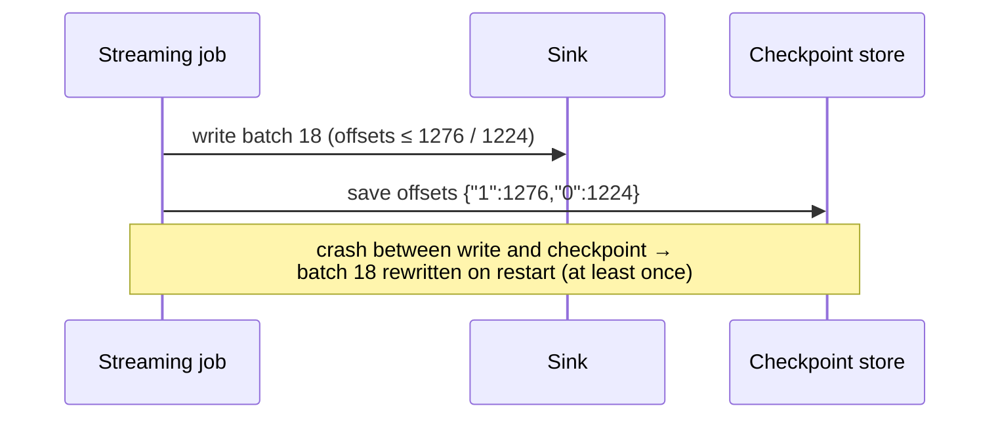

# فصل ۳: الگوهای طراحی مدیریت خطا

[فصل ۲: الگوهای طراحی ورود داده →](02-data-ingestion-design-patterns.md) · [کتاب](../README.md) · [فصل ۴: الگوهای طراحی idempotency ←](04-idempotency-design-patterns.md)

## خلاصه

«هیچ چیز قطعی نیست جز خطا و مسئله‌ی کیفیت داده»؛ شما مشکل‌های شبکه و تلاش‌های دوباره و crashهای producer‌هایتان را به ارث می‌برید. این فصل هفت الگو می‌دهد. الگوی **Dead-Letter** با فرستادن رکوردهای پردازش‌نشدنی به ذخیره‌سازی جدا، job را سر پا نگه می‌دارد، همراه با monitoring و یک pipeline اختیاری برای اجرای دوباره. الگوی **Windowed Deduplicator** تکراری‌ها را در دامنه‌ای bounded برمی‌دارد، یعنی کل دسته یا یک پنجره‌ی زمانی که در یک state store نگه داشته می‌شود. سه الگو به **late data** می‌پردازند: **Late Data Detector** یک **watermark** یکنوا حساب می‌کند، یعنی بیشینه‌ی زمان رویداد منهای تأخیر مجاز؛ **Static Late Data Integrator** یک پنجره‌ی نگاه‌به‌عقب ثابت را دوباره پردازش می‌کند؛ و **Dynamic Late Data Integrator** فقط پارتیشن‌هایی را دوباره پردازش می‌کند که واقعاً late data گرفته‌اند و در یک جدول حالت ثبت شده‌اند. الگوی **Filter Interceptor** می‌شمارد هر شرط فیلتر چند ردیف را حذف می‌کند، و **Checkpointer** موقعیت stream و حالت را durable می‌کند تا jobی که دوباره راه می‌افتد از اول شروع نکند. هر الگو درستی را با پیچیدگی یا تأخیر یا هزینه‌ی backfill معامله می‌کند، و هیچ‌کدام به‌تنهایی تحویل exactly-once نمی‌دهند.

## نکته‌های کلیدی

- **روش dead-letter خطاها را پنهان می‌کند**: می‌تواند سر اجرای دوباره، بهمنی از backfillهای downstreamی راه بیندازد، ترتیب و sessionها را بشکند، و باید با هشداری همراه شود که وقتی رکوردهای زیادی شکست می‌خورند job را متوقف کند (pp. 42–44).
- **حذف تکراری‌ها bounded است**: jobهای batch داخل مجموعه‌داده‌ی پردازش‌شده و jobهای streaming داخل پنجره‌ای زمانی تکراری‌زدایی می‌کنند که طولش، تکراری‌های از‌دست‌رفته را با اندازه‌ی حالت معامله می‌کند (pp. 46–49).
- **مفهوم watermark برابر است با بیشینه‌ی زمان رویداد منهای تأخیر مجاز**، و هیچ‌وقت نباید به عقب برگردد؛ کمینه گرفتن در هر پارتیشن حلقه‌ی باز و بسته شدن و jobی گیرکرده در گذشته می‌سازد (pp. 51–55).
- **پیشرفت سراسری بین پارتیشن‌ها** می‌تواند کندترین منبع را دنبال کند، یعنی کمینه با رکورد late کمتر و بافر بزرگ‌تر، یا سریع‌ترین را، یعنی بیشینه با بافر کوچک‌تر و حذف بیشتر رکورد در شرایط نامتوازن (pp. 52, 55).
- **پنجره‌های نگاه‌به‌عقب ثابت هم‌پوشانی دارند**: هر اجرای jobی با نگاه‌به‌عقب چهار‌روزه را backfill نکنید؛ اجرای دوباره‌ی آخرینش کافی است (p. 61).
- **نگاه‌به‌عقب پویا به یک جدول حالت نیاز دارد** که آخرین زمان پردازش و آخرین زمان به‌روزرسانی هر پارتیشن را دارد، به‌علاوه‌ی یک پرچم «پردازش‌شده» و taskهای پشت سر هم تا زیر concurrency backfill تکراری نشود (pp. 64–70).
- **مفهوم checkpoint فقط «حسِ exactly-once» می‌دهد**: checkpoint بعد از نوشتن یعنی at-least-once و قبلش یعنی حداکثر‌یک‌بار؛ تحویل exactly-once به الگوهای idempotency فصل ۴ نیاز دارد (pp. 75–76).

## فهرست بخش‌ها

*از فهرست مطالب خود کتاب، از bookmarkهای PDF؛ شماره‌ها صفحه‌ی چاپی‌اند.*

- رکوردهای پردازش‌نشدنی — p. 40
  - الگو: Dead-Letter — p. 40
- رکوردهای تکراری — p. 46
  - الگو: Windowed Deduplicator — p. 46
- late data — p. 51
  - الگو: Late Data Detector — p. 51
  - الگو: Static Late Data Integrator — p. 58
  - الگو: Dynamic Late Data Integrator — p. 64
- فیلتر کردن — p. 70
  - الگو: Filter Interceptor — p. 70
- تاب‌آوری در برابر خطا — p. 74
  - الگو: Checkpointer — p. 74
- خلاصه — p. 77

## یادداشت‌ها

فصل با جمله‌ی «مرگ و مالیات» از Benjamin Franklin در سال ۱۷۸۹ باز می‌شود که برای مهندس‌های داده به خطا و مسئله‌ی کیفیت داده بازنویسی شده. داده پویاست، انتظارهای امروز برای کل عمرش برقرار نمی‌مانند، و شما مشکل‌های producerها را به ارث می‌برید؛ شبکه‌ی نامطمئن تحویل late می‌سازد و crash تحویل دوباره و رکورد تکراری. این الگوها هم داده‌ی بد upstreamی را پوشش می‌دهند، یعنی رکوردهای پردازش‌نشدنی و تکراری و دیررس، و هم شکست زیرساخت را، یعنی crash کردن jobهای streaming (p. 39).

### رکوردهای پردازش‌نشدنی

مسئله‌های کیفیت داده اغلب شکست‌های مرگبار می‌سازند که job را می‌خوابانند؛ شکست سریع همیشه ممکن نیست، به‌خصوص برای jobهای streaming طولانی‌عمر (p. 40).

#### الگو: Dead-Letter (pp. 40–46)

**مسئله.** یک job streaming که رویدادهای بازدید Kafka را در یک ذخیره‌سازی object می‌نویسد مدام روی رکوردهای پردازش‌نشدنی شکست می‌خورد؛ سه روز است دستی راهش می‌اندازید و offsetهای checkpoint‌شده را ویرایش می‌کنید. می‌خواهید سر پا بماند و بعداً شکست‌ها را بررسی کنید (p. 40).

| نوع خطا | رفتار | نمونه |
|---|---|---|
| **transient** | موقتی؛ خودش برمی‌گردد | قطعی کوتاه دیتابیس که با تلاش دوباره‌ی اتصال درست می‌شود |
| **ناگذرا** | هیچ‌وقت برنمی‌گردد؛ دخالت دستی می‌خواهد | رکوردهای پردازش‌نشدنی، یعنی **پیام‌های قرص سمی** |

*از کادر کناری ص. ۴۰.*

**راه‌حل** (pp. 41–42): جاهایی را که کدتان می‌تواند شکست بخورد پیدا کنید؛ محافظشان کنید، با **try-catch** در یک تابع mapping یا یک **if-else** بعد از تبدیلی که خطا را امن می‌کند؛ خود شکست را به‌عنوان metadata بچسبانید، الگوی **Metadata Decorator** در فصل ۵ را ببینید؛ و شکست‌ها را به مقصد dead-letterی بفرستید که بر پایه‌ی **تاب‌آوری** انتخاب شده، چون برای dead-letterتان dead-letter ندارید، و **آسانی monitoring**، یعنی خطاها کِی شروع می‌شوند و چندتایند، و **performance نوشتن**. ذخیره‌سازی object و brokerهای استریم گزینه‌های خوبی‌اند. یک **pipeline اجرای دوباره**ی اختیاری رکوردهای اصلاح‌شده را برمی‌گرداند (شکل ۳-۱). در streaming شکست‌ها یکی‌یکی نوشته می‌شوند و در batch زیرمجموعه‌ی شکست‌خورده یک‌جا.


*Figure 3-1 (p. 42): رکوردهای بد پارک می‌شوند، هشدارشان داده می‌شود، و بعد از اصلاح دوباره اجرا می‌شوند، در حالی که جریان اصلی ادامه دارد.*

**پیامدها** (pp. 42–44):

| پیامد | چه می‌شود | راه کاهش |
|---|---|---|
| **بهمن backfill** | رکوردهای اجراشده‌ی دوباره در پارتیشن‌هایی می‌نشینند که consumerها پردازششان کرده‌اند، و consumerهای آن‌ها را هم به backfill مجبور می‌کنند (شکل ۳-۲) | یا دوباره اجرا نکنید و داده را از دست بدهید، یا backfill کنید و ناسازگاری را برای کسانی بپذیرید که نمی‌توانند |
| **شناختن رکوردهای اجراشده‌ی دوباره** | consumerها شاید بخواهند فیلتر یا ردیابی‌شان کنند | یک پرچم `was_dead_lettered`، یا نام و نسخه‌ی job و زمان اجرای دوباره، یعنی تزئین داده |
| **ترتیب و سازگاری** | حسگرهای IoT هر دقیقه داده می‌دهند؛ پنج دقیقه رویداد dead-letter‌شده یک session را زودتر می‌بندد. رکوردهای ۱۰:۰۰ و ۱۰:۰۱ و ۱۰:۰۲ که بی‌ترتیب دوباره اجرا شوند می‌شوند ۱۰:۰۰ و ۱۰:۰۲ و ۱۰:۰۱ | — |
| **توابع امن در برابر خطا** | توابعی که به‌جای پرتاب خطا NULL برمی‌گردانند خطا را پنهان می‌کنند: ورودی را که هست با خروجی که NULL است مقایسه کنید | معنای ایمنی هر تابع را بفهمید |
| **خطا یا شکست؟** | پنهان کردن خطا می‌تواند یک شکست مرگبار را پنهان کند | هشداری که بعد از دور ریختن رویدادهای زیاد job را متوقف می‌کند |

**نمونه‌ها** (pp. 44–46): **side output** در Apache Flink، یعنی یک `OutputTag('invalid_visits')` و تابع mappingی که یا JSON معتبر می‌دهد یا در `except` زوج خروجی نامعتبر و خطای بسته‌بندی‌شده، و دو sink در Kafka. **Spark SQL با Delta Lake** و تابع `CONCAT` که در برابر خطا امن است و اگر هر ورودی NULL باشد NULL می‌دهد: یک کوئری `is_valid` را حساب می‌کند، یعنی ورودی هست ولی نتیجه NULL است، پس false؛ `persist()` جلوی دوباره اجرا شدنش را می‌گیرد؛ و دو نوشتن فیلترشده به `devices-table` و `devices-dead-letter-table` می‌روند. انجام این کار در SQL اعلانی پرحرف و سخت‌نگه‌داری است (p. 46).

> **In practice:** ردیفی که loader نمی‌تواند parse کند نباید کل job را بخواباند.
>
> **Your turn:** یک ردیف با `amount` غیرعددی در منبع A کل DAG را fail می‌کند و on-call ساعت ۳ صبح بیدار می‌شود. با الگوی Dead-Letter چه عوض می‌کنید؟
>
> *Answer:* ردیف خراب را با دلیل خطا در جدولی جدا، مثلاً `bronze_rejects`، بنویسید و بقیه را بار کنید؛ بعد شمار ردیف‌های آن جدول را به‌شکل metric در Prometheus بفرستید تا Grafana از یک آستانه به بعد alert بدهد. dead-letter بدون monitoring فقط خطا را پنهان می‌کند (pp. 40–46).

### رکوردهای تکراری

تحویل exactly-once در سیستم‌های توزیع‌شده نادر است و at-least-once رایج. اگر منطق شما باید هر رخداد را فقط یک‌بار پردازش کند چه (p. 46)؟

#### الگو: Windowed Deduplicator (pp. 46–50)

**مسئله.** یک job batch رویدادهای بازدید را، که از streaming به ذخیره‌سازی object synchronous شده‌اند، مستقیم به کاربرهای کسب‌وکار نشان می‌دهد و باید هر رکورد متمایز را exactly-once پردازش کند، ولی تلاش‌های دوباره‌ی خودکار producerها تکراری می‌سازند (p. 47).

**راه‌حل** (pp. 47–48): **ویژگی‌های تکراری‌زدایی** را انتخاب کنید، یعنی چیزی که رکورد را یکتا می‌کند، و بعد **دامنه** را: برای batch، مجموعه‌داده‌ی فعلی که یک پنجره‌ی سراسری ضمنی است و کشیدنش به مجموعه‌داده‌های گذشته محاسبه‌ی بیشتری می‌خواهد؛ برای streaming، یک **پنجره‌ی زمانی** که کلیدهای دیده‌شده در یک **state store** نگه داشته می‌شوند (شکل ۳-۳). در batch از `DISTINCT` یا تابع `WINDOW` با `row_number()` استفاده می‌شود.


*Figure 3-3 (p. 48): این state store چیزی را که داخل پنجره دیده شده به یاد می‌آورد؛ هر چیزی که از قبل آن‌جاست دور انداخته می‌شود.*

| state store (p. 48) | حالت کجا می‌ماند | معامله |
|---|---|---|
| محلی | فقط حافظه | سریع‌ترین؛ حالت با شکست از بین می‌رود |
| محلی با تاب‌آوری | حافظه به‌علاوه‌ی ماندگارسازی از راه دور | ماندگارسازی در هر تکرار یعنی سازگار ولی کندتر؛ کم‌تکرارتر یعنی سریع‌تر ولی کم‌سازگارتر |
| از راه دور | data warehouse دوردست | تاب‌آور؛ با تأخیر یا هزینه‌ی بیشتر |

> **Vault note:** کادر کناری کتاب هشدار می‌دهد که *پردازش* exactly-once فقط در نبود خطای زمان اجرا برقرار است: jobی که خودکار دوباره راه می‌افتد ممکن است با وجود تکراری‌زدایی رکوردها را دوباره پردازش کند، که معمولاً معامله‌ی پذیرفته‌شده‌ای است (p. 46).

**پیامدها** (p. 49): **فضا در برابر زمان**؛ پنجره‌ی کوتاه تکراری‌ها را از دست می‌دهد ولی منابع کمی می‌خورد و پنجره‌ی بلند کلیدهای بیشتری در حالت نگه می‌دارد. **producer idempotent**؛ تکراری‌زدایی *تحویل* exactly-once نمی‌دهد و تلاش دوباره باز هم می‌تواند دو بار بنویسد (فصل ۴ را ببینید).

**نمونه‌ها** (pp. 49–50): در Spark `dropDuplicates(['type', 'full_name', 'version'])` که اگر فهرست ندهید همه‌ی ستون‌ها را می‌گیرد؛ در SQL `ROW_NUMBER() OVER (PARTITION BY type, full_name, version ORDER BY 1) AS position … WHERE position = 1`؛ و در streaming `withWatermark("visit_time", "10 minutes").dropDuplicates(["visit_id", "visit_time"])`، که watermark هم رکوردهای late را رد می‌کند و هم کلیدهای به‌یادمانده را منقضی می‌کند تا حالت بی‌پایان رشد نکند.

> **Run it:** [آزمایش پنجره‌ی تکراری‌زدایی](../lab/03-dedup-window/README.md) در vault اندازه می‌گیرد با بزرگ شدن پنجره، چند تکراری از دست می‌رود و حالت چقدر بزرگ می‌شود.

> **In practice:** loader با `write_disposition: append` و retry یعنی Bronze تکراری دارد؛ deduplication جایش در Silver است.
>
> **Your turn:** برای dedup تراکنش‌ها در Silver کدام کلید و کدام پنجره را انتخاب می‌کنید؟
>
> *Answer:* کلید اصلی منبع، و نگه داشتن تازه‌ترین نسخه بر اساس `update_date`، مثلاً با `ReplacingMergeTree(update_date)` و خواندن با `FINAL` یا `argMax`. هر dedupی به یک پنجره محدود است و پنجره باید از دورترین فاصله‌ای که retry یا بار دوباره می‌سازد بزرگ‌تر باشد (pp. 46–50).

### late data

مفهوم late data بی‌خطر به نظر می‌رسد ولی به‌شدت روی pipelineها اثر می‌گذارد (p. 51).

#### الگو: Late Data Detector (pp. 51–57)

**مسئله.** رویدادهای بازدید معمولاً ظرف **۱۵ ثانیه** می‌رسند، ولی کاربرهایی که اتصالشان قطع می‌شود بازدیدها را محلی بافر می‌کنند و بعداً می‌فرستند؛ jobها باید چنین رویدادهایی را تشخیص بدهند و راهبردی به کار ببرند، مثلاً نادیده گرفتنشان (p. 51).

**راه‌حل** (pp. 51–54):

۱. یک ویژگی **زمان رویداد** انتخاب کنید، یعنی زمانی که رویداد رخ داده. *زمان پردازش*، یعنی زمانی که pipeline به آن رسیده، هیچ‌وقت late نیست.
۲. پیشرفت را **در هر پارتیشن** با یک تجمیع **یکنواخت صعودی** دنبال کنید، یعنی **بیشینه**ی زمان رویداد. کمینه job را در گذشته گیر می‌اندازد.
۳. پارتیشن‌ها را در یک زمان رویداد **سراسری** ترکیب کنید (شکل ۳-۴):

   | راهبرد سراسری | چه چیزی را دنبال می‌کند | اثر |
   |---|---|---|
   | کمینه | کندترین upstream | داده‌ی بیشتری به‌موقع حساب می‌شود؛ بافر بزرگ‌تر |
   | بیشینه | سریع‌ترین upstream | بافر کوچک‌تر؛ ممکن است رکورد منبع‌های کند را رد کند |
   | کمینه و بیشینه در سطح‌های مختلف | چند منبع پارتیشن‌بندی‌شده | مثلاً کمینه در هر منبع و بیشینه بین منبع‌ها، یا برعکس |

۴. یک **تأخیر مجاز** کم کنید: **watermark برابر است با بیشینه‌ی زمان رویداد منهای تأخیر مجاز**، یعنی کمینه‌ی زمان رویدادی که هنوز به‌موقع حساب می‌شود. نامزد تازه‌ای که از watermark فعلی پایین‌تر باشد نادیده گرفته می‌شود؛ watermark هیچ‌وقت به عقب برنمی‌گردد.

*جدول ۳-۱: watermark با ۳۰ دقیقه تأخیر مجاز* (p. 54)

| زمان‌های رویداد | watermark ورودی | نامزد watermark | watermark خروجی | رکوردهای نادیده‌گرفته‌شده |
|---|---|---|---|---|
| ۱۰:۰۰، ۱۰:۰۵، ۱۰:۰۶ | – | بیشینه‌ی این سه منهای ۳۰ دقیقه، یعنی ۹:۳۶ | ۹:۳۶ | – |
| ۹:۲۰، ۹:۳۱، ۱۰:۰۷ | ۹:۳۶ | ۱۰:۰۷ منهای ۳۰ دقیقه، یعنی ۹:۳۷ | بیشینه‌ی ۹:۳۶ و ۹:۳۷، یعنی ۹:۳۷ | ۹:۲۰، ۹:۳۱ |

رکوردهای late را می‌شود نادیده گرفت یا با الگوهای integrator بعدی وارد کرد (p. 54).

> **Try it:** [watermark و late data](../widgets/03-watermark.html)؛ streamهای جدول‌های ۳-۱ و ۳-۲ کتاب را دوباره اجرا کنید، تأخیر مجاز و اندازه‌ی پنجره را عوض کنید و ببینید کدام رویدادها دور انداخته می‌شوند و پنجره‌ها کِی منتشر می‌شوند.

**پیامدها** (pp. 54–55):

- **گرفتن late data**: Spark Structured Streaming late eventها را تشخیص می‌دهد و نادیده می‌گیرد ولی API آسانی برای گرفتنشان ندارد؛ Apache Flink هر دو کار را می‌کند.
- **کمینه در هر پارتیشن در jobهای stateful**: jobی حالت‌دار، مثلاً شمارش بازدید هر کاربر، وقتی watermark رد شود حالتش را منتشر می‌کند. اگر watermark بتواند از ۱۰:۳۰ به ۹:۰۰ برگردد، حالت‌های منتشرشده دوباره باز می‌شوند، یعنی **حلقه‌ی بی‌پایان باز و بسته شدن**، و late data تکراری می‌تواند job را **در گذشته گیر بیندازد** و حالت بی‌پایان بزرگ شود.
- **بیشینه و نامتوازنی رویداد**: اگر چهار منبع از پنج منبع ۴۰ دقیقه از منبع سالم عقب باشند، رکوردهایشان late حساب و دور انداخته می‌شوند. گلوله‌ی نقره‌ای‌ای در کار نیست؛ late eventها را بپایید و دوباره واردشان کنید.

**نمونه‌ها** (pp. 55–57): در Spark `withWatermark('event_time', '1 hour')` با پنجره‌های ۱۰ دقیقه‌ای (جدول ۳-۲ در پایین)؛ و در Flink `WatermarkStrategy.for_bounded_out_of_orderness(Duration.of_seconds(5))` با یک `TimestampAssigner` و یک `ProcessFunction` که هر رویداد را با `ctx.timer_service().current_watermark()` مقایسه می‌کند و lateها را به یک side output می‌فرستد.

*جدول ۳-۲ (p. 56): تأخیر مجاز یک‌ساعته، پنجره‌های ۱۰ دقیقه‌ای، رویدادهای ۲۰۲۳-۰۶-۳۰*

| زمان رویداد | watermark، قبل ← بعد | پنجره‌های بافرشده | پنجره‌های منتشرشده |
|---|---|---|---|
| ۰۳:۱۵ | ۱۹۷۰-۰۱-۰۱T۰۰:۰۰ ← ۰۲:۱۵ | ‎[۰۳:۱۰–۰۳:۲۰]‎ | – |
| ۰۳:۰۰ | ۰۲:۱۵ ← ۰۲:۱۵ | ‎[۰۳:۰۰–۰۳:۱۰، ۰۳:۱۰–۰۳:۲۰]‎ | – |
| ۰۱:۵۰ | ۰۲:۱۵ ← ۰۲:۱۵، نادیده گرفته می‌شود چون پیش از watermark است | همان | – |
| ۰۳:۱۱ | ۰۲:۱۵ ← ۰۲:۱۵ | همان | – |
| ۰۴:۳۱ | ۰۲:۱۵ ← ۰۳:۳۱ | ‎[۰۴:۳۰–۰۴:۴۰]‎ | ‎[۰۳:۰۰–۰۳:۱۰، ۰۳:۱۰–۰۳:۲۰]‎ |

در عمل Spark مقدار watermark را تا کران بالای پنجره گرد می‌کند؛ جدول ساده‌شده است (p. 56).

#### الگو: Static Late Data Integrator (pp. 58–63)

**مسئله.** یک job روزانه آمار ارجاع‌دهنده‌ها را حساب می‌کند که تا **۱۵ روز** تقریبی به حساب می‌آید، چون این بیشینه‌ی تأخیر late data است و رکوردهای قدیمی‌تر رد می‌شوند. فقط روز جاری را پردازش می‌کند؛ شما می‌خواهید late data هم بیاید، بدون اجرای ۱۵ job جدا در روز (p. 58).

**راه‌حل** (pp. 58–60): یک **پنجره‌ی نگاه‌به‌عقب ثابت**؛ مثلاً اجرای مربوط به ۲۰۲۴-۱۲-۳۱ با پنجره‌ی ۱۴ روزه، ۲۰۲۴-۱۲-۱۷ تا ۲۰۲۴-۱۲-۳۰ را هم دوباره پردازش می‌کند و late data ۲۰۲۴-۱۲-۱۵ نادیده گرفته می‌شود. مرحله‌ی late data را جایی در pipeline بگذارید (شکل ۳-۶): **پیش از** اجرای جاری، که برای pipelineهای **stateful** لازم است چون به تاریخچه‌ی معتبر نیاز دارند؛ **موازی** با آن؛ یا **بعد از** آن، برای pipelineهای stateless که داده‌ی جاری را اول می‌خواهند.

> **Vault note:** کتاب می‌گوید پارتیشن‌بندی بر پایه‌ی **زمان پردازش** late data را برای *شما* از بین می‌برد ولی مسئله را جابه‌جا می‌کند: اگر پارتیشن ۹:۰۰ شما ۸۰٪ داده‌ی ۹:۰۰ و ۱۰٪ داده‌ی ۸:۰۰ و ۱۰٪ داده‌ی ۷:۰۰ داشته باشد، consumerی که با زمان رویداد کار می‌کند حالا late data دارد (شکل ۳-۵، صص. ۵۸–۵۹).

**پیامدها** (pp. 61–62):

- **بهمن backfill** در پایین‌دست؛ تنها کاری که می‌شود کرد خبر دادن به consumerهای مستقیم است.
- **اجراهای هم‌پوشان**: با نگاه‌به‌عقب چهار‌روزه، اجرای دوباره‌ی ۲۰۲۴-۱۰-۱۰ و ۱۰-۱۱ و ۱۰-۱۲ همان تاریخ‌ها را بارها پردازش می‌کند (جدول ۳-۳)؛ اجرای دوباره‌ی فقط ۲۰۲۴-۱۰-۱۲ کافی است.
- **عمل trigger کردن pipeline**: backfillهای late data باید بخشی از pipeline اصلی باشند، نه pipelineهای جدا (شکل ۳-۷).
- **هدررفت**: شاید پنجره‌هایی اصلاً late data نداشته باشند؛ یک task کنترلی اضافه کنید یا از نسخه‌ی پویا استفاده کنید.
- **نیاز به زمان**: بدون پارتیشن‌های زمانی نمی‌توانید late data را تشخیص بدهید.


*Figure 3-6 (p. 60): وارد کردن late data می‌تواند پیش از اجرای جاری یا بعد از آن یا کنارش برود، ولی همیشه داخل pipeline اصلی.*

*جدول ۳-۳ (p. 61): backfill هم‌پوشان با نگاه‌به‌عقب چهار‌روزه*

| تاریخ اجرا | تاریخ‌های اجراشده |
|---|---|
| ۲۰۲۴-۱۰-۱۰ | ۱۰-۰۹، ۱۰-۰۸، ۱۰-۰۷، ۱۰-۰۶ |
| ۲۰۲۴-۱۰-۱۱ | ۱۰-۱۰، ۱۰-۰۹، ۱۰-۰۸، ۱۰-۰۷ |
| ۲۰۲۴-۱۰-۱۲ | ۱۰-۱۱، ۱۰-۱۰، ۱۰-۰۹، ۱۰-۰۸ |

**نمونه‌ها** (pp. 62–63): قابلیت **Dynamic Task Mapping** در Airflow؛ یک task به نام `generate_backfilling_runs` دو تاریخ قبلی را برمی‌گرداند و `integrate_late_data.expand(late_date=...)` برای هر تاریخ یک task می‌سازد، بعد از `file_to_load_sensor >> load_current_file()`.

#### الگو: Dynamic Late Data Integrator (pp. 64–70)

**مسئله.** مالک محصول حالا *همه‌ی* late data را می‌خواهد، حتی فراتر از ۱۵ روز، بدون اجرای دوباره‌ی کورکورانه‌ی دو هفته (p. 64).

**راه‌حل** (pp. 64–65): یک **پنجره‌ی نگاه‌به‌عقب پویا**؛ فقط پارتیشن‌هایی را backfill کنید که واقعاً late data گرفته‌اند، با یک **جدول حالت**:

*جدول ۳-۴ (p. 64)*

| پارتیشن | آخرین زمان پردازش | آخرین زمان به‌روزرسانی |
|---|---|---|
| ۲۰۲۴-۱۲-۱۷ | ۲۰۲۴-۱۲-۱۷T۱۰:۲۰ | ۲۰۲۴-۱۲-۱۷T۰۳:۰۰ |
| ۲۰۲۴-۱۲-۱۸ | ۲۰۲۴-۱۲-۱۸T۰۹:۵۵ | ۲۰۲۴-۱۲-۲۰T۱۰:۱۲ |

```sql
SELECT partition FROM state_table WHERE
  `Last update time` > `Last processed time` AND `Partition` < `Processed partition`
```

این‌جا ۲۰۲۴-۱۲-۱۸ backfill می‌شود. بعد از پردازش موفق، آخرین زمان پردازش را به‌روز کنید (شکل ۳-۸). آخرین زمان‌های به‌روزرسانی از `INFORMATION_SCHEMA.PARTITIONS.last_modified_timestamp` در **BigQuery** یا `last_updated_at` در metadata پارتیشن‌های **Apache Iceberg** می‌آیند؛ وگرنه خودتان حسابشان کنید. اگر بتوانید موجودیت‌های اثرپذیر را جدا کنید، به‌جای کل پارتیشن فقط همان‌ها را بازنویسی کنید (p. 65).

**پیامدها** (pp. 65–68):

- **مفهوم concurrency**: اجراهای موازی ممکن است همان پارتیشن‌های late را دو بار زمان‌بندی کنند (شکل ۳-۹). یک ستون **پردازش‌شده** اضافه کنید که کوئری `AND Is processed = false` بگیرد؛ هر اجرا را با علامت زدن پارتیشنش به‌عنوان «در حال پردازش» شروع کنید؛ taskی که backfill می‌سازد هم چیزی را که برمی‌دارد علامت بزند؛ هر دو task به موفقیت اجرای قبلی‌شان وابسته باشند؛ و task پایانی پرچم را پاک کند تا late data تازه بتواند دوباره اجرا شود. آن‌وقت backfillها می‌توانند pipeline جدا باشند (شکل ۳-۱۰)، ولی اگر task سازنده شکست بخورد اجراهای بعدی منتظر می‌مانند و باید دستی باز شوند.
- **همه‌ی pipelineهای stateful و داده‌ی خیلی late**: یک Incremental Sessionizer که آخرین اجرایش ۲۰۲۴-۱۰-۲۰ بوده و late data ۲۰۲۴-۰۹-۲۱ پیدا می‌کند باید هر اجرا از ۰۹-۲۱ تا ۱۰-۲۰ را از نو بسازد، پس حتی پنجره‌ی پویا را هم سقف بگذارید.
- **پیچیدگی زمان‌بندی**: گرفتن زمان تغییر هر پارتیشن شاید یعنی رفتن سراغ درون ذخیره‌سازی یا ساختن جدول ردیابی خودتان.


*Figure 3-10 (p. 67): علامت زدن پارتیشن‌ها به‌عنوان در حال پردازش نمی‌گذارد اجراهای هم‌زمان یک پارتیشن late را دو بار زمان‌بندی کنند.*

**نمونه‌ها** (pp. 68–70): در Delta Lake با Scala، متد `DeltaLog.getChanges(0)` فایل‌های اضافه و حذف‌شده را در هر نسخه می‌دهد؛ آن‌ها را به پارتیشن map کنید و آخرین نسخه‌ی هر پارتیشن را نگه دارید، و بعد پارتیشن‌هایی را انتخاب کنید که آخرین نسخه‌شان از آخرین نسخه‌ی پردازش‌شده بزرگ‌تر است، در حال پردازش نیستند، و از پارتیشن فعلی قدیمی‌ترند. نتیجه را در هر اجرا در یک فایل زمان‌دار بنویسید؛ Airflow می‌خواندش تا اجراهای backfill بسازد، با نامی مثل `backfill_{event_time}_from_{partition}_{start}`. taskهای کلیدی `depends_on_past=True` دارند در حالی که DAG اجازه‌ی `max_active_runs=5` می‌دهد.

> **In practice:** منبع B گاهی تراکنش‌های دیروز را امروز می‌فرستد؛ برای گزارش‌های Gold این late data است.
>
> **Your turn:** گزارش ماهانه روز اول ماه ساخته می‌شود و تراکنش‌های late روز سوم می‌رسند. چه می‌کنید؟
>
> *Answer:* یا ساخت گزارش را تا مهلتی مشخص عقب بیندازید، یا آن را بسازید و با رسیدن late data همان partition ماه را دوباره بسازید. راه دوم همان integrate کردن late data در کتاب است و فقط وقتی امن است که بازسازی partition idempotent باشد (pp. 51–57).

### فیلتر کردن

خطاها خطای انسانی را هم در بر می‌گیرند، مثل فیلترهای باگ‌داری که داده‌ی ناقص نشان می‌دهند (p. 70).

#### الگو: Filter Interceptor (pp. 70–74)

**مسئله.** بعد از یک release، سهم ردیف‌های فیلترشده از **۱۵٪ به ۹۰٪** می‌پرد. مسئله از داده است یا یک پس‌رفت در کد؟ نقشه‌ی اجرا نمی‌تواند بگوید، چون بهینه‌ساز همه‌ی عبارت‌های فیلتر را در یکی جمع می‌کند (pp. 70–71).

**راه‌حل** (p. 71): هر شرط را با یک **شمارنده** بپیچید که وقتی ردیفی را رد می‌کند یکی بالا می‌رود، و آخر کار شمارنده‌ها را جمع کنید. در SQL هر شرط را به‌عنوان یک ستون در یک زیرکوئری یا جدول موقت حساب کنید، مثل `a_is_not_null` و `b_is_not_abc`، و روی همان ستون‌ها فیلتر کنید. هر جا بهتر جا می‌افتد از API برنامه‌نویسی استفاده کنید (p. 71).

**پیامدها** (pp. 71–72): اثر **زمان اجرا** برای شمارنده‌های محلی کم است و برای جدول‌های موقت SQL بیشتر؛ **زبان‌های اعلانی** کمتر به این کار می‌خورند؛ و در **streaming** ممکن است jobی stateless را stateful کند و برای آمار به مرز زمانی نیاز داشته باشد، مثلاً پنجره‌های زمان پردازش.

**نمونه‌ها** (pp. 72–74): در PySpark objectهای `FilterWithAccumulator(name, filter, accumulator)` برای هر ستون که داخل `mapInPandas` ارزیابی می‌شوند و هر شرط شکست‌خورده یکی به **accumulator** خودش در Spark اضافه می‌کند؛ و در SQL یک `CASE WHEN … THEN 'null_type' WHEN … 'short_type' …` به‌عنوان `status_flag`، بعد یک شمارش با `GROUP BY status_flag`، و بعد نوشتن ردیف‌هایی که `status_flag IS NULL` دارند.

### تاب‌آوری در برابر خطا

گردش‌کارهای پیوسته باید بدانند از کجا دوباره شروع کنند، وگرنه داده‌ی پردازش‌شده را دوباره پردازش می‌کنند (p. 74).

#### الگو: Checkpointer (pp. 74–77)

**مسئله.** یک job streaming بازدیدهای یکتا را در پنجره‌های ۱۰ دقیقه‌ای می‌شمارد؛ یک شکست مرگبار نباید باعث شود از اول پردازش کند (p. 74).

**راه‌حل** (pp. 74–75): **موقعیت** در مبدأ و **حالت** محاسبه‌شده را در ذخیره‌سازی‌ای ماندگارتر از محیط job ثبت کنید.

| کجا | نمونه |
|---|---|
| مدیریت‌شده توسط framework | Spark Structured Streaming و Flink که metadata پیشرفت را در ذخیره‌سازی object تاب‌آور می‌گذارند |
| مدیریت‌شده توسط data warehouse | ابزار Kafka SDK در topic مربوط به `__consumer_offsets`؛ و Amazon KCL در یک جدول DynamoDB |

| چطور | نمونه |
|---|---|
| با config | تکراری تعیین کنید، مثل Spark و Flink |
| صریح | بعد از پردازش commit کنید، مثل متدهای `commit` در consumer سفارشی Kafka |

**پیامدها** (pp. 75–76): **تضمین تحویل در برابر تأخیر**؛ موقعیت‌ها ارزان‌اند ولی حالت، مثل sessionها، خیلی بزرگ‌تر است؛ checkpoint پرتکرار job را کند می‌کند و کم‌تکرار پردازش دوباره‌ی بیشتری می‌سازد. **حس exactly-once**؛ taskهای موازی می‌توانند پیش از یک checkpoint شکست بخورند، پس راه‌اندازی دوباره رکوردهای موفق را دوباره پردازش می‌کند.

| حالت تحویل (p. 76) | کِی |
|---|---|
| exactly-once | با الگوهای idempotency فصل ۴ شدنی است |
| دست‌کم یک‌بار | checkpoint **بعد از** پردازش و نوشتن؛ تلاش دوباره تکراری می‌سازد |
| حداکثر یک‌بار | checkpoint **پیش از** پردازش؛ شکست داده را از بین می‌برد |



*طرح vault از checkpoint دست‌کم‌یک‌بار، با offsetهای نمونه‌ی ۳-۲۶ (pp. 76–77).*

**نمونه‌ها** (pp. 76–77): در Spark گزینه‌ی `checkpointLocation` برای هر micro-batch فایل offset می‌نویسد، مثل `offsets/18` با محتوای `{"visits":{"1":1276,"0":1224}}`؛ و Flink بر پایه‌ی **زمان** checkpoint می‌گیرد، یعنی `enable_checkpointing(30000, mode=EXACTLY_ONCE)` که هر رکورد یک‌بار در حالت بازتاب می‌یابد، همراه با `RETAIN_ON_CANCELLATION` که checkpointها را بعد از شکست نگه می‌دارد. نسخه‌ی ۳٫۴٫۰ Spark پیگیری asynchronous پیشرفت را اضافه کرد، که در سال ۲۰۲۴ هنوز آزمایشی بود و در نسخه‌ی open source پشتیبانی state store نداشت.

> **In practice:** pod loader روی Kubernetes هر لحظه ممکن است evict یا kill شود؛ state cursor در dlt بعد از هر load موفق ذخیره می‌شود و همان checkpoint است.
>
> **Your turn:** pod وسط بار یک جدول بزرگ kill می‌شود و Airflow آن را retry می‌کند. چه چیزی جلوی بار دوباره‌ی همه‌چیز یا گم شدن ردیف‌ها را می‌گیرد؟
>
> *Answer:* این‌که cursor فقط بعد از commit موفق جلو برود؛ retry از آخرین cursor ثبت‌شده شروع می‌کند و در بدترین حالت ردیف‌هایی را دوباره می‌آورد که Silver dedup می‌کند. checkpoint فقط حس exactly-once می‌دهد و بین دو checkpoint تکراری ممکن است (pp. 74–77).

### خلاصه

خطاها از باگ یا ورودی بد یا مشکل سخت‌افزاری موقت می‌آیند. الگوهای Dead-Letter و Windowed Deduplicator و الگوهای late data به کیفیت داده می‌پردازند؛ Filter Interceptor رفتار فیلتر را توضیح می‌دهد؛ و Checkpointer تاب‌آوری در برابر خطا می‌دهد. هیچ‌کدام داده‌ی بی‌نقص را تضمین نمی‌کنند؛ تلاش دوباره و backfill باز هم درد دارند، مگر pipelineها idempotent باشند (pp. 77–78).

## بده‌بستان‌ها در یک نگاه

| الگو | چه می‌دهد | چه می‌گیرد |
|---|---|---|
| Dead-Letter | job سر پا می‌ماند؛ خطاها برای تحلیل می‌مانند | شکست‌های پنهان، بهمن backfill، ترتیب شکسته |
| Windowed Deduplicator | تکراری کمتر | اندازه‌ی حالت در برابر تکراری‌های از‌دست‌رفته؛ تحویل exactly-once نمی‌دهد |
| Late Data Detector | مرز صریح به‌موقع بودن | حذف رکورد در شرایط نامتوازن؛ پشتیبانی framework برای گرفتنشان فرق می‌کند |
| Static Late Data Integrator | نگاه‌به‌عقب ساده و قابل‌پیش‌بینی | اجراهای هدررفته؛ backfill هم‌پوشان؛ داده‌ی بیرون پنجره از دست می‌رود |
| Dynamic Late Data Integrator | فقط پارتیشن‌های اثرپذیر | جدول حالت، کنترل هم‌زمانی، آبشار داده‌ی خیلی late |
| Filter Interceptor | آمار فیلتر برای هر شرط | پیچیدگی زمان اجرا و SQL |
| Checkpointer | از همان‌جا که مانده‌اید شروع می‌کنید | تأخیر در برابر پردازش دوباره؛ exactly-once نیست |

## فراتر از کتاب

- ایده‌ی watermark از مدل Dataflow می‌آید (Akidau و همکاران، *The Dataflow Model*، VLDB سال ۲۰۱۵)، که trigger و تأخیر مجاز را هم به‌عنوان دو درجه‌بند جدا معرفی کرد؛ APIهای Spark و Flink از آن می‌آیند.
- [ویجت watermark](../widgets/03-watermark.html) در vault جدول‌های ۳-۱ و ۳-۲ را دقیقاً بازتولید می‌کند؛ با تنظیم‌های دیگر، عددهایش مال خودش‌اند.

## پیوندها

- **Run it:** [پنجره‌ی تکراری‌زدایی در برابر تکراری‌های از‌دست‌رفته](../lab/03-dedup-window/README.md)؛ تکراری‌های گرفته‌شده و کلیدهای نگه‌داشته‌شده برای طول‌های مختلف پنجره.
- **فصل‌های مرتبط:** [فصل ۲: ورود داده](02-data-ingestion-design-patterns.md) که Readiness Marker و late data را دارد، [فصل ۴: ویژگی idempotency](04-idempotency-design-patterns.md) که تحویل exactly-once را می‌گوید، [فصل ۵: ارزش داده](05-data-value-design-patterns.md) که Metadata Decorator و sessionizerها را دارد، و [فصل ۱۰: observability داده](10-data-observability-design-patterns.md) که هشدار روی حجم dead-letter را می‌گوید.

## خودتان را بسنجید

*پرسش‌ها و پاسخ‌ها مال vault است و از روی یادداشت‌های بالا نوشته شده؛ پاسخ‌ها به صفحه‌های کتاب ارجاع می‌دهند.*

1. **چرا اجرای دوباره‌ی رکوردهای dead-letter‌شده می‌تواند برای کل سازمان گران باشد؟**

   *Answer:* رکوردهای اجراشده‌ی دوباره ممکن است در پارتیشن‌هایی بنشینند که consumerهای downstream پردازششان کرده‌اند، و آن‌ها و consumerهای خودشان را به backfill مجبور کنند؛ همان اثر بهمن backfill (pp. 42–43).

2. **با ۳۰ دقیقه تأخیر مجاز و watermark فعلی ۹:۳۶، رکوردهای ۹:۲۰ و ۹:۳۱ و ۱۰:۰۷ می‌رسند. چه می‌شود؟**
   - [ ] هر سه پذیرفته می‌شوند و watermark ۹:۲۰ می‌شود
   - [x] رکوردهای ۹:۲۰ و ۹:۳۱ نادیده گرفته می‌شوند و watermark ۹:۳۷ می‌شود
   - [ ] فقط ۱۰:۰۷ نادیده گرفته می‌شود چون در آینده است
   - [ ] مقدار watermark به ۹:۰۱ برمی‌گردد

   *Answer:* نامزد برابر ۱۰:۰۷ منهای ۳۰ دقیقه یعنی ۹:۳۷ است که از ۹:۳۶ بزرگ‌تر است، پس پذیرفته می‌شود؛ رکوردهای قدیمی‌تر از watermark ورودی ۹:۳۶ lateاند (جدول ۳-۱، p. 54).

3. **چرا دنبال کردن زمان رویداد در هر پارتیشن باید با بیشینه باشد و نه کمینه؟**

   *Answer:* باید یکنوا باشد. با کمینه، رکوردهای late می‌توانند watermark را به عقب ببرند و حالت‌های منتشرشده را دوباره باز کنند، یعنی حلقه‌ی باز و بسته شدن، یا job را در گذشته با حالتی بی‌پایان در حال رشد گیر بیندازند (pp. 51, 54–55).

4. **یک job با پنجره‌ی نگاه‌به‌عقب ثابت چهار‌روزه در ۱۰-۱۰ و ۱۰-۱۱ و ۱۰-۱۲ اجرا شده. باید backfill کنید. کدام اجراها را دوباره راه بیندازید؟**
   - [ ] هر سه را، به ترتیب
   - [ ] فقط ۱۰-۱۰ را
   - [x] فقط ۱۰-۱۲ را، چون پنجره‌اش بقیه‌ی تاریخ‌ها را از قبل پوشش می‌دهد

   *Answer:* راه‌اندازی دوباره‌ی هر سه، تاریخ‌های هم‌پوشان را دوباره پردازش می‌کند (جدول ۳-۳)؛ راه‌اندازی دوباره‌ی آخرینش کافی است (p. 61).

5. **الگوی Dynamic Late Data Integrator برای کار کردن با اجراهای هم‌زمان جز جدول حالت چه چیز دیگری لازم دارد؟**

   *Answer:* یک پرچم «پردازش‌شده» که در کوئری هم بیاید، taskهایی که پارتیشن‌ها را به‌عنوان در حال پردازش علامت می‌زنند، ترتیب‌دهی از جنس `depends_on_past` برای آن taskها، و پاک کردن پرچم بعد از پردازش تا late data تازه بتواند دوباره اجرا شود (pp. 66–67, 70).

6. **یک consumer Kafka پیش از پردازش هر دسته offsetها را commit می‌کند. این کدام حالت تحویل است؟**
   - [ ] exactly-once
   - [ ] دست‌کم یک‌بار
   - [x] حداکثر یک‌بار

   *Answer:* checkpoint پیش از پردازش، اگر پردازش بعدش شکست بخورد داده را از بین می‌برد (p. 76).
