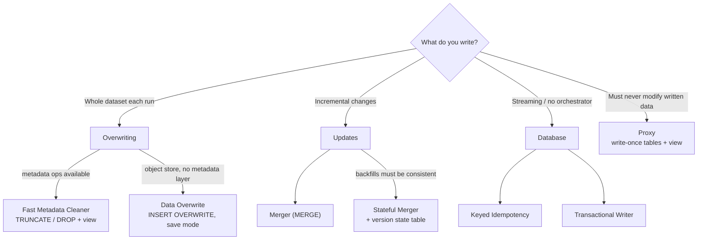
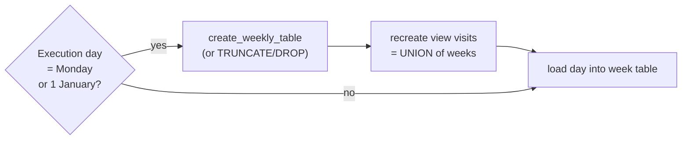
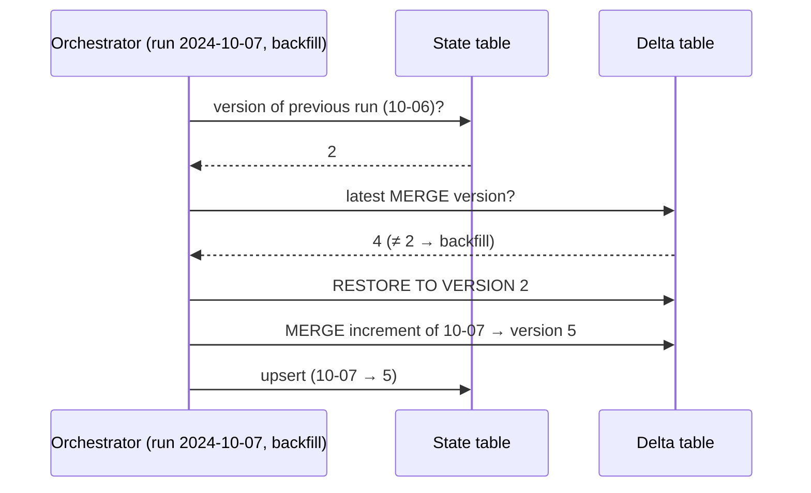

# 4. Idempotency Design Patterns

[← 3. Error Management Design Patterns](03-error-management-design-patterns.md) · [Book](../README.md) · [5. Data Value Design Patterns →](05-data-value-design-patterns.md)

## Summary

Automatic retries are great engineering and a data consistency hazard: a retried task can replay writes that already succeeded, creating duplicates — the *best* case, since the worst is duplicates nobody can recognize. Idempotency, like `absolute(-1) == absolute(absolute(-1))`, means any number of runs gives the same output, or at least clearly identifiable duplicates. The chapter's seven patterns come in four families. **Overwriting**: the **Fast Metadata Cleaner** replaces slow `DELETE`s with `TRUNCATE`/`DROP` on physically separate tables behind a view, and **Data Overwrite** replaces data files with `INSERT OVERWRITE` or a save mode. **Updates**: the **Merger** applies incremental changes with `MERGE`, and the **Stateful Merger** adds a version state table so backfills restore the table first. **Database**: **Keyed Idempotency** derives keys from immutable attributes such as append time, and the **Transactional Writer** exposes only committed data. **Immutable dataset**: the **Proxy** writes each version once and exposes the latest through a view or manifest.

## Key takeaways

- **Duplicates are the best case of a retried write**; idempotent processing makes repeated runs produce consistent output or recognizable duplicates (pp. 79–80).
- **Metadata operations beat `DELETE`**: split the dataset into tables (e.g. 52 weekly ones) behind a view, and the partitioning becomes your idempotency *and* backfill granularity (pp. 80–85).
- **`MERGE` needs immutable keys and soft deletes** — and the `is_deleted` check belongs on the `INSERT` branch too, or the first run inserts deleted rows (pp. 89–91).
- **A plain Merger isn't consistent during backfills**: replaying from 08:00 starts from the latest table, so consumers briefly see rows that didn't exist then (p. 92).
- **The Stateful Merger restores the table version created by the previous run**, from a state table of execution time → table version — limited by vacuum retention and confused by no-data commits like compaction (pp. 94–100).
- **Keys from event time aren't idempotent**: late data changes the first visit time; use the broker's **append time** (Kafka) or approximate arrival timestamp (Kinesis) (pp. 101–102).
- **Transactions make a run all-or-nothing, not idempotent across runs**: a backfill opens a new transaction and writes the records again (pp. 107–108).

## Section outline

*From the book’s own table of contents (PDF bookmarks); printed page numbers.*

- Overwriting — p. 80
  - Pattern: Fast Metadata Cleaner — p. 80
  - Pattern: Data Overwrite — p. 86
- Updates — p. 89
  - Pattern: Merger — p. 89
  - Pattern: Stateful Merger — p. 94
- Database — p. 100
  - Pattern: Keyed Idempotency — p. 100
  - Pattern: Transactional Writer — p. 105
- Immutable Dataset — p. 110
  - Pattern: Proxy — p. 110
- Summary — p. 113

## Notes

Error management patterns handle most issues, not all: automatic retries of a task or job can replay writes that already succeeded. Duplicates you can remove on the consumer side are the best case; duplicates you can't even recognize are the nightmare (p. 79). Idempotency, defined with the absolute function, means any number of runs gives consistent output without duplicates — or with clearly identifiable ones, since a messaging system without transactional producers can still duplicate on retry (pp. 79–80). The author credits Maxime Beauchemin's 2018 article “Functional Data Engineering: A Modern Paradigm for Batch Data Processing” with popularizing idempotency (p. 80).



*The vault's decision map of the chapter's patterns, following the book's summary (pp. 113–114).*

### Overwriting

Deleting existing data before writing is the easiest approach but can be compute-intensive on big datasets; data- or metadata-based solutions exist (p. 80).

#### Pattern: Fast Metadata Cleaner (pp. 80–86)

**Problem.** A daily batch processes **500 GB to 1.5 TB** of visits; for idempotency it first `DELETE`s rows from the previous run, then `INSERT`s. After three weeks, the growing table makes `DELETE` very slow (p. 80).

**Solution** (pp. 81–83). `DELETE` is a two-step action — find the rows, then rewrite the affected files. `TRUNCATE TABLE` and `DROP TABLE` are **metadata operations** (no table scan). Treat the dataset as many physically separate tables forming one logical unit behind a view — e.g. **52 weekly tables** composing a yearly visits dataset (Figure 4-1). The partitioning defines the **idempotency granularity** (here one week). The orchestration then:

1. **Decides** from the execution date whether to start a new granularity (e.g. **Exclusive Choice**, Ch. 6: Monday → initialization branch).
2. **Creates the idempotency environment**: create-then-`TRUNCATE`, or `DROP`-then-create.
3. **Updates the single abstraction** (a view unioning the weekly tables); with `DROP`, optionally remove the table from the view first so readers don't hit errors.


*Figure 4-1 (p. 81): each week lives in its own table, so redoing a week means dropping one table rather than deleting rows.*



*After Figure 4-2 and Examples 4-1/4-2 (pp. 83, 85).* For fully loaded tables, re-create the table at each load (Figure 4-3) or use Data Overwrite (p. 83).

**Consequences** (pp. 84–85):

| | |
|---|---|
| **Granularity = backfill boundary** | Backfilling one day of a weekly table means rerunning from the table-creation task for the whole week (other days only need their load step). No fine-grained backfills per provider, user or customer |
| **Metadata limits** | BigQuery: 4,000 partitions; Redshift: 200,000 tables — reached quickly across pipelines. Add a **freezing** step that merges immutable weekly tables into monthly or yearly ones |
| **Support** | Needs metadata operations: warehouses, lakehouses, relational databases — hard on plain object stores |
| **Data exposition** | Users want one entry point — a view or similar logical structure |
| **Schema evolution** | A new *optional* field needs a separate pipeline to alter existing tables; a new *required* field can come with reprocessing |

**Examples** (pp. 85–86): an Airflow `BranchPythonOperator` returning `create_weekly_table` when `day_of_week == 1 or day_of_year == 1`, else a dummy task; a `PostgresOperator` creates the week-suffixed table and a custom `PostgresViewManagerOperator` refreshes the `visits` view.

#### Pattern: Data Overwrite (pp. 86–88)

**Problem.** A daily job on event-time-partitioned visits in an object store creates duplicates on every backfill; there's no metadata layer for the Fast Metadata Cleaner (p. 86).

**Solution** (pp. 86–87):

| Layer | How |
|---|---|
| Processing framework | Spark save mode, Flink write mode; Delta Lake `replaceWhere` for **selective** overwrite |
| SQL | `DELETE FROM` + `INSERT INTO` (can target rows); `INSERT OVERWRITE` (concise, whole table/partition only); load commands with overwrite, e.g. BigQuery `LOAD DATA OVERWRITE`, or `TRUNCATE` first |

`INSERT` can take a `SELECT` instead of explicit values: `INSERT INTO visits (id, v_time) SELECT visit_id, visit_time FROM visits_raw` (p. 87). With **time travel** stores (table file formats, BigQuery, Snowflake) overwritten blocks remain until the retention period ends or a vacuum runs (p. 87).

**Consequences** (pp. 87–88): **data overhead** — big unpartitioned datasets get slower to overwrite every day (partition them, Ch. 8); **vacuum need** — deleted blocks stay on disk in table formats and relational databases.

**Examples** (p. 88): `INSERT OVERWRITE INTO devices SELECT * FROM devices_staging WHERE state = 'valid';` (Databricks, Snowflake); `bq load dedp.devices gs://devices/in_20240101.csv ./info_schema.json --replace=true` (shortcut for `WRITE_TRUNCATE`); PySpark `.write.mode('overwrite')` — not transactional by itself unless the format is, as with table formats where the delete is a new commit.

### Updates

Incremental datasets — where each delivery holds only new or changed records — can't simply be replaced (p. 89).

#### Pattern: Merger (pp. 89–94)

**Problem.** A batch pipeline must apply CDC changes from Kafka to a Delta Lake table that exactly reflects the source at a given moment, with no duplicates (p. 89).

**Solution** (pp. 89–91): choose the attributes that identify a record (user ID; or visit ID + visit time), then use **`MERGE`** (aka **UPSERT**), defining:

| Case | Action |
|---|---|
| Insert | New record → add |
| Update | Present in both → apply the new version |
| Delete | `MERGE` can't see a missing row → only **soft deletes** work (an `is_deleted` attribute) |

```sql
MERGE INTO dedp.devices_output AS target
USING dedp.devices_input AS input
ON target.type = input.type AND target.version = input.version
WHEN MATCHED AND input.is_deleted = true THEN DELETE
WHEN MATCHED AND input.is_deleted = false THEN UPDATE SET full_name = input.full_name
WHEN NOT MATCHED AND input.is_deleted = false THEN
  INSERT (full_name, version, type) VALUES (input.full_name, input.version, input.type)
```

*Example 4-6 (p. 90).* Without `is_deleted = false` on the insert branch, a first run inserts already-deleted records that later runs never remove (Figure 4-4, pp. 90–91).

**Consequences** (pp. 91–93):

- **Uniqueness**: without immutable identifying attributes, a backfill inserts instead of updating → duplicates.
- **I/O**: a data-level operation, though modern stores skip irrelevant files using metadata.
- **Incremental datasets with backfilling**: the replay starts from the *latest* table, not the table as it was.

*Table 4-1 (p. 92): normal runs (U = update, D = delete)*

| Ingestion time | New rows | Output table rows |
|---|---|---|
| 07:00 | A | A |
| 08:00 | A–U, B | A–U, B |
| 09:00 | B–D, C | A–U, C |
| 10:00 | M, N, O | A–U, C, M, N, O |

*Table 4-2 (p. 92): replaying from 08:00*

| Ingestion time | New rows | Current rows | Output table rows |
|---|---|---|---|
| 08:00 | A–U, B | A–U, C, M, N, O | A–U, B, C, M, N, O |
| 09:00 | B–D, C | A–U, B, C, M, N, O | A–U, C, M, N, O |
| 10:00 | M, N, O | A–U, C, M, N, O | A–U, C, M, N, O |

During the backfill, consumers see C, M, N and O at 08:00 although they didn't exist yet — a restore step is needed (the Stateful Merger). For **provider mistakes** you needn't replay: ask for a corrected increment and merge it, as long as row identity is unchanged (p. 93).

**Examples** (pp. 93–94): PostgreSQL `CREATE TEMPORARY TABLE changed_devices (LIKE dedp.devices)` (the `LIKE` avoids re-declaring the schema), `COPY … FROM '/data_to_load/dataset.csv'`, then `MERGE … WHEN MATCHED THEN UPDATE … WHEN NOT MATCHED THEN INSERT`.

> **Try it:** [Merger vs Stateful Merger backfill](../widgets/04-stateful-merger.html) — replay the book's A/B/C/M/N/O increments with and without the version state table and compare what consumers see.

#### Pattern: Stateful Merger (pp. 94–100)

**Problem.** A week after setting up the Merger between two Delta tables you find an issue; users want the table restored to its last valid version *before* backfilling (p. 94).

**Solution** (pp. 94–96): add a **state table** mapping each execution time to the table version its `MERGE` created, a **restore** step at the start, and a state-update step at the end (Figure 4-5). Restore only when backfilling (from orchestrator context, or detected):

1. No version for the previous execution → first run or first execution being backfilled → `TRUNCATE`, then merge.
2. Previous execution's version **=** current table version → normal run.
3. **≠** → backfill: restore the table to the previous execution's version, then merge.

*Tables 4-4 and 4-5 (pp. 95–96):*

| Execution time | Version | After backfilling 2024-10-07 |
|---|---|---|
| 2024-10-05 | 1 | 1 |
| 2024-10-06 | 2 | 2 |
| 2024-10-07 | 3 | **5** |
| 2024-10-08 | 4 | 4 |

Running 10-09 normally: the 10-08 version (4) equals the latest → merge. Rerunning 10-05: no 10-04 version → truncate. Rerunning 10-07: the 10-06 version (2) ≠ latest (4) → restore to 2, merge, record version 5; rerunning 10-08 then finds 10-07's version (5) = latest → normal run (p. 96).



*The vault's sequence for the backfill case of Tables 4-4/4-5 (pp. 95–96).*

**Consequences** (pp. 96–99):

- **Versioned stores** needed. Without them (Figure 4-6), keep a raw `devices_history` table with an execution-time column; if rows exist with `execution_time > '{{ ts }}'`, delete those `>=` the current time, rebuild the table from history with the **Windowed Deduplicator**, then load and merge.
- **Vacuum**: old versions disappear after retention; extend retention (more storage) or accept a backfill horizon.
- **No-data commits** such as **compaction** create versions too; restoring the previous run's version would drop them. With versions increasing by 1, restore `version_for_current_execution_time - 1` instead (Figure 4-7: backfilling 10-07, whose version is 9, restores 8 — the compacted version).

**Examples** (pp. 99–100): a `versions(execution_time STRING, delta_table_version INT)` table; `DESCRIBE HISTORY default.devices` filtered to `operation = "MERGE"` for the last merge version; `TRUNCATE` if no previous version, else `DeltaTable.forName(…).restoreToVersion(…)`; after the merge, upsert the new version into `versions` with a Delta `merge` (`whenMatchedUpdateAll().whenNotMatchedInsertAll()`).

### Database

When orchestration-based approaches are too much work, rely on the database (p. 100).

#### Pattern: Keyed Idempotency (pp. 100–105)

**Problem.** A streaming job buffers visits per user in a time window and writes updated sessions to a key-value store; retries must not create duplicates (p. 100).

**Solution** (pp. 101–102): make **key generation** idempotent from **immutable** properties. User ID alone would overwrite earlier sessions; user ID + first *visit (event) time* breaks when late data arrives after a restart — a late 09:55 record changes the session ID (Figure 4-8). Use the **append time** — when the broker physically stored the record (Kafka *append time*, Kinesis *approximate arrival timestamp*; in data at rest: added/ingestion/insertion time). The key then stays stable and partial results share the final ID. A window ordered by ingestion time ascending isn't affected by new rows:

```sql
SELECT ... OVER (PARTITION BY user_id ORDER BY ingestion_time ASC, visit_time ASC)
```

The same works for files, partitions or tables named after the execution time — a run on 20/11/2024 always writes `20_11_2024` (p. 102).

**Consequences** (pp. 102–103): **database-dependent** — natural for key-based NoSQL (Cassandra, ScyllaDB, HBase); relational databases reject duplicate primary keys, so writes become `MERGE`; Kafka keeps keyed duplicates until asynchronous compaction runs. **Mutable source** — compaction can delete the first event used for the key, yielding a new key on restart (arguably correct, since the data changed).

**Examples** (pp. 103–105): a ScyllaDB `sessions` table with `PRIMARY KEY(session_id, user_id)`; Spark reads Kafka's `timestamp` as `append_time`, watermarks `event_time` by 10 seconds, groups by user, and in a stateful mapping function (`GroupState`) keeps the minimum append time in state — `session_id = hash(str(min_append_time))` on timeout (50-second expiration). Kafka's append time is increasing, so the first one stays the minimum. For Kinesis, read `approximateArrivalTimestamp AS append_time`. A producer-set timestamp is less reliable than the broker's — check `log.message.timestamp.type` (p. 105).

#### Pattern: Transactional Writer (pp. 105–110)

**Problem.** A batch job on spare cloud capacity saves **60%** of infrastructure costs, but when the provider reclaims a node, tasks rerun elsewhere and consumers see duplicates and incomplete records (pp. 105–106).

**Solution** (pp. 106–107): begin a transaction (explicitly — `START TRANSACTION`/`BEGIN` — or implicitly), write privately, then **commit** (or **roll back**) so data becomes visible all at once (Figure 4-9). In warehouses (BigQuery, Redshift, Snowflake), transactions are declarative and managed by the store. In distributed ETL jobs:

| Scope | Behaviour |
|---|---|
| **Local** (per task) | Fine until a job retry rewrites already-committed tasks |
| **Whole job** | Open before tasks, commit when all finish — stronger, harder (Spark + Delta commit by writing a commit-log entry; if that fails, data files must be moved aside) |

Readers using **read uncommitted** can still see uncommitted rows — dirty reads (p. 107). Supported by table formats (Delta Lake, Iceberg, Hudi), Kafka, Redshift, BigQuery, PostgreSQL, MySQL, Oracle, SQL Server; Spark and Flink cover table formats, but Kafka transactional producers are only available from Flink (pp. 107–108).

**Consequences** (p. 108): **commit step** — extra open/commit steps and conflict resolution; transactional files become visible only at commit, so consumers wait for the slowest task. **Distributed processing** — support is partial (no Kafka transactions in Spark). **Idempotency scope** — limited to one transaction; restarts with task-local transactions and backfills write the same records again.

**Examples** (pp. 108–110): two `COPY` + `MERGE` blocks followed by one `COMMIT` — the second file has values too long for a column, so the first merge succeeds but **neither** commits. Kafka transactions work similarly: a special message starts the transaction and a metadata event confirms it. Flink's `KafkaSink` with `DeliveryGuarantee.EXACTLY_ONCE` and `transaction.timeout.ms` of one minute — exactly-once relies on checkpoints, so if a checkpoint takes longer than the timeout, the transaction expires and can't commit.

### Immutable dataset

What if you can't delete or update existing data? (p. 110).

#### Pattern: Proxy (pp. 110–113)

Named after the saying “We can solve any problem by introducing an extra level of indirection” (p. 110).

**Problem.** A job regenerates a full dataset each run and has been overwriting it; legal now requires keeping every past version while still exposing only the latest from one place (p. 110).

**Solution** (pp. 110–112), three implementations (Figure 4-10):

| Implementation | Write-once guarantee | Access point |
|---|---|---|
| Timestamped/versioned tables | Remove write permissions after creation; on object stores, **WORM** locks — S3 Object Lock, Azure Blob immutability policies, GCP object holds or bucket locks | A passthrough **view** (warehouses, relational DBs; OpenSearch aliases, Cassandra, ScyllaDB, MongoDB) |
| Files without views | Same | A **manifest** file listing locations — created by a separate task, so a manifest failure doesn't force reprocessing |
| Natively versioned stores (Delta Lake, Iceberg, BigQuery) | Every overwrite is a new version; old data kept for time travel (BigQuery: 7 days, not configurable) | The table itself |

**Consequences** (p. 112): **database support** (manifests make reading more cumbersome); **immutability configuration** — orchestration alone isn't enough; enforce it in the store (locks, revoked write permissions), maybe with the infrastructure team.

**Examples** (pp. 112–113): Airflow `load_data_to_internal_table >> refresh_view`; `CREATE OR REPLACE VIEW dedp.devices AS SELECT * FROM {{ devices_internal_table }}`, where the table name is suffixed with the DAG run's start time (`%Y%m%d_%H%M%S`) so a rerun writes a new table. The loading user should only be able to *create* tables.

### Summary

Error management protects the processing layer; idempotency completes the cycle. Overwrite when you have the whole dataset, merge when you have increments, rely on keys or transactions when there's no orchestrator (e.g. streaming), and use a Proxy when data must be written once (pp. 113–114).

## Trade-offs at a glance

| Pattern | Works on | Idempotency granularity | Main cost |
|---|---|---|---|
| Fast Metadata Cleaner | Tables/partitions with metadata ops | One table (e.g. a week) | Coarse backfills, quotas, view management |
| Data Overwrite | Any store | Overwritten dataset/partition | Slower as data grows; vacuum |
| Merger | Incremental changes | Record key | Inconsistent during backfills; needs soft deletes |
| Stateful Merger | Versioned tables | Run (table version) | State table, retention horizon, no-data commits |
| Keyed Idempotency | Key-based stores | Record key | Needs immutable key attributes |
| Transactional Writer | Transactional stores | One transaction | Commit latency; not across runs |
| Proxy | Write-once storage | Whole dataset version | View/manifest support; enforcing immutability |

## Beyond the book

- DDIA's chapter on stream processing describes the same idea as Keyed Idempotency under the name *idempotent writes with deterministic IDs*, and the Transactional Writer's “exactly once” is what Kafka calls *exactly-once semantics* via transactional producers plus `read_committed` consumers.
- The vault's [Stateful Merger widget](../widgets/04-stateful-merger.html) uses Table 4-1's data; its version numbers beyond the book's tables are the vault's.

## Connections

- **Related chapters:** [2. Data Ingestion](02-data-ingestion-design-patterns.md) (Full Loader's view switch, CDC feeding the Merger, Compactor creating no-data versions), [3. Error Management](03-error-management-design-patterns.md) (retries, Windowed Deduplicator), [6. Data Flow](06-data-flow-design-patterns.md) (Exclusive Choice), [8. Data Storage](08-data-storage-design-patterns.md) (partitioning, Manifest).

## Check yourself

*Questions and answers are the vault's, written from the notes above; answers cite the book's pages.*

1. **Why is `TRUNCATE TABLE` faster than `DELETE FROM` although both empty a table?**

   *Answer:* `DELETE` must identify rows and rewrite the affected files; `TRUNCATE` is a metadata operation with no table scan (pp. 80–81).

2. **Your visits live in weekly tables cleaned with the Fast Metadata Cleaner. One Wednesday's data was wrong. What must you rerun?**
   - [ ] Only Wednesday's load
   - [x] The week's table creation, then the loads of every day of that week (only Wednesday needs full reprocessing)
   - [ ] The whole year
   - [ ] Nothing — `MERGE` will fix it

   *Answer:* The idempotency granularity is also the backfill boundary; recreating the weekly table wipes the other days, whose load steps must be replayed (p. 84).

3. **Why does Example 4-6 check `is_deleted = false` in the `WHEN NOT MATCHED` branch?**

   *Answer:* Otherwise, on the first run, records already marked deleted would be inserted and never removed afterwards (pp. 90–91).

4. **The state table shows 10-06 → 2 and the table's latest MERGE version is 4. You rerun 10-07. What does the Stateful Merger do?**
   - [ ] Truncates the table
   - [ ] Merges directly (normal run)
   - [x] Restores the table to version 2, merges, and records the new version for 10-07

   *Answer:* Different versions signal a backfill; restoring to the previous run's version recreates the table as it was before 10-07 (pp. 95–96).

5. **Why is the user ID + first visit time a fragile session key, and what is better?**

   *Answer:* Event time is mutable across runs: late data (e.g. a late 09:55 visit) after a restart changes the first visit time and thus the key. The broker's append time can't change, so keys stay stable (pp. 101–102).

6. **Does a Transactional Writer make backfills idempotent?**

   *Answer:* No. It guarantees all-or-nothing visibility for one run; a backfill opens a new transaction and inserts the records again — idempotency is limited to the transaction (pp. 107–108).
