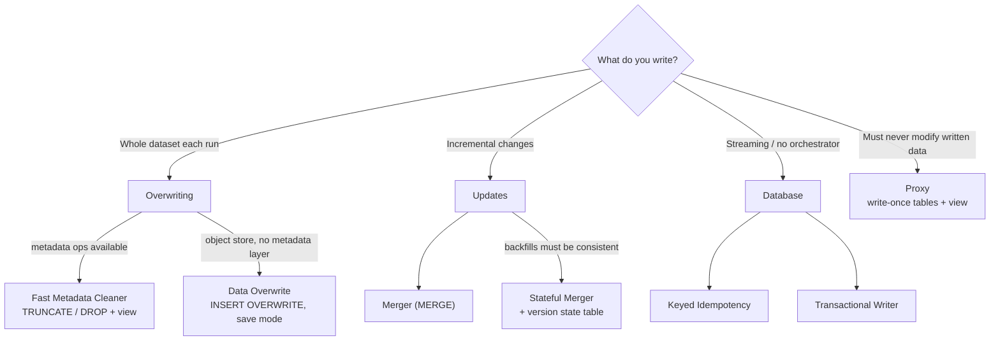
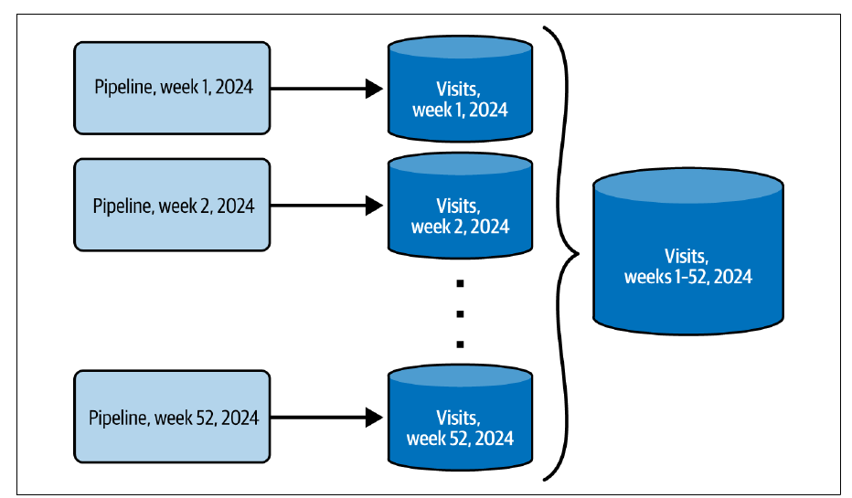
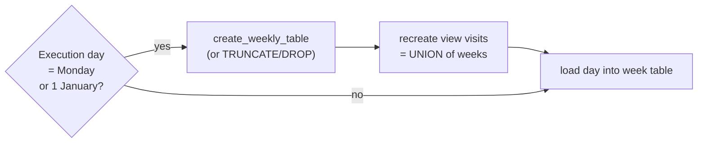
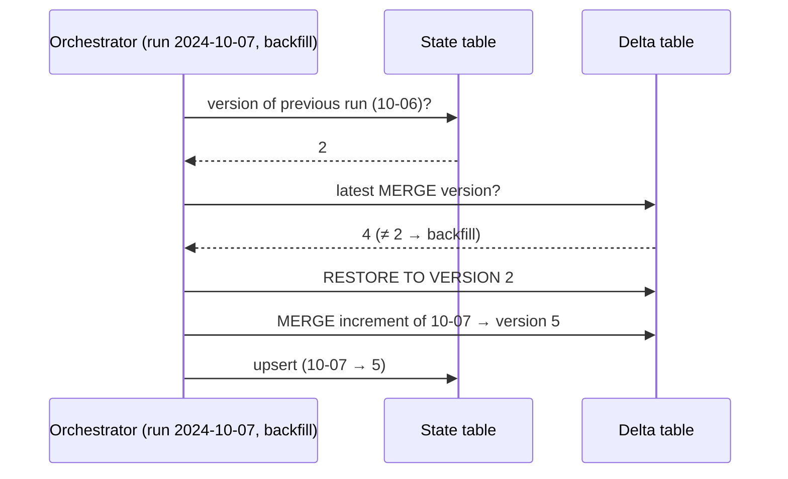

# فصل ۴: الگوهای طراحی idempotency

[فصل ۳: الگوهای طراحی مدیریت خطا →](03-error-management-design-patterns.md) · [کتاب](../README.md) · [فصل ۵: الگوهای طراحی ارزش داده ←](05-data-value-design-patterns.md)

## خلاصه

تلاش دوباره‌ی خودکار هم مهندسی خوبی است و هم خطری برای سازگاری داده: taskی که دوباره اجرا می‌شود می‌تواند نوشتن‌هایی را که از قبل موفق بوده‌اند تکرار کند و تکراری بسازد، که بهترین حالت است؛ بدترین حالت تکراری‌هایی است که کسی نمی‌شناسدشان. ویژگی idempotency، مثل `absolute(-1) == absolute(absolute(-1))`، یعنی هر تعداد اجرا همان خروجی را بدهد، یا دست‌کم تکراری‌هایی بدهد که به‌روشنی شناختنی‌اند. هفت الگوی این فصل در چهار خانواده‌اند. **بازنویسی**: الگوی **Fast Metadata Cleaner** که `DELETE`های کند را با `TRUNCATE` و `DROP` روی جدول‌های فیزیکی جدا و پشت یک view عوض می‌کند، و **Data Overwrite** که فایل‌های داده را با `INSERT OVERWRITE` یا یک save mode جابه‌جا می‌کند. **به‌روزرسانی**: **Merger** که تغییرهای افزایشی را با `MERGE` اعمال می‌کند، و **Stateful Merger** که یک جدول حالت نسخه اضافه می‌کند تا backfill اول جدول را برگرداند. **دیتابیس**: **Keyed Idempotency** که کلیدها را از ویژگی‌های immutable مثل append time می‌سازد، و **Transactional Writer** که فقط داده‌ی commit‌شده را نشان می‌دهد. **مجموعه‌داده‌ی immutable**: **Proxy** که هر نسخه را یک‌بار می‌نویسد و آخرینش را با یک view یا manifest نشان می‌دهد.

## نکته‌های کلیدی

- **تکراری بهترین حالتِ یک نوشتن تکرارشده است**؛ پردازش idempotent باعث می‌شود اجراهای تکراری خروجی سازگار بدهند یا تکراری‌های شناختنی (pp. 79–80).
- **عملیات metadata از `DELETE` بهترند**: مجموعه‌داده را به جدول‌هایی بشکنید، مثلاً ۵۲ جدول هفتگی پشت یک view، و آن‌وقت پارتیشن‌بندی هم granularity idempotency شما می‌شود و هم granularity backfill (pp. 80–85).
- **دستور `MERGE` به کلید immutable و حذف نرم نیاز دارد**، و شرط `is_deleted` باید در شاخه‌ی `INSERT` هم بیاید، وگرنه اجرای اول ردیف‌های حذف‌شده را درج می‌کند (pp. 89–91).
- **الگوی Merger ساده در زمان backfill سازگار نیست**: اجرای دوباره از ۸:۰۰ از جدید‌ترین حالت جدول شروع می‌شود، پس consumerها کوتاه‌مدت ردیف‌هایی را می‌بینند که آن موقع وجود نداشتند (p. 92).
- **الگوی Stateful Merger نسخه‌ای را برمی‌گرداند که اجرای قبلی ساخته بود**، از جدول حالتی که زمان اجرا را به نسخه‌ی جدول map می‌کند؛ محدودیتش نگه‌داری vacuum است و commitهای بی‌داده مثل compaction گیجش می‌کنند (pp. 94–100).
- **کلیدهای ساخته‌شده از زمان رویداد idempotent نیستند**: late data اولین زمان بازدید را عوض می‌کند؛ از **append time** در Kafka یا approximate arrival timestamp در Kinesis استفاده کنید (pp. 101–102).
- **تراکنش هر اجرا را همه‌یا‌هیچ می‌کند، نه idempotent بین اجراها**: backfill تراکنش تازه‌ای باز می‌کند و همان رکوردها را دوباره می‌نویسد (pp. 107–108).

## فهرست بخش‌ها

*از فهرست مطالب خود کتاب، از bookmarkهای PDF؛ شماره‌ها صفحه‌ی چاپی‌اند.*

- بازنویسی — p. 80
  - الگو: Fast Metadata Cleaner — p. 80
  - الگو: Data Overwrite — p. 86
- به‌روزرسانی — p. 89
  - الگو: Merger — p. 89
  - الگو: Stateful Merger — p. 94
- دیتابیس — p. 100
  - الگو: Keyed Idempotency — p. 100
  - الگو: Transactional Writer — p. 105
- مجموعه‌داده‌ی immutable — p. 110
  - الگو: Proxy — p. 110
- خلاصه — p. 113

## یادداشت‌ها

الگوهای مدیریت خطا بیشتر مسئله‌ها را حل می‌کنند، نه همه‌شان: تلاش دوباره‌ی خودکار یک task یا job می‌تواند نوشتن‌هایی را که از قبل موفق بوده‌اند تکرار کند. تکراری‌هایی که consumer می‌تواند پاکشان کند بهترین حالت‌اند؛ تکراری‌هایی که حتی شناختنی نیستند کابوس‌اند (p. 79). ویژگی idempotency که با تابع absolute تعریف می‌شود، یعنی هر تعداد اجرا خروجی سازگار و بدون تکراری بدهد، یا با تکراری‌های به‌روشنی شناختنی، چون سیستم پیام‌رسانی بدون producer تراکنشی باز هم می‌تواند سر تلاش دوباره تکراری بسازد (pp. 79–80). نویسنده رایج شدن این مفهوم را به مقاله‌ی سال ۲۰۱۸ از Maxime Beauchemin به نام *Functional Data Engineering: A Modern Paradigm for Batch Data Processing* نسبت می‌دهد (p. 80).



*نقشه‌ی تصمیم vault از الگوهای این فصل، بر پایه‌ی خلاصه‌ی خود کتاب (pp. 113–114).*

### بازنویسی

حذف داده‌ی موجود پیش از نوشتن ساده‌ترین روش است ولی روی مجموعه‌داده‌های بزرگ می‌تواند محاسبه‌بر باشد؛ راه‌حل‌هایی در سطح داده یا metadata هست (p. 80).

#### الگو: Fast Metadata Cleaner (pp. 80–86)

**مسئله.** یک batch روزانه بین **۵۰۰ گیگابایت و ۱٫۵ ترابایت** بازدید پردازش می‌کند؛ برای idempotency اول ردیف‌های اجرای قبلی را `DELETE` و بعد `INSERT` می‌کند. بعد از سه هفته، بزرگ شدن جدول `DELETE` را خیلی کند می‌کند (p. 80).

**راه‌حل** (pp. 81–83): دستور `DELETE` دو مرحله است، یعنی پیدا کردن ردیف‌ها و بعد بازنویسی فایل‌های اثرپذیر. دستورهای `TRUNCATE TABLE` و `DROP TABLE` **عملیات metadata**اند و جدول را پیمایش نمی‌کنند. مجموعه‌داده را چند جدول فیزیکی جدا ببینید که پشت یک view یک واحد منطقی می‌سازند؛ مثلاً **۵۲ جدول هفتگی** که مجموعه‌داده‌ی سالانه‌ی بازدید را می‌سازند (شکل ۴-۱). پارتیشن‌بندی **granularity idempotency** را تعیین می‌کند، این‌جا یک هفته. بعد زمان‌بندی این‌طور می‌شود:

۱. از تاریخ اجرا **تصمیم می‌گیرد** که granularity تازه‌ای شروع شود یا نه؛ مثلاً **Exclusive Choice** از فصل ۶، یعنی دوشنبه‌ها شاخه‌ی مقدمه‌چینی.
۲. **محیط idempotency را می‌سازد**: ساختن و بعد `TRUNCATE`، یا `DROP` و بعد ساختن.
۳. **انتزاع یکتا را به‌روز می‌کند**، یعنی viewی که جدول‌های هفتگی را union می‌کند؛ با `DROP` بهتر است جدول اول از view برداشته شود تا خواننده‌ها به خطا نخورند.



*Figure 4-1 (p. 81): هر هفته در جدول خودش می‌نشیند، پس انجام دوباره‌ی یک هفته یعنی حذف یک جدول و نه حذف ردیف‌ها.*



*بر پایه‌ی شکل ۴-۲ و نمونه‌های ۴-۱ و ۴-۲ (pp. 83, 85).* برای جدول‌هایی که کامل بار می‌شوند، جدول را در هر بار‌گذاری از نو بسازید (شکل ۴-۳) یا از Data Overwrite استفاده کنید (p. 83).

**پیامدها** (pp. 84–85):

| | |
|---|---|
| **granularity همان مرز backfill است** | backfill یک روز از جدولی هفتگی یعنی اجرای دوباره از task ساخت جدول برای کل آن هفته، در حالی که روزهای دیگر فقط مرحله‌ی بار‌گذاری را می‌خواهند. backfill دانه‌ریز برای هر تأمین‌کننده یا کاربر یا مشتری شدنی نیست |
| **محدودیت metadata** | سقف BigQuery چهار هزار پارتیشن و سقف Redshift دویست هزار جدول است، که بین pipelineها زود پر می‌شود. یک مرحله‌ی **فریز کردن** اضافه کنید که جدول‌های هفتگی immutable را در جدول‌های ماهانه یا سالانه merge کند |
| **پشتیبانی** | به عملیات metadata نیاز دارد، یعنی warehouse و lakehouse و دیتابیس رابطه‌ای؛ روی ذخیره‌سازی object ساده سخت است |
| **نمایش داده** | کاربرها یک نقطه‌ی ورود می‌خواهند، یعنی یک view یا ساختار منطقی مشابه |
| **تکامل schema** | فیلد *اختیاری* تازه به pipeline جداگانه‌ای نیاز دارد که جدول‌های موجود را تغییر دهد؛ فیلد *الزامی* تازه می‌تواند همراه پردازش دوباره بیاید |

**نمونه‌ها** (pp. 85–86): یک `BranchPythonOperator` در Airflow که وقتی `day_of_week == 1 or day_of_year == 1` نام `create_weekly_table` را برمی‌گرداند و وگرنه یک task خالی؛ یک `PostgresOperator` جدولِ پسوند‌خورده با شماره‌ی هفته را می‌سازد و یک `PostgresViewManagerOperator` سفارشی view به نام `visits` را تازه می‌کند.

#### الگو: Data Overwrite (pp. 86–88)

**مسئله.** یک job روزانه روی بازدیدهای پارتیشن‌بندی‌شده با زمان رویداد در ذخیره‌سازی object، سر هر backfill تکراری می‌سازد؛ لایه‌ی metadataیی هم برای Fast Metadata Cleaner در کار نیست (p. 86).

**راه‌حل** (pp. 86–87):

| لایه | چطور |
|---|---|
| framework پردازش | save mode در Spark، write mode در Flink، و `replaceWhere` در Delta Lake برای بازنویسی **گزینشی** |
| دستور SQL | `DELETE FROM` به‌علاوه‌ی `INSERT INTO` که می‌تواند ردیف‌ها را هدف بگیرد؛ `INSERT OVERWRITE` که کوتاه است ولی فقط کل جدول یا پارتیشن را می‌گیرد؛ و دستورهای بار‌گذاری با بازنویسی، مثل `LOAD DATA OVERWRITE` در BigQuery، یا اول `TRUNCATE` |

دستور `INSERT` می‌تواند به‌جای مقدارهای صریح یک `SELECT` بگیرد: `INSERT INTO visits (id, v_time) SELECT visit_id, visit_time FROM visits_raw` (p. 87). در ذخیره‌سازی‌های دارای **time travel**، یعنی table file formatها و BigQuery و Snowflake، بلوک‌های بازنویسی‌شده تا پایان دوره‌ی نگه‌داری یا اجرای vacuum می‌مانند (p. 87).

**پیامدها** (pp. 87–88): **سرریز داده**، یعنی مجموعه‌داده‌های بزرگ و پارتیشن‌بندی‌نشده هر روز کندتر بازنویسی می‌شوند، پس پارتیشن‌بندی‌شان کنید، فصل ۸ را ببینید؛ و **نیاز به vacuum**، چون در table formatها و دیتابیس‌های رابطه‌ای بلوک‌های حذف‌شده روی دیسک می‌مانند.

**نمونه‌ها** (p. 88): دستور `INSERT OVERWRITE INTO devices SELECT * FROM devices_staging WHERE state = 'valid';` در Databricks و Snowflake؛ فرمان `bq load dedp.devices gs://devices/in_20240101.csv ./info_schema.json --replace=true` که میان‌بر `WRITE_TRUNCATE` است؛ و `.write.mode('overwrite')` در PySpark، که خودش تراکنشی نیست مگر فرمت تراکنشی باشد، مثل table formatها که حذف در آن‌ها یک commit تازه است.

> **In practice:** در ClickHouse ارزان‌ترین بازنویسی idempotent جایگزین کردن یک partition است، نه `DELETE`.
>
> **Your turn:** باید Gold ماه گذشته را دوباره بسازید. چرا `REPLACE PARTITION` از `DELETE` و بعد `INSERT` بهتر است؟
>
> *Answer:* جایگزینی partition عملی روی metadata و اتمی است: اگر job وسط کار بمیرد، خواننده‌ها یا نسخه‌ی قبلی را می‌بینند یا نسخه‌ی تازه را. `DELETE` در ClickHouse یک mutation سنگین است و بین حذف و insert پنجره‌ای خالی می‌سازد؛ کتاب هم عملیات metadata را بر `DELETE` ترجیح می‌دهد (pp. 80–88).

### به‌روزرسانی

مجموعه‌داده‌های افزایشی، که هر تحویلشان فقط رکوردهای تازه یا تغییریافته را دارد، به‌سادگی جابه‌جا نمی‌شوند (p. 89).

#### الگو: Merger (pp. 89–94)

**مسئله.** یک pipeline batch باید تغییرهای CDC از Kafka را روی جدولی در Delta Lake اعمال کند که دقیقاً منبع را در لحظه‌ای معین بازتاب بدهد، بدون تکراری (p. 89).

**راه‌حل** (pp. 89–91): ویژگی‌هایی را انتخاب کنید که رکورد را می‌شناسانند، مثل شناسه‌ی کاربر، یا شناسه‌ی بازدید به‌علاوه‌ی زمان بازدید، و بعد از **`MERGE`** استفاده کنید، که **UPSERT** هم نامیده می‌شود، و این‌ها را تعریف کنید:

| حالت | کار |
|---|---|
| درج | رکورد تازه، یعنی اضافه شود |
| به‌روزرسانی | در هر دو هست، یعنی نسخه‌ی تازه اعمال شود |
| حذف | دستور `MERGE` ردیف نبوده را نمی‌بیند، پس فقط **حذف نرم** کار می‌کند، یعنی یک ویژگی `is_deleted` |

```sql
MERGE INTO dedp.devices_output AS target
USING dedp.devices_input AS input
ON target.type = input.type AND target.version = input.version
WHEN MATCHED AND input.is_deleted = true THEN DELETE
WHEN MATCHED AND input.is_deleted = false THEN UPDATE SET full_name = input.full_name
WHEN NOT MATCHED AND input.is_deleted = false THEN
  INSERT (full_name, version, type) VALUES (input.full_name, input.version, input.type)
```

*نمونه‌ی ۴-۶ (p. 90).* بدون شرط `is_deleted = false` در شاخه‌ی درج، اجرای اول رکوردهای از‌پیش‌حذف‌شده را درج می‌کند و اجراهای بعدی هیچ‌وقت برنمی‌دارندشان (شکل ۴-۴، صص. ۹۰–۹۱).

**پیامدها** (pp. 91–93):

- **یکتایی**: بدون ویژگی‌های شناسانده‌ی تغییرناپذیر، backfill درج می‌کند نه به‌روزرسانی، و نتیجه تکراری است.
- **عملیات I/O**: در سطح داده است، گرچه ذخیره‌سازی‌های امروزی با metadata از فایل‌های بی‌ربط می‌پرند.
- **مجموعه‌داده‌ی افزایشی به‌علاوه‌ی backfill**: اجرای دوباره از *جدید‌ترین* حالت جدول شروع می‌شود، نه از جدول آن‌طور که بود.

*جدول ۴-۱ (p. 92): اجراهای معمولی، که U یعنی به‌روزرسانی و D یعنی حذف*

| زمان ورود | ردیف‌های تازه | ردیف‌های جدول خروجی |
|---|---|---|
| ۰۷:۰۰ | A | A |
| ۰۸:۰۰ | A–U، B | A–U، B |
| ۰۹:۰۰ | B–D، C | A–U، C |
| ۱۰:۰۰ | M، N، O | A–U، C، M، N، O |

*جدول ۴-۲ (p. 92): اجرای دوباره از ۸:۰۰*

| زمان ورود | ردیف‌های تازه | ردیف‌های فعلی | ردیف‌های جدول خروجی |
|---|---|---|---|
| ۰۸:۰۰ | A–U، B | A–U، C، M، N، O | A–U، B، C، M، N، O |
| ۰۹:۰۰ | B–D، C | A–U، B، C، M، N، O | A–U، C، M، N، O |
| ۱۰:۰۰ | M، N، O | A–U، C، M، N، O | A–U، C، M، N، O |

در طول backfill، consumerها ردیف‌های C و M و N و O را در ۸:۰۰ می‌بینند، در حالی که آن موقع هنوز وجود نداشتند؛ به یک مرحله‌ی برگرداندن نیاز است، یعنی همان Stateful Merger. برای **اشتباه تأمین‌کننده** لازم نیست اجرای دوباره کنید: یک increment اصلاح‌شده بخواهید و merge کنید، تا وقتی شناسه‌ی ردیف‌ها عوض نشده (p. 93).

**نمونه‌ها** (pp. 93–94): در PostgreSQL دستور `CREATE TEMPORARY TABLE changed_devices (LIKE dedp.devices)`، که `LIKE` نمی‌گذارد schema را دوباره اعلان کنید، بعد `COPY … FROM '/data_to_load/dataset.csv'`، و بعد `MERGE … WHEN MATCHED THEN UPDATE … WHEN NOT MATCHED THEN INSERT`.

> **Try it:** [مقایسه‌ی Merger و Stateful Merger در backfill](../widgets/04-stateful-merger.html)؛ incrementهای A و B و C و M و N و O کتاب را با جدول حالت نسخه و بی آن اجرا کنید و ببینید consumer چه می‌بیند.

#### الگو: Stateful Merger (pp. 94–100)

**مسئله.** یک هفته بعد از راه‌اندازی Merger بین دو جدول Delta مسئله‌ای پیدا می‌کنید؛ کاربرها می‌خواهند جدول *پیش از* backfill به آخرین نسخه‌ی معتبرش برگردد (p. 94).

**راه‌حل** (pp. 94–96): یک **جدول حالت** اضافه کنید که هر زمان اجرا را به نسخه‌ای از جدول map می‌کند که `MERGE` آن اجرا ساخته، به‌علاوه‌ی یک مرحله‌ی **برگرداندن** در شروع و یک مرحله‌ی به‌روزرسانی حالت در پایان (شکل ۴-۵). فقط هنگام backfill برگردانید، که از context scheduler می‌آید یا تشخیص داده می‌شود:

۱. برای اجرای قبلی نسخه‌ای نیست، یعنی اجرای اول است یا اولین اجرایی است که backfill می‌شود، پس `TRUNCATE` و بعد merge.
۲. نسخه‌ی اجرای قبلی **برابر** نسخه‌ی فعلی جدول است، یعنی اجرای معمولی.
۳. **نابرابر** است، یعنی backfill: جدول را به نسخه‌ی اجرای قبلی برگردانید و بعد merge کنید.

*جدول‌های ۴-۴ و ۴-۵ (pp. 95–96):*

| زمان اجرا | نسخه | بعد از backfill تاریخ ۲۰۲۴-۱۰-۰۷ |
|---|---|---|
| ۲۰۲۴-۱۰-۰۵ | ۱ | ۱ |
| ۲۰۲۴-۱۰-۰۶ | ۲ | ۲ |
| ۲۰۲۴-۱۰-۰۷ | ۳ | **۵** |
| ۲۰۲۴-۱۰-۰۸ | ۴ | ۴ |

اجرای معمولی ۱۰-۰۹: نسخه‌ی ۱۰-۰۸ که ۴ است با جدید‌ترین نسخه برابر است، پس merge. اجرای دوباره‌ی ۱۰-۰۵: نسخه‌ای برای ۱۰-۰۴ نیست، پس truncate. اجرای دوباره‌ی ۱۰-۰۷: نسخه‌ی ۱۰-۰۶ که ۲ است با جدید‌ترین نسخه که ۴ است برابر نیست، پس برگرداندن به ۲ و merge و ثبت نسخه‌ی ۵؛ و بعد اجرای دوباره‌ی ۱۰-۰۸ می‌بیند نسخه‌ی ۱۰-۰۷ که ۵ است همان جدید‌ترین است، پس اجرای معمولی (p. 96).



*ترتیب vault برای حالت backfill در جدول‌های ۴-۴ و ۴-۵ (pp. 95–96).*

**پیامدها** (pp. 96–99):

- **ذخیره‌سازی نسخه‌دار** لازم است. بی آن (شکل ۴-۶)، یک جدول خام `devices_history` با ستون زمان اجرا نگه دارید؛ اگر ردیفی با `execution_time > '{{ ts }}'` بود، ردیف‌های `>=` زمان فعلی را حذف کنید، جدول را با **Windowed Deduplicator** از history از نو بسازید، و بعد بار‌گذاری و merge کنید.
- **عملیات vacuum**: نسخه‌های قدیمی بعد از دوره‌ی نگه‌داری از بین می‌روند؛ دوره را بکشید که یعنی ذخیره‌سازی بیشتر، یا افق backfill را بپذیرید.
- **همه‌ی commitهای بی‌داده** مثل **compaction** هم نسخه می‌سازند، و برگرداندن به نسخه‌ی اجرای قبلی آن‌ها را دور می‌ریزد. وقتی نسخه‌ها یکی‌یکی بالا می‌روند، به‌جایش `version_for_current_execution_time - 1` را برگردانید (شکل ۴-۷: برای backfill تاریخ ۱۰-۰۷ که نسخه‌اش ۹ است، نسخه‌ی ۸ یعنی نسخه‌ی compact‌شده برمی‌گردد).

**نمونه‌ها** (pp. 99–100): یک جدول `versions(execution_time STRING, delta_table_version INT)`؛ دستور `DESCRIBE HISTORY default.devices` که با `operation = "MERGE"` فیلتر شده تا آخرین نسخه‌ی merge را بدهد؛ `TRUNCATE` اگر نسخه‌ی قبلی نبود و وگرنه `DeltaTable.forName(…).restoreToVersion(…)`؛ و بعد از merge، درج‌و‌به‌روزرسانی نسخه‌ی تازه در `versions` با `merge` دلتا، یعنی `whenMatchedUpdateAll().whenNotMatchedInsertAll()`.

> **In practice:** ساختن «تازه‌ترین نسخه‌ی هر ردیف» در Silver همان Merger کتاب است.
>
> **Your turn:** چرا insert دوباره‌ی همان ردیف‌ها در `ReplacingMergeTree(update_date)` بعد از یک retry نتیجه را عوض نمی‌کند؟
>
> *Answer:* چون ردیف‌های با کلید و نسخه‌ی یکسان در merge یکی می‌شوند و خواندن با `FINAL` فقط یکی را برمی‌گرداند؛ merge بر اساس کلید، نوشتن را idempotent می‌کند، به شرط این‌که کلید از خود داده بیاید (pp. 89–94).

### دیتابیس

وقتی روش‌های مبتنی بر scheduler کار زیادی می‌برند، به دیتابیس تکیه کنید (p. 100).

#### الگو: Keyed Idempotency (pp. 100–105)

**مسئله.** یک job streaming بازدیدهای هر کاربر را در پنجره‌ای زمانی بافر می‌کند و sessionهای به‌روز‌شده را در یک ذخیره‌سازی key-value می‌نویسد؛ تلاش دوباره نباید تکراری بسازد (p. 100).

**راه‌حل** (pp. 101–102): **ساخت کلید** را از ویژگی‌های **immutable** idempotent کنید. شناسه‌ی کاربر به‌تنهایی sessionهای قبلی را بازنویسی می‌کند، و شناسه‌ی کاربر به‌علاوه‌ی اولین زمان *بازدید*، یعنی زمان رویداد، وقتی late data بعد از راه‌اندازی دوباره می‌آید می‌شکند، چون رکورد late ۹:۵۵ شناسه‌ی session را عوض می‌کند (شکل ۴-۸). از **append time** استفاده کنید، یعنی زمانی که broker رکورد را فیزیکی ذخیره کرده، که در Kafka *append time* است و در Kinesis *approximate arrival timestamp*، و در داده‌ی در حال سکون زمان اضافه شدن یا ورود یا درج. آن‌وقت کلید پایدار می‌ماند و نتیجه‌های جزئی همان شناسه‌ی نهایی را دارند. پنجره‌ای که با زمان ورود صعودی مرتب شده از ردیف‌های تازه اثر نمی‌گیرد:

```sql
SELECT ... OVER (PARTITION BY user_id ORDER BY ingestion_time ASC, visit_time ASC)
```

همین برای فایل‌ها و پارتیشن‌ها و جدول‌هایی کار می‌کند که اسمشان از زمان اجرا می‌آید، یعنی اجرای ۲۰/۱۱/۲۰۲۴ همیشه در `20_11_2024` می‌نویسد (p. 102).

**پیامدها** (pp. 102–103): **وابسته به دیتابیس**، یعنی برای NoSQLهای کلید‌محور مثل Cassandra و ScyllaDB و HBase طبیعی است؛ دیتابیس‌های رابطه‌ای کلید اصلی تکراری را رد می‌کنند، پس نوشتن تبدیل به `MERGE` می‌شود؛ و Kafka تکراری‌های هم‌کلید را تا اجرای compaction asynchronous نگه می‌دارد. **منبع mutable**، یعنی compaction می‌تواند اولین رویدادی را که کلید از آن ساخته شده حذف کند، و سر راه‌اندازی دوباره کلید تازه‌ای در بیاید، که می‌شود گفت درست است چون داده عوض شده.

**نمونه‌ها** (pp. 103–105): یک جدول `sessions` در ScyllaDB با `PRIMARY KEY(session_id, user_id)`؛ در Spark، خواندن `timestamp` از Kafka به‌عنوان `append_time`، watermark ده‌ثانیه‌ای روی `event_time`، گروه‌بندی بر حسب کاربر، و در تابع mapping stateful با `GroupState` نگه داشتن کمینه‌ی append time در حالت، و سر timeout محاسبه‌ی `session_id = hash(str(min_append_time))` با انقضای پنجاه‌ثانیه‌ای. مقدار append time در Kafka صعودی است، پس اولینش کمینه می‌ماند. برای Kinesis `approximateArrivalTimestamp AS append_time` خوانده می‌شود. زمانی که producer می‌گذارد از زمان broker کم‌اعتمادتر است؛ مقدار `log.message.timestamp.type` را ببینید (p. 105).

#### الگو: Transactional Writer (pp. 105–110)

**مسئله.** یک job batch روی ظرفیت مازاد cloud، **۶۰٪** از هزینه‌ی زیرساخت را صرفه‌جویی می‌کند، ولی وقتی تأمین‌کننده نودی را پس می‌گیرد، taskها جای دیگری دوباره اجرا می‌شوند و consumerها تکراری و رکورد ناقص می‌بینند (pp. 105–106).

**راه‌حل** (pp. 106–107): تراکنشی باز کنید، صریح با `START TRANSACTION` یا `BEGIN` یا به‌طور ضمنی، خصوصی بنویسید، و بعد **commit** یا **rollback** کنید تا داده یک‌جا دیده شود (شکل ۴-۹). در warehouseها، یعنی BigQuery و Redshift و Snowflake، تراکنش اعلانی است و ذخیره‌سازی مدیریتش می‌کند. در jobهای ETL توزیع‌شده:

| دامنه | رفتار |
|---|---|
| **محلی**، برای هر task | خوب است تا وقتی تلاش دوباره‌ی کل job، taskهای commit‌شده را بازنویسی کند |
| **کل job** | پیش از taskها باز می‌شود و وقتی همه تمام شدند commit؛ قوی‌تر و سخت‌تر است. در Spark و Delta، commit با نوشتن یک ورودی در commit log انجام می‌شود و اگر شکست بخورد باید فایل‌های داده را کنار گذاشت |

خواننده‌هایی که **read uncommitted** دارند باز هم می‌توانند ردیف‌های commit‌نشده را ببینند، یعنی خواندن کثیف (p. 107). این الگو را table formatها، یعنی Delta Lake و Iceberg و Hudi، و Kafka و Redshift و BigQuery و PostgreSQL و MySQL و Oracle و SQL Server پشتیبانی می‌کنند؛ Spark و Flink table formatها را پوشش می‌دهند، ولی producer تراکنشی Kafka فقط از Flink در دسترس است (pp. 107–108).

**پیامدها** (p. 108): **مرحله‌ی commit**، یعنی مرحله‌های اضافی باز کردن و commit و حل تضاد؛ و فایل‌های تراکنشی فقط سر commit دیده می‌شوند، پس consumerها منتظر کندترین task می‌مانند. **پردازش توزیع‌شده**، یعنی پشتیبانی ناقص است و در Spark تراکنش Kafka نیست. **دامنه‌ی idempotency**، یعنی محدود به یک تراکنش است، و راه‌اندازی دوباره با تراکنش‌های محلی task و همچنین backfill همان رکوردها را دوباره می‌نویسند.

**نمونه‌ها** (pp. 108–110): دو بلوک `COPY` و `MERGE` و بعد یک `COMMIT`؛ فایل دوم مقدارهایی دارد که برای ستون بلندند، پس merge اول موفق می‌شود ولی **هیچ‌کدام** commit نمی‌شوند. تراکنش‌های Kafka هم شبیه‌اند: یک پیام ویژه تراکنش را شروع می‌کند و یک رویداد metadata تأییدش می‌کند. در Flink، `KafkaSink` با `DeliveryGuarantee.EXACTLY_ONCE` و `transaction.timeout.ms` یک‌دقیقه‌ای؛ تحویل exactly-once به checkpoint تکیه دارد، پس اگر checkpoint بیشتر از timeout طول بکشد، تراکنش منقضی می‌شود و نمی‌تواند commit شود.

> **In practice:** jobی که خروجی API پیش‌بینی را در جدولی می‌نویسد، با هر بار اجرای دوباره ممکن است ردیف دوبل بسازد.
>
> **Your turn:** job شبانه‌ای که دسته‌ی خرج هر تراکنش را از API می‌گیرد دو بار اجرا شده است. چطور جلوی ردیف دوبل را می‌گیرید؟
>
> *Answer:* کلید ردیف را از ورودی بسازید، یعنی `transaction_id` و نسخه‌ی مدل، نه زمان اجرا؛ اجرای دوباره همان کلید را می‌نویسد و جدول آن را یکی می‌کند. این همان Keyed Idempotency است (pp. 100–105).

### مجموعه‌داده‌ی immutable

اگر نتوانید داده‌ی موجود را حذف یا به‌روز کنید چه (p. 110)؟

#### الگو: Proxy (pp. 110–113)

نامش از این گفته می‌آید که «هر مسئله‌ای را می‌شود با یک لایه‌ی اضافه‌ی غیرمستقیم حل کرد» (p. 110).

**مسئله.** یک job در هر اجرا کل مجموعه‌داده را از نو می‌سازد و تا حالا بازنویسی‌اش می‌کرده؛ قانون حالا می‌خواهد همه‌ی نسخه‌های گذشته نگه داشته شوند، در حالی که فقط آخرینش از یک‌جا نشان داده شود (p. 110).

**راه‌حل** (pp. 110–112)، سه پیاده‌سازی (شکل ۴-۱۰):

| پیاده‌سازی | تضمین یک‌بار‌نوشتن | نقطه‌ی دسترسی |
|---|---|---|
| جدول‌های زمان‌دار یا نسخه‌دار | بعد از ساختن، مجوز نوشتن را بردارید؛ روی ذخیره‌سازی object قفل‌های **WORM**، یعنی S3 Object Lock و سیاست‌های immutability Azure Blob و holdهای object یا قفل bucket در GCP | یک **view** عبوری در warehouseها و دیتابیس‌های رابطه‌ای، و aliasها در OpenSearch و Cassandra و ScyllaDB و MongoDB |
| فایل بدون view | همان | یک فایل **manifest** که مکان‌ها را فهرست می‌کند و taskی جدا می‌سازدش، پس شکست manifest پردازش دوباره را اجبار نمی‌کند |
| ذخیره‌سازی‌های بومی نسخه‌دار، یعنی Delta Lake و Iceberg و BigQuery | هر بازنویسی یک نسخه‌ی تازه است و داده‌ی قدیمی برای time travel می‌ماند؛ در BigQuery هفت روز و تنظیم‌نشدنی | خود جدول |

**پیامدها** (p. 112): **پشتیبانی دیتابیس**، چون manifest خواندن را دست‌و‌پاگیرتر می‌کند؛ و **تنظیم immutability**، چون زمان‌بندی به‌تنهایی کافی نیست و باید در ذخیره‌سازی اعمالش کنید، با قفل یا برداشتن مجوز نوشتن، شاید همراه تیم زیرساخت.

**نمونه‌ها** (pp. 112–113): در Airflow `load_data_to_internal_table >> refresh_view`؛ و `CREATE OR REPLACE VIEW dedp.devices AS SELECT * FROM {{ devices_internal_table }}`، که نام جدول با زمان شروع اجرای DAG به شکل `%Y%m%d_%H%M%S` پسوند می‌گیرد، پس اجرای دوباره جدول تازه‌ای می‌نویسد. کاربرِ بار‌گذاری باید فقط اجازه‌ی *ساختن* جدول داشته باشد.

### خلاصه

مدیریت خطا از لایه‌ی پردازش محافظت می‌کند و idempotency چرخه را کامل می‌کند. وقتی کل مجموعه‌داده را دارید بازنویسی کنید، وقتی increment دارید merge کنید، وقتی زمان‌بندی در کار نیست، مثل streaming، به کلید یا تراکنش تکیه کنید، و وقتی داده باید یک‌بار نوشته شود از Proxy استفاده کنید (pp. 113–114).

## بده‌بستان‌ها در یک نگاه

| الگو | کجا کار می‌کند | granularity idempotency | هزینه‌ی اصلی |
|---|---|---|---|
| Fast Metadata Cleaner | جدول و پارتیشن با عملیات metadata | یک جدول؛ مثلاً یک هفته | backfill درشت، سهمیه، مدیریت view |
| Data Overwrite | هر ذخیره‌سازی | مجموعه‌داده یا پارتیشن بازنویسی‌شده | کندتر شدن با رشد داده؛ vacuum |
| Merger | تغییرهای افزایشی | کلید رکورد | ناسازگاری در زمان backfill؛ نیاز به حذف نرم |
| Stateful Merger | جدول‌های نسخه‌دار | یک اجرا، یعنی نسخه‌ی جدول | جدول حالت، افق نگه‌داری، commitهای بی‌داده |
| Keyed Idempotency | ذخیره‌سازی کلید‌محور | کلید رکورد | نیاز به ویژگی‌های کلید immutable |
| Transactional Writer | ذخیره‌سازی تراکنشی | یک تراکنش | تأخیر commit؛ بین اجراها کار نمی‌کند |
| Proxy | ذخیره‌سازی یک‌بار‌نوشتنی | یک نسخه از کل مجموعه‌داده | پشتیبانی view یا manifest؛ اعمال immutability |

## فراتر از کتاب

- فصل پردازش stream در کتاب DDIA همین ایده‌ی Keyed Idempotency را با نام *idempotent writes with deterministic IDs* توضیح می‌دهد، و «exactly-once»ی که Transactional Writer می‌دهد همان است که Kafka به آن *exactly-once semantics* می‌گوید، یعنی producer تراکنشی به‌علاوه‌ی consumer `read_committed`.
- [ویجت Stateful Merger](../widgets/04-stateful-merger.html) در vault داده‌ی جدول ۴-۱ را به کار می‌برد؛ شماره‌ی نسخه‌هایش بیرون از جدول‌های کتاب، مال خود vault است.

## پیوندها

- **فصل‌های مرتبط:** [فصل ۲: ورود داده](02-data-ingestion-design-patterns.md) که عوض شدن view در Full Loader و خوراک دادن CDC به Merger و نسخه‌های بی‌داده‌ی Compactor را دارد، [فصل ۳: مدیریت خطا](03-error-management-design-patterns.md) که تلاش دوباره و Windowed Deduplicator را دارد، [فصل ۶: جریان داده](06-data-flow-design-patterns.md) که Exclusive Choice را دارد، و [فصل ۸: ذخیره‌سازی داده](08-data-storage-design-patterns.md) که پارتیشن‌بندی و Manifest را دارد.

## خودتان را بسنجید

*پرسش‌ها و پاسخ‌ها مال vault است و از روی یادداشت‌های بالا نوشته شده؛ پاسخ‌ها به صفحه‌های کتاب ارجاع می‌دهند.*

1. **چرا `TRUNCATE TABLE` از `DELETE FROM` سریع‌تر است، در حالی که هر دو جدول را خالی می‌کنند؟**

   *Answer:* دستور `DELETE` باید ردیف‌ها را بشناسد و فایل‌های اثرپذیر را بازنویسی کند، در حالی که `TRUNCATE` عملیاتی در metadata است و جدول را پیمایش نمی‌کند (pp. 80–81).

2. **بازدیدهایتان در جدول‌های هفتگی‌ای است که با Fast Metadata Cleaner پاک می‌شوند. داده‌ی یک چهارشنبه غلط بوده. چه چیزی را باید دوباره اجرا کنید؟**
   - [ ] فقط بار‌گذاری چهارشنبه را
   - [x] ساخت جدول آن هفته را و بعد بار‌گذاری همه‌ی روزهای آن هفته را، که فقط چهارشنبه پردازش دوباره‌ی کامل می‌خواهد
   - [ ] کل سال را
   - [ ] هیچ چیز را؛ دستور `MERGE` خودش درستش می‌کند

   *Answer:* granularity idempotency همان مرز backfill هم هست؛ ساختن دوباره‌ی جدول هفتگی روزهای دیگر را پاک می‌کند و مرحله‌ی بار‌گذاری‌شان باید تکرار شود (p. 84).

3. **چرا نمونه‌ی ۴-۶ در شاخه‌ی `WHEN NOT MATCHED` شرط `is_deleted = false` را می‌گذارد؟**

   *Answer:* وگرنه در اجرای اول، رکوردهایی که از قبل حذف علامت خورده‌اند درج می‌شوند و بعد از آن هیچ‌وقت برداشته نمی‌شوند (pp. 90–91).

4. **جدول حالت می‌گوید ۱۰-۰۶ به ۲ و جدید‌ترین نسخه‌ی merge جدول ۴ است. اجرای ۱۰-۰۷ را دوباره راه می‌اندازید. الگوی Stateful Merger چه می‌کند؟**
   - [ ] جدول را truncate می‌کند
   - [ ] مستقیم merge می‌کند، یعنی اجرای معمولی
   - [x] جدول را به نسخه‌ی ۲ برمی‌گرداند، merge می‌کند، و نسخه‌ی تازه را برای ۱۰-۰۷ ثبت می‌کند

   *Answer:* نابرابر بودن نسخه‌ها نشانه‌ی backfill است؛ برگرداندن به نسخه‌ی اجرای قبلی جدول را همان‌طور که پیش از ۱۰-۰۷ بود از نو می‌سازد (pp. 95–96).

5. **چرا شناسه‌ی کاربر به‌علاوه‌ی اولین زمان بازدید کلید شکننده‌ای برای session است، و چه چیزی بهتر است؟**

   *Answer:* زمان رویداد بین اجراها mutable است: داده‌ی دیررس، مثلاً بازدید late ۹:۵۵، بعد از راه‌اندازی دوباره اولین زمان بازدید و در نتیجه کلید را عوض می‌کند. مقدار append time در broker نمی‌تواند عوض شود، پس کلیدها پایدار می‌مانند (pp. 101–102).

6. **آیا Transactional Writer کاری می‌کند که backfill هم idempotent باشد؟**

   *Answer:* نه. فقط برای یک اجرا دیده شدن همه‌یا‌هیچ را تضمین می‌کند؛ backfill تراکنش تازه‌ای باز می‌کند و رکوردها را دوباره درج می‌کند، پس idempotency محدود به همان تراکنش است (pp. 107–108).
