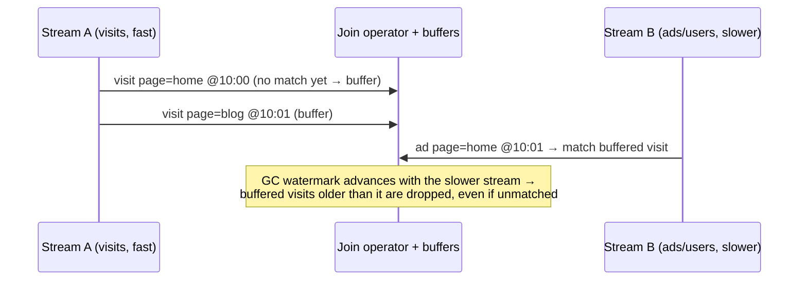
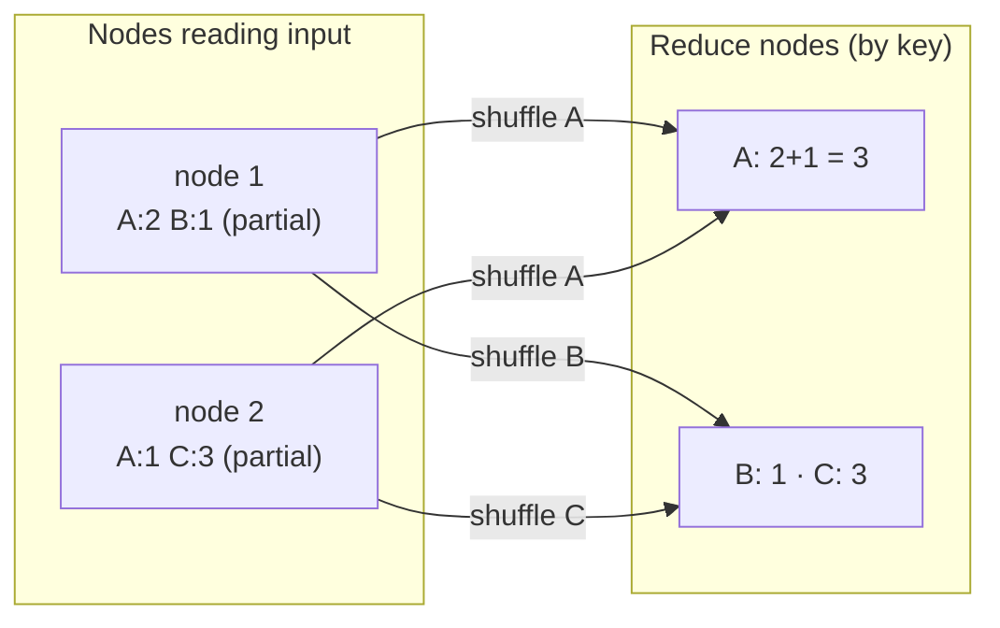
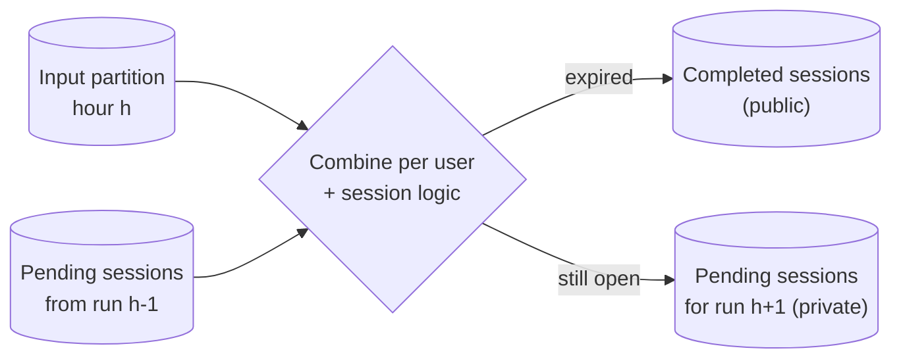

# 5. Data Value Design Patterns

[← 4. Idempotency Design Patterns](04-idempotency-design-patterns.md) · [Book](../README.md) · [6. Data Flow Design Patterns →](06-data-flow-design-patterns.md)

## Summary

Raw data in storage isn't yet an asset: a browser visit event knows the browser version and language, but nothing that connects visitors to each other. The chapter's ten patterns add value either by **adding information** or by **reducing it** to something understandable. **Static Joiner** and **Dynamic Joiner** enrich data from slowly changing reference data (with SCD types 2/4 for time correctness) or from another stream (with time-bounded buffers and a GC watermark). **Wrapper** and **Metadata Decorator** annotate records with computed or technical attributes, visibly or hidden in the metadata layer. **Distributed Aggregator** and **Local Aggregator** summarize data with or without a shuffle. **Incremental Sessionizer** and **Stateful Sessionizer** build sessions in batch (with pending-session storage) or streaming (with a state store). Finally, **Bin Pack Orderer** and **FIFO Orderer** keep data in order — the first even on bulk APIs with partial commits.

## Key takeaways

- **Joins with reference data need time**: use SCD type 2 or 4 and an immutable execution time (not `NOW()`) so backfills join the same version; materialize API data for idempotency (pp. 116–120).
- **Stream-to-stream joins need buffers and a GC watermark**: the faster stream waits for the slower one; how long you buffer trades memory against missed joins (pp. 122–124).
- **Wrapper vs Metadata Decorator is about audience**: wrapped values are for consumers; metadata (job version, batch) is data about data and stays hidden (pp. 125–132).
- **Shuffle is the latency troublemaker**: partial aggregation before it, salting for skew, and a shuffle service for scaling help; a Local Aggregator avoids it entirely when data is already partitioned by the grouping key (pp. 133–141).
- **Sessions are forward dependent**: backfilling the 09:00 partition means regenerating every later one; inactivity periods trade late-data coverage for resources (pp. 142–145).
- **Partial commits break ordering**: bulk writes of 10:00, 10:10, 10:20 may store only 10:20; a Bin Pack Orderer puts at most one record per entity in each bulk request (pp. 153–157).
- **FIFO isn't exactly once**: a successful send followed by a failed ack resends on restart (pp. 159–160).

## Section outline

*From the book’s own table of contents (PDF bookmarks); printed page numbers.*

- Data Enrichment — p. 116
  - Pattern: Static Joiner — p. 116
  - Pattern: Dynamic Joiner — p. 121
- Data Decoration — p. 125
  - Pattern: Wrapper — p. 125
  - Pattern: Metadata Decorator — p. 129
- Data Aggregation — p. 133
  - Pattern: Distributed Aggregator — p. 133
  - Pattern: Local Aggregator — p. 137
- Sessionization — p. 141
  - Pattern: Incremental Sessionizer — p. 141
  - Pattern: Stateful Sessionizer — p. 147
- Data Ordering — p. 153
  - Pattern: Bin Pack Orderer — p. 153
  - Pattern: FIFO Orderer — p. 158
- Summary — p. 162

## Notes

Data sitting in storage is “not a real asset” until it is made useful. Visit events produced by browsers carry technical details (browser version, language, OS) but no relationships, so a question like “what do visitors of a given browser have in common?” needs extra work (p. 115). The chapter adds value by combining datasets or computing attributes (enrichment, decoration), summarizing (aggregation, sessionization), and ordering (p. 115).

| Goal | Patterns |
|---|---|
| Add context | Static Joiner, Dynamic Joiner |
| Annotate records | Wrapper, Metadata Decorator |
| Summarize | Distributed Aggregator, Local Aggregator |
| Group activity | Incremental Sessionizer, Stateful Sessionizer |
| Preserve order | Bin Pack Orderer, FIFO Orderer |

*The vault's map of the chapter's five families, following the book's summary (p. 162).*

### Data enrichment

Events describe time and place well but lack context — the last connection date or a profile score of the user (p. 116).

#### Pattern: Static Joiner (pp. 116–121)

**Problem.** Stakeholders want to relate a user's registration date to daily activity, but visits lack user context, which lives only in a static user reference dataset (p. 116).

**Solution** (pp. 116–118): join on shared keys (e.g. `user_id`) — works even for streaming pipelines. If the reference data changes over time, add **time constraints** via **slowly changing dimensions (SCD)**:

| SCD type (p. 117) | Storage | Current value |
|---|---|---|
| **Type 2** | One table with validity dates | Row with an empty/open end date |
| **Type 4** | Two tables: current values + full history | The current table |

Enrichment is usually a SQL `JOIN`, or an HTTP call to an external API — which can also be **materialized** as a table in a pre-processing step (Figure 5-2). For idempotency, materialize the API data and use an SCD form so a replay sees the same dataset (p. 118).

**Consequences** (p. 119): **late data and consistency** — a profile change followed by a visit may not be reflected; streaming pipelines can use the Dynamic Joiner, batch pipelines can wait via a **Readiness Marker**. **Idempotency** — if the provider has no time-based queries, bring the enrichment data into your own store with SCD.

**Examples** (pp. 119–121):

```sql
SELECT v.visit_id, v.event_time, v.page, u.id, u.login, u.email
FROM dedp.visits v JOIN dedp.users u ON u.id = v.user_id
AND NOW() BETWEEN start_date AND end_date;
```

*Example 5-2 (p. 120): `users` has `start_date` and `end_date` (default `'9999-12-31'`). Replace `NOW()` with the orchestrator's execution time for idempotency.*

A Spark stream-to-batch `left_outer` join of Kafka visits with a Delta Lake devices table (insert-only, so no time condition) — the static side has its own lifecycle, so you can miss joins, or join against an *empty* table during a full rewrite if it were raw JSON/CSV; a table format's atomicity prevents that (pp. 120–121). For APIs, use **bulk** calls: a writer buffers 100 records and requests geolocation for the unique, not-yet-mapped IPs at once (p. 121).

#### Pattern: Dynamic Joiner (pp. 121–125)

**Problem.** With thousands of new users a week, profile changes are frequent and the static join gives stale results; user changes now arrive on the broker via CDC (p. 122).

**Solution** (pp. 122–123): keys and join method as before, plus **time boundaries**. The two streams have different latencies, so each side keeps a **time-bounded buffer** — if users are one hour behind visits, visits are buffered an extra hour. A **GC watermark** removes buffered events that are too old (older than the slower stream's oldest event time), losing joins for very late records in exchange for bounded state (Figure 5-3). Frameworks implement the buffering for you.



*The vault's sketch of Figure 5-3 (p. 123), using the visits-with-ads example of p. 124.*

**Consequences** (pp. 123–124): **space vs exactness** — bigger buffers find more joins at more cost; no formula, depends on usual latency difference. **Late data** — events from areas with connectivity problems may arrive after the GC watermark moved on; integrate late data (Ch. 3).

**Examples** (pp. 124–125): Spark — visits and ads each `withWatermark(…, '10 minutes')`, joined `left_outer` on `page = visit_page AND display_time BETWEEN event_time AND event_time + INTERVAL 2 minutes` (business rule: an ad shows at most 2 minutes after the visit). Flink **temporal table joins** (Java only): watermarks of 5 minutes on both topics, a `TemporalTableFunction` on `update_time` keyed by `ad_page`, and `joinLateral` to get the latest ad with `update_time <= event_time`.

### Data decoration

Enriched data is still raw; decoration prepares it to be understood (p. 125).

#### Pattern: Wrapper (pp. 125–129)

**Problem.** Visits from different providers have different schemas; a streaming job must extract fields into one place for consumers while keeping the original structure for debugging, clearly separated from computed values (pp. 125–126).

**Solution** (pp. 126–127): wrap the original record in an **envelope** holding raw attributes plus computed ones (from the data or the execution context, e.g. processing time, job version). Works for Avro, Protobuf, JSON and tables (Figure 5-4):

| Implementation | Layout | Note |
|---|---|---|
| 1 | Original columns flat; computed nested | Denormalized — faster reads |
| 2 | Computed flat; original nested | Denormalized |
| 3 | All columns flat, same level | Book calls this normalized — slower reads, logical isolation, original structure unchanged |
| 4 | Two tables joined by a unique key | Separate datasets |

In a table, the envelope is simply the row (p. 127). All need schema management (Ch. 9).

**Consequences** (pp. 127–128): **domain split** — user fields end up in both *raw* and *computed*, so keep wrapping in early layers (Silver), not in user-facing Gold. **Size** — decorations travel with every record; columnar **projection** (Redshift, BigQuery) reads only needed columns.

**Examples** (pp. 128–129): PySpark adds a `processing_context` struct (`job_version`, `batch_version`) and writes `to_json(struct(raw_data, processing_context))`; SQL `NAMED_STRUCT('is_connected', …, 'page_referral_key', CONCAT_WS('-', page, context.referral)) AS decorated`; or promote computed columns and push the original into `STRUCT(visit_id, event_time, user_id, page, context) AS raw`.

#### Pattern: Metadata Decorator (pp. 129–133)

**Problem.** Streaming jobs ship almost weekly; you want the job version on each record for maintenance, but not in what end users see (pp. 129–130).

**Solution** (pp. 130–131): put the technical context in the **metadata layer**:

| Store | How |
|---|---|
| Apache Kafka | Record **headers** (key-value pairs besides key and value) |
| Object stores | **Tags** on files (when metadata applies to all rows in a file) |
| Tables / databases | A hidden `processing_context` column exposed through a view or column permissions (Table 5-1), or a separate technical table referenced by `processing_context_id` (Tables 5-2/5-3) |

*Table 5-1 (p. 130):* `event_id = 1`, `event_time = 2023-06-10T10:00:59Z`, `processing_context = {"job_version": "v1.0.3", "processing_time": "2023-06-10T10:02:00Z"}`.

Wrapper and Metadata Decorator differ only in semantics: metadata *describes* the data and isn't for business users (p. 131).

**Consequences** (p. 131): **implementation** — Amazon Kinesis Data Streams has no headers; tables need extra columns or tables. **Data** — never put business attributes (shipment addresses, invoice amounts) in metadata, where consumers won't look.

**Examples** (pp. 132–133): Spark adds a `headers` array of `(key, value)` structs (`job_version`, `batch_version`) and writes to Kafka with `includeHeaders`; a `dedp.visits_context` table (`execution_date_time`, `loading_time`, `code_version`, `loading_attempt` = Airflow `try_number`) whose key is written into each weekly visits table.

### Data aggregation

Removing information can add value too (p. 133).

#### Pattern: Distributed Aggregator (pp. 133–137)

**Problem.** Build an **OLAP cube** of cleaned Silver visits — counts, average duration across user geography, devices, etc. — with daily and weekly views over daily event-time partitions (p. 133).

**Solution** (pp. 133–135): a **cluster** of machines that individually can't hold the data; group-by then reduce, same API as locally. Under the hood, a **shuffle** exchanges records over the network so related rows meet on one node (Figure 5-5) — often the first latency problem. **Partial aggregation** before the shuffle (e.g. local counts per key, then summing numbers) makes exchanges smaller. This is the **MapReduce** model (2004), from disk-based Hadoop MapReduce to memory-first Apache Spark (p. 134).



*The vault's drawing of Figure 5-5 with the partial count optimization described on p. 134.*

**Consequences** (pp. 135–136):

| Issue | Detail | Mitigation |
|---|---|---|
| **Extra network exchange** | Input read (storage and compute rarely colocated) + the shuffle | Local Aggregator, when possible |
| **Data skew** | One key with far more rows costs most to move and process | **Salting**: `groupBy('group_key', 'salt')` then `groupBy('group_key')` with `salt = (rand()*3).cast("int")`; Spark **Adaptive Query Execution** |
| **Scaling** | Nodes holding shuffle data can't be released while the job runs | A **shuffle service** — Spark External Shuffle Service, GCP Dataflow Shuffle |

**Examples** (pp. 136–137): Spark joins JSON visits with a PostgreSQL devices table read via JDBC; `explain()` shows `Exchange hashpartitioning` nodes under a `SortMergeJoin`, with local filtering first. BigQuery can join tables with GCS files declared as **external tables** (also Redshift, Azure Synapse, Snowflake).

#### Pattern: Local Aggregator (pp. 137–141)

**Problem.** A streaming job windows visits from a partitioned broker whose partition count never changes; you want to drop the shuffle the framework adds automatically (pp. 137–138).

**Solution** (pp. 138–139): if all records for a grouping key are already in the same input partition — a **static per-record partitioning key** and an **immutable partition count**, guaranteed by the producer — aggregate locally with only the input read. Tasks are also isolated, so slow ones don't hold others back. Kafka Streams `groupByKey`; Spark has no hint, but `mapPartitions`/`foreachPartition` allow local aggregation, and it skips the shuffle for datasets bucketed by the same key into the same number of buckets (**Bucket** pattern, Ch. 8). Small datasets can be aggregated in one node's memory.

**Consequences** (p. 139): **scaling** — changing partitions splits a key across groups; repartitioning means rewriting the whole dataset, or in streaming a stop-the-world switch. **Grouping keys** — one partitioning serves one grouping (change type vs user ID needs a Distributed Aggregator for one of them).

**Examples** (pp. 139–141): Kafka Streams `stream("visits").groupByKey().aggregate(…)` → `visits-aggregated`, using each record's key without network exchange; Spark `sortWithinPartitions(['visit_id', 'event_time'])` + `foreachPartition` with a `KafkaWriter` that emits a visit's pages when `visit_id` changes; Redshift `DISTSTYLE ALL` (copy `users` to every node) and `DISTSTYLE KEY, DISTKEY(visit_id)` (colocate rows by key).

### Sessionization

Sessions combine events of one activity — a starting point, events, an ending point — like watching videos or working out (p. 141).

#### Pattern: Incremental Sessionizer (pp. 141–147)

**Problem.** Visits land in **hourly partitions**; sessions start at the first visit and end after **two hours** without activity. A session lasts from minutes to **three hours**, so it can span up to three partitions (pp. 141–142).

**Solution** (pp. 142–144): three storage spaces and three session states.

| Storage | Visibility | Content |
|---|---|---|
| Input dataset | — | Hourly visits |
| **Completed sessions** | Public | Finished sessions (ongoing ones flagged, e.g. `is_final = false`) |
| **Pending sessions** | Private | Sessions that continue into the next run; may hold technical fields (execution ID) |

Each run combines the input with the previous run's pending sessions per entity → a **new** session, a **restored** session with new data, or a restored one without new data (likely expiring). Then apply **initialization** (e.g. a home-page visit), **accumulation** (e.g. pages in order) and **finalization** (an event type, or inactivity — e.g. three hours) (Figure 5-6).



*After Figure 5-6 (p. 143).*

**Consequences** (pp. 144–145): **inactivity period** — longer includes more late data but costs more and delays sessions; partial sessions can be emitted but may change (a banking fraud session first “not at risk”, later “risky”) — flag them `is_completed: false`. **Data freshness** — batch insights are late; partial sessions help. **Late data and backfilling** — sessions are **forward dependent**: 09:00 affects 10:00 affects 11:00, so a backfill must replay all later partitions (cheap code, high cost) or detect affected entities (cheap, complex).

**Examples** (pp. 145–146): Airflow first deletes `sessions` and `pending_sessions` rows with `execution_time_id >= '{{ ds }}'`, loads the hour into a temporary table, then a `FULL OUTER JOIN` of new visits with pending sessions from `{{ prev_ds }}` uses `COALESCE`, `LEAST(start_time)`, `GREATEST(last_visit_time)`, `ARRAY_CAT(pages)` and sets `expiration_batch_id` to `ds + 2` when there's new data; rows with `expiration_batch_id = ds` go to `sessions`, the rest to `pending_sessions`.

#### Pattern: Stateful Sessionizer (pp. 147–153)

**Problem.** Hourly partitions cap freshness at one hour; visits are on the broker within seconds — produce sessions in near real time (p. 147).

**Solution** (pp. 147–149): a stateful streaming job whose **state store** plays the role of pending-session storage — fast in memory, regularly synchronized to fault-tolerant storage (Figure 5-7). Same workflow: create or resume, combine, emit completed (or partial) sessions and save the rest. Two abstractions:

| Abstraction | How sessions end |
|---|---|
| **Session windows** | A **gap duration** per key: a gap > 20 minutes between events starts a new window (Figure 5-8) |
| **Arbitrary stateful processing** | Your own logic — static or per-key dynamic timers (Spark Structured Streaming, Flink, GCP Dataflow) |

**Consequences** (pp. 149–150): **at-least-once** — state is checkpointed irregularly, so restarts reprocess; don't build session keys from values that change between runs (e.g. real time). **Scaling** — state rebalancing pauses processing for moved keys. **Inactivity length** — the same cost/coverage balance. **Inactivity time** — expire state by **event time**; processing-time expiration can close sessions early after unexpected latency.

**Examples** (pp. 150–153): Spark `withWatermark('event_time', '1 minute').groupBy('visit_id').applyInPandasWithState(…, outputMode="update", timeoutConf="EventTimeTimeout")`; on timeout emit and `remove()` the state, otherwise append visits and `setTimeoutTimestamp(base_watermark + 10 minutes)`, using the max event time only while the watermark is still 0. Watermark-based expiration closes sessions sooner than event-time-based:

*Table 5-4 (p. 152): 1-minute watermark, 10-minute state expiration*

| State key | Event time | Expiration (watermark-based) | Expiration (event-time-based) | New watermark |
|---|---|---|---|---|
| A | 10:00 | 10:10 | 10:10 | 09:59 |
| A | 10:01 | 10:09 | 10:11 | 10:00 |
| A | 10:08 | 10:10 | 10:18 | 10:07 |
| B | 10:15 | 10:17 | 10:25 | 10:14 |

With watermark-based expiration, A (expiring 10:10) is emitted as soon as B's first record moves the watermark to 10:14; with event-time expiration it waits (10:18 > 10:14). Flink's alternative: `key_by(VisitIdSelector()).window(EventTimeSessionWindows.with_gap(Time.minutes(10))).allowed_lateness(15 minutes)` (pp. 152–153).

### Data ordering

Chronology matters: a car-fleet tracker without ordering would show cars jumping over buildings or swimming across rivers (p. 153).

#### Pattern: Bin Pack Orderer (pp. 153–158)

**Problem.** Visit events from external websites embedding your pages must be exposed through an API. One job for all partners builds a 10-minute processing-time window of per-minute aggregates and flushes them per partner, per minute, in event-time order — into a broker with **partial commit** semantics (p. 154).

**Partial commits** (p. 154): besides success and failure, a bulk write can partially succeed. Writing 10:00, 10:10, 10:20, if only 10:20 lands, retrying the other two breaks the order. Found in Kinesis `PutRecords`, DynamoDB `BatchWriteItem`, Elasticsearch bulk.

**Solution** (pp. 155–156): sending records one by one works but costs a request per record. Instead (Figure 5-9):

1. **Sort** by grouping key and event time.
2. **Pack** into bins so each bin holds **at most one record per key** (the 1st record of every key in bin 1, the 2nd in bin 2, …).
3. **Emit bins sequentially**; a retry stays inside its bin and can't reorder a key; the next bin waits until the current one is fully written.

> **Try it:** [Bin packing vs partial commits](../widgets/05-bin-pack-orderer.html) — send the same events with naive bulk requests and with bins, inject partial failures, and see which keys end up out of order.

**Consequences** (p. 157): **retries** of the *whole* pipeline still resend emitted bins and break ordering; **complexity** — custom sort and bin creation vs a plain sort.

**Examples** (pp. 157–158): Spark `sortWithinPartitions(['visit_id', 'event_time']).foreachPartition(…)` with a writer that resets the bin index to 0 when `visit_id` changes and appends each row to `delivery_groups[index]`, then delivers group by group to Kinesis.

#### Pattern: FIFO Orderer (pp. 158–162)

**Problem.** A streaming job must forward a subset of visit events, in processing order, as soon as possible — no buffering (p. 158).

**Solution** (p. 158): send each record and wait for the **acknowledgment** before the next — with a single-record API (Kinesis `PutRecord`, Kafka `send()` + synchronous `flush()`), or a bulk API with concurrency 1 on **full-commit** stores. In Kafka, `max.in.flight.requests.per.connection = 1`, or the **idempotent producer**, which keeps order with up to **five** in-flight requests. In-flight requests boost throughput but can reorder: if the second of two succeeds and the first is retried (p. 159).

**Consequences** (pp. 159–160): **I/O overhead and latency** — one request per record; multithreading helps if each entity's records go to the same thread. **FIFO isn't exactly once** — `producer.send(message)` then `consumer.ack(message)`: if the ack fails after a successful send, the restart resends; use Chapter 4's patterns.

**Examples** (pp. 160–162):

| Store | Configuration |
|---|---|
| Kafka, individual | `produce()` + `flush()` |
| Kafka, bulk | `max.in.flight.requests.per.connection: 1`, `queue.buffering.max.ms: 1000` |
| Kafka, idempotent | `max.in.flight.requests.per.connection: 5`, `enable.idempotence: True`, `queue.buffering.max.ms: 2000` (KIP-98) |
| Kinesis | `put_record` with `SequenceNumberForOrdering` = previous sequence number (otherwise only rough order) |
| GCP Pub/Sub | `ordering_key` — FIFO per key, single producer, single region |

### Summary

Value comes from adding information (enrichment — even across batch and streaming; decoration — visible wrappers or hidden metadata) or reducing it (aggregation, sessionization), and from preserving order (Bin Pack Orderer for partial commits, FIFO Orderer for simplicity). The next chapter connects these pipelines (pp. 162–163).

## Trade-offs at a glance

| | Static Joiner | Dynamic Joiner |
|---|---|---|
| Enrichment side | At rest (reference, API) | In motion (stream) |
| Time handling | SCD validity dates | Buffers + GC watermark |
| Main risk | Stale/late reference data; idempotency | Missed joins for late data; memory |

| | Distributed Aggregator | Local Aggregator |
|---|---|---|
| Network | Input read + shuffle | Input read only |
| Requirements | None | Fixed partitions keyed by the grouping key |
| Scaling | Easy (shuffle service) | Hard (reorganize data) |

| | Incremental Sessionizer | Stateful Sessionizer |
|---|---|---|
| Layer | Batch | Streaming |
| Pending state | Private table | State store |
| Freshness | Partition interval (e.g. 1 hour) | Seconds |

| | Bin Pack Orderer | FIFO Orderer |
|---|---|---|
| Requests | Bulk, one record per key per bin | One per record (or bulk with concurrency 1) |
| Works with partial commits | Yes | Only with single-record API |
| Complexity | Custom sort + bins | Simple |

## Beyond the book

- Ralph Kimball's dimensional modeling literature is where SCD types 1–7 are defined; the book uses only types 2 and 4.
- Salting trades one skewed group for several smaller ones plus a second aggregation — it only works for aggregations that can be combined (sums, counts, min/max), not, say, an exact median.

## Connections

- **Related chapters:** [2. Data Ingestion](02-data-ingestion-design-patterns.md) (CDC, Readiness Marker, Incremental Loader), [3. Error Management](03-error-management-design-patterns.md) (watermarks, state stores, Dead-Letter metadata), [4. Idempotency](04-idempotency-design-patterns.md) (exactly-once delivery, Keyed Idempotency), [8. Data Storage](08-data-storage-design-patterns.md) (Bucket, Denormalizer).

## Check yourself

*Questions and answers are the vault's, written from the notes above; answers cite the book's pages.*

1. **Why replace `NOW()` with the orchestrator's execution time in an SCD type 2 join?**

   *Answer:* The execution time is immutable for a run, so a backfill joins the same user version as the original run — the join becomes idempotent (p. 120).

2. **In a stream-to-stream join, what does the GC watermark trade?**
   - [ ] Throughput for ordering
   - [x] Buffer size (resources) against joins lost for records that arrive too late
   - [ ] Exactly-once for at-least-once
   - [ ] Shuffle cost for latency

   *Answer:* Keeping buffered events forever would need unbounded resources; the GC watermark drops old ones, so very late matches are missed (pp. 122–124).

3. **When should technical context like a job version go into a Metadata Decorator rather than a Wrapper?**

   *Answer:* When it describes the data rather than being business information — consumers don't care which job version produced a record, so hide it in headers, tags or hidden columns (pp. 129–131).

4. **What makes a Local Aggregator possible, and what does it cost?**

   *Answer:* All records of a grouping key must already be in one input partition (static partitioning key, fixed partition count). It removes the shuffle but makes scaling and multiple grouping keys hard (pp. 138–139).

5. **A bulk API may partially commit. Events for key K are 10:00, 10:10, 10:20. How does a Bin Pack Orderer keep K in order?**
   - [ ] It sends all three in one request and retries the whole request
   - [x] It puts each in a different bin and sends bin 2 only after bin 1 is fully written
   - [ ] It sorts them in reverse order
   - [ ] It relies on the broker to reorder

   *Answer:* With at most one record per key per bin, a partial failure only affects one record of K, retried before the next bin is sent (pp. 155–156).

6. **Why are sessions called forward dependent?**

   *Answer:* The session state built for one partition feeds the next (09:00 → 10:00 → 11:00), so late data or a backfill in one partition forces regeneration of all later ones (pp. 144–145).
