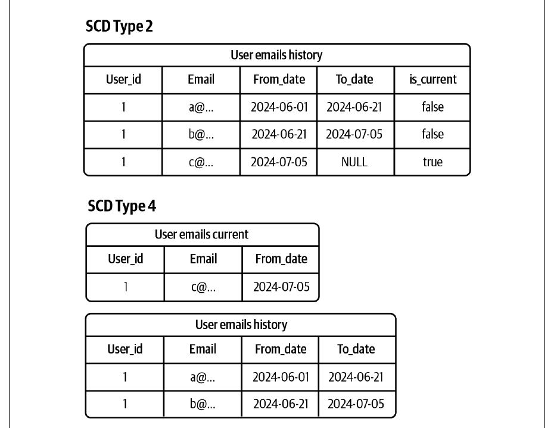
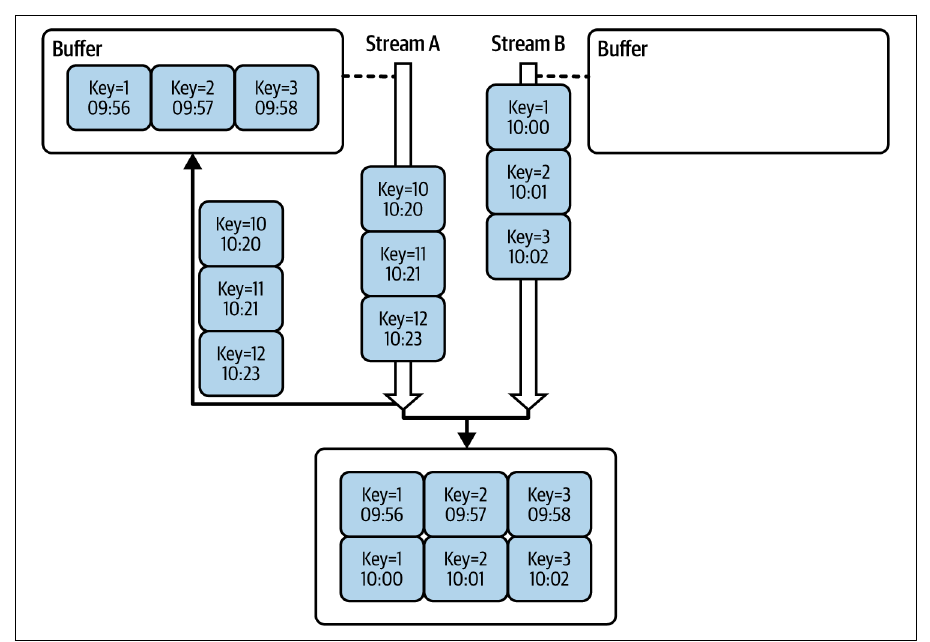
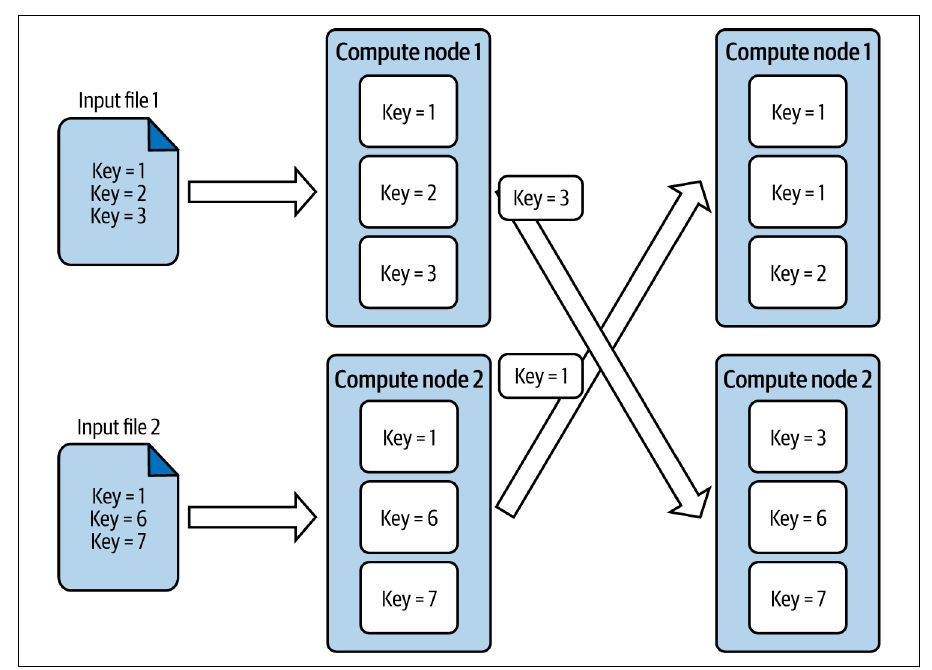
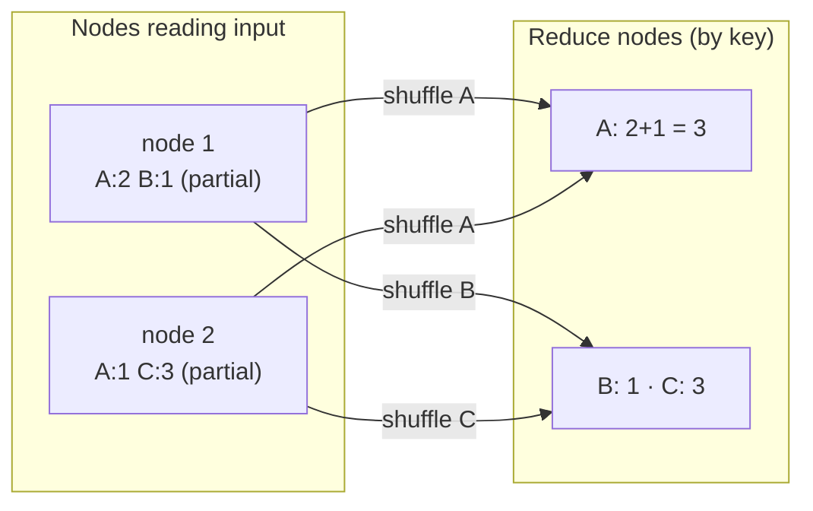
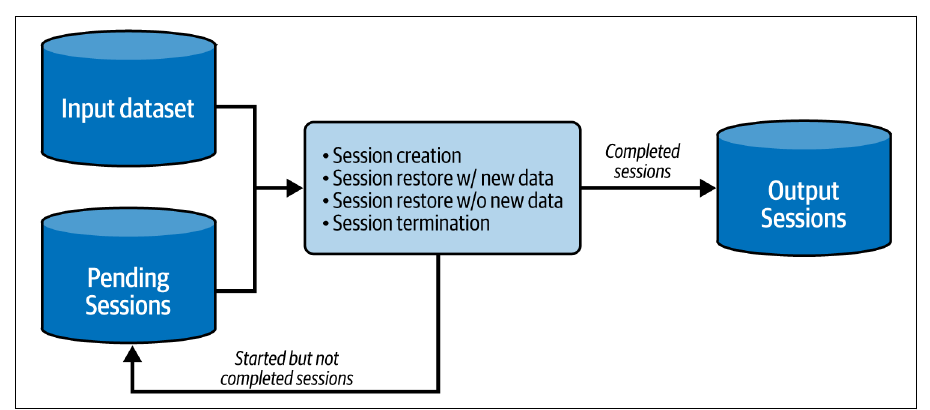
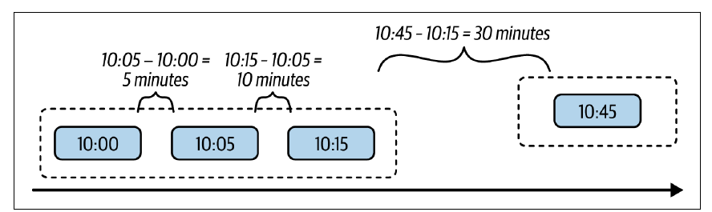

# فصل ۵: الگوهای طراحی ارزش داده

[فصل ۴: الگوهای طراحی idempotency →](04-idempotency-design-patterns.md) · [کتاب](../README.md) · [فصل ۶: الگوهای طراحی جریان داده ←](06-data-flow-design-patterns.md)

## خلاصه

داده‌ی خام در ذخیره‌سازی هنوز دارایی نیست: یک رویداد بازدید مرورگر، نسخه و زبان مرورگر را می‌داند ولی هیچ چیزی که بازدیدکننده‌ها را به هم وصل کند. ده الگوی این فصل یا با **افزودن اطلاعات** ارزش می‌سازند یا با **کم کردن** آن به چیزی فهمیدنی. الگوهای **Static Joiner** و **Dynamic Joiner** داده را از داده‌ی مرجعِ کند‌تغییر غنی می‌کنند، با SCD نوع ۲ یا ۴ برای درستی زمانی، یا از stream دیگری، با بافرهای bounded زمانی و یک GC watermark. الگوهای **Wrapper** و **Metadata Decorator** رکوردها را با ویژگی‌های محاسبه‌شده یا فنی حاشیه‌نویسی می‌کنند، یا پیدا یا پنهان در لایه‌ی metadata. الگوهای **Distributed Aggregator** و **Local Aggregator** داده را با shuffle یا بی آن خلاصه می‌کنند. الگوهای **Incremental Sessionizer** و **Stateful Sessionizer** در batch، با ذخیره‌سازی sessionهای معلق، یا در streaming، با یک state store، session می‌سازند. و دست آخر **Bin Pack Orderer** و **FIFO Orderer** داده را به‌ترتیب نگه می‌دارند، که اولی حتی روی APIهای bulk با commit جزئی.

## نکته‌های کلیدی

- **پیوند با داده‌ی مرجع به زمان نیاز دارد**: از SCD نوع ۲ یا ۴ و یک زمان اجرای immutable استفاده کنید و نه `NOW()`، تا backfill به همان نسخه پیوند بزند؛ داده‌ی API را برای idempotency materialize کنید (pp. 116–120).
- **پیوند stream به stream به بافر و GC watermark نیاز دارد**: stream سریع‌تر منتظر کندتر می‌ماند، و طول بافر، حافظه را با پیوندهای از‌دست‌رفته معامله می‌کند (pp. 122–124).
- **تفاوت Wrapper و Metadata Decorator در مخاطب است**: مقدارهای بسته‌بندی‌شده برای consumer‌اند، در حالی که metadata، مثل نسخه‌ی job و batch، داده درباره‌ی داده است و پنهان می‌ماند (pp. 125–132).
- **عملیات shuffle دردسرساز اصلی تأخیر است**: تجمیع جزئی پیش از آن، salting برای نامتوازنی، و یک shuffle service برای مقیاس‌پذیری کمک می‌کنند؛ و Local Aggregator وقتی داده از قبل با کلید گروه‌بندی پارتیشن‌بندی شده کل shuffle را برمی‌دارد (pp. 133–141).
- **همه‌ی sessionها وابسته به جلو‌اند**: backfill پارتیشن ۹:۰۰ یعنی ساختن دوباره‌ی همه‌ی پارتیشن‌های بعدی، و طول دوره‌ی بی‌فعالیتی، پوشش late data را با منابع معامله می‌کند (pp. 142–145).
- **عمل commit جزئی ترتیب را می‌شکند**: نوشتن bulk رکوردهای ۱۰:۰۰ و ۱۰:۱۰ و ۱۰:۲۰ ممکن است فقط ۱۰:۲۰ را ذخیره کند؛ الگوی Bin Pack Orderer در هر درخواست bulk حداکثر یک رکورد از هر موجودیت می‌گذارد (pp. 153–157).
- **روش FIFO همان exactly-once نیست**: فرستادن موفق و بعد ack ناموفق، سر راه‌اندازی دوباره دوباره می‌فرستد (pp. 159–160).

## فهرست بخش‌ها

*از فهرست مطالب خود کتاب، از bookmarkهای PDF؛ شماره‌ها صفحه‌ی چاپی‌اند.*

- غنی‌سازی داده — p. 116
  - الگو: Static Joiner — p. 116
  - الگو: Dynamic Joiner — p. 121
- تزئین داده — p. 125
  - الگو: Wrapper — p. 125
  - الگو: Metadata Decorator — p. 129
- تجمیع داده — p. 133
  - الگو: Distributed Aggregator — p. 133
  - الگو: Local Aggregator — p. 137
- ساختن session — p. 141
  - الگو: Incremental Sessionizer — p. 141
  - الگو: Stateful Sessionizer — p. 147
- ترتیب داده — p. 153
  - الگو: Bin Pack Orderer — p. 153
  - الگو: FIFO Orderer — p. 158
- خلاصه — p. 162

## یادداشت‌ها

داده‌ای که در ذخیره‌سازی نشسته تا به‌کار نیاید «دارایی واقعی نیست». رویدادهای بازدیدی که مرورگرها می‌سازند جزئیات فنی دارند، مثل نسخه و زبان مرورگر و OS، ولی هیچ رابطه‌ای، پس پرسشی مثل «بازدیدکننده‌های یک مرورگر معین چه چیز مشترکی دارند؟» کار اضافه می‌خواهد (p. 115). این فصل با ترکیب مجموعه‌داده‌ها و محاسبه‌ی ویژگی‌ها، یعنی غنی‌سازی و تزئین، و با خلاصه کردن، یعنی تجمیع و ساختن session، و با ترتیب دادن ارزش می‌سازد (p. 115).

| هدف | الگوها |
|---|---|
| افزودن زمینه | Static Joiner، Dynamic Joiner |
| حاشیه‌نویسی رکورد | Wrapper، Metadata Decorator |
| خلاصه کردن | Distributed Aggregator، Local Aggregator |
| گروه کردن فعالیت | Incremental Sessionizer، Stateful Sessionizer |
| نگه داشتن ترتیب | Bin Pack Orderer، FIFO Orderer |

*نقشه‌ی vault از پنج خانواده‌ی این فصل، بر پایه‌ی خلاصه‌ی خود کتاب (p. 162).*

### غنی‌سازی داده

رویدادها زمان و مکان را خوب توصیف می‌کنند ولی زمینه ندارند، مثل تاریخ آخرین اتصال یا امتیاز profile کاربر (p. 116).

#### الگو: Static Joiner (pp. 116–121)

**مسئله.** ذی‌نفع‌ها می‌خواهند تاریخ ثبت‌نام کاربر را به فعالیت روزانه‌اش ربط بدهند، ولی بازدیدها زمینه‌ی کاربر ندارند و این زمینه فقط در یک مجموعه‌داده‌ی مرجعِ ایستای کاربر هست (p. 116).

**راه‌حل** (pp. 116–118): روی کلیدهای مشترک پیوند بزنید، مثل `user_id`، که حتی برای pipelineهای streaming هم کار می‌کند. اگر داده‌ی مرجع در زمان عوض می‌شود، با **slowly changing dimension**، یعنی SCD، **قید زمانی** اضافه کنید:

| نوع SCD (p. 117) | ذخیره‌سازی | مقدار فعلی |
|---|---|---|
| **نوع ۲** | یک جدول با تاریخ‌های اعتبار | ردیفی که تاریخ پایانش خالی یا باز است |
| **نوع ۴** | دو جدول، یعنی مقدارهای فعلی به‌علاوه‌ی کل تاریخچه | جدول فعلی |



*Figure 5-1 (p. 117): نوع ۲ ردیف‌ها را در جای خودشان نسخه‌دار می‌کند و نوع ۴ مقدار فعلی و تاریخی را در دو جدول جدا می‌کند.*

غنی‌سازی معمولاً یک `JOIN` در SQL است، یا یک فراخوانی HTTP به یک API بیرونی، که می‌شود در یک مرحله‌ی پیش‌پردازش به‌عنوان جدول **materialize** هم بشود (شکل ۵-۲). برای idempotency داده‌ی API را materialize کنید و شکلی از SCD به کار ببرید تا اجرای دوباره همان مجموعه‌داده را ببیند (p. 118).

**پیامدها** (p. 119): **late data و سازگاری**، یعنی تغییر یک profile که بعدش بازدیدی بیاید ممکن است بازتاب پیدا نکند؛ pipelineهای streaming می‌توانند Dynamic Joiner را به کار ببرند و pipelineهای batch می‌توانند با **Readiness Marker** منتظر بمانند. **ویژگی idempotency**، یعنی اگر تأمین‌کننده کوئری زمان‌محور ندارد، داده‌ی غنی‌سازی را با SCD به ذخیره‌سازی خودتان بیاورید.

**نمونه‌ها** (pp. 119–121):

```sql
SELECT v.visit_id, v.event_time, v.page, u.id, u.login, u.email
FROM dedp.visits v JOIN dedp.users u ON u.id = v.user_id
AND NOW() BETWEEN start_date AND end_date;
```

*نمونه‌ی ۵-۲ (p. 120): جدول `users` ستون‌های `start_date` و `end_date` دارد که پیش‌فرضش `'9999-12-31'` است. برای idempotency، `NOW()` را با زمان اجرای scheduler عوض کنید.*

یک پیوند `left_outer` از stream به batch در Spark، بین بازدیدهای Kafka و جدول devices در Delta Lake، که فقط درج‌شدنی است و شرط زمانی ندارد؛ سمت ایستا چرخه‌ی عمر خودش را دارد، پس می‌شود پیوندهایی را از دست داد، یا اگر JSON یا CSV خام بود، در میانه‌ی بازنویسی کامل به جدولی *خالی* پیوند زد، که اتمی بودن یک table format جلویش را می‌گیرد (pp. 120–121). برای APIها از فراخوانی **bulk** استفاده کنید: یک writer صد رکورد را بافر می‌کند و موقعیت جغرافیایی IPهای یکتا و mapping‌نشده را یک‌جا می‌خواهد (p. 121).

#### الگو: Dynamic Joiner (pp. 121–125)

**مسئله.** با هزاران کاربر تازه در هفته، تغییر profile زیاد می‌شود و پیوند ایستا نتیجه‌ی کهنه می‌دهد؛ تغییرهای کاربر حالا با CDC روی broker می‌آیند (p. 122).

**راه‌حل** (pp. 122–123): کلیدها و روش پیوند مثل قبل، به‌علاوه‌ی **مرزهای زمانی**. دو stream تأخیرهای مختلف دارند، پس هر سمت یک **بافر bounded زمانی** نگه می‌دارد؛ اگر کاربرها یک ساعت از بازدیدها عقب‌ترند، بازدیدها یک ساعت بیشتر بافر می‌شوند. یک **GC watermark** رویدادهای بافرشده‌ای را که خیلی قدیمی‌اند برمی‌دارد، یعنی قدیمی‌تر از قدیمی‌ترین زمان رویداد stream کندتر، و پیوند رکوردهای خیلی late را در عوض حالت bounded از دست می‌دهد (شکل ۵-۳). خود frameworkها بافر کردن را برایتان پیاده می‌کنند.



*Figure 5-3 (p. 123): بافر کردن سمت سریع‌تر می‌گذارد تطابق‌های late باز هم پیوند بخورند، به قیمت حالتی که در حافظه می‌ماند.*

**پیامدها** (pp. 123–124): **فضا در برابر دقت**، یعنی بافر بزرگ‌تر پیوندهای بیشتری پیدا می‌کند با هزینه‌ی بیشتر؛ فرمولی نیست و به اختلاف تأخیر معمولتان بستگی دارد. **late data**، یعنی رویدادهای مناطقی که مشکل اتصال دارند ممکن است بعد از جلو رفتن GC watermark بیایند، پس late data را وارد کنید، فصل ۳ را ببینید.

**نمونه‌ها** (pp. 124–125): در Spark، بازدیدها و تبلیغ‌ها هر کدام `withWatermark(…, '10 minutes')` می‌گیرند و با `left_outer` روی `page = visit_page AND display_time BETWEEN event_time AND event_time + INTERVAL 2 minutes` پیوند می‌خورند، که قاعده‌ی کسب‌وکار است، یعنی تبلیغ حداکثر دو دقیقه بعد از بازدید نشان داده می‌شود. پیوندهای **temporal table** در Flink که فقط در Java هستند: watermark پنج‌دقیقه‌ای روی هر دو topic، یک `TemporalTableFunction` روی `update_time` با کلید `ad_page`، و `joinLateral` برای گرفتن آخرین تبلیغ با شرط `update_time <= event_time`.

> **In practice:** join کردن تراکنش با merchant در Silver همان Static Joiner است، با همان خطر: join با نسخه‌ی اشتباه داده‌ی مرجع.
>
> **Your turn:** merchantی دسته‌اش را عوض کرده و گزارش ماه‌های قبل یک‌شبه عوض شده است. چرا؟
>
> *Answer:* join با جدول merchant فعلی انجام شده، نه با نسخه‌ای که در زمان تراکنش معتبر بود. یا تاریخچه‌ی merchant را با ستون‌های اعتبار نگه دارید و روی بازه join کنید، یا دسته را هنگام ساخت Silver روی ردیف تراکنش ثابت کنید (pp. 116–121).

### تزئین داده

داده‌ی غنی‌شده باز هم خام است؛ تزئین آماده‌اش می‌کند تا فهمیده شود (p. 125).

#### الگو: Wrapper (pp. 125–129)

**مسئله.** بازدیدهای تأمین‌کننده‌های مختلف schemaهای مختلفی دارند؛ یک job streaming باید فیلدها را برای consumerها یک‌جا بیرون بکشد و ساختار اصلی را هم برای debug نگه دارد، به‌روشنی جدا از مقدارهای محاسبه‌شده (pp. 125–126).

**راه‌حل** (pp. 126–127): رکورد اصلی را در یک **پاکت** بپیچید که ویژگی‌های خام را به‌علاوه‌ی محاسبه‌شده‌ها دارد، که از خود داده می‌آیند یا از context اجرا، مثل زمان پردازش و نسخه‌ی job. برای Avro و Protobuf و JSON و جدول‌ها کار می‌کند (شکل ۵-۴):

| پیاده‌سازی | چیدمان | نکته |
|---|---|---|
| ۱ | ستون‌های اصلی تخت و محاسبه‌شده‌ها تو‌در‌تو | غیر‌نرمال؛ خواندن سریع‌تر |
| ۲ | محاسبه‌شده‌ها تخت و اصلی‌ها تو‌در‌تو | غیر‌نرمال |
| ۳ | همه‌ی ستون‌ها تخت و در یک سطح | کتاب این را نرمال می‌نامد؛ خواندن کندتر، جداسازی منطقی، ساختار اصلی دست‌نخورده |
| ۴ | دو جدول که با یک کلید یکتا پیوند می‌خورند | مجموعه‌داده‌های جدا |

در یک جدول، پاکت همان ردیف است (p. 127). همه‌شان مدیریت schema می‌خواهند، فصل ۹ را ببینید.

**پیامدها** (pp. 127–128): **شکستن دامنه**، یعنی فیلدهای کاربر هم در *خام* و هم در *محاسبه‌شده* در می‌آیند، پس بسته‌بندی را در لایه‌های اول نگه دارید، یعنی Silver، و نه در Gold که روبه‌روی کاربر است. **اندازه**، یعنی تزئین‌ها با هر رکورد سفر می‌کنند؛ **projection** ستونی در Redshift و BigQuery فقط ستون‌های لازم را می‌خواند.

**نمونه‌ها** (pp. 128–129): در PySpark، افزودن یک struct به نام `processing_context` با `job_version` و `batch_version` و نوشتن `to_json(struct(raw_data, processing_context))`؛ در SQL، `NAMED_STRUCT('is_connected', …, 'page_referral_key', CONCAT_WS('-', page, context.referral)) AS decorated`؛ یا بالا آوردن ستون‌های محاسبه‌شده و فرو بردن اصلی‌ها در `STRUCT(visit_id, event_time, user_id, page, context) AS raw`.

#### الگو: Metadata Decorator (pp. 129–133)

**مسئله.** jobهای streaming تقریباً هر هفته release می‌شوند؛ نسخه‌ی job را برای نگه‌داری روی هر رکورد می‌خواهید، ولی نه در آن چیزی که کاربر نهایی می‌بیند (pp. 129–130).

**راه‌حل** (pp. 130–131): context فنی را در **لایه‌ی metadata** بگذارید:

| ذخیره‌سازی | چطور |
|---|---|
| ابزار Apache Kafka | **header**های رکورد، یعنی زوج‌های کلید‌مقدار کنار کلید و مقدار |
| ذخیره‌سازی object | **tag** روی فایل، وقتی metadata به همه‌ی ردیف‌های یک فایل می‌خورد |
| جدول و دیتابیس | یک ستون پنهان `processing_context` که با view یا مجوز ستونی نشان داده می‌شود (جدول ۵-۱)، یا جدول فنی جدایی که با `processing_context_id` ارجاع می‌شود (جدول‌های ۵-۲ و ۵-۳) |

*جدول ۵-۱ (p. 130):* مقدار `event_id = 1`، `event_time = 2023-06-10T10:00:59Z`، و `processing_context = {"job_version": "v1.0.3", "processing_time": "2023-06-10T10:02:00Z"}`.

تفاوت Wrapper و Metadata Decorator فقط معنایی است: metadata داده را *توصیف* می‌کند و برای کاربر کسب‌وکار نیست (p. 131).

**پیامدها** (p. 131): **پیاده‌سازی**، یعنی Amazon Kinesis Data Streams header ندارد و جدول‌ها به ستون یا جدول اضافه نیاز دارند. **داده**، یعنی هیچ‌وقت ویژگی کسب‌وکار، مثل آدرس ارسال یا مبلغ فاکتور، را در metadata نگذارید که consumerها دنبالش نمی‌گردند.

**نمونه‌ها** (pp. 132–133): در Spark، افزودن آرایه‌ی `headers` از structهای کلید و مقدار، یعنی `job_version` و `batch_version`، و نوشتن در Kafka با `includeHeaders`؛ و یک جدول `dedp.visits_context` با ستون‌های `execution_date_time` و `loading_time` و `code_version` و `loading_attempt` که همان `try_number` در Airflow است، و کلیدش در هر جدول هفتگی بازدید نوشته می‌شود.

### تجمیع داده

برداشتن اطلاعات هم می‌تواند ارزش بسازد (p. 133).

#### الگو: Distributed Aggregator (pp. 133–137)



*Figure 5-5 (p. 135): عملیات shuffle هر رکورد را به نودی می‌برد که مالک کلیدش است، تا هر نود بتواند تنها تجمیع کند.*

**مسئله.** ساختن یک **OLAP cube** از بازدیدهای تمیز‌شده‌ی Silver، یعنی شمارش و میانگین مدت در طول جغرافیای کاربر و دستگاه و چیزهای دیگر، با نمای روزانه و هفتگی روی پارتیشن‌های روزانه‌ی زمان رویداد (p. 133).

**راه‌حل** (pp. 133–135): یک **cluster** از ماشین‌هایی که هیچ‌کدام به‌تنهایی داده را جا نمی‌دهند؛ گروه‌بندی و بعد کاهش، با همان API محلی. زیر پوسته، یک **shuffle** رکوردها را روی شبکه جابه‌جا می‌کند تا ردیف‌های مرتبط روی یک نود جمع شوند (شکل ۵-۵)، که اغلب اولین مسئله‌ی تأخیر است. **تجمیع جزئی** پیش از shuffle، مثلاً شمارش محلی هر کلید و بعد جمع زدن عددها، جابه‌جایی را کوچک‌تر می‌کند. این همان مدل **MapReduce** از سال ۲۰۰۴ است، از Hadoop MapReduce دیسک‌محور تا Apache Spark که اول حافظه را می‌بیند (p. 134).



*طرح vault از شکل ۵-۵ با بهینه‌سازی شمارش جزئی که در ص. ۱۳۴ آمده.*

**پیامدها** (pp. 135–136):

| مسئله | جزئیات | راه کاهش |
|---|---|---|
| **جابه‌جایی اضافه روی شبکه** | خواندن ورودی، چون ذخیره‌سازی و محاسبه کم هم‌مکان‌اند، به‌علاوه‌ی خود shuffle | الگوی Local Aggregator، وقتی شدنی است |
| **نامتوازنی داده** | یک کلید با ردیف‌های خیلی بیشتر، گران‌ترین کلید برای جابه‌جایی و پردازش است | روش **salting**، یعنی `groupBy('group_key', 'salt')` و بعد `groupBy('group_key')` با `salt = (rand()*3).cast("int")`؛ و **Adaptive Query Execution** در Spark |
| **مقیاس‌پذیری** | نودهایی که داده‌ی shuffle را دارند تا job تمام نشود آزاد نمی‌شوند | یک **shuffle service**، مثل Spark External Shuffle Service و GCP Dataflow Shuffle |

**نمونه‌ها** (pp. 136–137): در Spark، پیوند بازدیدهای JSON با جدول devices در PostgreSQL که با JDBC خوانده می‌شود؛ متد `explain()` نودهای `Exchange hashpartitioning` را زیر یک `SortMergeJoin` نشان می‌دهد، با فیلتر محلی در اول. سرویس BigQuery می‌تواند جدول‌ها را با فایل‌های GCS که به‌عنوان **external table** اعلان شده‌اند پیوند بزند، و Redshift و Azure Synapse و Snowflake هم همین‌طور.

#### الگو: Local Aggregator (pp. 137–141)

**مسئله.** یک job streaming بازدیدهای یک broker پارتیشن‌بندی‌شده را پنجره‌بندی می‌کند که شمار پارتیشن‌هایش هیچ‌وقت عوض نمی‌شود؛ می‌خواهید shuffleی را که framework خودکار اضافه می‌کند بردارید (pp. 137–138).

**راه‌حل** (pp. 138–139): اگر همه‌ی رکوردهای یک کلید گروه‌بندی از قبل در همان پارتیشن ورودی‌اند، یعنی **کلید پارتیشن‌بندی ایستا** برای هر رکورد و **شمار پارتیشن immutable** که producer تضمینش می‌کند، محلی تجمیع کنید و فقط ورودی را بخوانید. taskها هم جدا می‌مانند، پس کندها بقیه را عقب نمی‌اندازند. در Kafka Streams `groupByKey`؛ در Spark راهنمایی‌ای نیست، ولی `mapPartitions` و `foreachPartition` تجمیع محلی را ممکن می‌کنند، و برای مجموعه‌داده‌هایی که با همان کلید و به همان تعداد bucket شده‌اند shuffle را رد می‌کند، یعنی الگوی **Bucket** در فصل ۸. مجموعه‌داده‌های کوچک را می‌شود در حافظه‌ی یک نود تجمیع کرد.

**پیامدها** (p. 139): **مقیاس‌پذیری**، یعنی عوض کردن پارتیشن‌ها یک کلید را بین گروه‌ها می‌شکند و پارتیشن‌بندی دوباره یعنی بازنویسی کل مجموعه‌داده، یا در streaming یک تعویضِ همه‌چیز‌ایست. **کلیدهای گروه‌بندی**، یعنی یک پارتیشن‌بندی به یک گروه‌بندی می‌خورد، پس گروه‌بندی بر حسب نوع تغییر در برابر شناسه‌ی کاربر یعنی یکی‌شان به Distributed Aggregator نیاز دارد.

**نمونه‌ها** (pp. 139–141): در Kafka Streams، `stream("visits").groupByKey().aggregate(…)` که در `visits-aggregated` می‌نویسد و کلید هر رکورد را بی جابه‌جایی شبکه به کار می‌برد؛ در Spark، `sortWithinPartitions(['visit_id', 'event_time'])` به‌علاوه‌ی `foreachPartition` با یک `KafkaWriter` که وقتی `visit_id` عوض می‌شود صفحه‌های آن بازدید را منتشر می‌کند؛ و در Redshift، `DISTSTYLE ALL` که `users` را روی هر نود کپی می‌کند و `DISTSTYLE KEY, DISTKEY(visit_id)` که ردیف‌ها را بر حسب کلید هم‌مکان می‌کند.

> **In practice:** warehouse ما دو replica دارد و هیچ shardی ندارد، پس هر تجمیعی روی یک ماشین انجام می‌شود.
>
> **Your turn:** چرا `GROUP BY customer_id` روی Silver در ClickHouse ما shuffleی ندارد ولی در Spark دارد؟
>
> *Answer:* هر replica کل داده را دارد و تجمیع local است؛ در Spark داده بین executorها پخش است و ردیف‌های یک کلید باید با shuffle کنار هم بیایند، که هزینه‌ی اصلی Distributed Aggregator است (pp. 133–141).

### ساختن session

یک session رویدادهای یک فعالیت را با هم می‌آورد، یعنی یک نقطه‌ی شروع و رویدادها و یک نقطه‌ی پایان، مثل تماشای ویدئو یا ورزش کردن (p. 141).

#### الگو: Incremental Sessionizer (pp. 141–147)

**مسئله.** بازدیدها در **پارتیشن‌های ساعتی** می‌نشینند؛ session با اولین بازدید شروع می‌شود و بعد از **دو ساعت** بی‌فعالیتی تمام. یک session از چند دقیقه تا **سه ساعت** طول می‌کشد، پس می‌تواند تا سه پارتیشن را بگیرد (pp. 141–142).

**راه‌حل** (pp. 142–144): سه فضای ذخیره‌سازی و سه حالت session.

| ذخیره‌سازی | دیده شدن | محتوا |
|---|---|---|
| مجموعه‌داده‌ی ورودی | — | بازدیدهای ساعتی |
| **sessionهای کامل‌شده** | عمومی | sessionهای تمام‌شده، که در جریان‌ها پرچم می‌خورند؛ مثلاً `is_final = false` |
| **sessionهای معلق** | خصوصی | sessionهایی که به اجرای بعدی ادامه می‌دهند؛ می‌توانند فیلد فنی داشته باشند، مثل شناسه‌ی اجرا |

هر اجرا ورودی را با sessionهای معلق اجرای قبلی برای هر موجودیت ترکیب می‌کند، و نتیجه یا session **تازه** است، یا session **برگردانده‌شده** با داده‌ی تازه، یا برگردانده‌شده بی داده‌ی تازه که احتمالاً منقضی می‌شود. بعد **مقدمه‌چینی** را اعمال کنید، مثل بازدید از صفحه‌ی خانه، و **تجمع** را، مثل صفحه‌ها به‌ترتیب، و **نهایی‌سازی** را، یعنی یک نوع رویداد یا بی‌فعالیتی؛ مثلاً سه ساعت (شکل ۵-۶).



*Figure 5-6 (p. 143): سه فضای ذخیره‌سازی، یعنی ورودی و معلق و خروجی، sessionهای باز را از یک اجرای ساعتی به اجرای بعدی می‌برند.*

**پیامدها** (pp. 144–145): **دوره‌ی بی‌فعالیتی**، یعنی دوره‌ی بلندتر late data بیشتری را می‌گیرد ولی گران‌تر است و sessionها را عقب می‌اندازد؛ sessionهای جزئی را می‌شود منتشر کرد ولی ممکن است عوض شوند، مثل session تقلب بانکی که اول «بی‌خطر» است و بعد «پرخطر»، پس با `is_completed: false` پرچمشان بزنید. **تازگی داده**، یعنی بینش batch دیر می‌رسد و sessionهای جزئی کمک می‌کنند. **late data و backfill**، یعنی sessionها **وابسته به جلو**اند: ۹:۰۰ روی ۱۰:۰۰ اثر دارد و ۱۰:۰۰ روی ۱۱:۰۰، پس backfill باید همه‌ی پارتیشن‌های بعدی را دوباره اجرا کند، که کدش ارزان و هزینه‌اش بالاست، یا موجودیت‌های اثرپذیر را تشخیص بدهد، که ارزان و پیچیده است.

**نمونه‌ها** (pp. 145–146): در Airflow اول ردیف‌های `sessions` و `pending_sessions` با `execution_time_id >= '{{ ds }}'` حذف می‌شوند، آن ساعت در یک جدول موقت بار می‌شود، و بعد یک `FULL OUTER JOIN` بین بازدیدهای تازه و sessionهای معلق `{{ prev_ds }}` از `COALESCE` و `LEAST(start_time)` و `GREATEST(last_visit_time)` و `ARRAY_CAT(pages)` استفاده می‌کند و وقتی داده‌ی تازه هست `expiration_batch_id` را `ds + 2` می‌گذارد؛ ردیف‌هایی که `expiration_batch_id = ds` دارند به `sessions` می‌روند و بقیه به `pending_sessions`.

#### الگو: Stateful Sessionizer (pp. 147–153)

**مسئله.** پارتیشن‌های ساعتی سقف تازگی را یک ساعت می‌کنند، در حالی که بازدیدها ظرف چند ثانیه روی broker‌اند؛ sessionها را تقریباً بی‌درنگ بسازید (p. 147).

**راه‌حل** (pp. 147–149): یک job streaming stateful که **state store**ش نقش ذخیره‌سازی session معلق را بازی می‌کند، یعنی سریع در حافظه و synchronous‌شده‌ی منظم با ذخیره‌سازی تاب‌آور (شکل ۵-۷). گردش‌کار همان است، یعنی ساختن یا از سر گرفتن، ترکیب، منتشر کردن sessionهای کامل یا جزئی، و ذخیره‌ی بقیه. دو انتزاع:

| انتزاع | session چطور تمام می‌شود |
|---|---|
| **session window** | یک **gap duration** برای هر کلید، یعنی فاصله‌ی بیشتر از بیست دقیقه بین رویدادها پنجره‌ی تازه‌ای شروع می‌کند (شکل ۵-۸) |
| **پردازش stateful دلخواه** | منطق خودتان، با timer ایستا یا پویا برای هر کلید، در Spark Structured Streaming و Flink و GCP Dataflow |



*Figure 5-8 (p. 149): با gap بیست‌دقیقه‌ای، توقف سی‌دقیقه‌ای session اول را می‌بندد.*

**پیامدها** (pp. 149–150): **دست‌کم یک‌بار**، یعنی حالت نامنظم checkpoint می‌شود پس راه‌اندازی دوباره، دوباره پردازش می‌کند؛ کلید session را از مقدارهایی نسازید که بین اجراها عوض می‌شوند، مثل زمان واقعی. **مقیاس‌پذیری**، یعنی متوازن کردن دوباره‌ی حالت، پردازش کلیدهای جابه‌جا‌شده را متوقف می‌کند. **طول بی‌فعالیتی**، یعنی همان توازن هزینه و پوشش. **زمان بی‌فعالیتی**، یعنی حالت را با **زمان رویداد** منقضی کنید؛ انقضا با زمان پردازش می‌تواند بعد از تأخیری غیرمنتظره، sessionها را زود ببندد.

**نمونه‌ها** (pp. 150–153): در Spark، `withWatermark('event_time', '1 minute').groupBy('visit_id').applyInPandasWithState(…, outputMode="update", timeoutConf="EventTimeTimeout")`؛ سر timeout منتشر و `remove()` کنید و وگرنه بازدیدها را اضافه و `setTimeoutTimestamp(base_watermark + 10 minutes)` کنید، و بیشینه‌ی زمان رویداد را فقط تا وقتی به کار ببرید که watermark هنوز صفر است. انقضای watermark‌محور sessionها را زودتر از انقضای زمان‌رویداد‌محور می‌بندد:

*جدول ۵-۴ (p. 152): watermark یک‌دقیقه‌ای، انقضای حالت ده‌دقیقه‌ای*

| کلید حالت | زمان رویداد | انقضا، watermark‌محور | انقضا، زمان‌رویداد‌محور | watermark تازه |
|---|---|---|---|---|
| A | ۱۰:۰۰ | ۱۰:۱۰ | ۱۰:۱۰ | ۰۹:۵۹ |
| A | ۱۰:۰۱ | ۱۰:۰۹ | ۱۰:۱۱ | ۱۰:۰۰ |
| A | ۱۰:۰۸ | ۱۰:۱۰ | ۱۰:۱۸ | ۱۰:۰۷ |
| B | ۱۰:۱۵ | ۱۰:۱۷ | ۱۰:۲۵ | ۱۰:۱۴ |

با انقضای watermark‌محور، کلید A که انقضایش ۱۰:۱۰ است همین که اولین رکورد B، مقدار watermark را به ۱۰:۱۴ می‌برد منتشر می‌شود؛ با انقضای زمان‌رویداد‌محور منتظر می‌ماند، چون ۱۰:۱۸ از ۱۰:۱۴ بزرگ‌تر است. جایگزین Flink این است: `key_by(VisitIdSelector()).window(EventTimeSessionWindows.with_gap(Time.minutes(10))).allowed_lateness(15 minutes)` (pp. 152–153).

### ترتیب داده

گاه‌شماری مهم است: یک ردیاب ناوگان خودرو بی ترتیب، ماشین‌ها را نشان می‌دهد که از روی ساختمان می‌پرند یا از رودخانه شنا می‌کنند (p. 153).

#### الگو: Bin Pack Orderer (pp. 153–158)

**مسئله.** رویدادهای بازدید از سایت‌های بیرونی که صفحه‌های شما را embed می‌کنند باید با یک API نشان داده شوند. یک job برای همه‌ی شریک‌ها، یک پنجره‌ی ده‌دقیقه‌ای زمان پردازش از تجمیع‌های دقیقه‌ای می‌سازد و برای هر شریک و هر دقیقه، به‌ترتیب زمان رویداد، در یک broker با معنای **commit جزئی** تخلیه‌شان می‌کند (p. 154).

**عمل commit جزئی** (p. 154): جز موفقیت و شکست، نوشتن bulk می‌تواند جزئی موفق شود. در نوشتن ۱۰:۰۰ و ۱۰:۱۰ و ۱۰:۲۰، اگر فقط ۱۰:۲۰ بنشیند، تلاش دوباره برای آن دوی دیگر ترتیب را می‌شکند. در `PutRecords` در Kinesis و `BatchWriteItem` در DynamoDB و bulk در Elasticsearch هست.

**راه‌حل** (pp. 155–156): فرستادن رکوردها یکی‌یکی کار می‌کند ولی برای هر رکورد یک درخواست خرج می‌کند. در عوض (شکل ۵-۹):

۱. بر حسب کلید گروه‌بندی و زمان رویداد **مرتب** کنید.
۲. در binها **بسته‌بندی** کنید، به‌طوری که هر bin **حداکثر یک رکورد از هر کلید** داشته باشد، یعنی رکورد اول هر کلید در bin یک و دومش در bin دو و همین‌طور.
۳. همه‌ی binها را **پشت سر هم منتشر کنید**؛ تلاش دوباره داخل bin خودش می‌ماند و نمی‌تواند یک کلید را بی‌ترتیب کند، و bin بعدی تا کامل نوشته شدن bin فعلی منتظر می‌ماند.

> **Try it:** [بسته‌بندی bin در برابر commit جزئی](../widgets/05-bin-pack-orderer.html)؛ همان رویدادها را یک‌بار با درخواست bulk ساده و یک‌بار با bin بفرستید، شکست جزئی تزریق کنید، و ببینید کدام کلیدها بی‌ترتیب در می‌آیند.

**پیامدها** (p. 157): **تلاش دوباره**ی *کل* pipeline باز هم binهای منتشرشده را دوباره می‌فرستد و ترتیب را می‌شکند؛ و **پیچیدگی**، یعنی مرتب‌سازی و ساخت bin سفارشی در برابر یک مرتب‌سازی ساده.

**نمونه‌ها** (pp. 157–158): در Spark، `sortWithinPartitions(['visit_id', 'event_time']).foreachPartition(…)` با writerی که وقتی `visit_id` عوض می‌شود شماره‌ی bin را صفر می‌کند و هر ردیف را به `delivery_groups[index]` اضافه می‌کند، و بعد گروه‌به‌گروه به Kinesis تحویل می‌دهد.

#### الگو: FIFO Orderer (pp. 158–162)

**مسئله.** یک job streaming باید زیرمجموعه‌ای از رویدادهای بازدید را به‌ترتیب پردازش و در اولین فرصت جلو بفرستد، بی هیچ بافری (p. 158).

**راه‌حل** (p. 158): هر رکورد را بفرستید و پیش از بعدی منتظر **acknowledgment** بمانید، با یک API تک‌رکوردی مثل `PutRecord` در Kinesis و `send()` به‌علاوه‌ی `flush()` synchronous در Kafka، یا یک API bulk با concurrency یک روی ذخیره‌سازی‌های **full-commit**. در Kafka، `max.in.flight.requests.per.connection = 1`، یا **producer idempotent** که ترتیب را تا **پنج** درخواست در پرواز نگه می‌دارد. درخواست‌های در پرواز throughput را بالا می‌برند ولی می‌توانند ترتیب را عوض کنند: اگر از دو درخواست، دومی موفق شود و اولی تلاش دوباره بخورد (p. 159).

**پیامدها** (pp. 159–160): **سرریز I/O و تأخیر**، یعنی برای هر رکورد یک درخواست؛ چند‌ریسمانی کمک می‌کند اگر رکوردهای هر موجودیت به همان thread بروند. **روش FIFO همان exactly-once نیست**، یعنی `producer.send(message)` و بعد `consumer.ack(message)`: اگر ack بعد از فرستادن موفق شکست بخورد، راه‌اندازی دوباره، دوباره می‌فرستد، پس الگوهای فصل ۴ را به کار ببرید.

**نمونه‌ها** (pp. 160–162):

| ذخیره‌سازی | تنظیم |
|---|---|
| Kafka، تک‌رکوردی | `produce()` به‌علاوه‌ی `flush()` |
| Kafka، bulk | `max.in.flight.requests.per.connection: 1`، `queue.buffering.max.ms: 1000` |
| Kafka، idempotent | `max.in.flight.requests.per.connection: 5`، `enable.idempotence: True`، `queue.buffering.max.ms: 2000` بر پایه‌ی KIP-98 |
| Kinesis | `put_record` با `SequenceNumberForOrdering` برابر شماره‌ی ترتیب قبلی؛ وگرنه فقط ترتیب تقریبی |
| GCP Pub/Sub | `ordering_key`، یعنی FIFO برای هر کلید، با یک producer و یک region |

### خلاصه

ارزش از افزودن اطلاعات می‌آید، یعنی غنی‌سازی که حتی بین batch و streaming کار می‌کند و تزئین که با wrapper پیدا یا با metadata پنهان است، یا از کم کردن آن، یعنی تجمیع و ساختن session، و از نگه داشتن ترتیب، یعنی Bin Pack Orderer برای commit جزئی و FIFO Orderer برای سادگی. فصل بعدی این pipelineها را به هم وصل می‌کند (pp. 162–163).

## بده‌بستان‌ها در یک نگاه

| | Static Joiner | Dynamic Joiner |
|---|---|---|
| سمت غنی‌سازی | در حال سکون، یعنی مرجع و API | در حرکت، یعنی stream |
| برخورد با زمان | تاریخ‌های اعتبار SCD | بافر به‌علاوه‌ی GC watermark |
| خطر اصلی | داده‌ی مرجع کهنه یا دیررس؛ idempotency | پیوند از‌دست‌رفته برای داده‌ی دیررس؛ حافظه |

| | Distributed Aggregator | Local Aggregator |
|---|---|---|
| شبکه | خواندن ورودی به‌علاوه‌ی shuffle | فقط خواندن ورودی |
| نیازمندی | ندارد | پارتیشن ثابت با کلید همان گروه‌بندی |
| مقیاس‌پذیری | آسان، با shuffle service | سخت، با سازمان دادن دوباره‌ی داده |

| | Incremental Sessionizer | Stateful Sessionizer |
|---|---|---|
| لایه | batch | streaming |
| حالت معلق | جدول خصوصی | state store |
| تازگی | بازه‌ی پارتیشن؛ مثلاً یک ساعت | چند ثانیه |

| | Bin Pack Orderer | FIFO Orderer |
|---|---|---|
| درخواست | bulk، با یک رکورد از هر کلید در هر bin | یکی برای هر رکورد، یا bulk با concurrency یک |
| با commit جزئی کار می‌کند | بله | فقط با API تک‌رکوردی |
| پیچیدگی | مرتب‌سازی و bin سفارشی | ساده |

## فراتر از کتاب

- ادبیات مدل‌سازی ابعادی Ralph Kimball جایی است که SCD نوع ۱ تا ۷ تعریف شده‌اند؛ کتاب فقط نوع ۲ و ۴ را به کار می‌برد.
- روش salting یک گروه نامتوازن را با چند گروه کوچک‌تر به‌علاوه‌ی یک تجمیع دوم معامله می‌کند، پس فقط برای تجمیع‌هایی کار می‌کند که ترکیب‌شدنی‌اند، یعنی جمع و شمارش و کمینه و بیشینه، و نه مثلاً میانه‌ی دقیق.

## پیوندها

- **فصل‌های مرتبط:** [فصل ۲: ورود داده](02-data-ingestion-design-patterns.md) که CDC و Readiness Marker و Incremental Loader را دارد، [فصل ۳: مدیریت خطا](03-error-management-design-patterns.md) که watermark و state store و metadata الگوی Dead-Letter را دارد، [فصل ۴: ویژگی idempotency](04-idempotency-design-patterns.md) که تحویل exactly-once و Keyed Idempotency را دارد، و [فصل ۸: ذخیره‌سازی داده](08-data-storage-design-patterns.md) که Bucket و Denormalizer را دارد.

## خودتان را بسنجید

*پرسش‌ها و پاسخ‌ها مال vault است و از روی یادداشت‌های بالا نوشته شده؛ پاسخ‌ها به صفحه‌های کتاب ارجاع می‌دهند.*

1. **چرا در پیوندی با SCD نوع ۲ باید `NOW()` را با زمان اجرای scheduler عوض کرد؟**

   *Answer:* زمان اجرا برای یک اجرا immutable است، پس backfill به همان نسخه‌ی کاربری پیوند می‌زند که اجرای اصلی زده بود و پیوند idempotent می‌شود (p. 120).

2. **در پیوند stream به stream، مقدار GC watermark چه چیزی را معامله می‌کند؟**
   - [ ] مقدار throughput را با ترتیب
   - [x] اندازه‌ی بافر، یعنی منابع، را با پیوندهایی که برای رکوردهای خیلی late از دست می‌روند
   - [ ] تحویل exactly-once را با at-least-once
   - [ ] هزینه‌ی shuffle را با تأخیر

   *Answer:* نگه داشتن همیشگی رویدادهای بافرشده منابع unbounded می‌خواهد؛ مقدار GC watermark قدیمی‌ها را دور می‌ریزد، پس تطابق‌های خیلی late از دست می‌روند (pp. 122–124).

3. **کِی context فنی مثل نسخه‌ی job باید در Metadata Decorator بیاید و نه در Wrapper؟**

   *Answer:* وقتی داده را توصیف می‌کند و خودش اطلاعات کسب‌وکار نیست؛ consumerها کاری با این ندارند که کدام نسخه‌ی job رکورد را ساخته، پس در header یا tag یا ستون پنهان قایمش کنید (pp. 129–131).

4. **چه چیزی Local Aggregator را ممکن می‌کند و چه هزینه‌ای دارد؟**

   *Answer:* همه‌ی رکوردهای یک کلید گروه‌بندی باید از قبل در یک پارتیشن ورودی باشند، یعنی کلید پارتیشن‌بندی ایستا و شمار پارتیشن ثابت. عملیات shuffle را برمی‌دارد ولی مقیاس‌پذیری و چند کلید گروه‌بندی را سخت می‌کند (pp. 138–139).

5. **یک API bulk می‌تواند جزئی commit کند. رویدادهای کلید K در ۱۰:۰۰ و ۱۰:۱۰ و ۱۰:۲۰ هستند. الگوی Bin Pack Orderer چطور ترتیب K را نگه می‌دارد؟**
   - [ ] هر سه را در یک درخواست می‌فرستد و کل درخواست را تلاش دوباره می‌کند
   - [x] هر کدام را در bin جدایی می‌گذارد و bin دو را فقط بعد از نوشته شدن کامل bin یک می‌فرستد
   - [ ] آن‌ها را به‌ترتیب معکوس مرتب می‌کند
   - [ ] به broker تکیه می‌کند که ترتیب را درست کند

   *Answer:* با حداکثر یک رکورد از هر کلید در هر bin، شکست جزئی فقط روی یک رکورد از K اثر دارد که پیش از فرستادن bin بعدی تلاش دوباره می‌خورد (pp. 155–156).

6. **چرا به sessionها وابسته به جلو می‌گویند؟**

   *Answer:* حالت sessionی که برای یک پارتیشن ساخته می‌شود به پارتیشن بعدی خورانده می‌شود، یعنی ۹:۰۰ به ۱۰:۰۰ به ۱۱:۰۰، پس late data یا backfill در یک پارتیشن، ساختن دوباره‌ی همه‌ی بعدی‌ها را اجبار می‌کند (pp. 144–145).
