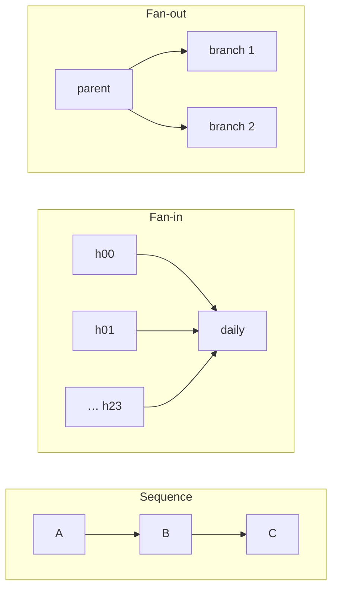
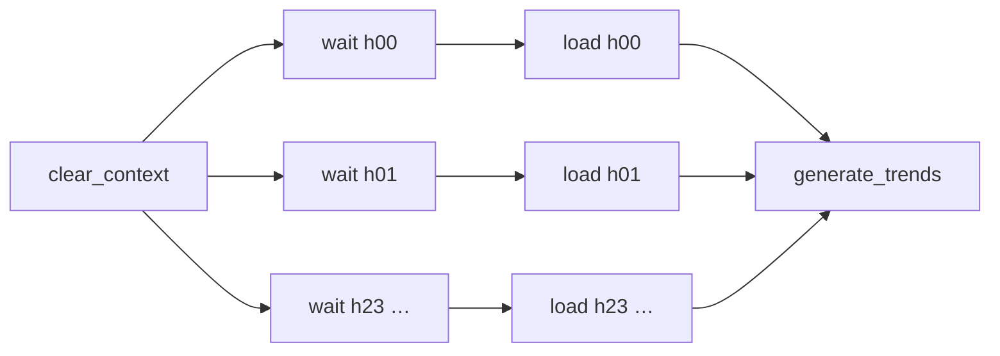

# فصل ۶: الگوهای طراحی جریان داده

[فصل ۵: الگوهای طراحی ارزش داده →](05-data-value-design-patterns.md) · [کتاب](../README.md) · [فصل ۷: الگوهای طراحی امنیت داده ←](07-data-security-design-patterns.md)

## خلاصه

ارزشی که می‌سازید تا به تیم‌های دیگر نرسد محلی می‌ماند، و مجموعه‌داده‌های آن‌ها هم به شما برمی‌گردند. الگوهای جریان داده، مرحله‌هایی را که یک مجموعه‌داده را می‌سازند طراحی و هماهنگ می‌کنند، در دو سطح: **زمان‌بندی داده**، یعنی یک یا چند pipeline که از مرز تیم‌ها رد می‌شوند، و **پردازش داده**، یعنی سازمان دادن منطق کسب‌وکار داخل یک job. هشت الگوی این فصل چهار جفت‌اند. **ترتیب**: الگوی **Local Sequencer** یک job بزرگ را به مرحله‌های راه‌اندازی‌دوباره‌پذیر می‌شکند، و **Isolated Sequencer** pipelineهای تیم‌های مختلف را از راه داده، یعنی readiness marker، یا از راه task، یعنی trigger مستقیم، به هم وصل می‌کند. **Fan-in**: الگوی **Aligned Fan-In** منتظر همه‌ی پدرها می‌ماند، مثلاً ۲۴ شاخه‌ی ساعتی که به یک تجمیع روزانه می‌رسند، و **Unaligned Fan-In** باز هم جلو می‌رود و داده‌ی جزئی را پرچم می‌زند. **Fan-out**: الگوی **Parallel Split** چند شاخه را از یک پدر اجرا می‌کند و **Exclusive Choice** یکی را انتخاب. **زمان‌بندی**: الگوی **Single Runner** اجرای هم‌زمان را ممنوع می‌کند، که منطق افزایشی به آن نیاز دارد، و **Concurrent Runner** برای مجموعه‌داده‌های مستقل اجازه‌اش می‌دهد.

## نکته‌های کلیدی

- **مرزها را جایی بکشید که می‌خواهید از آن‌جا دوباره راه بیندازید**: مرحله‌ی گران، مثل فراخوانی API پولی، نباید به‌خاطر شکست مرحله‌ی بعدی دوباره اجرا شود؛ عملیاتی که تراکنشی به هم وصل‌اند با هم بمانند (pp. 167–168).
- **وابستگی داده‌محور شل است و task‌محور تنگ**: یک readiness marker می‌گذارد consumer آزاد عوض شود، در حالی که trigger مستقیم با تغییر نام یک task در سمت consumer می‌شکند و زمان‌بندی‌ها را جفت می‌کند (pp. 171–172).
- **الگوی fan-in بازخورد سریع‌تر و اصلاح ارزان‌تر می‌دهد**: ۲۴ job ساعتی خطا را زودتر خبر می‌دهند و فقط ساعت شکست‌خورده دوباره اجرا می‌شود، به قیمت spike بار و انحراف زمان‌بندی و سرریز (pp. 176–177).
- **اگر داده‌ی جزئی منتشر می‌کنید، بگویید**: یک جدول کامل بودن، یا tag، یا پرچم `is_approximate`؛ مثلاً ۱۲ ساعت از ۲۴ ساعت یعنی ۵۰٪ (pp. 180–181).
- **شاخه‌های موازی باید کار پدر را شریک شوند، نه تکرارش کنند**: مجموعه‌داده‌ی میانی را durable کنید، و jobهایی را که شاخه‌هایشان سخت‌افزار مختلف می‌خواهند بشکنید (pp. 183–186).
- **شاخه، پیچیدگی را چند برابر می‌کند**: شرط‌هایی را ترجیح بدهید که در scheduler ارزیابی می‌شوند، یعنی پیدا، و روی metadata، یعنی ارزان (pp. 187–191).
- **الگوی Single Runner در backfill کند است و تأخیر جمع می‌کند** وقتی اجراها از زمان‌بندی طولانی‌تر شوند، مثل نیم ساعت که روی جریانی ساعتی یک ساعت و نیم می‌شود؛ و Concurrent Runner خطر گرسنگی و shared state دارد (pp. 192–194).

## فهرست بخش‌ها

*از فهرست مطالب خود کتاب، از bookmarkهای PDF؛ شماره‌ها صفحه‌ی چاپی‌اند.*

- ترتیب — p. 166
  - الگو: Local Sequencer — p. 166
  - الگو: Isolated Sequencer — p. 170
- الگوی Fan-In — p. 174
  - الگو: Aligned Fan-In — p. 175
  - الگو: Unaligned Fan-In — p. 178
- الگوی Fan-Out — p. 182
  - الگو: Parallel Split — p. 182
  - الگو: Exclusive Choice — p. 186
- زمان‌بندی — p. 191
  - الگو: Single Runner — p. 191
  - الگو: Concurrent Runner — p. 193
- خلاصه — p. 195

## یادداشت‌ها

به اشتراک گذاشتن مجموعه‌داده‌هایتان با تیم‌های دیگر و به کار بردن مال آن‌ها، ارزش را چند برابر می‌کند، ولی قاعده‌های خودش را می‌خواهد: زنجیر کردن taskها، شاخه‌های موازی یا انحصاری، و وابستگی بین pipelineهای فیزیکی جدا (p. 165). این الگوها در سطح **زمان‌بندی داده**، یعنی pipelineها و همکاری بین تیم‌ها، و سطح **پردازش داده**، یعنی سازمان دادن منطق job، کار می‌کنند (p. 165).

*طرح vault از سه شکل جریان؛ الگوهای زمان‌بندی تعیین می‌کنند چند اجرا با هم بروند.*

### ترتیب

ترتیب دادن روی پیچیدگی و performance و نگه‌داری اثر دارد: jobی که در چند دیتابیس به‌عنوان یک واحد می‌نویسد، برای بار کردن دوباره‌ی فقط یکی‌شان باید کامل دوباره اجرا شود (p. 166).

#### الگو: Local Sequencer (pp. 166–170)

**مسئله.** یک job تحلیلی قدیمی از چند ده خط به چند صد خط رسیده و سه برابر تبدیل بیشتری دارد؛ زیاد شکست می‌خورد و همیشه از اول راه می‌افتد. ساده‌اش کنید بی آن که منطق کسب‌وکار را بیندازید (p. 166).

**راه‌حل** (pp. 166–167): به مرحله‌های کوچک‌تری تجزیه‌اش کنید که پشت سر هم اجرا می‌شوند و با **وابستگی مجموعه‌داده** مرتب شده‌اند، یعنی اگر B به داده‌ی A نیاز دارد بعد از A برود؛ مثلاً یک task از جنس **Readiness Marker** و بعدش یک task از جنس **Full Loader**، که یا دو task زمان‌بندی‌شده‌اند یا یک task پردازش (شکل ۶-۱). سه معیار تعیین می‌کند ترتیب کجا بنشیند:

| معیار | نشانه |
|---|---|
| **جداسازی دغدغه‌ها** | سختی در نام گذاشتن روی یک task، یا نامی خیلی بلند، یعنی کار زیادی می‌کند |
| **نگه‌داشتنی بودن** | تلاش دوباره و backfill هر چیزی را که پیش از شکست بود دوباره حساب می‌کنند؛ مثلاً یک بررسی آمادگی که **ده API پولی** را صدا می‌زند و بعد از سه شکست دوباره اجرا می‌شود |
| **تلاش پیاده‌سازی** | schedulerها operatorهای آماده می‌دهند، مثل SQL و فراخوانی API؛ یک task بزرگ همه‌شان را از نو می‌سازد |

**پیامدها** (p. 168): **مرزها**، یعنی مرز خیلی درشت یا خیلی ریز به زمان اجرا و ظرفیت scheduler آسیب می‌زند. به **مرز راه‌اندازی دوباره** فکر کنید: Readiness Marker و Full Loader باید جدا شکست بخورند، یعنی اگر بار‌گذاری شکست خورد لازم نیست marker دوباره اجرا شود، به شرط آن که داده‌ی منبع immutable باشد. داخل یک job، بین گران‌ترین عملیات محاسبه‌ای ببرید. **واحدهای تراکنشی** را با هم نگه دارید، مثل پردازش Dynamic Late Data Integrator و به‌روزرسانی جدول حالتش.

**نمونه‌ها** (pp. 168–170): در Airflow، `input_data_sensor >> load_data_to_table >> expose_new_table`، که هر task فقط بعد از موفقیت پدرش اجرا می‌شود؛ مرحله‌های AWS EMR با `ActionOnFailure=TERMINATE_CLUSTER` تا شکست، داده‌ی جزئی را به‌عنوان موفقیت نشان ندهد؛ و متغیرهای PySpark که از خواندن تا نوشتن زنجیر می‌شوند. یک عبارت ساده‌ی **CRON** هم برای jobهای منفرد بی‌وابستگی باز هم خوب است (p. 170).

#### الگو: Isolated Sequencer (pp. 170–174)

**مسئله.** تیم شما مجموعه‌داده‌ها را تمیز و غنی می‌کند و تیم تجسم داده می‌خواهد تبدیل‌های داشبورد خودش را بسازد. شما مجموعه‌داده را می‌دهید و بقیه مال آن‌ها است (p. 170).

**راه‌حل** (pp. 170–171): pipelineها را روی **مرز تأمین‌کننده و consumer**، یعنی مرز تیم، بشکنید؛ داخل یک تیم فقط وقتی بشکنید که یک pipeline نخواندنی می‌شود، و وگرنه Local Sequencer را به کار ببرید. بعد یک trigger انتخاب کنید (شکل ۶-۲):

| | **داده‌محور** | **task‌محور** |
|---|---|---|
| سازوکار | تأمین‌کننده داده و یک readiness marker می‌نویسد و consumer منتظرش می‌ماند | تأمین‌کننده مستقیم pipeline consumer را trigger می‌کند |
| coupling | شل؛ فقط قرارداد marker | تنگ؛ نام تازه‌ی یک task در سمت consumer تأمین‌کننده را می‌شکند |
| چه کسی می‌تواند عوض کند | consumer می‌تواند بی خبر دادن مجموعه‌داده را عوض کند | consumer نمی‌تواند بیرون بزند و برداشتنش می‌تواند تأمین‌کننده را شکست بدهد |
| خوب برای | مجموعه‌داده‌ی مشترک | جایی که مجموعه‌داده‌ی مشترکی نیست؛ مثلاً consumerی که به کاربرها اطلاع می‌دهد |

**پیامدها** (pp. 172–173): **زمان‌بندی**، یعنی trigger کردن task‌محور با زمان‌بندی‌های یکسان بهتر کار می‌کند و وگرنه یک طرف باید از اجراها بپرد. **ارتباط**، یعنی بررسی شرط‌های طرف دیگر گران یا ناممکن است، چون امنیت ممکن است اتصال ورودی را ببندد؛ راه‌حل تاب‌آور سازمانی است، یعنی تیم‌ها ورودی و خروجی خودشان را بشناسند و تغییرهای شکننده را اعلام کنند.

**نمونه‌ها** (pp. 173–174): داده‌محور، یعنی `devices_loader` یک فایل را به `…/{ds_nodash}/dataset.csv` کپی می‌کند و `devices_aggregator` با یک `FileSensor` روی همان مسیر منتظر می‌ماند، پس وابستگی ضمنی است؛ task‌محور، یعنی یک `ExternalTaskMarker` در تأمین‌کننده و یک `ExternalTaskSensor` با `allowed_states=['success']` و `failed_states=['failed', 'skipped']` در مصرف‌کننده، که marker، backfillهای تأمین‌کننده را هم منتشر می‌کند. ابزارهای **data lineage** نشان می‌دهند چه کسی چه چیزی را مصرف می‌کند، فصل ۱۰ و **OpenLineage** را ببینید.

> **In practice:** DAG هر جدول در Airflow همان Local Sequencer است: extract، بعد PII، بعد staging، بعد Bronze.
>
> **Your turn:** چرا hash کردن PII را task جدا می‌کنید و نه بخشی از task بار؟
>
> *Answer:* task جدا یعنی retry یا backfill فقط همان قدم را اجرا می‌کند و جای شکست روشن است؛ هزینه‌اش overhead و وابستگی بیشتر است. این همان بده‌بستان کتاب بین یک job بزرگ و چند job کوچک است (pp. 166–170).

### الگوی Fan-in

شاخه‌هایی که جایی باز به هم می‌رسند (p. 174).

#### الگو: Aligned Fan-In (pp. 175–178)

**مسئله.** یک تجمیع روزانه از بازدیدهای وبلاگ از پارتیشن‌های ساعتی ساخته می‌شود؛ consumerها فقط کل روز را می‌خواهند، ولی شما می‌خواهید از پارتیشن‌بندی ساعتی استفاده کنید تا یک job غول‌آسا نسازید (p. 175).

**راه‌حل** (pp. 175–176): شاخه‌هایی که همه‌شان باید پیش از اجرای فرزند مشترک موفق شوند، یعنی ۲۴ تجمیع جزئی ساعتی و بعد یک merge روزانه (شکل ۶-۳). در پردازش، merge یعنی **UNION**، که عمودی است و ردیف بیشتر با همان ستون‌ها، یا **JOIN**، که افقی است و ستون بیشتر با ردیف کمتر. سودش: **حلقه‌ی بازخورد سریع‌تر**، چون ۲۴ job کوچک موازی خطا را زودتر از یک job یک‌روزه بیرون می‌کشند، و **شکست ارزان‌تر**، چون فقط ساعت شکست‌خورده دوباره اجرا می‌شود و نه ۲۳ ساعت سالم.

*Figure 6-3 (p. 175): task نهایی فقط وقتی اجرا می‌شود که همه‌ی ۲۴ شاخه‌ی ساعتی موفق شده باشند.*

*بر پایه‌ی نمونه‌ی ۶-۶ (p. 177).*

**پیامدها** (pp. 176–177): **spike زیرساخت**، یعنی ۲۴ job هم‌زمان، پس concurrency را محدود کنید یا هر شاخه را ساعتی اجرا کنید و در آخرین اجرای روز تجمیع کنید؛ **انحراف زمان‌بندی**، یعنی فرزند منتظر کندترین پدر می‌ماند؛ **سرریز زمان‌بندی** برای pipelineهای خیلی دانه‌ریز؛ و **پیچیدگی**، پس بپرسید «چه چیزی به یک واحد اجرا تعلق دارد؟» و «چه چیزی باید جدا backfill شود؟»

**نمونه‌ها** (pp. 177–178): در Airflow، ۲۴ شاخه‌ی sensor و loader در یک حلقه‌ی `for` بین `clear_context` و `generate_trends` ساخته می‌شوند، یا taskهای ایستا فهرست می‌شوند، مثل `[load_data_1, load_data_2] >> process_data`. دستور `UNION` در SQL **موقعیت‌محور** است، یعنی `SELECT a, b, c … UNION SELECT c, b, a …` بی‌صدا a را با c جفت می‌کند؛ متد `unionByName` در PySpark ستون‌ها را با نام تطبیق می‌دهد.

#### الگو: Unaligned Fan-In (pp. 178–182)

**مسئله.** وقتی یک ساعت شکست می‌خورد، هیچ تجمیع روزانه‌ای ساخته نمی‌شود؛ تیم توافق می‌کند که بهتر است داده‌ی جزئی منتشر شود و جاهای خالی بعداً پر شوند (pp. 178–179).

**راه‌حل** (p. 179): شرط موفقیت پدرها را شل کنید، یعنی فرزند را وقتی اجرا کنید که بعضی پدرها موفق شده‌اند، یا سر شکستشان یک task جایگزین یا مدیریت خطا زمان‌بندی کنید. در Airflow **trigger rule** آن task را بگذارید، و جاهای دیگر نتیجه‌ی پدرها را صریح ارزیابی کنید.

**پیامدها** (pp. 179–180): **خواندنی بودن**، یعنی شاخه‌های موفقیت و شکست کنار هم خواننده را گیج می‌کنند (شکل ۶-۴)، پس handlerهای شکست آماده را ترجیح بدهید، مثل `on_failure_callback` در Airflow و `Catch` در AWS Step Functions. **داده‌ی جزئی**، یعنی به consumerها بگویید، با یک جدول کامل بودن، مثلاً ۱۲ پدر از ۲۴ که ۵۰٪ است و ۶ پدر که ۲۵٪، یا tag روی object، یا اطلاع دادن، یا خروجی ناقص را تا رسیدن به صد درصد خصوصی نگه دارید.

**نمونه‌ها** (pp. 181–182): در Airflow، `trigger_rule=TriggerRule.ALL_DONE` روی `generate_cube`، که در گراف دیده نمی‌شود، به‌علاوه‌ی یک ستون `is_approximate` که وقتی `COUNT(DISTINCT execution_time_hour_id)` آن روز برابر ۲۴ نیست گذاشته می‌شود و در یک درج با `GROUP BY CUBE(…)` حساب می‌شود. در **AWS Step Functions**: یک Lambda تشخیص پارتیشن، یک task از جنس `Map` که برای هر پارتیشن یک Lambda پردازش اجرا می‌کند و بولی برمی‌گرداند، و یک Lambda سازنده‌ی جدول که اگر هر نتیجه‌ای `False` بود `is_partial` را می‌گذارد.

> **In practice:** Silverی که دو منبع را join می‌کند fan-in است و باید منتظر هر دو DAG بماند.
>
> **Your turn:** DAG منبع B دیر تمام می‌شود و Silver با داده‌ی دیروز B ساخته می‌شود. چه وابستگی‌ای کم است؟
>
> *Answer:* Silver باید منتظر کامل شدن هر دو منبع برای همان روز بماند، با Dataset یا sensor در Airflow، نه با ساعت؛ این Aligned Fan-In کتاب است (pp. 175–178).

### الگوی Fan-out

یک task که به چندتا خورانده می‌شود، مثل یک مجموعه‌داده که تیم تحلیل و تیم data science به کارش می‌برند (p. 182).

#### الگو: Parallel Split (pp. 182–186)

**مسئله.** یک framework قدیمی و بی‌مستند C# را بعد از مهندسی معکوس با یک کتابخانه‌ی Python عوض می‌کنید؛ تا وقتی consumerها جابه‌جا نشده‌اند، مجموعه‌داده‌ی پردازش‌شده باید هم در جای قدیم و هم در جای تازه نوشته شود (p. 183).

**راه‌حل** (p. 183): یک پدر و فرزندهای موازی. در زمان‌بندی، فقط همان DSL جریان است. در پردازش: بخش‌های مشترک را **یک‌بار** حساب کنید، با جدول موقت یا `.persist()` در Spark؛ متغیرهای مشترک را read-only یا امن برای merge نگه دارید؛ و به شاخه‌های زمان‌حساس منابع اختصاصی یا auto-scaling بدهید.

**پیامدها** (pp. 183–184): **اجرای بسته‌شده**، یعنی وقتی هر اجرا به موفقیت اجرای قبلی وابسته است، هر اجرا منتظر کندترین شاخه می‌ماند و یک شکست بعدی‌ها را می‌بندد؛ شاخه‌های کند را به pipeline خودشان ببرید، یعنی Isolated Sequencer. **سخت‌افزار**، یعنی شاخه‌ی CPU‌بر و شاخه‌ی حافظه‌بر نمی‌توانند زیرساخت یک job را شریک شوند؛ مجموعه‌داده‌ی میانی را materialize کنید و jobهای جدا راه بیندازید (شکل ۶-۵).

**نمونه‌ها** (pp. 184–186): در Airflow، یک `file_sensor` و بعدش جفت‌های `SparkKubernetesOperator` و `Sensor` برای Delta و CSV؛ در PySpark، `input_dataset.persist(StorageLevel.MEMORY_ONLY)` و بعد دو نوشتن، که اگر RAM کم بود حافظه‌و‌دیسک. برای پرهیز از نوشتن تکراری سر تلاش دوباره، گزینه‌های **`txnAppId` و `txnVersion`** در Delta Lake نوشتن‌های تکراری با همان مقدارها را بی‌اثر می‌کنند.

#### الگو: Exclusive Choice (pp. 186–191)

**مسئله.** بعد از مهاجرت، job تازه باید از **اول ژانویه‌ی ۲۰۲۴** اجرا شود، ولی backfill روزهای قبل‌تر باز هم باید job قدیم را به کار ببرد، در همان pipeline، تا تاریخچه‌اش حفظ شود (p. 186).

**راه‌حل** (pp. 186–187): پیش از شاخه‌ها یک **ارزیاب شرط** بگذارید، یعنی branch operatorهای Airflow و AWS Step Functions و Azure Data Factory با فعالیت *if condition* (شکل ۶-۶)، یا `if` و `switch` ساده داخل job.

**پیامدها** (pp. 187–188): **کارخانه‌ی پیچیدگی**، یعنی شاخه‌های زیادی که می‌شکنند و باز به هم می‌رسند نخواندنی می‌شوند، پس pipeline را برای یک تازه‌وارد خیالی توضیح بدهید، یعنی **rubber duck debugging**. **منطق پنهان**، یعنی شاخه‌های داخل یک job با گذر زمان فراموش می‌شوند، پس شرط را در scheduler ارزیابی کنید و نقطه‌های ورود مختلف را صدا بزنید، مثل `python job_for_condition_a.py` در برابر `job_for_default.py`. **شرط سنگین**، یعنی شرط‌های metadata‌محور را ترجیح بدهید، و اگر باید داده بخوانید، یک‌بار و افزایشی بخوانید.

**نمونه‌ها** (pp. 188–191): در Airflow، یک `BranchPythonOperator` که برای تاریخ‌های اجرای تاریخ مهاجرت و بعدش نام `load_job_trigger_delta` را برمی‌گرداند، که در کد `pendulum.datetime(2024, 2, 3)` است، و پیش از آن `load_job_trigger_csv`؛ یا به‌جایش pipelineهای جدا با `start_date` و `end_date`. در PySpark، یک آرگومان `--output_type` یک `OutputGenerationFactory` را می‌راند، که همان الگوی نرم‌افزاری **Factory** است و session و writer درست Spark را برمی‌گرداند؛ کلاس‌های writer اختصاصی شرط‌های تکراری را برمی‌داشتند. یا روی schema ورودی شاخه بزنید، یعنی سه فیلد یا بیشتر به مکان جدول تازه برود، که بررسی metadataیی سریعی است.

### زمان‌بندی

همه‌ی pipelineها می‌شوند مؤلفه‌هایی پویا که task اجرا می‌کنند (p. 191).

#### الگو: Single Runner (pp. 191–193)

**مسئله.** یک Incremental Sessionizer آزمایشی دستی اجرا می‌شده؛ برای release به زمان‌بندی نیاز دارد (p. 191).

**راه‌حل** (pp. 191–192): منطق افزایشی پشت‌سرهم است، پس **یک اجرا در هر لحظه** را اجازه بدهید، یعنی تنظیم concurrency روی یک در Airflow و Azure Data Factory، یا یک readiness marker که منتظر اجرای قبلی می‌ماند، که باز هم می‌گذارد اجراهای آینده منتظر تلنبار شوند.

**پیامدها** (p. 192): **کار backfill** کند است و بی نتیجه‌ی غلط موازی نمی‌شود؛ از مرحله‌های لازم‌نبوده بپرید، مثلاً فقط مجموعه‌داده‌ی ساخته‌شده را دوباره بار کنید. **تأخیر**، یعنی اگر اجراهای نیم‌ساعته‌ی یک جریان ساعتی یک ساعت و نیم شوند، تأخیر برای شما و همه‌ی consumerها جمع می‌شود؛ محاسبه اضافه کنید یا بهینه کنید.

**نمونه‌ها** (pp. 192–193): در Airflow، `max_active_runs=1` به‌علاوه‌ی `depends_on_past=True`، که هر task منتظر موفقیت اجرای قبلی خودش می‌ماند؛ در AWS EMR، `StepConcurrencyLevel`؛ و در Azure Data Factory تنظیم *Concurrency*، که اجراهای اضافه تا صد تا صف می‌شوند و صف پر، کد HTTP **۴۲۹** با پیام «Too many requests» می‌دهد.

> **Try it:** [مقایسه‌ی اجرای یکتا و هم‌زمان](../widgets/06-runners.html)؛ اجراهای ساعتی را زمان‌بندی کنید، مدتشان را بکشید، و ببینید تأخیر با یک اجرا یا چند اجرای هم‌زمان چطور جمع می‌شود.

#### الگو: Concurrent Runner (pp. 193–195)

**مسئله.** ورود داده هر نیم ساعت تا یک ساعت و گاهی بیشتر اجرا می‌شود، و زیر Single Runner هر تحویل بعدی عقب می‌افتد، در حالی که مجموعه‌داده‌ها مستقل‌اند (p. 193).

**راه‌حل** (pp. 193–194): concurrency بیشتر از یک را اجازه بدهید، متوازن با pipelineهای دیگر؛ scheduler اجرای بعدی را وقتی شروع می‌کند که نمونه‌های در حال اجرا زیر سقف باشند.

**پیامدها** (p. 194): **گرسنگی منابع** در schedulerهای چند‌مستأجری وقتی pipelineهای زیادی با هم backfill می‌کنند؛ از **workload management** استفاده کنید، یعنی ظرفیت برای هر گروه. schedulerهای serverless بیشتر مقیاس می‌گیرند؛ AWS Step Functions تا **ده هزار** اجرای موازی گردش‌کار فرزند می‌دهد. **shared state**، یعنی اجراهای هم‌زمان مثلاً Dynamic Late Data Integrator ممکن است یک backfill را چند بار trigger کنند یا هیچ‌بار.

**نمونه‌ها** (pp. 194–195): در Airflow، `max_active_runs=5` به‌علاوه‌ی `depends_on_past=False`، که اگر بعضی taskها به اجراهای قبلی خودشان وابسته‌اند برای هر task جدا بگذاریدش. سرویس Azure Data Factory concurrency و وابستگی trigger را پشتیبانی می‌کند ولی وابستگی سطح task به اجراهای گذشته را نه.

> **In practice:** هم DAGهای Airflow و هم CronJobهای Kubernetes اجازه می‌دهند دو اجرای یک job هم‌زمان راه بیفتند.
>
> **Your turn:** یک backfill دستی با `kubectl create job` هم‌زمان با اجرای ساعتی همان جدول شروع می‌شود و Bronze تکراری می‌گیرد. کدام تنظیم جلویش را می‌گیرد؟
>
> *Answer:* job را single runner کنید: `max_active_runs=1` روی DAG و `concurrencyPolicy: Forbid` روی CronJob، و backfill را هم از همان DAG اجرا کنید نه از کنارش. کتاب Single Runner را برای jobهایی می‌گذارد که state مشترک می‌نویسند (pp. 191–195).

### خلاصه

ترتیب‌ها، محلی یا جدا، مرزهای خواندنی و نگه‌داشتنی تعریف می‌کنند؛ fan-in شاخه‌ها را به هم می‌رساند، هم‌تراز یا تحمل‌کننده‌ی شکست؛ fan-out شاخه می‌سازد، موازی یا انحصاری؛ و runnerها concurrency را کنترل می‌کنند، یکتا برای منطق افزایشی و هم‌زمان برای اجراهای مستقل و backfill سریع (p. 195).

## بده‌بستان‌ها در یک نگاه

| جفت | گزینه‌ی الف | گزینه‌ی ب |
|---|---|---|
| ترتیب | **محلی**: یک pipeline با مرحله‌های راه‌اندازی‌دوباره‌پذیر | **جدا**: pipelineهای مالکِ تیم، با پیوند داده‌محور یا task‌محور |
| الگوی Fan-in | **هم‌تراز**: داده‌ی کامل، با انتظار برای کندترین | **ناهم‌تراز**: داده‌ی جزئی زودتر؛ باید پرچم بخورد |
| الگوی Fan-out | **Parallel Split**: همه‌ی شاخه‌ها، با کار مشترک پدر | **Exclusive Choice**: یک شاخه، با ارزیاب شرط |
| runner | **یکتا**: برای منطق افزایشی درست است؛ backfill کند | **هم‌زمان**: سریع؛ با خطر گرسنگی و shared state |

## فراتر از کتاب

- چند نام این‌جا، یعنی *Parallel Split* و *Exclusive Choice* و گونه‌های merge، پژواک فهرست کلاسیک Workflow Patterns است (van der Aalst و همکاران، سال ۲۰۰۳)، که الگوهای جریان کنترل را برای سیستم‌های فرایند کسب‌وکار، خیلی پیش از schedulerهای داده تعریف کرد.
- [ویجت runner](../widgets/06-runners.html) مدت‌های نیم‌ساعته و یک‌ساعت‌و‌نیمه‌ی کتاب را روی زمان‌بندی ساعتی به کار می‌برد؛ مدل صفش مال خود vault است.

## پیوندها

- **فصل‌های مرتبط:** [فصل ۲: ورود داده](02-data-ingestion-design-patterns.md) که Readiness Marker و External Trigger را دارد، [فصل ۳: مدیریت خطا](03-error-management-design-patterns.md) که Dynamic Late Data Integrator و concurrency را دارد، [فصل ۴: ویژگی idempotency](04-idempotency-design-patterns.md) که Exclusive Choice در Fast Metadata Cleaner را دارد، [فصل ۵: ارزش داده](05-data-value-design-patterns.md) که Incremental Sessionizer به Single Runner نیاز دارد، و [فصل ۱۰: observability داده](10-data-observability-design-patterns.md) که lineage را دارد.

## خودتان را بسنجید

*پرسش‌ها و پاسخ‌ها مال vault است و از روی یادداشت‌های بالا نوشته شده؛ پاسخ‌ها به صفحه‌های کتاب ارجاع می‌دهند.*

1. **یک بررسی آمادگی پیش از بار‌گذاری، ده API پولی را صدا می‌زند. چرا باید taskهای جدا باشند؟**

   *Answer:* اگر بار‌گذاری شکست بخورد و به‌عنوان بخشی از یک task تلاش دوباره یا backfill شود، فراخوانی‌های پولی هر بار دوباره اجرا می‌شوند؛ taskهای جدا مرزهای راه‌اندازی دوباره‌ی جدا می‌دهند (pp. 167–168).

2. **تیم consumer نام یک task را عوض می‌کند. کدام راهبرد بین pipelineها می‌شکند؟**
   - [ ] داده‌محور، یعنی readiness marker
   - [x] راهبرد task‌محور، یعنی trigger مستقیم
   - [ ] هیچ‌کدام

   *Answer:* در راهبرد task‌محور، تأمین‌کننده یک task معین از consumer را trigger می‌کند؛ اگر دیگر نباشد، pipeline تأمین‌کننده شکست می‌خورد (p. 171).

3. **چرا ۲۴ شاخه‌ی ساعتی می‌توانند از یک job روزانه بهتر باشند، و چه هزینه‌ای دارند؟**

   *Answer:* خطاها زودتر بیرون می‌آیند و فقط ساعت شکست‌خورده باید دوباره اجرا شود، ولی spike زیرساخت و انحراف زمان‌بندی، یعنی انتظار برای کندترین، و سرریز زمان‌بندی می‌سازند (pp. 176–177).

4. **قاعده‌ی `TriggerRule.ALL_DONE` را روی task روزانه گذاشته‌اید. چه چیز دیگری باید اضافه کنید؟**

   *Answer:* راهی که consumerها بفهمند نتیجه ممکن است جزئی باشد، مثل پرچم `is_approximate` وقتی کمتر از ۲۴ ساعت پردازش شده، یا یک جدول کامل بودن، چون خود قاعده در گراف دیده نمی‌شود (pp. 180–181).

5. **الگوی Incremental Sessionizer به کدام runner نیاز دارد؟**
   - [x] الگوی Single Runner
   - [ ] الگوی Concurrent Runner

   *Answer:* هر اجرا به sessionهای معلق اجرای قبلی وابسته است، پس اجراهای هم‌زمان نتیجه‌ی غلط می‌دهند (pp. 191–192).

6. **یک pipeline ساعتی زیر Single Runner حالا برای هر اجرا یک ساعت و نیم می‌برد. چه می‌شود؟**

   *Answer:* هر اجرا دیرتر از قبلی شروع می‌شود، پس داده برای شما و هر consumer downstream بیشتر و بیشتر عقب می‌افتد، تا وقتی محاسبه اضافه کنید یا بهینه کنید (p. 192).
