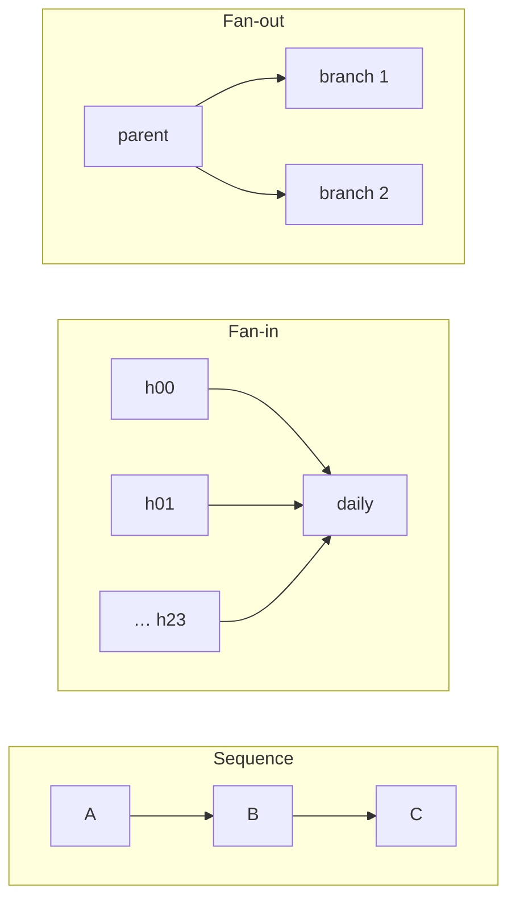
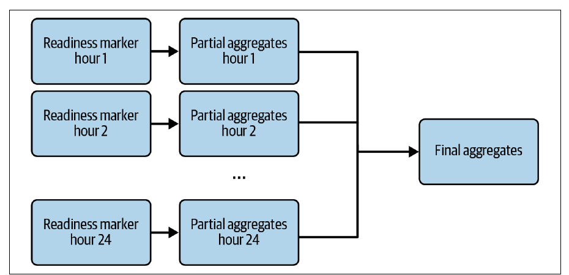
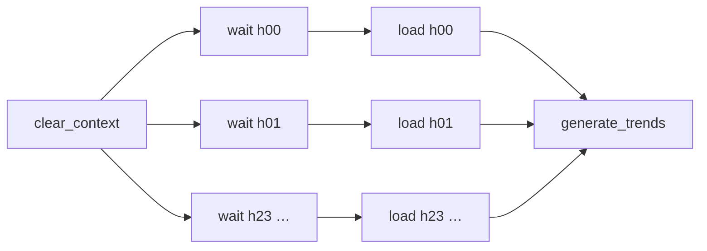

# 6. Data Flow Design Patterns

[← 5. Data Value Design Patterns](05-data-value-design-patterns.md) · [Book](../README.md) · [7. Data Security Design Patterns →](07-data-security-design-patterns.md)

## Summary

Value you create stays local until it flows to other teams — and their datasets flow back to you. Data flow patterns design and coordinate the steps that produce a dataset, at two levels: **data orchestration** (one or many pipelines, crossing team boundaries) and **data processing** (organizing business logic inside a job). The chapter's eight patterns come in four pairs. **Sequence**: the **Local Sequencer** splits a big job into restartable steps, the **Isolated Sequencer** links pipelines owned by different teams through data (readiness markers) or tasks (direct triggers). **Fan-in**: the **Aligned Fan-In** waits for all parents (e.g. 24 hourly branches → one daily aggregate), the **Unaligned Fan-In** proceeds anyway and flags partial data. **Fan-out**: the **Parallel Split** runs several branches from one parent, the **Exclusive Choice** picks one. **Orchestration**: the **Single Runner** forbids concurrent runs (needed for incremental logic), the **Concurrent Runner** allows them for independent datasets.

## Key takeaways

- **Draw boundaries where you would want to restart**: an expensive step (like paid API calls) shouldn't rerun because a later step failed; keep transactionally linked operations together (pp. 167–168).
- **Data-based dependencies are loose, task-based ones tight**: a readiness marker lets the consumer change freely; a direct trigger breaks when the consumer renames a task and couples schedules (pp. 171–172).
- **Fan-in gives faster feedback and cheaper fixes**: 24 hourly jobs report errors sooner and only the failed hour needs replaying — at the cost of load spikes, scheduling skew and overhead (pp. 176–177).
- **If you publish partial data, say so**: a completeness table, tags or an `is_approximate` flag (12 of 24 hours = 50%) (pp. 180–181).
- **Parallel branches must share the parent's work, not repeat it**: persist the intermediate dataset; split jobs whose branches need different hardware (pp. 183–186).
- **Branches multiply complexity**: prefer conditions evaluated in the orchestrator (visible) and on metadata (cheap) (pp. 187–191).
- **A Single Runner is slow to backfill and accumulates latency** when runs take longer than the schedule (30 min → 1.5 h on an hourly flow); a Concurrent Runner risks starvation and shared state (pp. 192–194).

## Section outline

*From the book’s own table of contents (PDF bookmarks); printed page numbers.*

- Sequence — p. 166
  - Pattern: Local Sequencer — p. 166
  - Pattern: Isolated Sequencer — p. 170
- Fan-In — p. 174
  - Pattern: Aligned Fan-In — p. 175
  - Pattern: Unaligned Fan-In — p. 178
- Fan-Out — p. 182
  - Pattern: Parallel Split — p. 182
  - Pattern: Exclusive Choice — p. 186
- Orchestration — p. 191
  - Pattern: Single Runner — p. 191
  - Pattern: Concurrent Runner — p. 193
- Summary — p. 195

## Notes

Sharing your datasets with other teams — and using theirs — multiplies value, but needs its own rules: chaining tasks, parallel or exclusive branches, and dependencies between physically separate pipelines (p. 165). The patterns work at the **data orchestration** level (pipelines, cross-team collaboration) and the **data processing** level (organizing job logic) (p. 165).

*The vault's sketch of the three flow shapes; orchestration patterns control how many runs execute at once.*

### Sequence

Sequencing affects complexity, performance and maintenance: a job writing to several databases as one unit must rerun entirely to reload just one of them (p. 166).

#### Pattern: Local Sequencer (pp. 166–170)

**Problem.** An old analytics job grew from dozens to hundreds of lines with three times more transformations; it fails often and always restarts from the beginning. Simplify it without dropping business logic (p. 166).

**Solution** (pp. 166–167): decompose it into smaller steps run sequentially, ordered by **dataset dependencies** (if B needs A's data, B runs after A) — e.g. a **Readiness Marker** task followed by a **Full Loader** task, either as two orchestrated tasks or one processing task (Figure 6-1). Three criteria decide where the sequence lives:

| Criterion | Signal |
|---|---|
| **Separation of concerns** | Struggling to name a task, or a too-long name, means it does too much |
| **Maintainability** | Retries and backfills recompute everything before the failure — e.g. a readiness check calling **10 paid APIs** rerun after three failures |
| **Implementation effort** | Orchestrators offer ready-made operators (SQL, API calls); one big task reinvents them |

**Consequences** (p. 168): **boundaries** — too coarse or too fine hurts execution time and scheduler capacity. Think in **restart boundaries**: Readiness Marker and Full Loader should fail independently (the marker needn't rerun if loading fails, assuming immutable source data). Inside a job, cut between the most compute-expensive operations. Keep **transactional units** together — e.g. the Dynamic Late Data Integrator's processing and its state-table update.

**Examples** (pp. 168–170): Airflow `input_data_sensor >> load_data_to_table >> expose_new_table` (a task runs only after its parent succeeds); AWS EMR steps with `ActionOnFailure=TERMINATE_CLUSTER` so a failure doesn't expose partial data as success; PySpark variables chained from read to write. A plain **CRON** expression is still fine for isolated jobs without dependencies (p. 170).

#### Pattern: Isolated Sequencer (pp. 170–174)

**Problem.** Your team cleans and enriches datasets; the data visualization team will build its own dashboard transformations. You provide the dataset, they own the rest (p. 170).

**Solution** (pp. 170–171): split pipelines at **provider/consumer (team) boundaries**; within one team, split only if one pipeline would become unreadable (otherwise use the Local Sequencer). Then pick a trigger (Figure 6-2):

| | **Data-based** | **Task-based** |
|---|---|---|
| Mechanism | Producer writes data + a readiness marker; consumer waits for it | Producer directly triggers the consumer's pipeline |
| Coupling | Loose — only the marker contract | Tight — a renamed consumer task breaks the producer |
| Who can change | Consumer may switch datasets without telling the producer | Consumer can't opt out; removing it can fail the producer |
| Good for | Shared datasets | No shared dataset, e.g. the consumer sends user notifications |

**Consequences** (pp. 172–173): **scheduling** — task-based triggering works best with identical schedules; otherwise one side must skip runs. **Communication** — checking the other side's conditions is costly or impossible (security may block incoming connections); the resilient fix is organizational: teams know their inputs and outputs and announce breaking changes.

**Examples** (pp. 173–174): data-based — `devices_loader` copies a file to `…/{ds_nodash}/dataset.csv` and `devices_aggregator` waits with a `FileSensor` on the same path (the dependency is implicit); task-based — an `ExternalTaskMarker` in the producer and an `ExternalTaskSensor` (`allowed_states=['success']`, `failed_states=['failed', 'skipped']`) in the consumer, where the marker also propagates producer backfills. **Data lineage** tools show who consumes what (Chapter 10; **OpenLineage**).

### Fan-in

Branches that merge again at some point (p. 174).

#### Pattern: Aligned Fan-In (pp. 175–178)

**Problem.** A daily aggregate of blog visits is built from hourly partitions; consumers only want the full day, but you'd like to use the hourly partitioning to avoid one huge job (p. 175).

**Solution** (pp. 175–176): branches that all must succeed before a common child runs — 24 hourly partial aggregates, then a daily merge (Figure 6-3). In processing, merging means **UNION** (vertical: more rows, same columns) or **JOIN** (horizontal: more columns, fewer rows). Benefits: a **faster feedback loop** (24 small parallel jobs surface errors sooner than one day-long job) and **cheaper failures** (replay only the failed hour, not 23 good ones).

*Figure 6-3 (p. 175): the final task runs only when all 24 hourly branches have succeeded.*

*After Example 6-6 (p. 177).*

**Consequences** (pp. 176–177): **infrastructure spikes** (24 concurrent jobs — limit concurrency, or run each branch hourly and aggregate in the day's last run); **scheduling skew** (the child waits for the slowest parent); **scheduling overhead** for very granular pipelines; **complexity** — ask “what belongs to one unit of execution?” and “what should be backfilled individually?”

**Examples** (pp. 177–178): Airflow creates 24 sensor → loader branches in a `for` loop between `clear_context` and `generate_trends` (or list static tasks: `[load_data_1, load_data_2] >> process_data`). SQL `UNION` is **position-based** — `SELECT a, b, c … UNION SELECT c, b, a …` silently pairs a with c; PySpark's `unionByName` matches columns by name.

#### Pattern: Unaligned Fan-In (pp. 178–182)

**Problem.** When an hour fails, no daily aggregate is produced; the team agrees it's better to publish partial data and fill gaps later (pp. 178–179).

**Solution** (p. 179): relax the parents' success condition — run the child when some parents succeed (partial input), or schedule a fallback/error-management task when they fail. In Airflow, set the task's **trigger rule**; elsewhere evaluate parents' outcomes explicitly.

**Consequences** (pp. 179–180): **readability** — success and failure branches side by side confuse readers (Figure 6-4); prefer built-in failure handlers (Airflow `on_failure_callback`, AWS Step Functions `Catch`). **Partial data** — tell consumers: a completeness table (12 of 24 parents = 50%, 6 = 25%), object tags, notifications — or keep incomplete output private until 100%.

**Examples** (pp. 181–182): Airflow `trigger_rule=TriggerRule.ALL_DONE` on `generate_cube` (invisible in the graph!) plus an `is_approximate` column set when `COUNT(DISTINCT execution_time_hour_id)` for the day ≠ 24, computed in a `GROUP BY CUBE(…)` insert. **AWS Step Functions**: a partitions-detector Lambda, a `Map` task running a processor Lambda per partition (returns a boolean), and a table-creator Lambda that sets `is_partial` if any result is `False`.

### Fan-out

One task feeding several — e.g. one dataset used by analytics and data science teams (p. 182).

#### Pattern: Parallel Split (pp. 182–186)

**Problem.** You're replacing an undocumented legacy C# framework with a Python library after reverse engineering it; until consumers switch, the processed dataset must be written to both the old and new places (p. 183).

**Solution** (p. 183): one parent, parallel children. In orchestration it's just the flow DSL. In processing: compute common parts **once** (temporary table, Spark `.persist()`), keep shared variables read-only or safely mergeable, and give time-sensitive branches dedicated resources or auto-scaling.

**Consequences** (pp. 183–184): **blocked execution** — with runs that depend on the previous run succeeding, every run waits for the slowest branch, and a failure blocks the next ones; move slow branches to their own pipeline (Isolated Sequencer). **Hardware** — CPU-heavy and memory-heavy branches can't share one job's infrastructure; materialize the intermediate dataset and start separate jobs (Figure 6-5).

**Examples** (pp. 184–186): Airflow — one `file_sensor` followed by Delta and CSV `SparkKubernetesOperator`/`Sensor` pairs; PySpark — `input_dataset.persist(StorageLevel.MEMORY_ONLY)` then two writes (memory-and-disk if RAM is short). To avoid duplicate writes on retry, Delta Lake's **`txnAppId` + `txnVersion`** options make repeated writes with the same values no-ops.

#### Pattern: Exclusive Choice (pp. 186–191)

**Problem.** After the migration, the new job must run from **January 1, 2024**, but backfills of earlier days must still use the old job — in the same pipeline, to keep its history (p. 186).

**Solution** (pp. 186–187): add a **condition evaluator** before the branches — Airflow branch operators, AWS Step Functions and Azure Data Factory (*if condition* activity) (Figure 6-6) — or plain `if`/`switch` in the job.

**Consequences** (pp. 187–188): **complexity factory** — many branches that split and merge become unreadable; explain the pipeline to an imaginary newcomer (**rubber duck debugging**). **Hidden logic** — branches inside a job are forgotten over time; evaluate the condition in the orchestrator and call different entry points (`python job_for_condition_a.py` vs `job_for_default.py`). **Heavy conditions** — prefer metadata-based conditions; if you must read data, do it once and incrementally.

**Examples** (pp. 188–191): Airflow `BranchPythonOperator` returning `load_job_trigger_delta` for execution dates on or after the migration date (`pendulum.datetime(2024, 2, 3)` in the code) and `load_job_trigger_csv` before; alternatively separate pipelines with `start_date`/`end_date`. In PySpark, an `--output_type` argument drives an `OutputGenerationFactory` (the **Factory** software pattern) that returns the right Spark session and writer — dedicated writer classes would remove the repeated conditions. Or branch on the input's schema: three or more fields → the new table location (a fast metadata check).

### Orchestration

Pipelines become dynamic components running tasks (p. 191).

#### Pattern: Single Runner (pp. 191–193)

**Problem.** A POC Incremental Sessionizer ran manually; for release it needs orchestration (p. 191).

**Solution** (pp. 191–192): incremental logic is sequential, so allow **one run at a time** — a concurrency setting of 1 (Airflow, Azure Data Factory), or a readiness marker waiting on the previous run (which still lets future runs pile up waiting).

**Consequences** (p. 192): **backfilling** is slow and can't be parallelized without wrong results — skip unneeded steps (e.g. only reload a generated dataset). **Latency** — if an hourly flow's 30-minute runs grow to 1.5 hours, delays accumulate for you and all consumers; add compute or optimize.

**Examples** (pp. 192–193): Airflow `max_active_runs=1` with `depends_on_past=True` (a task waits for its own previous run to succeed); AWS EMR `StepConcurrencyLevel`; Azure Data Factory *Concurrency* — extra runs are queued (up to 100) and a full queue returns HTTP **429** “Too many requests”.

> **Try it:** [Single vs concurrent runner](../widgets/06-runners.html) — schedule hourly runs, stretch their duration, and compare how delay accumulates with one or several concurrent runs.

#### Pattern: Concurrent Runner (pp. 193–195)

**Problem.** Ingestion runs every 30 minutes to an hour, sometimes longer, and under a Single Runner every later delivery is delayed — though the datasets are independent (p. 193).

**Solution** (pp. 193–194): allow concurrency > 1, balanced against other pipelines; the orchestrator starts the next run while running instances are below the limit.

**Consequences** (p. 194): **resource starvation** in multitenant orchestrators when many pipelines backfill concurrently — use **workload management** (capacity per group); serverless orchestrators scale further (AWS Step Functions: up to **10,000** parallel child workflow executions). **Shared state** — concurrent runs of e.g. the Dynamic Late Data Integrator may trigger a backfill several times or not at all.

**Examples** (pp. 194–195): Airflow `max_active_runs=5` with `depends_on_past=False` (set it per task if some tasks depend on their previous runs). Azure Data Factory supports concurrency and trigger dependencies but not task-level dependencies on past runs.

### Summary

Sequences (local or isolated) define readable, maintainable boundaries; fan-in merges branches (aligned or tolerating failures); fan-out creates them (parallel or exclusive); runners control concurrency — single for incremental logic, concurrent for independent runs and fast backfills (p. 195).

## Trade-offs at a glance

| Pair | Option A | Option B |
|---|---|---|
| Sequence | **Local**: one pipeline, restartable steps | **Isolated**: team-owned pipelines; data- or task-based links |
| Fan-in | **Aligned**: complete data, waits for slowest | **Unaligned**: partial data sooner; must be flagged |
| Fan-out | **Parallel Split**: all branches, shared parent work | **Exclusive Choice**: one branch, condition evaluator |
| Runner | **Single**: correct for incremental logic; slow backfills | **Concurrent**: fast; starvation and shared-state risks |

## Beyond the book

- Several names here — *Parallel Split*, *Exclusive Choice*, and the merge variants — echo the classic Workflow Patterns catalogue (van der Aalst et al., 2003), which defined control-flow patterns for business process systems long before data orchestrators.
- The [runner widget](../widgets/06-runners.html) uses the book's 30-minute and 1.5-hour durations on an hourly schedule; its queueing model is the vault's.

## Connections

- **Related chapters:** [2. Data Ingestion](02-data-ingestion-design-patterns.md) (Readiness Marker, External Trigger), [3. Error Management](03-error-management-design-patterns.md) (Dynamic Late Data Integrator and concurrency), [4. Idempotency](04-idempotency-design-patterns.md) (Fast Metadata Cleaner's Exclusive Choice), [5. Data Value](05-data-value-design-patterns.md) (Incremental Sessionizer needs a Single Runner), [10. Data Observability](10-data-observability-design-patterns.md) (lineage).

## Check yourself

*Questions and answers are the vault's, written from the notes above; answers cite the book's pages.*

1. **A readiness check calls 10 paid APIs before a load. Why make them separate tasks?**

   *Answer:* If the load fails and is retried or backfilled as part of one task, the paid API calls run again each time; separate tasks give separate restart boundaries (pp. 167–168).

2. **The consumer team renames a task. Which inter-pipeline strategy breaks?**
   - [ ] Data-based (readiness marker)
   - [x] Task-based (direct trigger)
   - [ ] Neither

   *Answer:* In the task-based strategy the producer triggers a specific consumer task; if it no longer exists, the producer's pipeline fails (p. 171).

3. **Why can 24 hourly branches be better than one daily job, and what do they cost?**

   *Answer:* Errors surface sooner and only the failed hour must be replayed; but they cause infrastructure spikes, scheduling skew (waiting for the slowest) and scheduling overhead (pp. 176–177).

4. **You set `TriggerRule.ALL_DONE` on the daily task. What else should you add?**

   *Answer:* A way for consumers to know the result may be partial — e.g. an `is_approximate` flag when fewer than 24 hours were processed, or a completeness table — since the rule itself is invisible in the graph (pp. 180–181).

5. **Which runner does an Incremental Sessionizer need?**
   - [x] Single Runner
   - [ ] Concurrent Runner

   *Answer:* Each run depends on the previous run's pending sessions, so concurrent runs would produce wrong results (pp. 191–192).

6. **An hourly pipeline under a Single Runner now takes 1.5 hours per run. What happens?**

   *Answer:* Each run starts later than the previous, so data gets increasingly delayed for you and every downstream consumer until you add compute or optimize (p. 192).
