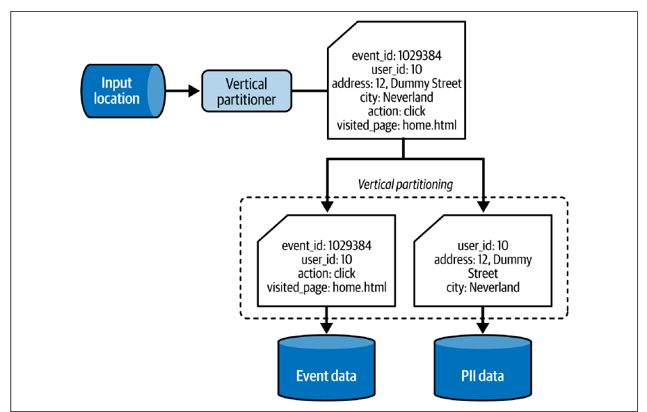
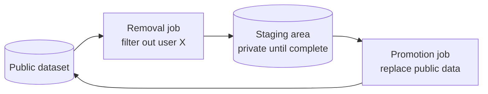
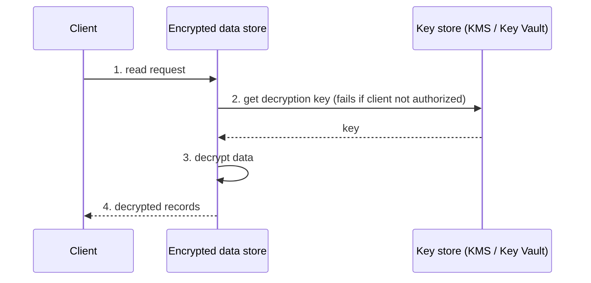

# فصل ۷: الگوهای طراحی امنیت داده

[فصل ۶: الگوهای طراحی جریان داده →](06-data-flow-design-patterns.md) · [کتاب](../README.md) · [فصل ۸: الگوهای طراحی ذخیره‌سازی داده ←](08-data-storage-design-patterns.md)

## خلاصه

مجموعه‌داده‌ی ارزشمند حسادت می‌آورد، از جمله از سمت بازیگرهای بدخواه، پس مهندس داده باید به امنیت هم فکر کند. این فصل چهار جنبه را با نُه الگو می‌پوشاند. **حذف داده** برای قانون‌های حریم خصوصی، یعنی GDPR و CCPA: الگوی **Vertical Partitioner** ویژگی‌های شخصی و immutable را یک‌بار ذخیره می‌کند تا حذف به یک ردیف بخورد، در حالی که **In-Place Overwriter** داده‌ی موجود را بازنویسی می‌کند، با یک ناحیه‌ی staging یا با tombstoneهای Kafka. **کنترل دسترسی**: الگوی **Fine-Grained Accessor for Tables** ستون‌ها و ردیف‌ها را محدود می‌کند، با GRANT و policy tag و masking و سیاست ردیفی، و **Fine-Grained Accessor for Resources** کمینه‌ی اختیار را روی منابع cloud اعمال می‌کند، با سیاست منبع‌محور یا هویت‌محور. **محافظت از داده**: الگوی **Encryptor** داده‌ی در حال سکون و در حال انتقال را محافظت می‌کند، **Anonymizer** مقدارهای حساس را برمی‌دارد یا آشفته یا مصنوعی می‌کند، و **Pseudo-Anonymizer** آن‌ها را mask یا tokenize یا hash یا رمز می‌کند و کمی سودمندی را نگه می‌دارد. **اتصال**: الگوی **Secrets Pointer** به credentialهایی ارجاع می‌دهد که در یک secrets manager‌اند، و **Secretless Connector** با هویت IAM یا گواهی، credential را کاملاً برمی‌دارد.

## نکته‌های کلیدی

- **داده‌ی شخصی را یک‌بار ذخیره کنید تا حذفش ارزان شود**: با Vertical Partitioner، برداشتن کاربری با دو هزار رکورد یعنی حذف یک ردیف، نه بازنویسی دو هزار رکورد (pp. 198–200, 205).
- **حذف کردن همان پاک کردن نیست**: table formatها نسخه‌های قدیمی را تا `VACUUM` نگه می‌دارند، و Kafka به tombstone و compaction نیاز دارد، که compaction فقط به topicهایی می‌خورد که یک رکورد در هر کلید دارند (pp. 202–205).
- **با ناحیه‌ی staging بازنویسی کنید**: job حذفی که تلاش دوباره خورده یا شکست خورده هیچ‌وقت نباید مجموعه‌داده‌ی عمومی را نیمه‌نوشته بگذارد (pp. 204, 206).
- **دسترسی دانه‌ریز در سطح ستون و ردیف** در warehouseها کار می‌کند، و در سطح منبع و prefix و tag و شرط در cloud، ولی سیاست‌های ریز و زیاد به سقف نگه‌داری و سهمیه می‌خورند (pp. 207–214).
- **عمل encryption می‌تواند خودتان را هم بیرون بگذارد**: گم شدن کلید یعنی گم شدن داده، و از همین‌جاست کلیدهای حذف‌نرم‌شده با پنجره‌ی برگرداندن (pp. 217–218).
- **داده‌ی pseudo-anonymized در ترکیب با مجموعه‌داده‌های دیگر می‌تواند دوباره شناسایی شود**، در حالی که داده‌ی anonymized نمی‌تواند، ولی اطلاعات بیشتری از دست می‌دهد (pp. 223–224).
- **مقدار credential باید ارجاع باشد یا اصلاً نباشد**: secrets managerها متمرکزش می‌کنند، و نقش‌های IAM و گواهی‌ها کاملاً برمی‌دارندش، ولی cache و log و چرخش باز هم دقت می‌خواهند (pp. 226–230).

## فهرست بخش‌ها

*از فهرست مطالب خود کتاب، از bookmarkهای PDF؛ شماره‌ها صفحه‌ی چاپی‌اند.*

- حذف داده — p. 198
  - الگو: Vertical Partitioner — p. 198
  - الگو: In-Place Overwriter — p. 203
- کنترل دسترسی — p. 207
  - الگو: Fine-Grained Accessor for Tables — p. 207
  - الگو: Fine-Grained Accessor for Resources — p. 211
- محافظت از داده — p. 215
  - الگو: Encryptor — p. 215
  - الگو: Anonymizer — p. 219
  - الگو: Pseudo-Anonymizer — p. 222
- اتصال — p. 226
  - الگو: Secrets Pointer — p. 226
  - الگو: Secretless Connector — p. 228
- خلاصه — p. 231

## یادداشت‌ها

مجموعه‌داده‌ها دارایی کسب‌وکارند و بازیگرهای دیگر بازار به چشمشان دارند، بدخواه‌ها هم (p. 197). امنیت این‌جا چهار سمت دارد: **انطباق** با قانون‌های حریم خصوصی مثل GDPR در اروپا و CCPA در آمریکا؛ **کنترل دسترسی**، چون مجموعه‌داده‌ی باز را تیم دیگری می‌تواند تصادفی بازنویسی کند؛ **محافظت از داده**، چون حتی با دسترسی به یک مکان، encryption باز هم کلید می‌خواهد؛ و **اتصال**، چون مقدار credential در یک repository گیت خطر لو رفتن را بالا می‌برد (p. 197).

| جنبه | الگوها |
|---|---|
| حذف داده، یعنی حق فراموش شدن | Vertical Partitioner، In-Place Overwriter |
| کنترل دسترسی | Fine-Grained Accessor برای جدول و برای منابع |
| محافظت از داده | Encryptor، Anonymizer، Pseudo-Anonymizer |
| اتصال | Secrets Pointer، Secretless Connector |

### حذف داده

قاعده‌های حریم خصوصی می‌خواهند که داده‌ی شخصی کاربر سر درخواستش حذف شود (p. 198).

#### الگو: Vertical Partitioner (pp. 198–203)

**مسئله.** همکارهایی که طراحی حذف داده‌ی شخصی شما را بررسی می‌کنند اشاره می‌کنند که ستون‌های تغییرناپذیر، مثل تاریخ تولد و شماره‌ی شناسایی شخصی، در هر رکورد تکرار شده‌اند. هر ویژگی immutable را یک‌بار ذخیره کنید تا حذف چیز کمتری برای حذف داشته باشد (p. 198).

**راه‌حل** (pp. 198–200): پارتیشن‌بندی **افقی** کل رکوردها را گروه می‌کند، مثلاً بر حسب تاریخ، فصل ۸ را ببینید؛ پارتیشن‌بندی **عمودی** هر ردیف را می‌شکند و بخش‌ها را در جاهای مختلف می‌نویسد، و این دو ترکیب‌شدنی‌اند. ستون‌هایی را که باید جدا شوند و ویژگی‌ای را که دوباره به هم می‌رساندشان بشناسید، مثل `user_id`، و بعد ورود داده را طوری کنید که ویژگی‌های mutable را در یک ذخیره‌سازی و immutableها و شخصی‌ها را در دیگری بنویسد (شکل ۷-۱)، با projectionهای ساده‌ی `SELECT` به‌علاوه‌ی قاعده‌هایی مثل تکراری‌زدایی. حذف به داده‌ی خیلی کمتری می‌خورد، و هر ذخیره‌سازی می‌تواند قاعده‌ی دسترسی و نگه‌داری خودش را داشته باشد.

*Figure 7-1 (p. 199): ویژگی‌های شخصی به ذخیره‌سازی خودشان می‌روند و `user_id` می‌گذارد consumerها بخش‌ها را دوباره به هم برسانند.*

**پیامدها** (pp. 200–201):

| | |
|---|---|
| **performance کوئری** | گونه‌ای از نرمال‌سازی است: خواننده‌ها باید پیوند بزنند، که ترافیک شبکه اضافه می‌کند |
| **پیچیدگی کوئری** | با یک view یا یک data catalog یا lineage کمش کنید، یعنی Dataset Tracker در فصل ۱۰ |
| **durableی چند‌زبانی** | همان رکورد در یک search engine و یک ذخیره‌سازی key-value یعنی شکستن و حذف در هر دو؛ یک job می‌شکند و consumerهای اختصاصی در هر ذخیره‌سازی می‌نویسند (شکل ۷-۲) |
| **داده‌ی خام** | الگو از اولین تبدیل به کار می‌آید؛ داده‌ی خام نشکسته راهبرد دیگری می‌خواهد، مثل دوره‌ی نگه‌داری کوتاه، که backfill را محدود می‌کند |

**نمونه‌ها** (pp. 201–203): در Spark، `foreachBatch` دسته را durable می‌کند، بازدیدها را با حذف `context.user` در یک topic کافکا با کلید `visit_id` و ویژگی‌های کاربر را در topic دیگری با کلید `user_id` می‌نویسد؛ و job دومی contextهای تکراری‌زدایی‌شده‌ی کاربر را با `MERGE` در یک جدول Delta می‌برد. حذف: `DeltaTable.delete('user_id = "…"')` **به‌علاوه‌ی `VACUUM`**، وگرنه نسخه‌های قدیمی باز هم کاربر را نشان می‌دهند. در Kafka یک **tombstone** بفرستید، یعنی کلید با مقدار `NULL`، به topicی که `cleanup.policy` آن compaction است؛ این برای `user_context` کار می‌کند که یک رکورد در هر کلید دارد، ولی برای بازدیدها نه، که compaction فقط آخرین بازدید هر کلید را نگه می‌داشت.

#### الگو: In-Place Overwriter (pp. 203–207)

**مسئله.** یک سیستم قدیمی چند ترابایت را در پارتیشن‌های افقی زمان‌محور دارد و هیچ راهبردی برای داده‌ی شخصی ندارد، ولی حالا باید به درخواست حذف جواب بدهد؛ بودجه‌ای هم برای بازسازی نیست (p. 203).

**راه‌حل** (pp. 203–205):

| ذخیره‌سازی | چطور حذف شود |
|---|---|
| حذف در جا را پشتیبانی می‌کند | دستور `DELETE … WHERE` و بعد یک مرحله‌ی پاک‌سازی برای فرمت‌های time travel، مثل Iceberg و Delta Lake |
| فایل‌های خام، یعنی JSON و CSV | کل مجموعه‌داده بی ردیف‌های آن کاربر در یک **ناحیه‌ی staging** بازنویسی می‌شود و بعد یک job ارتقا، داده‌ی عمومی را عوض می‌کند (شکل ۷-۳) |
| topic کافکای compact‌شده با رکوردهای کلید‌دار | topic را بخوانید و کلید هر موجودیت حذف‌شده را با payload تهی بفرستید |

مفهوم table formatها حذف را یا با **deletion vector** انجام می‌دهند، یعنی یک فایل کنارِ کوچک که ردیف‌های برداشته‌شده را فهرست می‌کند و سر خواندن فیلتر می‌شود، یا با بازنویسی فایل‌ها بی آن ردیف‌ها، که نوشتن‌بر است (p. 204). اگر دوره‌ی نگه‌داری از مهلت قانونی حذف کوتاه‌تر باشد، شاید انقضا به‌عنوان حذف حساب شود؛ با CDO و دپارتمان حقوقی‌تان بررسی کنید (p. 205).

*بر پایه‌ی شکل ۷-۳ (p. 204): job حذفی که شکست خورده یا تلاش دوباره خورده هیچ‌وقت مجموعه‌داده‌ی عمومی را خراب نمی‌کند.*

**پیامدها** (p. 205): **سرریز I/O**، یعنی خواندن و بازنویسی می‌تواند ذخیره‌سازی را با گذر زمان تقریباً دو برابر کند؛ آمارهای Parquet، که Delta Lake و Iceberg هم به کارشان می‌برند، می‌گذارند موتورها از بلوک‌های بی آن کاربر بپرند. **هزینه**، یعنی یک موجودیت حذف‌شده با **دو هزار** رکورد یعنی بازنویسی دو هزار رکورد در برابر یک رکورد با Vertical Partitioner؛ درخواست‌های حذف را در یک اجرا دسته کنید.

**نمونه‌ها** (pp. 206–207): در PySpark، متن خام خوانده می‌شود، فقط `user_id` با `from_json` بیرون کشیده می‌شود، آن کاربر فیلتر می‌شود و متن در staging نوشته؛ و بعد `aws s3 rm ${BUCKET}/output --recursive` و `aws s3 mv ${BUCKET}/staging ${BUCKET}/output --recursive`، چون تغییر نام در ذخیره‌سازی object همان کپی و حذف است و تراکنشی نیست. چون اصل بازنویسی می‌شود، حذفی باگ‌دار را نمی‌شود برگرداند، پس الگوی **Proxy** یا نسخه‌دار کردن ذخیره‌سازی object را به کار ببرید، یعنی S3 و Azure Storage و GCS (p. 207).

> **Run it:** [آزمایش هزینه‌ی حذف داده](../lab/07-removal-cost/README.md) در vault می‌شمارد هر دو الگو چند ردیف و چند بایت بازنویسی می‌کنند.

> **In practice:** داده‌ی شخصی در stack ما hash می‌شود، ولی درخواست حذف هنوز ممکن است و جدول تراکنش‌ها بزرگ‌ترین جدول warehouse است.
>
> **Your turn:** چرا نگه داشتن ستون‌های شخصی در جدولی جدا با کلید `customer_id` درخواست حذف را ارزان‌تر می‌کند؟
>
> *Answer:* حذف به‌جای mutation روی همه‌ی partitionهای جدول بزرگ، فقط چند ردیف از جدولی کوچک را پاک می‌کند، و بقیه‌ی داده بدون آن ستون‌ها دیگر شخصی نیست. این همان Vertical Partitioner است (pp. 198–203).

### کنترل دسترسی

جز انطباق، فقط کاربرهای مجاز باید به حیاتی‌ترین داده برسند، چون داده می‌تواند بزرگ‌ترین دارایی رقابتی‌تان باشد (p. 207).

#### الگو: Fine-Grained Accessor for Tables (pp. 207–211)

**مسئله.** بعد از بردن بارهای HDFS و Hive به یک warehouse در cloud، کاربرها و گروه‌ها دسترسی جدول را کنترل می‌کنند، ولی ذی‌نفع‌ها می‌خواهند بعضی کاربرها نتوانند ستون‌ها و ردیف‌های معینی را بخوانند (p. 207).

**راه‌حل** (pp. 207–209):

| سطح | پیاده‌سازی | سیستم‌ها |
|---|---|---|
| ستون | `GRANT SELECT(col_A, col_B) ON my_table TO some_user;` | Amazon Redshift، PostgreSQL |
| ستون | policy tag در Data Catalog به‌علاوه‌ی نقش Fine-Grained Reader | GCP BigQuery |
| ستون | **masking**، یعنی ستون دیده می‌شود ولی محتوایش پنهان است، مثل `ip STRING MASK ip_mask` که IP را فقط به اعضای `engineers` نشان می‌دهد | Databricks Unity Catalog، Snowflake |
| ردیف | شرط‌های پویایی که به کوئری اضافه می‌شوند: ROW FILTER در Databricks، Row-Level Security در Redshift، و row access policy در BigQuery و Snowflake | — |
| ردیف، جایگزین | یک view: `… FROM blogs WHERE blog_author = current_user` | هر کدام |

**پیامدها** (p. 209): **محدودیت سطح ردیف**، یعنی شرط‌ها بیشتر ویژگی‌های session را به کار می‌برند، مثل کاربر و گروه و IP؛ **نوع داده**، یعنی فیلدهای تو‌در‌تو باید باز شوند یا با **Dataset Materializer** نشان داده شوند، فصل ۸ را ببینید؛ **سرریز کوئری**، یعنی جدول یا view برای هر گروه materialize کنید، به قیمت تکرار و governance.

**نمونه‌ها** (pp. 209–210): در PostgreSQL، `GRANT SELECT(id, login, registered_datetime) ON dedp.users TO user_a` که بعدش `SELECT *` با خطای «permission denied» شکست می‌خورد؛ `ALTER TABLE dedp.users ENABLE ROW LEVEL SECURITY; CREATE POLICY user_row_access ON dedp.users USING (login = current_user);`؛ و در DynamoDB شرط IAM روی `dynamodb:LeadingKeys` برابر `${www.amazon.com:user_id}`، پس کاربرها فقط آیتم‌هایی را می‌خوانند که کلیدشان با شناسه‌ی خودشان شروع می‌شود.

#### الگو: Fine-Grained Accessor for Resources (pp. 211–215)

**مسئله.** یک audit jobی پیدا می‌کند که می‌توانسته هر مجموعه‌داده‌ای در ذخیره‌سازی object را بازنویسی کند؛ auditor **کمینه‌ی اختیار** را توصیه می‌کند، که کتاب اصل *at-least privilege* می‌نامدش: هر مؤلفه فقط مجوزهایی را بگیرد که لازم دارد (p. 211).

**راه‌حل** (pp. 211–213)، دو راهبرد (شکل ۷-۴):

| | منبع‌محور | هویت‌محور |
|---|---|---|
| مجوزها کجا می‌نشینند | روی خود منبع | روی کاربر یا نقش |
| نمونه | سیاست IAM یک bucket در GCS که `roles/storage.admin` را به یک کاربر می‌دهد، با Terraform | یک نقش IAM در AWS که EMR با `sts:AssumeRole` برمی‌داردش، با `kinesis:Get*/Describe*/List*/Put*` روی stream به نام `visits` |

مجوزها می‌توانند یک منبع یا یک prefix یا **شرط‌های زمان اجرا** را هدف بگیرند؛ مثلاً `s3:PutObject` در S3 فقط وقتی اجازه داشته باشد که `aws:TagKeys` با شناسه‌ی کاربر بخورد، یعنی دسترسی tag‌محور (p. 213).

**پیامدها** (p. 214): **امنیت کتابی**، یعنی سیاست‌های ریز و زیاد سخت نگه داشته می‌شوند؛ یک wildcard مثل `visits*` ساده‌اش می‌کند ولی ممکن است به منابع آینده هم دسترسی بدهد، پس با امنیت توافق کنید. **پیچیدگی**، یعنی از قاطی کردن دو راهبرد بپرهیزید. **سهمیه**، یعنی AWS IAM پیش‌فرض **۱۵۰۰** سیاست سفارشی می‌دهد و GCP **۳۰۰** نقش سفارشی برای هر پروژه.

**نمونه‌ها** (pp. 214–215): فرمان `aws s3 ls s3://dedp-visits-301JQN/` با `AccessDenied` شکست می‌خورد؛ هویت‌محور با نقشی که `s3:Get*` و `s3:List*` را روی bucket و objectهایش می‌دهد درستش کنید، یا منبع‌محور با `aws s3api put-bucket-policy` که principal به نام `visits-s3-reader` را نام می‌برد.

> **In practice:** در stack ما Authentik هویت را می‌دهد و SQL proxy دسترسی هر نفر به warehouse را؛ گروه‌های Authentik باید به roleهای ClickHouse و Metabase map شوند تا دسترسی یک جا تعریف شود.
>
> **Your turn:** تحلیلگری تیم را ترک می‌کند. دسترسی‌اش را کجا می‌بندید و چه چیزی ممکن است جا بماند؟
>
> *Answer:* در Authentik: کاربر غیرفعال می‌شود و هر ابزاری که پشت SSO است بسته می‌شود. آن‌چه جا می‌ماند credentialهای بیرون از SSO است، مثلاً token شخصی GitLab یا userی مستقیم در ClickHouse؛ برای همین دسترسی را به role و گروه بدهید، نه به آدم (pp. 207–215).

### محافظت از داده

کنترل‌های دسترسی منطقی کافی نیستند؛ خود داده هم باید در برابر استفاده‌ی غیرمنتظره محافظت شود (p. 215).

#### الگو: Encryptor (pp. 215–219)

**مسئله.** ذی‌نفع‌ها می‌ترسند کسی داده را بین brokerها و jobها شنود کند، یا فیزیکی از سرورها بدزدد (pp. 215–216).

**راه‌حل** (pp. 216–217): **در حال سکون**، یا encryption سمت client که producer رمز می‌کند و کلیدها را مدیریت، یا **سمت سرور** که ذخیره‌سازی همه کار را می‌کند و کلیدها در **KMS** از AWS و GCP یا **Key Vault** از Azure می‌نشینند. خواندن داده‌ی رمزشده (شکل ۷-۵):

*بر پایه‌ی شکل ۷-۵ (pp. 216–217).* **در حال انتقال**: ارتباط امن را در SDK سمت client روشن کنید و روی سرویس یک نسخه‌ی پروتکل را الزامی کنید (p. 217).

**پیامدها** (pp. 217–218): **سرریز CPU** در هر خواندن و نوشتن؛ **خطر از دست رفتن داده** اگر کلید گم شود، که تأمین‌کننده‌ها کلیدها را با دوره‌ی مهلت حذف نرم می‌کنند؛ و **به‌روزرسانی پروتکل**، یعنی TLS نسخه‌ی ۱٫۰ و ۱٫۱ منسوخ شده‌اند (RFC 8996)، پس سرویس‌ها باید ارتقا پیدا کنند.

**نمونه‌ها** (pp. 218–219): یک ماژول KMS در Terraform با `key_usage = "ENCRYPT_DECRYPT"` و `deletion_window_in_days = 14` که پنجره‌ی برگرداندن است و یک grant با `Encrypt` و `Decrypt` و `GenerateDataKey` به یک نقش IAM؛ `aws_s3_bucket_server_side_encryption_configuration` با `sse_algorithm = "aws:kms"`؛ و در Azure Event Hubs `minimum_tls_version = "1.2"`.

#### الگو: Anonymizer (pp. 219–222)

**مسئله.** یک شرکت تحلیلی بیرونی رفتار مشتری‌ها را تحلیل خواهد کرد، ولی بعضی کاربرها به اشتراک PII با طرف سوم رضایت نداده‌اند (p. 219). همین برای داده‌ی PHI، یعنی اطلاعات سلامت محافظت‌شده، و IP، یعنی مالکیت فکری، هم برقرار است (p. 220).

**راه‌حل** (pp. 220–221): ردیف‌ها را ناشناس کنید تا consumer نتواند کاربر را بشناسد:

| روش | نمونه |
|---|---|
| **حذف داده** | ستون‌ها را بیندازید |
| **آشفتگی داده** | نوفه اضافه کنید؛ مثلاً IP `123.456.789.012` می‌شود `1823.456.7809.012` |
| **جابه‌جایی با داده‌ی مصنوعی** | یک تولیدکننده، احتمالاً ML، جانشین‌های واقع‌نما می‌سازد؛ مثلاً `Portugal` می‌شود `Croatia` |

**پیامدها** (p. 221): **از دست رفتن اطلاعات**، یعنی تحلیل‌گرها و data scientistها نمی‌توانند آن ستون‌ها را به کار ببرند، که می‌تواند یعنی مدل و بینش غلط.

**نمونه‌ها** (pp. 221–222): در PySpark، `users.drop('birthday').withColumn('email', replace_email(users.email))`، که در آن یک UDF از جنس pandas با کتابخانه‌ی **Faker** ایمیل تصادفی می‌سازد.

#### الگو: Pseudo-Anonymizer (pp. 222–226)

**مسئله.** شریک تحلیلی با مجموعه‌داده‌ی ستون‌حذف‌شده نمی‌تواند بیشتر پرسش‌ها را جواب بدهد؛ می‌خواهد PII واقعی پنهان باشد ولی به شکلی به‌کار‌آمدنی‌تر (p. 222).

**راه‌حل** (pp. 222–223):

| روش | چطور | برگشت‌پذیر؟ |
|---|---|---|
| **masking داده** | مقدار `999-55-1040` می‌شود `XXX-XX-1040` یا `9XX-5X-1XXX` | نه؛ چند کاربر می‌توانند یک mask داشته باشند |
| **tokenization** | مقدارهای خیالی، با mappingی که در یک **token vault** امن می‌ماند | بله، با دسترسی به vault |
| **hashing** | الگوریتم SHA-256 و Base64 روی `contact@waitingforcode.com` | نه |
| **encryption** | کلید در سطح ستون یا ردیف | بله، با کلید |

**تفاوت anonymization و pseudo-anonymization** (p. 223): داده‌ی pseudo-anonymized در **ترکیب با مجموعه‌داده‌های دیگر** می‌تواند شناسایی‌پذیر شود، در حالی که داده‌ی anonymized نمی‌تواند.

**پیامدها** (pp. 223–224): **حس دروغین امنیت**؛ نمونه‌ی کتاب: یک جدول سلیقه‌ی غذایی، که کاربر ۱۰۰۰ هویج و بروکلی و سیب‌زمینی دوست دارد و چیپس و شکلات را نه، که با جدول ثبت‌نام پیوند می‌خورد و در آن کشور `S*n M****o` و نقش `C******h P*******r i******r` است، به سان‌مارینو و مخترع framework خیالی Cheetach Processor اشاره می‌کند، یعنی John Doe (جدول‌های ۷-۱ و ۷-۲). تعمیم دادن به «اروپا» و «مهندس نرم‌افزار» جلویش را می‌گرفت. **از دست رفتن اطلاعات**، یعنی `999-55-1040` و `999-13-1040` هر دو به `XXX-XX-1040` تبدیل می‌شوند؛ و **تعمیم** عددها را به بازه‌ی متنی تبدیل می‌کند، یعنی از دست رفتن نوع.

**نمونه‌ها** (pp. 224–225): متد `mapInPandas` کشورها را به ناحیه map می‌کند، یعنی Poland و France و Spain به `eu` و USA به `na`، و شماره‌های SSN را به `f'{ssn[0]}***-{ssn[5]}***-{ssn[10]}***'` تبدیل می‌کند؛ و یک `withColumn` جدا، `salary` را به بازه‌های `0-50000` و `50000-60000` و `60000+` تبدیل می‌کند، چون نوعش عوض می‌شود.

*نمونه‌ی ۷-۲۶ (p. 225): بعد از pseudo-anonymization*

| user_id | country | ssn | salary |
|---|---|---|---|
| ۱ | eu | `0***-0***-1***` | 0-50000 |
| ۲ | eu | `0***-0***-1***` | 50000-60000 |
| ۳ | na | `1***-0***-3***` | 60000+ |
| ۴ | eu | `8***-1***-9***` | 50000-60000 |

> **Vault note:** حقوق دقیقاً برابر پنجاه هزار در شاخه‌ی اول `CASE` می‌افتد، یعنی `BETWEEN 0 AND 50000`، و از همین‌جاست که کاربر ۱ در `0-50000` می‌نشیند؛ کران‌های دو‌طرفه‌شاملِ `BETWEEN` بازه‌های همسایه را هم‌پوشان می‌کنند.

### اتصال

داده داخل سیستم‌ها و بین آن‌ها جریان دارد و دسترسی هم باید امن باشد (p. 226).

#### الگو: Secrets Pointer (pp. 226–228)

**مسئله.** یک pipeline بی‌درنگ بازدیدها را با یک API موقعیت جغرافیایی بیرونی غنی می‌کند که فقط نام کاربری و گذرواژه می‌گیرد. تیم شما یک‌بار credential یک API درخواست‌محاسب را لو داده و صورت‌حساب بالا رفته؛ دیگر در کد ذخیره‌شان نکنید (p. 226).

**راه‌حل** (pp. 226–227): مقدار credential را در یک **secrets manager** نگه دارید، مثل Google Cloud Secret Manager و AWS Secrets Manager، و با **نام** ارجاعش بدهید؛ consumerها مقدارها را سر اجرا می‌گیرند و می‌توانند cache کنند. سودش: یک‌جا برای monitoring و چرخش. محافظت دو‌سطحی است، یعنی اول دسترسی به secrets manager با همان الگوهای دسترسی دانه‌ریز، و بعد اعتبار خود credential.

**پیامدها** (p. 227): **بی‌اعتبار کردن cache**، که یکی از «دو چیز سخت» Phil Karlton است، یعنی credential cache‌شده می‌تواند کهنه باشد؛ ساده‌ترین کار این است که بگذارید job شکست بخورد و سر راه‌اندازی دوباره بار شود، با نوشتن idempotent، یا asynchronous تازه‌اش کنید، که در میانه‌ی نوشتن پرخطر است. **logها** باز هم می‌توانند secret را لو بدهند. **secret باز هم secret می‌ماند**، یعنی کسی، مثل یک admin یا IaCی که مقدار تصادفی می‌سازد، باز هم باید بسازدشان.

**نمونه‌ها** (p. 228): در `boto3`، `secretsmanager_client.get_secret_value(SecretId='user')` و همان برای `'pwd'`، که به خواننده‌ی JDBC در Spark داده می‌شود. وقتی IaC برای هر محیط secret با همان نام‌ها می‌سازد، کد به فایل تنظیم جدا برای هر محیط نیاز ندارد.

#### الگو: Secretless Connector (pp. 228–231)

**مسئله.** تیم کوچکی که سرویس پردازش تازه‌ای را به کار می‌گیرد فقط نمونه‌های کلید API پیدا می‌کند و می‌خواهد بی هیچ credentialی در کد به منابع cloud دسترسی داشته باشد (p. 228).

**راه‌حل** (pp. 229–230):

| پیاده‌سازی | چطور |
|---|---|
| **IAM‌محور** | سیاست‌ها به کاربر و گروه و نقش، از جمله کاربرهای برنامه‌ای مثل jobهای زمان‌بندی‌شده، کارهایی را روی منابع می‌دهند، و سرویس از IAM می‌پرسد که صدازننده اجازه دارد یا نه (شکل ۷-۶) |
| **گواهی‌محور** | یک **certificate authority** گواهی‌ها را سر اتصال اعتبارسنجی می‌کند |

**پیامدها** (p. 230): **برداشت بی‌کار بودن**، یعنی باز هم هویت‌ها را تنظیم می‌کنید، مثل مجوزهای assume-role در AWS برای گرفتن credential موقت از **STS**. **چرخش** گواهی یا کلید: تازه‌ها را صادر کنید، قدیمی و تازه را هر دو بپذیرید تا consumerها تأیید کنند، و بعد قدیمی را بیندازید.

**نمونه‌ها** (pp. 230–231): از Spark به PostgreSQL با `ssl: true` و `sslmode: verify-full`، که نام host باید با گواهی بخورد، و `sslrootcert`، بی گذرواژه؛ و در GCP یک `google_service_account` و یک `google_storage_bucket_iam_binding` با `roles/storage.objectViewer` روی `visits` و یک `google_dataflow_job` که با همان service account اجرا می‌شود.

> **In practice:** credential دیتابیس‌های منبع نباید در YAML loader یا repo deployment باشد.
>
> **Your turn:** Argo CD همه‌چیز را از Git می‌خواند. password منبع A کجا باید باشد؟
>
> *Answer:* در یک secret store، و manifest فقط به آن اشاره کند، مثلاً Kubernetes Secretی که External Secrets یا Sealed Secrets پرش می‌کند. این Secrets Pointer کتاب است: کد فقط pointer را می‌شناسد، نه خود secret را (pp. 226–228).

### خلاصه

حذف داده، که Vertical Partitioner حذف ارزان می‌دهد و In-Place Overwriter همه‌جا‌کار ولی گران است؛ دسترسی دانه‌ریز برای جدول‌ها و منابع cloud؛ محافظت با encryption و anonymization و pseudo-anonymization؛ و اتصال با ارجاع به secret یا بی هیچ secretی (pp. 231–232).

## بده‌بستان‌ها در یک نگاه

| | Vertical Partitioner | In-Place Overwriter |
|---|---|---|
| ردیف‌های دست‌خورده برای هر کاربر حذف‌شده | یکی | همه‌ی رکوردهای آن کاربر |
| کار اولیه | طراحی دوباره‌ی ورود داده | ندارد |
| خواندن | پیوند لازم است | دست‌نخورده |

| | Anonymizer | Pseudo-Anonymizer |
|---|---|---|
| شناسایی دوباره با پیوند | ناممکن | ممکن |
| سودمندی برای تحلیل | کم | بیشتر |
| برگشت‌پذیر | نه | در tokenization و encryption: بله |

| | Secrets Pointer | Secretless Connector |
|---|---|---|
| مقدار credential وجود دارد | بله، در یک secrets manager | نه، با هویت IAM یا گواهی |
| خطر اصلی | cache کهنه، log | تنظیم، چرخش گواهی |

## فراتر از کتاب

- شناسایی دوباره با پیوند زدن مجموعه‌داده‌های «ناشناس» خوب مستند است: Latanya Sweeney در سال ۲۰۰۰ نشان داد کد پستی و تاریخ تولد و جنسیت به‌تنهایی بیشتر آمریکایی‌ها را می‌شناسانند، که نسخه‌ی واقعی نمونه‌ی سان‌مارینوی کتاب است.
- آن چیزی که کتاب *at-least privilege* می‌نامد، معمولاً **principle of least privilege** نامیده می‌شود (Saltzer و Schroeder، سال ۱۹۷۵).

## پیوندها

- **Run it:** [هزینه‌ی حذف داده‌ی شخصی](../lab/07-removal-cost/README.md)؛ ردیف‌ها و بایت‌هایی که Vertical Partitioner در برابر In-Place Overwriter بازنویسی می‌کنند.
- **فصل‌های مرتبط:** [فصل ۲: ورود داده](02-data-ingestion-design-patterns.md) که Transformation Replicator از Anonymizer استفاده می‌کند و Compactor و VACUUM را دارد، [فصل ۴: ویژگی idempotency](04-idempotency-design-patterns.md) که Proxy را برای برگرداندن دارد، [فصل ۸: ذخیره‌سازی داده](08-data-storage-design-patterns.md) که پارتیشن‌بندی افقی و عمودی و Dataset Materializer را دارد، و [فصل ۱۰: observability داده](10-data-observability-design-patterns.md) که Dataset Tracker را دارد.

## خودتان را بسنجید

*پرسش‌ها و پاسخ‌ها مال vault است و از روی یادداشت‌های بالا نوشته شده؛ پاسخ‌ها به صفحه‌های کتاب ارجاع می‌دهند.*

1. **کاربری دو هزار رکورد بازدید دارد. با هر الگوی حذف، چند رکورد باید حذف شود؟**

   *Answer:* با Vertical Partitioner یک ردیف در ذخیره‌سازی داده‌ی شخصی، و با In-Place Overwriter همه‌ی دو هزار رکورد باید بازنویسی شوند (p. 205).

2. **کاربری را از یک جدول Delta Lake با `DELETE` برمی‌دارید. داده رفته؟**
   - [ ] بله، همان لحظه
   - [x] نه تا وقتی `VACUUM` فایل‌های قدیمی فراتر از دوره‌ی نگه‌داری را بردارد
   - [ ] فقط اگر جدول بر حسب کاربر پارتیشن‌بندی شده باشد

   *Answer:* امکان time travel نسخه‌های قبلی را تا vacuum شدن خواندنی نگه می‌دارد (p. 202).

3. **چرا مجموعه‌داده‌ی بازنویسی‌شده را اول در ناحیه‌ی staging بنویسیم؟**

   *Answer:* jobی که شکست خورده یا تلاش دوباره خورده و مستقیم در مکان نهایی می‌نویسد می‌تواند داده‌ی جزئی بگذارد یا داده از بین ببرد؛ staging نتیجه را تا کامل شدن خصوصی نگه می‌دارد و فقط بعدش یک job ارتقا مجموعه‌داده‌ی عمومی را عوض می‌کند (pp. 204, 206).

4. **چرا tombstone کافکا برای topic به نام `user_context` خوب است ولی برای topic بازدیدها نه؟**

   *Answer:* عملیات compaction فقط آخرین رکورد هر کلید را نگه می‌دارد. موضوع `user_context` یک رکورد در هر کاربر دارد، ولی بازدیدها کلیدها را بین رویدادهای زیادی شریک‌اند، پس compaction فقط آخرین بازدید را می‌گذاشت (pp. 202–203).

5. **کدام روش می‌گذارد طرف مجاز مقدارهای اصلی را برگرداند؟**
   - [ ] روش masking داده
   - [ ] روش hashing
   - [x] روش tokenization، با دسترسی به vault
   - [ ] جابه‌جایی با داده‌ی مصنوعی

   *Answer:* روش tokenization mapping را در یک token vault نگه می‌دارد، و encryption هم با کلید برگشت‌پذیر است. روش masking و hashing نیستند (pp. 222–223).

6. **چرا یک مجموعه‌داده‌ی pseudo-anonymized باز هم می‌تواند کسی را بشناساند؟**

   *Answer:* در ترکیب با مجموعه‌داده‌های دیگر، مقدارهای نیمه‌mask‌شده، مثل `S*n M****o` و عنوان شغلی mask‌شده، می‌توانند به یک نفر برسند؛ روش anonymization در عوض تعمیمشان می‌دهد یا برمی‌داردشان (pp. 223–224).
