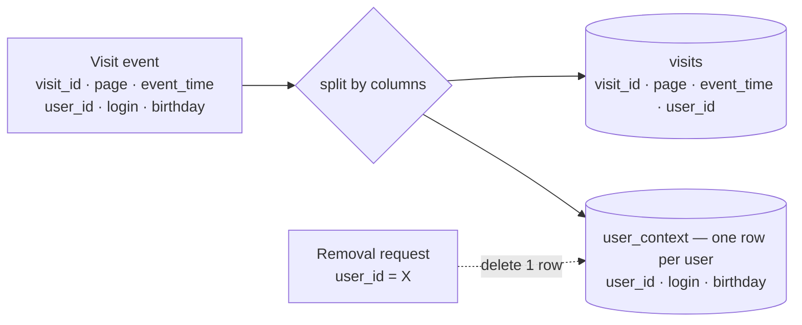
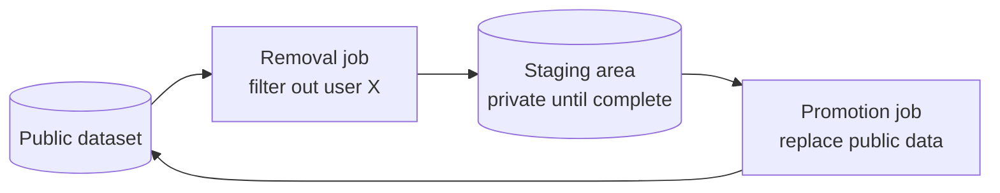
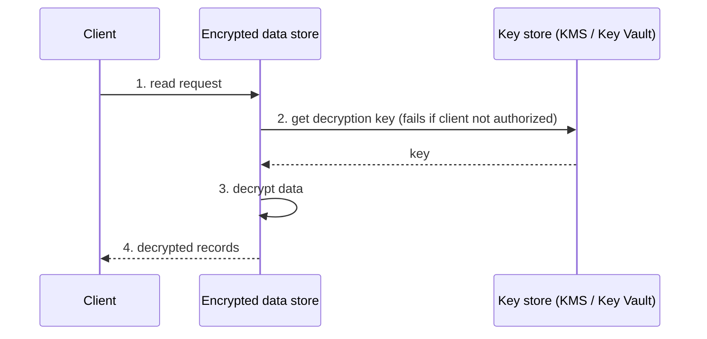

# 7. Data Security Design Patterns

[← 6. Data Flow Design Patterns](06-data-flow-design-patterns.md) · [Book](../README.md) · [8. Data Storage Design Patterns →](08-data-storage-design-patterns.md)

## Summary

Valuable datasets attract envy, including from malicious actors, so data engineers must also think about security. The chapter covers four aspects with nine patterns. **Data removal** for privacy laws (GDPR, CCPA): the **Vertical Partitioner** stores personal, immutable attributes once so a deletion touches one row, while the **In-Place Overwriter** rewrites existing data (via a staging area, or Kafka tombstones). **Access control**: the **Fine-Grained Accessor for Tables** restricts columns and rows (GRANT, policy tags, masking, row policies), and the **Fine-Grained Accessor for Resources** applies least privilege to cloud resources (resource- or identity-based policies). **Data protection**: the **Encryptor** protects data at rest and in transit, the **Anonymizer** removes, perturbs or synthesizes sensitive values, and the **Pseudo-Anonymizer** masks, tokenizes, hashes or encrypts them while keeping some usefulness. **Connectivity**: the **Secrets Pointer** references credentials stored in a secrets manager, and the **Secretless Connector** removes credentials altogether through IAM identities or certificates.

## Key takeaways

- **Store personal data once to delete it cheaply**: with a Vertical Partitioner, removing a user with 2,000 records means deleting one row, not rewriting 2,000 (pp. 198–200, 205).
- **Deleting isn't erasing**: table formats keep old versions until `VACUUM`; Kafka needs tombstones plus compaction — and compaction only suits topics with one record per key (pp. 202–205).
- **Overwrite via a staging area**: a retried or failed removal job must never leave the public dataset half-written (pp. 204, 206).
- **Fine-grained access works at column and row level** in warehouses, and at resource, prefix, tag or condition level in the cloud — but many tiny policies hit maintenance limits and quotas (pp. 207–214).
- **Encryption can lock you out too**: losing the key loses the data, hence soft-deleted keys with a restore window (pp. 217–218).
- **Pseudo-anonymized data can be re-identified when combined with other datasets**; anonymized data can't — but loses more information (pp. 223–224).
- **Credentials should be references or nothing at all**: secrets managers centralize them; IAM roles and certificates avoid them — but caching, logs and rotation still need care (pp. 226–230).

## Section outline

*From the book’s own table of contents (PDF bookmarks); printed page numbers.*

- Data Removal — p. 198
  - Pattern: Vertical Partitioner — p. 198
  - Pattern: In-Place Overwriter — p. 203
- Access Control — p. 207
  - Pattern: Fine-Grained Accessor for Tables — p. 207
  - Pattern: Fine-Grained Accessor for Resources — p. 211
- Data Protection — p. 215
  - Pattern: Encryptor — p. 215
  - Pattern: Anonymizer — p. 219
  - Pattern: Pseudo-Anonymizer — p. 222
- Connectivity — p. 226
  - Pattern: Secrets Pointer — p. 226
  - Pattern: Secretless Connector — p. 228
- Summary — p. 231

## Notes

Datasets are business assets coveted by other market actors, malicious ones included (p. 197). Security here has four sides: **compliance** with privacy laws such as the GDPR (Europe) and CCPA (US); **access control** — an open dataset can be overwritten by another team by accident; **data protection** — even with access to a location, encryption still requires the key; and **connections** — credentials in a Git repository raise the risk of leaks (p. 197).

| Aspect | Patterns |
|---|---|
| Data removal (right to be forgotten) | Vertical Partitioner, In-Place Overwriter |
| Access control | Fine-Grained Accessor for Tables, for Resources |
| Data protection | Encryptor, Anonymizer, Pseudo-Anonymizer |
| Connectivity | Secrets Pointer, Secretless Connector |

### Data removal

Privacy regulations require deleting a user's personal data on request (p. 198).

#### Pattern: Vertical Partitioner (pp. 198–203)

**Problem.** Peers reviewing your personal-data removal design point out that immutable columns — birthday, personal ID number — are repeated in every record. Store each immutable property once so a removal has less to delete (p. 198).

**Solution** (pp. 198–200). **Horizontal** partitioning groups whole records (e.g. by date, Ch. 8); **vertical** partitioning splits each row and writes the parts to different places — the two can be combined. Identify the columns to split and the attribute to rejoin them (e.g. `user_id`), then make ingestion write the changing attributes to one store and the immutable/personal ones to another (Figure 7-1), with plain `SELECT` projections (plus rules like deduplication). Removal touches far less data, and each store can have its own access and retention rules.

*After Figure 7-1 (p. 199): `user_id` lets consumers rejoin the parts.*

**Consequences** (pp. 200–201):

| | |
|---|---|
| **Query performance** | A kind of normalization: readers must join, adding network traffic |
| **Query complexity** | Mitigate with a view, a data catalog, or lineage (Dataset Tracker, Ch. 10) |
| **Polyglot persistence** | The same record in a search engine and a key-value store means splitting — and removing — in each; one job splits, dedicated consumers write to each store (Figure 7-2) |
| **Raw data** | The pattern applies from the first transformation; unsplit raw data needs another strategy, e.g. a short retention period (which limits backfills) |

**Examples** (pp. 201–203): Spark `foreachBatch` persists the batch, writes visits with `context.user` dropped to one Kafka topic (key `visit_id`) and the user attributes to another (key `user_id`); a second job `MERGE`s deduplicated user contexts into a Delta table. Removal: `DeltaTable.delete('user_id = "…"')` **plus `VACUUM`**, or old versions still expose the user. In Kafka, send a **tombstone** — the key with a `NULL` value — to a topic with `cleanup.policy` compaction; this works for `user_context` (one record per key) but not for visits, where compaction would keep only the last visit per key.

#### Pattern: In-Place Overwriter (pp. 203–207)

**Problem.** A legacy system holds terabytes in time-based horizontal partitions with no personal-data strategy, but must now honour removal requests; there's no budget to refactor (p. 203).

**Solution** (pp. 203–205):

| Storage | How to remove |
|---|---|
| Supports in-place deletes | `DELETE … WHERE`, then a cleaning step for time-travel formats (Iceberg, Delta Lake) |
| Raw files (JSON, CSV) | Rewrite the whole dataset without the user's rows — into a **staging area**, then a promotion job replaces the public data (Figure 7-3) |
| Compacted Kafka topic with keyed records | Read the topic and send each removed entity's key with a null payload |

Table formats handle deletes either with **deletion vectors** (a small side file listing removed rows, filtered at read time) or by rewriting files without them (writer-heavy) (p. 204). If retention is shorter than the legal removal delay, expiry might count as removal — check with your CDO and legal department (p. 205).

*After Figure 7-3 (p. 204): a failed or retried removal job never corrupts the public dataset.*

**Consequences** (p. 205): **I/O overhead** — reading and rewriting can nearly double storage over time; Parquet statistics (also used by Delta Lake and Iceberg) let engines skip blocks without the user. **Cost** — one removed entity with **2,000** records means rewriting 2,000 records vs one with the Vertical Partitioner; batch removal requests into one run.

**Examples** (pp. 206–207): PySpark reads raw text, extracts only `user_id` with `from_json`, filters out the user and writes text to staging; then `aws s3 rm ${BUCKET}/output --recursive` and `aws s3 mv ${BUCKET}/staging ${BUCKET}/output --recursive` (object-store renames are copy-and-delete, not transactional). Since the original is overwritten, a buggy removal can't be rolled back — use the **Proxy** pattern or object-store versioning (S3, Azure Storage, GCS) (p. 207).

> **Run it:** the vault's [data removal cost experiment](../lab/07-removal-cost/README.md) counts rows and bytes rewritten by both patterns.

### Access control

Beyond compliance, only authorized users should reach the most critical data — data can be your biggest competitive asset (p. 207).

#### Pattern: Fine-Grained Accessor for Tables (pp. 207–211)

**Problem.** After moving HDFS/Hive workloads to a cloud warehouse, users and groups control table access, but stakeholders also want some users unable to read certain columns and rows (p. 207).

**Solution** (pp. 207–209):

| Level | Implementation | Systems |
|---|---|---|
| Column | `GRANT SELECT(col_A, col_B) ON my_table TO some_user;` | Amazon Redshift, PostgreSQL |
| Column | Policy tags in Data Catalog + Fine-Grained Reader role | GCP BigQuery |
| Column | **Masking** — the column is visible but its content hidden (`ip STRING MASK ip_mask`, showing the IP only to members of `engineers`) | Databricks Unity Catalog, Snowflake |
| Row | Dynamic conditions added to queries: ROW FILTER (Databricks), Row-Level Security (Redshift), row access policies (BigQuery, Snowflake) | — |
| Row (fallback) | A view: `… FROM blogs WHERE blog_author = current_user` | Any |

**Consequences** (p. 209): **row-level limits** — conditions mostly use session attributes (user, group, IP); **data types** — nested fields must be unnested or exposed via the **Dataset Materializer** (Ch. 8); **query overhead** — materialize per-group tables or views, at the cost of duplication and governance.

**Examples** (pp. 209–210): PostgreSQL `GRANT SELECT(id, login, registered_datetime) ON dedp.users TO user_a` (`SELECT *` then fails with “permission denied”); `ALTER TABLE dedp.users ENABLE ROW LEVEL SECURITY; CREATE POLICY user_row_access ON dedp.users USING (login = current_user);`; DynamoDB IAM condition `dynamodb:LeadingKeys` = `${www.amazon.com:user_id}`, so users only read items whose key starts with their ID.

#### Pattern: Fine-Grained Accessor for Resources (pp. 211–215)

**Problem.** An audit finds a job that could overwrite every dataset in the object store; the auditor recommends **least privilege** (the book calls it the *at-least privilege* principle): each component gets only the permissions it needs (p. 211).

**Solution** (pp. 211–213), two strategies (Figure 7-4):

| | Resource-based | Identity-based |
|---|---|---|
| Where permissions live | On the resource | On the user or role |
| Example | GCS bucket IAM policy granting `roles/storage.admin` to one user (Terraform) | An AWS IAM role assumed by EMR (`sts:AssumeRole`) with `kinesis:Get*/Describe*/List*/Put*` on the `visits` stream |

Permissions can target one resource, a prefix, or **runtime conditions** — e.g. S3 `s3:PutObject` allowed only when `aws:TagKeys` match the user ID (tag-based access) (p. 213).

**Consequences** (p. 214): **security by the book** — many tiny policies are hard to maintain; a wildcard like `visits*` simplifies but may grant access to future resources — agree it with security. **Complexity** — avoid mixing both strategies. **Quotas** — AWS IAM: **1,500** custom policies by default; GCP: **300** custom roles per project.

**Examples** (pp. 214–215): `aws s3 ls s3://dedp-visits-301JQN/` fails with `AccessDenied`; fix it identity-based with a role allowing `s3:Get*`/`s3:List*` on the bucket and its objects, or resource-based with `aws s3api put-bucket-policy` naming the `visits-s3-reader` principal.

### Data protection

Logical access controls aren't enough; the data itself must be protected against unexpected use (p. 215).

#### Pattern: Encryptor (pp. 215–219)

**Problem.** Stakeholders fear someone could intercept data between brokers and jobs, or physically steal it from servers (pp. 215–216).

**Solution** (pp. 216–217). **At rest**: client-side encryption (the producer encrypts and manages keys) or **server-side** (the store does everything, with keys in AWS/GCP **KMS** or Azure **Key Vault**). Reading encrypted data (Figure 7-5):

*After Figure 7-5 (pp. 216–217).* **In transit**: enable secure communication in the client SDK and require a protocol version on the service (p. 217).

**Consequences** (pp. 217–218): **CPU overhead** for every read and write; **data loss risk** if the key is lost — providers soft-delete keys with a grace period; **protocol updates** — TLS 1.0 and 1.1 were deprecated (RFC 8996), so services must be upgraded.

**Examples** (pp. 218–219): Terraform KMS module with `key_usage = "ENCRYPT_DECRYPT"`, `deletion_window_in_days = 14` (the restore window) and a grant (`Encrypt`, `Decrypt`, `GenerateDataKey`) to an IAM role; `aws_s3_bucket_server_side_encryption_configuration` with `sse_algorithm = "aws:kms"`; Azure Event Hubs `minimum_tls_version = "1.2"`.

#### Pattern: Anonymizer (pp. 219–222)

**Problem.** An external analytics company will analyze customer behaviour, but some users didn't consent to sharing PII with third parties (p. 219). The same applies to PHI (protected health information) and IP (intellectual property) data (p. 220).

**Solution** (pp. 220–221): make rows anonymous, so the consumer can't identify the user:

| Method | Example |
|---|---|
| **Data removal** | Drop the columns |
| **Data perturbation** | Add noise — IP `123.456.789.012` → `1823.456.7809.012` |
| **Synthetic data replacement** | A (probably ML) generator produces realistic substitutes — `Portugal` → `Croatia` |

**Consequences** (p. 221): **information loss** — analysts and data scientists can't use those columns, which can mean false models and insights.

**Examples** (pp. 221–222): PySpark `users.drop('birthday').withColumn('email', replace_email(users.email))`, where a pandas UDF uses the **Faker** library to generate random emails.

#### Pattern: Pseudo-Anonymizer (pp. 222–226)

**Problem.** The analytics partner can't answer most questions from the dataset with removed columns; they want real PII hidden but in a more usable form (p. 222).

**Solution** (pp. 222–223):

| Method | How | Reversible? |
|---|---|---|
| **Data masking** | `999-55-1040` → `XXX-XX-1040` or `9XX-5X-1XXX` | No — several users may share a mask |
| **Tokenization** | Fictive values; mapping kept in a secured **token vault** | Yes, with vault access |
| **Hashing** | SHA-256 + Base64 of `contact@waitingforcode.com` | No |
| **Encryption** | Column- or row-level keys | Yes, with the key |

**Anonymization vs pseudo-anonymization** (p. 223): pseudo-anonymized data can become identifiable when **combined with other datasets**; anonymized data can't.

**Consequences** (pp. 223–224): **false sense of security** — the book's example: a food-preferences table (user 1000 likes carrot, broccoli, potato; dislikes chips, chocolate bar) joined with a registration table showing country `S*n M****o` and role `C******h P*******r i******r` points to San Marino and the inventor of the (imaginary) Cheetach Processor framework — John Doe (Tables 7-1, 7-2). Generalizing to “Europe” and “Software engineer” would prevent it. **Information loss** — `999-55-1040` and `999-13-1040` both mask to `XXX-XX-1040`; **generalization** turns numbers into text ranges (type loss).

**Examples** (pp. 224–225): `mapInPandas` maps countries to areas (Poland/France/Spain → `eu`, the USA → `na`) and masks SSNs to `f'{ssn[0]}***-{ssn[5]}***-{ssn[10]}***'`; a separate `withColumn` turns `salary` into ranges `0-50000`, `50000-60000`, `60000+` because the type changes.

*Example 7-26 (p. 225): after pseudo-anonymization*

| user_id | country | ssn | salary |
|---|---|---|---|
| 1 | eu | 0\*\*\*-0\*\*\*-1\*\*\* | 0-50000 |
| 2 | eu | 0\*\*\*-0\*\*\*-1\*\*\* | 50000-60000 |
| 3 | na | 1\*\*\*-0\*\*\*-3\*\*\* | 60000+ |
| 4 | eu | 8\*\*\*-1\*\*\*-9\*\*\* | 50000-60000 |

> **Vault note:** a salary of exactly 50000 falls in the first branch of the `CASE` (`BETWEEN 0 AND 50000`), which is why user 1 lands in `0-50000` — inclusive `BETWEEN` bounds on both sides make adjacent ranges overlap.

### Connectivity

Data flows within and across systems; access must be secure too (p. 226).

#### Pattern: Secrets Pointer (pp. 226–228)

**Problem.** A real-time pipeline enriches visits through an external geolocation API that only supports login/password. Your team once leaked credentials for a request-billed API, raising the bill; don't store them in code again (p. 226).

**Solution** (pp. 226–227): keep credentials in a **secrets manager** (Google Cloud Secret Manager, AWS Secrets Manager) and reference them by **name**; consumers fetch values at runtime and may cache them. Benefits: one place to monitor and rotate. Protection is two-level: access to the secrets manager (fine-grained access patterns), then the credentials' own validity.

**Consequences** (p. 227): **cache invalidation** (Phil Karlton's “two hard things”) — cached credentials may be stale; simplest is to let the job fail and reload on restart (with idempotent writes), or refresh asynchronously (risky mid-write). **Logs** can still leak secrets. **A secret remains secret** — someone (an admin, or IaC generating random values) still creates them.

**Examples** (p. 228): `boto3` `secretsmanager_client.get_secret_value(SecretId='user')` and `'pwd'`, passed to Spark's JDBC reader. With IaC generating secrets per environment under the same names, code needs no per-environment config files.

#### Pattern: Secretless Connector (pp. 228–231)

**Problem.** A small team adopting a new processing service finds only API-key examples and wants access to cloud resources without any credentials in code (p. 228).

**Solution** (pp. 229–230):

| Implementation | How |
|---|---|
| **IAM-based** | Policies grant users, groups or roles (including application users like scheduled jobs) actions on resources; the service asks IAM whether the caller is allowed (Figure 7-6) |
| **Certificate-based** | A **certificate authority** validates certificates during connection |

**Consequences** (p. 230): **workless impression** — you still configure identities, e.g. AWS assume-role permissions to get temporary credentials from **STS**. **Rotation** of certificates or keys: issue new ones, accept old and new until consumers confirm, then drop the old.

**Examples** (pp. 230–231): Spark → PostgreSQL with `ssl: true`, `sslmode: verify-full` (host name must match the certificate) and `sslrootcert`, no password; GCP — a `google_service_account`, a `google_storage_bucket_iam_binding` with `roles/storage.objectViewer` on `visits`, and a `google_dataflow_job` running as that service account.

### Summary

Data removal (Vertical Partitioner — cheap deletes; In-Place Overwriter — universal but expensive), fine-grained access for tables and cloud resources, protection by encryption, anonymization and pseudo-anonymization, and connectivity via secret references or no secrets at all (pp. 231–232).

## Trade-offs at a glance

| | Vertical Partitioner | In-Place Overwriter |
|---|---|---|
| Rows touched per removed user | One | Every record of the user |
| Up-front work | Redesign ingestion | None |
| Reads | Joins needed | Unchanged |

| | Anonymizer | Pseudo-Anonymizer |
|---|---|---|
| Re-identification by joining | Not possible | Possible |
| Usefulness for analysis | Low | Higher |
| Reversible | No | Tokenization and encryption: yes |

| | Secrets Pointer | Secretless Connector |
|---|---|---|
| Credentials exist | Yes, in a secrets manager | No (IAM identity) or certificates |
| Main risks | Stale cache, logs | Configuration, certificate rotation |

## Beyond the book

- Re-identification by linking “anonymous” datasets is well documented: Latanya Sweeney showed in 2000 that ZIP code, birth date and sex alone identify most Americans — the real-world version of the book's San Marino example.
- The book's “at-least privilege” is usually called the **principle of least privilege** (Saltzer and Schroeder, 1975).

## Connections

- **Run it:** [Cost of a personal-data removal](../lab/07-removal-cost/README.md) — rows and bytes rewritten by the Vertical Partitioner vs the In-Place Overwriter.
- **Related chapters:** [2. Data Ingestion](02-data-ingestion-design-patterns.md) (Transformation Replicator uses the Anonymizer; Compactor and VACUUM), [4. Idempotency](04-idempotency-design-patterns.md) (Proxy for rollback), [8. Data Storage](08-data-storage-design-patterns.md) (horizontal and vertical partitioning, Dataset Materializer), [10. Data Observability](10-data-observability-design-patterns.md) (Dataset Tracker).

## Check yourself

*Questions and answers are the vault's, written from the notes above; answers cite the book's pages.*

1. **A user has 2,000 visit records. How many records must be deleted with each removal pattern?**

   *Answer:* With the Vertical Partitioner, one row in the personal-data store; with the In-Place Overwriter, all 2,000 records must be rewritten (p. 205).

2. **You `DELETE` a user from a Delta Lake table. Is the data gone?**
   - [ ] Yes, immediately
   - [x] Not until `VACUUM` removes the old files beyond the retention period
   - [ ] Only if the table is partitioned by user

   *Answer:* Time travel keeps previous versions readable until vacuumed (p. 202).

3. **Why write the rewritten dataset to a staging area first?**

   *Answer:* A failed or retried job writing directly to the final location could leave partial data or lose data; staging keeps results private until complete, and only then a promotion job replaces the public dataset (pp. 204, 206).

4. **Why is a Kafka tombstone fine for the `user_context` topic but not for the visits topic?**

   *Answer:* Compaction keeps only the latest record per key. `user_context` has one record per user, but visits share keys across many events, so compaction would leave only the last visit (pp. 202–203).

5. **Which method lets an authorized party recover original values?**
   - [ ] Data masking
   - [ ] Hashing
   - [x] Tokenization (with vault access)
   - [ ] Synthetic data replacement

   *Answer:* Tokenization stores the mapping in a token vault; encryption is also reversible with the key. Masking and hashing aren't (pp. 222–223).

6. **Why can a pseudo-anonymized dataset still identify someone?**

   *Answer:* Combined with other datasets, partially masked values (e.g. `S*n M****o`, a masked job title) can narrow down to one person; anonymization generalizes or removes them instead (pp. 223–224).
