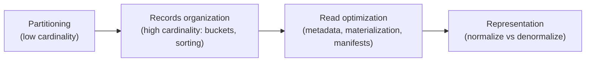
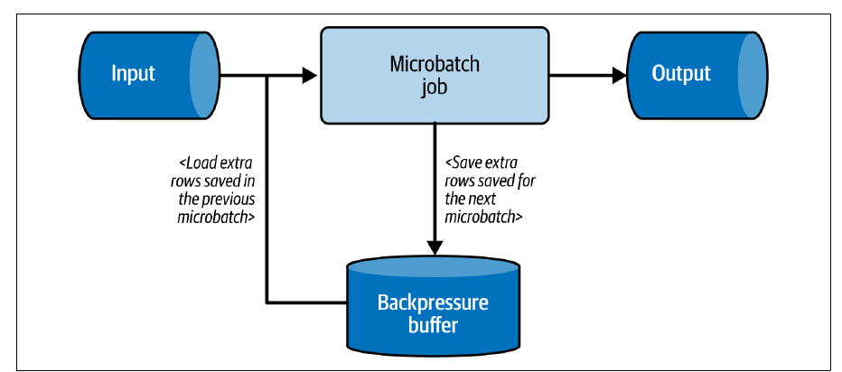
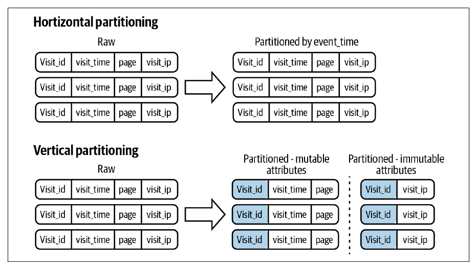
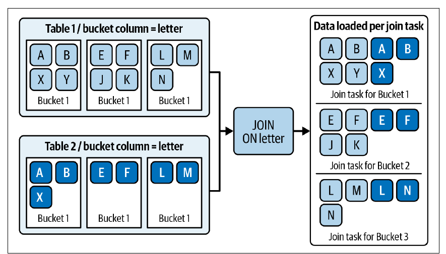
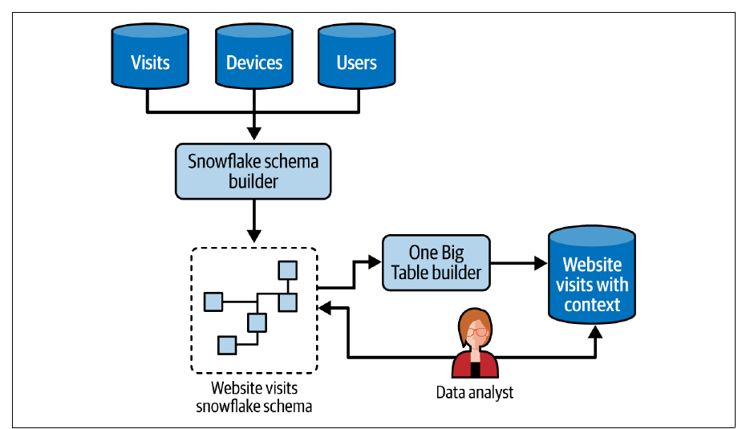

# 8. Data Storage Design Patterns

[← 7. Data Security Design Patterns](07-data-security-design-patterns.md) · [Book](../README.md) · [9. Data Quality Design Patterns →](09-data-quality-design-patterns.md)

## Summary

There are two ways to make queries and jobs faster: add compute (quick, but reactive and costly), or organize data wisely in advance — the subject of this chapter's nine patterns (pp. 233–234). **Partitioning**: the **Horizontal Partitioner** puts whole rows into physically isolated locations by a low-cardinality key such as event time; the **Vertical Partitioner** splits each row's attributes into separate places. **Records organization** handles high-cardinality columns: the **Bucket** pattern colocates groups of keys by `hash(key) % buckets` (enabling bucket pruning and shuffle-free joins), and the **Sorter** orders data — lexicographically or along a Z-order curve — so readers can skip blocks. **Read performance**: the **Metadata Enhancer** keeps statistics (Parquet footers, commit logs, table stats) to filter before reading; the **Dataset Materializer** precomputes costly queries as materialized views or tables; the **Manifest** records file lists so readers don't have to list object stores. **Data representation**: the **Normalizer** (normal forms, snowflake schema) favours consistency at the price of joins; the **Denormalizer** (One Big Table, star schema) removes joins but duplicates data.

## Key takeaways

- **Partition by low-cardinality attributes**: one million users per day as partition keys means one million partitions, slow listing and small files (p. 236).
- **Partitioning is static**: changing the key means moving all data; Iceberg's partition evolution only applies to new records (p. 237).
- **For high cardinality, bucket instead**: `hash(key) % N` groups keys, enabling bucket pruning and joins without shuffle between identically bucketed tables (pp. 243–244).
- **Lexicographic sort keys only help prefix queries**; Z-order curves help several columns at once — the book's figure reads 9 blocks lexicographically vs 7 with Z-order (pp. 248–250).
- **Statistics let engines skip data before reading it**, but they cost write time and can be stale (pp. 251–253).
- **Materialize repeated costly queries**, and refresh incrementally (Incremental Loader + Merger) where possible (pp. 254–257).
- **Normalize for consistency, denormalize for reads** — or both: a normalized model as the private source, a denormalized table on top (pp. 260–268).

## Section outline

*From the book’s own table of contents (PDF bookmarks); printed page numbers.*

- Partitioning — p. 234
  - Pattern: Horizontal Partitioner — p. 234
  - Pattern: Vertical Partitioner — p. 240
- Records Organization — p. 243
  - Pattern: Bucket — p. 243
  - Pattern: Sorter — p. 246
- Read Performance Optimization — p. 251
  - Pattern: Metadata Enhancer — p. 251
  - Pattern: Dataset Materializer — p. 254
  - Pattern: Manifest — p. 257
- Data Representation — p. 260
  - Pattern: Normalizer — p. 260
  - Pattern: Denormalizer — p. 266
- Summary — p. 271

## Notes

Waiting more than two minutes — or ten — for a query is common in big data; the faster a job runs, the earlier and (hopefully) cheaper the answer (p. 233). Adding compute is quick but often a reaction under pressure; the alternative is preemptive data organization (p. 233).

### Partitioning

The first layout question: how to divide the dataset so it's easy to access — horizontally or vertically (p. 234).

#### Pattern: Horizontal Partitioner (pp. 234–239)

**Problem.** A batch job computing rolling aggregates over the past four days slows down as data grows; filtering out older records takes longer. More compute helped but raised costs (p. 234).

**Solution** (pp. 234–236). Choose a **partitioning attribute** (a **distribution key**); each value gets a physically isolated storage space. Time is the classic choice, taken from either:

| Source of time | Effect |
|---|---|
| **Job execution context** | Every record of a run lands in the run date's partition (e.g. 2024-12-31) |
| **The dataset** (event time) | Because of late data, one run may write several partitions |

Business keys (customer, partner, region) also work, and keys can be nested — e.g. `visits/2024/05/05/france|india|poland|usa` (Example 8-1). Partitions are either **declarative** (`CREATE TABLE … PARTITIONED BY` in Databricks or BigQuery — producers needn't know) or **producer-defined** (Spark `partitionBy`, a custom Kafka partitioner) (p. 235). Some stores keep partition metadata: BigQuery `INFORMATION_SCHEMA.PARTITIONS`, Databricks `DESCRIBE TABLE EXTENDED`, Iceberg's `partitions` view (p. 236). Partitioning also underpins idempotency (Fast Metadata Cleaner, Ch. 4).

**Consequences** (pp. 236–237):

| | |
|---|---|
| **Granularity and metadata overhead** | Partitioning a site with one million daily users by username creates one million partitions — slow listings, many small files. Use low-cardinality attributes (event time to the hour or day); for IoT device IDs use **Bucket** |
| **Skew** | In micro-batch streaming, the biggest partition sets the batch duration; a **backpressure buffer** defers the skewed partition's extra records to the next micro-batch (Figure 8-1), raising its latency but keeping others near real time |
| **Mutability** | Changing the key moves all data; Iceberg supports partition evolution at the metadata layer — old files stay in the old layout |

*Figure 8-1 (p. 237): the buffer caps each batch so one oversized partition doesn't stretch every batch.*

**Partitioning vs sharding** (p. 237): sharding splits a dataset across machines — a special case of horizontal partitioning at the hardware layer.

**Examples** (pp. 238–239): Spark adds `year`/`month`/`day`/`hour` columns from `change_date` and calls `.partitionBy('year','month','day','hour')`; a Java Kafka `RangePartitioner` sends keys `A` and `B` to partition 0 and everything else to 1, registered with `partitioner.class` — but keep it simple and usually stick to default partitioners; PostgreSQL `PARTITION BY RANGE(event_time)` with one `PARTITION OF` table per day.

#### Pattern: Vertical Partitioner (pp. 240–242)

The storage-oriented counterpart of Chapter 7's security pattern (p. 240).

**Problem.** Visits carry mutable attributes (visit time, page) and immutable ones (IP address); store the immutable information only once per visit (p. 240).

**Solution** (p. 240): classify attributes into groups, pick a join attribute (`visit_id`), and write each group to its own table or directory. Beyond saving storage, each part can have its own retention and access policies. Figure 8-2 contrasts moving a whole row (horizontal) with splitting it (vertical).

*Figure 8-2 (p. 241): horizontal splits rows by a key; vertical splits columns by how they change.*

**Consequences** (p. 241): **domain split** — related attributes live apart, so document them; **querying** — rejoining is harder, so expose a view or a Dataset Materializer; **data producer** — producers must split rows and do several writes.

**Examples** (pp. 241–242): Spark `persist()`s the input (to avoid reading it twice), writes visits with `user_id` and the `context.user`/`context.technical` fields dropped, and writes deduplicated user and technical contexts to separate Delta tables; PostgreSQL uses `INSERT INTO … SELECT DISTINCT` or a `CREATE TABLE … AS SELECT` (**CTAS**).

### Records organization

Partitioning is rudimentary and fails for high-cardinality attributes; these patterns colocate records more cleverly (p. 243).

#### Pattern: Bucket (pp. 243–245)

**Problem.** 80% of queries filter on a business attribute whose cardinality is too high for partitioning — it would hit the store's metadata limits (p. 243).

**Solution** (pp. 243–244). Pick **bucket columns** (a secondary grouping inside partitions) and a **number of buckets**; each key goes to `hash(key) % buckets`. More buckets → smaller buckets. Two optimizations follow:

| Optimization | How |
|---|---|
| **Bucket pruning** | A predicate on the bucket column lets the engine compute the bucket and skip all others |
| **Shuffle elimination** | Joining two tables with *identical* bucketing loads matching buckets into the same join task, without the network exchange of the Distributed Aggregator (Figure 8-3) |

Bucketing was popularized by Apache Hive and is available in Spark and AWS Athena (p. 244).

*Figure 8-3 (p. 244): no shuffle, because matching keys are already in matching buckets.*

**Consequences** (p. 245): **mutability** — changing the column or bucket count requires a backfill; **bucket size** — sizing for today's volume gives big buckets later; sizing for predicted volume may be wrong and creates more buckets than needed meanwhile.

**Examples** (p. 245): Athena applies bucketing logically to data already on S3 (so `INSERT INTO` a bucketed table errors): `CLUSTERED BY (user_id) INTO 50 BUCKETS` with `'bucketing_format' = 'spark'`; Spark writes with `bucketBy(50, 'user_id').saveAsTable(…)`.

> **Try it:** [Bucket pruning and Z-order skipping](../widgets/08-data-skipping.html) — hash keys into buckets, then sort a two-column dataset lexicographically or by Z-order and count the blocks a range query must read.

#### Pattern: Sorter (pp. 246–251)

**Problem.** Weekly tables (for the Fast Metadata Cleaner) eased maintenance but not query time; most queries filter or sort by event time (p. 246).

**Solution** (pp. 246–249): declare the sort column(s) at table creation; the database stores rows in that order, and queries on the sort columns skip irrelevant blocks via per-block metadata (min/max ranges, Figure 8-4). **Curved sorts** such as **Z-order** colocate rows in multidimensional space instead of lexicographic order; Iceberg and Delta Lake implement it natively. In Figure 8-5, for a predicate over columns x and y, the lexicographic layout reads **nine** blocks and Z-order only **seven** (p. 248). Redshift has Z-curve-based **interleaved sort keys**; BigQuery and Snowflake offer classical sorting via **clustered tables** (p. 249). Z-order is often called *clustering*, but it really sorts data on disk, so the book classifies it as a Sorter (p. 249).

**Consequences** (pp. 249–250):

| | |
|---|---|
| **Unsorted segments** | New writes may leave unsorted blocks; schedule sorting inside the writer (slower writes) or separately |
| **Composite sort keys** | Lexicographically, queries must reference the preceding sort columns: with key (`visit_time`, `page`), filtering only on `page` scans most blocks (Figure 8-6) |
| **Mutability** | Changing sort keys may re-sort the whole table |

**Examples** (p. 250): BigQuery `PARTITION BY DATE(event_time) CLUSTER BY visit_id, page` — good for both columns, weak for `page` alone; Delta Lake `DeltaTable.forPath(…).optimize().executeZOrderBy(['visit_id', 'page'])` compacts files with a curved distribution.

### Read performance optimization

#### Pattern: Metadata Enhancer (pp. 251–254)

**Problem.** A JSON dataset partitioned by event time works for batch jobs, but new analysts querying small subsets on a pay-as-you-go service load whole partitions and only then filter (p. 251).

**Solution** (pp. 251–253): collect and persist **statistics** so engines can filter before loading. In columnar formats like **Parquet**, each file's **footer** holds per-column statistics (min, max, …) computed at write time (Figure 8-7); a query `WHERE age > 50` checks footers and opens only matching files — footers still have to be read, but that's far cheaper. Delta Lake, Iceberg and Hudi inherit this and add commit-log metadata (row counts, per-column min/max, null counts), making counts and filters on nonexistent values fast. Relational databases and warehouses keep table statistics for the query planner.

**Consequences** (p. 253): **overhead** — writers compute statistics; databases must keep them current; **out-of-date statistics** — automatic updates trigger on thresholds (e.g. rows modified), so small changes accumulate; refresh with `ANALYZE TABLE`, at a temporary read cost.

**Examples** (pp. 253–254): Spark `write.parquet(…)`; inspect with `hangxie/parquet-tools` `meta`, showing for the `Id` column `NumValues: 5000`, `NullCount: 0`, `MinValue`/`MaxValue` and `SNAPPY` compression; a Delta commit log's `add` entry with `stats` — `numRecords: 6100`, `minValues`, `maxValues`, `nullCount`.

#### Pattern: Dataset Materializer (pp. 254–257)

**Problem.** A view unions several partitioned tables to expose three weeks of data, but it reruns the query every time; consumers complain about latency (pp. 254–255).

**Solution** (p. 255): materialize the result — as a **materialized view** or a **table**:

| | Materialized view | Table |
|---|---|---|
| Refresh | Manual, or automatic (Redshift `AUTO REFRESH YES`; BigQuery, Databricks, Snowflake) — timing depends on workload, so less predictable | Your responsibility |
| Storage optimizations | Limited | Partitions, buckets, sorting available |

**Consequences** (pp. 255–256): **refresh cost** — rerunning a costly query competes with other users; use **incremental refresh** (supported by Databricks and BigQuery for some SQL operations, sometimes falling back to full); **data access** — a user denied one source table must be denied the view (or use a Fine-Grained Accessor); **storage overhead** — materialize only some parts.

**Examples** (pp. 256–257): BigQuery `CREATE MATERIALIZED VIEW … OPTIONS (enable_refresh = true, refresh_interval_minutes = 15)` — refreshes should run within **five minutes** of a change but may be delayed without capacity; PostgreSQL `REFRESH MATERIALIZED VIEW dedp.windowed_visits WITH DATA`; an incremental version combining **Incremental Loader and Merger**: `MERGE INTO dedp.visits_counter` from a `COUNT(*)` of rows with `insertion_time` after the previous run, `UPDATE SET count = count + input.visits` or `INSERT`.

#### Pattern: Manifest (pp. 257–259)

**Problem.** A fast Parquet dataset is exposed to analysts through a warehouse layer, but the slowest step is listing files in the object store (p. 257).

**Solution** (pp. 257–258): list once — or never, if the producer records file names. Delta Lake, Iceberg and Hudi write each transaction's files to the **commit log**, which acts as a manifest. Manual manifests help when many readers share a dataset (e.g. Fan-Out patterns). For writing: Redshift `COPY` accepts a manifest per load — useful for idempotency — and GCP Storage Transfer Service copies files from manifest listings.

**Consequences** (p. 258): **complexity** — an extra, simple step, better than repeated slow listings; **size** — streaming producers or many small files can produce **multi-gigabyte** manifests; early Spark Structured Streaming jobs sometimes couldn't restart because their manifests were too big (fixed in SPARK-27188).

**Examples** (p. 259): Delta `generate('symlink_format_manifest')` and a BigQuery external table with `file_set_spec_type = 'NEW_LINE_DELIMITED_MANIFEST'`; Redshift `COPY customer FROM 's3://devices/manifest_20250601_1031' … MANIFEST` with two `"mandatory": true` entries — reusable on every replay of that run.

### Data representation

Which attributes are stored together, and therefore which tables exist (p. 260).

#### Pattern: Normalizer (pp. 260–266)

**Problem.** The visits table repeats immutable device and OS attributes in every row: more storage, slow updates (p. 260).

**Solution** (pp. 260–263). Shared design steps: define business entities (visits, devices, browsers, referrals), describe their attributes, define relationships. Two implementations: **normal forms** (transactional workloads) and the **snowflake schema** (analytics).

| Normal form | Rule | Broken example (book's tables) | Fix |
|---|---|---|---|
| **1NF** | Atomic, nonrepeating values; a primary key | `Puzzle Tour` with a list of comments (Table 8-1) | A `games_comments` table |
| **2NF** | Non-key columns depend on the *whole* key | Key (name, platform); *platform language* depends only on platform — iOS→Swift, Android→Kotlin (Table 8-2) | A platforms table |
| **3NF** | No transitive dependencies | *Studio country* depends on studio, not game — Studio A→Italy, Studio B→Portugal (Table 8-3) | A studios table |

A **dimensional model** has one **fact** table (an observation: an order, a visit) and **dimension** tables (context). In the **snowflake** model, dimensions are themselves described by subdimensions — a date dimension split into months and quarters (Figure 8-8) (pp. 262–263). The goal: consistency first — an update is reflected everywhere at once.

**Consequences** (p. 264): **query cost** — many joins, costly across a network; colocate small tables with big ones or **broadcast** them (Spark `spark.sql.autoBroadcastJoinThreshold`); **archival** — dimensions change over time (prices), handled with SCDs (Static Joiner, Ch. 5).

**Examples** (pp. 264–266): Figure 8-9's normalized visit — browsers and devices in their own tables (shared across visits, not dependent on one), contexts outside `visits` to avoid repeating groups — needs a long chain of left-outer joins in Spark (Example 8-23); the snowflake version still joins pages→categories and dates→months→quarters (Example 8-24).

#### Pattern: Denormalizer (pp. 266–271)

**Problem.** A company's relational analytics model slowed as the product succeeded; 80% of queries join all **eight** tables (p. 266).

**Solution** (pp. 266–268): flatten joined values into one row, either as **regular columns** (**One Big Table** — Table 8-4: `visit_id 1, user_id 409, user_name user ABC, device_id 10000, device_full_name local computer, visit_time 2024-07-01T09:00:00Z, visited_page home.html`) or as **nested structures** (`STRUCT` columns). In dimensional models, the **star schema** keeps facts and dimensions but no nested dimensions (Figure 8-10). The patterns combine: build a normalized snowflake model, then a One Big Table from it for reading, kept in sync with Chapter 6's sequence patterns (Figure 8-11).

*Figure 8-11 (p. 268): the normalized snowflake stays the consistent source; the denormalized table is derived from it for analysts.*

**Consequences** (pp. 268–269): **costly updates** — one change touches many rows; unless the table is a point-in-time **snapshot**, accept slower updates for faster reads. **Storage** — duplicated values, reduced by encodings like **dictionaries** (`{1: "long name…", 2: …}`), which can also answer existence checks without reading data. **One big antipattern** — a table mixing user details, past orders, the current visit and a favourite colour is a trash bag; if naming it needs many *and*s or *with*s, you've combined unrelated attributes.

**Examples** (pp. 269–271): One Big Table is written once with all joins and then read with a plain `load` (Example 8-25); the star schema writes dimension tables (with `dropDuplicates`) and a fact table with `HASH(page)` and `HASH(TO_DATE(event_time))` as dimension keys — readers then need two joins (Example 8-26).

### Summary

Horizontal partitioning suits low-cardinality values, vertical partitioning splits attributes; Bucket and Sorter handle high cardinality and skipping; Metadata Enhancer, Dataset Materializer and Manifest speed up reads; Normalizer and Denormalizer trade consistency for joins (p. 271). Even optimized storage won't make people use data of poor quality — the next chapter (p. 271).

## Trade-offs at a glance

| Pattern | Best for | Main cost |
|---|---|---|
| Horizontal Partitioner | Low-cardinality filters (time, region) | Static key; skew; too many partitions |
| Vertical Partitioner | Separating immutable from mutable attributes | Joins; producers write several times |
| Bucket | High-cardinality filters and joins | Fixed bucket count; backfill to change |
| Sorter | Range filters, ordering | Write-time sorting; prefix-only for lexicographic keys |
| Metadata Enhancer | Skipping files and blocks | Write overhead; stale stats |
| Dataset Materializer | Repeated costly queries | Refresh cost; storage; access rules |
| Manifest | Avoiding object-store listings | Manifest size |
| Normalizer | Consistency, cheap updates | Many joins |
| Denormalizer | Fast reads | Costly updates, storage, OBT antipattern |

## Beyond the book

- Z-order (Morton order) interleaves the bits of each column's value; other space-filling curves such as the Hilbert curve preserve locality even better — Delta Lake's liquid clustering, for example, uses Hilbert curves.
- The normal forms go back to E. F. Codd's relational model (1970–71); the book stops at 3NF, but BCNF, 4NF and 5NF exist.

## Connections

- **Related chapters:** [2. Data Ingestion](02-data-ingestion-design-patterns.md) (Compactor and the small files problem; Incremental Loader), [4. Idempotency](04-idempotency-design-patterns.md) (Fast Metadata Cleaner, Merger), [5. Data Value](05-data-value-design-patterns.md) (Static Joiner and SCDs, Distributed Aggregator), [6. Data Flow](06-data-flow-design-patterns.md) (Fan-Out, sequence patterns), [7. Data Security](07-data-security-design-patterns.md) (Vertical Partitioner for removal, Fine-Grained Accessor).

## Check yourself

*Questions and answers are the vault's, written from the notes above; answers cite the book's pages.*

1. **Why is partitioning visits by username a bad idea?**

   *Answer:* High cardinality — one million daily users would create a million partitions, slow listings and many small files. Use a low-cardinality key or the Bucket pattern (p. 236).

2. **Two tables are bucketed by `user_id`, one into 50 buckets and one into 64. Can a join avoid the shuffle?**
   - [ ] Yes, bucketing always avoids shuffles
   - [x] No — shuffle elimination needs identical bucketing on both sides
   - [ ] Only if both are also partitioned by date

   *Answer:* Matching keys land in matching buckets only with the same configuration (p. 244).

3. **A table is sorted lexicographically by (`visit_time`, `page`). Which query benefits least?**
   - [ ] `WHERE visit_time BETWEEN …`
   - [ ] `WHERE visit_time = … AND page = …`
   - [x] `WHERE page = …`

   *Answer:* Without the preceding sort column, the engine iterates over most blocks; Z-order mitigates this (pp. 249–250).

4. **What does Iceberg's partition evolution do to existing files?**

   *Answer:* Nothing — it changes the schema at the metadata layer; old records keep the old layout, new records use the new one (p. 237).

5. **How can a manifest make Redshift `COPY` idempotent?**

   *Answer:* Create the manifest before loading and tie it to the job run; any replay reuses the same file list (p. 259).

6. **How do you tell when a One Big Table has become an antipattern?**

   *Answer:* It mixes unrelated domain attributes; if naming it needs many conjunctions like *and* or *with*, too much is combined (p. 269).
