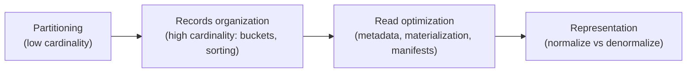

# فصل ۸: الگوهای طراحی ذخیره‌سازی داده

[فصل ۷: الگوهای طراحی امنیت داده →](07-data-security-design-patterns.md) · [کتاب](../README.md) · [فصل ۹: الگوهای طراحی کیفیت داده ←](09-data-quality-design-patterns.md)

## خلاصه

دو راه برای تندتر کردن کوئری‌ها و jobها هست: محاسبه اضافه کنید، که سریع است ولی واکنشی و پرهزینه، یا داده را از قبل عاقلانه سازمان بدهید، که موضوع نُه الگوی این فصل است (pp. 233–234). **پارتیشن‌بندی**: الگوی **Horizontal Partitioner** کل ردیف‌ها را با کلیدی کم‌کاردینالیتی مثل زمان رویداد در مکان‌های فیزیکی جدا می‌گذارد، و **Vertical Partitioner** ویژگی‌های هر ردیف را در جاهای جدا می‌شکند. **سازمان رکوردها** به ستون‌های پرکاردینالیتی می‌پردازد: الگوی **Bucket** گروه‌های کلید را با `hash(key) % buckets` هم‌مکان می‌کند، که bucket pruning و پیوند بی shuffle را ممکن می‌کند، و **Sorter** داده را مرتب می‌کند، واژه‌نامه‌ای یا روی خم Z-order، تا خواننده‌ها بتوانند از بلوک‌ها بپرند. **performance خواندن**: الگوی **Metadata Enhancer** آمار نگه می‌دارد، در footerهای Parquet و commit log و آمار جدول، تا پیش از خواندن فیلتر شود؛ **Dataset Materializer** کوئری‌های گران را از پیش به‌عنوان materialized view یا جدول حساب می‌کند؛ و **Manifest** فهرست فایل‌ها را ثبت می‌کند تا خواننده‌ها لازم نباشد ذخیره‌سازی object را فهرست کنند. **نمایش داده**: الگوی **Normalizer**، یعنی normal formها و snowflake schema، سازگاری را به قیمت پیوند ترجیح می‌دهد، و **Denormalizer**، یعنی One Big Table و star schema، پیوندها را برمی‌دارد ولی داده را تکرار می‌کند.

## نکته‌های کلیدی

- **با ویژگی‌های کم‌کاردینالیتی پارتیشن‌بندی کنید**: یک میلیون کاربر در روز به‌عنوان کلید پارتیشن یعنی یک میلیون پارتیشن و فهرست کردن کند و فایل‌های کوچک (p. 236).
- **پارتیشن‌بندی ایستاست**: عوض کردن کلید یعنی جابه‌جا کردن همه‌ی داده، و partition evolution در Iceberg فقط به رکوردهای تازه می‌خورد (p. 237).
- **برای کاردینالیتی بالا به‌جایش bucket کنید**: `hash(key) % N` کلیدها را گروه می‌کند و bucket pruning و پیوند بی shuffle بین جدول‌های هم‌bucket را ممکن می‌کند (pp. 243–244).
- **کلید مرتب‌سازی واژه‌نامه‌ای فقط به کوئری‌های prefix کمک می‌کند**، در حالی که خم Z-order به چند ستون با هم کمک می‌کند؛ در شکل کتاب، واژه‌نامه‌ای نُه بلوک می‌خواند و Z-order هفت بلوک (pp. 248–250).
- **آمار می‌گذارد موتورها پیش از خواندن از داده بپرند**، ولی زمان نوشتن خرج می‌کند و می‌تواند کهنه شود (pp. 251–253).
- **کوئری‌های گرانِ تکرارشده را materialize کنید** و جایی که می‌شود افزایشی تازه‌شان کنید، یعنی Incremental Loader به‌علاوه‌ی Merger (pp. 254–257).
- **برای سازگاری نرمال کنید و برای خواندن غیر‌نرمال**، یا هر دو: یک مدل نرمال به‌عنوان منبع خصوصی و یک جدول غیر‌نرمال رویش (pp. 260–268).

## فهرست بخش‌ها

*از فهرست مطالب خود کتاب، از bookmarkهای PDF؛ شماره‌ها صفحه‌ی چاپی‌اند.*

- پارتیشن‌بندی — p. 234
  - الگو: Horizontal Partitioner — p. 234
  - الگو: Vertical Partitioner — p. 240
- سازمان رکوردها — p. 243
  - الگو: Bucket — p. 243
  - الگو: Sorter — p. 246
- بهینه‌سازی performance خواندن — p. 251
  - الگو: Metadata Enhancer — p. 251
  - الگو: Dataset Materializer — p. 254
  - الگو: Manifest — p. 257
- نمایش داده — p. 260
  - الگو: Normalizer — p. 260
  - الگو: Denormalizer — p. 266
- خلاصه — p. 271

## یادداشت‌ها

انتظار بیشتر از دو دقیقه، یا ده دقیقه، برای یک کوئری در big data رایج است؛ هر چه job تندتر اجرا شود، پاسخ زودتر و امیدوارانه ارزان‌تر می‌آید (p. 233). اضافه کردن محاسبه سریع است ولی اغلب واکنشی زیر فشار؛ جایگزینش سازمان دادن پیشگیرانه‌ی داده است (p. 233).

### پارتیشن‌بندی

اولین پرسش چیدمان: مجموعه‌داده را چطور تقسیم کنیم که دسترسی به آن آسان باشد، افقی یا عمودی (p. 234)؟

#### الگو: Horizontal Partitioner (pp. 234–239)

**مسئله.** یک job batch که تجمیع غلتان چهار روز گذشته را حساب می‌کند با رشد داده کند می‌شود؛ فیلتر کردن رکوردهای قدیمی‌تر بیشتر طول می‌کشد. محاسبه‌ی بیشتر کمک کرد ولی هزینه را بالا برد (p. 234).

**راه‌حل** (pp. 234–236): یک **ویژگی پارتیشن‌بندی** انتخاب کنید، که **کلید توزیع** هم نامیده می‌شود؛ هر مقدارش یک فضای ذخیره‌سازی فیزیکی جدا می‌گیرد. زمان انتخاب کلاسیک است، که از یکی از این دو می‌آید:

| منبع زمان | اثر |
|---|---|
| **context اجرای job** | هر رکورد یک اجرا در پارتیشن تاریخ همان اجرا می‌نشیند؛ مثلاً ۲۰۲۴-۱۲-۳۱ |
| **خود مجموعه‌داده**، یعنی زمان رویداد | به‌خاطر داده‌ی دیررس، یک اجرا می‌تواند چند پارتیشن بنویسد |

کلیدهای کسب‌وکار هم کار می‌کنند، مثل مشتری و شریک و منطقه، و کلیدها می‌توانند تو‌در‌تو باشند، مثل `visits/2024/05/05/france|india|poland|usa` (نمونه‌ی ۸-۱). پارتیشن‌ها یا **اعلانی**اند، مثل `CREATE TABLE … PARTITIONED BY` در Databricks و BigQuery، که producer لازم نیست بداند، یا **تعریف‌شده‌ی producer**، مثل `partitionBy` در Spark و یک partitioner سفارشی در Kafka (p. 235). بعضی ذخیره‌سازی‌ها metadata پارتیشن را نگه می‌دارند: `INFORMATION_SCHEMA.PARTITIONS` در BigQuery، `DESCRIBE TABLE EXTENDED` در Databricks، و view به نام `partitions` در Iceberg (p. 236). پارتیشن‌بندی زیربنای idempotency هم هست، یعنی Fast Metadata Cleaner در فصل ۴.

**پیامدها** (pp. 236–237):

| | |
|---|---|
| **granularity و سرریز metadata** | پارتیشن‌بندی سایتی با یک میلیون کاربر روزانه بر حسب نام کاربری، یک میلیون پارتیشن می‌سازد، یعنی فهرست کردن کند و فایل‌های کوچک زیاد. ویژگی‌های کم‌کاردینالیتی به کار ببرید، مثل زمان رویداد در سطح ساعت یا روز؛ و برای شناسه‌ی دستگاه‌های IoT از **Bucket** استفاده کنید |
| **نامتوازنی** | در streaming micro-batch، بزرگ‌ترین پارتیشن مدت دسته را تعیین می‌کند؛ یک **بافر backpressure** رکوردهای اضافه‌ی پارتیشن نامتوازن را به micro-batch بعدی می‌اندازد (شکل ۸-۱)، که تأخیر آن را بالا می‌برد ولی بقیه را نزدیک بی‌درنگ نگه می‌دارد |
| **mutability** | عوض کردن کلید همه‌ی داده را جابه‌جا می‌کند؛ Iceberg از partition evolution در لایه‌ی metadata پشتیبانی می‌کند و فایل‌های قدیمی در چیدمان قدیمی می‌مانند |

*Figure 8-1 (p. 237): بافر سقف هر دسته را نگه می‌دارد تا یک پارتیشن بیش‌از‌اندازه بزرگ هر دسته را نکشد.*

**پارتیشن‌بندی در برابر sharding** (p. 237): روش sharding یک مجموعه‌داده را بین ماشین‌ها می‌شکند، یعنی حالت ویژه‌ای از پارتیشن‌بندی افقی در لایه‌ی سخت‌افزار.

**نمونه‌ها** (pp. 238–239): در Spark، ستون‌های `year` و `month` و `day` و `hour` از `change_date` اضافه می‌شوند و `.partitionBy('year','month','day','hour')` صدا زده می‌شود؛ یک `RangePartitioner` در Kafka با Java که کلیدهای `A` و `B` را به پارتیشن ۰ و بقیه را به ۱ می‌فرستد و با `partitioner.class` ثبت می‌شود، ولی ساده نگهش دارید و معمولاً به partitionerهای پیش‌فرض بچسبید؛ و در PostgreSQL `PARTITION BY RANGE(event_time)` با یک جدول `PARTITION OF` برای هر روز.

#### الگو: Vertical Partitioner (pp. 240–242)

همتای ذخیره‌سازی‌محور الگوی امنیتی فصل ۷ (p. 240).

**مسئله.** بازدیدها ویژگی‌های mutable دارند، مثل زمان بازدید و صفحه، و تغییرناپذیر، مثل آدرس IP؛ اطلاعات immutable را برای هر بازدید فقط یک‌بار ذخیره کنید (p. 240).

**راه‌حل** (p. 240): ویژگی‌ها را گروه‌بندی کنید، یک ویژگی پیوند انتخاب کنید، مثل `visit_id`، و هر گروه را در جدول یا پوشه‌ی خودش بنویسید. جز صرفه‌جویی ذخیره‌سازی، هر بخش می‌تواند سیاست نگه‌داری و دسترسی خودش را داشته باشد. شکل ۸-۲ جابه‌جا کردن کل یک ردیف، یعنی افقی، را با شکستنش، یعنی عمودی، مقایسه می‌کند.

*Figure 8-2 (p. 241): افقی ردیف‌ها را با یک کلید می‌شکند و عمودی ستون‌ها را بر حسب شکل تغییرشان.*

**پیامدها** (p. 241): **شکستن دامنه**، یعنی ویژگی‌های مرتبط جدا می‌نشینند، پس مستندشان کنید؛ **کوئری زدن**، یعنی به هم رساندن دوباره سخت‌تر است، پس یک view یا Dataset Materializer نشان بدهید؛ **producer داده**، یعنی producerها باید ردیف‌ها را بشکنند و چند بار بنویسند.

**نمونه‌ها** (pp. 241–242): در Spark، ورودی `persist()` می‌شود تا دو بار خوانده نشود، بازدیدها با `user_id` و با انداختن فیلدهای `context.user` و `context.technical` نوشته می‌شوند، و contextهای تکراری‌زدایی‌شده‌ی کاربر و فنی در جدول‌های جدای Delta می‌روند؛ در PostgreSQL از `INSERT INTO … SELECT DISTINCT` یا یک `CREATE TABLE … AS SELECT`، یعنی **CTAS**، استفاده می‌شود.

> **In practice:** `PARTITION BY toYYYYMM(posting_date)` در جدول‌های warehouse همان Horizontal Partitioner است.
>
> **Your turn:** کسی برای جدولی با چند هزار ردیف در روز partition روزانه پیشنهاد می‌دهد. چرا نه؟
>
> *Answer:* هر partition دست‌کم یک part جدا دارد؛ partition ریز یعنی هزاران part کوچک، merge کم‌اثر و فشار روی metadata. partition باید با حجم و الگوی کوئری جور باشد، نه ریزتر (pp. 234–240).

### سازمان رکوردها

پارتیشن‌بندی ابتدایی است و برای ویژگی‌های پرکاردینالیتی شکست می‌خورد؛ این الگوها رکوردها را زیرکانه‌تر هم‌مکان می‌کنند (p. 243).

#### الگو: Bucket (pp. 243–245)

**مسئله.** هشتاد درصد کوئری‌ها روی یک ویژگی کسب‌وکار فیلتر می‌کنند که کاردینالیتی‌اش برای پارتیشن‌بندی زیادی بالاست و به سقف metadata ذخیره‌سازی می‌خورد (p. 243).

**راه‌حل** (pp. 243–244): **ستون‌های bucket** را انتخاب کنید، که گروه‌بندی ثانویه‌ای داخل پارتیشن‌هاست، و **شمار bucketها** را؛ هر کلید به `hash(key) % buckets` می‌رود. bucket بیشتر یعنی bucketهای کوچک‌تر. دو بهینه‌سازی از پی‌اش می‌آید:

| بهینه‌سازی | چطور |
|---|---|
| **bucket pruning** | شرطی روی ستون bucket می‌گذارد موتور، bucket را حساب کند و از همه‌ی بقیه بپرد |
| **حذف shuffle** | پیوند دو جدول با bucketبندی *یکسان*، bucketهای متناظر را در همان task پیوند بار می‌کند، بی جابه‌جایی شبکه‌ای Distributed Aggregator (شکل ۸-۳) |

روش bucketing را Apache Hive رایج کرد و در Spark و AWS Athena در دسترس است (p. 244).

*Figure 8-3 (p. 244): هیچ shuffleی نیست، چون کلیدهای متناظر از قبل در bucketهای متناظرند.*

**پیامدها** (p. 245): **mutability**، یعنی عوض کردن ستون یا شمار bucket به backfill نیاز دارد؛ **اندازه‌ی bucket**، یعنی اندازه‌گیری برای حجم امروز، بعداً bucketهای بزرگ می‌دهد، و اندازه‌گیری برای حجم پیش‌بینی‌شده ممکن است غلط باشد و تا آن موقع bucketهای بیشتری از لازم بسازد.

**نمونه‌ها** (p. 245): سرویس Athena، bucketing را منطقی روی داده‌ای که از قبل در S3 است اعمال می‌کند، پس `INSERT INTO` در جدولی bucket‌شده خطا می‌دهد: `CLUSTERED BY (user_id) INTO 50 BUCKETS` با `'bucketing_format' = 'spark'`؛ و Spark با `bucketBy(50, 'user_id').saveAsTable(…)` می‌نویسد.

> **Try it:** [bucket pruning و پریدن با Z-order](../widgets/08-data-skipping.html)؛ کلیدها را در bucketها hash کنید، بعد یک مجموعه‌داده‌ی دو‌ستونی را واژه‌نامه‌ای یا با Z-order مرتب کنید و بشمارید یک کوئری بازه‌ای چند بلوک باید بخواند.

#### الگو: Sorter (pp. 246–251)

**مسئله.** جدول‌های هفتگی، که برای Fast Metadata Cleaner بودند، نگه‌داری را آسان کردند ولی زمان کوئری را نه؛ بیشتر کوئری‌ها بر حسب زمان رویداد فیلتر یا مرتب می‌کنند (p. 246).

**راه‌حل** (pp. 246–249): ستون یا ستون‌های مرتب‌سازی را سر ساختن جدول اعلان کنید؛ دیتابیس ردیف‌ها را به آن ترتیب ذخیره می‌کند، و کوئری روی ستون‌های مرتب‌سازی با metadata هر بلوک، یعنی بازه‌ی کمینه و بیشینه، از بلوک‌های بی‌ربط می‌پرد (شکل ۸-۴). **مرتب‌سازی‌های خم‌دار** مثل **Z-order** ردیف‌ها را در فضای چند‌بعدی هم‌مکان می‌کنند و نه به‌ترتیب واژه‌نامه‌ای؛ Iceberg و Delta Lake بومی پیاده‌اش کرده‌اند. در شکل ۸-۵، برای شرطی روی ستون‌های x و y، چیدمان واژه‌نامه‌ای **نُه** بلوک می‌خواند و Z-order فقط **هفت** (p. 248). سرویس Redshift **interleaved sort key** دارد که بر پایه‌ی خم Z است؛ و BigQuery و Snowflake مرتب‌سازی کلاسیک را با **clustered table** می‌دهند (p. 249). روش Z-order را اغلب *clustering* می‌نامند، ولی در واقع داده را روی دیسک مرتب می‌کند، پس کتاب آن را Sorter رده‌بندی می‌کند (p. 249).

**پیامدها** (pp. 249–250):

| | |
|---|---|
| **بخش‌های نامرتب** | نوشتن‌های تازه می‌توانند بلوک‌های نامرتب بگذارند؛ مرتب‌سازی را داخل writer زمان‌بندی کنید، که نوشتن را کند می‌کند، یا جدا |
| **کلید مرتب‌سازی ترکیبی** | در حالت واژه‌نامه‌ای، کوئری‌ها باید به ستون‌های مرتب‌سازی پیش از آن ارجاع بدهند: با کلید `visit_time` و `page`، فیلتر فقط روی `page` بیشتر بلوک‌ها را پیمایش می‌کند (شکل ۸-۶) |
| **mutability** | عوض کردن کلید مرتب‌سازی می‌تواند کل جدول را از نو مرتب کند |

**نمونه‌ها** (p. 250): در BigQuery، `PARTITION BY DATE(event_time) CLUSTER BY visit_id, page` که برای هر دو ستون خوب است و برای `page` به‌تنهایی ضعیف؛ و در Delta Lake، `DeltaTable.forPath(…).optimize().executeZOrderBy(['visit_id', 'page'])` که فایل‌ها را با توزیع خم‌دار compact می‌کند.

> **In practice:** کلید `ORDER BY` در MergeTree همان Sorter است: ردیف‌ها داخل هر part مرتب‌اند و index sparse روی همین ترتیب کار می‌کند.
>
> **Your turn:** بیشتر کوئری‌های Gold با `customer_id` فیلتر می‌کنند ولی جدول با `posting_date` مرتب است. چه عوض می‌کنید و هزینه‌اش چیست؟
>
> *Answer:* `ORDER BY (customer_id, posting_date)`، تا index بلوک‌های یک مشتری را پیدا کند. هزینه‌اش: کوئری‌هایی که فقط بازه‌ی زمانی می‌خواهند کندتر می‌شوند و عوض کردن کلید یعنی بازسازی جدول؛ هر ترتیبی فقط به نفع یک الگوی دسترسی است (pp. 246–251).

### بهینه‌سازی performance خواندن

#### الگو: Metadata Enhancer (pp. 251–254)

**مسئله.** یک مجموعه‌داده‌ی JSON که با زمان رویداد پارتیشن‌بندی شده برای jobهای batch کار می‌کند، ولی تحلیل‌گرهای تازه که زیرمجموعه‌های کوچکی را روی سرویسی به‌اندازه‌ی‌مصرف کوئری می‌زنند، کل پارتیشن‌ها را بار می‌کنند و فقط بعدش فیلتر (p. 251).

**راه‌حل** (pp. 251–253): **آمار** جمع و durable کنید تا موتورها بتوانند پیش از بار کردن فیلتر کنند. در فرمت‌های ستونی مثل **Parquet**، **footer** هر فایل آمار هر ستون را دارد، مثل کمینه و بیشینه، که سر نوشتن حساب شده (شکل ۸-۷)؛ کوئری `WHERE age > 50` footerها را بررسی می‌کند و فقط فایل‌های متناظر را باز، و footerها باز هم باید خوانده شوند ولی خیلی ارزان‌ترند. Delta Lake و Iceberg و Hudi این را به ارث می‌برند و metadata در commit log اضافه می‌کنند، مثل شمار ردیف و کمینه و بیشینه‌ی هر ستون و شمار تهی، که شمارش و فیلتر روی مقدارهای ناموجود را سریع می‌کند. دیتابیس‌های رابطه‌ای و warehouseها آمار جدول را برای planner کوئری نگه می‌دارند.

**پیامدها** (p. 253): **سرریز**، یعنی writerها آمار را حساب می‌کنند و دیتابیس‌ها باید به‌روزشان نگه دارند؛ **آمار کهنه**، یعنی به‌روزرسانی خودکار سر آستانه‌هایی راه می‌افتد، مثل شمار ردیف‌های تغییریافته، پس تغییرهای کوچک جمع می‌شوند؛ با `ANALYZE TABLE` تازه‌شان کنید، به قیمت موقت خواندن.

**نمونه‌ها** (pp. 253–254): در Spark، `write.parquet(…)`؛ با `meta` در `hangxie/parquet-tools` نگاهش کنید که برای ستون `Id` مقدارهای `NumValues: 5000` و `NullCount: 0` و `MinValue` و `MaxValue` و فشرده‌سازی `SNAPPY` را نشان می‌دهد؛ و یک ورودی `add` در commit log دلتا با `stats`، یعنی `numRecords: 6100` و `minValues` و `maxValues` و `nullCount`.

#### الگو: Dataset Materializer (pp. 254–257)

**مسئله.** یک view چند جدول پارتیشن‌بندی‌شده را union می‌کند تا سه هفته داده نشان بدهد، ولی هر بار کوئری را از نو اجرا می‌کند؛ consumerها از تأخیر شکایت دارند (pp. 254–255).

**راه‌حل** (p. 255): نتیجه را materialize کنید، به‌عنوان **materialized view** یا **جدول**:

| | materialized view | جدول |
|---|---|---|
| تازه کردن | دستی، یا خودکار با `AUTO REFRESH YES` در Redshift و در BigQuery و Databricks و Snowflake؛ زمان‌بندی‌اش به بار بستگی دارد پس کم‌پیش‌بینی‌پذیرتر است | به عهده‌ی شماست |
| بهینه‌سازی ذخیره‌سازی | محدود | پارتیشن و bucket و مرتب‌سازی در دسترس‌اند |

**پیامدها** (pp. 255–256): **هزینه‌ی تازه کردن**، یعنی اجرای دوباره‌ی یک کوئری گران با کاربرهای دیگر رقابت می‌کند، پس **تازه کردن افزایشی** را به کار ببرید، که Databricks و BigQuery برای بعضی عملیات SQL پشتیبانی می‌کنند و گاهی به کامل برمی‌گردند؛ **دسترسی داده**، یعنی کاربری که از یک جدول منبع محروم شده باید از view هم محروم شود، یا از Fine-Grained Accessor استفاده کنید؛ **سرریز ذخیره‌سازی**، یعنی فقط بعضی بخش‌ها را materialize کنید.

**نمونه‌ها** (pp. 256–257): در BigQuery، `CREATE MATERIALIZED VIEW … OPTIONS (enable_refresh = true, refresh_interval_minutes = 15)`، که تازه کردن باید ظرف **پنج دقیقه** از یک تغییر اجرا شود ولی بی ظرفیت می‌تواند عقب بیفتد؛ در PostgreSQL، `REFRESH MATERIALIZED VIEW dedp.windowed_visits WITH DATA`؛ و یک نسخه‌ی افزایشی که **Incremental Loader و Merger** را ترکیب می‌کند: `MERGE INTO dedp.visits_counter` از یک `COUNT(*)` روی ردیف‌هایی که `insertion_time` آن‌ها بعد از اجرای قبلی است، با `UPDATE SET count = count + input.visits` یا `INSERT`.

#### الگو: Manifest (pp. 257–259)

**مسئله.** یک مجموعه‌داده‌ی تند Parquet با لایه‌ی warehouse به تحلیل‌گرها نشان داده می‌شود، ولی کندترین مرحله فهرست کردن فایل‌ها در ذخیره‌سازی object است (p. 257).

**راه‌حل** (pp. 257–258): یک‌بار فهرست کنید، یا هیچ‌بار اگر producer نام فایل‌ها را ثبت کند. Delta Lake و Iceberg و Hudi فایل‌های هر تراکنش را در **commit log** می‌نویسند که نقش manifest را بازی می‌کند. manifest دستی وقتی کمک می‌کند که خواننده‌های زیادی یک مجموعه‌داده را شریک‌اند، مثل الگوهای Fan-Out. برای نوشتن: دستور `COPY` در Redshift برای هر بار‌گذاری یک manifest می‌گیرد، که برای idempotency به کار می‌آید، و GCP Storage Transfer Service فایل‌ها را از فهرست manifest کپی می‌کند.

**پیامدها** (p. 258): **پیچیدگی**، یعنی یک مرحله‌ی اضافه‌ی ساده که از فهرست کردن کند و تکراری بهتر است؛ **اندازه**، یعنی producerهای streaming یا فایل‌های کوچک زیاد می‌توانند manifestهای **چند‌گیگابایتی** بسازند؛ jobهای اولیه‌ی Spark Structured Streaming گاهی نمی‌توانستند دوباره راه بیفتند چون manifestشان زیادی بزرگ بود، که در SPARK-27188 درست شد.

**نمونه‌ها** (p. 259): در Delta، `generate('symlink_format_manifest')` و یک جدول بیرونی در BigQuery با `file_set_spec_type = 'NEW_LINE_DELIMITED_MANIFEST'`؛ و در Redshift، `COPY customer FROM 's3://devices/manifest_20250601_1031' … MANIFEST` با دو ورودی `"mandatory": true`، که در هر اجرای دوباره‌ی آن اجرا به کار می‌آید.

### نمایش داده

کدام ویژگی‌ها با هم ذخیره می‌شوند، و در نتیجه کدام جدول‌ها وجود دارند (p. 260).

#### الگو: Normalizer (pp. 260–266)

**مسئله.** جدول بازدیدها ویژگی‌های immutable دستگاه و OS را در هر ردیف تکرار می‌کند، یعنی ذخیره‌سازی بیشتر و به‌روزرسانی کند (p. 260).

**راه‌حل** (pp. 260–263): مرحله‌های طراحی مشترک: موجودیت‌های کسب‌وکار را تعریف کنید، مثل بازدید و دستگاه و مرورگر و ارجاع؛ ویژگی‌هایشان را توصیف کنید؛ و رابطه‌ها را تعریف. دو پیاده‌سازی: **normal form**ها برای بارهای تراکنشی، و **snowflake schema** برای تحلیل.

| normal form | قاعده | نمونه‌ی شکسته، از جدول‌های کتاب | اصلاح |
|---|---|---|---|
| **1NF** | مقدارهای اتمی و ناتکراری، با یک کلید اصلی | ردیف `Puzzle Tour` با فهرستی از نظرها (جدول ۸-۱) | یک جدول `games_comments` |
| **2NF** | ستون‌های غیرکلیدی به *کل* کلید وابسته باشند | کلید نام و platform؛ *زبان platform* فقط به platform وابسته است، یعنی iOS به Swift و Android به Kotlin (جدول ۸-۲) | یک جدول platform |
| **3NF** | وابستگی transitive نباشد | *کشور استودیو* به استودیو وابسته است و نه به بازی، یعنی استودیو A به ایتالیا و استودیو B به پرتغال (جدول ۸-۳) | یک جدول استودیو |

یک **مدل ابعادی** یک جدول **fact** دارد، یعنی یک مشاهده مثل سفارش یا بازدید، و جدول‌های **dimension** که زمینه‌اند. در مدل **snowflake**، خود dimensionها با subdimensionها توصیف می‌شوند، مثل یک dimension تاریخ که به ماه و فصل شکسته می‌شود (شکل ۸-۸) (pp. 262–263). هدف: اول سازگاری، یعنی یک به‌روزرسانی همه‌جا یک‌جا بازتاب پیدا کند.

**پیامدها** (p. 264): **هزینه‌ی کوئری**، یعنی پیوندهای زیاد، که روی شبکه گران‌اند؛ جدول‌های کوچک را با بزرگ‌ها هم‌مکان کنید یا **broadcast**شان کنید، مثل `spark.sql.autoBroadcastJoinThreshold` در Spark؛ **بایگانی**، یعنی dimensionها با زمان عوض می‌شوند، مثل قیمت، که با SCDها اداره می‌شود، یعنی Static Joiner در فصل ۵.

**نمونه‌ها** (pp. 264–266): بازدید نرمال‌شده‌ی شکل ۸-۹، که مرورگرها و دستگاه‌ها جدول خودشان را دارند، چون بین بازدیدها مشترک‌اند و به یکی وابسته نیستند، و contextها بیرون `visits` می‌مانند تا گروه‌ها تکرار نشوند، به زنجیر بلندی از پیوندهای left-outer در Spark نیاز دارد (نمونه‌ی ۸-۲۳)؛ و نسخه‌ی snowflake باز هم صفحه‌ها را به دسته‌ها و تاریخ‌ها را به ماه‌ها و فصل‌ها پیوند می‌زند (نمونه‌ی ۸-۲۴).

#### الگو: Denormalizer (pp. 266–271)

**مسئله.** مدل تحلیلی رابطه‌ای یک شرکت با موفقیت محصول کند شد؛ هشتاد درصد کوئری‌ها همه‌ی **هشت** جدول را پیوند می‌زنند (p. 266).

**راه‌حل** (pp. 266–268): مقدارهای پیوند‌خورده را در یک ردیف تخت کنید، یا به‌عنوان **ستون معمولی**، یعنی **One Big Table**؛ در جدول ۸-۴: `visit_id 1, user_id 409, user_name user ABC, device_id 10000, device_full_name local computer, visit_time 2024-07-01T09:00:00Z, visited_page home.html`؛ یا به‌عنوان **ساختار تو‌در‌تو**، یعنی ستون‌های `STRUCT`. در مدل‌های ابعادی، **star schema** fact و dimension را نگه می‌دارد ولی dimension تو‌در‌تو ندارد (شکل ۸-۱۰). این الگوها ترکیب می‌شوند: یک مدل نرمال snowflake بسازید و بعد یک One Big Table رویش برای خواندن، که با الگوهای ترتیب فصل ۶ synchronous می‌ماند (شکل ۸-۱۱).

*Figure 8-11 (p. 268): مدل نرمال snowflake منبع سازگار می‌ماند و جدول غیر‌نرمال برای تحلیل‌گرها از آن ساخته می‌شود.*

**پیامدها** (pp. 268–269): **به‌روزرسانی گران**، یعنی یک تغییر به ردیف‌های زیادی می‌خورد؛ مگر جدول یک **snapshot** از یک لحظه باشد، به‌روزرسانی کندتر را برای خواندن تندتر بپذیرید. **ذخیره‌سازی**، یعنی مقدارهای تکراری، که با encodingهایی مثل **dictionary** کم می‌شوند، یعنی `{1: "long name…", 2: …}`، که می‌تواند بررسی وجود را هم بی خواندن داده جواب بدهد. **یک آنتی‌الگوی بزرگ**، یعنی جدولی که جزئیات کاربر و سفارش‌های گذشته و بازدید فعلی و رنگ مورد علاقه را قاطی می‌کند کیسه‌ی آشغال است؛ اگر نام گذاشتن رویش به «و»ها و «همراه»های زیادی نیاز دارد، ویژگی‌های بی‌ربط را با هم آورده‌اید.

**نمونه‌ها** (pp. 269–271): الگوی One Big Table یک‌بار با همه‌ی پیوندها نوشته می‌شود و بعد با یک `load` ساده خوانده (نمونه‌ی ۸-۲۵)؛ و star schema جدول‌های dimension را با `dropDuplicates` و یک جدول fact را با `HASH(page)` و `HASH(TO_DATE(event_time))` به‌عنوان کلیدهای dimension می‌نویسد، پس خواننده‌ها به دو پیوند نیاز دارند (نمونه‌ی ۸-۲۶).

> **In practice:** منبع‌ها normalized‌اند و Gold عمداً denormalized است: یک جدول پهن برای هر داشبورد.
>
> **Your turn:** یک جدول Gold پهن ۴۰ ستون دارد و همه‌ی داشبوردها از آن می‌خوانند. وقتی نام یک merchant عوض شود چه می‌شود؟
>
> *Answer:* نام قدیمی در ردیف‌های قبلی می‌ماند تا Gold دوباره ساخته شود. این هزینه‌ی Denormalizer است: خواندن ارزان و به‌روزرسانی گران؛ پس Gold را طوری بسازید که بازسازی کاملش ارزان باشد (pp. 266–271).

### خلاصه

پارتیشن‌بندی افقی به مقدارهای کم‌کاردینالیتی می‌خورد و پارتیشن‌بندی عمودی ویژگی‌ها را می‌شکند؛ Bucket و Sorter به کاردینالیتی بالا و پریدن می‌پردازند؛ Metadata Enhancer و Dataset Materializer و Manifest خواندن را تند می‌کنند؛ و Normalizer و Denormalizer سازگاری را با پیوند معامله می‌کنند (p. 271). حتی ذخیره‌سازی بهینه هم نمی‌تواند کاری کند که مردم داده‌ی بی‌کیفیت را به کار ببرند، که موضوع فصل بعدی است (p. 271).

## بده‌بستان‌ها در یک نگاه

| الگو | بهترین برای | هزینه‌ی اصلی |
|---|---|---|
| Horizontal Partitioner | فیلتر کم‌کاردینالیتی، مثل زمان و منطقه | کلید ایستا؛ نامتوازنی؛ پارتیشن زیادی |
| Vertical Partitioner | جدا کردن ویژگی immutable از mutable | پیوند؛ چند بار نوشتن producer |
| Bucket | فیلتر و پیوند پرکاردینالیتی | شمار ثابت bucket؛ backfill برای تغییرش |
| Sorter | فیلتر بازه‌ای و ترتیب | مرتب‌سازی سر نوشتن؛ فقط prefix برای کلید واژه‌نامه‌ای |
| Metadata Enhancer | پریدن از فایل و بلوک | سرریز نوشتن؛ آمار کهنه |
| Dataset Materializer | کوئری گرانِ تکرارشده | هزینه‌ی تازه کردن؛ ذخیره‌سازی؛ قاعده‌های دسترسی |
| Manifest | پرهیز از فهرست کردن ذخیره‌سازی object | اندازه‌ی manifest |
| Normalizer | سازگاری و به‌روزرسانی ارزان | پیوندهای زیاد |
| Denormalizer | خواندن تند | به‌روزرسانی گران، ذخیره‌سازی، آنتی‌الگوی OBT |

## فراتر از کتاب

- روش Z-order، که Morton order هم نامیده می‌شود، بیت‌های مقدار هر ستون را در هم می‌بافد؛ خم‌های پرکننده‌ی فضای دیگر مثل خم Hilbert محلیت را حتی بهتر نگه می‌دارند، و مثلاً liquid clustering در Delta Lake از خم Hilbert استفاده می‌کند.
- ساختار normal formها به مدل رابطه‌ای E. F. Codd برمی‌گردد (سال‌های ۱۹۷۰ تا ۱۹۷۱)؛ کتاب تا 3NF می‌رود، ولی BCNF و 4NF و 5NF هم وجود دارند.

## پیوندها

- **فصل‌های مرتبط:** [فصل ۲: ورود داده](02-data-ingestion-design-patterns.md) که Compactor و مسئله‌ی فایل‌های کوچک و Incremental Loader را دارد، [فصل ۴: ویژگی idempotency](04-idempotency-design-patterns.md) که Fast Metadata Cleaner و Merger را دارد، [فصل ۵: ارزش داده](05-data-value-design-patterns.md) که Static Joiner و SCDها و Distributed Aggregator را دارد، [فصل ۶: جریان داده](06-data-flow-design-patterns.md) که Fan-Out و الگوهای ترتیب را دارد، و [فصل ۷: امنیت داده](07-data-security-design-patterns.md) که Vertical Partitioner برای حذف و Fine-Grained Accessor را دارد.

## خودتان را بسنجید

*پرسش‌ها و پاسخ‌ها مال vault است و از روی یادداشت‌های بالا نوشته شده؛ پاسخ‌ها به صفحه‌های کتاب ارجاع می‌دهند.*

1. **چرا پارتیشن‌بندی بازدیدها بر حسب نام کاربری ایده‌ی بدی است؟**

   *Answer:* کاردینالیتی بالاست؛ یک میلیون کاربر روزانه، یک میلیون پارتیشن و فهرست کردن کند و فایل‌های کوچک زیاد می‌ساخت. از کلیدی کم‌کاردینالیتی یا الگوی Bucket استفاده کنید (p. 236).

2. **دو جدول بر حسب `user_id` bucket شده‌اند، یکی در ۵۰ bucket و دیگری در ۶۴. پیوندشان می‌تواند از shuffle بپرهیزد؟**
   - [ ] بله، روش bucketing همیشه از shuffle می‌پرهیزد
   - [x] نه؛ حذف shuffle به bucketبندی یکسان در هر دو سمت نیاز دارد
   - [ ] فقط اگر هر دو بر حسب تاریخ هم پارتیشن‌بندی شده باشند

   *Answer:* کلیدهای متناظر فقط با همان تنظیم در bucketهای متناظر می‌نشینند (p. 244).

3. **جدولی واژه‌نامه‌ای بر حسب `visit_time` و `page` مرتب شده. کدام کوئری کمترین سود را می‌برد؟**
   - [ ] کوئری `WHERE visit_time BETWEEN …`
   - [ ] کوئری `WHERE visit_time = … AND page = …`
   - [x] کوئری `WHERE page = …`

   *Answer:* بی ستون مرتب‌سازی پیش از آن، موتور روی بیشتر بلوک‌ها می‌گردد؛ روش Z-order کمش می‌کند (pp. 249–250).

4. **قابلیت partition evolution در Iceberg با فایل‌های موجود چه می‌کند؟**

   *Answer:* هیچ؛ schema را در لایه‌ی metadata عوض می‌کند، پس رکوردهای قدیمی چیدمان قدیمی را نگه می‌دارند و رکوردهای تازه چیدمان تازه را (p. 237).

5. **یک manifest چطور می‌تواند `COPY` در Redshift را idempotent کند؟**

   *Answer:* فایل manifest را پیش از بار‌گذاری بسازید و به آن اجرای job ببندید؛ هر اجرای دوباره همان فهرست فایل را به کار می‌برد (p. 259).

6. **از کجا بفهمیم یک One Big Table به آنتی‌الگو تبدیل شده؟**

   *Answer:* وقتی ویژگی‌های بی‌ربط دامنه را قاطی می‌کند؛ اگر نام گذاشتن رویش به ربط‌های زیادی مثل «و» یا «همراه» نیاز دارد، بیش از اندازه با هم آمده است (p. 269).
