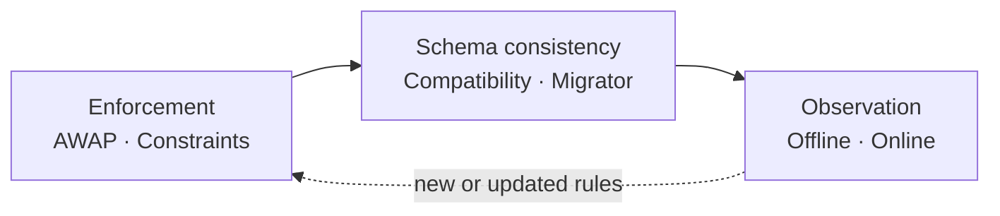
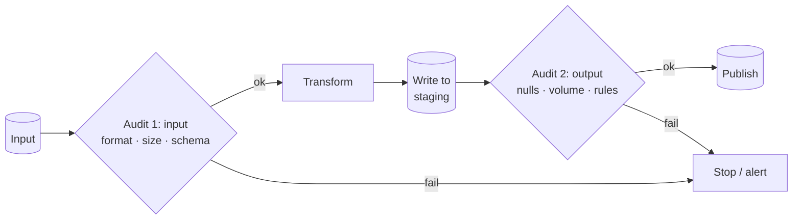
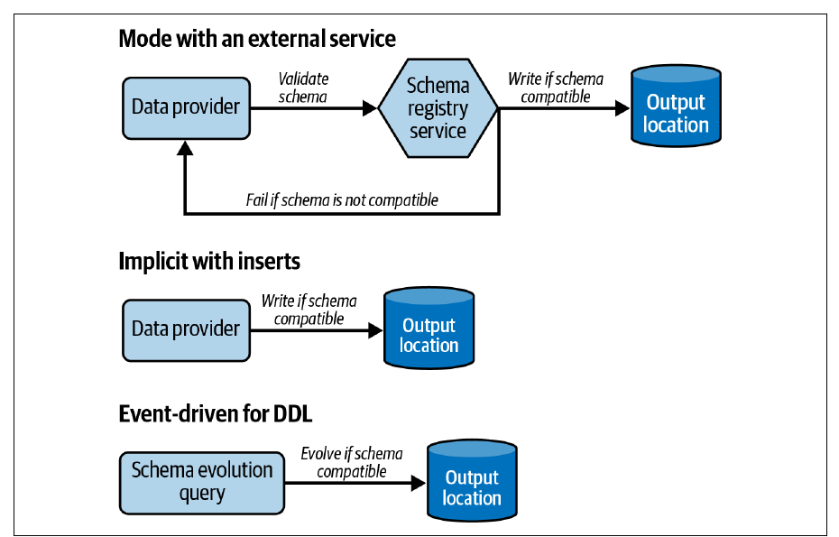
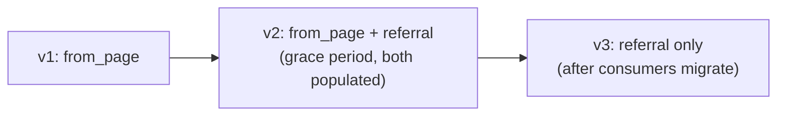
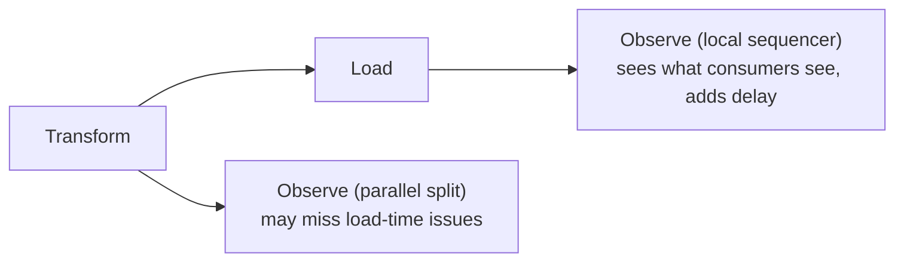

# 9. Data Quality Design Patterns

[← 8. Data Storage Design Patterns](08-data-storage-design-patterns.md) · [Book](../README.md) · [10. Data Observability Design Patterns →](10-data-observability-design-patterns.md)

## Summary

Trust is a key property of a dataset, and poor quality — incompleteness, inaccuracy, inconsistency — destroys it (p. 273). The chapter's six patterns fall into three groups. **Quality enforcement** keeps bad data from being exposed: **Audit-Write-Audit-Publish** (AWAP) adds audit steps on the input and on the transformed output before publishing, and the **Constraints Enforcer** delegates type, nullability, value and integrity rules to the database or format. **Schema consistency**: the **Schema Compatibility Enforcer** blocks breaking schema changes (backward, forward or full compatibility, transitive or not), and the **Schema Migrator** makes renames, type changes and removals possible through a grace period during which old and new fields coexist. **Quality observation** keeps the rules relevant as data evolves: the **Offline Observer** profiles datasets in a separate, nonblocking job, and the **Online Observer** puts observation inside the pipeline so issues surface right after generation.

## Key takeaways

- **Audit both sides**: a cheap audit of the input (format, size, schema from the first line) and a data-level audit of the output; put an expensive check where it's most exhaustive (pp. 275–276).
- **A failed audit needn't fail the pipeline**: dispatch invalid rows, or publish with an annotation (nonblocking audit) (pp. 276–277).
- **An “issue” may not be an issue** — a viral post legitimately multiplies traffic; some audit failures should only alert (p. 278).
- **Database constraints are declarative but all-or-nothing**, often stopping at the first error, and they serve producers' view of quality, not every consumer's (pp. 282–283).
- **Transitive compatibility checks against every past version**, not just the previous one: v0 → v1 (add `amount` with a default) → v2 (make it required) is fine nontransitively but breaks transitively (pp. 287–288).
- **Rename = add, coexist, then remove**: never `RENAME COLUMN` in place under live consumers (pp. 291–292).
- **Observation is not auditing**: observers never block; offline is late but cheap, online is timely but can slow or break the pipeline (pp. 294–300).

## Section outline

*From the book’s own table of contents (PDF bookmarks); printed page numbers.*

- Quality Enforcement — p. 274
  - Pattern: Audit-Write-Audit-Publish — p. 274
  - Pattern: Constraints Enforcer — p. 281
- Schema Consistency — p. 284
  - Pattern: Schema Compatibility Enforcer — p. 284
  - Pattern: Schema Migrator — p. 290
- Quality Observation — p. 293
  - Pattern: Offline Observer — p. 293
  - Pattern: Online Observer — p. 298
- Summary — p. 302

## Notes

Exchanging data is a mutual transaction: the goal is a happy producer and a happy consumer (p. 273). Enforcement prevents exposing bad data; schema patterns stop producers' schema changes from breaking pipelines; observation keeps today's rules valid for tomorrow's data (p. 273).

### Quality enforcement

#### Pattern: Audit-Write-Audit-Publish (pp. 274–281)

**Problem.** Unique visitors in a daily statistics job dropped by 50% for a week; the product team launched a marketing campaign — then you found the aggregation was wrong. Prevent it happening again (p. 274).

**Solution** (pp. 274–277). AWAP extends **Write-Audit-Publish** (WAP), presented by Michelle Ufford at DataWorks Summit 2017 (“Whoops, the Numbers Are Wrong! Scaling Data Quality @ Netflix”), with a lightweight audit of the input (p. 274). Like unit-test assertions applied to real data flows:

*After Figure 9-1 (p. 275).*

| Audit | Typical checks | Example |
|---|---|---|
| **Input** | Fast: file format, file or table size, schema | Check a CSV has columns `a`, `b`, `c` from its first line — avoid reading the whole dataset twice |
| **Output** | Data-level, like unit tests on real data | Transformed columns are never `NULL` |

Similar-looking checks aren't redundant: a `NULL` check on the input tests the provider; on the output, it tests your transformation. If volume forces a choice, put the check where it's **most exhaustive** — the output catches nulls from both (pp. 275–276). Unit tests stay the first line of defence; audits extend them to real, evolving data (p. 276). Checks can be record-level or dataset-level (volume, distinctness, null proportion). Outcomes besides failure (pp. 276–277):

| Outcome | Behaviour |
|---|---|
| **Fail** | Stop the pipeline |
| **Data dispatching** | Promote valid rows; store invalid ones separately — like a Dead-Letter, but driven by explicit controls, not runtime errors |
| **Nonblocking audit** | Publish anyway, annotated with a data summary of issues so consumers judge trust |

In **streaming** (Figure 9-2), either **window-based** (audit processing-time windows inside the job) or **staging-based** (write to staging; a separate audit job promotes). The input audit usually disappears — the exhaustiveness rule again (p. 277).

**Consequences** (pp. 277–278): **compute cost** (metadata checks cheap, row checks expensive); **rules coverage** — today's rules may not cover tomorrow's data, so don't treat audited pipelines as 100% reliable (see the observers); **streaming latency** — e.g. waiting for a window to assess null distribution; **an issue may not be an issue** — being quoted on social media raises volume legitimately, so some failures should just alert.

**Examples** (pp. 278–280): an Airflow DAG `next_partition_sensor >> audit_file_to_load >> transform_file >> audit_transformed_file >> load_flattened_visits_to_final_table`; the input audit checks minimum size, minimum line count and invalid JSON lines and **reports all errors at once**; the output audit uses pandas `isnull().any()` over required columns (the CSV has no constraints — otherwise use the Constraints Enforcer). Streaming: Spark writes to a Delta staging table every 15 seconds (`maxOffsetsPerTrigger` 50); a second stream reads staging (`maxBytesPerTrigger` 20000000), adds `is_valid`, and every 30 seconds writes to the output or errors table.

#### Pattern: Constraints Enforcer (pp. 281–284)

**Problem.** A months-old batch job starts writing random `NULL`s in required fields; the job is complex enough already — make the load fail on quality errors without adding validation code (p. 281).

**Solution** (pp. 281–282): identify attributes needing rules (business- or law-driven, e.g. an order's amount and billing address), then declare constraints:

| Constraint | Meaning | Example |
|---|---|---|
| **Type** | Every value has the same type; the backbone of schema consistency | `event_time TIMESTAMP` |
| **Nullability** | Never or possibly missing; also tells consumers to filter | `NOT NULL` |
| **Value** | Allowed values or expressions | `x <= NOW()`, `x BETWEEN 1901 AND 2000` |
| **Integrity** | References must exist (normalized models) | A visit's page must exist in `pages` |

Beyond databases: Delta Lake `CHECK`; Avro and Protobuf enforce types natively and values via extensions. Constraints are **informative** for consumers and **interactive** for producers (p. 282).

**Consequences** (pp. 282–283): **all-or-nothing** — one bad row rejects the whole insert, and databases often stop at the first error, so producers iterate (validating producer-side recovers the full list but loses the benefits); **data producer shift** — consumers may need stricter rules than the constraints; **coverage** — table formats may lack integrity constraints; AWAP rules are limited only by your language.

**Examples** (pp. 283–284): Delta `visit_id STRING NOT NULL`, `event_time TIMESTAMP NOT NULL`, plus `CHECK (event_time < NOW() + INTERVAL "1 SECOND")`; violations raise `DELTA_VIOLATE_CONSTRAINT_WITH_VALUES` or `DELTA_NOT_NULL_CONSTRAINT_VIOLATED` and nothing from the transaction is written. Protobuf + **protovalidate**: `visit_id` `min_len = 5`, `event_time` `lt_now`, required fields, and a CEL rule that `page` must not end with `html`; `validate(…)` raises `ValidationError: invalid Visit`.

### Schema consistency

#### Pattern: Schema Compatibility Enforcer (pp. 284–290)

**Problem.** Your Stateful Sessionizer job failed many times last month: a new upstream team removed fields they thought obsolete. Make them unable to ship breaking changes (p. 285).

**Solution** (pp. 285–288). Three enforcement modes (Figure 9-3):

*Figure 9-3 (p. 286): compatibility can be checked by an external registry, by the store on insert, or when the schema itself is evolved.*

| Mode | How | Examples |
|---|---|---|
| **External service or library** | Producers and consumers talk to a registry that versions schemas and validates changes against a compatibility rule | Kafka **Schema Registry**; Avro `SchemaValidator` (no configurable rule) |
| **Implicit with inserts** | Table constraints reject nonconforming writes; no explicit mode | Table formats, relational databases |
| **Event-driven for DDL** | Event triggers run before `DROP COLUMN`/`RENAME COLUMN` and can roll back; or simply don't grant `ALTER TABLE` | PostgreSQL, SQL Server |

Compatibility modes (the book omits *None*, which enforces nothing) (pp. 286–287):

| Mode | Consumers can… | Allowed changes (Table 9-1) |
|---|---|---|
| **Backward** | with the **new** schema, read **old** data | Delete field, add optional field |
| **Forward** | with the **old** schema, read **new** data | Add field, delete optional field |
| **Full** | both | Add optional field, delete optional field |

**Nontransitive** modes compare consecutive versions; **transitive** modes compare against all past (or future) versions — the allowed actions are the same, but the scope differs (p. 287). The book's example (pp. 287–288):

| Version | Order schema |
|---|---|
| v0 | `order_id LONG REQUIRED` |
| v1 | + `amount DOUBLE DEFAULT 0.0` (optional, backward compatible) |
| v2 | `amount DOUBLE REQUIRED` (default removed at the product team's request) |

v2 reading v1 data works — the default fills missing amounts — so it's **nontransitively** backward compatible; v2 can't read v0 data, so it **breaks transitive** backward compatibility.

> **Try it:** [Schema compatibility checker](../widgets/09-schema-compatibility.html) — evolve the book's Order schema, pick a compatibility mode, and see which version pairs a reader can still handle.

**Consequences** (p. 288): **interaction overhead** — producers validate against the latest version; **harder evolution** — a rename may become “add a new field, deprecate the old” (the Schema Migrator).

**Examples** (pp. 288–290): a forward-compatible Avro `Visit` schema (`visit_id` string, `event_time` int) in Schema Registry; producing without `visit_id` fails with HTTP **409** `READER_FIELD_MISSING_DEFAULT_VALUE` — the old schema's field has no default and is missing. Delta Lake's implicit enforcement rejects a write adding `ad_id` with “A schema mismatch detected when writing to the Delta table”.

#### Pattern: Schema Migrator (pp. 290–293)

**Problem.** Being consumer-friendly, you kept adding fields; visit events now have up to **60** attributes, scattered. Consumers want related ones grouped (e.g. `login`, email and age under `user`) without a sudden breaking change (p. 290).

**Solution** (pp. 290–291). Requires **nontransitive** compatibility — transitive modes would forbid any rename or removal (p. 290). Three evolutions:

| Evolution | Steps |
|---|---|
| **Rename** / **type change** | Add the new field → agree a transition period → send both → after the deadline, a version with only the new field |
| **Removal** | Easy only with a 100% guarantee no one uses it; otherwise find a substitute or cancel. Agree a removal period, then drop it |

Use the **Fine-Grained Tracker** (Ch. 10) to find who uses an attribute (p. 291).

**Consequences** (pp. 291–292): **size impact** — duplicated fields cost storage, network and I/O. Protobuf's best practices warn against hundreds of fields: each, even unpopulated, takes at least **65 bytes** and builders can hit Java compilation limits; Delta Lake collects statistics on the first **32** columns by default. **Impossible removal** when a consumer has no alternative.

**Examples** (pp. 292–293): a consumer runs `INSERT INTO dedp.connected_users_visits SELECT … from_page FROM dedp.visits …`; `ALTER TABLE dedp.visits RENAME COLUMN from_page TO referral` breaks it with `ERROR: column "from_page" does not exist`. Instead `ALTER TABLE dedp.visits ADD COLUMN referral …` and drop `from_page` once consumers adapt. Protobuf renames are safe on the wire (only tags are encoded), type changes may not be (p. 293).

### Quality observation

Datasets change; rules valid today may not be tomorrow (p. 293).

#### Pattern: Offline Observer (pp. 293–298)

**Problem.** A new, well-enforced pipeline has few issues, but you know the upstream will evolve. Monitor value distributions and nulls per column without blocking the pipeline (p. 293).

**Solution** (pp. 293–294): a separate **data observability job** analyzes processed records and feeds the monitoring layer — distributions, nulls in nullable fields, new unprocessed input fields — possibly on its own schedule (e.g. nightly, to avoid contention). **Observability vs auditing**: an audit blocks; observability only detects (p. 294).

**Consequences** (p. 294): **time accuracy** — insight may arrive after consumers have used bad data; **compute resources** — observing hourly data once a day processes 24 hours at once; sampling helps but may miss observations.

**Examples** (pp. 294–298): an Airflow DAG `wait_for_new_data >> record_new_observation_state >> insert_new_observations`. The state step records the first and last row IDs after the previous run's `last_row_id` (for idempotent, consistent scope); the observation step counts all rows and invalid fields between them. In streaming, a Spark job's `foreachBatch` runs the same query, writes a **ydata-profiling** HTML report (`ProfileReport(…, minimal=True)`, Figure 9-4), and computes **lag** per partition as the topic's last offset minus the producer job's last checkpointed offset.

#### Pattern: Online Observer (pp. 298–302)

**Problem.** Analysts found an unexpected zip code format from an upstream regression; your weekly Offline Observer saw it, but only after users did (p. 298).

**Solution** (pp. 298–299): make observation part of the data generation pipeline, so insight is available right after generation. In batch, place it after the Transform stage as a **Parallel Split** or a **Local Sequencer** step (Figure 9-5). In streaming, the observation logic lives inside the job — its errors or memory issues can affect the whole job; sampling reduces the risk at the cost of insight (Figure 9-6). Observability also covers technical metadata (CPU, memory, disk) (p. 300).

*After Figure 9-5 (p. 299).*

**Consequences** (p. 300): **extra delays** with a Local Sequencer; with a **Parallel Split**, the observer may see a partially valid dataset — e.g. date times in an unexpected format go missing in the database, but the observer, reading the transformed data, doesn't notice. Prefer observing what's exposed to consumers.

**Examples** (pp. 300–302): the Airflow pipeline now includes `copy_new_visits >> record_new_observation_state >> insert_new_observations`, plus a final no-op task with trigger rule `all_done` so observation failures don't fail the pipeline. In streaming, the reader adds partition and offset columns; Spark **accumulators** collect max offsets per partition and invalid-field counts in one pass, aggregated on the driver when `.value` is read — avoiding reading the input twice.

### Summary

Enforcement at the pipeline (AWAP), database (Constraints Enforcer) and schema (Schema Compatibility Enforcer) levels prevents publishing data that breaks known rules — but only known rules; observation (offline or online, trading time for accuracy) keeps the rules up to date (pp. 302–303).

## Trade-offs at a glance

| | AWAP | Constraints Enforcer |
|---|---|---|
| Where rules live | Your pipeline code | Database / format |
| Flexibility | Any logic | Limited to supported constraints |
| Error reporting | All errors at once (if coded so) | Often first error, all-or-nothing |
| Outcomes | Fail, dispatch, annotate | Reject |

| | Offline Observer | Online Observer |
|---|---|---|
| Blocks pipeline | No | No (but can fail or slow it) |
| Timeliness | Late | Right after generation |
| Production impact | None | Extra step or shared resources |

## Beyond the book

- Open-source tools such as Great Expectations, Soda and dbt tests implement audit steps declaratively; the book's examples write them by hand to show the mechanism.
- Confluent Schema Registry's documented modes are exactly the book's list — `BACKWARD`, `BACKWARD_TRANSITIVE`, `FORWARD`, `FORWARD_TRANSITIVE`, `FULL`, `FULL_TRANSITIVE` — plus `NONE`; its default is `BACKWARD`.

## Connections

- **Related chapters:** [3. Error Management](03-error-management-design-patterns.md) (Dead-Letter vs data dispatching), [5. Data Value](05-data-value-design-patterns.md) (Stateful Sessionizer), [6. Data Flow](06-data-flow-design-patterns.md) (Parallel Split, Local Sequencer), [8. Data Storage](08-data-storage-design-patterns.md) (Normalizer and integrity constraints), [10. Data Observability](10-data-observability-design-patterns.md) (Fine-Grained Tracker, Flow Interruption Detector).

## Check yourself

*Questions and answers are the vault's, written from the notes above; answers cite the book's pages.*

1. **You can afford one `NULL` check. Where should it go, and why?**

   *Answer:* In the output audit — it's the most exhaustive place, catching nulls from the provider and from your transformation (p. 276).

2. **Some rows fail the output audit but most are valid. Which outcome publishes the valid ones?**
   - [ ] Fail the pipeline
   - [x] Data dispatching
   - [ ] Nonblocking audit

   *Answer:* Dispatching promotes valid rows and keeps invalid ones aside; a nonblocking audit publishes everything with an annotation (p. 276).

3. **A producer's batch has three invalid rows with different problems. Why might fixing them take several round-trips with a constrained database?**

   *Answer:* Constraints are all-or-nothing and databases often stop at the first error, so each attempt reveals one problem (p. 282).

4. **Order v0 has `order_id`; v1 adds `amount` with default 0.0; v2 makes `amount` required. Which backward mode rejects v2?**
   - [ ] Backward nontransitive
   - [x] Backward transitive
   - [ ] Neither

   *Answer:* v2 can read v1 data (defaults fill gaps) but not v0 data, which has no amount — only the transitive check compares with v0 (pp. 287–288).

5. **Why does the Schema Migrator require nontransitive compatibility?**

   *Answer:* Transitive modes guarantee compatibility with all versions, so no rename or removal could ever complete (p. 290).

6. **What's the risk of running the Online Observer as a parallel split next to the load step?**

   *Answer:* It observes the transformed data, not what consumers get — e.g. date times dropped by the database during loading go unnoticed (p. 300).
