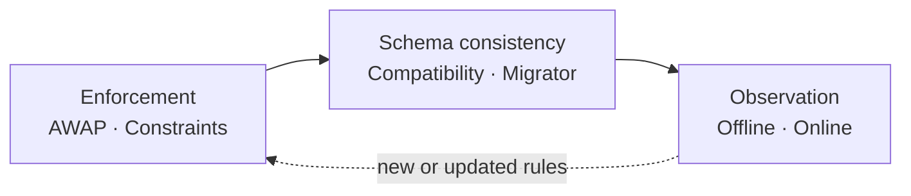
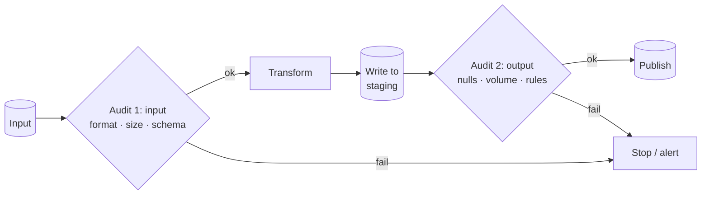
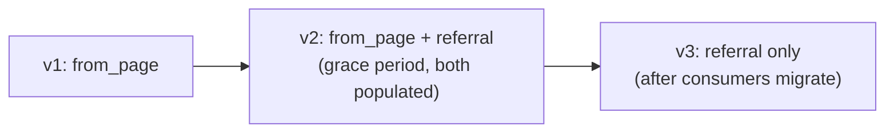
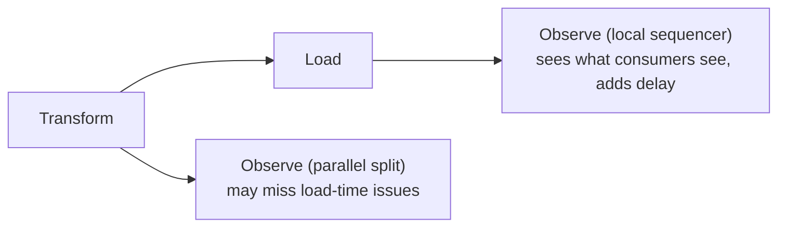

# فصل ۹: الگوهای طراحی کیفیت داده

[فصل ۸: الگوهای طراحی ذخیره‌سازی داده →](08-data-storage-design-patterns.md) · [کتاب](../README.md) · [فصل ۱۰: الگوهای طراحی observability داده ←](10-data-observability-design-patterns.md)

## خلاصه

اعتماد ویژگی کلیدی یک مجموعه‌داده است، و کیفیت بد، یعنی ناقص بودن و نادقیق بودن و ناسازگاری، نابودش می‌کند (p. 273). شش الگوی این فصل در سه گروه‌اند. **اعمال کیفیت** نمی‌گذارد داده‌ی بد نشان داده شود: الگوی **Audit-Write-Audit-Publish** یا همان AWAP، مرحله‌های audit روی ورودی و روی خروجی تبدیل‌شده را پیش از انتشار اضافه می‌کند، و **Constraints Enforcer** قاعده‌های نوع و تهی‌پذیری و مقدار و یکپارچگی را به دیتابیس یا فرمت می‌سپارد. **schema compatibility**: الگوی **Schema Compatibility Enforcer** تغییرهای شکننده‌ی schema را می‌بندد، با backward compatibility یا رو‌به‌جلو یا کامل، transitive یا non-transitive، و **Schema Migrator** تغییر نام و تغییر نوع و حذف را با یک دوره‌ی مهلت ممکن می‌کند که در آن فیلد قدیم و تازه با هم زندگی می‌کنند. **مشاهده‌ی کیفیت** قاعده‌ها را با تکامل داده به‌جا نگه می‌دارد: الگوی **Offline Observer** مجموعه‌داده‌ها را در jobی جدا و نابازدارنده profile می‌کند، و **Online Observer** مشاهده را داخل pipeline می‌گذارد تا مسئله‌ها همان بعد از ساخته شدن بیرون بیایند.

## نکته‌های کلیدی

- **هر دو سمت را audit کنید**: یک audit ارزان روی ورودی، یعنی فرمت و اندازه و schema از خط اول، و یک audit سطح داده روی خروجی؛ بررسی گران را جایی بگذارید که جامع‌ترین است (pp. 275–276).
- **شکست audit لازم نیست pipeline را شکست بدهد**: ردیف‌های نامعتبر را به جای دیگری بفرستید، یا با یک یادداشت منتشر کنید، یعنی audit نابازدارنده (pp. 276–277).
- **یک «مسئله» ممکن است مسئله نباشد**: یک پست وایرال واقعاً ترافیک را چند برابر می‌کند، پس بعضی شکست‌های audit فقط باید هشدار بدهند (p. 278).
- **قید دیتابیس اعلانی است ولی همه‌یا‌هیچ**، اغلب روی اولین خطا می‌ایستد، و نگاه تأمین‌کننده به کیفیت را می‌دهد و نه نگاه هر consumer (pp. 282–283).
- **سازگاری transitive با همه‌ی نسخه‌های گذشته بررسی می‌شود**، نه فقط قبلی: مسیر v0 به v1 با افزودن `amount` پیش‌فرض‌دار و بعد v2 با الزامی کردنش، non-transitive خوب است ولی transitive می‌شکند (pp. 287–288).
- **تغییر نام یعنی افزودن و با هم زندگی کردن و بعد حذف**: هیچ‌وقت زیر پای consumerهای زنده `RENAME COLUMN` در جا نکنید (pp. 291–292).
- **مشاهده همان audit نیست**: مشاهده‌گرها هیچ‌وقت نمی‌بندند؛ آفلاین دیر ولی ارزان است و آنلاین به‌موقع ولی می‌تواند pipeline را کند یا بشکند (pp. 294–300).

## فهرست بخش‌ها

*از فهرست مطالب خود کتاب، از bookmarkهای PDF؛ شماره‌ها صفحه‌ی چاپی‌اند.*

- اعمال کیفیت — p. 274
  - الگو: Audit-Write-Audit-Publish — p. 274
  - الگو: Constraints Enforcer — p. 281
- schema compatibility — p. 284
  - الگو: Schema Compatibility Enforcer — p. 284
  - الگو: Schema Migrator — p. 290
- مشاهده‌ی کیفیت — p. 293
  - الگو: Offline Observer — p. 293
  - الگو: Online Observer — p. 298
- خلاصه — p. 302

## یادداشت‌ها

تبادل داده تراکنشی دو‌طرفه است: هدف، تأمین‌کننده‌ی خوشحال و consumer خوشحال است (p. 273). اعمال، جلوی نشان دادن داده‌ی بد را می‌گیرد؛ الگوهای schema نمی‌گذارند تغییر schema تأمین‌کننده pipelineها را بشکند؛ و مشاهده، قاعده‌های امروز را برای داده‌ی فردا معتبر نگه می‌دارد (p. 273).

### اعمال کیفیت

#### الگو: Audit-Write-Audit-Publish (pp. 274–281)

**مسئله.** بازدیدکننده‌های یکتا در یک job آمار روزانه یک هفته ۵۰٪ افت کردند؛ تیم محصول یک کمپین بازاریابی راه انداخته بود، و بعد فهمیدید تجمیع غلط بوده. نگذارید باز اتفاق بیفتد (p. 274).

**راه‌حل** (pp. 274–277): الگوی AWAP، الگوی **Write-Audit-Publish** یا همان WAP را، که Michelle Ufford در DataWorks Summit سال ۲۰۱۷ با عنوان «Whoops, the Numbers Are Wrong! Scaling Data Quality @ Netflix» معرفی کرد، با یک audit سبک روی ورودی گسترش می‌دهد (p. 274). مثل assertionهای unit test که روی جریان داده‌ی واقعی اعمال شوند:

*بر پایه‌ی شکل ۹-۱ (p. 275).*

| audit | بررسی‌های معمول | نمونه |
|---|---|---|
| **ورودی** | تند: فرمت فایل، اندازه‌ی فایل یا جدول، schema | بررسی این که یک CSV از خط اولش ستون‌های `a` و `b` و `c` را دارد، تا کل مجموعه‌داده دو بار خوانده نشود |
| **خروجی** | سطح داده، مثل unit test روی داده‌ی واقعی | ستون‌های تبدیل‌شده هیچ‌وقت `NULL` نیستند |

بررسی‌های به‌ظاهر شبیه، تکراری نیستند: بررسی `NULL` روی ورودی تأمین‌کننده را می‌سنجد و روی خروجی تبدیل خودتان را. اگر حجم مجبورتان کرد انتخاب کنید، بررسی را جایی بگذارید که **جامع‌ترین** است، یعنی خروجی که تهی‌های هر دو سمت را می‌گیرد (pp. 275–276). unit testها همان خط اول دفاع می‌مانند و auditها آن‌ها را به داده‌ی واقعی و در حال تکامل می‌کشانند (p. 276). بررسی‌ها می‌توانند در سطح رکورد یا در سطح مجموعه‌داده باشند، مثل حجم و تمایز و نسبت تهی. پیامدهای غیر از شکست (pp. 276–277):

| پیامد | رفتار |
|---|---|
| **شکست** | pipeline را متوقف کنید |
| **فرستادن داده** | ردیف‌های معتبر را ارتقا بدهید و نامعتبرها را جدا ذخیره کنید؛ مثل Dead-Letter، ولی از کنترل‌های صریح می‌آید و نه خطای زمان اجرا |
| **audit نابازدارنده** | باز هم منتشر کنید، با یک خلاصه‌ی داده از مسئله‌ها، تا consumerها خودشان اعتماد را بسنجند |

در **streaming** (شکل ۹-۲)، یا **پنجره‌محور است**، یعنی audit پنجره‌های زمان پردازش داخل job، یا **staging‌محور**، یعنی نوشتن در staging و بعد یک job audit جدا که ارتقا می‌دهد. audit ورودی معمولاً از بین می‌رود، باز هم به‌خاطر قاعده‌ی جامع بودن (p. 277).

**پیامدها** (pp. 277–278): **هزینه‌ی محاسبه**، یعنی بررسی metadata ارزان است و بررسی ردیف گران؛ **پوشش قاعده‌ها**، یعنی قاعده‌های امروز ممکن است داده‌ی فردا را نپوشانند، پس pipelineهای audit‌شده را صد درصد قابل‌اعتماد نگیرید، مشاهده‌گرها را ببینید؛ **تأخیر streaming**، مثل انتظار برای یک پنجره تا توزیع تهی سنجیده شود؛ و **یک مسئله ممکن است مسئله نباشد**، یعنی نقل شدن در شبکه‌های اجتماعی واقعاً حجم را بالا می‌برد، پس بعضی شکست‌ها فقط باید هشدار بدهند.

**نمونه‌ها** (pp. 278–280): یک DAG در Airflow به شکل `next_partition_sensor >> audit_file_to_load >> transform_file >> audit_transformed_file >> load_flattened_visits_to_final_table`؛ audit ورودی کمینه‌ی اندازه و کمینه‌ی شمار خط و خط‌های JSON نامعتبر را بررسی می‌کند و **همه‌ی خطاها را یک‌جا خبر می‌دهد**؛ audit خروجی از `isnull().any()` در pandas روی ستون‌های الزامی استفاده می‌کند، چون CSV قید ندارد، وگرنه Constraints Enforcer را به کار ببرید. در streaming: Spark هر پانزده ثانیه در یک جدول staging دلتا می‌نویسد، با `maxOffsetsPerTrigger` برابر ۵۰؛ و stream دومی staging را می‌خواند، با `maxBytesPerTrigger` برابر ۲۰۰۰۰۰۰۰، ستون `is_valid` اضافه می‌کند، و هر سی ثانیه در جدول خروجی یا خطا می‌نویسد.

#### الگو: Constraints Enforcer (pp. 281–284)

**مسئله.** یک job batch چند‌ماهه شروع می‌کند مقدار `NULL` تصادفی در فیلدهای الزامی بنویسد؛ job به‌اندازه‌ی کافی پیچیده است، پس بار‌گذاری را بی اضافه کردن کد اعتبارسنجی سر خطای کیفیت شکست بدهید (p. 281).

**راه‌حل** (pp. 281–282): ویژگی‌هایی را که قاعده می‌خواهند بشناسید، که از کسب‌وکار یا قانون می‌آیند، مثل مبلغ و آدرس صورت‌حساب یک سفارش، و بعد قیدها را اعلان کنید:

| قید | معنا | نمونه |
|---|---|---|
| **نوع** | هر مقدار همان نوع را دارد؛ ستون فقرات schema compatibility | `event_time TIMESTAMP` |
| **تهی‌پذیری** | هیچ‌وقت یا شاید غایب؛ به consumerها هم می‌گوید فیلتر کنند | `NOT NULL` |
| **مقدار** | مقدارها یا عبارت‌های مجاز | `x <= NOW()`، `x BETWEEN 1901 AND 2000` |
| **یکپارچگی** | ارجاع‌ها باید وجود داشته باشند، در مدل‌های نرمال | صفحه‌ی یک بازدید باید در `pages` باشد |

جز دیتابیس‌ها: `CHECK` در Delta Lake؛ و Avro و Protobuf نوع را بومی و مقدار را با افزونه اعمال می‌کنند. قیدها برای consumerها **خبری** و برای تأمین‌کننده‌ها **تعاملی**اند (p. 282).

**پیامدها** (pp. 282–283): **همه‌یا‌هیچ**، یعنی یک ردیف بد کل درج را رد می‌کند و دیتابیس‌ها اغلب روی اولین خطا می‌ایستند، پس تأمین‌کننده‌ها باید تکرار کنند؛ اعتبارسنجی سمت تأمین‌کننده فهرست کامل را برمی‌گرداند ولی سودهایش را از دست می‌دهد. **جابه‌جایی به producer داده**، یعنی consumerها ممکن است قاعده‌های سخت‌گیرانه‌تر از قیدها بخواهند. **پوشش**، یعنی table formatها ممکن است قید یکپارچگی نداشته باشند، در حالی که قاعده‌های AWAP فقط به زبان شما محدودند.

**نمونه‌ها** (pp. 283–284): در Delta، `visit_id STRING NOT NULL` و `event_time TIMESTAMP NOT NULL` به‌علاوه‌ی `CHECK (event_time < NOW() + INTERVAL "1 SECOND")`؛ نقض‌ها خطای `DELTA_VIOLATE_CONSTRAINT_WITH_VALUES` یا `DELTA_NOT_NULL_CONSTRAINT_VIOLATED` می‌دهند و هیچ چیزی از آن تراکنش نوشته نمی‌شود. با Protobuf و **protovalidate**: برای `visit_id` مقدار `min_len = 5`، برای `event_time` قید `lt_now`، فیلدهای الزامی، و یک قاعده‌ی CEL که `page` نباید به `html` تمام شود؛ متد `validate(…)` خطای `ValidationError: invalid Visit` می‌دهد.

> **In practice:** data-quality gateهایی که بین لایه‌ها برنامه‌ریزی شده‌اند همان Audit-Write-Audit-Publish‌اند.
>
> **Your turn:** چک uniqueness روی Silver بعد از publish اجرا می‌شود و داشبوردها نیم ساعت عدد دوبل نشان می‌دهند. ترتیب درست چیست؟
>
> *Answer:* در جدول staging بنویسید، audit کنید و فقط اگر قبول شد با `EXCHANGE TABLES` یا `REPLACE PARTITION` publish کنید؛ consumer هیچ‌وقت داده‌ی audit‌نشده نمی‌بیند (pp. 274–281).

### schema compatibility

#### الگو: Schema Compatibility Enforcer (pp. 284–290)

**مسئله.** job از جنس Stateful Sessionizer شما ماه پیش چند بار شکست خورد: تیم upstreamی تازه‌ای فیلدهایی را که به نظرشان منسوخ بودند برداشت. کاری کنید نتوانند تغییر شکننده release کنند (p. 285).

**راه‌حل** (pp. 285–288): سه حالت اعمال (شکل ۹-۳).

*Figure 9-3 (p. 286): سازگاری را یک registry بیرونی، یا خود ذخیره‌سازی سر درج، یا سر تکامل خود schema می‌تواند بررسی کند.*

| حالت | چطور | نمونه |
|---|---|---|
| **سرویس یا کتابخانه‌ی بیرونی** | تأمین‌کننده‌ها و consumerها با registryی حرف می‌زنند که schemaها را نسخه‌دار می‌کند و تغییرها را با یک قاعده‌ی سازگاری اعتبارسنجی | **Schema Registry** در Kafka؛ و `SchemaValidator` در Avro که قاعده‌ی تنظیم‌شدنی ندارد |
| **ضمنی با درج** | قیدهای جدول نوشتن‌های نامنطبق را رد می‌کنند؛ حالت صریحی نیست | table formatها، دیتابیس‌های رابطه‌ای |
| **رویداد‌محور برای DDL** | event triggerها پیش از `DROP COLUMN` و `RENAME COLUMN` اجرا می‌شوند و می‌توانند برگردانند؛ یا به‌سادگی `ALTER TABLE` را ندهید | PostgreSQL، SQL Server |

حالت‌های سازگاری، که کتاب حالت *None* را که هیچ چیزی اعمال نمی‌کند نیاورده (pp. 286–287):

| حالت | consumerها می‌توانند… | تغییرهای مجاز (جدول ۹-۱) |
|---|---|---|
| **رو‌به‌عقب** | با schema **تازه**، داده‌ی **قدیم** را بخوانند | حذف فیلد، افزودن فیلد اختیاری |
| **رو‌به‌جلو** | با schema **قدیم**، داده‌ی **تازه** را بخوانند | افزودن فیلد، حذف فیلد اختیاری |
| **کامل** | هر دو | افزودن فیلد اختیاری، حذف فیلد اختیاری |

حالت‌های **non-transitive** نسخه‌های پشت سر هم را مقایسه می‌کنند و حالت‌های **transitive** با همه‌ی نسخه‌های گذشته یا آینده؛ کارهای مجاز همان‌اند ولی دامنه فرق می‌کند (p. 287). نمونه‌ی کتاب (pp. 287–288):

| نسخه | schema سفارش |
|---|---|
| v0 | `order_id LONG REQUIRED` |
| v1 | به‌علاوه‌ی `amount DOUBLE DEFAULT 0.0`، یعنی اختیاری و سازگار رو‌به‌عقب |
| v2 | `amount DOUBLE REQUIRED`، که پیش‌فرض به درخواست تیم محصول برداشته شده |

خواندن داده‌ی v1 با v2 کار می‌کند، چون پیش‌فرض مبلغ‌های غایب را پر می‌کند، پس **non-transitive** سازگار رو‌به‌عقب است؛ ولی v2 نمی‌تواند داده‌ی v0 را بخواند، پس backward compatibility **transitive را می‌شکند**.

> **Try it:** [بررسی‌کننده‌ی schema compatibility](../widgets/09-schema-compatibility.html)؛ schema سفارش کتاب را تکامل بدهید، یک حالت سازگاری انتخاب کنید، و ببینید خواننده کدام جفت نسخه را باز هم می‌تواند بخواند.

**پیامدها** (p. 288): **سرریز تعامل**، یعنی تأمین‌کننده‌ها با جدید‌ترین نسخه اعتبارسنجی می‌کنند؛ **تکامل سخت‌تر**، یعنی یک تغییر نام می‌تواند بشود «فیلد تازه اضافه کن و قدیمی را منسوخ اعلام کن»، یعنی همان Schema Migrator.

**نمونه‌ها** (pp. 288–290): یک schema سازگار رو‌به‌جلو به نام `Visit` در Avro با `visit_id` رشته‌ای و `event_time` عددی در Schema Registry؛ تولید بی `visit_id` با کد HTTP **۴۰۹** و `READER_FIELD_MISSING_DEFAULT_VALUE` شکست می‌خورد، چون فیلد schema قدیمی پیش‌فرض ندارد و غایب است. اعمال ضمنی Delta Lake نوشتنی را که `ad_id` اضافه می‌کند با «A schema mismatch detected when writing to the Delta table» رد می‌کند.

#### الگو: Schema Migrator (pp. 290–293)

**مسئله.** از بس هوای consumer را داشتید فیلد اضافه کردید؛ رویدادهای بازدید حالا تا **۶۰** ویژگی دارند که پراکنده‌اند. consumerها می‌خواهند مرتبط‌ها گروه شوند، مثل `login` و ایمیل و سن زیر `user`، بی یک تغییر شکننده‌ی ناگهانی (p. 290).

**راه‌حل** (pp. 290–291): به سازگاری **non-transitive** نیاز دارد، چون حالت‌های transitive هر تغییر نام یا حذفی را ممنوع می‌کنند (p. 290). سه تکامل:

| تکامل | مرحله‌ها |
|---|---|
| **تغییر نام** یا **تغییر نوع** | فیلد تازه را اضافه کنید، روی یک دوره‌ی گذار توافق کنید، هر دو را بفرستید، و بعد از مهلت، نسخه‌ای با فقط فیلد تازه |
| **حذف** | فقط با تضمین صد درصدی این که کسی به کارش نمی‌برد آسان است؛ وگرنه جانشینی پیدا کنید یا لغوش کنید. روی دوره‌ی حذف توافق کنید و بعد بیندازیدش |

برای یافتن این که چه کسی یک ویژگی را به کار می‌برد از **Fine-Grained Tracker** در فصل ۱۰ استفاده کنید (p. 291).

**پیامدها** (pp. 291–292): **اثر اندازه**، یعنی فیلدهای تکراری ذخیره‌سازی و شبکه و I/O خرج می‌کنند. بهترین‌روش‌های Protobuf نسبت به صدها فیلد هشدار می‌دهند: هر فیلد حتی پرنشده دست‌کم **۶۵ بایت** می‌گیرد و builderها می‌توانند به سقف کامپایل Java بخورند؛ و Delta Lake پیش‌فرض برای **۳۲** ستون اول آمار جمع می‌کند. **حذف ناممکن**، وقتی consumerی جایگزینی ندارد.

**نمونه‌ها** (pp. 292–293): یک consumer `INSERT INTO dedp.connected_users_visits SELECT … from_page FROM dedp.visits …` را اجرا می‌کند؛ و `ALTER TABLE dedp.visits RENAME COLUMN from_page TO referral` با `ERROR: column "from_page" does not exist` می‌شکندش. در عوض `ALTER TABLE dedp.visits ADD COLUMN referral …` و بعد از سازگار شدن consumerها `from_page` را بیندازید. تغییر نام در Protobuf روی سیم امن است، چون فقط tagها encode می‌شوند، ولی تغییر نوع ممکن است نباشد (p. 293).

> **In practice:** schema منبع‌ها را تیم‌های دیگر عوض می‌کنند؛ schema drift یکی از چک‌های برنامه‌ریزی‌شده‌ی stack است.
>
> **Your turn:** تیم منبع A نوع ستون `status` را از عدد به متن عوض کرده است. loader با dlt چه می‌کند و چه باید بکند؟
>
> *Answer:* با تنظیم پیش‌فرض، dlt ستونی variant مثل `status__v_text` می‌سازد و ستون قدیمی دیگر پر نمی‌شود، بی‌آن‌که کسی خبردار شود. بهتر است schema contract آن جدول `freeze` باشد تا تغییر نوع بار را fail کند و alert بدهد؛ این Schema Compatibility Enforcer است (pp. 284–290).

### مشاهده‌ی کیفیت

مجموعه‌داده‌ها عوض می‌شوند؛ قاعده‌های معتبر امروز ممکن است فردا معتبر نباشند (p. 293).

#### الگو: Offline Observer (pp. 293–298)

**مسئله.** یک pipeline تازه و خوب‌اعمال‌شده مسئله‌های کمی دارد، ولی می‌دانید upstream تکامل پیدا می‌کند. توزیع مقدارها و تهی‌های هر ستون را بی بستن pipeline بپایید (p. 293).

**راه‌حل** (pp. 293–294): یک **job observability داده**ی جدا، رکوردهای پردازش‌شده را تحلیل می‌کند و به لایه‌ی monitoring می‌خوراند، یعنی توزیع‌ها و تهی‌ها در فیلدهای تهی‌پذیر و فیلدهای ورودی پردازش‌نشده‌ی تازه، و می‌تواند زمان‌بندی خودش را داشته باشد، مثلاً شبانه، تا رقابت نشود. **تفاوت observability و audit**: یک audit می‌بندد و observability فقط تشخیص می‌دهد (p. 294).

**پیامدها** (p. 294): **دقت زمانی**، یعنی بینش ممکن است بعد از آن بیاید که consumerها داده‌ی بد را به کار برده‌اند؛ **منابع محاسبه**، یعنی مشاهده‌ی داده‌ی ساعتی یک‌بار در روز، بیست‌و‌چهار ساعت را یک‌جا پردازش می‌کند؛ نمونه‌برداری کمک می‌کند ولی ممکن است مشاهده‌هایی را از دست بدهد.

**نمونه‌ها** (pp. 294–298): یک DAG در Airflow به شکل `wait_for_new_data >> record_new_observation_state >> insert_new_observations`. مرحله‌ی حالت، شناسه‌ی اولین و آخرین ردیف بعد از `last_row_id` اجرای قبلی را ثبت می‌کند، برای دامنه‌ی idempotent و سازگار؛ و مرحله‌ی مشاهده همه‌ی ردیف‌ها و فیلدهای نامعتبر بینشان را می‌شمارد. در streaming، `foreachBatch` یک job در Spark همان کوئری را اجرا می‌کند، یک گزارش HTML از **ydata-profiling** می‌نویسد، یعنی `ProfileReport(…, minimal=True)` (شکل ۹-۴)، و **lag** هر پارتیشن را به‌عنوان آخرین offset آن topic منهای آخرین offset checkpoint‌شده‌ی job producer حساب می‌کند.

#### الگو: Online Observer (pp. 298–302)

**مسئله.** تحلیل‌گرها فرمت غیرمنتظره‌ای از کد پستی را پیدا کردند که از یک پس‌رفت upstreamی می‌آمد؛ Offline Observer هفتگی شما دیدش، ولی فقط بعد از کاربرها (p. 298).

**راه‌حل** (pp. 298–299): مشاهده را بخشی از pipeline ساخت داده کنید، تا بینش همان بعد از ساخته شدن در دسترس باشد. در batch، بعد از مرحله‌ی Transform بگذاریدش، به‌عنوان یک **Parallel Split** یا یک مرحله‌ی **Local Sequencer** (شکل ۹-۵). در streaming، منطق مشاهده داخل خود job می‌نشیند و خطا یا مسئله‌ی حافظه‌اش می‌تواند روی کل job اثر بگذارد؛ نمونه‌برداری خطر را کم می‌کند به قیمت بینش (شکل ۹-۶). observability متادیتای فنی را هم می‌پوشاند، یعنی CPU و حافظه و دیسک (p. 300).

*بر پایه‌ی شکل ۹-۵ (p. 299).*

**پیامدها** (p. 300): **تأخیر اضافه** با Local Sequencer؛ و با **Parallel Split** مشاهده‌گر ممکن است مجموعه‌داده‌ای نیمه‌معتبر ببیند، مثلاً زمان‌هایی با فرمت غیرمنتظره که در دیتابیس غایب می‌شوند، ولی مشاهده‌گر که داده‌ی تبدیل‌شده را می‌خواند متوجه نمی‌شود. ترجیح بدهید همان چیزی را مشاهده کنید که به consumerها نشان داده می‌شود.

**نمونه‌ها** (pp. 300–302): pipeline در Airflow حالا `copy_new_visits >> record_new_observation_state >> insert_new_observations` را هم دارد، به‌علاوه‌ی یک task پایانی بی‌کار با trigger rule برابر `all_done`، تا شکست مشاهده pipeline را شکست ندهد. در streaming، خواننده ستون‌های پارتیشن و offset را اضافه می‌کند؛ و **accumulator**های Spark بیشینه‌ی offset هر پارتیشن و شمار فیلدهای نامعتبر را در یک گذر جمع می‌کنند، که سر خواندن `.value` روی driver تجمیع می‌شوند و نمی‌گذارند ورودی دو بار خوانده شود.

> **In practice:** freshness و volume را می‌شود داخل pipeline سنجید یا با jobی جدا از آن.
>
> **Your turn:** هر کدام را با Prometheus چطور می‌سازید؟
>
> *Answer:* داخل pipeline: loader بعد از هر load شمار ردیف و `max(update_date)` را به‌شکل metric export می‌کند و Grafana رویش alert دارد. جدا از pipeline: jobی مستقل هر ساعت آمار جدول‌ها را حساب می‌کند. اولی سریع‌تر است، دومی مستقل است و job از کار افتاده را هم می‌بیند (pp. 293–302).

### خلاصه

اعمال در سطح pipeline با AWAP و در سطح دیتابیس با Constraints Enforcer و در سطح schema با Schema Compatibility Enforcer، جلوی انتشار داده‌ای را می‌گیرد که قاعده‌های شناخته‌شده را می‌شکند، ولی فقط قاعده‌های شناخته‌شده؛ و مشاهده، آفلاین یا آنلاین که زمان را با دقت معامله می‌کند، قاعده‌ها را به‌روز نگه می‌دارد (pp. 302–303).

## بده‌بستان‌ها در یک نگاه

| | AWAP | Constraints Enforcer |
|---|---|---|
| قاعده‌ها کجا می‌نشینند | در کد pipeline خودتان | در دیتابیس یا فرمت |
| انعطاف | هر منطقی | محدود به قیدهای پشتیبانی‌شده |
| خبر دادن خطا | همه‌ی خطاها یک‌جا، اگر این‌طور کدش کنید | اغلب اولین خطا، همه‌یا‌هیچ |
| پیامدها | شکست، فرستادن، یادداشت | رد کردن |

| | Offline Observer | Online Observer |
|---|---|---|
| pipeline را می‌بندد | نه | نه، ولی می‌تواند شکستش بدهد یا کندش کند |
| به‌موقع بودن | دیر | همان بعد از ساخته شدن |
| اثر روی تولید | ندارد | مرحله‌ی اضافه یا منابع مشترک |

## فراتر از کتاب

- ابزارهای open source مثل Great Expectations و Soda و testهای dbt مرحله‌های audit را اعلانی پیاده می‌کنند؛ نمونه‌های کتاب دستی نوشته شده‌اند تا سازوکار را نشان بدهند.
- حالت‌های مستندشده‌ی Confluent Schema Registry دقیقاً همان فهرست کتاب‌اند، یعنی `BACKWARD` و `BACKWARD_TRANSITIVE` و `FORWARD` و `FORWARD_TRANSITIVE` و `FULL` و `FULL_TRANSITIVE`، به‌علاوه‌ی `NONE`؛ و پیش‌فرضش `BACKWARD` است.

## پیوندها

- **فصل‌های مرتبط:** [فصل ۳: مدیریت خطا](03-error-management-design-patterns.md) که Dead-Letter را در برابر فرستادن داده دارد، [فصل ۵: ارزش داده](05-data-value-design-patterns.md) که Stateful Sessionizer را دارد، [فصل ۶: جریان داده](06-data-flow-design-patterns.md) که Parallel Split و Local Sequencer را دارد، [فصل ۸: ذخیره‌سازی داده](08-data-storage-design-patterns.md) که Normalizer و قیدهای یکپارچگی را دارد، و [فصل ۱۰: observability داده](10-data-observability-design-patterns.md) که Fine-Grained Tracker و Flow Interruption Detector را دارد.

## خودتان را بسنجید

*پرسش‌ها و پاسخ‌ها مال vault است و از روی یادداشت‌های بالا نوشته شده؛ پاسخ‌ها به صفحه‌های کتاب ارجاع می‌دهند.*

1. **فقط یک بررسی `NULL` را می‌توانید بپردازید. کجا باید برود و چرا؟**

   *Answer:* در audit خروجی، چون جامع‌ترین جاست و تهی‌هایی را که از تأمین‌کننده می‌آیند و تهی‌هایی را که تبدیل خودتان می‌سازد هر دو می‌گیرد (p. 276).

2. **بعضی ردیف‌ها در audit خروجی شکست می‌خورند ولی بیشترشان معتبرند. کدام پیامد، معتبرها را منتشر می‌کند؟**
   - [ ] شکست دادن pipeline
   - [x] فرستادن داده
   - [ ] مفهوم audit نابازدارنده

   *Answer:* فرستادن داده ردیف‌های معتبر را ارتقا می‌دهد و نامعتبرها را کنار می‌گذارد؛ audit نابازدارنده همه چیز را با یک یادداشت منتشر می‌کند (p. 276).

3. **دسته‌ای از یک تأمین‌کننده سه ردیف نامعتبر با مسئله‌های مختلف دارد. چرا اصلاحشان با دیتابیسی قید‌دار می‌تواند چند رفت‌و‌برگشت ببرد؟**

   *Answer:* قیدها همه‌یا‌هیچ‌اند و دیتابیس‌ها اغلب روی اولین خطا می‌ایستند، پس هر تلاش یک مسئله را آشکار می‌کند (p. 282).

4. **نسخه‌ی v0 سفارش `order_id` دارد؛ v1 فیلد `amount` را با پیش‌فرض ۰٫۰ اضافه می‌کند؛ v2 آن را الزامی می‌کند. کدام حالت رو‌به‌عقب v2 را رد می‌کند؟**
   - [ ] رو‌به‌عقب non-transitive
   - [x] رو‌به‌عقب transitive
   - [ ] هیچ‌کدام

   *Answer:* نسخه‌ی v2 می‌تواند داده‌ی v1 را بخواند، چون پیش‌فرض‌ها جاها را پر می‌کنند، ولی داده‌ی v0 را نه، که مبلغ ندارد؛ و فقط بررسی transitive با v0 مقایسه می‌کند (pp. 287–288).

5. **چرا Schema Migrator به سازگاری non-transitive نیاز دارد؟**

   *Answer:* حالت‌های transitive سازگاری با همه‌ی نسخه‌ها را تضمین می‌کنند، پس هیچ تغییر نام یا حذفی هیچ‌وقت نمی‌توانست کامل شود (p. 290).

6. **خطر اجرای Online Observer به‌عنوان یک parallel split کنار مرحله‌ی بار‌گذاری چیست؟**

   *Answer:* داده‌ی تبدیل‌شده را مشاهده می‌کند و نه آن چیزی که به consumer می‌رسد؛ مثلاً زمان‌هایی که دیتابیس سر بار‌گذاری می‌اندازد دیده نمی‌شوند (p. 300).
