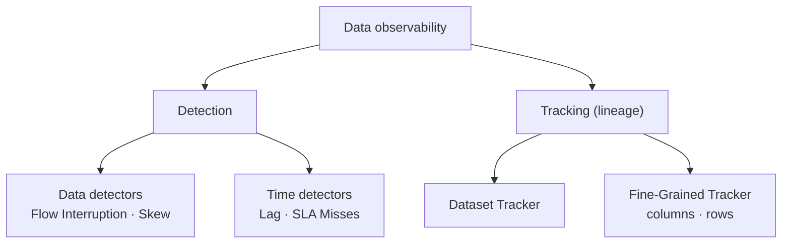
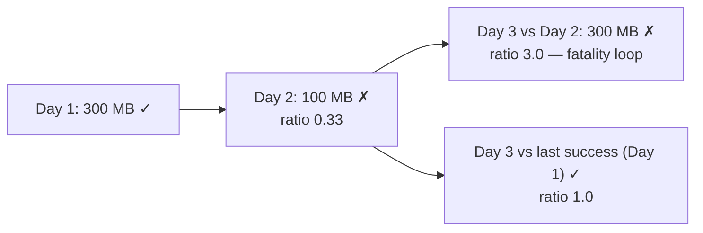
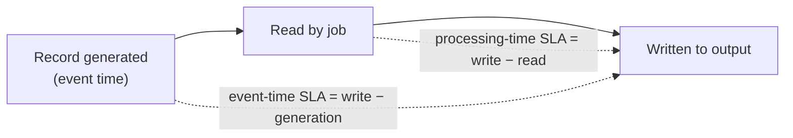

# فصل ۱۰: الگوهای طراحی observability داده

[فصل ۹: الگوهای طراحی کیفیت داده →](09-data-quality-design-patterns.md) · [کتاب](../README.md)

## خلاصه

الگوهای کیفیت داده روی خود داده تمرکز دارند و مسئله‌های دور و برش را نمی‌بینند. یک job از جنس AWAP که هیچ‌وقت اجرا نمی‌شود، چون جریانی upstreamی ایستاده، هیچ چیزی را تشخیص نمی‌دهد (p. 305). الگوهای observability، monitoring و هشدار اضافه می‌کنند و روی دو ستون ساخته می‌شوند: **تشخیص** و **ردیابی**.

**الگوهای detector داده** خود داده را بررسی می‌کنند:

- الگوی **Flow Interruption Detector** وقتی داده دیگر نمی‌رسد هشدار می‌دهد. می‌تواند بی‌داده بودن هر واحد زمان، یا فاصله‌ی بیش از اندازه بی داده، یا کهنگی metadata یا داده یا ذخیره‌سازی را بپاید.
- الگوی **Skew Detector** حجم را بین اجراها مقایسه می‌کند، یا پخش شدن بین پارتیشن‌ها را با `STDDEV/AVG`، تا pipeline مجموعه‌داده‌ی نیمه‌خالی پردازش نکند.

**الگوهای detector زمان** تأخیر را بررسی می‌کنند:

- الگوی **Lag Detector** می‌سنجد consumer چقدر از تأمین‌کننده‌اش عقب است، با تجمیع MAX و صدک‌ها و هیچ‌وقت میانگین.
- الگوی **SLA Misses Detector** زمان اجرا را با یک سقف بررسی می‌کند، در زمان پردازش و جدا در زمان رویداد.

**مفهوم lineage داده** نشان می‌دهد چه کسی به چه کسی وابسته است:

- الگوی **Dataset Tracker** شجره‌نامه‌ای از جدول‌ها و topicها و pipelineها می‌سازد، یا مدیریت‌شده با Unity Catalog و Dataplex، یا خود‌ساخته با OpenLineage و Marquez.
- الگوی **Fine-Grained Tracker** تا سطح ستون، از نقشه‌ی اجرا، و ردیف، با headerهای lineage، پایین می‌رود.

## نکته‌های کلیدی

- **یک job که بی شکست اجرا می‌شود باز هم می‌تواند هیچ چیزی تحویل ندهد.** داده‌ی غایب را تشخیص بدهید و منتظر شکایت consumerها نمانید (p. 306).
- **جریان‌های نامنظم به تشخیص پنجره‌ای نیاز دارند.** هشدار دادن سر هر دقیقه‌ی خالی، مثبت کاذب و خستگی از هشدار می‌سازد (pp. 306–307).
- **هر فایل تازه داده‌ی تازه نیست.** عملیات compaction بی اضافه کردن رکورد فایل می‌سازد، و تغییر schema زمان تغییر را به‌روز می‌کند (pp. 308–309).
- **بررسی نامتوازنی روز‌به‌روز می‌تواند خودش را در حلقه حبس کند.** بعد از یک روز بد، روز خوب بعدی سه برابر بزرگ‌تر از لازم به نظر می‌آید. به‌جایش با آخرین اجرای *موفق* مقایسه کنید (p. 312).
- **میانگین lag را پنهان می‌کند.** برای lagهای ۱۰ و ۵ و ۳۰ و ۲ و ۳ و ۵ و ۳ ثانیه‌ای پارتیشن‌ها، میانگین ۸ ثانیه است ولی P90 برابر ۱۸ ثانیه (p. 315).
- **مقدار lag و SLA مکمل هم‌اند.** consumerی که خودش را throttle می‌کند می‌تواند SLA را رعایت کند در حالی که lag بزرگ می‌شود، و یک job batch روزانه می‌تواند lag نداشته باشد ولی SLA را از دست بدهد (p. 318).
- **ساختار lineage می‌گوید از چه کسی بپرسید.** lineage مدیریت‌شده فقط بوم‌سازگان خودش را می‌بیند، و کد سفارشی برای lineage ستونی مات است (pp. 324, 327).

## فهرست بخش‌ها

*از فهرست مطالب خود کتاب، از bookmarkهای PDF؛ شماره‌ها صفحه‌ی چاپی‌اند.*

- بخش detectorهای داده — p. 306
  - الگو: Flow Interruption Detector — p. 306
  - الگو: Skew Detector — p. 310
- بخش detectorهای زمان — p. 314
  - الگو: Lag Detector — p. 314
  - الگو: SLA Misses Detector — p. 317
- ردگیری lineage داده — p. 321
  - الگو: Dataset Tracker — p. 321
  - الگو: Fine-Grained Tracker — p. 325
- خلاصه — p. 328

## یادداشت‌ها

واژه‌ی observability شاید مثل «کارهایی که تیم operations باید بکند» به گوش بیاید، ولی مهندس‌های داده هم به آن نیاز دارند (pp. 305–306). **تشخیص** مسئله‌های داده یا زمان را می‌بیند، مثل جریانی ایستاده یا job batchی که زیادی طول می‌کشد. **ردیابی** رابطه‌های بین مجموعه‌داده‌ها و ستون‌ها و jobهای پردازش را نقشه می‌کند، که در سازمان‌های بزرگ اغلب از چند تیم رد می‌شوند (p. 305).

### الگوهای detector داده

#### الگو: Flow Interruption Detector (pp. 306–310)

**مسئله.** یک job streaming داده را با یک ذخیره‌سازی object synchronous می‌کند که به jobهای batch تیم‌های زیادی می‌خوراند. بعد از هفت ماه، رکوردها را پردازش می‌کرد ولی نوشتنشان را قطع کرده بود. شکست نخورد، و فقط وقتی فهمیدید که consumerی شکایت کرد (p. 306).

**راه‌حل** (pp. 306–308): برای streaming (شکل ۱۰-۱):

*Figure 10-1 (p. 307): ایست کامل آسان دیده می‌شود، ولی چکه‌های نامنظم به یک آستانه روی یک پنجره‌ی زمانی نیاز دارند.*

| حالت تحویل | تشخیص |
|---|---|
| **پیوسته** | وقتی در یک واحد زمان، مثلاً یک دقیقه، هیچ نقطه‌داده‌ای نیامد هشدار بدهید |
| **نامنظم** | وقتی دوره‌ی بی‌داده از پنجره‌ی پذیرفته‌شده، مثلاً پنج دقیقه، بیشتر شد هشدار بدهید. هشدار دقیقه‌به‌دقیقه مثبت کاذب و خستگی از هشدار می‌داد |

برای pipelineهای batch و داده‌ی در حال سکون، تازگی را در یکی از سه لایه بررسی کنید:

| لایه | چطور | نکته |
|---|---|---|
| **metadata** | زمان آخرین تغییر در برابر یک آستانه، مثلاً جدولی ساعتی که بیشتر از یک ساعت دست‌نخورده مانده | ارزان‌ترین |
| **داده** | یک ستون زمان تغییر، یا شمار ردیف در هر دوره؛ شمار دست‌نخورده در دو ساعت پشت سر هم یعنی قطعی | ذخیره‌سازی برای شمارش‌های گذشته می‌خواهد |
| **ذخیره‌سازی** | زمان آخرین فایل نوشته‌شده | با هر فرمت فایلی کار می‌کند |

**پیامدها** (pp. 308–309):

- **آستانه.** شرط «دست‌کم یک رکورد در دقیقه» آسان گذاشته می‌شود ولی برای جریان‌های پرحجم واقع‌بینانه نیست. آستانه‌هایی که از حجم گذشته یاد گرفته می‌شوند وقتی مثلاً یک کمپین بازاریابی فعالیت را عوض می‌کند مثبت کاذب می‌دهند.
- **مفهوم metadata.** ممکن است نباشد، و زمان تغییر با تکامل schema هم عوض می‌شود که هیچ رکوردی اضافه نمی‌کند.
- **مثبت کاذب ذخیره‌سازی.** عملیات compaction فایل تازه می‌نویسد بی داده‌ی تازه.

**نمونه‌ها** (pp. 309–310):

- **سیستم Kafka با Prometheus و Grafana.** عبارت `sum without(instance)(rate(kafka_server_brokertopicmetrics_messagesin_total{topic="visits"}[1m]))` را حساب کنید و بعد در Grafana وقتی پنج مقدار آخر صفرند هشدار بدهید.
- **سیستم PostgreSQL.** با روشن بودن `track_commit_timestamp`، روی `NOW() - MAX(pg_xact_commit_timestamp(xmin))` هشدار بدهید.
- **مفهوم metric فرستاده‌ی producer.** یک writer در Delta Lake بعد از هر نوشتن یک gauge به نام `visits_last_update_time` به Prometheus Pushgateway می‌فرستد.

#### الگو: Skew Detector (pp. 310–313)

**مسئله.** حالا که قطعی جریان تشخیص داده می‌شود، consumerها باز شکایت می‌کنند. job شما درست اجرا شد ولی روی مجموعه‌داده‌ای نیمه‌خالی، چون تأمین‌کننده مسئله‌ی تولید داشت (p. 310).

**راه‌حل** (pp. 310–311): در این کتاب، نامتوازنی به‌معنای **حجم‌های مختلف داده در اجراهای پشت سر هم** هم هست، نه فقط taskهای نامتوازن. سه مرحله می‌برد:

۱. **پنجره‌ی مقایسه** را انتخاب کنید، مثلاً امروز در برابر دیروز.
۲. یک **آستانه‌ی تحمل** بگذارید. روی پنجاه درصد، job بین پنجاه درصد کمتر و پنجاه درصد بیشتر داده را می‌پذیرد. بر پایه‌ی تغییر مشاهده‌شده بگذاریدش یا از کاربرهای کسب‌وکار بپرسید.
۳. نامتوازنی را به یکی از دو شکل حساب کنید:

- اختلاف درصدی **پنجره به پنجره**، برای jobهای batch یا برای پنجره‌های زمان پردازش و زمان رویداد در streaming.
- **نسبت انحراف معیار**، یعنی `STDDEV(x)/AVG(x)`، برای ذخیره‌سازی‌های پارتیشن‌بندی‌شده مثل یک topic کافکا یا یک جدول PostgreSQL.

الگوی Skew Detector در مرحله‌ی audit اول AWAP جا می‌گیرد، جایی که مجموعه‌داده‌های جزئی را می‌بندد (p. 311).

**پیامدها** (pp. 311–312):

- **فصلی بودن.** کمپین‌ها و فصل‌ها حجم را عوض می‌کنند. با دانش کسب‌وکار فرمول را بنویسید و استثنا اضافه کنید.
- **ارتباط.** با دپارتمان‌های دیگر هماهنگ شوید تا مثبت کاذب را پیش‌بینی کنید.
- **حلقه‌ی مرگ.** داده‌ی یک روز سه برابر کوچک‌تر است و بررسی را شکست می‌دهد. اگر تا روز بعد درست نشود، مجموعه‌داده‌ی معتبر بعدی سه برابر بزرگ‌تر از لازم به نظر می‌آید. از تأمین‌کننده بخواهید درستش کند، یا با مجموعه‌داده‌ی **آخرین اجرای موفق** مقایسه کنید، که در این نمونه دو روز پیش است.

*تصویر vault از نمونه‌ی کتاب (p. 312). حجم‌ها ساختگی‌اند و کتاب فقط می‌گوید «سه برابر کوچک‌تر».*

> **Run it:** [آزمایش detector نامتوازنی و lag](../lab/10-skew-and-lag/README.md) در vault یک روز بد را با هر دو مبنا دوباره اجرا می‌کند و نمونه‌ی میانگین در برابر P90 کتاب را حساب می‌کند.

**نمونه‌ها** (pp. 312–313):

- **پارتیشن‌های PostgreSQL.** عبارت `(STDDEV(n_live_tup) / AVG(n_live_tup)) * 100` از `pg_stat_user_tables` روی پارتیشن‌های `visits_all_range_%`.
- **سیستم Kafka در Prometheus.** عبارت `stddev(sum(kafka_log_size{topic='visits'}) by (partition)) / avg(kafka_log_size{topic='visits'}) * 100`.
- **سیستم Airflow.** بعد از sensor یک Readiness Marker، task به نام `compare_volumes` اندازه‌ی فایل فعلی را بر اجرای قبلی تقسیم می‌کند و اگر نسبت از ۱٫۵ بیشتر یا از ۰٫۵ کمتر بود شکست می‌خورد.

> **In practice:** alert روی «صفر ردیف» کافی نیست: منبعی که نیمه‌کاره بار شده صفر نمی‌شود.
>
> **Your turn:** چه metricی در Prometheus می‌گذارید تا هم قطع جریان و هم skew را ببیند؟
>
> *Answer:* شمار ردیف هر load به تفکیک جدول. alert اول وقتی چند اجرای پشت‌سرهم صفر باشند؛ alert دوم وقتی شمار با همان ساعت هفته‌های قبل خیلی فرق کند، مثلاً کمتر از نصف. دومی همان Skew Detector است که آستانه را نسبت به اجراهای قبلی می‌گذارد (pp. 306–313).

### الگوهای detector زمان

#### الگو: Lag Detector (pp. 314–317)

**مسئله.** یک هفته پیش یک job streaming شروع کرد سی درصد داده‌ی بیشتر بگیرد. اعلامش را ندیدید و حالا consumerی از تحویل کندتر شکایت دارد. پیش از مقیاس دادن، بسنجید consumer چقدر تند عقب نمی‌افتد (p. 314).

**راه‌حل** (pp. 314–315): یک **واحد lag** انتخاب کنید، مثل موقعیت یا append time یک رکورد کافکا، یا شمار commit در Delta Lake، یا timestamp یک پارتیشن. بعد `lag = last_available_unit − last_processed_unit` را حساب کنید. ذخیره‌سازی‌های پارتیشن‌بندی‌شده برای هر پارتیشن یک lag می‌دهند، پس تجمیعشان کنید:

- مقدار **MAX** بدترین پارتیشن را نشان می‌دهد.
- **صدک‌ها** مثل P90 و P95 نشان می‌دهند بیشتر پارتیشن‌ها چطورند. مقدار P90 برابر ده ثانیه یعنی نود درصد پارتیشن‌ها حداکثر ده ثانیه عقب‌اند.
- ترکیب هر دو، هم تأخیر کلی را می‌پوشاند و هم بدترین حالت را.

**تله‌ی میانگین** (p. 315):

| lag پارتیشن‌ها، به ثانیه | میانگین | P90 |
|---|---|---|
| ۱۰، ۵، ۳۰، ۲، ۳، ۵، ۳ | ۸ | ۱۸ |

**پیامدها** (p. 315): **نامتوازنی داده**. مقدار MAX بد می‌تواند از یک پارتیشن پربار بیاید و نه از consumerی کند. با توزیع بهتر داده سر نوشتن درستش کنید.

**نمونه‌ها** (pp. 315–317):

- **سیستم Kafka.** یک `StreamingQueryListener.onQueryProgress` در Spark مقدار `endOffset` هر micro-batch را برای هر پارتیشن با جدید‌ترین offsetهای topic مقایسه می‌کند. یک gauge به نام `visits_reader_lag` با برچسب پارتیشن می‌فرستد.
- **سیستم Delta Lake.** یک job زمان‌بندی‌شده با `trigger(availableNow=True)` مقدار `lastProgress[…]["endOffset"]["reservoirVersion"]` را به‌عنوان `visits_reader_version` خبر می‌دهد. تأمین‌کننده `MAX(version)` را از `DESCRIBE HISTORY` خبر می‌دهد و هشدار روی اختلافشان راه می‌افتد.

#### الگو: SLA Misses Detector (pp. 317–321)

**مسئله.** یک job batch که ساعت ۶ صبح زمان‌بندی شده باید ظرف **چهل دقیقه** تمام شود، چون pipelineهای حیاتی downstream آمار را پیش از ۸ صبح منتشر می‌کنند. وقتی طولانی‌تر اجرا شد باید خبر بگیرید (p. 317).

**راه‌حل** (p. 318): زمان پردازش را با بیشینه‌ی مجاز مقایسه کنید:

- **مفهوم batch:** زمان پایان منهای زمان شروع.
- **مفهوم micro-batch یا streaming پنجره‌ای:** همان محاسبه برای هر تکرار.
- **مفهوم streaming رکورد‌به‌رکورد:** زمان نوشتن منهای زمان خواندن هر رکورد، با تجمیع MAX یا صدک‌ها و جمع شدن با Online یا Offline Observer.

مقدار lag و از دست رفتن SLA همیشه با هم نمی‌آیند:

| موقعیت | lag | SLA |
|---|---|---|
| consumer throughput را throttle می‌کند در حالی که یک پارتیشن نامتوازن است | مدام بزرگ می‌شود | رعایت می‌شود |
| job batch روزانه‌ای که زیادی طول می‌کشد | در شروع ندارد | از دست می‌رود |

**پیامدها** (p. 319): **late data و زمان رویداد**. یک SLA زمان‌رویدادی، یعنی زمان نوشتن منهای زمان ساخته شدن، می‌تواند بشکند چون تأمین‌کننده‌ای آفلاین داده را بافر کرده، که تقصیر شما نیست. یک SLA زمان‌پردازشی، یعنی زمان نوشتن منهای زمان خواندن، اثر نمی‌گیرد. این دو را جدا بپایید (شکل ۱۰-۲).

*بر پایه‌ی شکل ۱۰-۲ (p. 319).*

**نمونه‌ها** (pp. 319–321):

- **سیستم Airflow.** دکوراتور `@task(sla=datetime.timedelta(seconds=10))`. در Airflow نسخه‌ی **۲٫۱۰٫۲**، مقدار SLA از شروع *pipeline* شمرده می‌شود و نه از شروع task: برای اجرای ۸:۰۰، `processing_task_2` اگر بعد از ۰۸:۰۰:۱۰ شروع شود دیر است. بازسازی SLA با AIP-57 برای Airflow نسخه‌ی ۳٫۱ برنامه‌ریزی شده.
- **دو job در Flink.** اولی به هر رکورد `start_processing_time_unix_ms` اضافه می‌کند. دومی آن را از metadata به نام `append_time` در Kafka کم می‌کند و صدک‌ها را روی پنجره‌های tumbling یک‌دقیقه‌ای زمان رویداد منتشر می‌کند.

> **In practice:** freshness در stack ما همان lag است: `now() - max(update_date)` در هر جدول Bronze.
>
> **Your turn:** SLA داشبورد مدیریت «داده تا ساعت ۹ صبح» است. alert را روی چه می‌گذارید؟
>
> *Answer:* روی SLA miss، پیش از نقض: اگر DAG تا ۸:۳۰ تمام نشده، alert بدهد. lag را هم جدا داشته باشید تا بفهمید داده‌ی منبع دیر است یا pipeline؛ کتاب این دو را دو الگوی جدا می‌داند (pp. 314–321).

### ردگیری lineage داده

وقتی مسئله‌ی تشخیص‌داده‌شده تقصیر شما نیست، باید بدانید از چه کسی بپرسید. شجره‌نامه‌ای از مجموعه‌داده‌هایتان بسازید (p. 321).

#### الگو: Dataset Tracker (pp. 321–325)

**مسئله.** job batch شما مدام شکست می‌خورد چون نوع یک فیلد در طول زمان عوض شده. تأمین‌کننده‌ی شما هم آن مجموعه‌داده را نمی‌سازد و داده‌ی تیم دیگری را پردازش می‌کند. پیدا کنید کدام تیم ناسازگاری را وارد می‌کند (p. 321).

**راه‌حل** (pp. 321–323): درختی از وابستگی جدول‌ها و پوشه‌ها و topicها و صف‌ها بسازید، با یادداشت تیم مالکشان (شکل ۱۰-۳، که به سازمانی data mesh شبیه است). دو پیاده‌سازی هست:

| | کامل مدیریت‌شده | خود‌ساخته |
|---|---|---|
| چطور | سرویس، jobها و جدول‌ها و داشبوردها را برایتان تحلیل می‌کند | ورودی و خروجی هر کوئری و task و pipeline را به یک سرویس lineage خبر بدهید و بعد تجسمشان کنید (شکل ۱۰-۴) |
| کجا | Databricks Unity Catalog؛ و **Dataplex** در GCP برای BigQuery و Dataproc | **لایه‌ی زمان‌بندی**، مثل Airflow با OpenLineage که وابستگی‌ها را خودکار تشخیص می‌دهد، یا **لایه‌ی دیتابیس**، یعنی تجزیه‌ی کوئری‌های اجراشده مثل `SELECT … FROM orders o JOIN users u …` به درخت |
| محدودیت | فقط jobهای پشتیبانی‌شده؛ Dataplex، jobهای بار‌گذاری BigQuery را می‌پوشاند ولی BigQuery Data Transfer Service را نه | تلاش بیشتر |

**پیامدها** (p. 324): **گیر افتادن در vendor**، چون lineage مدیریت‌شده فقط سرویس‌های خودش را می‌بیند و جای دیگر نمای جزئی می‌دهد. **کار سفارشی**، چون schedulerها ورودی و خروجی را فقط برای نوع taskهای آماده استنتاج می‌کنند.

**نمونه‌ها** (pp. 324–325):

- **سیستم Airflow.** مقدار `OPENLINEAGE_URL=http://localhost:5000` را بگذارید و `apache-airflow-providers-openlineage` را نصب کنید. operatorهایی مثل `PostgresOperator` آن‌وقت lineage را خودکار خبر می‌دهند، که در interface **Marquez** دیدنی است (شکل ۱۰-۵).
- **سیستم Spark.** تنظیم `spark.extraListeners = io.openlineage.spark.agent.OpenLineageSparkListener` با transport از جنس HTTP و namespace به نام `visits` و بسته‌ی `openlineage-spark_2.12:1.21.1`.

#### الگو: Fine-Grained Tracker (pp. 325–328)

**مسئله.** یک جدول غیر‌نرمال در سه سال از **سی** ستون گذشته، و اعضای تازه‌ی تیم مدام می‌پرسند کدام ستون‌های upstreamی به هر کدام می‌خورانند (p. 325).

**راه‌حل** (pp. 325–326):

- **سطح ستون، مدیریت‌شده:** جدول `system.access.column_lineage` در Databricks Unity Catalog و **Purview** در Azure.
- **سطح ستون، خود‌ساخته:** روی نقشه‌ی اجرای کوئری قدم بزنید. در `SELECT CONCAT(u.first_name, d.delivery_address) AS user_with_address FROM users u JOIN addresses d …`، ستون `user_with_address` به `users.first_name` و `addresses.delivery_address` وابسته است (شکل ۱۰-۶). ابزار OpenLineage از Spark بومی پشتیبانی می‌کند.
- **سطح ردیف:** ثبت کنید هر ردیف را کدام job ساخته، به‌عنوان یک ویژگی یا ستون اضافه، یعنی همان الگوهای تزئین داده.

*Figure 10-6 (p. 326): ساختار lineage ستونی از نقشه‌ی کوئری خوانده می‌شود، یعنی هر ستون خروجی به کدام ستون‌های ورودی وابسته است.*

**پیامدها** (p. 327):

- **کد سفارشی.** توابع mapping برنامه‌نویسی‌شده برای ابزارهای lineage جعبه‌های مات‌اند.
- **تجسم سطح ردیف.** ابزارهای کلاسیک lineage سطح ردیف را نشان نمی‌دهند، پس لایه‌ی کوئری خودش را می‌خواهد.
- **مدیریت تکامل.** lineage ستونی باید دنبال کند که تبدیل‌ها در طول زمان چطور عوض می‌شوند.

**نمونه‌ها** (pp. 327–328): job به نام `visits_decorator_job` در header های کافکا `job_version` و `job_name` و `batch_version` را می‌نویسد. job به نام `visits_reducer_job` همان headerها را به‌علاوه‌ی `parent_lineage` می‌نویسد، که headerهای upstreamی را به‌عنوان JSON دارد، پس هر ردیفی را می‌شود تا منبعش ردیابی کرد.

> **In practice:** trace در OpenTelemetry یک run را دنبال می‌کند و lineage یک جدول را؛ هر دو برای پیدا کردن ریشه‌ی خطا لازم‌اند.
>
> **Your turn:** ستونی در Gold غلط است. چطور می‌فهمید از کدام جدول Bronze آمده؟
>
> *Answer:* با lineage در سطح dataset: اگر DAGها inlet و outlet خود را اعلام کنند، Airflow با OpenLineage گراف جدول‌ها را می‌سازد، و dbt هم این گراف را از `ref()` درمی‌آورد. Dataset Tracker کتاب برای همین پرسش است (pp. 321–325).

### خلاصه

الگوهای این فصل این‌هایند:

- الگوی Flow Interruption Detector، برای پیوستگی داده؛
- الگوی Skew Detector، برای کامل بودن، به‌خصوص در jobهای batch با حجم‌های همگون؛
- الگوی Lag Detector، برای jobهای streaming که عقب می‌افتند؛
- الگوی SLA Misses Detector، برای سقف زمان هر task؛
- الگوی Dataset Tracker، برای گراف سراسری وابستگی؛
- الگوی Fine-Grained Tracker، برای جزئیات ستون و ردیف (pp. 328–329).

کتاب بعد با یک پس‌گفتار (p. 331) و یک پیوست که همه‌ی الگوها را خلاصه می‌کند (p. 333) تمام می‌شود.

## بده‌بستان‌ها در یک نگاه

| الگو | چه چیزی را تشخیص می‌دهد | دام اصلی |
|---|---|---|
| Flow Interruption Detector | نبود داده‌ی تازه | آستانه‌ها؛ مثبت کاذب metadata و compaction |
| Skew Detector | حجم غیرمنتظره یا نامتوازنی پارتیشن | فصلی بودن؛ حلقه‌ی مرگ |
| Lag Detector | عقب بودن consumer از تأمین‌کننده | پارتیشن نامتوازن MAX را باد می‌کند؛ میانگین lag را پنهان می‌کند |
| SLA Misses Detector | اجرا یا رکورد زیادی کند | late data در SLAهای زمان‌رویدادی |
| Dataset Tracker | چه کسی چه چیزی را می‌سازد و مصرف می‌کند | گیر افتادن در vendor؛ taskهای سفارشی |
| Fine-Grained Tracker | خاستگاه ستون و ردیف | کد سفارشی مات؛ lineage ردیفی لایه‌ی خودش را می‌خواهد |

## فراتر از کتاب

- مقدار P90 برابر ۱۸ ثانیه در کتاب از درون‌یابی خطی بین مقدارهای مرتب‌شده می‌آید. صدک با رتبه‌ی نزدیک‌ترین، روی هفت مقدار، به‌جایش ۳۰ ثانیه می‌دهد. هر طور که باشد، خیلی بالاتر از میانگین هشت‌ثانیه‌ای است. آزمایش پایین هر دو را چاپ می‌کند.
- پروژه‌ی OpenLineage زیر Linux Foundation است، یعنی LF AI & Data، و Marquez پیاده‌سازی مرجعش.

## پیوندها

- **Run it:** [detectorهای نامتوازنی و lag](../lab/10-skew-and-lag/README.md) حلقه‌ی مرگ را با مبنای روز قبل و اصلاحش را با مبنای آخرین اجرای موفق نشان می‌دهد، به‌علاوه‌ی lag میانگین در برابر صدکی.
- **فصل‌های مرتبط:**
  - [فصل ۲: ورود داده](02-data-ingestion-design-patterns.md): الگوهای Readiness Marker و Compactor.
  - [فصل ۵: ارزش داده](05-data-value-design-patterns.md): الگوهای تزئین داده.
  - [فصل ۷: امنیت داده](07-data-security-design-patterns.md): پیچیدگی کوئری در Vertical Partitioner.
  - [فصل ۸: ذخیره‌سازی داده](08-data-storage-design-patterns.md): الگوی Denormalizer و نامتوازنی Horizontal Partitioner.
  - [فصل ۹: کیفیت داده](09-data-quality-design-patterns.md): الگوهای AWAP و Online و Offline Observer و Schema Migrator.

## خودتان را بسنجید

*پرسش‌ها و پاسخ‌ها مال vault است و از روی یادداشت‌های بالا نوشته شده؛ پاسخ‌ها به صفحه‌های کتاب ارجاع می‌دهند.*

1. **داده در فوران می‌آید و فاصله‌های معمولی تا پنج دقیقه دارد. کدام حالت تشخیص می‌خورد؟**
   - [ ] هشدار سر هر دقیقه‌ی بی‌رکورد
   - [x] هشدار وقتی پنجره‌ی بی‌داده از مدت پذیرفته‌شده بیشتر شود
   - [ ] هشدار فقط روی زمان تغییر فایل

   *Answer:* تحویل نامنظم به تشخیص پنجره‌ای نیاز دارد. هشدار دقیقه‌به‌دقیقه مثبت کاذب و خستگی از هشدار می‌ساخت (pp. 306–307).

2. **چرا detector جریان ذخیره‌سازی‌محور را compaction می‌تواند گول بزند؟**

   *Answer:* عملیات compaction با merge بلوک‌های موجود فایل تازه می‌نویسد. ذخیره‌سازی فعالیت نشان می‌دهد، ولی داده‌ی تازه‌ای نرسیده (p. 309).

3. **ورودی روز دوم سه برابر کوچک‌تر است و بررسی نامتوازنی را شکست می‌دهد. کسی درستش نمی‌کند. روز سوم چه می‌شود و چطور از آن بپرهیزیم؟**

   *Answer:* در مقایسه با روز دوم، حجم معمولی روز سوم سه برابر بزرگ‌تر از لازم به نظر می‌آید و آن هم شکست می‌خورد، یعنی حلقه‌ی مرگ. به‌جایش با آخرین اجرای موفق مقایسه کنید (p. 312).

4. **مقدار lag پارتیشن‌ها ۱۰ و ۵ و ۳۰ و ۲ و ۳ و ۵ و ۳ ثانیه است. کدام خلاصه گمراه‌کننده‌ترین است؟**
   - [x] میانگین، یعنی ۸ ثانیه
   - [ ] مقدار P90، یعنی ۱۸ ثانیه
   - [ ] مقدار MAX، یعنی ۳۰ ثانیه

   *Answer:* میانگین پارتیشن‌های کند را پنهان می‌کند. صدک‌ها برای lag مربوط‌ترند (p. 315).

5. **یک consumer خودش را روی حجم ثابتی در هر اجرا throttle می‌کند در حالی که یک پارتیشن نامتوازن است. کدام detector می‌فهمد؟**

   *Answer:* الگوی Lag Detector، چون lag مدام بزرگ می‌شود. الگوی SLA Misses Detector می‌بیند اجراها سر وقت تمام می‌شوند (p. 318).

6. **چرا SLA زمان پردازش و زمان رویداد را جدا کنیم؟**

   *Answer:* late data از تأمین‌کننده‌ای قطع‌شده می‌تواند SLA زمان‌رویدادی را بی هیچ تقصیری از job شما بشکند، در حالی که SLA زمان‌پردازشی فقط سرعت job خودتان را می‌سنجد (p. 319).
