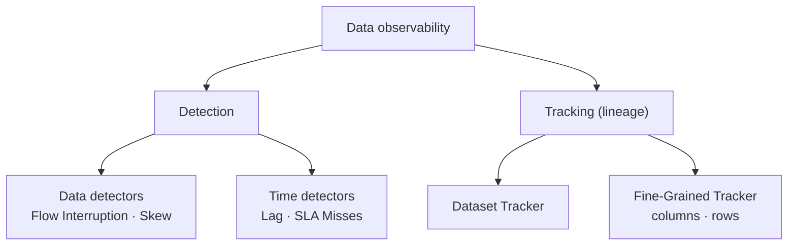
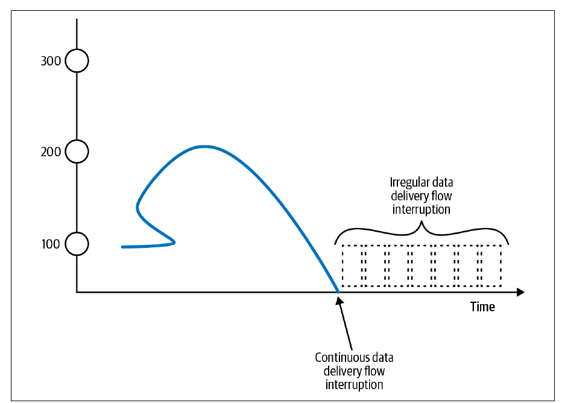
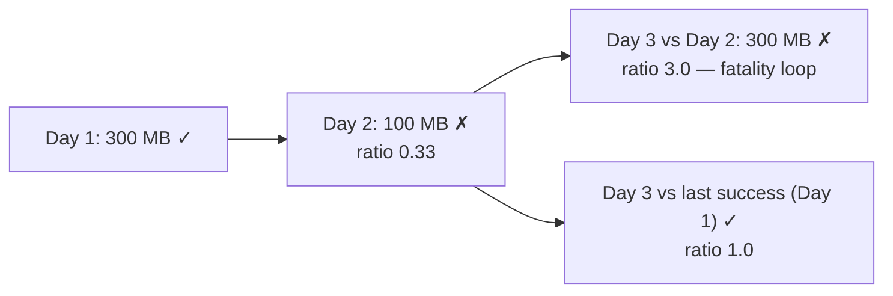
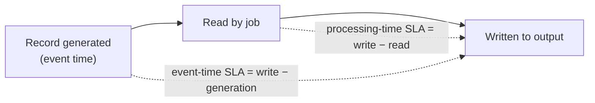
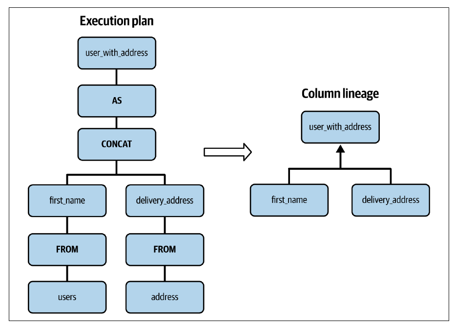

# 10. Data Observability Design Patterns

[← 9. Data Quality Design Patterns](09-data-quality-design-patterns.md) · [Book](../README.md)

## Summary

Data quality patterns focus on the data itself and miss problems around it. An AWAP job that never runs because an upstream flow stopped detects nothing (p. 305). Observability patterns add monitoring and alerting, built on two pillars: **detection** and **tracking**.

**Data detectors** check the data:

- The **Flow Interruption Detector** alerts when data stops arriving. It can watch for no data per time unit, an over-long gap without data, or stale metadata, data or storage.
- The **Skew Detector** compares volumes between runs, or the spread across partitions (`STDDEV/AVG`), so a pipeline doesn't process a half-empty dataset.

**Time detectors** check latency:

- The **Lag Detector** measures how far a consumer trails its producer, aggregated with MAX and percentiles — never the average.
- The **SLA Misses Detector** checks execution time against a limit, in processing time and, separately, in event time.

**Data lineage** shows who depends on whom:

- The **Dataset Tracker** builds a family tree of tables, topics and pipelines, either managed (Unity Catalog, Dataplex) or self-built (OpenLineage, Marquez).
- The **Fine-Grained Tracker** goes down to columns (from the execution plan) and rows (lineage headers).

## Key takeaways

- **A job that runs without failing can still deliver nothing.** Detect missing data instead of waiting for consumers to complain (p. 306).
- **Irregular flows need windowed detection.** Alerting on every empty minute causes false positives and alarm fatigue (pp. 306–307).
- **Not every new file is new data.** Compaction creates files without adding records, and schema changes update the modification time (pp. 308–309).
- **A day-to-day skew check can lock itself in a loop.** After one bad day, the next good day looks three times too big. Compare with the last *successful* run instead (p. 312).
- **Averages hide lag.** For partition lags of 10, 5, 30, 2, 3, 5 and 3 seconds, the average is 8 s but P90 is 18 s (p. 315).
- **Lag and SLA are complementary.** A throttled consumer can meet its SLA while lag grows, and a daily batch job can have no lag yet miss its SLA (p. 318).
- **Lineage tells you whom to ask.** Managed lineage only sees its own ecosystem, and custom code is opaque to column lineage (pp. 324, 327).

## Section outline

*From the book’s own table of contents (PDF bookmarks); printed page numbers.*

- Data Detectors — p. 306
  - Pattern: Flow Interruption Detector — p. 306
  - Pattern: Skew Detector — p. 310
- Time Detectors — p. 314
  - Pattern: Lag Detector — p. 314
  - Pattern: SLA Misses Detector — p. 317
- Data Lineage — p. 321
  - Pattern: Dataset Tracker — p. 321
  - Pattern: Fine-Grained Tracker — p. 325
- Summary — p. 328

## Notes

Observability may sound like “things the operations team should do”, but data engineers need it too (pp. 305–306). **Detection** spots problems with data or time, such as a stopped flow or a batch job that runs too long. **Tracking** maps the relationships among datasets, columns and processing jobs, which in large organizations often span teams (p. 305).

### Data detectors

#### Pattern: Flow Interruption Detector (pp. 306–310)

**Problem.** A streaming job syncs data to an object store that feeds many teams' batch jobs. After seven months it kept processing records but stopped writing them. It didn't fail, and you only found out when a consumer complained (p. 306).

**Solution** (pp. 306–308). For streaming (Figure 10-1):

*Figure 10-1 (p. 307): a full stop is easy to spot; irregular trickles need a threshold over a time window.*

| Delivery mode  | Detection                                                                                                                                  |
| -------------- | ------------------------------------------------------------------------------------------------------------------------------------------ |
| **Continuous** | Alert when no data points arrive in a time unit, e.g. one minute                                                                           |
| **Irregular**  | Alert when a no-data period exceeds the accepted window, e.g. five minutes. Per-minute alerts would give false positives and alarm fatigue |

For batch pipelines and data at rest, check freshness at one of three layers:

| Layer        | How                                                                                                                    | Note                          |
| ------------ | ---------------------------------------------------------------------------------------------------------------------- | ----------------------------- |
| **Metadata** | Last modification time against a threshold, e.g. an hourly table unchanged for more than one hour                      | Cheapest                      |
| **Data**     | A modification-time column, or row counts per period; unchanged counts over two consecutive hours mean an interruption | Needs storage for past counts |
| **Storage**  | Time of the last file written                                                                                          | Works with any file format    |

**Consequences** (pp. 308–309):

- **Threshold.** “At least one record per minute” is easy to set but unrealistic for high-volume flows. Thresholds learned from past volume give false positives when, say, a marketing campaign changes activity.
- **Metadata.** It may not exist, and modification times also change with schema evolution, which adds no records.
- **Storage false positives.** Compaction writes new files without new data.

**Examples** (pp. 309–310):

- **Kafka with Prometheus and Grafana.** Compute `sum without(instance)(rate(kafka_server_brokertopicmetrics_messagesin_total{topic="visits"}[1m]))`, then alert in Grafana when the last five values are zero.
- **PostgreSQL.** With `track_commit_timestamp` on, alert on `NOW() - MAX(pg_xact_commit_timestamp(xmin))`.
- **Producer-pushed metric.** A Delta Lake writer pushes a `visits_last_update_time` gauge to the Prometheus Pushgateway after each write.

#### Pattern: Skew Detector (pp. 310–313)

**Problem.** With flow interruptions now detected, consumers complain again. Your job ran correctly but on a half-empty dataset, because the provider had generation issues (p. 310).

**Solution** (pp. 310–311). In this book, skew also means **different data volumes in consecutive executions**, not only unbalanced tasks. It takes three steps:

1. Choose the **comparison window**, e.g. today vs yesterday.
2. Set a **tolerance threshold**. At 50%, the job accepts between 50% less and 50% more data. Base it on observed variation or ask business users.
3. Calculate the skew in one of two ways:
   - **Window-to-window** percentage difference, for batch jobs or for processing-time and event-time windows in streaming.
   - **Ratio of standard deviation**, `STDDEV(x)/AVG(x)`, for partitioned stores such as a Kafka topic or a PostgreSQL table.

The Skew Detector fits in AWAP's first audit step, where it blocks partial datasets (p. 311).

**Consequences** (pp. 311–312):

- **Seasonality.** Campaigns and seasons change volume. Use business knowledge to write the formula and add exceptions.
- **Communication.** Sync with other departments to anticipate false positives.
- **Fatality loop.** One day's data is three times smaller and fails the check. If it isn't fixed by the next day, the next valid dataset looks three times too large. Ask the producer to fix it, or compare with the dataset of the **most recent successful run** (two days ago in this example).

*The vault's illustration of the book's example (p. 312). The volumes are made up; the book only says “three times smaller”.*

> **Run it:** the vault's [skew and lag detector experiment](../lab/10-skew-and-lag/README.md) replays a bad day with both baselines and computes the book's average-vs-P90 lag example.

**Examples** (pp. 312–313):

- **PostgreSQL partitions.** `(STDDEV(n_live_tup) / AVG(n_live_tup)) * 100` from `pg_stat_user_tables` over the `visits_all_range_%` partitions.
- **Kafka in Prometheus.** `stddev(sum(kafka_log_size{topic='visits'}) by (partition)) / avg(kafka_log_size{topic='visits'}) * 100`.
- **Airflow.** After a Readiness Marker sensor, `compare_volumes` divides the current file size by the previous run's and fails if the ratio is `> 1.5` or `< 0.5`.

### Time detectors

#### Pattern: Lag Detector (pp. 314–317)

**Problem.** A week ago a streaming job started receiving 30% more data. You missed the announcement, and a consumer now complains about slower delivery. Before scaling, measure how fast the consumer keeps up (p. 314).

**Solution** (pp. 314–315). Pick a **lag unit**: a Kafka record position or append time, a Delta Lake commit number, or a partition timestamp. Then compute `lag = last_available_unit − last_processed_unit`. Partitioned stores give one lag per partition, so aggregate them:

- **MAX** shows the worst partition.
- **Percentiles (P90, P95)** show how most partitions do. A P90 of 10 s means 90% of partitions lag 10 s at most.
- Combining both covers overall latency and the worst case.

**The average trap** (p. 315):

| Partition lags (s)    | Average | P90 |
| --------------------- | ------- | --- |
| 10, 5, 30, 2, 3, 5, 3 | 8       | 18  |

**Consequences** (p. 315): **data skew**. A bad MAX may come from one overloaded partition rather than a slow consumer. Fix it by distributing data better when writing.

**Examples** (pp. 315–317):

- **Kafka.** A Spark `StreamingQueryListener.onQueryProgress` compares each micro-batch's `endOffset` per partition with the topic's latest offsets. It pushes a `visits_reader_lag` gauge labelled by partition.
- **Delta Lake.** A scheduled `trigger(availableNow=True)` job reports `lastProgress[…]["endOffset"]["reservoirVersion"]` as `visits_reader_version`. The producer reports `MAX(version)` from `DESCRIBE HISTORY`, and the alert fires on the difference.

#### Pattern: SLA Misses Detector (pp. 317–321)

**Problem.** A batch job scheduled at 6:00 a.m. must finish within **40 minutes**, because critical downstream pipelines publish statistics before 8:00 a.m. You need notifications when it runs longer (p. 317).

**Solution** (p. 318). Compare processing time with the maximum allowed:

- **Batch:** end time minus start time.
- **Micro-batch or windowed streaming:** the same calculation per iteration.
- **Per-record streaming:** write time minus read time for each record, aggregated with MAX or percentiles and collected with an Online or Offline Observer.

Lag and SLA misses don't always occur together:

| Situation                                                   | Lag           | SLA    |
| ----------------------------------------------------------- | ------------- | ------ |
| Consumer throttles throughput while one partition is skewed | Keeps growing | Met    |
| Daily batch job that runs too long                          | None at start | Missed |

**Consequences** (p. 319): **late data and event time**. An event-time SLA (write time minus generation time) can break because a producer buffered data offline, which isn't your fault. A processing-time SLA (write time minus read time) is unaffected. Monitor the two separately (Figure 10-2).

*After Figure 10-2 (p. 319).*

**Examples** (pp. 319–321):

- **Airflow.** `@task(sla=datetime.timedelta(seconds=10))`. In Airflow **2.10.2** the SLA counts from the *pipeline's* start, not the task's: for an 8:00 run, `processing_task_2` is late if it starts after 08:00:10. An SLA refactor (AIP-57) is planned for Airflow 3.1.
- **Two Flink jobs.** The first adds `start_processing_time_unix_ms` to each record. The second subtracts it from the Kafka `append_time` metadata and emits percentiles over one-minute tumbling event-time windows.

### Data lineage

When a detected issue isn't your fault, you need to know whom to ask. Build a family tree of your datasets (p. 321).

#### Pattern: Dataset Tracker (pp. 321–325)

**Problem.** Your batch job keeps failing because one field's type changed over time. Your provider doesn't generate that dataset either; it processes another team's data. Find which team introduces the inconsistency (p. 321).

**Solution** (pp. 321–323). Build a dependency tree of tables, folders, topics and queues, annotated with their owning teams (Figure 10-3, which resembles a data mesh organization). There are two implementations:

|       | Fully managed                                                                                     | Self-built                                                                                                                                                                                           |
| ----- | ------------------------------------------------------------------------------------------------- | ---------------------------------------------------------------------------------------------------------------------------------------------------------------------------------------------------- |
| How   | The service analyzes jobs, tables and dashboards for you                                          | Report each query's, task's or pipeline's inputs and outputs to a lineage service, then visualize them (Figure 10-4)                                                                                 |
| Where | Databricks Unity Catalog; GCP **Dataplex** for BigQuery and Dataproc                              | **Orchestration layer** (e.g. Airflow with OpenLineage detects dependencies automatically) or **database layer** (parse executed queries such as `SELECT … FROM orders o JOIN users u …` into trees) |
| Limit | Only supported jobs; Dataplex covers BigQuery loading jobs but not BigQuery Data Transfer Service | More effort                                                                                                                                                                                          |

**Consequences** (p. 324): **vendor lock**, since managed lineage sees only its own services and gives a partial view elsewhere. **Custom work**, since orchestrators infer inputs and outputs only for built-in task types.

**Examples** (pp. 324–325):

- **Airflow.** Set `OPENLINEAGE_URL=http://localhost:5000` and install `apache-airflow-providers-openlineage`. Operators such as `PostgresOperator` then report lineage automatically, viewable in the **Marquez** UI (Figure 10-5).
- **Spark.** `spark.extraListeners = io.openlineage.spark.agent.OpenLineageSparkListener`, with HTTP transport, namespace `visits` and package `openlineage-spark_2.12:1.21.1`.

#### Pattern: Fine-Grained Tracker (pp. 325–328)

**Problem.** A denormalized table has grown past **30** columns in three years, and new team members keep asking which upstream columns feed each one (p. 325).

**Solution** (pp. 325–326):

- **Column level, managed:** Databricks Unity Catalog's `system.access.column_lineage` table and Azure **Purview**.
- **Column level, self-built:** walk the query execution plan. In `SELECT CONCAT(u.first_name, d.delivery_address) AS user_with_address FROM users u JOIN addresses d …`, `user_with_address` depends on `users.first_name` and `addresses.delivery_address` (Figure 10-6). OpenLineage supports Spark natively.
- **Row level:** record which job produced each row, as an extra attribute or column (the data decoration patterns).

*Figure 10-6 (p. 326): column lineage is read off the query plan — which input columns each output column depends on.*

**Consequences** (p. 327):

- **Custom code.** Programmatic mapping functions are opaque boxes to lineage tools.
- **Row-level visualization.** Classical lineage tools don't show row-level lineage, so it needs its own query layer.
- **Evolution management.** Column lineage must track how transformations change over time.

**Examples** (pp. 327–328): `visits_decorator_job` writes Kafka headers `job_version`, `job_name` and `batch_version`. `visits_reducer_job` writes the same headers plus `parent_lineage`, which holds the upstream headers as JSON, so any row can be traced back to its source.

### Summary

The chapter's patterns are:

- the Flow Interruption Detector, for data continuity;
- the Skew Detector, for completeness, especially in batch jobs with homogeneous volumes;
- the Lag Detector, for streaming jobs that fall behind;
- the SLA Misses Detector, for per-task time limits;
- the Dataset Tracker, for the global dependency graph;
- the Fine-Grained Tracker, for column and row details (pp. 328–329).

The book then closes with an Afterword (p. 331) and an appendix summarizing all patterns (p. 333).

## Trade-offs at a glance

| Pattern                    | Detects                                  | Main pitfall                                        |
| -------------------------- | ---------------------------------------- | --------------------------------------------------- |
| Flow Interruption Detector | No new data                              | Thresholds; metadata and compaction false positives |
| Skew Detector              | Unexpected volume or partition imbalance | Seasonality; fatality loop                          |
| Lag Detector               | Consumer behind producer                 | Skewed partitions inflate MAX; averages hide lag    |
| SLA Misses Detector        | Runs or records too slow                 | Late data in event-time SLAs                        |
| Dataset Tracker            | Who produces and consumes what           | Vendor lock; custom tasks                           |
| Fine-Grained Tracker       | Column and row origins                   | Opaque custom code; row lineage needs its own layer |

## Beyond the book

- The book's P90 of 18 s comes from linear interpolation between the sorted values. A nearest-rank percentile over seven values gives 30 s instead. Either way, it's far above the 8-second average. The lab below prints both.
- OpenLineage is a Linux Foundation (LF AI & Data) project, and Marquez is its reference implementation.

## Connections

- **Run it:** [Skew and lag detectors](../lab/10-skew-and-lag/README.md) shows the fatality loop with a previous-day baseline and its fix with a last-successful baseline, plus average vs percentile lag.
- **Related chapters:**
  - [2. Data Ingestion](02-data-ingestion-design-patterns.md): Readiness Marker, Compactor.
  - [5. Data Value](05-data-value-design-patterns.md): data decoration patterns.
  - [7. Data Security](07-data-security-design-patterns.md): Vertical Partitioner query complexity.
  - [8. Data Storage](08-data-storage-design-patterns.md): Denormalizer, Horizontal Partitioner skew.
  - [9. Data Quality](09-data-quality-design-patterns.md): AWAP, Online and Offline Observer, Schema Migrator.

## Check yourself

*Questions and answers are the vault's, written from the notes above; answers cite the book's pages.*

1. **Data arrives in bursts with normal gaps of up to five minutes. What detection mode fits?**
   - [ ] Alert on any minute without records
   - [x] Alert when a no-data window exceeds the accepted duration
   - [ ] Alert on file modification time only

   *Answer:* Irregular delivery needs windowed detection. Per-minute alerts would cause false positives and alarm fatigue (pp. 306–307).

2. **Why can a storage-based flow detector be fooled by compaction?**

   *Answer:* Compaction writes new files by merging existing blocks. The storage shows activity, but no new data arrived (p. 309).

3. **Day 2's input is three times smaller and fails the skew check. Nobody fixes it. What happens on Day 3, and how do you avoid it?**

   *Answer:* Compared with Day 2, Day 3's normal volume looks three times too large and fails as well: a fatality loop. Compare with the most recent successful run instead (p. 312).

4. **Partition lags are 10, 5, 30, 2, 3, 5 and 3 seconds. Which summary is most misleading?**
   - [x] The average (8 s)
   - [ ] P90 (18 s)
   - [ ] MAX (30 s)

   *Answer:* The average hides the slow partitions. Percentiles are more relevant for lag (p. 315).

5. **A consumer throttles to a fixed volume per run while one partition is skewed. Which detector notices?**

   *Answer:* The Lag Detector, because lag keeps growing. The SLA Misses Detector sees runs finish on time (p. 318).

6. **Why separate processing-time and event-time SLAs?**

   *Answer:* Late data from a disconnected producer can break an event-time SLA through no fault of your job, while the processing-time SLA measures only your job's speed (p. 319).
