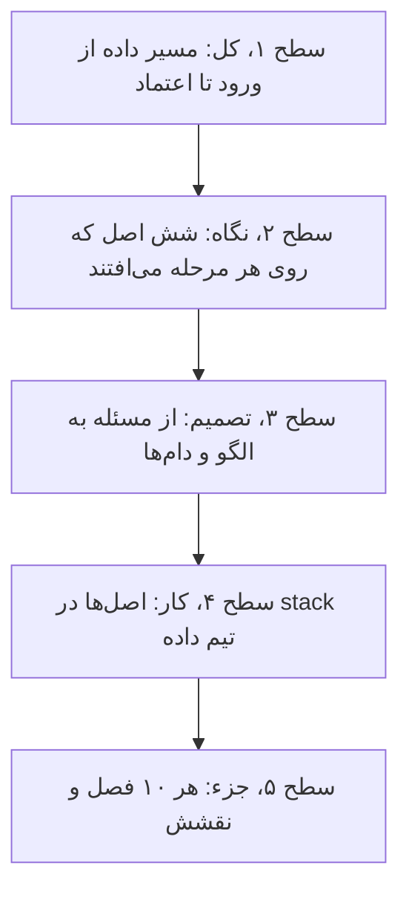
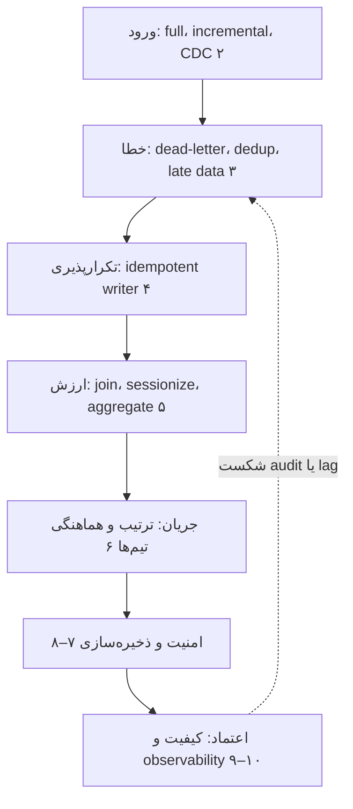
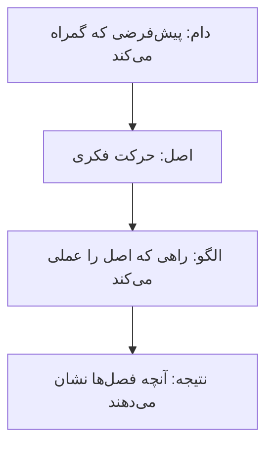
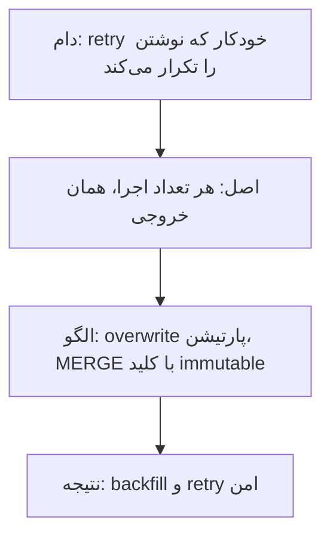
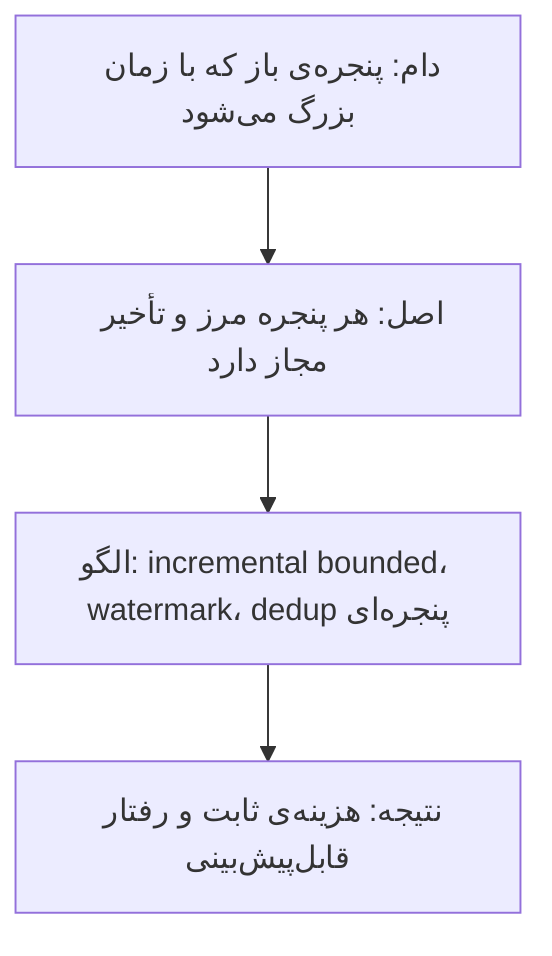
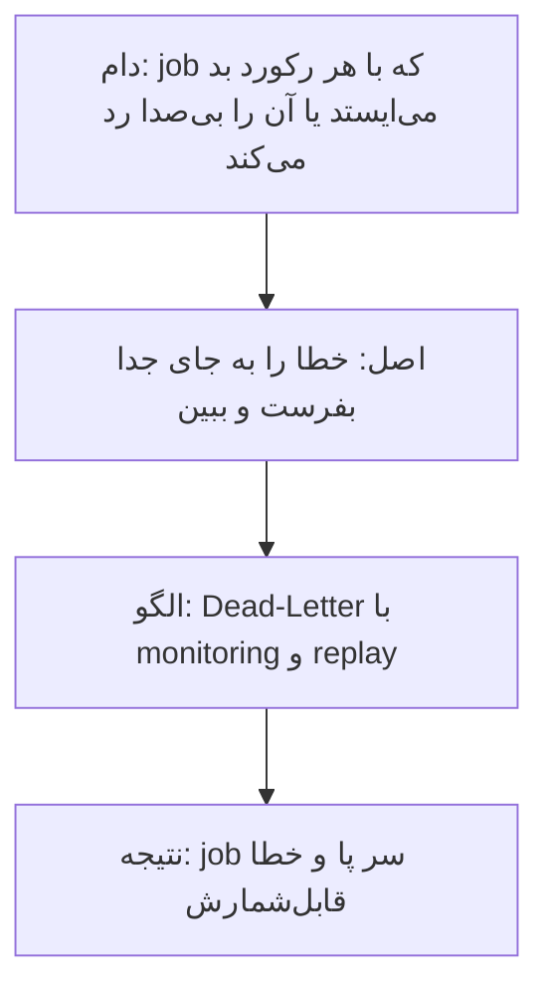
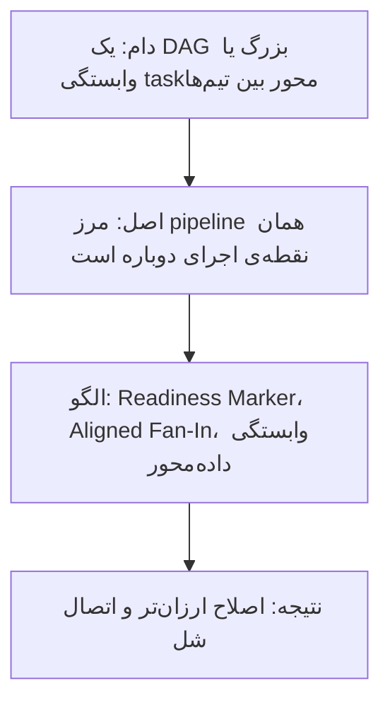
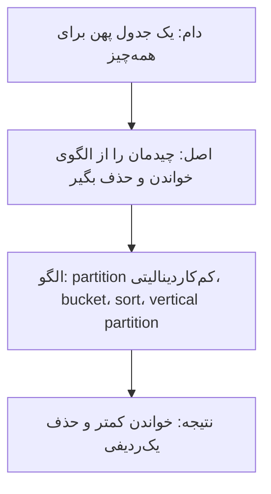
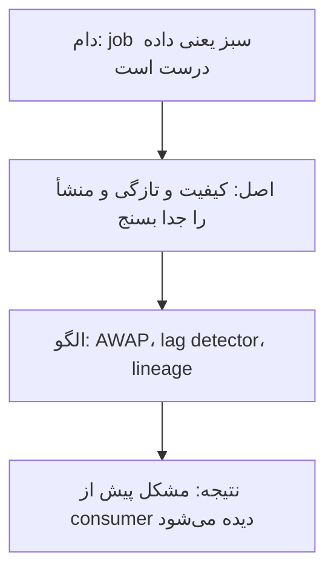

# چارچوب کتاب: مسیر یک مجموعه‌داده از ورود تا اعتماد

[کتاب](README.md) · [فصل ۱ ←](chapters/01-introducing-data-engineering-design-patterns.md)

این صفحه **سنتز خود vault** است، نه بخشی از کتاب. کتاب ده فصل الگو دارد که هر کدام یک گام از مسیر داده را پوشش می‌دهد؛ این‌جا همان الگوها کنار هم می‌نشینند تا بدانید هر الگو کجای مسیر است و کدام الگوها با هم به کار می‌روند.

چارچوب سه لایه دارد. **مسیر داده** می‌گوید یک مجموعه‌داده از کجا می‌آید و از چه مرحله‌هایی می‌گذرد. **شش اصل** می‌گوید کدام نگاه در همه‌ی الگوها تکرار می‌شود. **راهنمای تصمیم و stack** می‌گوید برای هر مسئله کدام فصل را باز کنید و هر اصل در stack تیم داده کجا می‌نشیند. همه‌ی ادعاها به فصل‌ها ارجاع می‌دهند؛ نام‌گذاری اصل‌ها مال vault است.

## تصویر کل

### کل کتاب در سه جمله

خوانش vault از کتاب، پیش از هر جزئی:

1. **هر الگو پاسخی به یک خرابی قابل‌انتظار است.** کار داده با شکست و retry و backfill زندگی می‌کند و الگوهای نرم‌افزاری کلاسیک این را نمی‌پوشانند ([۱](chapters/01-introducing-data-engineering-design-patterns.md)، [۳](chapters/03-error-management-design-patterns.md)، [۴](chapters/04-idempotency-design-patterns.md)).
2. **هر مرحله باید بشود دوباره اجرا شود و همان نتیجه را بدهد.** idempotency و مرزهای درست pipeline پیش‌شرط backfill امن‌اند ([۴](chapters/04-idempotency-design-patterns.md)، [۶](chapters/06-data-flow-design-patterns.md)).
3. **داده‌ای که نمی‌شود به آن اعتماد کرد ارزشی ندارد.** کیفیت، امنیت و observability کار را از «اجرا شد» به «درست و به‌موقع رسید» می‌برند ([۷](chapters/07-data-security-design-patterns.md)، [۹](chapters/09-data-quality-design-patterns.md)، [۱۰](chapters/10-data-observability-design-patterns.md)).

### از کل به جزء

این صفحه مثل نقشه از دور به نزدیک خوانده می‌شود. هر سطح همان سطح قبلی است با بزرگ‌نمایی بیشتر:

## مسیر داده

### نقشه‌ی مسیر

*سطح ۱ از ۵: کل.*

کتاب جریان داده را دنبال می‌کند: داده وارد می‌شود، خطاهایش مدیریت می‌شود، نوشتنش idempotent می‌شود، ارزش پیدا می‌کند، بین تیم‌ها جریان می‌یابد، امن و سازمان‌یافته ذخیره می‌شود و در آخر کیفیت و سلامتش سنجیده می‌شود ([۱](chapters/01-introducing-data-engineering-design-patterns.md)).

### مرحله‌ها و پرسش‌هایشان

| مرحله | پرسش اصلی | الگوهای کلیدی | بده‌بستان اصلی | فصل |
|---|---|---|---|---|
| ورود | چه چیزی را و چطور بیاوریم؟ | Full Loader، Incremental Loader، Change Data Capture، Readiness Marker | سادگی در برابر دیدن حذف‌ها و تازگی | [۲](chapters/02-data-ingestion-design-patterns.md) |
| خطا | با رکورد بد و تکراری و late چه کنیم؟ | Dead-Letter، Windowed Deduplicator، Late Data Detector | پیوستگی job در برابر پنهان شدن خطا | [۳](chapters/03-error-management-design-patterns.md) |
| تکرارپذیری | اجرای دوباره چه می‌کند؟ | Fast Metadata Cleaner، Merger، Stateful Merger، Transactional Writer | هزینه‌ی بازنویسی در برابر سازگاری backfill | [۴](chapters/04-idempotency-design-patterns.md) |
| ارزش | داده را چطور معنادار کنیم؟ | Static Joiner، Dynamic Joiner، Incremental Sessionizer، Distributed Aggregator | تازگی در برابر shuffle و بافر | [۵](chapters/05-data-value-design-patterns.md) |
| جریان | مرحله‌ها و تیم‌ها چطور هماهنگ شوند؟ | Local Sequencer، Aligned Fan-In، Single Runner | اتصال تنگ در برابر شل | [۶](chapters/06-data-flow-design-patterns.md) |
| امنیت | چه کسی چه چیزی را ببیند و چطور حذف کنیم؟ | Vertical Partitioner، In-Place Overwriter، Fine-Grained Accessor for Tables | دسترسی در برابر حریم خصوصی | [۷](chapters/07-data-security-design-patterns.md) |
| ذخیره‌سازی | داده را چطور بچینیم تا خواندن ارزان شود؟ | Horizontal Partitioner، Bucket، Sorter، Dataset Materializer | انعطاف در برابر سرعت خواندن | [۸](chapters/08-data-storage-design-patterns.md) |
| کیفیت | آیا داده درست است؟ | Audit-Write-Audit-Publish، Constraints Enforcer، Schema Compatibility Enforcer | سخت‌گیری در برابر availability | [۹](chapters/09-data-quality-design-patterns.md) |
| observability | آیا داده به‌موقع رسید و از کجا آمد؟ | Flow Interruption Detector، Lag Detector، Dataset Tracker | حساسیت در برابر هشدار کاذب | [۱۰](chapters/10-data-observability-design-patterns.md) |

## شش اصل

*سطح ۲ از ۵: نگاه.*

شش حرکت فکری در همه‌ی الگوها تکرار می‌شوند. هر اصل با یک زنجیره‌ی چهارتایی شروع می‌شود: **دام** رایج، **اصلی** که آن را می‌بندد، **الگویی** که اصل را عملی می‌کند و **نتیجه**.

### اصل ۱: هر اجرا باید تکرارپذیر باشد

- **تکراری بهترین حالت یک نوشتن تکرارشده است**؛ بدترینش تکراری‌ای است که کسی نمی‌شناسد ([۴](chapters/04-idempotency-design-patterns.md)).
- **کلید ساخته‌شده از زمان رویداد idempotent نیست** و `MERGE` به کلید immutable نیاز دارد ([۴](chapters/04-idempotency-design-patterns.md)).
- **تراکنش هر اجرا را همه‌یا‌هیچ می‌کند، نه idempotent بین اجراها** ([۴](chapters/04-idempotency-design-patterns.md))؛ و checkpoint فقط «حس exactly-once» می‌دهد ([۳](chapters/03-error-management-design-patterns.md)).

### اصل ۲: پنجره را bounded کن

- **پنجره‌های افزایشی را bounded کنید** ([۲](chapters/02-data-ingestion-design-patterns.md))، و حذف تکراری‌ها هم bounded است ([۳](chapters/03-error-management-design-patterns.md)).
- **مفهوم watermark برابر بیشینه‌ی زمان رویداد منهای تأخیر مجاز است** ([۳](chapters/03-error-management-design-patterns.md))؛ join بین streamها هم به بافر و GC watermark نیاز دارد ([۵](chapters/05-data-value-design-patterns.md)).
- **نگاه‌به‌عقب پویا به جدول حالت نیاز دارد** ([۳](chapters/03-error-management-design-patterns.md)).

### اصل ۳: خطا را جدا کن، پنهان نکن

- **روش dead-letter خطاها را پنهان می‌کند** مگر monitoring و replay داشته باشد ([۳](chapters/03-error-management-design-patterns.md)).
- **شکست audit لازم نیست pipeline را شکست بدهد**، ولی باید دیده شود ([۹](chapters/09-data-quality-design-patterns.md)).
- **اگر داده‌ی جزئی منتشر می‌کنید، بگویید** ([۶](chapters/06-data-flow-design-patterns.md)).

### اصل ۴: مرز را جایی بکش که می‌خواهی دوباره راه بیندازی

- **مرزها را جایی بکشید که می‌خواهید از آن‌جا دوباره راه بیندازید** ([۶](chapters/06-data-flow-design-patterns.md)).
- **وابستگی داده‌محور شل است و task‌محور تنگ**؛ نشانگر آمادگی و trigger قرارداد بین تیم‌هاست ([۲](chapters/02-data-ingestion-design-patterns.md)، [۶](chapters/06-data-flow-design-patterns.md)).
- **شاخه پیچیدگی را چند برابر می‌کند** و شاخه‌های موازی باید کار پدر را شریک شوند ([۶](chapters/06-data-flow-design-patterns.md)).

### اصل ۵: داده را برای خواندن و حذف بچین

- **با ویژگی کم‌کاردینالیتی پارتیشن کنید و برای کاردینالیتی بالا bucket کنید** ([۸](chapters/08-data-storage-design-patterns.md)).
- **کلید مرتب‌سازی فقط به کوئری‌های prefix کمک می‌کند** و آمار اجازه‌ی پریدن از داده را می‌دهد ([۸](chapters/08-data-storage-design-patterns.md)).
- **داده‌ی شخصی را یک‌بار ذخیره کنید تا حذفش ارزان شود** ([۷](chapters/07-data-security-design-patterns.md)).

### اصل ۶: اعتماد را بسنج، نه اجرا را

- **یک job که بی‌شکست اجرا می‌شود باز هم می‌تواند هیچ چیزی تحویل ندهد** ([۱۰](chapters/10-data-observability-design-patterns.md)).
- **هر دو سمت را audit کنید**، ورودی و خروجی تبدیل‌شده ([۹](chapters/09-data-quality-design-patterns.md)).
- **میانگین lag را پنهان می‌کند** و lineage می‌گوید از چه کسی بپرسید ([۱۰](chapters/10-data-observability-design-patterns.md)).

## از مسئله به فصل

*سطح ۳ از ۵: تصمیم.*

| مسئله | اول بخوانید | بعد |
|---|---|---|
| منبع حذف فیزیکی دارد | [۲](chapters/02-data-ingestion-design-patterns.md) | [۴](chapters/04-idempotency-design-patterns.md) |
| رکوردهای خراب job را می‌خوابانند | [۳](chapters/03-error-management-design-patterns.md) | [۱۰](chapters/10-data-observability-design-patterns.md) |
| retry ردیف تکراری ساخته | [۴](chapters/04-idempotency-design-patterns.md) | [۳](chapters/03-error-management-design-patterns.md) |
| backfill نتیجه‌ی متفاوت می‌دهد | [۴](chapters/04-idempotency-design-patterns.md) | [۶](chapters/06-data-flow-design-patterns.md) |
| join با داده‌ی مرجع در زمان اشتباه | [۵](chapters/05-data-value-design-patterns.md) | [۸](chapters/08-data-storage-design-patterns.md) |
| تیم downstream زود شروع می‌کند | [۶](chapters/06-data-flow-design-patterns.md) | [۲](chapters/02-data-ingestion-design-patterns.md) |
| درخواست حذف داده‌ی شخصی | [۷](chapters/07-data-security-design-patterns.md) | [۸](chapters/08-data-storage-design-patterns.md) |
| کوئری داشبورد کند است | [۸](chapters/08-data-storage-design-patterns.md) | [۵](chapters/05-data-value-design-patterns.md) |
| تغییر schema consumer را شکست | [۹](chapters/09-data-quality-design-patterns.md) | [۱۰](chapters/10-data-observability-design-patterns.md) |
| داده نرسیده ولی هیچ هشداری نیامده | [۱۰](chapters/10-data-observability-design-patterns.md) | [۹](chapters/09-data-quality-design-patterns.md) |

## دام‌ها

1. **بارگذاری با ستون delta** و ندیدن حذف‌های فیزیکی ([۲](chapters/02-data-ingestion-design-patterns.md)).
2. **رد کردن بی‌صدای رکورد بد** به‌جای dead-letter دیدنی ([۳](chapters/03-error-management-design-patterns.md)).
3. **کلید از زمان رویداد** که با هر اجرا عوض می‌شود ([۴](chapters/04-idempotency-design-patterns.md)).
4. **دستور `DELETE` به‌جای عملیات metadata** روی پارتیشن ([۴](chapters/04-idempotency-design-patterns.md)).
5. **یکی دانستن FIFO و exactly-once** ([۵](chapters/05-data-value-design-patterns.md)).
6. **وابستگی task‌محور بین تیم‌ها** که هر تغییر را می‌شکند ([۶](chapters/06-data-flow-design-patterns.md)).
7. **یکی دانستن حذف کردن و پاک کردن** ([۷](chapters/07-data-security-design-patterns.md)).
8. **پارتیشن با کاردینالیتی بالا** ([۸](chapters/08-data-storage-design-patterns.md)).
9. **انجام audit فقط روی خروجی** ([۹](chapters/09-data-quality-design-patterns.md)).
10. **تشخیص سلامت از روی سبز بودن job** ([۱۰](chapters/10-data-observability-design-patterns.md)).

## در stack شما

*سطح ۴ از ۵: کار.*

هر اصل در [stack مرجع](../../practice/reference-stack.md) یک جای مشخص دارد. کادرهای *In practice* هر فصل جزئیاتش را می‌دهند.

| بخش stack | اصل | فصل‌ها | یادآوری |
|---|---|---|---|
| loader با dlt و cursor روی `update_date` | ۲ | [۲](chapters/02-data-ingestion-design-patterns.md) | cursor حذف را نمی‌بیند؛ پنجره را bounded نگه دارید |
| hash کردن PII پیش از staging | ۵ | [۷](chapters/07-data-security-design-patterns.md) | داده‌ی شخصی را یک‌جا نگه دارید تا حذفش یک ردیف باشد |
| staging با Parquet و Bronze | ۳ | [۳](chapters/03-error-management-design-patterns.md)، [۸](chapters/08-data-storage-design-patterns.md) | رکورد بد را جدا کنید و فایل‌ها را بر پایه‌ی زمان partition کنید |
| ساخت Silver و Gold در ClickHouse | ۱ | [۴](chapters/04-idempotency-design-patterns.md)، [۵](chapters/05-data-value-design-patterns.md) | هر partition را با overwrite یا `REPLACE PARTITION` بنویسید |
| DAGهای Airflow | ۴ | [۶](chapters/06-data-flow-design-patterns.md) | مرز DAG را نقطه‌ی اجرای دوباره بگذارید |
| تست در GitLab CI | ۶ | [۹](chapters/09-data-quality-design-patterns.md) | schema compatibility را پیش از merge بسنجید |
| Prometheus و Grafana | ۶ | [۱۰](chapters/10-data-observability-design-patterns.md) | freshness و lag و row count را کنار سلامت سیستم نشان دهید |
| Authentik و نقش‌ها | ۵ | [۷](chapters/07-data-security-design-patterns.md) | دسترسی لایه‌ها در یک جا |

> **In practice:** اصل‌های «تکرارپذیری»، «مرز درست» و «سنجیدن اعتماد» در یک اجرای دوباره به هم می‌رسند.
>
> **Your turn:** loader دیشب نیمه‌کاره ماند و Airflow آن را retry کرد. صبح جدول Gold عدد درست دارد ولی هیچ هشداری هم نیامده. از کجا مطمئن می‌شوید که درست است؟
>
> *Answer:* اول بررسی کنید که نوشتن هر partition idempotent بوده، یعنی retry ردیف تکراری نساخته ([۴](chapters/04-idempotency-design-patterns.md))؛ بعد ببینید DAG از مرز درست دوباره راه افتاده و Gold پیش از آماده بودن Silver اجرا نشده ([۶](chapters/06-data-flow-design-patterns.md))؛ و در آخر شمارش ردیف و lag را با منبع مقایسه کنید، چون سبز بودن job چیزی را ثابت نمی‌کند ([۱۰](chapters/10-data-observability-design-patterns.md)).

## نقشه‌ی فصل‌ها

*سطح ۵ از ۵: جزء.*

| فصل | مرحله | اصل | نقش در چارچوب |
|---|---|---|---|
| [۱](chapters/01-introducing-data-engineering-design-patterns.md) | پایه | همه | تعریف الگو و ترتیب کتاب در مسیر داده |
| [۲](chapters/02-data-ingestion-design-patterns.md) | ورود | ۲، ۴ | بارگذاری کامل و افزایشی، CDC، replication و نشانگر آمادگی |
| [۳](chapters/03-error-management-design-patterns.md) | خطا | ۲، ۳ | ساختار dead-letter، حذف تکراری، late data و checkpoint |
| [۴](chapters/04-idempotency-design-patterns.md) | تکرارپذیری | ۱ | نوشتن idempotent با overwrite و merge و تراکنش |
| [۵](chapters/05-data-value-design-patterns.md) | ارزش | ۲ | پیوند با داده‌ی مرجع، session، تجمیع توزیع‌شده و ترتیب |
| [۶](chapters/06-data-flow-design-patterns.md) | جریان | ۳، ۴ | ترتیب، fan-in و fan-out، هماهنگی بین تیم‌ها |
| [۷](chapters/07-data-security-design-patterns.md) | امنیت | ۵ | حذف داده‌ی شخصی، دسترسی دانه‌ریز، encryption و credential |
| [۸](chapters/08-data-storage-design-patterns.md) | ذخیره‌سازی | ۵ | پارتیشن و bucket، مرتب‌سازی، materialize |
| [۹](chapters/09-data-quality-design-patterns.md) | کیفیت | ۳، ۶ | الگوی AWAP، قید، schema compatibility |
| [۱۰](chapters/10-data-observability-design-patterns.md) | observability | ۶ | تشخیص توقف جریان، lag، SLA و lineage |
