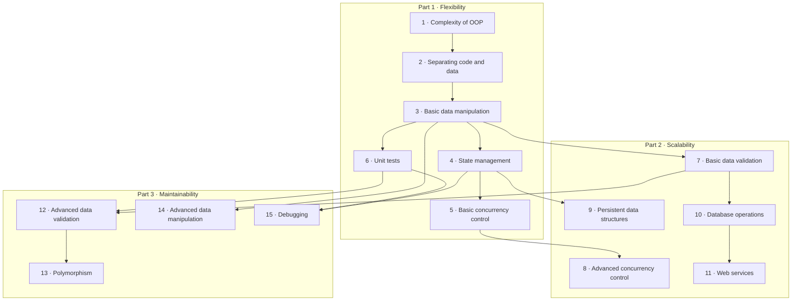

# Data-Oriented Programming

**Open [`index.html`](index.html) in a browser** for the interactive version: one slide-by-slide lesson per chapter, with embedded simulations and self-checks. Everything here also reads fine on GitHub.

## About

*Data-Oriented Programming: Reduce Software Complexity* sets out a paradigm for reducing the complexity of systems that manipulate information, such as frontend applications, backend web servers and web services (p. xx). It is written for developers with a couple of years of experience in a high-level language. OOP developers may need to unlearn some habits; FP developers will find it easier to digest (p. xx).

The book tells a **story**. Theo, a senior developer at Albatross, struggles with the complexity of an OOP Library Management System for Klafim, the startup of the entrepreneur Nancy. Joe, an independent programmer, mentors him in DOP; later Theo mentors his junior colleague Dave (pp. xx–xxii, xxvi). The author's preface explains the choice: like Plato's dialogues or Goldratt's *The Goal*, an invented story to share ideas (p. xvii). The code is in basic JavaScript, with Lodash for generic data manipulation and occasional Java for statically typed languages (pp. xx–xxiii).

Its four principles are summarized in Appendix A (pp. 333–334):

1. **Separate code from data.**
2. **Represent data with generic data structures.**
3. **Data is immutable.**
4. **Separate data schema from data representation.**

Forewords are by Michael T. Nygard and Ryan Singer (pp. xiii–xvi).

## What's in this folder

| Path | What it is |
|---|---|
| [`chapters/NN-*.md`](chapters/01-complexity-of-object-oriented-programming.md) | Chapter notes, **the source of truth**. Each `.md` has a generated `.html` lesson next to it |
| [`widgets/`](widgets/01-code-data-split.html) | Hand-built simulations, embedded in the lessons; each also opens on its own |
| [`lab/`](lab/04-structural-sharing/README.md) | Runnable Python experiments with expected output |
| `index.html` | The book hub, generated from this README and the chapters |

## How the book fits together

The book has three parts (pp. xxi–xxii). Part 1 and chapter 7 are needed for parts 2 and 3; otherwise the author suggests reading in order (p. xx).

- **Part 1, Flexibility** (chapters 1–6): the complexity of OOP, then DOP's basic principles: separating code from data, generic data, immutable state, optimistic concurrency, and simple unit tests.
- **Part 2, Scalability** (chapters 7–11): data validation at the boundaries, lock-free concurrency with an atom, persistent data structures, databases and web services.
- **Part 3, Maintainability** (chapters 12–15): validation inside the system, polymorphism with multimethods, custom data manipulation tools, and debugging by reproducing a context.

*The parts and chapter order are the book's (pp. xxi–xxii); the arrows are the vault's reading of which chapters build on which.*

Some threads run through the whole book:

- **Generic data and generic functions**: maps, arrays and Lodash replace classes and their methods (2, 3, 10, 11, 14).
- **Immutability** makes state versions, concurrency, persistent structures and reproducibility work (4, 5, 8, 9, 15).
- **Schemas as data**, separate from the data itself: at the boundaries, inside the system, in diagrams and in generated tests (7, 10, 11, 12, 13).
- **Data in, data out** makes unit tests and debugging simple (6, 12, 14, 15).

## Chapters

| # | Chapter | Pages |
|---:|---|---|
| 1 | [Complexity of object-oriented programming](chapters/01-complexity-of-object-oriented-programming.md) | 3–25 |
| 2 | [Separation between code and data](chapters/02-separation-between-code-and-data.md) | 26–42 |
| 3 | [Basic data manipulation](chapters/03-basic-data-manipulation.md) | 43–70 |
| 4 | [State management](chapters/04-state-management.md) | 71–90 |
| 5 | [Basic concurrency control](chapters/05-basic-concurrency-control.md) | 91–109 |
| 6 | [Unit tests](chapters/06-unit-tests.md) | 110–136 |
| 7 | [Basic data validation](chapters/07-basic-data-validation.md) | 141–162 |
| 8 | [Advanced concurrency control](chapters/08-advanced-concurrency-control.md) | 163–174 |
| 9 | [Persistent data structures](chapters/09-persistent-data-structures.md) | 175–196 |
| 10 | [Database operations](chapters/10-database-operations.md) | 197–219 |
| 11 | [Web services](chapters/11-web-services.md) | 220–244 |
| 12 | [Advanced data validation](chapters/12-advanced-data-validation.md) | 247–271 |
| 13 | [Polymorphism](chapters/13-polymorphism.md) | 272–294 |
| 14 | [Advanced data manipulation](chapters/14-advanced-data-manipulation.md) | 295–310 |
| 15 | [Debugging](chapters/15-debugging.md) | 311–331 |

Page ranges are printed pages. Part openers are at p. 1 (Part 1), pp. 137–139 (Part 2) and pp. 245–246 (Part 3); the notes for chapters 7 and 12 cover the openers of parts 2 and 3. The front matter (pp. i–xxvi) has the forewords, the preface, *about this book* and the *dramatis personae*. The book ends with four appendices:

- **A: Principles of data-oriented programming** (p. 333).
- **B: Generic data access in statically-typed languages** (p. 364).
- **C: Data-oriented programming, a link in the chain of programming paradigms** (p. 381).
- **D: Lodash reference** (p. 387).

## Key concepts

These ideas recur across chapters; each row lists the chapters that discuss them. The definitions are the vault's summaries of the book's explanations.

| Concept | Definition | Chapters |
|---|---|---|
| Separate code from data (Principle #1) | Code lives in stateless functions whose behaviour doesn't depend on data encapsulated in their context; data lives in entities. | [1](chapters/01-complexity-of-object-oriented-programming.md) · [2](chapters/02-separation-between-code-and-data.md) |
| Generic data structures (Principle #2) | Records are maps and collections are arrays, manipulated with generic functions such as Lodash's, instead of classes. | [3](chapters/03-basic-data-manipulation.md) · [10](chapters/10-database-operations.md) · [11](chapters/11-web-services.md) · [14](chapters/14-advanced-data-manipulation.md) |
| Immutable data (Principle #3) | Data is never changed in place; "mutations" compute a new version, sharing unchanged parts. | [4](chapters/04-state-management.md) · [9](chapters/09-persistent-data-structures.md) · [15](chapters/15-debugging.md) |
| Separate schema from representation (Principle #4) | The expected shape of data is itself data (JSON Schema), validated when and where you choose. | [7](chapters/07-basic-data-validation.md) · [12](chapters/12-advanced-data-validation.md) |
| Index (homogeneous map) | A map from IDs to records of the same shape, such as `booksByIsbn`, as opposed to a record's heterogeneous map. | [3](chapters/03-basic-data-manipulation.md) · [12](chapters/12-advanced-data-validation.md) |
| Information path | The chain of keys from the system data's root to a value, used with `_.get`. | [3](chapters/03-basic-data-manipulation.md) · [5](chapters/05-basic-concurrency-control.md) |
| Structural sharing | A new version copies only the path to what changed and shares everything else with the previous version. | [4](chapters/04-state-management.md) · [9](chapters/09-persistent-data-structures.md) |
| Multi-version state | The system state is a reference to the current version of immutable system data; a mutation is a calculation phase plus a commit. | [4](chapters/04-state-management.md) · [5](chapters/05-basic-concurrency-control.md) · [8](chapters/08-advanced-concurrency-control.md) |
| Optimistic concurrency and reconciliation | Writers compute without locks; on commit, non-conflicting changes are merged with a three-way diff, and conflicts abort. | [5](chapters/05-basic-concurrency-control.md) · [8](chapters/08-advanced-concurrency-control.md) |
| Atom | A thread-safe reference updated by compare-and-swap in a retry loop, so state is managed without locks. | [8](chapters/08-advanced-concurrency-control.md) |
| Persistent data structures | Immutable collections (Bagwell's hash array mapped tries) whose updates are efficient through structural sharing. | [9](chapters/09-persistent-data-structures.md) |
| Validation at the boundaries | Requests, responses and external data are validated against schemas where they enter and leave the system, in production. | [7](chapters/07-basic-data-validation.md) · [10](chapters/10-database-operations.md) · [11](chapters/11-web-services.md) |
| Validation inside the system | Function arguments and return values are validated against schemas in development only, as documentation and early errors. | [12](chapters/12-advanced-data-validation.md) · [13](chapters/13-polymorphism.md) |
| Data-in, data-out tests | Unit tests call a function with data and compare the returned data, with no mocks or object state to set up. | [6](chapters/06-unit-tests.md) · [12](chapters/12-advanced-data-validation.md) · [15](chapters/15-debugging.md) |
| Multimethods | Polymorphism without objects: a dispatch function emits a value, and methods registered for each value implement it; single, multiple or dynamic dispatch. | [13](chapters/13-polymorphism.md) |
| Custom data manipulation tools | Small, well-named generic functions (`update`, `flatMap`, `unwind`) that keep business logic free of low-level iteration. | [14](chapters/14-advanced-data-manipulation.md) |
| Context capturing | Serializing a function's arguments so the call can be replayed in a REPL or a unit test; works because data is immutable and serializable. | [15](chapters/15-debugging.md) |

## How these notes work

- **Everything above *Beyond the book* in a chapter note restates the book**, with page references. Supplementary material, meaning outside sources and the vault's interpretation, lives under *Beyond the book* or in `> **Vault note:**` callouts.
- **Page numbers are printed pages.** The body's printed page is the PDF page minus 28; the front matter uses roman numerals.
- **The story is kept, briefly.** Who says what matters to the book's teaching, so the notes name the characters, but they summarize the dialogue rather than reproduce it.
- **Listing bugs are flagged.** Where a printed listing has an error (a wrong variable, a missing concatenation, an inverted condition), a vault note says so, and the widgets and experiments use a corrected version.
- Section outlines are the book's own table of contents, taken from the PDF's bookmarks.
- Mermaid diagrams are the vault's redrawings of the book's figures, or its own summaries. Captions say which.
- *Check yourself* questions and answers are the vault's, written from the notes; the answers cite pages.
- Simulations and experiments are the vault's own implementations of the book's examples (the Library Management System, the animals, the catalog), in JavaScript in the browser and in standard-library Python. Each says which pages it illustrates and what it simplifies.

## Source

- **Primary source:** the publisher's PDF of *Data-Oriented Programming: Reduce Software Complexity*, © 2022 Manning Publications Co., ISBN 9781617298578 (426 PDF pages). The PDF is kept outside version control (see `.gitignore`).
- **Table of contents:** taken from the PDF's bookmark outline and checked against the book's brief contents.
- **Structure:** front matter (forewords, preface, about this book, dramatis personae), three parts of 15 chapters, four appendices and an index.
- **Coverage:** all 15 chapters, with the part openers. The appendices are referenced where chapters point to them but have no notes of their own.
