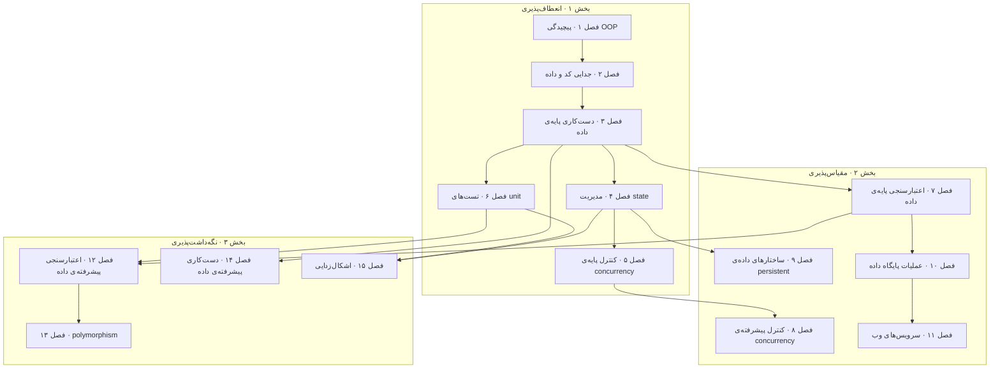

# Data-Oriented Programming

**فایل [`index.html`](index.html) را در مرورگر باز کنید** تا نسخه‌ی تعاملی را ببینید: برای هر فصل یک درس اسلایدبه‌اسلاید، با شبیه‌سازی‌های کارگذاشته و خودسنجی. هر چه اینجاست روی GitHub هم خوب خوانده می‌شود.

## درباره‌ی کتاب

کتاب *Data-Oriented Programming: Reduce Software Complexity* الگویی را پیش می‌گذارد برای کم کردن پیچیدگی سیستم‌هایی که خبر را دست‌کاری می‌کنند؛ مثلاً برنامه‌های frontend و سرورهای وب backend و سرویس‌های وب (p. xx). برای برنامه‌نویسانی نوشته شده که چند سال با زبانی سطح‌بالا کار کرده‌اند. برنامه‌نویسان OOP شاید لازم باشد چند عادت را از یاد ببرند؛ و برنامه‌نویسان FP آن را آسان‌تر هضم می‌کنند (p. xx).

این کتاب **داستان** می‌گوید. تئو، برنامه‌نویسی ارشد در Albatross، با پیچیدگی یک سیستم مدیریت کتابخانه‌ی OOP برای Klafim، استارتاپ نانسی کارآفرین، دست‌وپنجه نرم می‌کند. جو، برنامه‌نویسی مستقل، او را در DOP راهنمایی می‌کند؛ و بعد تئو همکار جوان‌ترش دیو را راهنمایی (pp. xx–xxii, xxvi). پیش‌گفتار نویسنده این گزینش را روشن می‌کند: مانند گفت‌وگوهای افلاطون یا کتاب *The Goal* از گلدرت، داستانی ساخته برای شریک شدن ایده‌ها (p. xvii). کد به JavaScript ساده است، با Lodash برای دست‌کاری عمومی داده و گاهی Java برای زبان‌های ایستا-نوع (pp. xx–xxiii).

چهار اصلش در پیوست A خلاصه شده (pp. 333–334):

1. **کد را از داده جدا کنید.**
2. **داده را با ساختارهای داده‌ی عمومی بنمایانید.**
3. **داده immutable است.**
4. **طرح داده را از نمایش داده جدا کنید.**

پیش‌گفتارها از مایکل تی. نایگارد و رایان سینگر است (pp. xiii–xvi).

## محتوای این پوشه

| مسیر | چیست |
|---|---|
| [`chapters/NN-*.md`](chapters/01-complexity-of-object-oriented-programming.md) | یادداشت فصل‌ها، **سرچشمه‌ی درستی**. کنار هر `.md` یک درس `.html` تولیدشده هست |
| [`widgets/`](widgets/01-code-data-split.html) | شبیه‌سازی‌های دست‌ساز، کارگذاشته در درس‌ها؛ هر کدام تنها هم باز می‌شود |
| [`lab/`](lab/04-structural-sharing/README.md) | آزمایش‌های اجراشدنی Python با خروجی چشم‌داشته |
| `index.html` | صفحه‌ی اصلی کتاب، تولیدشده از همین README و فصل‌ها |

## کتاب چطور به هم وصل است

کتاب سه بخش دارد (pp. xxi–xxii). بخش ۱ و فصل ۷ برای بخش‌های ۲ و ۳ لازمند؛ وگرنه نویسنده خواندن به ترتیب را پیش می‌گذارد (p. xx).

- **بخش ۱، انعطاف‌پذیری** (فصل‌های ۱ تا ۶): پیچیدگی OOP، و بعد اصل‌های پایه‌ی DOP، یعنی جدا کردن کد از داده، داده‌ی عمومی، state تغییرناپذیر، concurrency خوش‌بینانه، و تست unit ساده.
- **بخش ۲، مقیاس‌پذیری** (فصل‌های ۷ تا ۱۱): اعتبارسنجی داده بر مرزها، concurrency بی قفل با یک atom، ساختارهای داده‌ی persistent، پایگاه داده و سرویس‌های وب.
- **بخش ۳، نگه‌داشت‌پذیری** (فصل‌های ۱۲ تا ۱۵): اعتبارسنجی درون سیستم، polymorphism با multimethod، ابزارهای دست‌ساز دست‌کاری داده، و اشکال‌زدایی با بازساختن یک زمینه.

*بخش‌ها و ترتیب فصل‌ها مال کتاب است (pp. xxi–xxii)؛ و پیکان‌ها خوانش vault از این است که کدام فصل روی کدام می‌نشیند.*

چند رشته از سر تا ته کتاب می‌گذرند:

- **داده‌ی عمومی و تابع عمومی**: map و array و Lodash جای کلاس‌ها و متدهایشان را می‌گیرند (۲ و ۳ و ۱۰ و ۱۱ و ۱۴).
- **مفهوم immutability** است که versionهای state و concurrency و ساختارهای persistent و بازتولیدپذیری را کار می‌اندازد (۴ و ۵ و ۸ و ۹ و ۱۵).
- **طرح به‌شکل داده**، جدا از خود داده: بر مرزها، درون سیستم، در نمودارها و در تست‌های تولیدشده (۷ و ۱۰ و ۱۱ و ۱۲ و ۱۳).
- **داده تو، داده بیرون** است که تست unit و اشکال‌زدایی را ساده می‌کند (۶ و ۱۲ و ۱۴ و ۱۵).

## فصل‌ها

| # | فصل | صفحه‌ها |
|---:|---|---|
| ۱ | [پیچیدگی برنامه‌نویسی object-oriented](chapters/01-complexity-of-object-oriented-programming.md) | ۳–۲۵ |
| ۲ | [جدایی کد از داده](chapters/02-separation-between-code-and-data.md) | ۲۶–۴۲ |
| ۳ | [دست‌کاری پایه‌ی داده](chapters/03-basic-data-manipulation.md) | ۴۳–۷۰ |
| ۴ | [مدیریت state](chapters/04-state-management.md) | ۷۱–۹۰ |
| ۵ | [کنترل پایه‌ی concurrency](chapters/05-basic-concurrency-control.md) | ۹۱–۱۰۹ |
| ۶ | [تست‌های unit](chapters/06-unit-tests.md) | ۱۱۰–۱۳۶ |
| ۷ | [اعتبارسنجی پایه‌ی داده](chapters/07-basic-data-validation.md) | ۱۴۱–۱۶۲ |
| ۸ | [کنترل پیشرفته‌ی concurrency](chapters/08-advanced-concurrency-control.md) | ۱۶۳–۱۷۴ |
| ۹ | [ساختارهای داده‌ی persistent](chapters/09-persistent-data-structures.md) | ۱۷۵–۱۹۶ |
| ۱۰ | [عملیات پایگاه داده](chapters/10-database-operations.md) | ۱۹۷–۲۱۹ |
| ۱۱ | [سرویس‌های وب](chapters/11-web-services.md) | ۲۲۰–۲۴۴ |
| ۱۲ | [اعتبارسنجی پیشرفته‌ی داده](chapters/12-advanced-data-validation.md) | ۲۴۷–۲۷۱ |
| ۱۳ | [polymorphism](chapters/13-polymorphism.md) | ۲۷۲–۲۹۴ |
| ۱۴ | [دست‌کاری پیشرفته‌ی داده](chapters/14-advanced-data-manipulation.md) | ۲۹۵–۳۱۰ |
| ۱۵ | [اشکال‌زدایی](chapters/15-debugging.md) | ۳۱۱–۳۳۱ |

بازه‌های صفحه، صفحه‌های چاپی‌اند. سرآغاز بخش‌ها در ص. ۱ برای بخش ۱، صص. ۱۳۷–۱۳۹ برای بخش ۲ و صص. ۲۴۵–۲۴۶ برای بخش ۳ است؛ و یادداشت فصل‌های ۷ و ۱۲ سرآغاز بخش‌های ۲ و ۳ را می‌پوشاند. صفحه‌های آغازین، صص. i–xxvi، پیش‌گفتارها و دیباچه و *about this book* و *dramatis personae* را دارند. کتاب با چهار پیوست تمام می‌شود:

- **پیوست A: اصل‌های برنامه‌نویسی داده‌گرا** (p. 333).
- **پیوست B: دسترسی عمومی به داده در زبان‌های ایستا-نوع** (p. 364).
- **پیوست C: برنامه‌نویسی داده‌گرا، حلقه‌ای در زنجیره‌ی الگوهای برنامه‌نویسی** (p. 381).
- **پیوست D: مرجع Lodash** (p. 387).

## مفهوم‌های کلیدی

این ایده‌ها در چند فصل برمی‌گردند؛ و هر سطر فصل‌هایی را می‌آورد که از آن می‌گویند. تعریف‌ها خلاصه‌های vault از توضیح‌های کتاب است.

| مفهوم | تعریف | فصل‌ها |
|---|---|---|
| جدا کردن کد از داده، اصل ۱ | کد در تابع‌های بی‌state می‌نشیند که رفتارشان به داده‌ی بسته‌بندی‌شده در زمینه‌شان بسته نیست؛ و داده در entityها می‌نشیند. | [۱](chapters/01-complexity-of-object-oriented-programming.md) · [۲](chapters/02-separation-between-code-and-data.md) |
| ساختارهای داده‌ی عمومی، اصل ۲ | رکوردها mapاند و مجموعه‌ها arrayاند، که با تابع‌های عمومی مانند تابع‌های Lodash دست‌کاری می‌شوند، نه با کلاس. | [۳](chapters/03-basic-data-manipulation.md) · [۱۰](chapters/10-database-operations.md) · [۱۱](chapters/11-web-services.md) · [۱۴](chapters/14-advanced-data-manipulation.md) |
| داده‌ی تغییرناپذیر، اصل ۳ | داده هیچ‌وقت سر جایش عوض نمی‌شود؛ «mutation» versionی تازه را حساب می‌کند و بخش‌های دست‌نخورده را شریک. | [۴](chapters/04-state-management.md) · [۹](chapters/09-persistent-data-structures.md) · [۱۵](chapters/15-debugging.md) |
| جدا کردن طرح از نمایش، اصل ۴ | شکل چشم‌داشته‌ی داده خودش داده است، یعنی JSON Schema، که هر وقت و هر جا شما بخواهید اعتبارسنجی می‌شود. | [۷](chapters/07-basic-data-validation.md) · [۱۲](chapters/12-advanced-data-validation.md) |
| شاخص، یا map همگن | یک map از شناسه‌ها به رکوردهای هم‌شکل، مانند `booksByIsbn`، در برابر map ناهمگن یک رکورد. | [۳](chapters/03-basic-data-manipulation.md) · [۱۲](chapters/12-advanced-data-validation.md) |
| مسیر خبر | زنجیره‌ی کلیدها از ریشه‌ی داده‌ی سیستم تا یک مقدار، که با `_.get` به کار می‌رود. | [۳](chapters/03-basic-data-manipulation.md) · [۵](chapters/05-basic-concurrency-control.md) |
| شریک شدن ساختاری | versionی تازه تنها مسیر تا چیز عوض‌شده را کپی می‌کند و باقی را با version پیشین شریک می‌شود. | [۴](chapters/04-state-management.md) · [۹](chapters/09-persistent-data-structures.md) |
| state چندنگارشی | مقدار state سیستم ارجاعی به version کنونی داده‌ی immutable سیستم است؛ و هر mutationی یک فاز حساب به‌علاوه‌ی یک commit است. | [۴](chapters/04-state-management.md) · [۵](chapters/05-basic-concurrency-control.md) · [۸](chapters/08-advanced-concurrency-control.md) |
| concurrency خوش‌بینانه و reconciliation | نویسنده‌ها بی قفل حساب می‌کنند؛ و سر commit، تغییرهای بی‌ناسازی با یک diff سه‌سویه درهم می‌آمیزند، و ناسازی‌ها abort می‌کنند. | [۵](chapters/05-basic-concurrency-control.md) · [۸](chapters/08-advanced-concurrency-control.md) |
| واحد atom | ارجاعی thread-safe که با compare-and-swap در حلقه‌ای از نو تلاش به‌روز می‌شود، پس state بی قفل مدیریت می‌شود. | [۸](chapters/08-advanced-concurrency-control.md) |
| ساختارهای داده‌ی persistent | مجموعه‌های تغییرناپذیر، همان hash array mapped trie از بگول، که به‌روزرسانی‌هایشان با شریک شدن ساختاری کارآمد است. | [۹](chapters/09-persistent-data-structures.md) |
| اعتبارسنجی بر مرزها | درخواست‌ها و پاسخ‌ها و داده‌ی بیرونی همان جا که به سیستم وارد و از آن بیرون می‌شوند با طرح‌ها اعتبارسنجی می‌شوند، در production. | [۷](chapters/07-basic-data-validation.md) · [۱۰](chapters/10-database-operations.md) · [۱۱](chapters/11-web-services.md) |
| اعتبارسنجی درون سیستم | آرگومان‌ها و مقدارهای بازگشتی تابع‌ها تنها در توسعه با طرح‌ها اعتبارسنجی می‌شوند، به‌شکل مستندسازی و خطای زودهنگام. | [۱۲](chapters/12-advanced-data-validation.md) · [۱۳](chapters/13-polymorphism.md) |
| تست داده-تو داده-بیرون | هر تست unit تابعی را با داده صدا می‌زند و داده‌ی بازگشتی را می‌سنجد، بی هیچ mock یا state شیئی که راه بیندازد. | [۶](chapters/06-unit-tests.md) · [۱۲](chapters/12-advanced-data-validation.md) · [۱۵](chapters/15-debugging.md) |
| روش multimethod | polymorphism بی شیء: تابعی توزیع‌کننده مقداری می‌دهد، و متدهای ثبت‌شده برای هر مقدار پیاده‌اش می‌کنند؛ توزیع یگانه یا چندگانه یا پویا. | [۱۳](chapters/13-polymorphism.md) |
| ابزارهای دست‌ساز دست‌کاری داده | تابع‌های عمومی کوچک و خوش‌نام، مانند `update` و `flatMap` و `unwind`، که منطق کسب‌وکار را از پیمایش سطح‌پایین آزاد نگه می‌دارند. | [۱۴](chapters/14-advanced-data-manipulation.md) |
| گرفتن زمینه | سریالی کردن آرگومان‌های یک تابع تا آن صدا زدن در REPL یا تستی unit replay شود؛ کار می‌کند چون داده immutable و سریالی‌شدنی است. | [۱۵](chapters/15-debugging.md) |

## این یادداشت‌ها چطور نوشته شده‌اند

- **هر چه در یادداشت فصل بالای *فراتر از کتاب* است، کتاب را بازمی‌گوید**، با ارجاع صفحه. مواد افزوده، یعنی منبع‌های بیرونی و تفسیر vault، زیر *فراتر از کتاب* یا در کادرهای `> **Vault note:**` می‌نشیند.
- **شماره‌ی صفحه‌ها صفحه‌ی چاپی است.** صفحه‌ی چاپی متن اصلی همان صفحه‌ی PDF منهای ۲۸ است؛ و صفحه‌های آغازین شماره‌ی رومی دارند.
- **داستان کوتاه نگه داشته شده.** اینکه چه کسی چه می‌گوید برای آموزش کتاب مهم است، پس یادداشت‌ها نام شخصیت‌ها را می‌آورند، ولی گفت‌وگو را خلاصه می‌کنند، نه بازنویسی.
- **اشکال‌های listingها نشانه‌گذاری شده‌اند.** هر جا listing چاپی خطایی دارد؛ مثلاً متغیری غلط، به‌هم‌چسبانی جاافتاده، شرطی برگشته، کادری از vault می‌گویدش، و widgetها و آزمایش‌ها version تصحیح‌شده را به کار می‌برند.
- فهرست بخش‌ها همان فهرست خود کتاب است، برگرفته از bookmarkهای PDF.
- نمودارهای Mermaid بازکشیدن‌های vault از شکل‌های کتاب‌اند، یا خلاصه‌های خودش. زیرنویس‌ها می‌گویند کدام.
- پرسش‌ها و پاسخ‌های *خودتان را بسنجید* مال vault است و از همین یادداشت‌ها نوشته شده؛ و پاسخ‌ها صفحه می‌دهند.
- شبیه‌سازی‌ها و آزمایش‌ها پیاده‌سازی‌های خود vault از مثال‌های کتاب‌اند، یعنی سیستم مدیریت کتابخانه و جانوران و فهرست، به JavaScript در مرورگر و به Python کتابخانه‌ی استاندارد. هر کدام می‌گوید کدام صفحه‌ها را تصویر می‌کند و چه را ساده.

## منبع

- **منبع اصلی:** نسخه‌ی PDF ناشر از *Data-Oriented Programming: Reduce Software Complexity*، © ۲۰۲۲ Manning Publications Co.، شماره‌ی ISBN ۹۷۸۱۶۱۷۲۹۸۵۷۸، با ۴۲۶ صفحه‌ی PDF. آن PDF بیرون از کنترل version نگه داشته می‌شود؛ `.gitignore` را ببینید.
- **فهرست مطالب:** برگرفته از فهرست bookmarkهای PDF و سنجیده با فهرست کوتاه کتاب.
- **ساختار:** صفحه‌های آغازین، یعنی پیش‌گفتارها و دیباچه و *about this book* و *dramatis personae*، سپس سه بخش با ۱۵ فصل، چهار پیوست و یک index.
- **پوشش:** همه‌ی ۱۵ فصل، با سرآغاز بخش‌ها. پیوست‌ها هر جا فصلی به آن‌ها اشاره کند یاد می‌شوند ولی یادداشت خودشان را ندارند.
