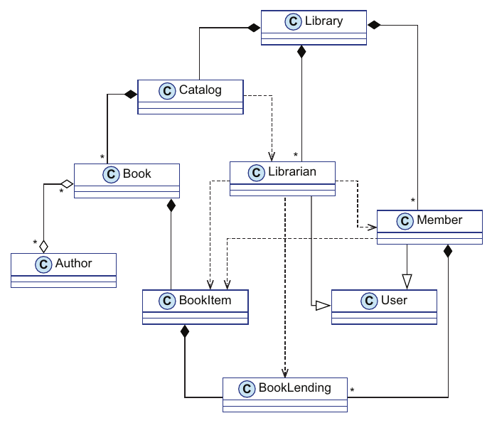
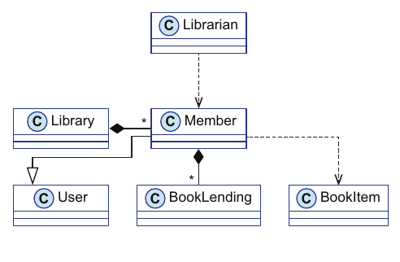
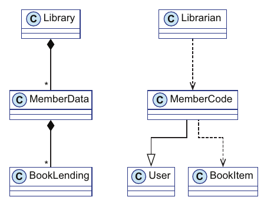
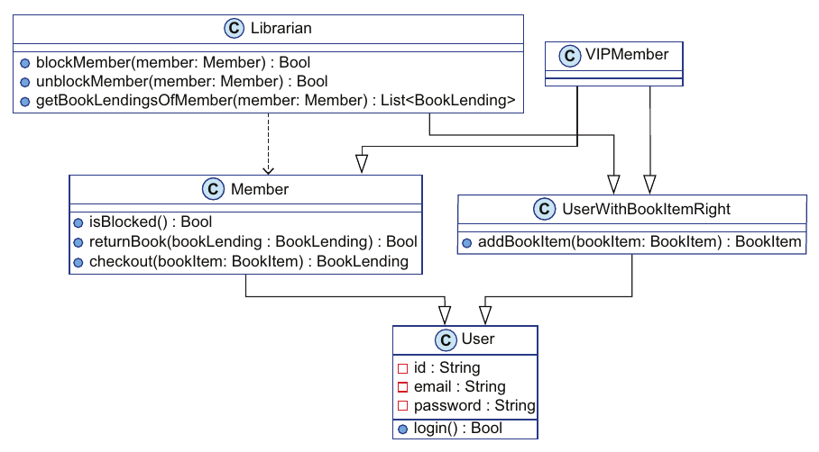
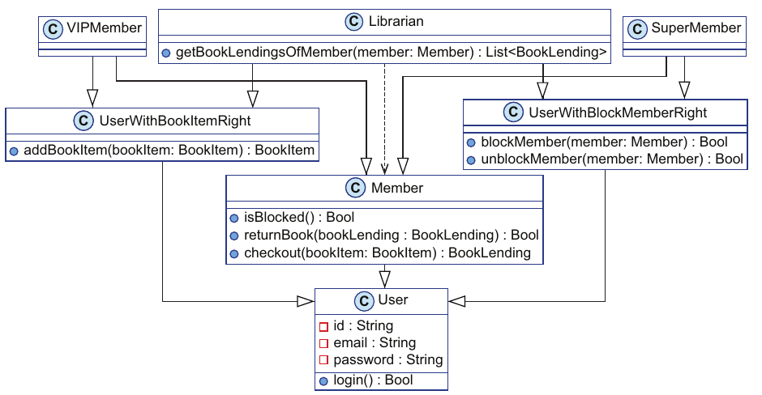

# ۱. پیچیدگی برنامه‌نویسی object-oriented

[کتاب](../README.md) · [۲. جدایی کد از داده →](02-separation-between-code-and-data.md)

## خلاصه

تئو، سرپرست فنی ارشد در آژانس Albatross، نمونه‌ی اولیه‌ی سیستم مدیریت کتابخانه‌ی Klafim را به شیوه‌ی کلاسیک object-oriented طراحی می‌کند. نمودار کلاس UML از نه کلاس می‌کشد و دیو، برنامه‌نویسی جوان، را از آن می‌گذراند (pp. 4–12). بعد نویسنده همان طرح را به چالش می‌کشد. طرح غلط نیست؛ دردسر گرایشی در خود OOP است که سیستم‌ها را **دشوارفهم** می‌کند، و «پیچیدگی» در سراسر کتاب همین معنا را دارد (p. 13). فصل این پیچیدگی را به چهار وجه OOP رد می‌زند (جدول ۱.۱، ص. ۱۴):

- **کد و داده قاطی‌اند**، پس کلاس‌ها در رابطه‌های زیادی شریک می‌شوند.
- **شیءها تغییرپذیرند**، پس خواندن کد فکر بیشتری می‌خواهد، و کد multi-threaded هم‌آهنگی صریح.
- **داده در شیءها قفل است**، پس سریالی کردن بدیهی نیست.
- **کد در کلاس‌ها قفل است**، پس سلسله‌مراتب کلاس‌ها پیچیده می‌شود.

دو ویژگی «ناچیز» دیررس، یعنی عضوهای VIP و عضوهای Super، سلسله‌مراتب تئو را به سه «الماس مرگ‌آور مرگ» می‌کشانند، و او مهلت را از دست می‌دهد (pp. 20–24).

## نکته‌های کلیدی

- **پیچیدگی یعنی دشوارفهم.** این تعریف از مقاله‌ی «Out of the Tar Pit» موزلی و مارکس (۲۰۰۶) می‌آید. نسبی است، نه مطلق، و هیچ ربطی به مصرف منابع ندارد (p. 13).
- **کتاب نقدی بر OOP نیست.** روش DOP با هر دو OOP و FP سازگار است، و پیوست A اصل‌های DOP را در هر دو سبک پیاده نشان می‌دهد (pp. 4, 13).
- **قاطی کردن کد و داده رابطه‌ها را چند برابر می‌کند.** کلاس `Member` تنها در پنج رابطه شریک است؛ و شکستن هر کلاسی به یک entity کد و یک entity داده دو زیرسیستم مستقل به دست می‌دهد (pp. 14–16).
- **وقتی داده mutable است، کد پیش‌بینی‌ناپذیر است.** دو بار خواندن `this.isBlocked` در محیطی چندرشته‌ای، یا با کد asynchronous در JavaScript، می‌تواند دو پاسخ بدهد (pp. 16–18).
- **داده‌ی قفل‌شده در عضوها سریالی کردن را گران می‌کند.** هر endpoint از JSON کلاس‌های پرسش و نتیجه‌ی خودش را می‌خواهد، چون راه عمومی ساده‌ای برای دسترسی به داده نیست (pp. 18–20).
- **کد قفل‌شده در کلاس‌ها سلسله‌مراتب را شکننده می‌کند.** به کار بردن دوباره‌ی `addBookItem` برای عضوهای VIP کلاس پایه‌ی تازه و وراثت چندگانه را به زور می‌آورد (pp. 20–24).

## فهرست بخش‌ها

*از فهرست خود کتاب، یعنی bookmarkهای PDF؛ شماره‌ی صفحه‌ها چاپی‌اند.*

- ۱.۱ طراحی OOP: کلاسیک یا کلاسیکال؟ — ص. ۴
  - ۱.۱.۱ فاز طراحی — ص. ۴
  - ۱.۱.۲ مقدمات UML — ص. ۶
  - ۱.۱.۳ توضیح هر تکه‌ی نمودار کلاس — ص. ۹
  - ۱.۱.۴ فاز پیاده‌سازی — ص. ۱۲
- ۱.۲ سرچشمه‌های پیچیدگی — ص. ۱۳
  - ۱.۲.۱ رابطه‌های زیاد میان کلاس‌ها — ص. ۱۴
  - ۱.۲.۲ رفتار پیش‌بینی‌ناپذیر کد — ص. ۱۶
  - ۱.۲.۳ سریالی کردن داده که بدیهی نیست — ص. ۱۸
  - ۱.۲.۴ سلسله‌مراتب پیچیده‌ی کلاس — ص. ۲۰
- خلاصه — ص. ۲۴

## یادداشت‌ها

این کتاب داستانی است. در سرآغاز بخش ۱ (pp. 1–2)، نانسی، کارآفرینی، تئو را در کافه‌ای نزدیک باغ‌وحش سان‌فرانسیسکو می‌بیند. استارتاپ او Klafim شبکه‌ای اجتماعی برای کتاب‌هاست که می‌گذارد کاربران از کتابخانه‌های محلی کتاب قرض بگیرند، و تنها نرم‌افزار سفارشی‌ای که می‌خواهد یک «سیستم جهانی مدیریت کتابخانه» است. نیازمندی‌های نمونه‌ی اولیه را روی دستمالی می‌نویسد، و تئو قول می‌دهد در دو هفته تحویل دهد.

| نیازمندی نمونه‌ی اولیه‌ی Klafim (pp. 2, 4) |
|---|
| دو گونه کاربر: عضوهای کتابخانه و کتابدارها |
| کاربران با ایمیل و گذرواژه وارد می‌شوند |
| عضوها می‌توانند کتاب قرض بگیرند |
| عضوها و کتابدارها می‌توانند کتاب را با عنوان یا نویسنده بجویند |
| کتابدارها می‌توانند عضوها را ببندند و باز کنند؛ مثلاً وقتی در برگرداندن کتابی دیر می‌کنند |
| کتابدارها می‌توانند کتاب‌هایی را که همین حالا به عضوی قرض داده شده فهرست کنند |
| هر کتابی می‌تواند چند نسخه داشته باشد |
| هر کتابی به کتابخانه‌ای فیزیکی تعلق دارد |

### ۱.۱ طراحی OOP: کلاسیک یا کلاسیکال؟

تئو در Albatross کار می‌کند، شرکتی مشاوره که بخش استارتاپش اعتماد مشتریانش را از دست داده. مدیریت او را از بخش Enterprise به آن‌جا کوچاند تا قرارداد ببندد و سر وقت تحویل دهد (p. 4).

#### ۱.۱.۱ فاز طراحی

برای برنامه‌نویسی object-oriented، هر entity کسب‌وکار شیئی است ساخته از کلاسی (p. 4). تئو کلاس‌های اصلی را می‌یابد (p. 5):

| کلاس | نقش |
|---|---|
| `Library` | بخش مرکزی طرح |
| `Book` | یک کتاب |
| `BookItem` | یک نسخه از کتابی |
| `BookLending` | وقتی کتابی قرض داده می‌شود ساخته می‌شود |
| `Member` | عضوی از کتابخانه |
| `Librarian` | کتابداری |
| `User` | کلاس پایه‌ی `Librarian` و `Member` |
| `Catalog` | فهرستی از کتاب‌ها را دارد |
| `Author` | نویسنده‌ی کتابی |

رابطه‌ها بخش سخت کارند؛ و پس از حدود دو ساعت شکل ۱.۱ را دارد (p. 6). نویسنده می‌گوید طرح به‌عمد ساده‌لوحانه است: برنامه‌نویسان کارکشته‌ی OOP با الگوهای طراحی طرح بهتری می‌ساختند، ولی همین قدر غنی است که کدنویسی را آغاز کند و پیچیدگی سیستمی معمول از OOP را نشان دهد (p. 5).

#### ۱.۱.۲ مقدمات UML

تئو چهار گونه پیکان را به دیو توضیح می‌دهد (pp. 6–9):

| رابطه | معنا | نماد UML |
|---|---|---|
| ترکیب | وقتی یک شیء می‌میرد، آن یکی هم می‌میرد؛ کلاس `Library` یک‌به‌یک مالک `Catalog` خودش است، و یک‌به‌چند مالک `Member`هایش | الماسی ساده در یک لبه، ستاره‌ای اختیاری در آن یکی |
| تداعی | هر شیئی چرخه‌ی زندگی مستقلی دارد؛ `Book` و `Author`، چندبه‌چند | الماسی تهی و ستاره‌ای در هر دو لبه |
| کاربرد | کلاسی متدی از کلاس دیگری را به کار می‌برد؛ `Librarian::blockMember` متد `Member::block` را صدا می‌زند | پیکانی خط‌چین |
| وراثت | کلاسی از دیگری مشتق می‌شود؛ `Member` از `User` | پیکانی ساده با مثلثی تهی، رو به ابرکلاس |

#### ۱.۱.۳ توضیح هر تکه‌ی نمودار کلاس

نقش کلاس‌ها (pp. 9–12):

- کلاس **`Library`** خودش هیچ نمی‌کند: همه را به شیءهایی که مالکشان است وامی‌گذارد، یعنی `Member`های زیاد و `Librarian`های زیاد و یک `Catalog`. کتاب *کد* و *رفتار* را جابه‌جا به کار می‌برد.
- کلاس **`User`** یک `id` و `email` و `password` دارد، هنوز بی هیچ امنیتی، و می‌تواند `login` کند.
- کلاس **`Member`** هیچ داده‌ای به `User` نمی‌افزاید. می‌تواند `checkout` و `returnBook` و `block` و `unblock` کند و به `isBlocked` پاسخ دهد. مالک `BookLending`های زیادی است و برای پیاده کردن `checkout` از `BookItem` کار می‌کشد.
- کلاس **`Librarian`** هم داده‌ای نمی‌افزاید. می‌تواند عضوی را ببندد و باز کند، قرض‌های عضوی را فهرست کند و نسخه‌ی کتاب بیفزاید. از `Member` و `BookItem` و `BookLending` کار می‌کشد.
- کلاس **`Catalog`** می‌تواند کتاب‌ها را `search` و `addBookItem` کند، با کار کشیدن از `Librarian`. مالک `Book`های زیادی است.
- کلاس **`Book`** یک `id` و یک `title` دارد. با `Author`های زیادی تداعی می‌شود و مالک `BookItem`های زیادی است.
- کلاس **`BookItem`** یک `id` و یک `libId` دارد، یعنی شناسه‌ی کتابخانه‌ی فیزیکی‌اش. برای هر بار قرض دادن مالک یک `BookLending` است، و می‌شود برداشتش کرد.

#### ۱.۱.۴ فاز پیاده‌سازی

دیو حیرت می‌کند که مردم طرحشان را این‌قدر ریز می‌نویسند؛ و تئو می‌گوید سر کدنویسی وقت زیادی برایش صرفه می‌کند (p. 12).

> **In practice:** پیش از کد زدن یک pipeline تازه، معمولاً یک نمودار از entityها و رابطه‌هایشان می‌کشیم.
>
> **Your turn:** در نمودار طراحی یک pipeline، چه چیزی باید جدا از کد بماند؟
>
> *Answer:* شکل داده در هر لایه، یعنی ستون‌ها و نوع‌هایشان در Bronze، Silver و Gold، از تابع‌هایی که لایه‌ها را می‌سازند. کتاب نشان می‌دهد نمودار کلاس OOP این دو را در یک جعبه می‌گذارد و همین پیچیدگی بعدی را می‌سازد (pp. 4–12).

### ۱.۲ سرچشمه‌های پیچیدگی

طرح روی کاغذ شاید روشن بنماید، ولی نویسنده می‌گوید سیستم را دشوارفهم می‌کند. این از همان الگو می‌آید، نه از گزینش کلاس‌های تئو (p. 13). «پیچیدگی» این‌جا همان گونه‌ای است که سیستم‌ها را دشوارفهم می‌کند، همان‌طور که در «Out of the Tar Pit» موزلی و مارکس (۲۰۰۶) تعریف شده، نه مصرف منابع، و «ساده» یعنی آسان‌فهم. هر دو نسبی‌اند: می‌شود گفت سیستم A از سیستم B پیچیده‌تر است (p. 13).

بنا بر DOP، سرچشمه‌های اصلی پیچیدگی در سیستم تئو، و در بسیاری از سیستم‌های سنتی OOP، چهارند (p. 13). این به نقد برنامه‌نویسی تابعی از OOP می‌ماند، ولی رویکرد داده‌ای DOP به کم کردن پیچیدگی با رویکرد FP تفاوت دارد (p. 13).

| وجه | اثر بر پیچیدگی (جدول ۱.۱، ص. ۱۴) |
|---|---|
| کد و داده قاطی‌اند | کلاس‌ها گرایش دارند در رابطه‌های زیادی درگیر شوند |
| شیءها تغییرپذیرند | سر خواندن کد فکر بیشتری لازم است |
| شیءها تغییرپذیرند | در محیط‌های multi-threaded هم‌آهنگی صریح لازم است |
| داده در شیءها قفل است | سریالی کردن داده بدیهی نیست |
| کد در کلاس‌ها قفل است | سلسله‌مراتب کلاس پیچیده است |

#### ۱.۲.۱ رابطه‌های زیاد میان کلاس‌ها

اگر تنها به entityها و رابطه‌ها نگاه کنیم (شکل ۱.۱۰، ص. ۱۴)، کلاس `Member` در پنج رابطه شریک است (p. 15):

*Figure 1.10 (p. 14): نمودار کلاس حتی سیستمی کوچک هم به تاری از رابطه‌های درهم‌رفته بدل می‌شود.*

- **رابطه‌های داده:** کلاس `Library` چند `Member` دارد، و هر `Member` چند `BookLending`.
- **رابطه‌های کد:** کلاس `Member` از `User` می‌آید، کلاس `Librarian` از `Member` کار می‌کشد، و `Member` از `BookItem`.

اگر آن را به `MemberCode` با سه رابطه و `MemberData` با دو رابطه بشکنیم، نمودار به دو بخش مستقل می‌افتد که هر کدام آسان‌فهم‌ترند (pp. 15–16). شکستن *هر* کلاسی (شکل ۱.۱۳، ص. ۱۶) یک زیرسیستم تنها از entityهای داده و یکی تنها از entityهای کد می‌دهد، که می‌شود جدا و به هر ترتیبی فهمیدشان. کتاب تأکید می‌کند که این تصادفی ساده‌تر نشده: منطقی از جدا کردن کد از داده پی می‌گیرد (p. 16).

*Figure 1.11 (p. 15): پنج رابطه روی یک entity به هم می‌رسند، چون `Member` کد و داده را قاطی می‌کند.*

*Figure 1.12 (p. 15): همان پنج رابطه دو تا روی entity داده و سه تا روی entity کد می‌شوند.*

> **Try it:** [جدا کردن کد از داده](../widgets/01-code-data-split.html) — نمودار کلاس تئو را بردارید، کلاس‌ها را یکی‌یکی به entity کد و داده بشکنید، و ببینید رابطه‌های هر entity و بخش‌های مستقل چطور عوض می‌شوند.

#### ۱.۲.۲ رفتار پیش‌بینی‌ناپذیر کد

دو version از `displayBlockedStatusTwice` (listingهای ۱.۱ و ۱.۲، ص. ۱۷):

- **مفهوم version listing ۱.۱** مقدار `this.isBlocked` را در متغیری محلی کپی و دو بار چاپ می‌کند. اگر چاپ نخست `true` باشد، آن دومی هم.
- **مفهوم version listing ۱.۲** مقدار `this.isBlocked` را دو بار چاپ می‌کند. در محیطی single-threaded هر دو `true` چاپ می‌کنند. در محیطی multi-threaded پیش‌بینی‌ناپذیر است، چون عوض شدن زمینه میان آن دو صدا زدن می‌تواند شیء را عوض کند؛ مثلاً وقتی کتابداری عضو را باز می‌کند. همین می‌تواند در JavaScript single-threaded رخ دهد وقتی کدی asynchronous داده را دست‌کاری کند (پیوست A، اصل ۳).

تفاوت این است که آن نخستی مقداری بدوی می‌خواند، در حالی که آن دومی عضوی از شیئی mutable را. **وقتی داده mutable است، کد پیش‌بینی‌ناپذیر است** (p. 17). روش OOP می‌تواند چنین کدی را با mutex پناه دهد، به بهای ضربه‌ای به کارایی و خطر deadlock. روش DOP در عوض همه‌ی داده را، بدوی و مجموعه یکسان، مقداری immutable می‌گیرد (p. 18).

#### ۱.۲.۳ سریالی کردن داده که بدیهی نیست

در خوابی، نانسی از تئو یک REST API با JSON می‌خواهد. یک endpoint `/search` مقدار `{"searchCriteria": "author", "query": "albert"}` را می‌گیرد و کتاب‌ها را با نام کامل نویسنده‌هایشان برمی‌گرداند (listingهای ۱.۳ و ۱.۴، ص. ۱۸). در OOP این یعنی سه کلاس (p. 19):

- کلاس `SearchController` پرسش را می‌چرخاند.
- کلاس `SearchQuery` رشته‌ی JSON را به داده بدل می‌کند.
- کلاس `SearchResult` نتیجه‌ها را به رشته‌ی JSON برمی‌گرداند.

یک endpoint `/add-book-item` سه کلاس دیگر می‌خواهد، با نوشتن دوباره‌ی همان کد سریالی کردن و برگرداندن، و همین‌طور برای هر endpointی (pp. 19–20). با این حال سریالی کردن هر پرسشی به گذر از فیلدهای داده و به‌هم‌چسبانی نام‌ها و مقدارها می‌رسد. در OOP سخت است چون داده از شکلی سخت پی می‌گیرد که در کلاس‌ها تعریف شده؛ **داده در عضوها قفل است**، بی هیچ دسترسی عمومی ساده (p. 20). بیشتر زبان‌های OOP بدل کردن به JSON را کمی آسان می‌کنند، ولی تنها با reflection که پیچیده است، یا با پرگویی (p. 20).

#### ۱.۲.۴ سلسله‌مراتب پیچیده‌ی کلاس

وراثت وقتی همه‌ی نیازمندی‌ها از پیش دانسته باشد از دوباره‌گویی پرهیز می‌کند: هر دو `Librarian` و `Member` متد `login` را از `User` به ارث می‌برند (p. 20). نیازمندی‌های late داستان دیگری است (pp. 20–24):

1. **عضوهای VIP** می‌توانند خودشان نسخه‌ی کتاب بیفزایند. کدی که این را می‌کند در `Librarian::addBookItem` قفل است، و `VIPMember` نمی‌تواند از `Librarian` مشتق شود، چون عضوهای VIP نباید عضوها را ببندند یا قرض‌ها را فهرست کنند. چاره‌ی تئو (شکل ۱.۱۶) کلاس پایه‌ی `UserWithBookItemRight` را می‌افزاید که `addBookItem` را دارد، و هر دو `Librarian` و `VIPMember` را از آن می‌آورد. کلاس `VIPMember` از `Member` هم می‌آید، که الماسی می‌سازد، چون هر دو پایه از `User` می‌آیند.
2. **عضوهای Super** می‌توانند کتاب‌های قرض‌داده به عضوهای دیگر را فهرست کنند. نقشه‌ی تئو (شکل ۱.۱۷) کلاس‌های `UserWithBlockMemberRight` و `SuperMember` را می‌افزاید و به سه «الماس مرگ‌آور مرگ» می‌رسد. آن همان دوپهلویی است وقتی کلاس D از B و C می‌آید که هر دو از A می‌آیند.

او می‌کوشد `User` را به interface بدل کند و ترکیب را جای وراثت بگذارد، ولی زیر فشار مهلت نمی‌تواند عضوهای Super را تحویل دهد. نانسی آن ویژگی را فعلاً می‌اندازد (p. 24). درسی که تئو می‌گیرد: **در OOP، ترکیب را بر وراثت کلاس ترجیح دهید** (p. 24).

*Figure 1.16 (p. 22): کلاس `VIPMember` از دو مسیر به `User` می‌رسد؛ الماسی از وراثت چندگانه.*

*Figure 1.17 (p. 23): افزودن عضوهای Super شمار الماس‌ها را به سه می‌رساند.*

> **Try it:** [آن ویژگی ناچیز](../widgets/01-class-hierarchy.html) — عضوهای VIP و Super را به سلسله‌مراتب تئو بیفزایید، ببینید متدها کجا باید بروند و الماس‌ها را بشمارید، بعد با همان حق‌ها که تابع‌هایی روی داده نگه داشته شده‌اند بسنجید.

> **In practice:** کد DAGها و loaderها در Python است و وسوسه‌ی ساختن کلاس‌های تودرتو برای هر منبع و هر جدول همیشه هست.
>
> **Your turn:** هر منبع یک کلاس `SourceExtractor` با وراثت از `BaseExtractor` دارد و افزودن یک فیلد به یک منبع سه کلاس را عوض می‌کند. نشانه‌ی کدام سرچشمه‌ی پیچیدگی است؟
>
> *Answer:* رابطه‌های زیاد میان کلاس‌ها و سلسله‌مراتب پیچیده: داده و رفتار در هم بافته‌اند. اگر config هر منبع یک dict ساده و extract یک تابع عمومی باشد، افزودن فیلد فقط داده را عوض می‌کند (pp. 13–24).

## بده‌بستان‌ها در یک نگاه

| خوی OOP (جدول ۱.۱) | چه خرج می‌دهد | کتاب چه پیش می‌گذارد، پیش‌نمایش |
|---|---|---|
| کد و داده قاطی در کلاس‌ها | entityهایی با رابطه‌های زیاد؛ یک نمودار درهم‌رفته | دو زیرسیستم مستقل، کد و داده (فصل ۲) |
| شیءهای mutable | کدی که سر خواندن باید بازاندیشی‌اش کنید؛ قفل و ضربه به کارایی و deadlock | مقدارهای immutable برای همه‌ی داده (فصل‌های ۳–۵) |
| داده‌ی قفل‌شده در عضوها | کلاسی برای هر شکل JSON؛ یا reflection یا پرگویی | دسترسی عمومی به داده (فصل‌های ۳ و ۱۱) |
| کد قفل‌شده در کلاس‌ها | سلسله‌مراتب شکننده، و الماس زیر نیازمندی‌های late | کد به‌شکل تابع‌هایی که به کلاسی بسته نیستند (فصل‌های ۲ و ۱۳) |
| الگوهای طراحی | پیچیدگی را «تا اندازه‌ای» کم می‌کنند (p. 25) | رد نشده‌اند: روش DOP با OOP سازگار است (p. 13) |

## فراتر از کتاب

- **مقاله‌ی «Out of the Tar Pit».** مقاله‌ی موزلی و مارکس پیچیدگی را به پیچیدگی *ذاتی* که در خود مسئله است و پیچیدگی *تصادفی* که از شیوه‌ی حل ما می‌آید می‌شکند. آن‌ها state mutable را سرچشمه‌ی اصلی گونه‌ی تصادفی می‌نامند. کتاب تعریف مقاله از پیچیدگی به‌شکل دشوارفهمی را قرض می‌گیرد (p. 13)؛ و شکستن ذاتی و تصادفی مال مقاله است، نه این فصل.
- **ترجیح ترکیب بر وراثت** پند کتاب *Design Patterns* از «گروه چهار» (۱۹۹۴) است، که دیباچه‌اش می‌گوید ترکیب شیء را بر وراثت کلاس ترجیح دهید. تئو خیلی دیر به آن می‌رسد (p. 24).
- **مسئله‌ی الماس** را زبان‌های مختلف فرق‌دار می‌چرخانند. زبان C++ وراثت مجازی دارد؛ زبان Java می‌گذارد کلاسی تنها از یک کلاس بیاید ولی interfaceهای زیادی را پیاده کند؛ و زبان Python کلاس‌های پایه را با method resolution order خودش خطی می‌کند. حرف کتاب این است که مدلی ساخته تنها از کلاس، این پرسش را از اساس به زور می‌آورد.
- **همان ویژگی‌ها بی سلسله‌مراتب.** فصل ۲ (pp. 39–41) عضوهای Super و VIP را با افزودن سنجش `isSuperMember` و `isVIPMember` به تابع‌های بی‌state می‌افزاید، بی هیچ تغییر طرح. حالت سنجش widget از همان پی می‌گیرد؛ و شمارش‌های هر قدمش که نشان می‌دهد جمع‌بندی vault است، نه کتاب.

## پیوندها

- **پسین:** [۲. جدایی کد از داده](02-separation-between-code-and-data.md) همان شکستن بخش ۱.۲.۱ را روی سیستم Klafim پیاده می‌کند.
- **داده‌ی mutable و کد پیش‌بینی‌ناپذیر** در [۴. مدیریت state](04-state-management.md) و [۵. کنترل پایه‌ی concurrency](05-basic-concurrency-control.md) برمی‌گردند.
- **دسترسی عمومی به داده و JSON** در [۳. دست‌کاری پایه‌ی داده](03-basic-data-manipulation.md) و [۱۱. سرویس‌های وب](11-web-services.md) برمی‌گردند.
- **کد قفل‌شده در کلاس‌ها** به‌شکل polymorphism بی شیء در [۱۳. polymorphism](13-polymorphism.md) برمی‌گردد.

## خودتان را بسنجید

1. در این کتاب «پیچیدگی» چه معنا دارد، و تعریفش از کجا می‌آید؟
   

پاسخ
دشوارفهم، همان‌طور که در «Out of the Tar Pit» از موزلی و مارکس (۲۰۰۶) تعریف شده. هیچ ربطی به منابعی که برنامه مصرف می‌کند ندارد، و نسبی است نه مطلق (p. 13).

2. چهار وجه OOP را که کتاب پیچیدگی را به گردنشان می‌اندازد و اثر هر کدام را نام ببرید.
   

پاسخ
کد و داده‌ی قاطی با رابطه‌های زیاد؛ شیءهای mutable با فکر بیشتر سر خواندن و هم‌آهنگی صریح با رشته‌ها؛ داده‌ی قفل در شیءها با سریالی کردن که بدیهی نیست؛ و کد قفل در کلاس‌ها با سلسله‌مراتب پیچیده. جدول ۱.۱، ص. ۱۴.

3. کلاس `Member` در چند رابطه شریک است، و وقتی به `MemberCode` و `MemberData` بشکنیدش چه می‌شود؟
   

پاسخ
پنج: دو رابطه‌ی داده، یعنی `Library` چند `Member` دارد و `Member` چند `BookLending`؛ و سه رابطه‌ی کد، یعنی از `User` می‌آید، `Librarian` از آن کار می‌کشد، و از `BookItem` کار می‌کشد. شکستن دو رابطه را روی entity داده و سه را روی entity کد می‌گذارد، در دو بخش مستقل (pp. 15–16).

4. چرا listing ۱.۲ می‌تواند `true` و بعد `false` چاپ کند، در حالی که listing ۱.۱ نمی‌تواند؟
   

پاسخ
مفهوم version listing ۱.۱ مقداری بدوی را می‌خواند که در متغیری محلی کپی شده. version listing ۱.۲ عضوی از شیئی mutable را دو بار می‌خواند؛ و رشته‌ای دیگر، یا کدی asynchronous در JavaScript، می‌تواند میان آن دو خواندن عوضش کند (p. 17).

5. چرا تئو نتوانست همان `Librarian::addBookItem` را برای عضوهای VIP به کار ببرد؟
   

پاسخ
آن کد در کلاس `Librarian` قفل است. کلاس `VIPMember` نمی‌تواند از `Librarian` مشتق شود، چون عضوهای VIP نباید عضوها را ببندند یا قرض‌ها را فهرست کنند، پس تئو ناچار شد متد را به کلاس پایه‌ی تازه‌ای بکوچاند، که الماسی ساخت (pp. 21–23).

6. بنا بر کتاب، سریالی کردن به JSON در OOP معمولاً به چه تکیه می‌کند؟
   

پاسخ
یا به reflection که پیچیده است، یا به کد پرگو: کلاسی پرسش و کلاسی نتیجه برای هر endpoint، چون داده شکلی سخت دارد که کلاس تعریفش کرده (p. 20).

