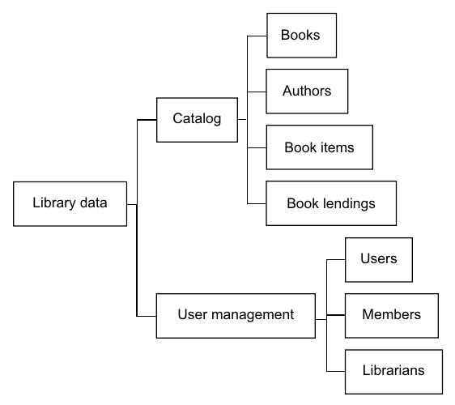
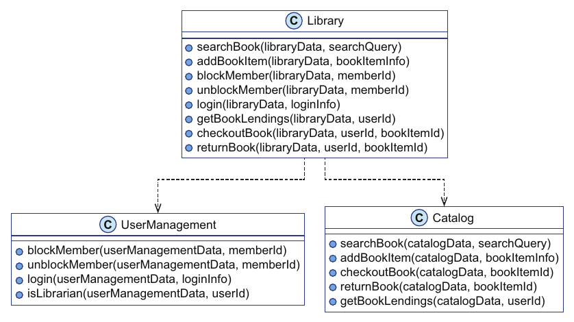

# 2. Separation between code and data

[← 1. Complexity of object-oriented programming](01-complexity-of-object-oriented-programming.md) · [Book](../README.md) · [3. Basic data manipulation →](03-basic-data-manipulation.md)

## Summary

After the prototype ships, Theo asks online how to build less complex systems and meets **Joe**, a San Francisco developer who programmed in Java for nearly a decade before adopting Clojure about seven years ago (pp. 27–28). Joe introduces the first principle of data-oriented programming: **separate code from data**. Data lives in **data entities** that hold only members; code lives in **modules of stateless functions** that take the data they work on as an explicit argument, usually the first (pp. 26, 28, 34). Theo redesigns Klafim with Joe:

- The **data entities** come from the nouns in the requirements, grouped into a mind map (pp. 29–31).
- The **functions** come from the verbs, collected into a `Library` module (pp. 31–34).
- The **high-level modules** mirror the high-level data entities: `Catalog` and `UserManagement` (pp. 34–36).

The result is easier to understand, because each part has constraints, and more flexible: Super and VIP members take a few lines of code and no design change (pp. 36–41).

## Key takeaways

- **Principle #1:** separate code from data so that code lives in functions whose behaviour doesn't depend on data encapsulated in the function's context (p. 26).
- **DOP is against data encapsulation**, and its principles are language-agnostic: no monads, algebraic data types or higher-order functions required (p. 28).
- **Most of DOP's ideas are known best practices**; the novelty is combining them into a cohesive whole (p. 28).
- **Design data first.** Find data entities as the nouns of the requirements and sort them into high-level groups, as a nested list or a mind map (pp. 29–31).
- **In OOP, an object's state is an implicit argument of its methods; in DOP it is explicit.** `getBookLendings(libraryData, userId, memberId)` is a static method of a class with no data members (pp. 33–34).
- **High-level modules correspond to high-level data entities** (p. 36).
- **Constraints make each part easy to understand** (table 2.1, p. 38): data entities have members only and only association and composition relations; code modules have stateless functions only and only usage relations, with no inheritance.
- **DOP systems often adapt to new requirements without design changes** (p. 40).

## Section outline

*From the book’s own table of contents (PDF bookmarks); printed page numbers.*

- 2.1 The two parts of a DOP system — p. 27
- 2.2 Data entities — p. 29
- 2.3 Code modules — p. 31
- 2.4 DOP systems are easy to understand — p. 36
- 2.5 DOP systems are flexible — p. 38
- Summary — p. 42

## Notes

The chapter is a deep dive into DOP's first principle (figure 2.1, p. 27). The separation brings two benefits now, and others later in the book (p. 27):

- **The system is simple**, meaning easy to understand.
- **The system is flexible and extensible**, often needing no design change to meet changing requirements.

This chapter designs the code; chapter 3 designs the data (p. 27).

| Part | Entities | Relations (figure 2.1, p. 27) |
|---|---|---|
| Code modules | Stateless (static) functions, taking data as the first argument | Usage only, no inheritance |
| Data entities | Members only, no code | Association and composition |

### 2.1 The two parts of a DOP system

Theo knows he satisfied the customer more by luck than brains: had Nancy kept Super members, he would have missed the deadline (p. 27). Joe tells him that most of DOP's foundational ideas are known best practices, combined into a cohesive whole (p. 28). On the relation between code and data:

- **DOP is against data encapsulation.** Encapsulation has merits and drawbacks, and the mixing of code and data in objects is the main cause of complexity and inflexibility (p. 28).
- **DOP is language-agnostic:** it applies in object-oriented and in functional languages (p. 28).
- **Data entities only hold members; code is aggregated into modules where all functions are stateless,** taking the data entity as an argument instead of encapsulating it (pp. 28–29).

### 2.2 Data entities

"It's data-oriented programming, so let's start with data" (p. 29). Data entities are the parts of the system that hold information. One way to find them is to highlight the nouns and noun phrases in the requirements (p. 29). Theo groups them into two (p. 30):

*Figure 2.3 (p. 30): data entities grouped by what they belong to, with no code attached.*

Theo asks whether books and authors are an association or a composition; Joe says not to worry yet. The most precise view is a data entity diagram with different arrows for the two, which comes later (pp. 30–31).

> **Try it:** [Nouns and verbs](../widgets/02-nouns-and-verbs.html) — sort the words of Nancy's requirements into data entities and functions, and watch the data mind map and the `Library` module build up.

### 2.3 Code modules

The second step is the code. Highlight the verb phrases, which represent functionality (p. 31). Theo adds two obvious ones, returning a book and checking whether a user is a librarian, to get nine functions (pp. 31–32). All of them except the librarian check are exposed to the outside world, for example as HTTP endpoints. They go into a module box called `Library` (figure 2.4, p. 32):

`searchBook`, `addBookItem`, `blockMember`, `unblockMember`, `getBookLendings`, `checkoutBook`, `returnBook`

A **module is an aggregation of functions**: a class in OOP, but a package or namespace elsewhere. What matters is that DOP modules contain only stateless functions, like Java static methods in a class with no data members (pp. 32–34).

**Implicit vs explicit state** (pp. 33–34):

| Style | Signature | Where the state comes from |
|---|---|---|
| Classic OOP | `Library#getBookLendings(userId, memberId)` | `this.catalog` and `this.userManagement`: the state is an *implicit* argument |
| DOP (listing 2.1) | `static Library.getBookLendings(libraryData, userId, memberId)` | Passed as an *explicit* argument |

Theo compares it to Python's `self` in method signatures (listing 2.2). Joe says the difference is deeper than syntax: the data lives *outside* the modules (p. 34). Figure 2.5 then gives every `Library` function a `libraryData` first argument (p. 34).

**High-level design** in DOP means defining the modules and their interactions. The high-level modules correspond to the high-level data entities of the mind map (pp. 34–36):

- **`Catalog`** functions receive `catalogData` first: `searchBook`, `addBookItem`, `checkoutBook`, `returnBook`, `getBookLendings`.
- **`UserManagement`** functions receive `userManagementData` first: `blockMember`, `unblockMember`, `login`, `isLibrarian`.
- **`Library`** functions receive `libraryData`, and pass `libraryData.catalog` and `libraryData.userManagement` on to the other two modules. For now Theo thinks of `libraryData` as a class with those two members (p. 36).

*Figure 2.7 (p. 35): every function receives the data it works on as an argument; the only relation between modules is usage.*

### 2.4 DOP systems are easy to understand

The main benefit over traditional OOP is that the system splits cleanly into code modules and data entities (p. 36). To understand the data you don't think about the code, and vice versa. Theo's "Aha!": data lives on its own (p. 36).

The module diagram looks like a class diagram but is simpler, because it has constraints (pp. 37–38):

| System part | Constraint on entities | Constraint on relations (table 2.1, p. 38) |
|---|---|---|
| Data entities | Members only (no code) | Association and composition |
| Code modules | Stateless functions (no members) | Usage (no inheritance) |

Theo asks whether no inheritance means DOP is against polymorphism. Joe says DOP achieves polymorphism by another mechanism, which is the subject of chapter 13 (p. 38).

### 2.5 DOP systems are flexible

Back to the requirements that broke the class hierarchy (p. 39): Super members may list other members' book lendings, and VIP members may add book items. `Library.getBookLendings` has two parts. It calls `UserManagement.isLibrarian` with the user-management data, then `Catalog.getBookLendings` with the catalog data, and otherwise throws "Not allowed to get book lendings" (listing 2.3, pp. 39–40). The inner functions are left for chapter 3, which handles permissions and queries with generic data collections.

| Change | DOP code change |
|---|---|
| Super members (listing 2.4, p. 40) | Add `UserManagement.isSuperMember` and `\|\|` it into the check in `Library.getBookLendings` |
| VIP members (listing 2.6, p. 41) | Add `UserManagement.isVIPMember` and `\|\|` it into the check in `Library.addBookItem` |

Passing `libraryData`, `libraryData.userManagement` and `libraryData.catalog` around feels awkward at first, but the change "takes only a few lines of code and requires no changes in the system design" (p. 40). `bookItemInfo` is, for now, an object; chapter 3 shows how DOP represents data, and chapter 4 how `Catalog.addBookItem` manages state with immutable data (p. 41). The hardest thing for Theo to accept is that data isn't encapsulated in objects (p. 42).

> **Try it:** [The tiny feature](../widgets/01-class-hierarchy.html) — switch to the DOP design and add Super and VIP members again: one predicate and one `||` each, with the module diagram unchanged.

## Trade-offs at a glance

| | Traditional OOP (ch. 1) | DOP principle #1 |
|---|---|---|
| Where state lives | Inside objects; an implicit `this` argument | In data entities; an explicit first argument |
| Relations | Composition, association, usage and inheritance, all in one diagram | Data: association and composition. Code: usage only |
| Late requirement (Super members) | New base classes and diamonds | A new predicate; no design change |
| Encapsulation | Protects data behind methods | Rejected: data is open and lives on its own |
| What feels awkward | Hierarchies under change | Passing data objects around everywhere (p. 40) |

## Beyond the book

- **This is the "procedural" shape, deliberately.** Separating data structures from the procedures that operate on them is how C and Pascal programs were organized long before OOP. The book's claim (p. 28) is that DOP combines this with later best practices, such as immutable data from chapter 4 and generic data structures from chapter 3, which classic procedural code often lacked.
- **Robert C. Martin** draws a related distinction in *Clean Code* (2008, "Objects and Data Structures"). Objects hide data and expose behaviour, which makes it easy to add new kinds of objects. Data structures expose data and have no behaviour, which makes it easy to add new functions. DOP chooses the second side, and chapter 13 addresses the cost, adding new kinds, with multimethods.
- **Encapsulation still exists in DOP-style code at the module level.** A module can keep its internal helpers private; what DOP gives up is hiding the *data* behind methods. Chapter 7 restores some of the safety that encapsulation gave, through data validation at boundaries.

## Connections

- **Previous:** [1. Complexity of object-oriented programming](01-complexity-of-object-oriented-programming.md) set out the four sources of complexity; this chapter answers the first, mixed code and data.
- **Next:** [3. Basic data manipulation](03-basic-data-manipulation.md) designs the data side and fills in `isLibrarian` and `getBookLendings`.
- **Polymorphism without inheritance:** [13. Polymorphism](13-polymorphism.md).

## Check yourself

1. State DOP Principle #1.
   

Answer
Separate code from data, so that the code resides in functions whose behaviour doesn't depend on data that is somehow encapsulated in the function's context (p. 26).

2. How does Theo find the data entities, and how does he find the functions?
   

Answer
He highlights the nouns and noun phrases in the requirements for data entities (pp. 29–30) and the verb phrases for functionality (pp. 31–32), adding returning a book and checking whether a user is a librarian.

3. What is the difference between `this` in an OOP method and `libraryData` in a DOP function?
   

Answer
In OOP, the object's state is an implicit argument of its methods, reached through `this`. In DOP, the data is passed as an explicit argument, usually the first, to a stateless function, and the data lives outside the module (pp. 33–34).

4. Which modules does the Klafim design have, and how are they chosen?
   

Answer
`Library`, `Catalog` and `UserManagement`. High-level modules correspond to the high-level data entities in the mind map (pp. 34–36).

5. Why is a DOP module diagram simpler than a class diagram that looks similar?
   

Answer
It has constraints: all functions are stateless, and the only relation between modules is usage, with no association, composition or inheritance (pp. 37–38, table 2.1).

6. How does the DOP design add Super members, and what does it not need to change?
   

Answer
Add an `isSuperMember` function to `UserManagement` and OR it into the check in `Library.getBookLendings`. A few lines of code, and no change in the system design (listing 2.4, p. 40).

