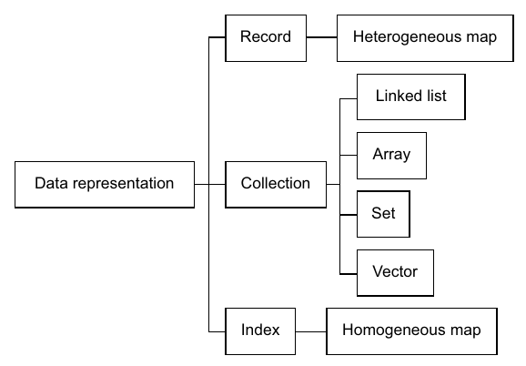
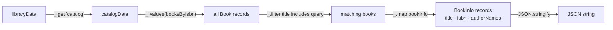

# ۳. دست‌کاری پایه‌ی داده

[← ۲. جدایی کد از داده](02-separation-between-code-and-data.md) · [کتاب](../README.md) · [۴. مدیریت state →](04-state-management.md)

## خلاصه

با کدی جدا از داده، جو و تئو داده را تنها و خودش طراحی می‌کنند. اصل دوم DOP این است که **entityهای داده را با ساختارهای داده‌ی عمومی بنمایانید**: رکوردها به map رشته‌ای ناهمگن بدل می‌شوند، indexها به map رشته‌ای همگن، و مجموعه‌های جایگاهی هر مجموعه‌ای که بخورد (pp. 43, 48–49). بعد هر تکه خبری **مسیر خبر** دارد، مانند `["booksByIsbn", "978-1779501127", "title"]`، و با تابعی عمومی مانند `_.get` از Lodash خواندنی است (pp. 55–57). جو جست‌وجوی کتاب را سرتاپا از تابع‌های عمومی می‌سازد، یعنی `_.get` و `_.map` و `_.filter` و `_.values`، با `JSON.stringify` در پایان. «آهان!» تئو این است که کد هیچ انتزاعی ندارد: تنها دست‌کاری داده است (pp. 58–64). رکوردها کم به گونه نیاز دارند؛ و جو برای جدا کردن عضوهای VIP و Super از **فیلدهای ویژگی** مانند `isVIP` کار می‌کشد (pp. 65–68). بهایش ایمنی است: روش DOP سنجش زمان کامپایل کلاس‌ها را با انعطاف و عمومیت بده‌بستان می‌کند (جدول ۳.۱، ص. ۵۴).

## نکته‌های کلیدی

- **اصل ۲: entityهای داده را با ساختارهای داده‌ی عمومی بنمایانید** (p. 43). کد تنها سست به داده بسته است: کافی است همان کلیدهایی را بداند که به کار می‌برد (p. 44).
- **نمودار entity داده سه گونه گرد آمدن دارد:** رکوردها، مجموعه‌های جایگاهی `[String]` و indexها `{Book}` که کلیدهایشان همیشه رشته‌اند. رابطه‌ها ترکیب یا تداعی‌اند (pp. 46–48).
- **رکوردها map رشته‌ای ناهمگن‌اند؛ و indexها map رشته‌ای همگن** (pp. 48–49).
- **کلاس‌ها ایمنی را به بهای انعطاف می‌خرند.** با map هیچ کلاس `BookInSearchResults` یا سازنده‌ی کپی برای هر گونه‌ای لازم نیست؛ و فیلدها سر اجرا افزودنی و برداشتنی و نام‌عوض‌کردنی‌اند (p. 52).
- **سریالی کردن به JSON مفت می‌آید**، چون رکورد تنها داده است و تابعی عمومی هر رکوردی را سریالی می‌کند (p. 53).
- **مسیرهای خبر درجه‌یک‌اند:** می‌شود در متغیر ذخیره و به تابع فرستادشان. با شیءها هر گونه مسیری کد ویژه‌ی خودش را می‌خواهد (pp. 55–57).
- **بیشتر وقت‌ها لازم نیست گونه‌ی رکوردی را بدانید.** فیلدی ویژگی مانند `isVIP` را بر خبر گونه ترجیح دهید (pp. 65–67).
- **دسترسی به فیلدی از map کمی از عضوی از کلاس کندتر است، و معمولاً نه چندان.** زبان‌های ایستا-نوع گاهی cast می‌خواهند (pp. 56–57).

## فهرست بخش‌ها

*از فهرست خود کتاب، یعنی bookmarkهای PDF؛ شماره‌ی صفحه‌ها چاپی‌اند.*

- ۳.۱ طراحی مدل داده — ص. ۴۴
- ۳.۲ نمایاندن رکوردها به‌شکل map — ص. ۴۸
- ۳.۳ دست‌کاری داده با تابع‌های عمومی — ص. ۵۴
- ۳.۴ حساب کردن نتیجه‌های جست‌وجو — ص. ۵۸
- ۳.۵ چرخاندن رکوردهای گونه‌های مختلف — ص. ۶۵
- خلاصه — ص. ۶۹

## یادداشت‌ها

این فصل تنها *پرسش* از داده را می‌پوشاند؛ و فصل ۴ تغییرهای state سیستم را (p. 44). نمایاندن رکوردها به‌شکل map رشته‌ای، نه شیءهایی نمونه‌شده از کلاس، داده را «شهروندی درجه‌یک می‌کند که تابع‌های عمومی برای افزودن و برداشتن و نام‌عوض‌کردن فیلدها نیرویش می‌دهند» (p. 44). «map رشته‌ای» mapی است با کلیدهای رشته‌ای.

### ۳.۱ طراحی مدل داده

سر طراحی داده به کد فکر نمی‌کنید، و تنها رابطه‌ها تداعی و ترکیب‌اند (p. 44). تئو نقشه‌ی ذهنی داده را به نمودار entity داده با فیلدها بدل می‌کند (شکل ۳.۲، ص. ۴۵)، و بعد هر رابطه‌ای را صریح (pp. 46–47):

- **کتاب ↔ نویسنده**، چندبه‌چند: هر `Book` مجموعه‌ای از شناسه‌ی نویسنده‌ها را دارد و هر `Author` مجموعه‌ای از ISBN کتاب‌ها. هیچ‌کدام آن یکی را ندارد؛ رابطه ناسرراست است و از indexی می‌گذرد.
- **شناسه‌ها:** شناسه‌ی هر کتابی همان ISBN آن است، شناسه‌ای عددی و تجاری که قرار است یکتا باشد. شناسه‌ی هر نویسنده‌ای نامش با حرف کوچک و خط تیره جای فاصله است، به فرض آنکه دو نویسنده هم‌نام نباشند.
- **همه‌ی indexها** در `Catalog` می‌نشینند: `booksByIsbn` به‌شکل `{Book}` و `authorsById` به‌شکل `{Author}`. ماژول `UserManagement` دو index `librariansByEmail` و `membersByEmail` را دارد.

هر **مجموعه‌ی جایگاهی** عضوهایش را به ترتیب نگه می‌دارد، مانند فهرست یا array، و `[String]` نوشته می‌شود. هر **indexی** دسترسی با کلید می‌دهد، مانند hash map، و `{Book}` نوشته می‌شود؛ و در مدل داده، کلیدهای index همیشه رشته‌اند (p. 46).


*Figure 3.3 (p. 47): پیکان‌های توپر دربرگیری جایگاهی یا index‌شده‌اند؛ و خط‌چین‌ها ارجاع با شناسه. کتاب برای index `{Book}` و برای مجموعه‌ی جایگاهی `[String]` می‌نویسد.*

جو گونه‌ی سوم گرد آمدن را نام می‌گذارد: آنچه «entity» صدایش می‌کردند، در زبان علوم کامپیوتر، **رکورد** است. یعنی مجموعه‌ای از فیلدها، شاید از گونه‌های مختلف (pp. 47–48). پس نمودار entity داده از رکوردهایی ساخته می‌شود که مقدارهایشان بدوی یا مجموعه‌ی جایگاهی یا index‌اند، و رابطه‌های میان رکوردها ترکیب یا تداعی‌اند، هر کدام یک‌به‌یک یا یک‌به‌چند یا چندبه‌چند (p. 48).

### ۳.۲ نمایاندن رکوردها به‌شکل map

روش DOP حرف ویژه‌ای در باب مجموعه‌ها ندارد، که می‌توانند فهرست پیوندی یا array یا vector یا set باشند؛ کتاب فعلاً array به کار می‌برد. indexها map رشته‌ای **همگن**‌اند، که همه‌ی مقدارهایشان هم‌گونه است، مانند OOP. شگفتی این است که **رکوردها map رشته‌ای ناهمگن‌اند**، که مقدارهایشان گونه‌های مختلف دارد (pp. 48–49). این برای زبان‌های OOP و FP یکسان برپاست. در JavaScript و Python و Ruby طبیعی حس می‌شود، و در Java و C# کمی دست‌وپاگیرتر (p. 48).



*Figure 3.4 (p. 49): سه خشت ساختمانی، یعنی رکورد و مجموعه و شاخص، بس است تا داده‌ی کل سیستم را بنمایاند.*

رمان گرافیکی محبوب جو، *Watchmen* از آلن مور و دیو گیبونز (۱۹۸۷)، با دو نسخه در کتابخانه‌ی `nyc-central-lib` که یکی‌شان بیرون است، به map لفظی JavaScript بدل می‌شود (listingهای ۳.۱ و ۳.۲، ص. ۵۰). در Java از متدهای کارخانه‌ی immutable `Map.of` و `List.of` کار می‌کشد (listing ۳.۳، ص. ۵۱).

**چرا تئو کلاس‌ها را ترجیح می‌دهد، و چه خرج می‌دهند** (pp. 51–52):

- کلاس‌ها شکل داده را بخشی از برنامه می‌کنند، پس IDE نام فیلدها را خودکار کامل می‌کند و خطاها سر کامپایل گرفته می‌شوند.
- ولی نشان دادن کتابی در نتیجه‌های جست‌وجو، با *نام* نویسنده‌ها و بی نسخه‌های کتاب، کلاس تازه‌ی `BookInSearchResults` و سازنده‌ی کپی می‌خواهد. کلاس‌ها ایمنی را به بهای انعطاف می‌آورند.

**عمومیت** (pp. 52–53): رکورد تنها داده است، پس یک تابع عمومی هر رکوردی را به JSON سریالی می‌کند، بی هیچ reflection مانند آنچه کتابخانه‌ی Gson به کار می‌برد. زبان JavaScript تابع `JSON.stringify` را دارد، ولی هیچ چیز توکار برای انداختن چند کلید یا نام‌عوض‌کردنشان. کتاب برای چنین تابع‌های عمومی **Lodash** را به کار می‌برد، که برای Java و C# و Python با نام pydash و Ruby هم درگاه دارد. هیچ چیز ویژه‌ای در Lodash نیست: کتابخانه‌های دیگر یا کد دست‌ساز هم کار می‌کنند (p. 53).

| | روش OOP | روش DOP (جدول ۳.۱، ص. ۵۴) |
|---|---|---|
| ایمنی | بالا | پایین |
| انعطاف | پایین | بالا |
| عمومیت | پایین | بالا |

> **In practice:** dlt هر ردیف منبع را dict می‌بیند و ClickHouse ستون `JSON` و `Map` دارد: رکورد به‌شکل map در سراسر pipeline ما هست.
>
> **Your turn:** یک منبع ستون JSON با کلیدهای متغیر دارد. آن را در Bronze چطور نگه می‌دارید؟
>
> *Answer:* در Bronze به‌شکل map خام، بی‌آن‌که برای هر کلید ستون بسازید، و در Silver کلیدهای لازم را با مسیر استخراج کنید. map رکوردهای ناهمگون را بدون تغییر schema نگه می‌دارد و این همان آزادی‌ای است که کتاب از map انتظار دارد (pp. 48–54).

### ۳.۳ دست‌کاری داده با تابع‌های عمومی

جو رکوردی `Catalog` با *Watchmen* و دو نویسنده‌اش می‌سازد (listing ۳.۵، صص. ۵۴–۵۵). در نمودار entity، رکوردها و indexها روشن از هم جدایند، ولی در کد هر دو داده‌ی خالی‌اند. «در DOP، داده به‌شکل داده نمایانده می‌شود»، که تصویر کردن هر بخشی از داده‌ی سیستم را آسان می‌کند؛ و تئو بدیهی‌گویی‌اش می‌نامد، حقیقتی آشکار (p. 55).

**مسیرهای خبر.** هر تکه خبری مسیری دارد، مانند مسیر فایلی که نام‌هایش entityهای تودرتوست (p. 55):

```js
_.get(catalogData, ["booksByIsbn", "978-1779501127", "title"])
// → "Watchmen"
```

تئو `get` خودش را در چند دقیقه به‌شکل حلقه‌ای روی مسیر می‌نویسد (listing ۳.۷، ص. ۵۶). مسیرها رشته و عدد صحیح را قاطی می‌کنند: کتاب نخست آلن مور `["catalog", "authorsById", "alan-moore", "bookIsbns", 0]` است (شکل ۳.۵، ص. ۵۷).

**نکته‌هایی که جو و تئو ته‌نشین می‌کنند** (pp. 56–57):

| پرسش | پاسخ |
|---|---|
| تابع `_.get` در Java کار می‌کند؟ | برای به کار بردن ملموس مقداری castش می‌کنید، یعنی `((String)watchmen.get("title")).toUpperCase()`، چون آن map یک `Map<String,Object>` است؛ و بیشتر وقت‌ها کد تنها داده را این‌ور آن‌ور می‌فرستد. واژه‌ی `dynamic` در C# از آن cast می‌پرهیزد |
| کارایی؟ | دسترسی به فیلدی از map کمی از عضوی از کلاس کندتر است؛ و معمولاً نه چندان |
| مگر `catalogData.booksByIsbn["…"].title` در OOP هم کار نمی‌کند؟ | با شیءها برای هر گونه مسیری کد ویژه می‌خواهید: وارد کردن کلاس در Java، و نقطه برای عضوها ولی کروشه برای کلیدهای map حتی در JavaScript. با map، یک تابع عمومی مسیر را آرگومان می‌گیرد |

مسیر خبر شهروندی درجه‌یک است: می‌شود در متغیری ذخیره و به تابعی فرستادش (p. 57).

> **Try it:** [مسیرهای خبر](../widgets/03-information-path.html) — درخت catalog از شکل ۳.۵ را کلیک‌به‌کلیک بگردید، یا مسیری تایپ کنید، و ببینید `_.get` چطور قدم‌به‌قدم حلش می‌کند، کلیدهای جاافتاده هم.

> **In practice:** تابع‌های عمومی روی map همان transform تکرارپذیر در pipeline‌اند، مثل hash کردن PII.
>
> **Your turn:** hash کردن PII در هر منبع جدا با کد خاص آن منبع نوشته شده. چرا یک تابع عمومی با فهرست مسیر فیلدها بهتر است؟
>
> *Answer:* یک تابع `hash_fields(record, paths)` که فهرست مسیرهای PII هر منبع را از config می‌گیرد یک بار تست می‌شود و افزودن منبع فقط فهرست را عوض می‌کند. کتاب می‌گوید تابع‌های عمومی روی map جای accessorهای خاص هر کلاس را می‌گیرند (pp. 55–58).

### ۳.۴ حساب کردن نتیجه‌های جست‌وجو

هر نتیجه‌ی جست‌وجو رکوردی `BookInfo` با `title` و `isbn` و `authorNames` است (listing ۳.۱۰، ص. ۵۸). جو آن را در چهار تابع می‌سازد (pp. 59–64):

| تابع | ماژول | چه می‌کند |
|---|---|---|
| `authorNames(catalogData, book)` | `Catalog` | با `_.map` مقدار `authorIds` کتاب را به `["authorsById", id, "name"]` می‌نگارد |
| `bookInfo(catalogData, book)` | `Catalog` | map لفظی می‌سازد؛ بی هیچ کلاسی برای `BookInfo` |
| `searchBooksByTitle(catalogData, query)` | `Catalog` | با `_.values` از `booksByIsbn`، با `_.filter` بر پایه‌ی `title.includes(query)`، و با `_.map` به `bookInfo` |
| `searchBooksByTitleJSON(libraryData, query)` | `Library` | کلید `"catalog"` را می‌گیرد، می‌جوید، و `JSON.stringify` |

تئو ایراد می‌گیرد که `_.map` بوی برنامه‌نویسی تابعی می‌دهد. جو می‌گوید تنها تابعی است که مقدارهای مجموعه‌ای را دگر می‌کند، و تئو `map` و `filter` را به‌شکل حلقه‌ی `for` خالی می‌نویسد (listingهای ۳.۱۲ و ۳.۱۷). جو `_.get(book, "title")` را بر `book.title` ترجیح می‌دهد چون نشانه‌ی نقطه و کروشه شاید در برخی زبان‌ها روی map کار نکند؛ «زبان‌ناشناس بودن بها دارد»، تئو می‌گوید (pp. 61–62). در listing ۳.۲۳، تابع `_.filter` یک‌راست همان map از `booksByIsbn` را می‌گیرد، چون اگر mapی بگیرد روی مقدارها می‌گردد (p. 64).

فهرست فیلدهای `BookInfo` بخشی از برنامه نیست؛ در نمودار entity یا مستند تابع می‌نویسیدش. فصل‌های ۷ و ۱۲ نشان می‌دهند چطور بخشی از برنامه‌اش کنید (p. 60).



*نمودار vault از listing ۳.۲۳ (pp. 63–64).*

«مهم این نیست که کد موجز است، بلکه این است که کد هیچ انتزاعی ندارد. تنها دست‌کاری داده است!» جو آن را به درس آموزگار مراقبه‌اش می‌ماند که واقعیت را بی انتزاع‌های ساخته‌ی اندیشه بگیرد (p. 64).

> **Try it:** [جست‌وجو به‌شکل دست‌کاری داده](../widgets/03-search-pipeline.html) — تابع `searchBooksByTitle` را مرحله‌به‌مرحله روی catalogی کوچک اجرا کنید، پرسش را عوض کنید، و فیلدی به کتابی بیفزایید تا ببینید کدام کد اهمیتش می‌دهد.

### ۳.۵ چرخاندن رکوردهای گونه‌های مختلف

اگر رکورد تنها mapی است، گونه‌اش را از کجا می‌دانید؟ «بیشتر وقت‌ها لازم نیست گونه‌ی رکورد را بدانید»؛ آنچه مهم است مقدار فیلدهاست. تابع `authorNames` تنها `authorIds` را اهمیت می‌دهد (p. 65). گونه‌های رکورد خودشان را می‌چرخانند:

- **کتابدار یا عضو:** بسنجید رکورد در کدام index یافت می‌شود. تابع `isLibrarian` همان `_.has(_.get(userManagement, "librariansByEmail"), email)` است (listingهای ۳.۲۶ و ۳.۲۷، صص. ۶۵–۶۶). داده‌ی نمونه گذرواژه‌ها را ساده‌لوحانه با base-64 رمز می‌کند تا کار ساده بماند.
- **عضوهای VIP و Super:** جو می‌توانست indexهای `VIPMembersByEmail` و `SuperMembersByEmail` را بیفزاید، ولی ترجیح می‌دهد `isVIP: true` یا `isSuper: true` را به رکورد عضو بیفزاید و مسیر `["membersByEmail", email, "isVIP"]` را بسنجد (listingهای ۳.۲۹ و ۳.۳۰، صص. ۶۶–۶۷).

چرا فیلدی `type` نه؟ عضوی می‌تواند هم VIP باشد هم Super. مجموعه‌ای `types` کار می‌کرد و گاهی به کار می‌آید، ولی جو فیلدی ویژگی و بولی برای هر ویژگی را ساده‌تر می‌یابد (p. 67). با این حال کتابدارها و عضوها گونه‌های رکورد جدا می‌مانند، چون در داده تفاوت دارند: عضوها قرض کتاب دارند و کتابدارها نه (p. 68). شکل ۳.۶ دو فیلد `isVIP` و `isSuper` را به `Member` می‌افزاید (p. 68).

پیوند پایانی تئو: مراقبه یعنی تجربه‌ی واقعیت بی صافی اندیشه‌ها، و DOP یعنی رفتار با داده به‌شکل داده، بی صافی کلاس‌ها (p. 69).

| تابع Lodash (p. 70) | توضیح |
|---|---|
| `get(map, path)` | مقدار `map` در `path` |
| `has(map, path)` | آیا `map` در `path` فیلدی دارد |
| `merge(mapA, mapB)` | درهم‌آمیزی بازگشتی دو map |
| `values(map)` | آرایه‌ای از مقدارهای map |
| `filter(coll, pred)` | عضوهایی که `pred` برایشان درست است |
| `map(coll, f)` | هر عضوی از `f` گذرانده |

## بده‌بستان‌ها در یک نگاه

| | رکورد به‌شکل نمونه‌ی کلاس | رکورد به‌شکل map رشته‌ای در DOP |
|---|---|---|
| سنجش نام فیلد | سر کامپایل، با تکمیل خودکار IDE | برنامه نمی‌سنجدش، تا فصل‌های ۷ و ۱۲ |
| شکلی تازه، مانند نتیجه‌ی جست‌وجو | کلاسی تازه و سازنده‌ی کپی | map لفظی تازه‌ای |
| قالب JSON | یا reflection یا کلاسی برای هر شکل | یک تابع عمومی |
| خواندن مقداری تودرتو | کدی ویژه برای هر مسیری | عبارت `_.get(data, path)`، با مسیری که خودش داده است |
| زبان‌های ایستا | طبیعی | سر به کار بردن مقداری، cast از `Object` (p. 56) |
| کارایی | دسترسی به عضو | دسترسی کمی کندتر به map، معمولاً نه چندان (p. 57) |

## فراتر از کتاب

- **اثر Clojure.** پیشینه‌ی جو، یعنی Java و بعد Clojure، تصادفی نیست: کد اصطلاحی Clojure entityهای دامنه را به‌شکل map خالی با کلیدهای keyword مدل می‌کند و با کتابخانه‌ای بزرگ از تابع‌های عمومی دست‌کاری. سخنرانی‌های ریچ هیکی، مانند «Simple Made Easy» (۲۰۱۱) و «The Value of Values» (۲۰۱۲)، از همین سبک پشتیبانی می‌کنند. تابع `_.get` از Lodash با `get-in` از Clojure می‌خواند.
- **مسیرهای جاافتاده.** تابع `_.get` برای مسیری که نیست `undefined` برمی‌گرداند؛ و Lodash مقدار پیش‌فرضی اختیاری را هم آرگومان سوم می‌پذیرد. تابع `get` دست‌ساز تئو (listing ۳.۷) در عوض وقتی بکوشد میانه‌ی مسیر در `undefined` index بزند خطا می‌اندازد. widget رفتار Lodash را نشان می‌دهد.
- **گونه‌دهی ساختاری به‌شکل میانه‌ای.** زبان TypeScript شکل شیءهای خالی را بی کلاس وصف می‌کند، پس `BookInfo` می‌تواند نام‌مستعاری گونه روی map لفظی باشد. پیوست B کتاب از دسترسی عمومی به داده در زبان‌های ایستا-نوع می‌گوید.
- **فیلدهای ویژگی در برابر اجتماع برچسب‌خورده.** زبان‌های تابعی بیشتر وقت‌ها برچسب `type` بسته‌ای را ترجیح می‌دهند که کامپایلر فراگیر می‌سنجدش. فیلدهای ویژگی بازند: هر رکوردی می‌تواند `isVIP` را بی عوض کردن تعریف گونه‌ای ببرد، که به هدف انعطاف جو می‌خورد ولی سنجش فراگیری را وامی‌گذارد.

## پیوندها

- **پیشین:** [۲. جدایی کد از داده](02-separation-between-code-and-data.md) تابع‌های `isLibrarian` و `getBookLendings` را پیاده‌نشده گذاشت؛ و این فصل نخستی را پیاده می‌کند.
- **پسین:** [۴. مدیریت state](04-state-management.md) *تغییرهای* همین داده را می‌چرخاند، که این فصل از آن پرهیخت.
- **برگرداندن ایمنی:** [۷. اعتبارسنجی پایه‌ی داده](07-basic-data-validation.md) و [۱۲. اعتبارسنجی پیشرفته‌ی داده](12-advanced-data-validation.md) شکل رکوردها را با JSON Schema باز بخشی از برنامه می‌کنند.
- **تابع‌های عمومی بیشتر:** [۱۴. دست‌کاری پیشرفته‌ی داده](14-advanced-data-manipulation.md).

## خودتان را بسنجید

1. اصل ۲ از DOP را بگویید، و بگویید رکوردها و indexها و مجموعه‌ها چطور نمایانده می‌شوند.
   <details><summary>پاسخ</summary>همه‌ی entityهای داده را با ساختارهای داده‌ی عمومی بنمایانید (p. 43). رکوردها map رشته‌ای ناهمگن‌اند، indexها map رشته‌ای همگن، و مجموعه‌های جایگاهی می‌توانند هر مجموعه‌ی خورنده‌ای باشند؛ کتاب array به کار می‌برد (pp. 48–49).</details>
2. مسیر خبر چیست؟ مسیر کتاب نخست آلن مور را بدهید.
   <details><summary>پاسخ</summary>زنجیره‌ی کلیدها و indexهایی که به تکه‌ای خبر در داده‌ی تودرتو می‌رساند، مانند مسیر فایل. کتاب نخست آلن مور `["catalog", "authorsById", "alan-moore", "bookIsbns", 0]` است (pp. 55–57).</details>
3. چرا جو می‌گوید مسیرهای خبر در DOP درجه‌یک‌اند ولی با شیءها نه؟
   <details><summary>پاسخ</summary>با map، یک تابع عمومی مانند `_.get` مسیر را آرگومان می‌گیرد، پس می‌شود مسیری را ذخیره و این‌ور آن‌ور فرستاد. با شیءها برای هر گونه مسیری کد ویژه می‌خواهید: وارد کردن کلاس در Java، و نقطه برای عضوها در برابر کروشه برای کلیدهای map در JavaScript (p. 57).</details>
4. مدل کلاس‌محور برای نشان دادن کتاب‌ها در نتیجه‌های جست‌وجو چه می‌خواهد، و چرا DOP آن را نمی‌خواهد؟
   <details><summary>پاسخ</summary>کلاس `BookInSearchResults` بی `bookItems`، با `authorNames` جای شناسه‌ی نویسنده‌ها، و سازنده‌ی کپی از `Book`. در DOP رکورد mapی است، پس `bookInfo` تنها map لفظی تازه‌ای می‌سازد (pp. 52, 60).</details>
5. بنا بر جدول ۳.۱، روش DOP چه وامی‌گذارد و چه می‌برد؟
   <details><summary>پاسخ</summary>ایمنی را وامی‌گذارد، که در OOP بالاست و در DOP پایین، و انعطاف و عمومیت را می‌برد، که در OOP پایین‌اند و در DOP بالا (p. 54).</details>
6. کتاب عضوهای VIP را چطور جدا می‌کند، و چرا نه با فیلدی `type`؟
   <details><summary>پاسخ</summary>با فیلدی ویژگی و بولی، یعنی `isVIP`، که از راه مسیر `["membersByEmail", email, "isVIP"]` سنجیده می‌شود. عضوی می‌تواند هم VIP باشد هم Super، و جو بولی برای هر ویژگی را از مجموعه‌ای `types` ساده‌تر می‌یابد (pp. 66–67).</details>
7. «آهان!» تئو در باب کد جست‌وجو چه بود؟
   <details><summary>پاسخ</summary>نه آنکه کد موجز است، بلکه آنکه هیچ انتزاعی ندارد: تنها دست‌کاری داده است (p. 64).</details>
