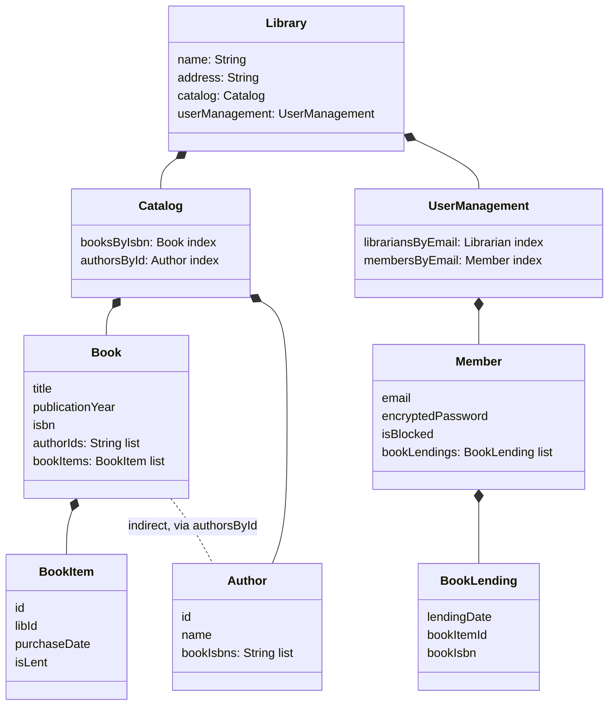
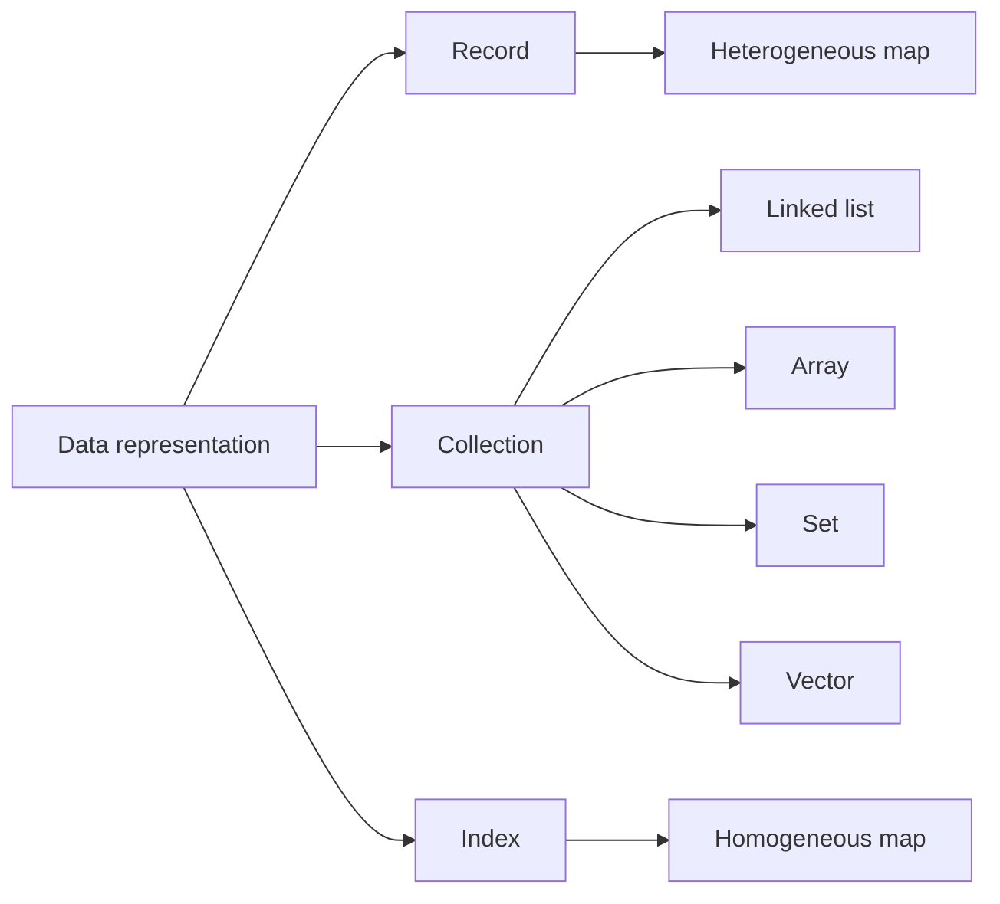
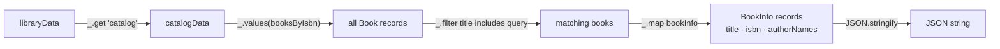

# 3. Basic data manipulation

[← 2. Separation between code and data](02-separation-between-code-and-data.md) · [Book](../README.md) · [4. State management →](04-state-management.md)

## Summary

With code separated from data, Joe and Theo design the data on its own. The second principle of DOP is to **represent data entities with generic data structures**: records become heterogeneous string maps, indexes become homogeneous string maps, and positional collections are whatever collection suits (pp. 43, 48–49). Every piece of information then has an **information path**, such as `["booksByIsbn", "978-1779501127", "title"]`, and can be read with a generic function like Lodash's `_.get` (pp. 55–57). Joe builds book search entirely from generic functions (`_.get`, `_.map`, `_.filter`, `_.values`), with `JSON.stringify` at the end. Theo's "Aha!" is that the code contains no abstractions: it is just data manipulation (pp. 58–64). Records rarely need a type; to tell VIP and Super members apart, Joe uses **feature fields** like `isVIP` (pp. 65–68). The price is safety: DOP trades the compile-time checking of classes for flexibility and genericity (table 3.1, p. 54).

## Key takeaways

- **Principle #2: represent data entities with generic data structures** (p. 43). Code depends on data only weakly: it needs to know just the keys it uses (p. 44).
- **A data entity diagram has three kinds of aggregation:** records, positional collections (`[String]`) and indexes (`{Book}`, whose keys are always strings). The relations are composition or association (pp. 46–48).
- **Records are heterogeneous string maps; indexes are homogeneous string maps** (pp. 48–49).
- **Classes buy safety at the cost of flexibility.** With maps there is no `BookInSearchResults` class or copy constructor for each variation; fields can be added, removed and renamed at run time (p. 52).
- **JSON serialization comes for free**, because a record is just data and a generic function serializes any record (p. 53).
- **Information paths are first-class:** they can be stored in variables and passed to functions. With objects, each kind of path needs specific code (pp. 55–57).
- **Most of the time, there's no need to know a record's type.** Prefer a feature field such as `isVIP` over type information (pp. 65–67).
- **Accessing a map field is slightly slower than a class member, usually not significantly.** Statically typed languages sometimes need casts (pp. 56–57).

## Section outline

*From the book’s own table of contents (PDF bookmarks); printed page numbers.*

- 3.1 Designing a data model — p. 44
- 3.2 Representing records as maps — p. 48
- 3.3 Manipulating data with generic functions — p. 54
- 3.4 Calculating search results — p. 58
- 3.5 Handling records of different types — p. 65
- Summary — p. 69

## Notes

The chapter covers data *query* only; chapter 4 covers changes to system state (p. 44). Representing records as string maps, rather than objects instantiated from classes, makes data "a first-class citizen powered by generic functions to add, remove, or rename fields" (p. 44). ("String maps" are maps with string keys.)

### 3.1 Designing a data model

When designing the data you don't think about code, and the only relations are association and composition (p. 44). Theo turns the data mind map into a data entity diagram with fields (figure 3.2, p. 45), then makes each relation explicit (pp. 46–47):

- **Book ↔ Author** (many-to-many): each `Book` holds a collection of author IDs and each `Author` a collection of book ISBNs. Neither holds the other; the relation is indirect and goes through an index.
- **IDs:** a book's ID is its ISBN, a numeric commercial identifier intended to be unique. An author's ID is the author's name in lowercase with dashes for spaces, assuming no two authors share a name.
- **Indexes** live in `Catalog`: `booksByIsbn` (`{Book}`) and `authorsById` (`{Author}`). `UserManagement` holds `librariansByEmail` and `membersByEmail`.

A **positional collection** keeps its elements in order, like a list or an array, and is noted `[String]`. An **index** gives access by key, like a hash map, and is noted `{Book}`; in a data model, index keys are always strings (p. 46).



*Condensed from figure 3.3 (p. 47); `Librarian` (email, encryptedPassword) omitted. The book writes `{Book}` for an index and `[String]` for a positional collection.*

Joe names the third kind of aggregation: what they had been calling an "entity" is, in computer science terms, a **record**. That is a collection of fields, possibly of different types (pp. 47–48). So a data entity diagram consists of records whose values are primitives, positional collections or indexes, and the relations between records are composition or association, each one-to-one, one-to-many or many-to-many (p. 48).

### 3.2 Representing records as maps

DOP has nothing special to say about collections, which can be linked lists, arrays, vectors or sets (the book uses arrays for now). Indexes are **homogeneous** string maps, where all values have the same type, as in OOP. The surprise is that **records are heterogeneous string maps**, whose values have different types (pp. 48–49). This holds for OOP and FP languages alike. It feels natural in JavaScript, Python and Ruby, and is a bit more cumbersome in Java and C# (p. 48).



*Redrawn from figure 3.4 (p. 49).*

Joe's favourite graphic novel, *Watchmen* by Alan Moore and Dave Gibbons (1987), with two copies at library `nyc-central-lib`, one of them out, becomes a JavaScript map literal (listings 3.1–3.2, pp. 50). In Java it uses the immutable `Map.of` and `List.of` factory methods (listing 3.3, p. 51).

**Why Theo prefers classes, and what they cost** (pp. 51–52):

- Classes make the data shape part of the program, so the IDE autocompletes field names and errors are caught at compile time.
- But showing a book in search results, with author *names* and no book items, needs a new `BookInSearchResults` class and a copy constructor. Classes bring safety at the cost of flexibility.

**Genericity** (pp. 52–53): a record is just data, so one generic function serializes any record to JSON, with no reflection like the Gson library uses. JavaScript has `JSON.stringify`, but nothing built in to omit several keys or rename keys. The book uses **Lodash** for such generic functions, which has ports for Java, C#, Python (pydash) and Ruby. There is nothing special about Lodash: other libraries or custom code would do (p. 53).

| | OOP | DOP (table 3.1, p. 54) |
|---|---|---|
| Safety | High | Low |
| Flexibility | Low | High |
| Genericity | Low | High |

### 3.3 Manipulating data with generic functions

Joe builds a `Catalog` record with *Watchmen* and its two authors (listing 3.5, pp. 54–55). In the entity diagram records and indexes are clearly distinct, but in code both are plain data. "In DOP, data is represented as data," which makes any part of the system data easy to visualize; Theo calls it a lapalissade, an obvious truth (p. 55).

**Information paths.** Every piece of information has a path, like a file path whose names are nested entities (p. 55):

```js
_.get(catalogData, ["booksByIsbn", "978-1779501127", "title"])
// → "Watchmen"
```

Theo writes his own `get` as a loop over the path in a few minutes (listing 3.7, p. 56). Paths mix strings and integers: Alan Moore's first book is `["catalog", "authorsById", "alan-moore", "bookIsbns", 0]` (figure 3.5, p. 57).

**Points Joe and Theo settle** (pp. 56–57):

| Question | Answer |
|---|---|
| Does `_.get` work in Java? | To use a value concretely you cast it, `((String)watchmen.get("title")).toUpperCase()`, because the map is a `Map<String,Object>`; often code just passes data around. C#'s `dynamic` avoids the cast |
| Performance? | Map field access is slightly slower than a class member; usually not significant |
| Doesn't `catalogData.booksByIsbn["…"].title` work in OOP too? | With objects you need specific code for each kind of path: class imports in Java, and dot notation for members but brackets for map keys even in JavaScript. With maps, one generic function takes the path as an argument |

The information path is a first-class citizen: it can be stored in a variable and passed to a function (p. 57).

> **Try it:** [Information paths](../widgets/03-information-path.html) — click through the catalog tree from figure 3.5, or type a path, and see `_.get` resolve it step by step, including missing keys.

### 3.4 Calculating search results

A search result is a `BookInfo` record with `title`, `isbn` and `authorNames` (listing 3.10, p. 58). Joe builds it in four functions (pp. 59–64):

| Function | Module | What it does |
|---|---|---|
| `authorNames(catalogData, book)` | `Catalog` | `_.map` the book's `authorIds` to `["authorsById", id, "name"]` |
| `bookInfo(catalogData, book)` | `Catalog` | Build a map literal; no class for `BookInfo` |
| `searchBooksByTitle(catalogData, query)` | `Catalog` | `_.values` of `booksByIsbn`, `_.filter` by `title.includes(query)`, `_.map` to `bookInfo` |
| `searchBooksByTitleJSON(libraryData, query)` | `Library` | Get `"catalog"`, search, `JSON.stringify` |

Theo objects that `_.map` smells like functional programming. Joe says it's just a function that transforms a collection's values, and Theo writes `map` and `filter` as plain `for` loops (listings 3.12, 3.17). Joe prefers `_.get(book, "title")` to `book.title` because dot and bracket notation might not work on maps in some languages; "being language-agnostic has a price," says Theo (pp. 61–62). In listing 3.23, `_.filter` is passed the `booksByIsbn` map directly, since given a map it iterates over the values (p. 64).

The field list of a `BookInfo` isn't part of the program; you document it in the entity diagram or the function's documentation. Chapters 7 and 12 show how to make it part of the program (p. 60).



*The vault's diagram of listing 3.23 (pp. 63–64).*

"The important thing is not that the code is concise, but that the code contains no abstractions. It's just data manipulation!" Joe likens it to his meditation teacher's lesson of grasping reality without the abstractions created by thought (p. 64).

> **Try it:** [Search as data manipulation](../widgets/03-search-pipeline.html) — run `searchBooksByTitle` stage by stage over a small catalog, change the query, and add a field to a book to see which code cares.

### 3.5 Handling records of different types

If a record is just a map, how do you know its type? "Most of the time, there's no need to know the record type"; what matters is the values of the fields. `authorNames` only cares about `authorIds` (p. 65). The record types handle themselves:

- **Librarian or member:** check which index the record is found in. `isLibrarian` is `_.has(_.get(userManagement, "librariansByEmail"), email)` (listings 3.26–3.27, pp. 65–66). The sample data encodes passwords as naive base-64 to keep things simple.
- **VIP and Super members:** Joe could add `VIPMembersByEmail` and `SuperMembersByEmail` indexes, but prefers adding `isVIP: true` or `isSuper: true` to the member record and checking the path `["membersByEmail", email, "isVIP"]` (listings 3.29–3.30, pp. 66–67).

Why not a `type` field? A member can be both VIP and Super. A `types` collection would work and is sometimes helpful, but Joe finds a Boolean **feature field** per feature simpler (p. 67). Librarians and members stay separate record types, though, because they differ in data: members have book lendings and librarians don't (p. 68). Figure 3.6 adds `isVIP` and `isSuper` to `Member` (p. 68).

Theo's closing connection: meditation means experiencing reality without the filter of thoughts, and DOP means treating data as data, without the filter of classes (p. 69).

| Lodash function (p. 70) | Description |
|---|---|
| `get(map, path)` | The value of `map` at `path` |
| `has(map, path)` | Whether `map` has a field at `path` |
| `merge(mapA, mapB)` | Recursive merge of two maps |
| `values(map)` | Array of the map's values |
| `filter(coll, pred)` | Elements for which `pred` is true |
| `map(coll, f)` | Each element run through `f` |

## Trade-offs at a glance

| | Records as class instances | Records as string maps (DOP) |
|---|---|---|
| Field names checked | At compile time, with IDE autocomplete | Not by the program (until chapters 7 and 12) |
| A new shape (search result) | A new class and a copy constructor | A new map literal |
| JSON | Reflection or a class per shape | One generic function |
| Reading a nested value | Specific code per path | `_.get(data, path)`, with the path as data |
| Static languages | Natural | Casts from `Object` when you use a value (p. 56) |
| Performance | Member access | Slightly slower map access, usually not significant (p. 57) |

## Beyond the book

- **Clojure's influence.** Joe's background (Java, then Clojure) is no accident: idiomatic Clojure models domain entities as plain maps with keyword keys and manipulates them with a large library of generic functions. Rich Hickey's talks, such as "Simple Made Easy" (2011) and "The Value of Values" (2012), argue for this style. Lodash's `_.get` corresponds to Clojure's `get-in`.
- **Missing paths.** `_.get` returns `undefined` for a path that doesn't exist; Lodash also accepts an optional default value as a third argument. Theo's custom `get` (listing 3.7) would instead throw when it tries to index into `undefined` partway down the path. The widget shows the Lodash behaviour.
- **Structural typing as a middle ground.** TypeScript describes the shape of plain objects without classes, so a `BookInfo` can be a type alias over a map literal. Appendix B of the book discusses generic data access in statically typed languages.
- **Feature fields vs. tagged unions.** Functional languages often prefer a closed `type` tag checked exhaustively by the compiler. Feature fields are open: any record can carry `isVIP` without changing a type definition, which suits Joe's goal of flexibility but gives up exhaustiveness checks.

## Connections

- **Previous:** [2. Separation between code and data](02-separation-between-code-and-data.md) left `isLibrarian` and `getBookLendings` unimplemented; this chapter implements the first.
- **Next:** [4. State management](04-state-management.md) handles *changes* to this data, which this chapter avoided.
- **Getting safety back:** [7. Basic data validation](07-basic-data-validation.md) and [12. Advanced data validation](12-advanced-data-validation.md) make record shapes part of the program again, with JSON Schema.
- **More generic functions:** [14. Advanced data manipulation](14-advanced-data-manipulation.md).

## Check yourself

1. State DOP Principle #2, and say how records, indexes and collections are represented.
   <details><summary>Answer</summary>Represent data entities with generic data structures (p. 43). Records are heterogeneous string maps, indexes are homogeneous string maps, and positional collections can be any suitable collection; the book uses arrays (pp. 48–49).</details>
2. What is an information path? Give the path to Alan Moore's first book.
   <details><summary>Answer</summary>The sequence of keys and indices that leads to a piece of information in nested data, like a file path. Alan Moore's first book is `["catalog", "authorsById", "alan-moore", "bookIsbns", 0]` (pp. 55–57).</details>
3. Why does Joe say information paths are first-class in DOP but not with objects?
   <details><summary>Answer</summary>With maps, one generic function such as `_.get` takes the path as an argument, so a path can be stored and passed around. With objects you need specific code for each kind of path: class imports in Java, and dot notation for members versus brackets for map keys in JavaScript (p. 57).</details>
4. What does a class-based model need in order to show books in search results, and why doesn't DOP need it?
   <details><summary>Answer</summary>A `BookInSearchResults` class without `bookItems`, with `authorNames` in place of author IDs, and a copy constructor from `Book`. In DOP a record is a map, so `bookInfo` simply builds a new map literal (pp. 52, 60).</details>
5. According to table 3.1, what does DOP give up and what does it gain?
   <details><summary>Answer</summary>It gives up safety (high in OOP, low in DOP) and gains flexibility and genericity (low in OOP, high in DOP) (p. 54).</details>
6. How does the book distinguish VIP members, and why not with a `type` field?
   <details><summary>Answer</summary>With a Boolean feature field, `isVIP`, checked via the path `["membersByEmail", email, "isVIP"]`. A member can be both VIP and Super, and Joe finds a Boolean per feature simpler than a `types` collection (pp. 66–67).</details>
7. What was Theo's "Aha!" about the search code?
   <details><summary>Answer</summary>It isn't that the code is concise, but that it contains no abstractions: it is just data manipulation (p. 64).</details>
