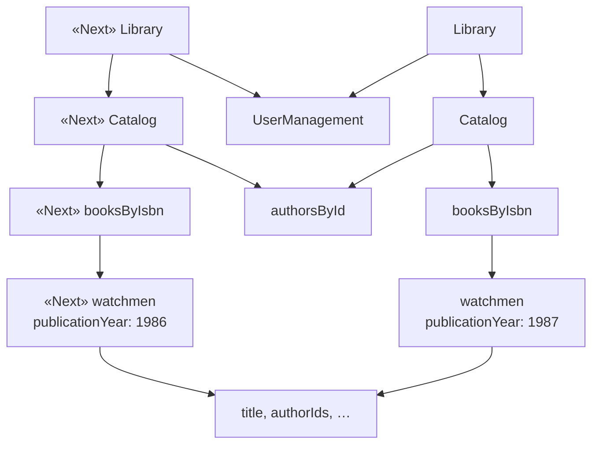
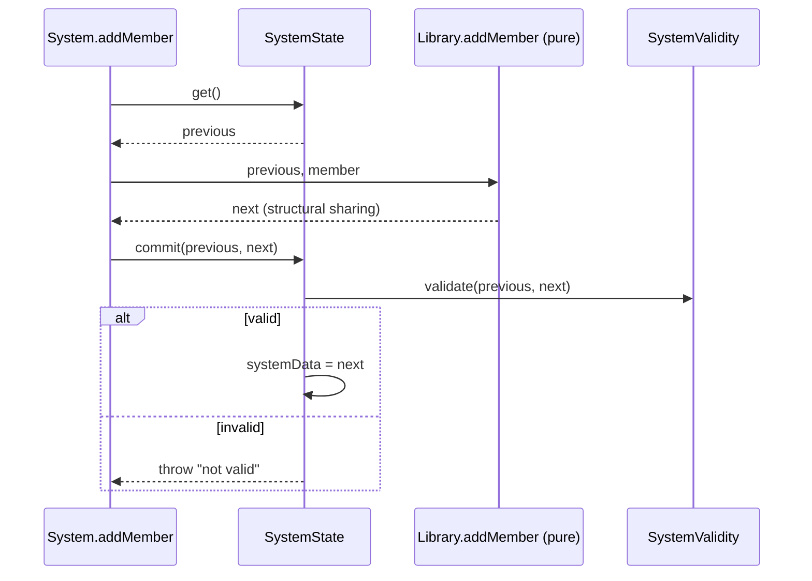

# 4. State management

[← 3. Basic data manipulation](03-basic-data-manipulation.md) · [Book](../README.md) · [5. Basic concurrency control →](05-basic-concurrency-control.md)

## Summary

Chapter 3 handled queries; this chapter handles **mutations**, operations that change the system state (p. 72). Instead of updating data in place, DOP keeps **multiple versions** of the system data, like Git, and the system state is a reference to one of them. That rests on the third principle, **data is immutable**: the data is immutable, but the state reference is mutable (pp. 71, 73). New versions are cheap because of **structural sharing**: an immutable `_.set` copies only the nodes along the changed path and shares everything else. Dave implements it in 11 lines (pp. 74–81).

A mutation splits into two phases (table 4.1, p. 72):

- **Calculation** is stateless and specific to each mutation; it computes the next version with generic immutable functions.
- **Commit** is stateful and common to all mutations; it moves the state reference forward.

Because the commit is common, it is the one place to **validate the whole system data**, like a Git commit hook (pp. 85–86). Keeping the previous reference makes **undo** trivial (pp. 86–89). The chapter assumes no concurrent mutations; chapter 5 adds them (p. 72).

## Key takeaways

- **Principle #3: data is immutable.** Keeping several versions requires immutability, and structural sharing makes it efficient in memory and computation (pp. 71–72).
- **The data is immutable, but the state reference is mutable** (p. 73).
- **Structural sharing** creates a new version by recursively sharing the parts that don't need to change; changing one field copies only the maps on its path (pp. 74–78).
- **Lodash's default functions mutate.** The immutable versions come from Lodash FP, configured (listing 4.1) to keep the documented signatures (pp. 75–76).
- **All data manipulation must go through immutable functions; the native setter is forbidden.** That is a developer discipline. **Persistent data structures** enforce it at the data level, and Joe recommends them for production (pp. 82–83).
- **Only the commit phase is stateful,** so the stateful part of the system shrinks to a bare minimum, a small OOP-like `SystemState` class (pp. 72, 84–85).
- **Validation is decoupled from manipulation:** the commit checks the next version as a whole, given both previous and next so it can validate only what changed (pp. 85–86).
- **History is cheap.** Structural sharing lets you keep many versions without exploding memory, so restoring a previous state is easy (pp. 86–89).

## Section outline

*From the book’s own table of contents (PDF bookmarks); printed page numbers.*

- 4.1 Multiple versions of the system data — p. 72
- 4.2 Structural sharing — p. 74
- 4.3 Implementing structural sharing — p. 80
- 4.4 Data safety — p. 82
- 4.5 The commit phase of a mutation — p. 83
- 4.6 Ensuring system state integrity — p. 85
- 4.7 Restoring previous states — p. 86
- Summary — p. 89

## Notes

| Phase | Responsibility | State | Implementation (table 4.1, p. 72) |
|---|---|---|---|
| Calculation | Computes the next version of system data | Stateless | Specific |
| Commit | Moves the system state forward | Stateful | Common |

### 4.1 Multiple versions of the system data

On a walk, Theo and Joe discuss how Git keeps the whole commit history and can restore code to a previous state fast, which reminds Theo of *Back to the Future* (p. 72). Theo asks why a mutation isn't just code that modifies part of the hash map. Joe answers that mutating in place makes it hard to ensure a mutation doesn't put the system into an invalid state, and loses previous versions (p. 73).

DOP's **multi-version state approach** (figure 4.1, p. 73): at any moment the system state refers to one version of the data, and after a mutation the reference moves forward (V12 → V13). It doesn't deep-copy the data before each mutation, which would be inefficient; structural sharing makes new versions cheap (pp. 73–74). In a simple application, old versions are garbage-collected. When you want Git-like time travel, you keep references to them (p. 74).

### 4.2 Structural sharing

In the calculation phase you don't deal with state, so its code is stateless and "as simple as the code of a query" (p. 74). To set *Watchmen*'s publication year to 1986, the path is `["catalog", "booksByIsbn", "978-1779501127", "publicationYear"]` (p. 75).

**Immutable Lodash** (pp. 75–76): the default `_.set` mutates the object. The immutable versions are in the Lodash FP module, whose argument order is shuffled by default. Listing 4.1 configures it with `fp.convert({cap: false, curry: false, fixed: false, immutable: true, rearg: false})`, so the immutable functions have the documented signatures. A function is **immutable** when it creates a new version of the data instead of changing the data it receives (p. 76).

Joe's question-by-question narrowing (pp. 76–77): only the `Catalog` is affected, not `UserManagement`; within it only `booksByIsbn`; within that only the *Watchmen* record; within that only `publicationYear`. So the immutable function builds a fresh `Library` that reuses the unchanged parts, never deep-copying them (figure 4.4, p. 78):



*Redrawn from figure 4.4 (p. 78). Four new maps are created along the path; `UserManagement`, `authorsById` and the book's other fields are shared.*

**Adding a member** (figure 4.5 and listing 4.3, pp. 79–80) shares the `Catalog` and the librarians. The mutation differs from a query in two ways:

- **It can fail:** `UserManagement.addMember` throws "Member already exists." if `["membersByEmail", email]` is already present.
- **It must rebuild the parents:** `Library.addMember` sets the new `userManagement` into a new `Library`.

Returning an updated version instead of changing data in place felt weird to Joe too, when he met immutable data in Clojure seven years earlier. It took him a couple of weeks to get used to it (p. 80).

> **Try it:** [Structural sharing](../widgets/04-structural-sharing.html) — pick a path in the library data and set it immutably, see which maps are new and which are shared, then try a native setter on shared data as in listing 4.5.

### 4.3 Implementing structural sharing

Dave, the junior developer, takes up the challenge and the next day shows an 11-line JavaScript implementation (listing 4.4, p. 81):

```js
function setImmutable(map, path, v) {
  var modifiedNode = v;
  var k = path[0];
  var restOfPath = path.slice(1);
  if (restOfPath.length > 0) {
    modifiedNode = setImmutable(map[k], restOfPath, v);
  }
  var res = Object.assign({}, map);   // shallow clone
  res[k] = modifiedNode;
  return res;
}
```

It recurses down the path, then shallow-clones each map on the way back up and swaps in the modified child. Every sibling is shared by reference.

> **Run it:** the [structural-sharing experiment](../lab/04-structural-sharing/README.md) measures this with a Python port of `setImmutable`.

### 4.4 Data safety

Theo's worry: what if code modifies data that two versions share? In listing 4.5, after `nextBooks = _.set(books, …)`, assigning `books[…]["authorIds"][1] = "dave-chester-gibbons"` changes `nextBooks` too, because that array is shared (p. 82).

Joe's answer: mutating data with the native hash map setter is **forbidden**; all data manipulation must use immutable functions. "Forbidden" means it's up to the developer (p. 82). To protect against mistakes, use **persistent data structures**, which are immutable at the level of the data, so there is no way to mutate them even by mistake. Their internal organization makes them even more efficient than immutable functions (pp. 82–83). Joe's list of libraries (p. 83):

| Language | Library |
|---|---|
| JavaScript | Immutable.js |
| Java | Paguro |
| C# | Immutable Collections |
| Python | Pyrsistent |
| Ruby | Hamster |

The drawback is that they are not native, so you convert between native and persistent structures. Joe's advice: play with immutable functions, but use persistent data structures in production. One reason he loves Clojure is that its native data structures are immutable (p. 83).

> **Vault note:** listing 4.5 is about `authorIds`, but the line after it asks for "the value of isBlocked in updatedMember." That looks like a leftover from an earlier draft; the listing's own output answers the question it actually shows (p. 82).

### 4.5 The commit phase of a mutation

`Library.addMember` returns a new library but doesn't change the current state (p. 83). The commit phase moves the system state forward to the version the calculation returned (figure 4.7, p. 84). It is implemented by two singleton, stateful, OOP-like classes: `System`, which implements the mutations, and `SystemState`, which manages the state (pp. 84–85). As Joe puts it, meditation taught him that every part of the universe has a role to play (p. 84).

```js
class System {
  addMember(member) {
    var previous = SystemState.get();
    var next = Library.addMember(previous, member);
    SystemState.commit(previous, next);
  }
}
```

*Listing 4.7 (pp. 84–85); `SystemState` (listing 4.8) has a `get()` and a `commit(previous, next)` that assigns `next`.*

### 4.6 Ensuring system state integrity

In OOP, only a class's own methods touch its data, which protects its inner state. Theo's example of an invalid state is a mutation that adds a book item to a member's lendings without marking the item lent in the catalog (p. 85). In DOP, integrity is checked **at the level of the whole system**, instead of being scattered among classes. Because the commit code is common to all mutations, its first step can validate the version to be committed and reject it if it's invalid (listing 4.9, pp. 85–86). Theo likens it to a Git commit hook.

`validate` receives both `previous` and `next` so it can optimize, for example by validating only the data that changed (p. 86). Defining the schema comes in chapters 7 and 12.



*The vault's sequence diagram of listings 4.7–4.9 (pp. 84–86).*

### 4.7 Restoring previous states

Structural sharing lets you keep every version without exploding memory (p. 86). For **undo**, `SystemState` keeps two references, `systemData` and `previousSystemData` (pp. 86–88):

- **Commit:** both move forward. At V12, `previousSystemData` is V11; after a commit it is V12 and `systemData` is V13.
- **Undo:** `systemData` is set to `previousSystemData`, so both refer to V12.

In practice you'd keep a stack of all state references for multiple undos; one reference keeps the example simple (pp. 88–89). Listing 4.10 shows the full class. Theo: "in DOP, time travel is real" (p. 89).

> **Try it:** [Commit and undo](../widgets/04-commit-undo.html) — run mutations through the calculation and commit phases, reject an invalid one at the commit, and compare a single previous reference with a stack of versions when you undo twice.

> **Vault note:** listings 4.9 and 4.10 differ in small ways. 4.9 assigns `this.systemData` in a class that 4.8 declared with `systemState`, and 4.10 calls `Consistency.validate` where 4.9 called `SystemValidity.validate`. The prose before 4.10 also mentions "conflict resolution", which anticipates chapter 5 (pp. 85–88).

## Trade-offs at a glance

| Choice | Gains | Costs |
|---|---|---|
| Mutate in place | Simple, familiar | Hard to guarantee validity; no history (p. 73) |
| Deep copy per version | History and isolation | Inefficient in memory and computation (p. 73) |
| Immutable functions with structural sharing | Cheap versions, history, stateless calculation | Discipline: a native setter on shared data corrupts other versions (p. 82) |
| Persistent data structures | Immutability enforced; even more efficient | Not native; convert in and out (p. 83) |
| Central commit with validation | Integrity checked for the whole system, in one place | One stateful component to get right; schema still to be written (chs. 7, 12) |

## Beyond the book

- **Path copying.** What `setImmutable` does is known in the literature as *path copying*: an update copies the O(depth) nodes from the root to the change. For a balanced tree that is O(log n) of n nodes; for Klafim's nested maps it is just the depth of the path. The lab measures this for a JSON-like tree. One caveat: a shallow clone of a map with k keys costs O(k), so a flat index with thousands of entries makes each update copy every key of that level. Persistent data structures, chapter 9, avoid that.
- **Git again.** Git's tree objects share unchanged subtrees between commits in exactly this way: a commit that changes one file creates new tree objects only along that file's path.
- **Redux and React.** JavaScript front-end state management popularized the same split. A pure reducer computes the next state, the store holds a single mutable reference, and Redux DevTools offers time travel. Joe's `SystemState` corresponds to the store and `Library.addMember` to a reducer.
- **Freezing as a cheap guard.** In JavaScript, `Object.freeze` applied recursively (deep freeze) makes accidental native mutation throw in strict mode. It is a stopgap between discipline and persistent data structures, at some run-time cost.

## Connections

- **Previous:** [3. Basic data manipulation](03-basic-data-manipulation.md) did queries with `_.get`; this chapter adds `_.set`.
- **Next:** [5. Basic concurrency control](05-basic-concurrency-control.md) lets mutations run concurrently and adds reconciliation to the commit phase.
- **Validation in the commit:** [7. Basic data validation](07-basic-data-validation.md).
- **Enforced immutability:** [9. Persistent data structures](09-persistent-data-structures.md).
- **Run it:** [Structural sharing in numbers](../lab/04-structural-sharing/README.md) — counts the maps created and shared by an immutable set against a deep copy, and the cost of keeping a thousand versions.

## Check yourself

1. State DOP Principle #3, and explain "the data is immutable, but the state reference is mutable."
   <details><summary>Answer</summary>Data is immutable (p. 71). Each version of the system data never changes; the system state is a reference to one version, and a mutation moves that reference to a new version (p. 73).</details>
2. What are the two phases of a mutation, and which is stateful?
   <details><summary>Answer</summary>Calculation computes the next version; it is stateless and specific to each mutation. Commit moves the system state forward; it is stateful and common to all mutations (table 4.1, p. 72).</details>
3. When *Watchmen*'s publication year is set immutably, which maps are new and which are shared?
   <details><summary>Answer</summary>New: the `Library`, its `Catalog`, `booksByIsbn` and the *Watchmen* record. Shared: `UserManagement`, `authorsById`, and every other field of the book (pp. 77–78).</details>
4. Why does listing 4.5 print `dave-chester-gibbons` for `nextBooks`?
   <details><summary>Answer</summary>The `authorIds` array is shared between the two versions, and the code mutated it with a native setter. That's why native setters are forbidden and all manipulation must use immutable functions (p. 82).</details>
5. What do persistent data structures add, and why doesn't Joe use them from the start?
   <details><summary>Answer</summary>They are immutable at the level of the data, so they can't be mutated even by mistake, and they're even more efficient. But they aren't native, so you convert to and from them. Joe suggests immutable functions to play around and persistent structures for production (pp. 82–83).</details>
6. Why can DOP validate data in one place, and why does `validate` get both `previous` and `next`?
   <details><summary>Answer</summary>The commit phase is common to all mutations, so validation runs there for the whole system before the reference moves. Having both versions lets it optimize, for example by validating only what changed (pp. 85–86).</details>
7. With one `previousSystemData` reference, what happens after one commit and then one undo?
   <details><summary>Answer</summary>Starting at V12 (previous V11), the commit makes `systemData` V13 and previous V12; the undo sets `systemData` to V12, so both refer to V12. Multiple undos need a stack of references (pp. 87–88).</details>
