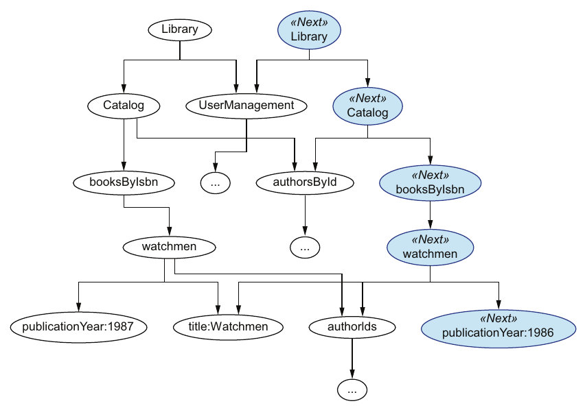
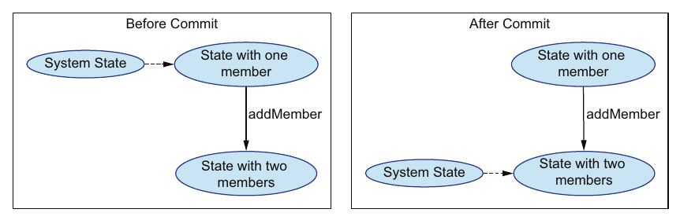
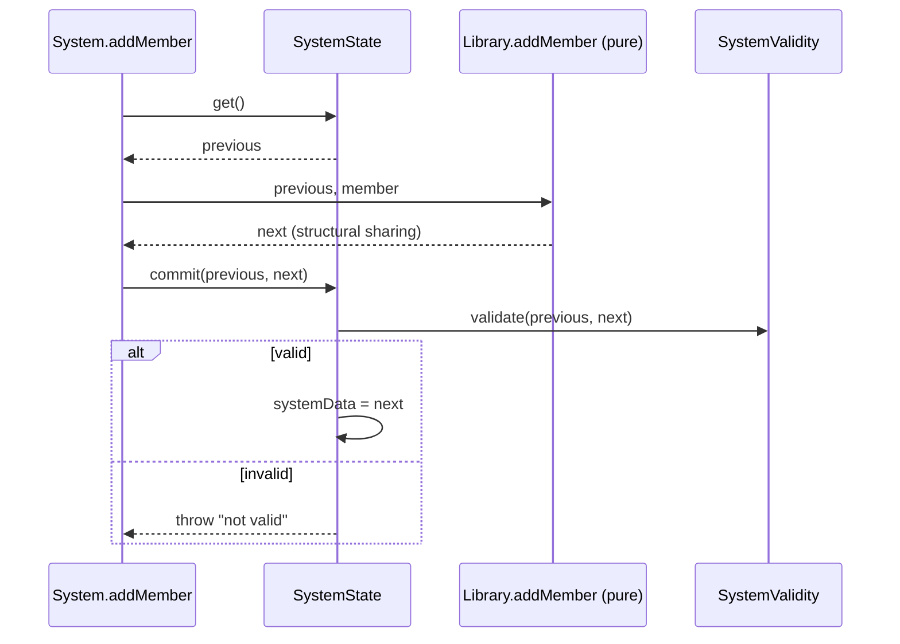

# ۴. مدیریت state

[← ۳. دست‌کاری پایه‌ی داده](03-basic-data-manipulation.md) · [کتاب](../README.md) · [۵. کنترل پایه‌ی concurrency →](05-basic-concurrency-control.md)

## خلاصه

فصل ۳ پرسش‌ها را چرخاند؛ و این فصل **mutationها** را، یعنی عملیاتی که state سیستم را عوض می‌کند (p. 72). روش DOP به‌جای به‌روز کردن داده سر جایش، **چند version** از داده‌ی سیستم را نگه می‌دارد، مانند Git، و state سیستم ارجاعی به یکی‌شان است. این روی اصل سوم می‌نشیند، **داده immutable است**: داده immutable است، ولی ارجاع state mutable (pp. 71, 73). versionهای تازه ارزانند چون **شریک شدن ساختاری** هست: یک `_.set` immutable تنها nodeهای روی مسیر عوض‌شده را کپی و باقی را شریک می‌شود. دیو آن را در ۱۱ خط پیاده می‌کند (pp. 74–81).

هر mutationی به دو فاز می‌شکند (جدول ۴.۱، ص. ۷۲):

- **حساب** بی‌state است و ویژه‌ی هر جهشی؛ version پسین را با تابع‌های immutable عمومی حساب می‌کند.
- **عمل commit** باstate است و میان همه‌ی mutationها مشترک؛ ارجاع state را پیش می‌برد.

چون آن commit مشترک است، همان یک جاست که می‌شود **کل داده‌ی سیستم را اعتبارسنجی کرد**، مانند قلاب commit در Git (pp. 85–86). نگه داشتن ارجاع پیشین **undo** را بدیهی می‌کند (pp. 86–89). فصل فرض می‌گیرد mutation concurrent نیست؛ و فصل ۵ آن را می‌افزاید (p. 72).

## نکته‌های کلیدی

- **اصل ۳: داده immutable است.** نگه داشتن چند version immutability می‌خواهد، و شریک شدن ساختاری آن را در حافظه و حساب کارآمد می‌کند (pp. 71–72).
- **داده immutable است، ولی ارجاع state mutable** (p. 73).
- **شریک شدن ساختاری** versionی تازه می‌سازد با شریک شدن بازگشتی بخش‌هایی که لازم نیست عوض شوند؛ و عوض کردن فیلدی تنها mapهای روی مسیرش را کپی می‌کند (pp. 74–78).
- **تابع‌های پیش‌فرض Lodash mutation می‌دهند.** versionهای immutable از Lodash FP می‌آیند، که (listing ۴.۱) کوک می‌شود تا امضاهای مستندشده را نگه دارد (pp. 75–76).
- **همه‌ی دست‌کاری داده باید از تابع‌های immutable بگذرد؛ و setter بومی ممنوع است.** این انتظامی از برنامه‌نویس است. **ساختارهای داده‌ی persistent** آن را در سطح داده به زور می‌آورند، و جو برای production پیشنهادشان می‌کند (pp. 82–83).
- **تنها فاز commit باstate است،** پس بخش باstate سیستم به کم‌ترین اندازه آب می‌رود، یعنی کلاسی کوچک و OOP‌مانند به نام `SystemState` (pp. 72, 84–85).
- **اعتبارسنجی از دست‌کاری جدا شده:** آن commit version پسین را به‌شکل یک کل می‌سنجد، با گرفتن هر دو version پیشین و پسین، پس می‌تواند تنها چیز عوض‌شده را اعتبارسنجی کند (pp. 85–86).
- **تاریخ ارزان است.** شریک شدن ساختاری می‌گذارد versionهای زیادی را بی منفجر شدن حافظه نگه دارید، پس برگرداندن stateی پیشین آسان است (pp. 86–89).

## فهرست بخش‌ها

*از فهرست خود کتاب، یعنی bookmarkهای PDF؛ شماره‌ی صفحه‌ها چاپی‌اند.*

- ۴.۱ چند version از داده‌ی سیستم — ص. ۷۲
- ۴.۲ شریک شدن ساختاری — ص. ۷۴
- ۴.۳ پیاده کردن شریک شدن ساختاری — ص. ۸۰
- ۴.۴ ایمنی داده — ص. ۸۲
- ۴.۵ فاز commit یک mutation — ص. ۸۳
- ۴.۶ پاس داشتن تمامیت state سیستم — ص. ۸۵
- ۴.۷ برگرداندن stateهای پیشین — ص. ۸۶
- خلاصه — ص. ۸۹

## یادداشت‌ها

| فاز | مسئولیت | وضع state | پیاده‌سازی (جدول ۴.۱، ص. ۷۲) |
|---|---|---|---|
| حساب | version پسین داده‌ی سیستم را حساب می‌کند | بی‌state | ویژه |
| commit | state سیستم را پیش می‌برد | باstate | مشترک |

### ۴.۱ چند version از داده‌ی سیستم

سر پیاده‌روی، تئو و جو از این می‌گویند که Git چطور کل تاریخ commit را نگه می‌دارد و می‌تواند کد را تند به stateی پیشین برگرداند، که تئو را یاد *Back to the Future* می‌اندازد (p. 72). تئو می‌پرسد چرا mutation تنها کدی نیست که بخشی از hash map را دست‌کاری می‌کند. جو پاسخ می‌دهد که mutation سر جا، پاس داشتن اینکه mutationی سیستم را به stateی نامعتبر نیندازد را سخت می‌کند، و versionهای پیشین را گم (p. 73).

**رویکرد state چندنگارشی** در DOP (شکل ۴.۱، ص. ۷۳): در هر لحظه state سیستم به یک version از داده ارجاع می‌دهد، و پس از mutationی آن ارجاع پیش می‌رود، از V12 به V13. پیش از هر mutationی داده را عمیق کپی نمی‌کند، که ناکارآمد بود؛ شریک شدن ساختاری versionهای تازه را ارزان می‌کند (pp. 73–74). در برنامه‌ای ساده، versionهای کهنه garbage collectorی می‌شوند. وقتی سفر در زمان Git‌مانند بخواهید، ارجاع‌هایشان را نگه می‌دارید (p. 74).

> **In practice:** Bronze در ClickHouse append-only است: هر بار تازه‌ی loader نسخه‌ی تازه‌ای از ردیف را کنار نسخه‌های قبلی می‌گذارد.
>
> **Your turn:** چرا Bronze را append-only نگه می‌دارید و Silver را جای به‌روزرسانی در Bronze می‌سازید؟
>
> *Answer:* نسخه‌های قبلی امکان بازسازی Silver، بررسی گذشته و rollback را می‌دهند؛ Silver از Bronze مشتق است و هر وقت لازم شد از نو ساخته می‌شود. کتاب state را دنباله‌ای از نسخه‌های immutable می‌بیند، نه یک شیء که عوض می‌شود (pp. 72–74).

### ۴.۲ شریک شدن ساختاری

در فاز حساب با state سروکار ندارید، پس کدش بی‌state است و «به‌سادگی کد یک پرسش» (p. 74). برای گذاشتن سال نشر *Watchmen* روی ۱۹۸۶، مسیر `["catalog", "booksByIsbn", "978-1779501127", "publicationYear"]` است (p. 75).

**کتابخانه‌ی Lodash immutable** (pp. 75–76): تابع پیش‌فرض `_.set` شیء را mutation می‌دهد. versionهای immutable در ماژول Lodash FP‌اند، که ترتیب آرگومانش پیش‌فرض به هم ریخته. listing ۴.۱ آن را با `fp.convert({cap: false, curry: false, fixed: false, immutable: true, rearg: false})` کوک می‌کند، تا تابع‌های immutable امضاهای مستندشده را داشته باشند. تابعی **immutable** است وقتی به‌جای عوض کردن داده‌ای که می‌گیرد، versionی تازه از آن می‌سازد (p. 76).

باریک کردن پرسش‌به‌پرسش جو (pp. 76–77): تنها `Catalog` اثر می‌گیرد، نه `UserManagement`؛ و درونش تنها `booksByIsbn`؛ و درون آن تنها رکورد *Watchmen*؛ و درون آن تنها `publicationYear`. پس تابع immutable `Library` تازه‌ای می‌سازد که بخش‌های دست‌نخورده را باز به کار می‌برد، بی هیچ‌وقت عمیق کپی کردنشان (شکل ۴.۴، ص. ۷۸):



*Figure 4.4 (p. 78): تنها همان چهار map روی مسیر تغییر تازه‌اند؛ و باقی با version پیشین شریک است.*

**افزودن عضوی** (شکل ۴.۵ و listing ۴.۳، صص. ۷۹–۸۰) آن `Catalog` و کتابدارها را شریک می‌شود. mutation به دو شکل از پرسش فرق دارد:

- **می‌تواند شکست بخورد:** تابع `UserManagement.addMember` خطای «Member already exists.» می‌اندازد اگر `["membersByEmail", email]` از پیش باشد.
- **باید پدرها را از نو بسازد:** تابع `Library.addMember` مقدار `userManagement` تازه را در `Library` تازه‌ای می‌گذارد.

برگرداندن versionی به‌روز به‌جای عوض کردن داده سر جا برای خود جو هم عجیب بود، وقتی هفت سال پیش‌تر در Clojure به داده‌ی immutable خورد. چند هفته برد تا خو کند (p. 80).

> **Try it:** [شریک شدن ساختاری](../widgets/04-structural-sharing.html) — مسیری در داده‌ی کتابخانه برگزینید و immutable بگذاریدش، ببینید کدام mapها تازه‌اند و کدام شریک، بعد مانند listing ۴.۵ setterی بومی را روی داده‌ی شریک بیازمایید.

### ۴.۳ پیاده کردن شریک شدن ساختاری

دیو، برنامه‌نویس جوان، چالش را برمی‌دارد و فردا پیاده‌سازی ۱۱خطی JavaScript را نشان می‌دهد (listing ۴.۴، ص. ۸۱):

```js
function setImmutable(map, path, v) {
  var modifiedNode = v;
  var k = path[0];
  var restOfPath = path.slice(1);
  if (restOfPath.length > 0) {
    modifiedNode = setImmutable(map[k], restOfPath, v);
  }
  var res = Object.assign({}, map);   // shallow clone
  res[k] = modifiedNode;
  return res;
}
```

روی مسیر پایین بازگشت می‌کند، بعد سر بالا آمدن هر mapی را سطحی کلون و فرزند دست‌کاری‌شده را جایش می‌گذارد. هر هم‌نیایی با ارجاع شریک می‌شود.

> **Run it:** [آزمایش شریک شدن ساختاری](../lab/04-structural-sharing/README.md) آن را با درگاهی Python از `setImmutable` می‌سنجد.

### ۴.۴ ایمنی داده

نگرانی تئو: اگر کدی داده‌ای را دست‌کاری کند که دو version شریکش‌اند چه؟ در listing ۴.۵، پس از `nextBooks = _.set(books, …)`، سپردن `books[…]["authorIds"][1] = "dave-chester-gibbons"` مقدار `nextBooks` را هم عوض می‌کند، چون آن array شریک است (p. 82).

پاسخ جو: mutation دادن داده با setter بومی hash map **ممنوع** است؛ همه‌ی دست‌کاری داده باید از تابع‌های immutable کار بکشد. «ممنوع» یعنی به خود برنامه‌نویس بسته است (p. 82). برای پناه گرفتن از اشتباه، **ساختارهای داده‌ی persistent** را به کار ببرید، که در سطح داده تغییرناپذیرند، پس هیچ راهی به mutation دادنشان نیست، حتی به اشتباه. سازمان درونی‌شان آن‌ها را حتی از تابع‌های immutable کارآمدتر می‌کند (pp. 82–83). فهرست کتابخانه‌های جو (p. 83):

| زبان | کتابخانه |
|---|---|
| JavaScript | Immutable.js |
| Java | Paguro |
| C# | Immutable Collections |
| Python | Pyrsistent |
| Ruby | Hamster |

عیبش این است که بومی نیستند، پس میان ساختارهای بومی و persistent بدل می‌کنید. پند جو: با تابع‌های immutable بازی کنید، ولی در production از ساختارهای داده‌ی persistent کار بکشید. یک دلیل دوست داشتن Clojure برایش این است که ساختارهای داده‌ی بومی‌اش تغییرناپذیرند (p. 83).

> **Vault note:** listing ۴.۵ از `authorIds` است، ولی خط پس از آن «مقدار isBlocked در updatedMember» را می‌پرسد. این به جامانده‌ای از پیش‌نویسی پیشین می‌ماند؛ و خروجی خود listing به پرسشی پاسخ می‌دهد که واقعاً نشان می‌دهد (p. 82).

### ۴.۵ فاز commit یک mutation

تابع `Library.addMember` کتابخانه‌ای تازه برمی‌گرداند ولی state کنونی را عوض نمی‌کند (p. 83). فاز commit مقدار state سیستم را به versionی پیش می‌برد که حساب برگردانده (شکل ۴.۷، ص. ۸۴). دو کلاس یگانه و باstate و OOP‌مانند پیاده‌اش می‌کنند: کلاس `System` که mutationها را پیاده می‌کند، و `SystemState` که state را مدیریت (pp. 84–85). به گفته‌ی جو، مراقبه به او آموخت که هر بخشی از گیتی نقشی برای بازی دارد (p. 84).



*Figure 4.7 (p. 84): هر commitی تنها جابه‌جا کردن یک ارجاع است؛ و هر دو version هنوز هستند.*

```js
class System {
  addMember(member) {
    var previous = SystemState.get();
    var next = Library.addMember(previous, member);
    SystemState.commit(previous, next);
  }
}
```

*نمونه‌ی listing ۴.۷ (pp. 84–85)؛ کلاس `SystemState` در listing ۴.۸ یک `get()` و یک `commit(previous, next)` دارد که `next` را می‌سپارد.*

### ۴.۶ پاس داشتن تمامیت state سیستم

در OOP، تنها متدهای خود کلاس به داده‌اش دست می‌زنند، که state درونی‌اش را پناه می‌دهد. مثال تئو از stateی نامعتبر، mutationی است که نسخه‌ی کتابی را به قرض‌های عضوی می‌افزاید بی آنکه آن نسخه را در catalog قرض‌داده نشان کند (p. 85). در DOP، تمامیت **در سطح کل سیستم** سنجیده می‌شود، به‌جای پخش شدن میان کلاس‌ها. چون کد commit میان همه‌ی mutationها مشترک است، قدم نخستش می‌تواند versionی را که قرار است commit شود اعتبارسنجی و اگر نامعتبر بود ردش کند (listing ۴.۹، صص. ۸۵–۸۶). تئو آن را به قلاب commit در Git می‌ماند.

تابع `validate` هر دو `previous` و `next` را می‌گیرد تا بتواند بهینه کند؛ مثلاً با اعتبارسنجی تنها داده‌ی عوض‌شده (p. 86). تعریف کردن طرح در فصل‌های ۷ و ۱۲ می‌آید.



*نمودار ترتیبی vault از listingهای ۴.۷ تا ۴.۹ (pp. 84–86).*

### ۴.۷ برگرداندن stateهای پیشین

شریک شدن ساختاری می‌گذارد هر versionی را بی منفجر شدن حافظه نگه دارید (p. 86). برای **undo**، کلاس `SystemState` دو ارجاع نگه می‌دارد، یعنی `systemData` و `previousSystemData` (pp. 86–88):

- **سر commit:** هر دو پیش می‌روند. در V12، مقدار `previousSystemData` همان V11 است؛ و پس از commit آن V12 می‌شود و `systemData` مقدار V13.
- **سر undo:** مقدار `systemData` روی `previousSystemData` گذاشته می‌شود، پس هر دو به V12 ارجاع می‌دهند.

در کار واقعی پشته‌ای از همه‌ی ارجاع‌های state را برای چند undo نگه می‌دارید؛ و یک ارجاع مثال را ساده نگه می‌دارد (pp. 88–89). listing ۴.۱۰ کل آن کلاس را نشان می‌دهد. تئو: «در DOP، سفر در زمان واقعی است» (p. 89).

> **Try it:** [commit و undo](../widgets/04-commit-undo.html) — mutationها را از فازهای حساب و commit بگذرانید، یکی نامعتبر را سر commit رد کنید، و وقتی دو بار undo می‌کنید یک ارجاع پیشین را با پشته‌ای از versionها بسنجید.

> **Vault note:** listingهای ۴.۹ و ۴.۱۰ ریز فرق دارند. نمونه‌ی ۴.۹ مقدار `this.systemData` را می‌سپارد در کلاسی که ۴.۸ با `systemState` اعلامش کرده بود، و ۴.۱۰ تابع `Consistency.validate` را صدا می‌زند جایی که ۴.۹ تابع `SystemValidity.validate` را. متن پیش از ۴.۱۰ از «حل ناسازی» هم می‌گوید، که پیش‌درآمد فصل ۵ است (pp. 85–88).

> **In practice:** rollback در GitOps با Argo CD همان برگرداندن state پیشین است: کافی است اشاره‌گر را به commit قبلی برگردانید.
>
> **Your turn:** deploy تازه‌ی loader داده‌ی خراب نوشت. rollback کد کافی است؟
>
> *Answer:* کد آری، با git revert و sync در Argo CD؛ داده نه: partitionهای خراب را باید از Bronze دوباره بسازید. برگرداندن state فقط وقتی ارزان است که نسخه‌ی قبلی هنوز وجود داشته باشد، که برای کد در git هست و برای داده در Bronze append-only (pp. 86–88).

## بده‌بستان‌ها در یک نگاه

| گزینش | چه می‌برد | چه خرج می‌دهد |
|---|---|---|
| mutation سر جا | ساده و آشنا | تضمین اعتبار سخت است؛ بی هیچ تاریخی (p. 73) |
| کپی عمیق برای هر version | تاریخ و جدایی | در حافظه و حساب ناکارآمد (p. 73) |
| تابع‌های immutable با شریک شدن ساختاری | version ارزان، تاریخ، حساب بی‌state | انتظام: setterی بومی روی داده‌ی شریک versionهای دیگر را خراب می‌کند (p. 82) |
| ساختارهای داده‌ی persistent | immutability به زور؛ و حتی کارآمدتر | بومی نیستند؛ تو و بیرون بدل می‌کنید (p. 83) |
| commit مرکزی با اعتبارسنجی | تمامیت کل سیستم، در یک جا سنجیده | یک مؤلفه‌ی باstate که باید درست باشد؛ و طرحی که هنوز باید نوشته شود، فصل‌های ۷ و ۱۲ |

## فراتر از کتاب

- **کپی مسیر.** آنچه `setImmutable` می‌کند در ادبیات به *path copying* شناخته می‌شود: هر به‌روزرسانی O(depth) node را از ریشه تا تغییر کپی می‌کند. برای درختی متوازن آن O(log n) از n node است؛ و برای mapهای تودرتوی Klafim تنها عمق مسیر. آزمایش lab این را برای درختی JSON‌مانند می‌سنجد. یک تذکر: کلون سطحی mapی با k کلید O(k) خرج می‌دهد، پس indexی تخت با هزاران entry هر به‌روزرسانی را وامی‌دارد همه‌ی کلیدهای آن سطح را کپی کند. ساختارهای داده‌ی persistent، فصل ۹، از آن می‌پرهیزند.
- **باز هم Git.** شیءهای درخت در Git زیردرخت‌های دست‌نخورده را میان commitها دقیقاً همین‌طور شریک می‌شوند: commitی که یک فایل را عوض می‌کند تنها روی مسیر همان فایل شیء درخت تازه می‌سازد.
- **کتابخانه‌های Redux و React.** مدیریت state در frontend به JavaScript همین شکستن را رایج کرد. reducerی سرراست state پسین را حساب می‌کند، آن store یک ارجاع mutable را نگه می‌دارد، و Redux DevTools سفر در زمان می‌دهد. کلاس `SystemState` جو با store می‌خواند و `Library.addMember` با reducer.
- **یخ زدن به‌شکل پناهی ارزان.** در JavaScript، تابع `Object.freeze` که بازگشتی پیاده شود، یعنی deep freeze، mutation بومی تصادفی را در حالت سخت وامی‌دارد خطا بیندازد. میانه‌ای است بین انتظام و ساختارهای داده‌ی persistent، به بهایی سر اجرا.

## پیوندها

- **پیشین:** [۳. دست‌کاری پایه‌ی داده](03-basic-data-manipulation.md) پرسش‌ها را با `_.get` کرد؛ و این فصل `_.set` را می‌افزاید.
- **پسین:** [۵. کنترل پایه‌ی concurrency](05-basic-concurrency-control.md) می‌گذارد mutationها concurrent اجرا شوند و reconciliation را به فاز commit می‌افزاید.
- **اعتبارسنجی در commit:** [۷. اعتبارسنجی پایه‌ی داده](07-basic-data-validation.md).
- **مفهوم immutability به زور:** [۹. ساختارهای داده‌ی persistent](09-persistent-data-structures.md).
- **Run it:** [شریک شدن ساختاری در عدد](../lab/04-structural-sharing/README.md) — mapهای ساخته و شریک‌شده‌ی یک set immutable را در برابر کپی عمیق می‌شمارد، و بهای نگه داشتن هزار version.

## خودتان را بسنجید

1. اصل ۳ از DOP را بگویید، و «داده immutable است، ولی ارجاع state mutable» را توضیح دهید.
   <details><summary>پاسخ</summary>داده immutable است (p. 71). هر versionی از داده‌ی سیستم هیچ‌وقت عوض نمی‌شود؛ مقدار state سیستم ارجاعی به یک version است، و mutationی آن ارجاع را به versionی تازه می‌برد (p. 73).</details>
2. دو فاز یک mutation کدامند، و کدام باstate است؟
   <details><summary>پاسخ</summary>حساب version پسین را حساب می‌کند؛ بی‌state است و ویژه‌ی هر mutationی. commit مقدار state سیستم را پیش می‌برد؛ باstate است و میان همه‌ی mutationها مشترک (جدول ۴.۱، ص. ۷۲).</details>
3. وقتی سال نشر *Watchmen* immutable گذاشته می‌شود، کدام mapها تازه‌اند و کدام شریک؟
   <details><summary>پاسخ</summary>تازه: خود `Library` و `Catalog`ش و `booksByIsbn` و رکورد *Watchmen*. شریک: `UserManagement` و `authorsById` و هر فیلد دیگری از آن کتاب (pp. 77–78).</details>
4. چرا listing ۴.۵ برای `nextBooks` مقدار `dave-chester-gibbons` چاپ می‌کند؟
   <details><summary>پاسخ</summary>آرایه‌ی `authorIds` میان آن دو version شریک است، و کد با setterی بومی mutationش داد. همین است که setterهای بومی ممنوعند و همه‌ی دست‌کاری باید از تابع‌های immutable کار بکشد (p. 82).</details>
5. ساختارهای داده‌ی persistent چه می‌افزایند، و چرا جو از آغاز به کارشان نمی‌برد؟
   <details><summary>پاسخ</summary>در سطح داده تغییرناپذیرند، پس حتی به اشتباه هم mutation‌دادنی نیستند، و حتی کارآمدترند. ولی بومی نیستند، پس به آن‌ها و از آن‌ها بدل می‌کنید. جو تابع‌های immutable را برای بازی کردن و ساختارهای persistent را برای production پیش می‌گذارد (pp. 82–83).</details>
6. چرا DOP می‌تواند داده را در یک جا اعتبارسنجی کند، و چرا `validate` هر دو `previous` و `next` را می‌گیرد؟
   <details><summary>پاسخ</summary>فاز commit میان همه‌ی mutationها مشترک است، پس اعتبارسنجی همان‌جا برای کل سیستم پیش از جابه‌جا شدن ارجاع اجرا می‌شود. داشتن هر دو version می‌گذارد بهینه کند؛ مثلاً با اعتبارسنجی تنها چیز عوض‌شده (pp. 85–86).</details>
7. با یک ارجاع `previousSystemData`، پس از یک commit و بعد یک undo چه می‌شود؟
   <details><summary>پاسخ</summary>از V12 که آغاز شود و پیشینش V11 باشد، آن commit مقدار `systemData` را V13 و پیشین را V12 می‌کند؛ و آن undo `systemData` را روی V12 می‌گذارد، پس هر دو به V12 ارجاع می‌دهند. چند undo پشته‌ای از ارجاع‌ها می‌خواهد (pp. 87–88).</details>
