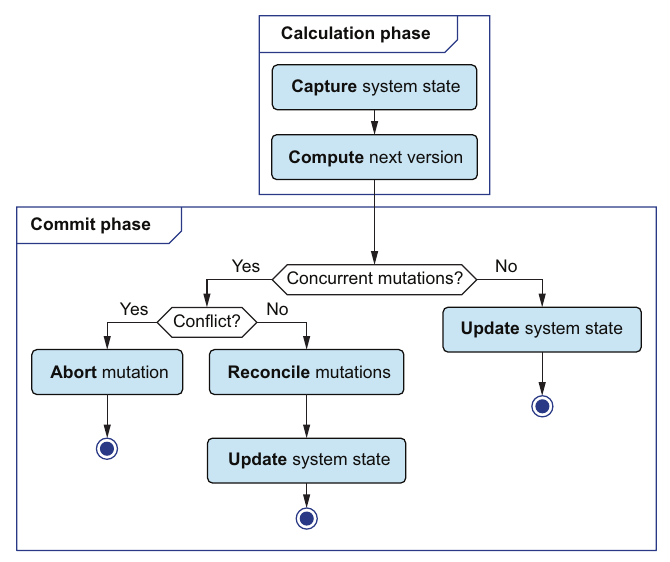
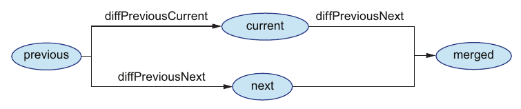

# 5. Basic concurrency control

[← 4. State management](04-state-management.md) · [Book](../README.md) · [6. Unit tests →](06-unit-tests.md)

## Summary

In production, mutations run concurrently, so moving the state reference forward naively, as chapter 4 did, isn't enough (p. 91). DOP uses **optimistic concurrency control**, a lock-free strategy (the book cites Elasticsearch) in which mutations "ask forgiveness instead of permission" (pp. 92–93). The calculation phase still computes as if it were the only mutation running. Only the commit phase changes: it **reconciles** the next version with whatever was committed meanwhile, much as Git merges a branch (pp. 93–96):

- **Fast-forward** if the state hasn't changed.
- **Three-way merge** if the concurrent changes touch different fields.
- **Abort** if they touch the same field; the user retries.

The pieces are a structural `diff` of two maps (pp. 99–102), the `informationPaths` of a diff (p. 104), a check that two diffs share no path, and `_.merge` to apply a patch (p. 105). Two facts about immutable data make it efficient: unchanged subtrees are shared, so `diff` returns immediately on them, and versions can be compared by reference (pp. 102, 107). The commit code is **universal**, working for any system whose data is an immutable hash map (p. 93). It isn't thread-safe yet; chapter 8 fixes that (p. 108).

## Key takeaways

- **Optimistic concurrency control is lock-free.** Locks hit performance and risk deadlocks; OCC gives high read and write throughput (pp. 92, 108).
- **Only the commit phase changes.** The calculation phase computes the next version in isolation, as before (table 5.1, p. 93).
- **The reconciliation logic is universal:** it assumes only that system data is an immutable map (p. 93).
- **Three versions meet at commit:** *previous* (the calculation's base), *current* (the state now) and *next* (the calculation's result). `current == previous` means no concurrent mutation, so fast-forward (pp. 95–96).
- **Three-way merge compares fields instead of lines:** compute diff(previous, current) and diff(previous, next). If they have no information path in common, merge diff(previous, next) into current (pp. 95–96).
- **In a user-facing system, conflicting concurrent mutations are fairly rare**, so aborting and asking the user to retry is acceptable (pp. 96–97).
- **Immutable data makes this cheap:** reference equality is a safe and fast comparison, and the diff of two structurally shared versions skips the shared nodes (pp. 102, 107).
- **The structural diff supports replacements and additions, not deletions** (pp. 99–100).

## Section outline

*From the book’s own table of contents (PDF bookmarks); printed page numbers.*

- 5.1 Optimistic concurrency control — p. 92
- 5.2 Reconciliation between concurrent mutations — p. 94
- 5.3 Reducing collections — p. 97
- 5.4 Structural difference — p. 99
- 5.5 Implementing the reconciliation algorithm — p. 106
- Summary — p. 108

## Notes

The book warns that this chapter takes more effort: the reconciliation flow is not trivial, and its implementation involves a nontrivial recursion (p. 92). Before work, Theo and Joe talk about conflicts at home. Theo and his wife Jane went to an Imago Relationship Therapy expert about the house budget, which sets up the day's theme of resolving conflicts (p. 92).

### 5.1 Optimistic concurrency control

DOP uses no locks: they hurt performance and, if you're not careful, deadlock (p. 92). Optimistic concurrency control (OCC) is the strategy that lets databases like Elasticsearch scale, and it fits DOP because it is "super efficient when the system data is immutable" (pp. 92–93).

| Phase | Responsibility | State | Implementation (table 5.1, p. 93) |
|---|---|---|---|
| Calculation | Compute next state in isolation | Stateless | Specific |
| Commit | Reconcile and update system state | Stateful | Common |

*Figure 5.1 (p. 94): only the commit phase needs to know about other mutations; the calculation phase is a pure function of the captured state.*

### 5.2 Reconciliation between concurrent mutations

Examples of conflicts: two members borrowing the same book copy, or two librarians updating the same book's publication year (p. 94). Reconciliation resembles merging a Git branch. If main hasn't moved, Git fast-forwards; if someone else committed meanwhile, it does a three-way merge, and a line changed on both sides needs manual resolution (p. 94). DOP does the same, except a conflict **aborts** the mutation (p. 95).

When the commit phase starts there are three versions (figure 5.3, p. 95):

| Version | What it is |
|---|---|
| `previous` | The version the calculation phase based its computation on |
| `current` | The system state at commit time; differs from `previous` if other mutations committed concurrently |
| `next` | The version the calculation phase returned |

If `current` is `previous`, fast-forward to `next`. Otherwise compare *fields* of the system hash map rather than lines: compute the diffs from `previous` to `next` and from `previous` to `current`. If they have no fields in common, apply the first diff to `current` (pp. 95–96, figure 5.4).

*Figure 5.4 (p. 96): the two diffs start from the same `previous`, so when they touch different fields they can be applied in either order.*

| DOP | Git (table 5.2, p. 96) |
|---|---|
| Concurrent mutations | Different branches |
| A version of the system data | A commit |
| State | A reference |
| Calculation phase | Branching |
| Validation | Precommit hook |
| Reconciliation | Merge |
| Fast-forward / three-way merge | Fast-forward / three-way merge |
| Abort | Manual conflict resolution |
| Hash map / leaf node / data field | Tree (folder) / blob (file) / line of code |

> **Try it:** [Reconcile two mutations](../widgets/05-reconcile.html) — start two mutations from the same tiny library, commit one, then commit the other and watch the commit phase fast-forward, merge or abort.

### 5.3 Reducing collections

The diff uses `_.reduce`, which takes a collection, a two-argument function `f` and an initial value. It starts from the initial value and updates the result with `f(result, x)` for each element (p. 97). Theo expands `reduce([1, 2, 3], +, 0)` as `f(f(f(0, 1), 2), 3)` (figure 5.5, p. 98) and writes his own `reduce` as a loop (listing 5.2).

### 5.4 Structural difference

The book marks this section as skippable: a sophisticated use of recursion that the rest of the book doesn't depend on (p. 99). A **structural** diff looks at the structure of the maps and ignores field order (p. 99).

| Kind | First | Second | Diff (tables 5.3–5.5, pp. 99–100) |
|---|---|---|---|
| Replacement | `{"a": 1}` | `{"a": 2}` | `{"a": 2}` |
| Addition | `{"a": 1}` | `{"a": 1, "b": 2}` | `{"b": 2}` |
| Nested replacement | `{"a": {"x": 1}}` | `{"a": {"x": 2}}` | `{"a": {"x": 2}}` |
| Array replacement | `[1]` | `[2]` | `[2]` |
| Array addition | `[1]` | `[1, 2]` | `[null, 2]` |
| Deletion | `{"a": 1, "b": 2}` | `{"a": 1}` | Not supported |

Arrays compare element by element in order: an equal element gives null, and a differing one takes the second array's value (p. 100). Handling deletions is possible but needs a more complicated algorithm (p. 100).

Joe's implementation is about 30 lines, "a recursion inside a reduce" (listing 5.4, pp. 100–101):

- `diff(a, b)` recurses into `diffObjects` when both are collections. Otherwise it returns `b` if the values differ, or the marker `"no-diff"`.
- `diffObjects(a, b)` returns an empty object or array immediately when `a == b`. Otherwise it reduces over the union of keys, keeping only non-empty child diffs.

**Why it is fast** (p. 102): in general a diff visits every leaf of both maps. But two versions made by structural sharing from the same map share most nodes, so `diffObjects` usually returns at once because `data1` and `data2` are the same reference.

Theo tests it on a tiny library with just *Watchmen* (listing 5.6, p. 102). It has two non-conflicting mutations (listing 5.7, p. 103):

- **`next`** sets the publication year to 1986.
- **`current`** sets the title to "The Watchmen" and Dave Gibbons's name to "David Chester Gibbons."

Their diffs' **information paths** (listings 5.10–5.12, pp. 104–105) are disjoint, so there is no conflict. `havePathInCommon` checks whether `_.intersection` of the two path lists is empty (listing 5.13), and the patch is a recursive `_.merge(current, diff(previous, next))` (listing 5.14, pp. 105–106).

> **Vault note:** some of the printed outputs in this section don't match the code. The author's path for the name change is `["catalog", "authorsById", "dave-gibbons", "name"]`. But listing 5.9 prints `authorsById` at the top level, and Theo reads the path as `["authorsById", "dave-gibbons", "name"]` (pp. 103–104). As a result, listing 5.14's merged output shows an `authorsById` both at the top level and inside `catalog` (pp. 105–106). Listing 5.11 prints a dotted string where listing 5.12 prints arrays. With the code as listed, the name change sits under `catalog`, and the merge produces a single `catalog` with all three changes. The [lab](../lab/05-three-way-merge/README.md) shows the actual output.

### 5.5 Implementing the reconciliation algorithm

Only `SystemState.commit` changes. It calls `SystemConsistency.reconcile(this.systemData, previous, next)`, validates the result and stores it (listing 5.15, pp. 106–107). `reconcile` fast-forwards when `current == previous` and otherwise calls `threeWayMerge`, which merges or throws "Conflicting concurrent mutations." (listing 5.16, p. 107).

Theo objects that `current == previous` compares references, not values. Joe answers that with immutable data, comparing references is safe and super fast: if the references are the same, the data is the same (p. 107).

Theo also spots a race. A context switch between the check and the update could let one mutation override another's changes. The code is fine in single-threaded JavaScript, with its event loop, but not in a multi-threaded environment; chapter 8 makes it thread-safe (p. 108). It is "optimistic" because it assumes conflicts don't occur often (p. 108).

> **Vault note:** as printed, listing 5.16 has its condition inverted: `if(havePathInCommon(...)) { return _.merge(...) }` merges exactly when the diffs *do* share a path, and throws when they don't. The prose on the same page states the intended rule, "If the intersection between the two diffs is empty, it means there is no conflict." So the test should be negated. A second subtlety: Lodash's `_.intersection` compares elements with SameValueZero equality. Two separately built path arrays such as `["a","b"]` and `["a","b"]` are different objects, so they never match. The check only works if paths are compared as strings, or with `_.intersectionWith(..., _.isEqual)`. The lab demonstrates both points.

> **Run it:** the [three-way merge experiment](../lab/05-three-way-merge/README.md) ports `diff`, `informationPaths` and `reconcile` to Python and replays the book's example.

> **Try it:** [Optimistic or locked](../widgets/05-occ-throughput.html) — run many concurrent mutations against a store, vary how often they touch the same field, and compare aborts and throughput for optimistic commits against a global lock.

## Trade-offs at a glance

| Strategy | When it shines | Costs |
|---|---|---|
| Locks (mutexes) | Frequent conflicts on the same data | Performance hit, deadlock risk (pp. 18, 92) |
| OCC: fast-forward | No concurrent commit | Nothing beyond a reference comparison |
| OCC: three-way merge | Concurrent changes to different fields | A structural diff, cheap thanks to structural sharing (p. 102) |
| OCC: abort | Concurrent changes to the same field | The user must retry; acceptable because such conflicts are rare in user-facing systems (p. 96) |
| This chapter's diff | Replacements and additions | No deletions (p. 100) |

## Beyond the book

- **OCC in databases.** Kung and Robinson introduced optimistic concurrency control in 1981 ("On Optimistic Methods for Concurrency Control"), with read, validation and write phases. Joe's calculation phase is the read phase, and reconciliation is validation. Elasticsearch, which the book cites, exposes it through sequence numbers and primary terms on each document: a write that names an outdated version is rejected.
- **Conflict granularity.** Here two mutations conflict only if they write the same *leaf* path. That is a write-write check. It doesn't catch a mutation whose *decision* depended on a field another mutation changed, a read-write conflict or "write skew." For example, two checkouts that each read "one copy available" and write different lending records would both merge. Database OCC usually validates the read set too. Chapter 8 makes the commit atomic, but it doesn't change what counts as a conflict.
- **Prefix conflicts.** Comparing exact leaf paths treats a change to `["book", "title"]` and the addition of a whole new subtree at `["book"]` as different paths. Since the diff here never replaces a subtree with a leaf, this rarely matters, but a production version usually treats a path that is a prefix of another as a conflict.
- **CRDTs** take the opposite approach to aborting: data types designed so that concurrent updates always merge deterministically, such as counters, sets and registers. They suit offline-first and multi-leader systems, where asking a user to retry isn't possible.

## Connections

- **Previous:** [4. State management](04-state-management.md) built the calculation and commit phases this chapter extends.
- **Thread safety:** [8. Advanced concurrency control](08-advanced-concurrency-control.md) replaces the check-then-set with an atomic compare-and-swap.
- **Efficient diffs need sharing:** [9. Persistent data structures](09-persistent-data-structures.md).
- **Run it:** [Three-way merge in Python](../lab/05-three-way-merge/README.md) — replays listings 5.6–5.16, shows the inverted condition and the array-identity pitfall, and counts aborts as mutations crowd onto fewer fields.

## Check yourself

1. What does "ask forgiveness instead of permission" mean here?
   

Answer
Mutations don't take locks before computing. The calculation phase runs as if it were alone, and the commit phase reconciles with concurrent mutations, or aborts if they conflict (p. 93).

2. Name the three versions present at commit time, and when `current` differs from `previous`.
   

Answer
`previous` is the calculation's base, `current` is the state at commit, and `next` is the calculation's result. `current` differs from `previous` when other mutations committed concurrently (p. 95).

3. When does the commit fast-forward, merge or abort?
   

Answer
Fast-forward if `current` is `previous`. Otherwise, merge if diff(previous, current) and diff(previous, next) share no information path, and abort if they do (pp. 95–96).

4. Why is comparing `current == previous` by reference correct here?
   

Answer
The data is immutable, so the same reference means the same data, and the check is super fast (p. 107).

5. Why is the structural diff cheap on system data, even though it visits all leaves in general?
   

Answer
Versions created by structural sharing from the same map share most nodes, so `diffObjects` usually returns at once because both arguments are the same object (p. 102).

6. What can't the chapter's diff express?
   

Answer
Deletions of fields or array elements; only replacements and additions are supported (pp. 99–100).

7. Why isn't the chapter's `SystemConsistency` thread-safe, and when is that fine?
   

Answer
A context switch between checking the state and updating it can let one mutation overwrite another's changes. It is fine in single-threaded JavaScript with its event loop; chapter 8 fixes it for multi-threaded environments (p. 108).

