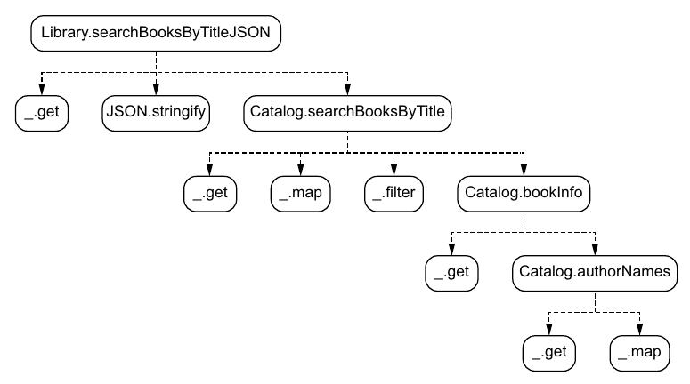
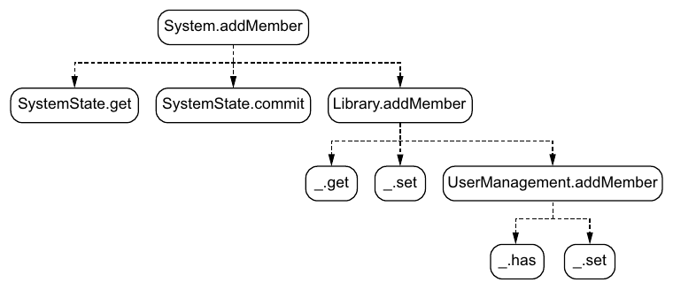

# ۶. تست‌های unit

[← ۵. کنترل پایه‌ی concurrency](05-basic-concurrency-control.md) · [کتاب](../README.md) · [۷. اعتبارسنجی پایه‌ی داده →](07-basic-data-validation.md)

## خلاصه

در سیستمی داده‌گرا بیشتر تابع‌ها داده می‌گیرند و داده برمی‌گردانند، پس تستی unit آن‌قدر آسان است که در کافه نوشتنی باشد. هر موردی از تست همان سه قدم را دارد: ورودی را بسازید، خروجی چشم‌داشته را بسازید، و `f(input)` را با آن بسنجید. سنجشی عمومی و بازگشتی، یعنی `_.isEqual` از Lodash، سنجیدن را می‌کند، و معمولاً هیچ نیازی به mock نیست (pp. 110–112). جو **درخت صدا زدن تابع‌ها** از جریانی کد را روی دستمالی می‌کشد و با آن *کیفیت* و *کمیت* موردهای تست را تصمیم می‌گیرد (pp. 113–115):

- تابع‌های **عمیق در درخت** داده‌ی ساده‌تری می‌گیرند و موردهای تست بیشتری می‌خواهند.
- تابع‌های **نزدیک به ریشه** داده‌ی پیچیده‌تری می‌گیرند و موردهای کم‌تری می‌خواهند، چون فرض می‌گیرید تابع‌هایی که صدایشان می‌زنند از پیش تست شده‌اند (pp. 119–121).

ورودی تست باید **کمینه** باشد، چون اعتبار داده به زمینه بسته است (p. 117). داده را بسنجید، هیچ‌وقت رشته‌ی JSON را (pp. 121–123). پرسشی با حرف کوچک اشکالی واقعی را در جست‌وجو رو می‌کند (pp. 124–125). mutationها از راه فاز حسابشان تست می‌شوند، با سنجیدن کل mapهای state، موردهای منفی هم. تابع باstate `System.addMember` با خواندن state پس از آن صدا زدن تست می‌شود (pp. 126–133). بخش با پیچی تمام می‌شود: Albatross پروژه‌ی بلندمدت نانسی را می‌برد، ولی مهندسان تئو نتیجه می‌گیرند که DOP «در مقیاس خوب کار نمی‌کند» (p. 134).

## نکته‌های کلیدی

- **موردی داده‌گرا از تست:** عبارت `_.isEqual(f(dataIn), dataOut)` (listing ۶.۳، ص. ۱۱۲). به mock کم نیاز می‌شود (p. 111).
- **درخت صدا زدن تابع‌ها** تابع `f` را در ریشه دارد، تابع‌هایی که هر node صدا می‌زند را به‌شکل فرزندانش، و تابع‌های بیرون از کدبیس را به‌شکل برگ. صدا زدنی درون تابعی بی‌نام هم فرزند به شمار می‌آید (p. 114).
- **فرض بگیرید صداشده‌ها تست شده‌اند.** تستی unit برای تابعی تنها موردی کمینه می‌خواهد برای آنچه صداشده‌هایش از پیش می‌پوشانند، که شمار موردهای تست را به‌جد کم می‌کند (p. 119).
- **عمق، پیچیدگی داده را با شمار موردها بده‌بستان می‌کند** (جدول ۶.۲، ص. ۱۲۱).
- **داده‌ی کمینه به کار ببرید.** اعتبار داده به زمینه بسته است: مقدار `catalogData` با تنها `authorsById` برای جست‌وجو نامعتبر است ولی برای `authorNames` معتبر. داده هر چه کوچک‌تر، دست‌کاری‌اش آسان‌تر (p. 117).
- **از سنجش رشته‌ای بپرهیزید.** دو رشته‌ی JSON می‌توانند همان یک داده را با ترتیب فیلد مختلف سریالی کنند، پس با `JSON.parse` بازکنیدش و داده را بسنجید (pp. 122–123).
- **تست mutationها stateها را می‌سنجد**، یعنی پیش و چشم‌داشته‌ی پس، و کوشش بیشتری از تست پرسش‌ها می‌خواهد (p. 127). **موردهای منفی تست** را بگنجانید (p. 129).
- **بخش باstate هنوز تست می‌خواهد:** تابع `System.addMember` هیچ برنمی‌گرداند، پس state را پس از آن صدا زدن بخوانید (pp. 131–133).

## فهرست بخش‌ها

*از فهرست خود کتاب، یعنی bookmarkهای PDF؛ شماره‌ی صفحه‌ها چاپی‌اند.*

- ۶.۱ سادگی موردهای داده‌گرای تست — ص. ۱۱۰
- ۶.۲ تست‌های unit برای کد دست‌کاری داده — ص. ۱۱۲
  - ۶.۲.۱ درخت صدا زدن تابع‌ها — ص. ۱۱۳
  - ۶.۲.۲ تست‌های unit برای تابع‌های پایین درخت — ص. ۱۱۵
  - ۶.۲.۳ تست‌های unit برای nodeهای درخت — ص. ۱۱۹
- ۶.۳ تست‌های unit برای پرسش‌ها — ص. ۱۲۱
- ۶.۴ تست‌های unit برای mutationها — ص. ۱۲۶
- خلاصه — ص. ۱۳۴

## یادداشت‌ها

فصل با منطق موردهای تست سروکار دارد، نه با اجراگر یا چارچوب تست: «چارچوب تست محبوبتان را به کار ببرید» (pp. 118–119).

### ۶.۱ سادگی موردهای داده‌گرای تست

تئو و جو در «La vie est belle» کار می‌کنند، کافه‌ای فرانسوی نزدیک پل گلدن‌گیت (p. 110). قدم‌های یک مورد تست (p. 111):

1. ورودی داده را بسازید، یعنی `dataIn`.
2. خروجی چشم‌داشته را بسازید، یعنی `dataOut`.
3. مقدار `f(dataIn)` را با `dataOut` بسنجید.

سنجیدن mapها یعنی فیلدبه‌فیلد و بازگشتی سنجیدن. تئو نمی‌تواند در کافه کد بازگشتی بنویسد، ولی لازم هم ندارد: چون داده عمومی است، تابع `_.isEqual` mapها و آرایه‌ها را بازگشتی می‌سنجد (listingهای ۶.۱ و ۶.۲، صص. ۱۱۱–۱۱۲).

> **In practice:** تست transformهای Python و مدل‌های SQL در GitLab CI اجرا می‌شود و ساده‌ترینش ورودی داده و خروجی داده است.
>
> **Your turn:** تابع `hash_fields` را چطور تست می‌کنید بی‌آن‌که به دیتابیس یا ClickHouse نیاز باشد؟
>
> *Answer:* یک dict ورودی، یک dict انتظاری و یک `assert` برابری؛ چون تابع خالص است و داده را برمی‌گرداند، هیچ mock یا fixture لازم نیست. کتاب می‌گوید تست داده‌گرا همین سادگی را دارد (pp. 110–112).

### ۶.۲ تست‌های unit برای کد دست‌کاری داده

کد زیر تست همان پرسش جست‌وجوی فصل ۳ است (listing ۶.۴، ص. ۱۱۳). کمی بازآرایی شده: تابع `authorNames` حالا `authorIds` را می‌گیرد، نه کتابی را.

#### ۶.۲.۱ درخت صدا زدن تابع‌ها

*Figure 6.1 (p. 114): برگ‌ها تابع‌های بیرون کدبیس برنامه‌اند، یعنی Lodash و `JSON`، پس تست یک سطح بالاتر آغاز می‌شود.*

درخت را تا رسیدن به تابعی بیرون کدبیس برنامه، یا تابعی که هیچ صدا نمی‌زند، باز می‌کنید. تابع `Catalog.bookInfo` فرزند `searchBooksByTitle` است گرچه درون تابعی بی‌نام صدا زده می‌شود (p. 114).

#### ۶.۲.۲ تست‌های unit برای تابع‌های پایین درخت

از عمیق‌ترین تابع برنامه آغاز کنید، یعنی `Catalog.authorNames(catalogData, authorIds)` که `authorNames` می‌دهد (شکل ۶.۲، ص. ۱۱۵). جدول موردهای تئو (جدول ۶.۱، ص. ۱۱۶) از catalogی با دو نویسنده و `authorIds`ی کار می‌کشد که تهی است یا یک شناسه دارد یا دو. موردهای بیشتری پی می‌آیند (listing ۶.۹، ص. ۱۱۸):

- **داده‌ی catalog تهی.**
- **شناسه‌ی نویسنده‌های ناشناس**، که در خروجی `undefined` می‌دهند.

جو ورودی را آب می‌کند. مقدار کامل `catalogData` در listing ۶.۶ می‌تواند `booksByIsbn` و `bookIsbns` نویسنده‌ها را از دست بدهد (listing ۶.۷، ص. ۱۱۷). تئو اعتراض می‌کند که این `catalogData` معتبر نیست. جو: در DOP، **اعتبار به زمینه بسته است**. version کمینه برای `searchBooksByTitle` نامعتبر است ولی برای `bookInfo` و `authorNames` کاملاً معتبر، که تنها `authorsById` را می‌خوانند (p. 117).

#### ۶.۲.۳ تست‌های unit برای nodeهای درخت

برای `Catalog.bookInfo`، تئو آغاز می‌کند به فهرست کردن همان‌قدر مورد که برای `authorNames`. جو بازش می‌دارد: فرض بگیرید تابع‌هایی که صدا می‌زند از پیش پوشیده و سالم‌اند، و یک مورد کمینه بنویسید (listing ۶.۱۱، صص. ۱۱۹–۱۲۰). همان یک مورد رکوردها را درگیر می‌کند، پس داده‌اش پیچیده‌تر است (p. 120).

| جایگاه در درخت | پیچیدگی داده | شمار موردهای تست (جدول ۶.۲، ص. ۱۲۱) |
|---|---|---|
| نزدیک ریشه، عمق کم‌تر | بالاتر | کم‌تر |
| عمیق در درخت، عمق بیشتر | پایین‌تر | بیشتر |

> **Vault note:** ستون نخست آن جدول «عمق در درخت» است، که عمق «کم‌تر» یعنی نزدیک ریشه. نکته‌ی درست پیش از آن می‌گوید «تابع‌هایی که در سطحی پایین‌تر از درخت پیدا می‌شوند … داده‌ی کم‌پیچیده‌تری درگیر می‌کنند»، که «پایین‌تر» را عمیق‌تر روی نقاشی می‌خواند. هر دو همان یک قاعده را وصف می‌کنند: nodeهای عمیق داده‌ی ساده و موردهای زیاد می‌گیرند (pp. 120–121).

> **Try it:** [درخت صدا زدن تابع‌ها](../widgets/06-call-tree.html) — nodeی از درخت جست‌وجو یا افزودن عضو برگزینید تا ورودی‌ها و خروجی‌هایش، فیلدهایی که واقعاً می‌خواند، داده‌ی تست کمینه‌ای که در زمینه‌اش معتبر است، و شمار موردهایی که قاعده‌ی کتاب پیش می‌گذارد را ببینید.

### ۶.۳ تست‌های unit برای پرسش‌ها

تابع `Library.searchBooksByTitleJSON` داده‌ی کتابخانه و پرسشی می‌گیرد و رشته‌ای JSON برمی‌گرداند (شکل ۶.۴، ص. ۱۲۱). ایده‌ی نخست تئو، یعنی سنجیدن با رشته‌ای چشم‌داشته، رد می‌شود (pp. 122–123):

- دو رشته‌ی `{"title":"Watchmen","publicationYear":1987}` و `{"publicationYear":1987,"title":"Watchmen"}` فرق دارند ولی همان یک داده را سریالی می‌کنند (listing ۶.۱۳).
- پس **بازش کنید**، یعنی داده‌ای را بسازید که سریالی‌اش همان رشته است، با `JSON.parse` بومی، و با `_.isEqual` بسنجید (listingهای ۶.۱۴ و ۶.۱۵).

تست `Catalog.searchBooksByTitle` خوشایندتر است: داده برمی‌گرداند، پس چیزی برای باز کردن نیست، و ورودی‌اش پوششی `libraryData` نمی‌خواهد (pp. 124–125). بعد جو پرسشی تمام‌حرف‌کوچک می‌خواهد. مقدار `"watchmen"` شکست می‌خورد، که هدف تست‌های unit همین است: یافتن اشکال. تئو با حرف‌کوچک کردن هر دو پرسش و عنوان پیش از `includes` درستش می‌کند (listingهای ۶.۱۸ تا ۶.۲۰، ص. ۱۲۵).

> **Try it:** [میز تست](../widgets/06-test-bench.html) — موردهای تست جست‌وجوی این فصل را اجرا کنید، خروجی‌ها را به‌شکل رشته یا داده‌ی بازشده بسنجید، ترتیب فیلدها را به هم بزنید، و آن مورد حرف‌کوچک را بیفزایید تا آن اشکال را بیابید و بعد درست کنید.

> **In practice:** کوئری‌های Silver و Gold هم پرسش‌اند و می‌شود آن‌ها را با داده‌ی کوچک تست کرد.
>
> **Your turn:** چطور یک مدل Gold را در GitLab CI تست می‌کنید؟
>
> *Answer:* یک ClickHouse موقت در Docker، چند ردیف ورودی شناخته‌شده، اجرای کوئری و مقایسه‌ی خروجی با جدول انتظاری. چون کوئری داده می‌گیرد و داده می‌دهد، تست همان شکل تست تابع خالص را دارد (pp. 122–126).

### ۶.۴ تست‌های unit برای mutationها

*Figure 6.5 (p. 126): درخت آن جهش، چرخاندن state با `SystemState` را با حساب‌های سرراست زیر `Library.addMember` قاطی می‌کند.*

از تابع‌های برنامه، آن‌های `SystemState` عمومی‌اند و بیرون هر mutation ویژه‌ای تست می‌شوند. سه تا می‌ماند، و گوشت واقعی در `UserManagement.addMember` است؛ آن دو تای دیگر پوششند (p. 127). تست mutationی کوشش بیشتری از تست پرسشی می‌خواهد، چون mutation *state سیستم* تازه‌ای را از state کنونی و آرگومان‌هایش حساب می‌کند، در حالی که پرسش داده‌ی پاسخ برمی‌گرداند (شکل ۶.۶، ص. ۱۲۷). تست‌های `UserManagement.addMember` (pp. 127–130):

| مورد | پیش | چشم‌داشته |
|---|---|---|
| state تهی (listing ۶.۲۲) | `{}` | مقدار `membersByEmail` با jessie |
| عضوهای موجود (listing ۶.۲۳) | franck | هر دو franck و jessie |
| منفی (listing ۶.۲۴) | jessie | استثنای «Member already exists.»، که با try/catch گرفته و سنجیده می‌شود |

تئو می‌پذیرد که همیشه موردهای منفی را از یاد می‌برد چون خوش‌بین است (p. 129). تابع `Library.addMember` تنها مورد عضوهای موجود را می‌گیرد، چون صداشده‌اش پوشیده است (listing ۶.۲۵، صص. ۱۳۰–۱۳۱).

**بخش باstate.** تابع `System.addMember` هیچ برنمی‌گرداند؛ state سیستم را عوض می‌کند (شکل ۶.۷، ص. ۱۳۱). «گرچه DOP می‌گذارد اندازه‌ی بخش باstate کدمان را کم کنیم، آن بخش هنوز هست» (p. 131). تست یک `SystemState` می‌سازد، مقدار `libraryStateBefore` را commit می‌کند، mutation را اجرا، و `systemState.get()` را با state چشم‌داشته با `_.isEqual` می‌سنجد. مقدار state سیستم mapی است مانند هر map دیگری (listing ۶.۲۷، صص. ۱۳۲–۱۳۳). نوشتنش «آرامش دفتر را می‌خواهد»، پس با تله‌کابین به Albatross برمی‌گردند (p. 132).

**پیش رفتن** (p. 134): سیستم Klafim در بازار جا می‌گیرد و Albatross پروژه‌ای بلندمدت با بودجه‌ای خوب می‌برد. ولی پس از بازآرایی نمونه‌ی اولیه به DOP و تحلیلی عمیق با مهندسانش، تئو نتیجه گرفته که DOP به نمونه‌ی اولیه می‌خورد ولی «در مقیاس خوب کار نمی‌کند». می‌پذیرد برای خداحافظی جو را ببیند؛ و داستان در سرآغاز بخش ۲ پی می‌گیرد.

## بده‌بستان‌ها در یک نگاه

| گزینش | سود | خرج |
|---|---|---|
| تابع عمومی `_.isEqual` | یک سنجش برای هر داده‌ای؛ بی هیچ کد فیلدبه‌فیلد | همه را می‌سنجد، فیلدهایی را هم که تستی اهمیتشان نمی‌دهد |
| داده‌ی ورودی کمینه | نوشتن و خواندنش آسان | تنها در زمینه‌ی آن تابع معتبر (p. 117) |
| فرض گرفتن تست‌شدن صداشده‌ها | موردهای خیلی کم‌تر نزدیک ریشه (p. 119) | رخنه‌ای در تست تابعی عمیق رو به بالا پخش می‌شود |
| باز کردن JSON و بعد سنجیدن | ترتیب فیلد دیگر مهم نیست (p. 122) | یک قدم بیشتر برای خروجی‌های سریالی |
| تست کردن پوشش باstate | مسیر commit را می‌پوشاند | یک `SystemState` واقعی و راه انداختنش را می‌خواهد (pp. 131–133) |

## فراتر از کتاب

- **تست‌های بی mock** از معماری هسته‌ی تابعی و پوسته‌ی دستوری پی می‌گیرند که گری برنهارت در «Boundaries» (۲۰۱۲) وصفش کرد. تصمیم‌ها را به تابع‌های سرراست روی مقدارها برانید و پوسته‌ای نازک برای I/O و state نگه دارید. فازهای حساب و commit از DOP همان شکستن است، پس بیشتر تست‌ها سنجش مقدار خالی‌اند.
- **تست خاصیت‌محور** به داده‌ی عمومی خوب می‌خورد. کتابخانه‌هایی مانند fast-check برای JavaScript و Hypothesis برای Python و test.check برای Clojure mapها و آرایه‌ها را می‌سازند، پس خاصیت‌هایی مانند «جست‌وجوی عنوان دقیق حرف‌کوچک‌شده‌ی کتابی همیشه می‌یابدش» را می‌شود روی هزاران catalog ساخته سنجید. با طرح‌های JSON Schema از فصل ۷، می‌شود ورودی‌های *معتبر* را هم از طرح ساخت.
- **تست‌های snapshot یا «طلایی»** خروجی تابعی را ذخیره و اجراهای دیرتر را با آن می‌سنجند. با خروجی داده‌ای، diff ساختاری مانند فصل ۵ شکست‌هایی خیلی خواندنی‌تر از diff رشته‌ای می‌دهد.
- **تست mutationی**، که به‌عمد کد را می‌شکند تا ببیند تست‌ها می‌گیرندش یا نه، سنجش خوبی برای قاعده‌ی «فرض بگیرید صداشده‌ها تست شده‌اند» است.

## پیوندها

- **چه زیر تست است:** پرسش جست‌وجو از [۳. دست‌کاری پایه‌ی داده](03-basic-data-manipulation.md) و mutation افزودن عضو از [۴. مدیریت state](04-state-management.md).
- **پسین:** [۷. اعتبارسنجی پایه‌ی داده](07-basic-data-validation.md) بخش ۲ را می‌گشاید، جایی که شک‌های تئو در باب DOP در مقیاس پاسخ می‌گیرد.
- **اعتبار بسته به زمینه** در طرح‌های آرگومان تابع [۱۲. اعتبارسنجی پیشرفته‌ی داده](12-advanced-data-validation.md) صریح می‌شود.
- **بازساختن اشکال‌ها به‌شکل تست:** [۱۵. اشکال‌زدایی](15-debugging.md) ورودی‌های گرفته‌شده را به تست unit بدل می‌کند.

## خودتان را بسنجید

1. سه قدم موردی داده‌گرا از تست کدامند، و چرا معمولاً mock لازم نیست؟
   

پاسخ
ورودی را بسازید، خروجی چشم‌داشته را بسازید، و خروجی تابع را با آن بسنجید. بیشتر تابع‌ها تنها داده می‌گیرند و برمی‌گردانند، پس هم‌کاری نیست که mockش کنید (pp. 111–112).

2. درخت صدا زدن تابع‌ها را تعریف کنید. باز کردنش را کجا بس می‌کنید؟
   

پاسخ
ریشه تابع `f` است، و فرزندان node `g` تابع‌هایی‌اند که `g` صدا می‌زند، صدا زدن‌های درون تابع‌های بی‌نام هم. سر تابع‌های بیرون کدبیس برنامه، یا تابع‌هایی که هیچ تابعی را صدا نمی‌زنند، مانند تابع‌های Lodash، بس می‌کنید (p. 114).

3. چرا `Catalog.bookInfo` تنها یک مورد تست می‌خواهد در حالی که `Catalog.authorNames` چند تا؟
   

پاسخ
سر تست کردن تابعی فرض می‌گیرید صداشده‌هایش پوشیده و سالم‌اند، پس `bookInfo` تنها موردی کمینه می‌خواهد. nodeهای بالاتر موردهای کم‌تری با داده‌ی پیچیده‌تر می‌گیرند؛ و nodeهای عمیق‌تر موردهای بیشتری با داده‌ی ساده‌تر (pp. 119–121).

4. چطور `catalogData`ی با تنها `authorsById` می‌تواند معتبر باشد؟
   

پاسخ
اعتبار به زمینه بسته است. تابع‌های `authorNames` و `bookInfo` تنها `authorsById` را می‌خوانند، پس برای آن‌ها آن map کمینه معتبر است، گرچه برای `searchBooksByTitle` نامعتبر بود (p. 117).

5. چرا داده‌ی بازشده را بسنجیم و نه رشته‌ی JSON را؟
   

پاسخ
دو رشته‌ی مختلف می‌توانند همان یک داده را سریالی کنند، مثلاً با فیلدهایی به ترتیبی دیگر، پس سنجش رشته‌ای می‌تواند روی خروجی درست شکست بخورد (pp. 122–123).

6. آن مورد تست حرف‌کوچک چه را رو کرد، و چطور درست شد؟
   

پاسخ
جست‌وجوی «watchmen» عنوان «Watchmen» را نیافت. تئو هر دو پرسش و عنوان را پیش از صدا زدن `includes` حرف‌کوچک کرد (p. 125).

7. تابع `System.addMember` را که هیچ برنمی‌گرداند چطور تست می‌کنید؟
   

پاسخ
یک `SystemState` بسازید، داده‌ی آغازین کتابخانه را commit کنید، mutation را اجرا کنید، بعد `systemState.get()` را با state چشم‌داشته با `_.isEqual` بسنجید (pp. 131–133).

