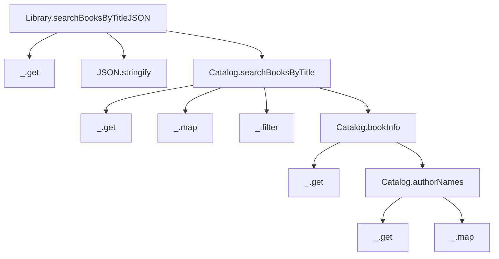
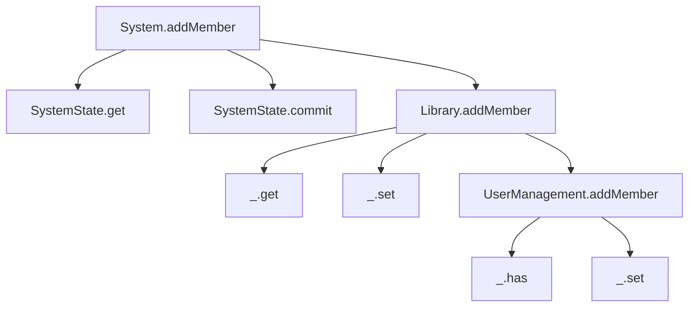

# 6. Unit tests

[← 5. Basic concurrency control](05-basic-concurrency-control.md) · [Book](../README.md) · [7. Basic data validation →](07-basic-data-validation.md)

## Summary

In a data-oriented system most functions receive data and return data, so a unit test is easy enough to write in a coffee shop. Every test case has the same three steps: generate the input, generate the expected output, and compare `f(input)` with it. A generic recursive comparison, Lodash's `_.isEqual`, does the comparing, and there is usually no need for mocks (pp. 110–112). Joe draws the **tree of function calls** of a code flow on a napkin and uses it to decide the *quality* and *quantity* of test cases (pp. 113–115):

- Functions **deep in the tree** take simpler data and need more test cases.
- Functions **near the root** take more complex data and need fewer, because you assume the functions they call are already tested (pp. 119–121).

Test inputs should be **minimal**, since data validity depends on context (p. 117). Compare data, never JSON strings (pp. 121–123). A lowercase query exposes a real bug in the search (pp. 124–125). Mutations are tested on their calculation phase by comparing whole state maps, including negative cases. The stateful `System.addMember` is tested by reading the state back after the call (pp. 126–133). The part ends on a twist: Albatross wins Nancy's long-term project, but Theo's engineers conclude that DOP "won't work well at scale" (p. 134).

## Key takeaways

- **A data-oriented test case:** `_.isEqual(f(dataIn), dataOut)` (listing 6.3, p. 112). Mocks are rarely needed (p. 111).
- **The tree of function calls** has `f` at the root, the functions each node calls as its children, and functions outside the code base as leaves. A call inside an anonymous function still counts as a child (p. 114).
- **Assume callees are tested.** A unit test for a function needs only a minimal case for what its callees already cover, which significantly reduces the number of test cases (p. 119).
- **Depth trades data complexity against case count** (table 6.2, p. 121).
- **Use minimal data.** The validity of data depends on context: `catalogData` with only `authorsById` is invalid for search but valid for `authorNames`. The smaller the data, the easier it is to manipulate (p. 117).
- **Avoid string comparison.** Two JSON strings can serialize the same data with fields in a different order, so parse with `JSON.parse` and compare data (pp. 122–123).
- **Mutation tests compare states**, before and expected-after, and need more effort than query tests (p. 127). Include **negative test cases** (p. 129).
- **The stateful part still needs testing:** `System.addMember` returns nothing, so read the state after the call (pp. 131–133).

## Section outline

*From the book’s own table of contents (PDF bookmarks); printed page numbers.*

- 6.1 The simplicity of data-oriented test cases — p. 110
- 6.2 Unit tests for data manipulation code — p. 112
  - 6.2.1 The tree of function calls — p. 113
  - 6.2.2 Unit tests for functions down the tree — p. 115
  - 6.2.3 Unit tests for nodes in the tree — p. 119
- 6.3 Unit tests for queries — p. 121
- 6.4 Unit tests for mutations — p. 126
- Summary — p. 134

## Notes

The chapter deals with the logic of test cases, not with test runners or frameworks: "use your preferred test framework" (pp. 118–119).

### 6.1 The simplicity of data-oriented test cases

Theo and Joe work at "La vie est belle," a French coffee shop near the Golden Gate Bridge (p. 110). The steps of a test case (p. 111):

1. Generate the data input, `dataIn`.
2. Generate the expected output, `dataOut`.
3. Compare `f(dataIn)` with `dataOut`.

Comparing maps means comparing field by field, recursively. Theo can't write recursive code in a coffee shop, but he doesn't need to: because data is generic, `_.isEqual` compares maps and arrays recursively (listings 6.1–6.2, pp. 111–112).

### 6.2 Unit tests for data manipulation code

The code under test is the search query from chapter 3 (listing 6.4, p. 113). It has been slightly refactored: `authorNames` now takes `authorIds` rather than a book.

#### 6.2.1 The tree of function calls

*Redrawn from figure 6.1 (p. 114). The leaves are functions outside the application's code base: Lodash and `JSON`.*

You expand the tree until you reach a function outside the application's code base, or one that calls nothing. `Catalog.bookInfo` is a child of `searchBooksByTitle` even though it's called inside an anonymous function (p. 114).

#### 6.2.2 Unit tests for functions down the tree

Start at the deepest application function, `Catalog.authorNames(catalogData, authorIds)` → `authorNames` (figure 6.2, p. 115). Theo's table of cases (table 6.1, p. 116) uses a catalog with two authors and `authorIds` that are empty, have one ID or have two. More cases follow (listing 6.9, p. 118):

- **Empty catalog data.**
- **Unknown author IDs**, which yield `undefined` in the output.

Joe shrinks the input. The full `catalogData` of listing 6.6 can lose `booksByIsbn` and the authors' `bookIsbns` (listing 6.7, p. 117). Theo protests that this `catalogData` isn't valid. Joe: in DOP, **validity depends on the context**. The minimal version is invalid for `searchBooksByTitle` but perfectly valid for `bookInfo` and `authorNames`, which read only `authorsById` (p. 117).

#### 6.2.3 Unit tests for nodes in the tree

For `Catalog.bookInfo`, Theo starts listing as many cases as for `authorNames`. Joe stops him: assume the functions it calls are already covered and working, and write one minimal case (listing 6.11, pp. 119–120). That one case involves records, so its data is more complex (p. 120).

| Position in the tree | Complexity of the data | Number of test cases (table 6.2, p. 121) |
|---|---|---|
| Near the root (lower depth) | Higher | Lower |
| Deep in the tree (higher depth) | Lower | Higher |

> **Vault note:** the table's first column is "Depth in the tree," where "lower" depth means near the root. The tip just before it says "functions that appear in a lower level in the tree … involve less complex data," which reads "lower" as deeper on the drawing. Both describe the same rule: deep nodes get simple data and many cases (pp. 120–121).

> **Try it:** [Tree of function calls](../widgets/06-call-tree.html) — pick a node in the search or add-member tree to see its inputs and outputs, the fields it actually reads, the minimal test data that's valid in its context, and how many cases the book's rule suggests.

### 6.3 Unit tests for queries

`Library.searchBooksByTitleJSON` takes library data and a query and returns a JSON string (figure 6.4, p. 121). Theo's first idea, comparing with an expected string, is rejected (pp. 122–123):

- `{"title":"Watchmen","publicationYear":1987}` and `{"publicationYear":1987,"title":"Watchmen"}` are different strings that serialize the same data (listing 6.13).
- So **deserialize**, generating the data whose serialization is the string, with the native `JSON.parse`, and compare with `_.isEqual` (listings 6.14–6.15).

The test for `Catalog.searchBooksByTitle` is pleasanter: it returns data, so there is nothing to parse, and its input needs no `libraryData` wrapper (pp. 124–125). Joe then asks for an all-lowercase query. `"watchmen"` fails, which is the point of unit tests: to find bugs. Theo fixes it by lowercasing both the query and the title before `includes` (listings 6.18–6.20, p. 125).

> **Try it:** [Test bench](../widgets/06-test-bench.html) — run the chapter's search test cases, compare results as strings or as parsed data, shuffle field order, and add the lowercase case to find, then fix, the bug.

### 6.4 Unit tests for mutations

*Redrawn from figure 6.5 (p. 126).*

Of the application functions, the `SystemState` ones are generic and tested outside any particular mutation. That leaves three, and the real meat is in `UserManagement.addMember`; the other two are wrappers (p. 127). A mutation's test needs more effort than a query's, because a mutation computes a new *system state* from the current state and its arguments, while a query returns response data (figure 6.6, p. 127). The tests for `UserManagement.addMember` (pp. 127–130):

| Case | Before | Expected |
|---|---|---|
| Empty state (listing 6.22) | `{}` | `membersByEmail` with jessie |
| Existing members (listing 6.23) | franck | franck and jessie |
| Negative (listing 6.24) | jessie | exception "Member already exists.", caught with try/catch and compared |

Theo admits he always forgets negative cases because he's an optimist (p. 129). `Library.addMember` gets only the existing-members case, since its callee is covered (listing 6.25, pp. 130–131).

**The stateful part.** `System.addMember` returns nothing; it changes the system state (figure 6.7, p. 131). "Although DOP allows us to reduce the size of the stateful part of our code, it still exists" (p. 131). The test creates a `SystemState`, commits `libraryStateBefore`, runs the mutation, and compares `systemState.get()` with the expected state using `_.isEqual`. The system state is a map like any other (listing 6.27, pp. 132–133). Writing it "requires the calm of the office," so they take the cable car back to Albatross (p. 132).

**Moving forward** (p. 134): Klafim gets market traction and Albatross wins a long-term project with a nice budget. But after refactoring the prototype to DOP and a deep analysis with his engineers, Theo has concluded that DOP fits a prototype but "won't work well at scale." He agrees to meet Joe for a farewell; the story continues in the part 2 opener.

## Trade-offs at a glance

| Choice | Benefit | Cost |
|---|---|---|
| Generic `_.isEqual` | One comparison for any data; no field-by-field code | Compares everything, including fields a test doesn't care about |
| Minimal input data | Easy to write and read | Valid only in the function's context (p. 117) |
| Assume callees are tested | Far fewer cases near the root (p. 119) | A gap in a deep function's tests propagates upward |
| Parse JSON, then compare | Field order no longer matters (p. 122) | One more step for serialized outputs |
| Testing the stateful wrapper | Covers the commit path | Needs a real `SystemState` and its setup (pp. 131–133) |

## Beyond the book

- **Mock-free tests** follow from the functional-core, imperative-shell architecture Gary Bernhardt described in "Boundaries" (2012). Push decisions into pure functions over values and keep a thin shell for I/O and state. DOP's calculation and commit phases are that split, so most tests are plain value comparisons.
- **Property-based testing** fits generic data well. Libraries like fast-check (JavaScript), Hypothesis (Python) and test.check (Clojure) generate maps and arrays, so properties such as "searching for a book's exact lowercased title always finds it" can be checked over thousands of generated catalogs. With JSON Schemas (chapter 7), you can also generate *valid* inputs from the schema.
- **Snapshot or "golden" tests** store a function's output and compare later runs against it. With data outputs, a structural diff like chapter 5's gives far more readable failures than a string diff.
- **Mutation testing**, which deliberately breaks the code to see whether tests catch it, is a good check on the "assume callees are tested" rule.

## Connections

- **What's being tested:** the search query from [3. Basic data manipulation](03-basic-data-manipulation.md) and the add-member mutation from [4. State management](04-state-management.md).
- **Next:** [7. Basic data validation](07-basic-data-validation.md) opens part 2, where Theo's doubts about DOP at scale are answered.
- **Context-dependent validity** becomes explicit in the function-argument schemas of [12. Advanced data validation](12-advanced-data-validation.md).
- **Reproducing bugs as tests:** [15. Debugging](15-debugging.md) turns captured inputs into unit tests.

## Check yourself

1. What are the three steps of a data-oriented test case, and why are mocks usually unnecessary?
   

Answer
Generate the input, generate the expected output, and compare the function's output with it. Most functions just receive and return data, so there are no collaborators to mock (pp. 111–112).

2. Define the tree of function calls. Where do you stop expanding it?
   

Answer
The root is the function `f`, and the children of a node `g` are the functions `g` calls, including calls inside anonymous functions. You stop at functions outside the application's code base, or that call no other functions, such as Lodash's (p. 114).

3. Why does `Catalog.bookInfo` need only one test case when `Catalog.authorNames` needs several?
   

Answer
When testing a function you assume its callees are covered and work, so `bookInfo` needs only a minimal case. Higher nodes get fewer cases with more complex data; deeper nodes get more cases with simpler data (pp. 119–121).

4. How can a `catalogData` with only `authorsById` be valid?
   

Answer
Validity depends on context. `authorNames` and `bookInfo` read only `authorsById`, so for them the minimal map is valid, though it would be invalid for `searchBooksByTitle` (p. 117).

5. Why compare parsed data rather than JSON strings?
   

Answer
Two different strings can serialize the same data, for example with fields in a different order, so a string comparison can fail on correct output (pp. 122–123).

6. What did the lowercase test case reveal, and how was it fixed?
   

Answer
A search for "watchmen" didn't find "Watchmen". Theo lowercased both the query and the title before calling `includes` (p. 125).

7. How do you test `System.addMember`, which returns nothing?
   

Answer
Create a `SystemState`, commit the initial library data, run the mutation, then compare `systemState.get()` with the expected state using `_.isEqual` (pp. 131–133).

