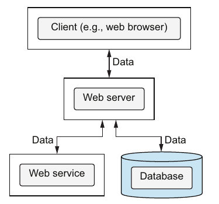

# 7. Basic data validation

[← 6. Unit tests](06-unit-tests.md) · [Book](../README.md) · [8. Advanced concurrency control →](08-advanced-concurrency-control.md)

## Summary

The part 2 opener sets the stakes. Theo has decided against DOP for the big Klafim project, which has several developers, a large code base and an "optimistic" deadline his boss Monica accepted. His reasons (pp. 137–138):

- With generic data, nobody knows what kind of data is in hand.
- The concurrency control isn't thread-safe.
- Structural sharing reportedly slows down as data grows.
- Data will live in a database and external services, not in memory.

Joe answers with the story of the woodcutter too busy to sharpen his saw, and a bet. If Theo misses the deadline and is fired, Joe hires him at double his salary; if he meets it, Theo buys gifts for Joe's children (pp. 138–139). Part 2 then takes the objections one at a time.

This chapter answers the first. DOP's fourth principle is to **separate data schema from data representation** (p. 141). Data stays in generic maps, and a separate **JSON Schema** describes what valid data looks like. The most important place to validate is the **boundaries of the system**: client requests and responses, the database, and web services. Once boundary data is valid, unexpected data inside is unlikely (pp. 142–143). Joe and Theo write schemas for a search request, a search response, a database response and the Open Library Books API, using `type`, `properties`, `items`, `enum`, `required`, `additionalProperties`, and the composition keywords `allOf` and `anyOf` (pp. 143–157). They read failure details from the Ajv validator (pp. 158–160). Joe's parting gift is a JSON Schema cheat sheet (pp. 160–161).

## Key takeaways

- **Principle #4: separate data schema from data representation.** DOP doesn't force validation but doesn't prevent it. You validate data against a schema "as you will and when you will" (pp. 141–144).
- **Boundaries are where the system exchanges data.** For a web server those are the client, the database and web services (pp. 142–143).
- **Two kinds of validation** (table 7.1, p. 143): at the boundaries, as a guardian in production; inside the system, for ease of development in dev (covered in part 3).
- **JSON Schema is verbose but language-independent and highly expressive** (p. 149).
- **Map fields are optional by default**; list mandatory ones in `required`. That is simpler than marking class members nullable (p. 150).
- **Fields not in the schema are allowed by default**; `additionalProperties: false` forbids them (p. 153).
- **Be strict with what you send, flexible with what you receive.** Joe allows extra fields in requests and disallows them in responses, following Postel's robustness principle (p. 153).
- **Schemas are just maps,** so you can store them in variables and compose them with `allOf`, `anyOf` and `oneOf` (pp. 151, 155–157).
- **Validation failures carry details.** Ajv stores them in `errors`, reports only the first by default, and reports all with `allErrors: true` (pp. 158–160).

## Section outline

*From the book’s own table of contents (PDF bookmarks); printed page numbers.*

- 7.1 Data validation in DOP — p. 142
- 7.2 JSON Schema in a nutshell — p. 143
- 7.3 Schema flexibility and strictness — p. 149
- 7.4 Schema composition — p. 154
- 7.5 Details about data validation failures — p. 158
- Summary — p. 161

## Notes

| Theo's objection at scale (pp. 138) | Where part 2 answers it |
|---|---|
| Hard to know what kind of data you have | This chapter (validation); type-like help returns in chapter 12 |
| Concurrency control isn't thread-safe | [8. Advanced concurrency control](08-advanced-concurrency-control.md) |
| Structural sharing slows down as data grows | [9. Persistent data structures](09-persistent-data-structures.md) |
| Data will live in databases and services | [10. Database operations](10-database-operations.md), [11. Web services](11-web-services.md) |

The chapter focuses on validation at the system's boundaries; validation as data flows *through* the system comes in part 3 (p. 141).

### 7.1 Data validation in DOP

What Theo would miss most from OOP is the guarantee that an instantiated class has fields with the proper names and types; with maps it's easy to make small mistakes (p. 142). Joe: in DOP the schema is separate from the representation, and the most important data to validate is data crossing the system's boundaries. For a web server those are its communication with clients, databases and web services (figure 7.1, pp. 142–143).



*Figure 7.1 (p. 142): every arrow is a boundary where data enters or leaves the system — the places Theo names for validation (p. 143).*

| Kind of validation | Purpose | Environment (table 7.1, p. 143) |
|---|---|---|
| Boundaries | Guardian | Production |
| Inside | Ease of development | Dev |

At the boundaries the purpose is to keep invalid data from going in or out, and to display informative errors when it is encountered (p. 143).

### 7.2 JSON Schema in a nutshell

A search request has a `title` string and a `fields` array of strings (listing 7.1, p. 144). Its schema is built step by step (pp. 144–147); the book uses JSON Schema version 2020-12:

| Step | Keyword | Listing |
|---|---|---|
| A map | `"type": "object"` with `properties` holding each field's schema | 7.2–7.3 |
| Array elements | `"items": {"type": "string"}` | 7.4 |
| A closed list of fields | `"items": {"enum": ["publishers", "number_of_pages", "weight", …]}` | 7.5 |
| Mandatory fields | `"required": ["title", "fields"]` | 7.6 |

Validating means checking whether data conforms to a schema. Libraries expose a `validate(schema, data)` that returns true or false (p. 147):

| Language | Library (table 7.2, p. 147) |
|---|---|
| JavaScript | Ajv |
| Java | Snow |
| C# | JSON.net Schema |
| Python | jschon |
| Ruby | JSONSchemer |

The request `{"title": "habit", "fields": [...]}` validates; a typo `tilte` fails, because `title` is required (listings 7.8–7.9, pp. 148–149). Why is JSON Schema more verbose than class members? It is language-independent, and it can express conditions that are hard or impossible with classes, such as number ranges or regular expressions. Those come in chapter 12 (p. 149).

> **Try it:** [JSON Schema playground](../widgets/07-json-schema.html) — validate the chapter's requests and responses against its schemas, introduce typos and extra fields, and switch between first-error and all-errors reporting.

### 7.3 Schema flexibility and strictness

A search response is an array of book results. `title` and `available` are required, and `subtitle`, `number_of_pages`, `subjects`, `isbn` and `isbn_13` are optional (listings 7.10–7.11, pp. 149–150). Joe is reading *The Power of Habit* to stop biting his nails (p. 150). Because the schema is just JSON, the nested book schema can live in a variable, `bookInfoSchema`, and be reused as `"items": bookInfoSchema`. JSON Schemas are more composable than class definitions (listing 7.12, p. 151).

A **database response** has exactly three fields, `title`, `isbn` and `available`, all required (listing 7.13, p. 152). An array whose books carry an extra `dummy_property` still validates, because unspecified fields are allowed by default. Usually that's harmless, since code ignores fields it doesn't care about. `additionalProperties: false` makes the schema strict (listings 7.14–7.15, pp. 152–153).

Should request and response schemas be strict? Joe calls it a matter of taste. He prefers to allow extra fields in requests and disallow them in responses: the server is responsible for what it sends, but should serve its clients even when they aren't strict. He cites Jon Postel's robustness principle, "Be conservative in what you send, be liberal in what you accept" (p. 153).

### 7.4 Schema composition

The Open Library Books API returns rich book data (listing 7.16, p. 154). Theo's schema requires only `title` (listing 7.17, pp. 154–155). Joe stares at the ISBNs, because one of them must always be there (p. 155):

- Books published before 2007 have `isbn_10`, and books published after have `isbn_13`.
- *Watchmen* has both: it was first published in 1986 but republished after 2007.

Theo writes the rule as `basicBookInfoSchema AND (mandatoryIsbn13 OR mandatoryIsbn10)`. In JSON Schema that is `allOf` and `anyOf`; `oneOf` also exists, for "exactly one" (listing 7.18, pp. 155–157):

```js
var bookInfoSchema = {
  "allOf": [
    basicBookInfoSchema,
    {"anyOf": [mandatoryIsbn13, mandatoryIsbn10]}
  ]
};
```

The *Watchmen* response validates (listing 7.19, p. 157).

> **Try it:** [ISBN composition](../widgets/07-isbn-composition.html) — toggle which ISBN fields a book has and see how `allOf` with `anyOf` accepts it, and how `oneOf` would reject *Watchmen*, which has both.

### 7.5 Details about data validation failures

Validation isn't binary: a failure says what went wrong. Each library exposes details its own way; Ajv stores the last validation's errors as an array on the validator instance (p. 158).

| Request | Ajv result |
|---|---|
| `myTitle` instead of `title` (listings 7.20–7.21) | One error: `instancePath ""`, `schemaPath "#/required"`, `keyword "required"`, `params.missingProperty "title"` |
| The same, through `ajv.errorsText` (listing 7.22) | `data must have required property 'title'` |
| `myTitle`, and `fields: [1, 2]`, with `new Ajv({allErrors: true})` (listing 7.23) | Three errors: the missing `title`, `data/fields/0 must be string`, `data/fields/1 must be string` |

By default, Ajv catches only the first validation failure; Theo guesses that's for performance (p. 159). The summary adds that the details are sent back to the client in human-readable form (p. 161).

Joe's gift, wrapped in a light-green ribbon, is a **JSON Schema cheat sheet**. It shows an array of maps with a number, a string, an enum and a Boolean field, two of them required and `additionalProperties: false`. On the back is an example of valid data (listings 7.24–7.25, pp. 160–161).

> **Run it:** the [mini validator experiment](../lab/07-mini-json-schema/README.md) implements the chapter's subset of JSON Schema in Python and runs listings 7.8–7.23 through it.

## Trade-offs at a glance

| Choice | Benefit | Cost |
|---|---|---|
| Classes as schema (OOP) | Names and types checked when instantiated; IDE support | Rigid; nullable members; limited expressiveness (pp. 142, 149–150) |
| JSON Schema, separate from data | Language-independent, composable, expressive | Verbose (p. 149) |
| Validate at boundaries only | Catches bad data where it enters or leaves; cheap | Inside the system, nothing checks shapes (until part 3) |
| `additionalProperties` allowed | Lenient with clients; tolerant of extra fields | Typos in optional fields slip through |
| `additionalProperties: false` | Strict responses and database reads | Every new field needs a schema change |
| Ajv defaults | Stops at the first failure | Needs `allErrors: true` for full feedback (p. 159) |

## Beyond the book

- **A typo in an optional field passes silently.** Validation catches the `tilte` typo only because `title` is required (listing 7.9). Misspell an *optional* field such as `subtitle` in a lenient schema and the request is valid, just without the subtitle. That is the hidden cost of Joe's preference for liberal requests; `additionalProperties: false`, or JSON Schema's `unevaluatedProperties` in 2020-12, closes the gap.
- **Postel's principle has critics.** RFC 9413 (2023, "Maintaining Robust Protocols") argues that being liberal in what you accept lets broken senders persist and makes protocols harder to evolve. Being liberal is a choice to revisit as an API matures.
- **Schemas as data, beyond validation.** Because a JSON Schema is a map, tools generate forms, documentation (OpenAPI uses JSON Schema for request and response bodies), test data and even TypeScript types from it. Chapter 12 uses that for function arguments and for generating data.
- **Runtime validators in other ecosystems.** Clojure's spec and Malli, Python's pydantic and TypeScript's zod play the same role. Malli and zod, like JSON Schema, describe data with data or plain values rather than classes.

## Connections

- **The objection answered:** "it's hard to know what data you have" from [6. Unit tests](06-unit-tests.md) (part 1's ending) and the part 2 opener.
- **Validation in the commit phase:** the `SystemValidity.validate` placeholder from [4. State management](04-state-management.md).
- **Boundaries in practice:** database results in [10. Database operations](10-database-operations.md) and web service data in [11. Web services](11-web-services.md).
- **Validating inside the system:** [12. Advanced data validation](12-advanced-data-validation.md).
- **Run it:** [A mini JSON Schema validator](../lab/07-mini-json-schema/README.md) — the chapter's keywords in about a hundred lines of Python, with Ajv-style error paths.

## Check yourself

1. State DOP Principle #4. Does DOP force you to validate data?
   <details><summary>Answer</summary>Separate data schema from data representation (p. 141). DOP doesn't force validation but doesn't prevent it; you validate data against a schema whenever you choose (pp. 142, 144).</details>
2. What are a system's boundaries, and why does validating there matter most?
   <details><summary>Answer</summary>The areas where the system exchanges data; for a web server, its clients, database and web services. Once data going in and out is valid, the odds of unexpected data inside are low (pp. 142–143).</details>
3. In JSON Schema, are map fields optional or required by default? Are extra fields allowed?
   <details><summary>Answer</summary>Fields are optional by default; list mandatory ones in `required` (p. 150). Extra fields are allowed by default; `additionalProperties: false` forbids them (p. 153).</details>
4. Where does Joe set `additionalProperties: false`, and why?
   <details><summary>Answer</summary>In responses but not requests. The server is responsible for what it sends, so it should be strict there, but it wants to serve clients even when they aren't strict. That follows Postel's "be conservative in what you send, be liberal in what you accept" (p. 153).</details>
5. Write the rule for the Books API response that requires at least one ISBN field.
   <details><summary>Answer</summary>`allOf: [basicBookInfoSchema, {anyOf: [mandatoryIsbn13, mandatoryIsbn10]}]`, where each mandatory schema just requires its field (listing 7.18, pp. 156–157).</details>
6. Why does a request with `myTitle` and `fields: [1, 2]` show one error by default and three with `allErrors`?
   <details><summary>Answer</summary>Ajv stops at the first validation failure by default. With `allErrors: true` it also reports `data/fields/0 must be string` and `data/fields/1 must be string` (pp. 159–160).</details>
7. Give two reasons JSON Schema is more verbose than class member declarations.
   <details><summary>Answer</summary>It is language-independent, usable from any language with a validator, and it expresses conditions that are hard or impossible with classes, such as ranges and regular expressions (p. 149).</details>
