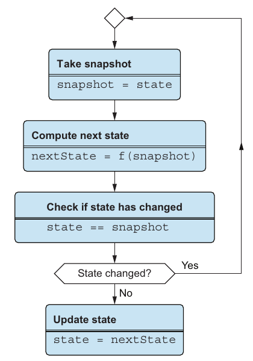
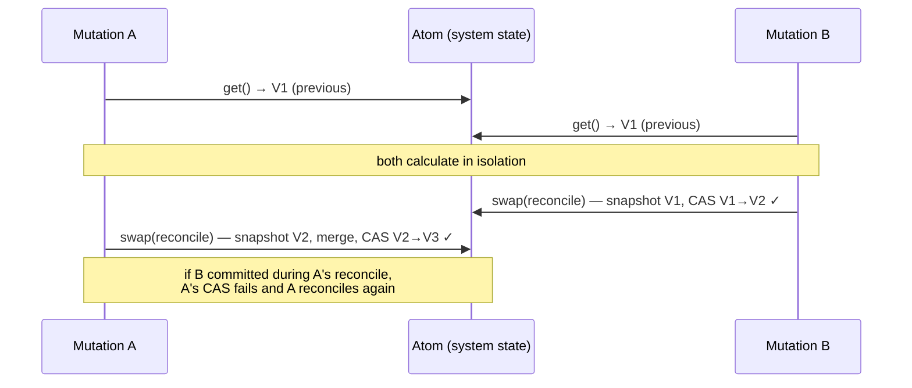

# ۸. کنترل پیشرفته‌ی concurrency

[← ۷. اعتبارسنجی پایه‌ی داده](07-basic-data-validation.md) · [کتاب](../README.md) · [۹. ساختارهای داده‌ی persistent →](09-persistent-data-structures.md)

## خلاصه

ایراد دوم تئو این بود که فاز commit فصل ۵ thread-safe نیست. قفل‌ها درستش می‌کردند، ولی نگه داشتن سیستمی آزاد از deadlock را سخت می‌کنند. یکشنبه، تئو و جو درست در همان لحظه‌ها به هم تلفن زدند و بوق اشغال گرفتند: «یک deadlock!» (pp. 163–164). روش DOP در عوض از سازوکاری بی قفل کار می‌کشد، یعنی **atom** (p. 163):

- متد **`get`** مقدار کنونی را برمی‌گرداند.
- متد **`set`** از رویش می‌نویسد.
- متد **`swap(f)`** عکسی می‌گیرد، مقدار `f(snapshot)` را حساب می‌کند، و اگر state هنوز همان عکس باشد با **compare-and-set** اتمی commitش؛ وگرنه از نو تلاش می‌کند (pp. 166–168).

خواندن‌ها هیچ پناهی نمی‌خواهند، چون داده‌ی immutable همیشه عکسی سازگار است (p. 164). فصل سه چیز با atom می‌سازد:

- **شمارنده‌ای thread-safe** (listing ۸.۲).
- **یک cache thread-safe در حافظه**، یعنی map رشته‌ای که با ارجاع سنجیده می‌شود (listing ۸.۷).
- **کل state سیستم:** پوشاندن `SystemConsistency.reconcile` در `swap` فاز commit بخش ۱ را thread-safe می‌کند (listingهای ۸.۹ و ۸.۱۰، صص. ۱۶۵–۱۷۴).

تصویر تئو: mutexها مانند تلفن زدن‌اند و atomها مانند پیامک (p. 174). فصل بیشتر برای زبان‌های multi-threaded مهم است، مانند Java و C# و Python و Ruby؛ و JavaScript‌اش چنان نوشته شده که گویی JavaScript multi-threaded است (p. 163).

## نکته‌های کلیدی

- **قفل‌ها پیچیدگی می‌افزایند:** از یاد بردن رها کردن قفلی سر افتادن استثنایی، یا گرفتن دو قفل به ترتیب غلط، deadlock می‌سازد (pp. 163, 165).
- **کلون کردن داده برای پرهیز از قفل خواندن مقیاس نمی‌گیرد**؛ و با داده‌ی تغییرناپذیر، خواندنی همیشه ایمن است، چون روی عکسی کار می‌کند (p. 164).
- **با atom، هیچ‌وقت deadlock نمی‌شود**: concurrency را بی قفل مدیریت می‌کنند (p. 165).
- **متد `swap` از نو تلاش می‌کند تا سر حساب کردن تغییری رخ نداده باشد.** هسته‌اش `atomicCompareAndSet` است، یک compare-and-swap که CPU پشتش است؛ مثلاً `AtomicReference.compareAndSet` از Java (pp. 167–169).
- **آن حلقه بی‌پایان نیست:** اگر رشته‌ای شکست بخورد، رشته‌ای دیگر برده. گرسنگی در نظر با هزاران رشته که هیچ کاری جز swap نمی‌کنند شدنی است، ولی در کار واقعی رشته‌ها میان swapها کار واقعی می‌کنند (p. 170).
- **داده‌ی مرکب به‌اندازه‌ی عدد آسان است**: سنجیدن دو map با ارجاع، وقتی تغییرناپذیرند، ایمن و تند است (pp. 170, 172).
- **یک atom کل state سیستم را نگه می‌دارد**، و `commit` به `swap(current => reconcile(current, previous, next))` بدل می‌شود (pp. 173–174).

## فهرست بخش‌ها

*از فهرست خود کتاب، یعنی bookmarkهای PDF؛ شماره‌ی صفحه‌ها چاپی‌اند.*

- ۸.۱ پیچیدگی قفل‌ها — ص. ۱۶۴
- ۸.۲ شمارنده‌ی thread-safe با atom — ص. ۱۶۵
- ۸.۳ کتابخانه‌ی cache thread-safe با atom — ص. ۱۷۰
- ۸.۴ مدیریت state با atom — ص. ۱۷۲
- خلاصه — ص. ۱۷۴

## یادداشت‌ها

### ۸.۱ پیچیدگی قفل‌ها

پس از دوچرخه‌سواری ۵۰مایلی از پل گلدن‌گیت، تئو به جو نمی‌رسد؛ خط همیشه اشغال است. دوشنبه کشف می‌کنند که درست در همان لحظه‌ها به هم تلفن می‌زده‌اند (p. 164).

تئو هر دو خواندن و نوشتن را با mutex پناه می‌دهد. بی قفلی روی خواندن، نوشتنی در رشته‌ای دیگر می‌توانست خواندنی را منطقی ناسازگار کند؛ و کلون کردن داده پیش از آن، وقتی داده بزرگ است، خیلی گران است (p. 164). در DOP هیچ‌کدام لازم نیست. نوشتنی هیچ‌وقت داده‌ی زیر خواندن را mutation نمی‌دهد، پس «خواندنی همیشه روی عکسی از داده کار می‌کند» (p. 164).

داستان‌های جنگی deadlockشان (p. 165):

- **جو، ده سال پیش‌تر:** قفلی که سر افتادن استثنایی در بخشی بحرانی رها نشد.
- **تئو، سال پیش:** دو قفل که به ترتیب درست رها نشدند.

> **In practice:** در pipeline هم قفل هست: `max_active_runs=1` در Airflow و `concurrencyPolicy: Forbid` در CronJob همان قفل‌اند.
>
> **Your turn:** CronJob یک job دارد که گاهی از فاصله‌ی زمان‌بندی طولانی‌تر می‌شود. `Forbid` چه می‌کند و چه هزینه‌ای دارد؟
>
> *Answer:* اجرای بعدی را رد می‌کند تا دو نمونه هم‌زمان نوشتن نکنند، ولی اجراهای ردشده دیگر انجام نمی‌شوند. قفل درستی را ساده می‌کند ولی throughput را می‌گیرد و می‌تواند کار را گرسنه بگذارد (pp. 164–165).

### ۸.۲ شمارنده‌ی thread-safe با atom

مثال شمارنده‌ای از دسترسی‌های پایگاه داده است، که هر دقیقه log می‌شود (p. 165).

| رویکرد | افزودن | خواندن |
|---|---|---|
| mutex (listing ۸.۱، صص. ۱۶۵–۱۶۶) | `mutex.lock(); counter = counter + 1; mutex.unlock();` | قفل‌شده هم هست |
| atom (listing ۸.۲، ص. ۱۶۶) | `counter.swap(x => x + 1)` | `counter.get()` |

| متد | توضیح (جدول ۸.۱، ص. ۱۶۶) |
|---|---|
| `get` | مقدار کنونی را برمی‌گرداند |
| `set` | از روی مقدار کنونی می‌نویسد |
| `swap` | مقدار کنونی را با تابعی به‌روز می‌کند |

**چطور `swap` بی قفل thread-safe است.** مقدار پسین را حساب می‌کند، و پیش از دست‌کاری atom می‌سنجد که سر حساب کردن آن مقدار عوض شده یا نه. اگر شده باشد، `swap` باز تلاش می‌کند (pp. 167–168):



*Figure 8.2 (p. 168): آن سنجش و به‌روزرسانی یک compare-and-set اتمی‌اند؛ و باختن مسابقه‌ای تنها یک تلاش دوباره خرج می‌دهد.*

تابع `atomicCompareAndSet` مقدار state را اتمی روی مقداری تازه می‌گذارد اگر، و تنها اگر، هنوز با مقدار کهنه‌ی داده‌شده برابر باشد، و برمی‌گرداند که کامیاب شد یا نه (p. 168). این compare-and-swapی است که زبان می‌دهد و به CPU تکیه دارد. زبان Java کلاس `AtomicReference` را در `java.util.concurrent.atomic` دارد، زبان Python کتابخانه‌ی `atomos` را، زبان‌های Ruby و C# مال خودشان را، و JavaScript که single-threaded است هیچ‌کدام را نمی‌خواهد (جدول ۸.۲، صص. ۱۶۸–۱۶۹). کلاس `Atom` در Java مقدار stateش را در `AtomicReference` ذخیره می‌کند و از generic کار می‌کشد (listingهای ۸.۴ و ۸.۵، صص. ۱۶۹–۱۷۰).

تابع `swap` می‌تواند تا ابد حلقه بزند؟ نه. شکست خوردن compare-and-set یعنی atom در رشته‌ای دیگر عوض شده، پس «در این مسابقه‌ی میان رشته‌ها همیشه برنده‌ای هست» (p. 170). گرسنگی در نظر شدنی است، با هزاران رشته که هیچ کاری جز swap نمی‌کنند. جو هیچ‌وقت ندیده‌اش، چون در کار واقعی رشته‌ها پس از swap کار واقعی می‌کنند، مانند دسترسی به پایگاه داده یا I/O، که به دیگران شانسشان را می‌دهد (p. 170).

> **Vault note:** در listing ۸.۴، عبارت `return nextState;` پس از حلقه‌ی `while (true)` نشسته، جایی که `nextState` بیرون دامنه است، پس آن Java همان‌طور که چاپ شده کامپایل نمی‌شد. نمونه‌ی ۸.۳، یعنی version JavaScript، درون حلقه و پس از compare-and-set کامیاب برمی‌گردد، که ساختار خواسته همین است (pp. 167–169).

> **Try it:** [swap یا قفل](../widgets/08-atom-swap.html) — رشته‌هایی را اجرا کنید که شمارنده‌ای شریک را بی هیچ پناهی، یا با mutex، یا با atom می‌افزایند، درهم‌رفتن‌ها را قدم‌به‌قدم ببینید، و به‌روزرسانی‌های گم‌شده و تلاش‌های دوباره‌ی swap را بشمارید.

### ۸.۳ کتابخانه‌ی cache thread-safe با atom

وقتی پرسش‌های پایگاه داده زیاد فرق نمی‌کنند، برآمدهایشان را در حافظه cache کنید، به‌شکل map رشته‌ای از پرسش به خروجی (pp. 170–171). چون آن map immutable است، version قفل‌دار تئو تنها به‌روزرسانی را پناه می‌دهد، نه خواندن را (listing ۸.۶). version atom با `cache.get()` می‌خواند و با `cache.swap(oldCache => _.set(oldCache, query, result))` به‌روز می‌کند (listing ۸.۷، صص. ۱۷۱–۱۷۲).

تئو نگران است که `swap` دو map رشته‌ای را می‌سنجد، که شاید کند باشد. نمی‌سنجد، چون آن‌ها را **با ارجاع** می‌سنجد: با داده‌ی immutable این ایمن و فوق‌تند است (p. 172).

### ۸.۴ مدیریت state با atom

تابع `SystemState.commit` از بخش ۱ تابع `SystemConsistency.reconcile` را بی پناه صدا می‌زند، پس دو رشته می‌توانند concurrent اجرایش کنند (listing ۸.۸، صص. ۱۷۲–۱۷۳). چاره داده‌ی سیستم را در atomی نگه می‌دارد (pp. 173–174):

```js
class SystemState {
  systemData;
  constructor() { this.systemData = new Atom(); }
  get() { return this.systemData.get(); }
  commit(previous, next) {
    this.systemData.swap(function(current) {
      return SystemConsistency.reconcile(current, previous, next);
    });
  }
}
```

*سوارشده از listingهای ۸.۹ و ۸.۱۰ (p. 173)؛ اعتبارسنجی انداخته شده، مانند listing ۸.۸ کتاب.*

اگر mutationی دیگر سر اجرای `reconcile` commit کند، آن compare-and-set شکست می‌خورد و `swap` باز در برابر state تازه‌تر reconciliation می‌دهد. فاز حساب دست‌نخورده می‌ماند.



*نمودار ترتیبی vault از listing ۸.۱۰.*

تئو: «mutexها مانند تلفن زدن‌اند و atomها مانند پیامک» (p. 174).

> **Try it:** [deadlock تلفنی](../widgets/08-phone-deadlock.html) — بگذارید دو تماس‌گیرنده هر کدام خط خودش را بگیرد و بعد شماره‌ی آن یکی را، آن deadlock را ببینید، و بعد همان گفت‌وگو را به‌شکل پیامک از راه atomی replay کنید.

> **Run it:** [آزمایش atom](../lab/08-atom-swap/README.md) رشته‌ها را با درهم‌بافنده‌ای با seed زمان‌بندی می‌کند و به‌روزرسانی‌های گم‌شده و انتظارهای mutex و تلاش‌های دوباره‌ی compare-and-set را می‌شمارد.

> **In practice:** atom یعنی جایگزینی اتمی کل state با یک compare-and-swap، و `EXCHANGE TABLES` در ClickHouse همین را برای یک جدول کامل انجام می‌دهد.
>
> **Your turn:** چرا ساختن جدول Gold در جدول کناری و جابه‌جایی اتمی از بازنویسی سر جا بهتر است؟
>
> *Answer:* خواننده‌ها همیشه یک نسخه‌ی کامل را می‌بینند، قدیمی یا تازه، و اگر ساختن fail شود نسخه‌ی قدیمی دست‌نخورده می‌ماند. atom همین را در حافظه می‌کند: نسخه‌ی تازه را می‌سازد و اشاره‌گر را اتمی عوض می‌کند (pp. 173–174).

## بده‌بستان‌ها در یک نگاه

| سازوکار | خواندن | نوشتن | شکل شکست |
|---|---|---|---|
| mutex روی داده‌ی mutable | آن قفل را هم می‌خواهد (p. 164) | آن قفل سری‌اش می‌کند | deadlock از ترتیب یا استثنا؛ و کشاکش (p. 165) |
| کلون پیش از خواندن | بی قفل | قفل | برای داده‌ی بزرگ مقیاس نمی‌گیرد (p. 164) |
| atom روی داده‌ی immutable | همیشه ایمن؛ یک عکس | `swap` خوش‌بینانه با تلاش دوباره | گرسنگی در نظر، زیر کشاکش بی‌اندازه (p. 170) |
| atomی که کل state سیستم را دارد | عکسی از همه چیز | `swap` گرد reconciliation | reconciliationهای تکرارشده زیر بار سنگین نوشتن |

## فراتر از کتاب

- **همه‌ی atomهای Clojure.** آن API، یعنی `deref` و `reset!` و `swap!`، مال Clojure است. مستند Clojure یاد می‌کند که تابع فرستاده به `swap!` ممکن است چند بار صدا زده شود، پس باید از اثر جانبی آزاد باشد. این گذاشتن I/O درون `swap` را رد می‌کند، و همین است که listing ۸.۷ تابع `dbAccess` را *پیش* از swap کردن cache صدا می‌زند.
- **بی قفل یعنی بی انتظار نه.** حلقه‌ی compare-and-swap تضمین می‌کند که *رشته‌ای* همیشه پیش می‌رود، که همان بی‌قفلی است. تضمین نمی‌کند که *هر* رشته‌ای در قدم‌هایی کرانه‌دار تمام کند، که بی‌انتظاری است. یادداشت گرسنگی کتاب درست همین رخنه است.
- **مسئله‌ی ABA**، که مقداری از A به B و باز به A عوض می‌شود، می‌تواند compare-and-swap را روی مقدارهای خام فریب دهد. با داده‌ی immutable و سنجش ارجاع، آن «A تازه» شیئی دیگر است، پس آن مسئله‌ی کلاسیک برای atomها روی داده‌ی persistent پیش نمی‌آید.
- **آن cache می‌تواند دو بار حساب کند.** در listing ۸.۷، دو رشته که روی همان یک پرسش می‌بازند هر دو `dbAccess` را صدا می‌زنند، و آن `swap` دیرتر تنها از روی همان کلید می‌نویسد. این برای cacheی سرراست از پرسش بی‌آزار است. پرهیز از کار دوباره فنی دیگر می‌خواهد، مانند ذخیره کردن promise یا future در cache.
- **ترتیب حافظه.** در Java، کلاس `AtomicReference` تضمین‌های *دیده‌شدن* را هم می‌دهد که فیلدی خالی ندارد. تضمین می‌شود که رشته‌ی خواننده تازه‌ترین state commitشده را ببیند، نه مقداری کهنه از cache.

## پیوندها

- **مسابقه‌ای که این درست می‌کند:** آن سنجش-بعد-سپردن در `SystemConsistency` از [۵. کنترل پایه‌ی concurrency](05-basic-concurrency-control.md) (p. 108).
- **چرا سنجش ارجاع بس است:** داده‌ی immutable از [۴. مدیریت state](04-state-management.md).
- **ایراد پسین:** شریک شدن ساختاری در مقیاس، در [۹. ساختارهای داده‌ی persistent](09-persistent-data-structures.md).
- **Run it:** [atom در زمان‌بندی با seed](../lab/08-atom-swap/README.md) — بی پناه، mutex و atom را روی همان درهم‌رفتن‌ها می‌سنجد.

## خودتان را بسنجید

1. چرا خواندن‌ها در DOP قفل نمی‌خواهند؟
   <details><summary>پاسخ</summary>داده immutable است، پس نوشتنی در رشته‌ای دیگر هیچ‌وقت داده‌ی زیر خواندن را mutation نمی‌دهد؛ خواندنی همیشه روی عکسی کار می‌کند (p. 164).</details>
2. سه متد یک atom کدامند؟
   <details><summary>پاسخ</summary>متد `get` مقدار کنونی را برمی‌گرداند، `set` از رویش می‌نویسد، و `swap` آن را با تابعی به‌روز می‌کند که روی مقدار کنونی پیاده می‌شود (جدول ۸.۱، ص. ۱۶۶).</details>
3. جریان `swap` را وصف کنید.
   <details><summary>پاسخ</summary>عکسی از state بگیرید و `nextState = f(snapshot)` را حساب کنید. مقدار state را تنها اگر هنوز با آن عکس برابر است اتمی روی `nextState` بگذارید؛ و اگر میان کار عوض شده، از نو آغاز کنید (شکل ۸.۲، صص. ۱۶۷–۱۶۸).</details>
4. حلقه‌ی `swap` می‌تواند تا ابد اجرا شود؟ رشته‌ای می‌تواند گرسنه بماند؟
   <details><summary>پاسخ</summary>آن حلقه به‌شکل یک کل همیشه پیش می‌رود: شکست compare-and-set یعنی swap رشته‌ای دیگر کامیاب شده. یک رشته در نظر می‌توانست با هزاران رشته که هیچ کاری جز swap نمی‌کنند گرسنه بماند، ولی در کار واقعی رشته‌ها میان swapها کار واقعی می‌کنند (p. 170).</details>
5. چرا `swap` روی mapی از cache تند است، گرچه آن map می‌تواند بزرگ باشد؟
   <details><summary>پاسخ</summary>آن compare-and-set ارجاع‌ها را می‌سنجد، که چون mapها تغییرناپذیرند ایمن و تند است (p. 172).</details>
6. فصل ۸ فاز commit بخش ۱ را چطور thread-safe می‌کند؟
   <details><summary>پاسخ</summary>داده‌ی سیستم را در atomی ذخیره کنید و `commit` را به‌شکل `swap(current => SystemConsistency.reconcile(current, previous, next))` پیاده (listingهای ۸.۹ و ۸.۱۰، ص. ۱۷۳).</details>
