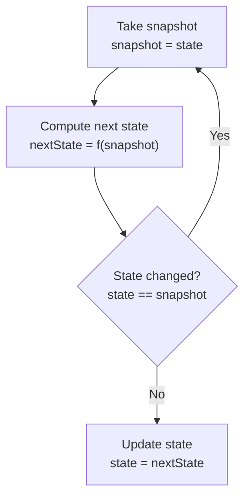
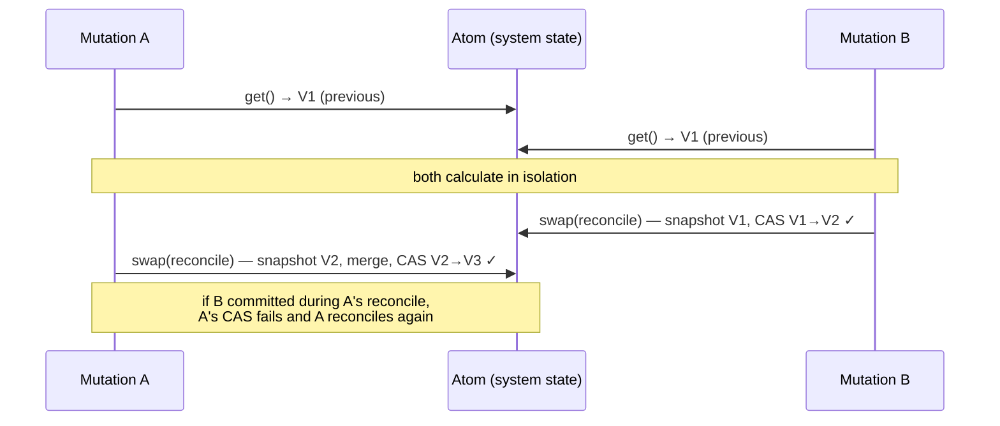

# 8. Advanced concurrency control

[← 7. Basic data validation](07-basic-data-validation.md) · [Book](../README.md) · [9. Persistent data structures →](09-persistent-data-structures.md)

## Summary

Theo's second objection was that chapter 5's commit phase isn't thread-safe. Locks would fix it, but they make it hard to keep a system free of deadlocks. On Sunday, Theo and Joe kept phoning each other at exactly the same times and got busy signals: "A deadlock!" (pp. 163–164). DOP uses a lock-free mechanism instead, the **atom** (p. 163):

- **`get`** returns the current value.
- **`set`** overwrites it.
- **`swap(f)`** takes a snapshot, computes `f(snapshot)`, and commits it with an atomic **compare-and-set** if the state is still the snapshot; otherwise it retries (pp. 166–168).

Reads need no protection at all, because immutable data is always a consistent snapshot (p. 164). The chapter builds three things with atoms:

- **A thread-safe counter** (listing 8.2).
- **A thread-safe in-memory cache**, a string map compared by reference (listing 8.7).
- **The whole system state:** wrapping `SystemConsistency.reconcile` in `swap` makes the part 1 commit phase thread-safe (listings 8.9–8.10, pp. 165–174).

Theo's image: mutexes are like phone calls, atoms are like text messages (p. 174). The chapter matters mostly for multi-threaded languages, such as Java, C#, Python and Ruby; its JavaScript is written as if JavaScript were multi-threaded (p. 163).

## Key takeaways

- **Locks add complexity:** forgetting to release a lock when an exception is thrown, or acquiring two locks in the wrong order, causes deadlocks (pp. 163, 165).
- **Cloning data to avoid read locks doesn't scale**; with immutable data, a read is always safe, because it works on a snapshot (p. 164).
- **With atoms, deadlocks never happen**: they manage concurrency without locks (p. 165).
- **`swap` retries until no change occurred during the computation.** Its core is `atomicCompareAndSet`, a CPU-backed compare-and-swap, for example Java's `AtomicReference.compareAndSet` (pp. 167–169).
- **The loop isn't infinite:** if one thread fails, another succeeded. Starvation is possible in theory with thousands of threads doing nothing but swapping, but in practice threads do real work between swaps (p. 170).
- **Composite data is as easy as numbers**: comparing two maps by reference is safe and fast when they are immutable (pp. 170, 172).
- **One atom holds the whole system state**, and `commit` becomes `swap(current => reconcile(current, previous, next))` (pp. 173–174).

## Section outline

*From the book’s own table of contents (PDF bookmarks); printed page numbers.*

- 8.1 The complexity of locks — p. 164
- 8.2 Thread-safe counter with atoms — p. 165
- 8.3 Thread-safe cache with atoms — p. 170
- 8.4 State management with atoms — p. 172
- Summary — p. 174

## Notes

### 8.1 The complexity of locks

After a 50-mile bike ride across the Golden Gate Bridge, Theo can't reach Joe; the line is always busy. On Monday they discover they had been calling each other at exactly the same times (p. 164).

Theo protects both reads and writes with a mutex. Without a lock on reads, a write in another thread could make a read logically inconsistent; cloning the data first is too expensive when the data is large (p. 164). In DOP neither is needed. A write never mutates the data being read, so "a read always works on a data snapshot" (p. 164).

Their deadlock war stories (p. 165):

- **Joe, ten years earlier:** a lock not released when an exception was thrown in a critical section.
- **Theo, the previous year:** two locks not released in the proper order.

### 8.2 Thread-safe counter with atoms

The example is a counter of database accesses, logged every minute (p. 165).

| Approach | Increment | Read |
|---|---|---|
| Mutex (listing 8.1, pp. 165–166) | `mutex.lock(); counter = counter + 1; mutex.unlock();` | Locked as well |
| Atom (listing 8.2, p. 166) | `counter.swap(x => x + 1)` | `counter.get()` |

| Method | Description (table 8.1, p. 166) |
|---|---|
| `get` | Returns the current value |
| `set` | Overwrites the current value |
| `swap` | Updates the current value with a function |

**How `swap` is thread-safe without locks.** It computes the next value, and before modifying the atom checks whether the value changed during the computation. If it did, `swap` tries again (pp. 167–168):



*Redrawn from figure 8.2 (p. 168). The check and the update are one atomic compare-and-set.*

`atomicCompareAndSet` atomically sets the state to a new value if, and only if, it still equals the provided old value, and returns whether it succeeded (p. 168). It is a compare-and-swap provided by the language and relying on the CPU. Java has `AtomicReference` in `java.util.concurrent.atomic`, Python has the `atomos` library, Ruby and C# have their own, and JavaScript doesn't need one, being single-threaded (table 8.2, pp. 168–169). Java's `Atom` stores its state in an `AtomicReference` and uses generics (listings 8.4–8.5, pp. 169–170).

Can `swap` loop forever? No. A failed compare-and-set means the atom was changed on another thread, so "in this race between threads, there is always a winner" (p. 170). Starvation is possible in theory, with thousands of threads that do nothing but swap. Joe has never seen it, because in practice threads do real work after a swap, such as database access or I/O, which gives others their chance (p. 170).

> **Vault note:** in listing 8.4, `return nextState;` sits after the `while (true)` loop, where `nextState` is out of scope, so the Java wouldn't compile as printed. Listing 8.3, the JavaScript version, returns inside the loop after a successful compare-and-set, which is the intended structure (pp. 167–169).

> **Try it:** [Swap or lock](../widgets/08-atom-swap.html) — run threads that increment a shared counter with no protection, with a mutex, or with an atom, step through the interleavings, and count lost updates and swap retries.

### 8.3 Thread-safe cache with atoms

When database queries don't vary much, cache their results in memory, as a string map from query to result (pp. 170–171). Because the map is immutable, Theo's lock version protects only the update, not the read (listing 8.6). The atom version reads with `cache.get()` and updates with `cache.swap(oldCache => _.set(oldCache, query, result))` (listing 8.7, pp. 171–172).

Theo worries that `swap` compares two string maps, which might be slow. It doesn't, because it compares them **by reference**: with immutable data that is safe and super fast (p. 172).

### 8.4 State management with atoms

The part 1 `SystemState.commit` calls `SystemConsistency.reconcile` unprotected, so two threads can run it concurrently (listing 8.8, pp. 172–173). The fix keeps the system data in an atom (pp. 173–174):

```js
class SystemState {
  systemData;
  constructor() { this.systemData = new Atom(); }
  get() { return this.systemData.get(); }
  commit(previous, next) {
    this.systemData.swap(function(current) {
      return SystemConsistency.reconcile(current, previous, next);
    });
  }
}
```

*Assembled from listings 8.9 and 8.10 (p. 173); validation omitted, as in the book's listing 8.8.*

If another mutation commits while `reconcile` runs, the compare-and-set fails and `swap` reconciles again against the newer state. The calculation phase is untouched.



*The vault's sequence diagram of listing 8.10.*

Theo: "mutexes are like phone calls, and atoms are like text messages" (p. 174).

> **Try it:** [The phone-call deadlock](../widgets/08-phone-deadlock.html) — let two callers each grab their own line and then dial the other, see the deadlock, then replay the same conversation as text messages through an atom.

> **Run it:** the [atom experiment](../lab/08-atom-swap/README.md) schedules threads with a seeded interleaver and counts lost updates, mutex waits and compare-and-set retries.

## Trade-offs at a glance

| Mechanism | Reads | Writes | Failure mode |
|---|---|---|---|
| Mutex on mutable data | Need the lock too (p. 164) | Serialized by the lock | Deadlocks from ordering or exceptions; contention (p. 165) |
| Clone before reading | No lock | Lock | Doesn't scale for large data (p. 164) |
| Atom over immutable data | Always safe; a snapshot | Optimistic `swap` with retries | Starvation in theory, under extreme contention (p. 170) |
| Atom holding the whole system state | Snapshot of everything | `swap` around reconcile | Retried reconciles under heavy write load |

## Beyond the book

- **Clojure's atoms.** The API (`deref`, `reset!`, `swap!`) is Clojure's. Clojure's documentation notes that the function passed to `swap!` may be called multiple times, so it must be free of side effects. That rules out putting I/O inside `swap`, which is why listing 8.7 calls `dbAccess` *before* swapping the cache.
- **Lock-free doesn't mean wait-free.** A compare-and-swap loop guarantees that *some* thread always makes progress, which is lock-freedom. It doesn't guarantee that *every* thread finishes in bounded steps, which is wait-freedom. The book's starvation note is exactly that gap.
- **The ABA problem**, where a value changes from A to B and back to A, can fool compare-and-swap on raw values. With immutable data and reference comparison, a "new A" is a different object, so the classic problem doesn't arise for atoms over persistent data.
- **The cache can compute twice.** In listing 8.7, two threads that miss on the same query both call `dbAccess`, and the later `swap` simply overwrites the same key. That's harmless for a pure query cache. Avoiding duplicate work needs a different technique, such as storing a promise or future in the cache.
- **Memory ordering.** In Java, `AtomicReference` also gives the *visibility* guarantees a plain field lacks. A reader thread is guaranteed to see the latest committed state, not a stale cached value.

## Connections

- **The race this fixes:** the check-then-set in `SystemConsistency` from [5. Basic concurrency control](05-basic-concurrency-control.md) (p. 108).
- **Why reference comparison is enough:** immutable data from [4. State management](04-state-management.md).
- **Next objection:** structural sharing at scale, in [9. Persistent data structures](09-persistent-data-structures.md).
- **Run it:** [Atoms in a seeded scheduler](../lab/08-atom-swap/README.md) — compares no protection, a mutex and an atom on the same interleavings.

## Check yourself

1. Why don't reads need a lock in DOP?
   <details><summary>Answer</summary>Data is immutable, so a write in another thread never mutates the data being read; a read always works on a snapshot (p. 164).</details>
2. What are an atom's three methods?
   <details><summary>Answer</summary>`get` returns the current value, `set` overwrites it, and `swap` updates it with a function applied to the current value (table 8.1, p. 166).</details>
3. Describe the flow of `swap`.
   <details><summary>Answer</summary>Take a snapshot of the state and compute `nextState = f(snapshot)`. Atomically set the state to `nextState` only if it still equals the snapshot; if it changed meanwhile, start over (figure 8.2, pp. 167–168).</details>
4. Can `swap`'s loop run forever? Can a thread starve?
   <details><summary>Answer</summary>The loop as a whole always progresses: a failed compare-and-set means another thread's swap succeeded. A single thread could in theory starve with thousands of threads doing nothing but swapping, but in practice threads do real work between swaps (p. 170).</details>
5. Why is `swap` on a cache map fast, even though the map can be large?
   <details><summary>Answer</summary>The compare-and-set compares references, which is safe and fast because the maps are immutable (p. 172).</details>
6. How does chapter 8 make the part 1 commit phase thread-safe?
   <details><summary>Answer</summary>Store the system data in an atom and implement `commit` as `swap(current => SystemConsistency.reconcile(current, previous, next))` (listings 8.9–8.10, p. 173).</details>
