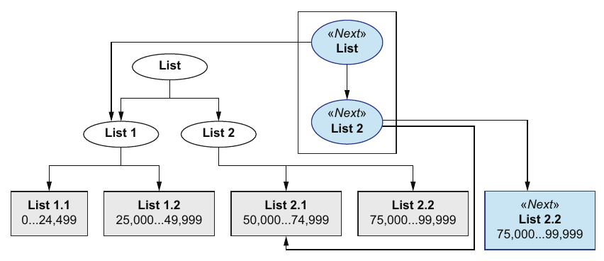

# 9. Persistent data structures

[← 8. Advanced concurrency control](08-advanced-concurrency-control.md) · [Book](../README.md) · [10. Database operations →](10-database-operations.md)

## Summary

Theo has two worries about part 1's structural sharing (p. 176):

- **Safety:** immutable functions don't stop someone from mutating data by accident.
- **Performance:** each update shallow-copies whole collections.

The naive fixes, Java's immutable collections or JavaScript's `Object.freeze` and a recursive `deepFreeze`, deal with safety but are cumbersome. Shallow-copying a 100,000-entry catalog on every update costs time and memory (pp. 176–178).

The real solution is **persistent data structures**, which always preserve their previous version (p. 178). They build structural sharing into the data structure itself:

- **A linked list** can be prepended in constant time by pointing a new head at the old list (p. 179).
- **A list stored as a tree** needs to copy only the path to the changed element. Splitting by 2 again and again gives about log₂ N operations, 16.6 for 100,000 elements (pp. 180–181).
- **A branching factor of 32** cuts the depth five-fold. Because CPUs copy whole cache lines, update cost is dominated by depth rather than node width (pp. 181–182). Even 10 billion elements need only about 6.64 levels, so operations are "essentially constant" in practice (pp. 182–183).

The ideas rest on Phil Bagwell's 2001 "Ideal hash trees," which Rich Hickey used in 2007 as the foundation of Clojure's data structures (pp. 175–176). The chapter then uses real libraries. Java's Paguro implements the read-only parts of the collection interfaces (pp. 184–186). JavaScript's Immutable.js has its own API, so Joe ports the needed Lodash functions to it, and the search query, add-member mutation, JSON serialization and structural diff all carry over by replacing `_` with `Immutable` (pp. 186–195).

## Key takeaways

- **Immutable collections are not persistent data structures.** They prevent mutation but give no efficient way to create new versions (pp. 176, 195).
- **Naive structural sharing hurts at scale:** a shallow copy of 100,000 entries takes up to about 50 ms on Joe's machine, and adds memory on every update (p. 178).
- **Persistent data structures preserve their previous versions** and protect data from mutation (p. 178).
- **When data is immutable, it is safe to share it.** That insight underlies structural sharing inside the structure (p. 179).
- **Tree-shaped lists make updates logarithmic,** and a branching factor of 32 makes access and update cost about log₃₂ N (pp. 180–182).
- **Depth dominates on modern CPUs:** copying one 32-slot array is one cache read and one write, while 16 small arrays on different levels are 16 of each. A branching factor of 64 would decrease update performance on today's CPUs (p. 182).
- **In practice, near constant time**, since log₃₂ of 10 billion is 6.64 (p. 183).
- **Integrating a library:** in Java it is straightforward, because Paguro collections implement the read-only parts of the collection interfaces. In JavaScript it needs a small port layer and `fromJS`/`toJS` conversions (pp. 184–188).

## Section outline

*From the book’s own table of contents (PDF bookmarks); printed page numbers.*

- 9.1 The need for persistent data structures — p. 175
- 9.2 The efficiency of persistent data structures — p. 178
- 9.3 Persistent data structures libraries — p. 184
  - 9.3.1 Persistent data structures in Java — p. 184
  - 9.3.2 Persistent data structures in JavaScript — p. 186
- 9.4 Persistent data structures in action — p. 188
  - 9.4.1 Writing queries with persistent data structures — p. 188
  - 9.4.2 Writing mutations with persistent data structures — p. 191
  - 9.4.3 Serialization and deserialization — p. 192
  - 9.4.4 Structural diff — p. 193
- Summary — p. 195

## Notes

Joe holds this session in a university classroom to honour the memory of Phil Bagwell, who died in 2012. His 2001 discovery made efficient persistent data structures possible in programming languages (pp. 175–176).

### 9.1 The need for persistent data structures

**The naive way to safety** (pp. 176–178):

| Language | Mechanism | On mutation |
|---|---|---|
| Java | `List.of(...)`, `Collections.unmodifiableMap(...)` (listings 9.1–9.2) | `UnsupportedOperationException` |
| JavaScript | `Object.freeze` for arrays and objects (listing 9.3) | `TypeError` in strict mode; fails silently otherwise |
| JavaScript, nested | A recursive `deepFreeze` (listing 9.4) | Freezes every level |

That works but is cumbersome, and immutable collections are not the same as persistent data structures (pp. 176, 178).

**Performance at scale** (p. 178). Take a catalog with 100,000 books. Joe says a shallow copy of a collection that size takes no more than 50 ms on his machine. Theo answers that even 50 ms per update is sometimes unacceptable, and that copying an array of 100,000 elements on each update adds 100 KB of memory. "At scale, naive structural sharing causes a performance hit, both in terms of memory and computation."

> **Vault note:** the 100 KB figure corresponds to about one byte per element. An array of 100,000 references on a 64-bit runtime is typically 8 bytes per slot, closer to 800 KB per copy. Either way the cost grows linearly with the collection, which is the book's point (p. 178).

### 9.2 The efficiency of persistent data structures

They are called persistent because they always preserve their previous versions. They address both of naive structural sharing's limits (pp. 178–179):

- **Safety.** In Java they implement the mutating interface methods by throwing; in JavaScript they expose their own non-mutating API, so no dot notation.
- **Efficiency.** They use structural sharing at the level of the data structure.

**Linked list:** prepending to an immutable list of 100,000 elements is a new head pointing at the old head, which is efficient whatever the size of the list (figure 9.1, p. 179). "When data is immutable, it is safe to share it."

**List as a tree.** To modify one element, say index 75,100, of a 100,000-element list (pp. 180–181):

| Split | Work to change one element |
|---|---|
| None | Copy 100,000 elements |
| Into 2 halves (figure 9.2) | Share 1 half and copy 50,000: 50,001 operations |
| Into 4 quarters (figure 9.3) | Share 2 and copy 25,000: 25,002 operations |
| Until leaves hold at most 2 | About log₂ N: 16.6 for N = 100,000 |
| Branching factor 32 | About log₃₂ N: 16.6 / 5 = 3.3 levels |

The same depth applies to accessing elements (p. 181).

*Figure 9.3 (p. 181): changing element 75,100 creates new nodes only along its path; everything else is shared with the old list.*

**Why 32, and not a wider or narrower tree** (pp. 181–182). Theo objects that with 32 slots each update copies 32 elements per level instead of 2. That is 16 times more work, which the five-fold drop in depth doesn't make up for. Joe's answer is CPU architecture. Modern CPUs read and write memory in cache lines, often 32 or 64 bytes. Copying one array of 32 takes "a single pair of cache accesses," while 16 arrays of 2 on different levels each need their own pair. So **update cost is dominated by the depth of the tree**, up to a point: with today's CPUs a branching factor of 64 would decrease update performance (p. 182).

**Effectively constant** (pp. 182–183). Assume 4 bytes per element: 10 billion elements would take about 40 GB, which is a reasonable upper bound for a list in memory. log₂ of 10 billion is about 33, and log₃₂ is 6.64. So getting or updating an element is essentially constant in practice, though not in theory. Persistent maps work similarly, but there's no time to cover them (p. 183).

> **Try it:** [Path copying](../widgets/09-path-copying.html) — update an element of a small persistent vector with branching factor 2, 4 or 32, and see which nodes are copied, which are shared, and how depth changes.

> **Try it:** [Copying at scale](../widgets/09-scaling.html) — grow a collection from a thousand to ten billion elements and compare a full shallow copy with path copying at different branching factors, counting elements and cache-line accesses per update.

### 9.3 Persistent data structures libraries

Clojure, Scala and C# provide persistent data structures as part of the language; most languages need a library (p. 184):

| Language | Library (table 9.1, p. 184) |
|---|---|
| JavaScript | Immutable.js |
| Java | Paguro |
| C# | Provided by the language (Immutable Collections) |
| Python | Pyrsistent |
| Ruby | Hamster |

#### 9.3.1 Persistent data structures in Java

**Paguro** collections implement the read-only methods of Java's collection interfaces. Maps have `get()` and `containsKey()` but not `put()` or `remove()`, which throw `UnsupportedOperationException`. Vectors have `get()` and `size()` but not `set()` (pp. 184–185). So they can be passed to any method that expects a Java collection, iterated with `for`, and streamed (listings 9.5–9.6). New versions come from `replace(index, value)` on vectors and `assoc(key, value)` on maps (listings 9.7–9.8, pp. 185–186).

#### 9.3.2 Persistent data structures in JavaScript

JavaScript objects and arrays expose no interface, so **Immutable.js** has its own functions (p. 186):

| Need | Immutable.js |
|---|---|
| Convert native data, recursively | `Immutable.fromJS(...)` (listing 9.9) |
| Read a field or a nested field | `Immutable.get`, `Immutable.getIn` (listing 9.10) |
| New version with a changed field | `Immutable.set`, `Immutable.setIn` (listing 9.11) |
| Back to native data | `.toJS()`, which can be slow for huge collections |
| Collection operations | Its own `map`, `filter` and `reduce`, or mudash, a port of Lodash |

Dot or bracket notation on an Immutable.js map reaches its *internal representation*, not its fields (p. 187).

### 9.4 Persistent data structures in action

#### 9.4.1 Writing queries with persistent data structures

The search query and its tests use `get`, `map`, `filter` and `isEqual` (p. 188). Joe ports the missing ones to Immutable.js (listing 9.12, pp. 188–189):

- `Immutable.map` calls the collection's own `map` method.
- `Immutable.filter` uses `valueSeq()` when given a map, so it iterates over values like Lodash does.
- `Immutable.isEqual` is `Immutable.is`.
- `get` exists already; `getIn` is needed for nested paths, where Lodash's `_.get` did both.

Theo then replaces `_` with `Immutable` in the code and tests, wraps fixtures in `fromJS`, and the tests pass (listings 9.13–9.14, pp. 189–190).

#### 9.4.2 Writing mutations with persistent data structures

`UserManagement.addMember` ports the same way, with `hasIn` and `setIn`, and its test passes (listings 9.15–9.16, pp. 191–192).

#### 9.4.3 Serialization and deserialization

`JSON.stringify` works on Immutable.js collections out of the box, because it calls an object's `.toJSON()` method if there is one (listing 9.17, p. 192). Deserialization takes two steps: `Immutable.fromJS(JSON.parse(s))` (listing 9.18, p. 192).

#### 9.4.4 Structural diff

Chapter 5's diff needs eight more functions: `reduce`, `isEmpty`, `keys` (via `keySeq`), `isObject` (via `Map.isMap`), `isArray` (via `isIndexed`), and `union` (listing 9.19, p. 193). `union` uses JavaScript's implicit `arguments` object, because `Immutable.Set.union` takes an array of lists while Lodash's `_.union` takes several arrays (p. 193). With those, the diff passes its test after the same `_` → `Immutable` replacement; its no-diff marker is now `"data-diff:no-diff"` (listings 9.20–9.21, pp. 193–195).

Theo finds using a library like Immutable.js much easier than understanding the internals, but is glad to know how it works under the hood. Dave asks what was wrong with his structural sharing: when collections get big enough, naive structural sharing has performance issues (p. 195).

> **Run it:** the [persistent vector experiment](../lab/09-persistent-vector/README.md) implements a 32-way persistent vector in Python and compares it with copying a list on every update.

## Trade-offs at a glance

| Approach | Safety | Cost of one update | Integration |
|---|---|---|---|
| Native data and immutable functions (part 1) | Discipline only | Shallow copy of each collection on the path; grows with collection size (p. 178) | Native; works with Lodash |
| Immutable collections, `freeze` | Enforced | Full copy to make a new version | Native types; cumbersome |
| Persistent data structures | Enforced | Path copy: about log₃₂ N nodes of 32 slots | Java: read-only interfaces (Paguro). JavaScript: own API plus a port layer and conversions (Immutable.js) |
| Branching factor 2 | — | Many levels, many cache-line pairs | — |
| Branching factor 32 | — | Few levels, one cache-line pair per level | The book's choice (pp. 182, 196) |
| Branching factor 64 | — | Worse updates on today's CPUs (p. 182) | — |

## Beyond the book

- **The data structures.** Bagwell's paper describes the hash array mapped trie (HAMT), which Clojure uses for maps and sets. Clojure's vectors use a related 32-way trie indexed by bits of the position, with a "tail" buffer that makes appends cheap. Scala's immutable `Vector` and Immutable.js's `List` use the same idea, and Immutable.js's `Map` is a HAMT. Later work, CHAMP (Steindorfer and Vinju, 2015), made HAMTs more compact and faster to iterate.
- **The arithmetic of a 32-way update.** Each level copies a node of 32 pointers, 256 bytes with 8-byte references. That's four 64-byte cache lines rather than one, so the "single pair of cache accesses" is a simplification. The core argument still holds: a few wide, contiguous nodes beat many scattered small ones, because the pointer-chasing between levels is what costs most.
- **Transients.** Clojure and Immutable.js offer a batch mode, Clojure's transients and Immutable.js's `withMutations`. Inside it, a structure is mutated in place, safely, because no one else can see it yet; it is then frozen as a new persistent version. This removes most of the cost of building large collections one element at a time.
- **Python.** Pyrsistent, cited in table 9.1, provides `pvector`, `pmap` and `pset`; the lab instead builds a small vector from scratch so the copying can be counted.

## Connections

- **Previous attempt:** Dave's `setImmutable` and the discipline rule "native setters are forbidden" from [4. State management](04-state-management.md).
- **Diffs that skip shared nodes:** [5. Basic concurrency control](05-basic-concurrency-control.md) relies on the sharing that persistent structures guarantee.
- **Next objection:** data that lives outside memory, in [10. Database operations](10-database-operations.md).
- **Appendix B** covers generic data access in statically typed languages, the other half of using DOP from Java.
- **Run it:** [A persistent vector in Python](../lab/09-persistent-vector/README.md) — counts slots copied per update for branching factors 2 to 64 and the memory kept by 1,000 versions.

## Check yourself

1. What's the difference between an immutable collection and a persistent data structure?
   

Answer
Both prevent mutation, but immutable collections give no efficient way to create a new version; persistent data structures create new versions efficiently while preserving the old ones (pp. 176, 178, 195).

2. Why is prepending to an immutable linked list efficient regardless of its size?
   

Answer
The new list is a new head pointing to the old list's head; nothing is copied, and sharing is safe because the old list is immutable (p. 179).

3. How many operations does it take to change one element of a 100,000-element list split once into halves? Split all the way down?
   

Answer
One share plus copying 50,000 elements, so 50,001 operations. Split repeatedly until leaves hold at most 2, it's about log₂ N, 16.6 (pp. 180–181).

4. Theo says a branching factor of 32 copies 16 times more per level. Why does Joe still prefer it?
   

Answer
CPUs copy memory in cache lines, so one 32-slot array costs a single pair of cache accesses, while arrays on 16 different levels each need their own pair. Update cost is dominated by tree depth, and 32 cuts depth five-fold (p. 182).

5. Why does the book call access "essentially constant"?
   

Answer
A practical upper bound for a list is about 10 billion elements (about 40 GB at 4 bytes each), and log₃₂ of 10 billion is 6.64, so it is never more than about seven levels (pp. 182–183).

6. Why is integrating persistent data structures easier in Java than in JavaScript?
   

Answer
Paguro collections implement the read-only parts of Java's collection interfaces, so they pass to any method that reads a collection. JavaScript objects and arrays expose no interface, so Immutable.js needs its own API, ports of Lodash functions, and `fromJS`/`toJS` conversions (pp. 184–188).

