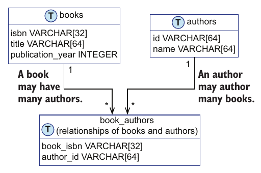
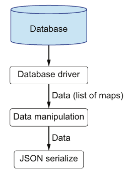
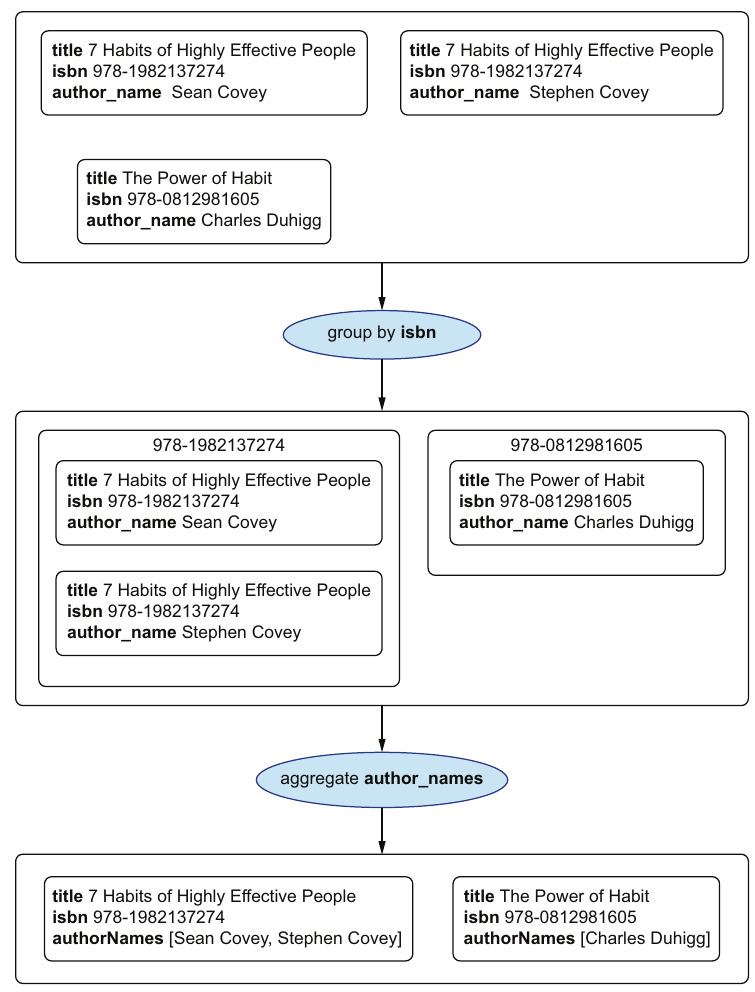

# ۱۰. عملیات پایگاه داده

[← ۹. ساختارهای داده‌ی persistent](09-persistent-data-structures.md) · [کتاب](../README.md) · [۱۱. سرویس‌های وب →](11-web-services.md)

## خلاصه

ایراد چهارم تئو این بود که داده‌ی واقعی در پایگاه داده می‌نشیند، نه در حافظه. روش OOP معمولاً الگوهای طراحی و لایه‌هایی از شیء را میان کد و پایگاه داده می‌گذارد. روش DOP خروجی پرسش را همان‌طور که هر داده‌ی دیگری را می‌نمایاند، یعنی به‌شکل **مجموعه‌های داده‌ی عمومی**: برای پایگاه داده‌ای رابطه‌ای، یک **فهرست از map** که فیلدهایش مقدار ستون‌هاست (pp. 197–198). داده از راننده‌ی پایگاه داده به‌شکل فهرستی از map جاری می‌شود، از اعتبارسنجی و دست‌کاری عمومی داده می‌گذرد، و به سریالی کردن JSON می‌رسد (شکل ۱۰.۲، ص. ۲۰۲):

- **در JavaScript**، راننده‌ای مانند node-postgres یک‌راست فهرستی از map برمی‌گرداند.
- **در Java**، تابعی ده‌خطی مجموعه‌ی خروجی JDBC را به یکی بدل می‌کند (listing ۱۰.۵).

مقدارها تا وقتی سریالی‌کننده‌ی JSON نگاهشان کند به‌شکل `Object` گونه‌دار می‌مانند، که جو **پیوند late** می‌نامدش (pp. 202–204). ذخیره کردن داده فیلدهای map را آرگومان پرسش می‌فرستد، و `_.at` چندشان را یک‌جا برمی‌دارد (pp. 204–206). چون نام فیلدها تنها رشته‌اند، **فیلدها درجه‌یک‌اند**، پس تابع‌های عمومی می‌توانند خروجی هر پرسشی را از نو شکل دهند. تابع `renameResultKeys` ستون‌ها را از mapی از کلید نام‌عوض می‌کند (pp. 207–211). تابع `aggregateFields` سه ردیف یک join را به دو کتاب بدل می‌کند، که هر کدام فهرستی از نام نویسنده دارد، از راه `_.groupBy` (pp. 211–218). کوآن عنوان فصل، «ابری ابر است»، یعنی: داده را به‌شکل داده بنمایانید (pp. 198, 218).

## نکته‌های کلیدی

- **بهترین راه دست‌کاری داده، نمایاندن داده به‌شکل داده است** (p. 197).
- **ردیف‌ها mapاند.** خروجیی رابطه‌ای فهرستی از map است؛ و دسترسی NoSQL هم همان‌طور کار می‌کند (pp. 198, 200).
- **آنچه پایگاه داده برمی‌گرداند را** پیش از به کار بردنش با JSON Schema اعتبارسنجی کنید، و خطاها را به‌شکل خطای درونی گزارش (listing ۱۰.۶، ص. ۲۰۴).
- **مفهوم interface JDBC به‌معنایی داده‌گراست:** بدل کردن مجموعه‌ی خروجی به map سرراست است (pp. 202–203).
- **پیوند late:** مقدارها به‌شکل `Object` از آن می‌گذرند، و تنها سریالی‌کننده‌ی JSON، مانند Gson، گونه‌های ملموسشان را بازرسی می‌کند (pp. 203–204).
- **دسترسی نرم به فیلد از عضوهای کلاس می‌برد**: عبارت `_.at(member, ["email", "encryptedPassword"])` فهرست آرگومان را می‌سازد (pp. 205–206).
- **وقتی SQL را ساده نگه می‌دارد، در برنامه از نو شکل دهید.** نام‌عوض کردن در SQL با `AS` کار می‌کند ولی پرسش را به عرف برنامه خم می‌کند، و برخی پایگاه‌های داده، مثلاً MongoDB، سخت‌ترش می‌کنند (pp. 207, 211).
- **تابع‌های عمومی نام فیلدها را آرگومان می‌گیرند**، پس همان یک کد به entityهای مختلف سرویس می‌دهد (p. 218).

## فهرست بخش‌ها

*از فهرست خود کتاب، یعنی bookmarkهای PDF؛ شماره‌ی صفحه‌ها چاپی‌اند.*

- ۱۰.۱ آوردن داده از پایگاه داده — ص. ۱۹۸
- ۱۰.۲ ذخیره کردن داده در پایگاه داده — ص. ۲۰۴
- ۱۰.۳ دست‌کاری ساده‌ی داده — ص. ۲۰۷
- ۱۰.۴ دست‌کاری پیشرفته‌ی داده — ص. ۲۱۱
- خلاصه — ص. ۲۱۸

## یادداشت‌ها

فصل SQL پایه، یعنی `SELECT` و `AS` و `WHERE` و `INNER JOIN`، را فرض می‌گیرد و می‌گوید این رویکرد آسان با پایگاه‌های داده‌ی NoSQL کنار می‌آید (p. 197). نمایاندن داده‌ی پایگاه داده به‌شکل مجموعه‌های عمومی، پیچیدگی کم‌تر سیستم و عمومیت بیشتر می‌دهد (p. 198).

### ۱۰.۱ آوردن داده از پایگاه داده

روی نیمکتی کنار دریاچه، تئو اسبی و خودرویی در ابرها می‌بیند؛ و جو پاسخ می‌دهد، «ابری ابر است» (p. 198). مدل خام پایگاه داده‌ی تئو (شکل ۱۰.۱، ص. ۱۹۹):



*Figure 10.1 (p. 199): رابطه‌ای چندبه‌چند میان کتاب‌ها و نویسنده‌ها که از راه جدول `book_authors` ذخیره شده.*

داده‌ی نمونه (جدول‌های ۱۰.۱ تا ۱۰.۳، ص. ۱۹۹):

- **کتاب‌ها:** کتاب *The Power of Habit* از ۲۰۱۲ و *7 Habits of Highly Effective People* از ۱۹۸۹.
- **نویسنده‌ها:** شان کاوی و استیون کاوی و چارلز داهیگ.
- **پیوندها:** کتاب *7 Habits* به هر دو کاوی، و *The Power of Habit* به داهیگ.

پرسش `SELECT title, isbn, publication_year FROM books WHERE title LIKE '%habit%'` هر دو کتاب را برمی‌گرداند. به‌شکل داده، آن فهرستی از دو map است، که JSON Schemaی وصفش می‌کند و هر سه فیلد را اجبار (listingهای ۱۰.۱ تا ۱۰.۴، صص. ۲۰۰–۲۰۱). تئو آن طرح را با برگه‌ی تقلب جو می‌نویسد، چون «هدف هدیه این است که گیرنده‌اش به کارش ببرد» (p. 201).



*Figure 10.2 (p. 202): آن راننده از پیش داده‌ی عمومی برمی‌گرداند، پس هیچ قدمی کلاسی برای ردیف نمی‌خواهد.*

| زبان | از راننده به فهرستی از map |
|---|---|
| JavaScript | راننده‌ای مانند node-postgres (p. 202) |
| Java | interface JDBC به‌علاوه‌ی `convertJDBCResultSetToListOfMaps`، که روی ردیف‌ها حلقه می‌زند و `getColumnLabel(i)` به `getObject(i)` را در `HashMap` می‌گذارد (listing ۱۰.۵، صص. ۲۰۲–۲۰۳) |

**پیوند late** (pp. 203–204): هر مقداری در mapهای بدل‌شده یک `Object` است. جست‌وجوی کتاب هیچ‌وقت به گونه‌ها نگاه نمی‌کند؛ ردشان می‌کند. گونه تنها سر سریالی کردن JSON مهم می‌شود، جایی که کتابخانه‌ای مانند Gson سر اجرا تشخیصش می‌دهد و `publication_year` را بی گیومه و `title` را با گیومه می‌نویسد. «با پیوند دیررس، سروکار داشتن با گونه‌های داده را تا جای شدنی وامی‌گذاریم.»

مفهوم listing ۱۰.۶ کنار هم می‌گذاردش (p. 204):

1. پرسشی پارامتری، که بهترین روش امنیتی است، از راه `dbClient.query` اجرا کنید.
2. ردیف‌ها را با `dbSearchResultSchema` و با `allErrors` از Ajv اعتبارسنجی کنید؛ و سر شکست خطای «Internal error: Unexpected result from the database» را با متن خطا بیندازید.
3. ردیف‌ها را `JSON.stringify` کنید.

فصل I/O از JavaScript را چنان می‌نویسد که گویی synchronous است؛ و کد واقعی از `async` و `await` کار می‌کشد (p. 203).

> **Vault note:** دو ریزکاری از listing ۱۰.۶ همان‌طور که چاپ شده کار نمی‌کرد (p. 204). نخست، آن پرسش تنها `title` و `isbn` را برمی‌دارد، ولی `dbSearchResultSchema` در listing ۱۰.۴ مقدار `publication_year` را اجبار می‌کند، پس اعتبارسنجی روی هر ردیفی شکست می‌خورد. دوم، در PostgreSQL یک `$1` درون مقداری گیومه‌دار، یعنی `'%$1%'`، تنها متن است، نه آرگومان. شکل رایجش `LIKE '%' || $1 || '%'` است، یا فرستادن `"%habit%"` به‌شکل آرگومان. [آزمایش lab](../lab/10-rows-as-maps/README.md) پرسش تصحیح‌شده را اجرا می‌کند.

> **In practice:** loader ردیف‌های منبع را به‌شکل dict می‌آورد و هیچ کلاس ORM ندارد، همان کاری که کتاب پیشنهاد می‌کند.
>
> **Your turn:** چرا loader را با ORM و کلاس برای هر جدول منبع نمی‌نویسید؟
>
> *Answer:* با ده‌ها جدول منبع، هر کلاس باید با هر تغییر schema عوض شود؛ ردیف به‌شکل map بدون کد تازه هر ستونی را می‌آورد. کتاب داده‌ی دیتابیس را مستقیم map می‌کند و از لایه‌ی کلاس می‌گذرد (pp. 198–204).

### ۱۰.۲ ذخیره کردن داده در پایگاه داده

افزودن عضوی، پرسشی پارامتری به‌شکل `INSERT INTO members (email, encrypted_password) VALUES ($1, $2)` است، با مقدارهایی که از map عضو برداشته می‌شوند (listingهای ۱۰.۷ و ۱۰.۸، صص. ۲۰۴–۲۰۵).

تئو عبارت `_.get(member, "email")` را در برابر `member.email` دست‌وپاگیر می‌یابد. زبان JavaScript نشانه‌ی نقطه را روی map روا می‌دارد، ولی کتاب از آن می‌پرهیزد تا نشان دهد DOP در زبان‌هایی مانند Java، که نشانه‌ی نقطه برای hash map در دست نیست، چطور پیاده می‌شود (p. 205). دسترسی نرم با **`_.at`** جواب می‌دهد، که مقدارهای فهرستی از کلید را به همان ترتیب برمی‌گرداند (listingهای ۱۰.۹ و ۱۰.۱۰، صص. ۲۰۵–۲۰۶):

```js
dbClient.query(addMemberQuery, _.at(member, ["email", "encryptedPassword"]));
```

### ۱۰.۳ دست‌کاری ساده‌ی داده

ستون‌های پایگاه داده snake caseاند، مانند `publication_year`؛ و جو در JSON مقدار `publicationYear` را می‌خواهد، و تئو `bookTitle` را جای `title` (p. 207). سه گزینه هست (pp. 207–209):

| گزینه | چطور | داوری |
|---|---|---|
| نام‌عوض کردن در SQL (listing ۱۰.۱۱) | عبارت‌های `title AS bookTitle` و `publication_year AS publicationYear` | کار می‌کند، ولی خم کردن پرسشی به نام‌گذاری برنامه عجیب است، و در پایگاهی مانند MongoDB سخت‌تر |
| تابعی ویژه برای هر پرسشی (listing ۱۰.۱۲) | تابع `renameBookInfoKeys` mapی تازه می‌سازد | یک تابع برای هر گونه خروجیی |
| تابعی عمومی (listingهای ۱۰.۱۳ و ۱۰.۱۴) | عبارت `renameResultKeys(results, {"title": "bookTitle", "publication_year": "publicationYear"})` | روی هر فهرستی از map کار می‌کند؛ و فیلدهای نگفته همان‌طور می‌مانند |

تابع `renameKeys` روی آن map از کلید تحویل می‌برد: برای هر کلید کهنه‌ای مقدار را زیر کلید تازه می‌گذارد، بعد کهنه را `_.omit` می‌کند. تابع `renameResultKeys` آن را روی ردیف‌ها می‌نگارد (listing ۱۰.۱۴، ص. ۲۰۹). این شدنی است چون فیلدها پویا و با رشته دسترس‌پذیرند، که **فیلدها را شهروند درجه‌یک** می‌کند (p. 209). مانند هر تابع داده‌ای، تست unit می‌شود (listing ۱۰.۱۵). همان تابع در پرسشی روی کاربران `email` را به `userEmail` نام‌عوض می‌کند، چون از داده‌ای که رویش کار می‌کند جدا شده (listing ۱۰.۱۶، صص. ۲۱۰–۲۱۱).

> **Try it:** [نام‌عوض کردن کلیدها](../widgets/10-rename-keys.html) — آن map از کلید را ویرایش کنید و ببینید `renameResultKeys` چطور با همان یک کد ردیف‌های کتاب و کاربر را از نو شکل می‌دهد، کلیدهای نبوده را هم.

> **Vault note:** کتاب `publicationYear` را «Pascal case» می‌نامد (p. 207)؛ و نام رایج آن سبک camel case است. سبک Pascal case حرف نخست را هم بزرگ می‌کند، یعنی `PublicationYear`.

### ۱۰.۴ دست‌کاری پیشرفته‌ی داده

گاهی ردیف‌ها باید از نو ساختار بگیرند؛ مثلاً گرد کردن فیلدهایی از چند ردیف در یک map. تجمیع JSON در PostgreSQL می‌تواند این را در SQL بکند، ولی از نو شکل دادن در برنامه SQL را ساده نگه می‌دارد، و آن کد برای entityهای دیگر بازاستفاده‌شدنی است (p. 211). join کردن `books` و `book_authors` و `authors` برای «habit» سه ردیف برای دو کتاب می‌دهد، چون *7 Habits* دو نویسنده دارد (listing ۱۰.۱۷ و جدول ۱۰.۶، صص. ۲۱۱–۲۱۲). هدف دو map با فهرست `authorNames` است (listing ۱۰.۱۹، ص. ۲۱۳).



*Figure 10.3 (p. 214): هر join از SQL برای هر جفت کتاب-نویسنده یک ردیف برمی‌گرداند؛ و دو قدم عمومی، یعنی گروه و گرد، آن‌ها را باز به یک map برای هر کتاب بدل می‌کند.*

قدم‌ها (pp. 213–218):

1. تابع **`_.groupBy(sqlRows, "isbn")`** mapی از ISBN به ردیف‌های آن کتاب می‌دهد (listingهای ۱۰.۲۰ و ۱۰.۲۱).
2. **برای یک دسته** (listing ۱۰.۲۲): عبارت `_.map(rows, "author_name")` نام‌ها را گرد می‌کند. عبارت `_.nth(rows, 0)` ردیف نخست را پایه می‌گیرد، `_.set` مقدار `authorNames` را می‌افزاید، و `_.omit` مقدار `author_name` را برمی‌دارد.
3. **عمومی کنید** به `aggregateField(rows, fieldName, aggregateFieldName)` و تستش کنید (listingهای ۱۰.۲۳ و ۱۰.۲۴).
4. **کنار هم بگذارید** در `aggregateFields(rows, idFieldName, fieldName, aggregateFieldName)`: با فیلد شناسه گروه کنید، مقدارها را بردارید چون کلیدها مهم نیستند، و `aggregateField` را روی هر دسته‌ای بنگارید (listingهای ۱۰.۲۵ و ۱۰.۲۶).

تئو حالا آن کوآن را می‌فهمد: به‌جای به دام انداختن داده در شیءها، داده را به‌شکل داده بنمایانید (p. 218).

| تابع Lodash (p. 219) | توضیح |
|---|---|
| `at(map, [paths])` | آرایه‌ای از مقدارها در `paths` |
| `omit(map, [paths])` | mapی بی فیلدهای `paths` |
| `nth(arr, n)` | عضوی در index `n` |
| `groupBy(coll, f)` | mapی از `f(element)` به عضوهایی که ساختندش |

> **Try it:** [گروه و گرد](../widgets/10-group-aggregate.html) — کتاب و نویسنده به خروجی join بیفزایید و از `groupBy` و `aggregateField` قدم‌به‌قدم بگذرید تا ببینید سه ردیف چطور دو کتاب می‌شود.

> **Run it:** [آزمایش ردیف‌ها به‌شکل map](../lab/10-rows-as-maps/README.md) جدول‌های این فصل را در SQLite بار می‌کند، ردیف‌ها را به‌شکل dictionary می‌آورد، اعتبارسنجی‌شان می‌کند، کلیدها را نام‌عوض و آن join را گرد.

> **Vault note:** شماره‌های ISBN میان فصل‌ها فرق دارند. پاسخ جست‌وجوی فصل ۷ به *7 Habits* مقدار `978-0812981605` و به *The Power of Habit* مقدار `978-1982137274` می‌دهد (p. 149). جدول‌های این فصل جابه‌جاشان می‌کنند، و درون همین فصل سازگارند (p. 199). listing ۱۰.۱۸ هم `"publication_year": "Sean Covey"` را چاپ می‌کند جایی که `"author_name"` خواسته است (p. 212). یادداشت‌ها و widgetها از جدول‌های همین فصل پی می‌گیرند.

> **In practice:** بخش زیادی از دست‌کاری داده در ClickHouse با SQL انجام می‌شود، و بخشی در Python با map.
>
> **Your turn:** تبدیلی را که در Python روی dict نوشته‌اید کِی به SQL در ClickHouse می‌برید؟
>
> *Answer:* وقتی داده بزرگ است و تبدیل تجمیع یا join است: ClickHouse آن را ستونی و موازی اجرا می‌کند و داده جابه‌جا نمی‌شود. Python را برای منطق ردیفی پیچیده نگه دارید. کتاب هم دست‌کاری را تابع عمومی روی داده می‌بیند، هر جا اجرا شود (pp. 211–218).

## بده‌بستان‌ها در یک نگاه

| گزینش | سود | خرج |
|---|---|---|
| ORM یا لایه‌های شیء در OOP سنتی | شیءهای گونه‌دار؛ و پشتیبانی IDE | الگوهای طراحی و سلسله‌مراتب کلاس برای هر entity (p. 218) |
| ردیف‌ها به‌شکل فهرستی از map در DOP | کد عمومی؛ JSON مفت؛ بی هیچ کلاس version | مقدارها در Java تا سر به کار بردن `Object`اند (p. 203) |
| از نو شکل دادن در SQL با `AS` یا تجمیع JSON | یک رفت‌وبرگشت؛ پایگاه داده کار را می‌کند | پرسش‌ها به عرف برنامه خم می‌شوند؛ و از پایگاهی به پایگاهی فرق دارد (pp. 207, 211) |
| از نو شکل دادن در برنامه | SQL ساده؛ تابع‌های عمومی بازاستفاده‌شدنی | ستون‌های دوباره را جابه‌جا می‌کند، مانند یک ردیف برای هر نویسنده |
| اعتبارسنجی خروجی پایگاه داده | داده‌ی نامنتظر بر مرز می‌ایستد (فصل ۷) | طرحی برای هر پرسشی که باید نگه‌داشت |

## فراتر از کتاب

- **راننده‌هایی که از پیش map می‌گویند.** ماژول `sqlite3` در Python با `row_factory = sqlite3.Row` ردیف‌ها را به‌شکل شیءهای dictionary‌مانند برمی‌گرداند. کتابخانه‌ی next.jdbc در Clojure پیش‌فرض map برمی‌گرداند. راننده‌ی node-postgres شیءهایی کلیدخورده با نام ستون برمی‌گرداند. interface JDBC همان بیرون‌افتاده‌ای است که تابع بدل را می‌خواهد.
- **برخورد نام در join.** mapی که با *برچسب* ستون کلید خورده، وقتی دو جدول joinشده نام ستونی مانند `id` را شریک باشند داده گم می‌کند؛ ستون دیرتر خاموش از روی پیشین می‌نویسد. تابع `getColumnLabel` جو نام‌های مستعار `AS` را پاس می‌دارد، پس نام مستعار دادن در SELECT، آن‌طور که listing ۱۰.۱۷ با `author_name` می‌کند، از آن می‌پرهیزد.
- **تابع `renameKeys` و mappingهای همانی.** در listing ۱۰.۱۴، mappingی از کلیدی به خودش، یعنی `{"isbn": "isbn"}`، مقدار را می‌گذارد و بعد همان کلید را می‌اندازد، که آن فیلد را پاک می‌کند. دو کلید جابه‌جاشده در یک map، یعنی `{"a": "b", "b": "a"}`، هم غلط در می‌آید، چون آن نام‌عوض دوم مقدار از پیش نام‌عوض‌شده را می‌بیند. Lodash هیچ نام‌عوض توکاری ندارد؛ و versionی ایمن‌تر خروجی را از صفر می‌سازد، نه آنکه سر جا به‌روزش کند.
- **تابع `aggregateField` فیلدهای دیگر ردیف نخست را نگه می‌دارد.** اگر ردیف‌های یک دسته سر ستونی ناگردشده ناسازگار باشند، مثلاً ردیف کتابی که با دو ویراست مختلف join شده، مقدارهای دیرتر خاموش انداخته می‌شوند. برای مورد کتاب این خوب است، جایی که همه چیز جز نام نویسنده تکرار می‌شود.
- **بدیل N+1.** آوردن کتاب‌ها و بعد پرسش از نویسنده‌ها برای هر کتابی از ستون‌های دوباره می‌پرهیزد ولی یک پرسش برای هر کتاب خرج می‌دهد. همان یک join به‌علاوه‌ی گروه کردن در حافظه که این‌جا نشان داده شد معمولاً بده‌بستان بهتری است.

## پیوندها

- **تابع‌های عمومی:** این فصل آن جعبه‌ابزار [۳. دست‌کاری پایه‌ی داده](03-basic-data-manipulation.md) را با `at` و `omit` و `nth` و `groupBy` گسترش می‌دهد.
- **اعتبارسنجی بر مرز پایگاه داده:** [۷. اعتبارسنجی پایه‌ی داده](07-basic-data-validation.md).
- **پسین:** [۱۱. سرویس‌های وب](11-web-services.md) همان رویکرد را روی داده‌ی سرویس‌های بیرونی پیاده می‌کند.
- **دست‌کاری عمومی بیشتر:** [۱۴. دست‌کاری پیشرفته‌ی داده](14-advanced-data-manipulation.md).
- **Run it:** [ردیف‌ها به‌شکل map با SQLite](../lab/10-rows-as-maps/README.md) — پرسش‌های این فصل را روی پایگاهی در حافظه با آرگومان `LIKE` تصحیح‌شده اجرا می‌کند.

## خودتان را بسنجید

1. روش DOP خروجی پرسشی رابطه‌ای را چطور می‌نمایاند؟
   <details><summary>پاسخ</summary>به‌شکل فهرستی از map، که فیلدهای هر map مقدار ستون‌هاست؛ و خروجی‌های NoSQL همان‌طور چرخانده می‌شوند (pp. 198, 200).</details>
2. «پیوند late» در این فصل چیست؟
   <details><summary>پاسخ</summary>واگذاشتن سروکار داشتن با گونه‌های داده تا جای شدنی. در Java، مقدارهای ردیف `Object`اند که دست‌نخورده رد می‌شوند، و تنها سریالی‌کننده‌ی JSON، مانند Gson، گونه‌های ملموسشان را سر اجرا تشخیص می‌دهد (pp. 203–204).</details>
3. مفهوم listing ۱۰.۶ برای سرویس دادن به جست‌وجویی از پایگاه داده چه سه قدمی برمی‌دارد؟
   <details><summary>پاسخ</summary>پرسشی پارامتری اجرا می‌کند، ردیف‌ها را با JSON Schemaی اعتبارسنجی می‌کند و اگر نامعتبر بودند خطایی درونی می‌اندازد، بعد `JSON.stringify`شان می‌کند (p. 204).</details>
4. عبارت `_.at(member, ["email", "encryptedPassword"])` چه برمی‌گرداند، و چرا این‌جا به کار می‌آید؟
   <details><summary>پاسخ</summary>مقدار همان فیلدها را به همان ترتیب، مانند `["samantha@gmail.com", "c2VjcmV0"]`. آن درست همان آرایه‌ی آرگومان برای INSERT است، که از فهرست کردن هر `_.get` کوتاه‌تر است (pp. 205–206).</details>
5. چرا جو `renameResultKeys` را بر `AS` در SQL یا تابعی برای هر پرسش ترجیح می‌دهد؟
   <details><summary>پاسخ</summary>نام‌عوض کردن در SQL آن پرسش را به عرف نام‌گذاری برنامه خم می‌کند و در برخی پایگاه‌های داده سخت‌تر است. تابعی عمومی که mapی از کلید بگیرد، روی خروجی هر پرسشی کار می‌کند، چون نام فیلدها تنها رشته‌اند (pp. 207–210).</details>
6. تابع `aggregateFields` آن سه ردیف join را چطور به دو کتاب بدل می‌کند؟
   <details><summary>پاسخ</summary>ردیف‌ها را با `_.groupBy` با ISBN گروه می‌کند و دسته‌ها را برمی‌دارد. در هر دسته‌ای مقدارهای `author_name` را در `authorNames` گرد می‌کند، از ردیف نخست آغاز و `author_name` را می‌اندازد (pp. 213–217).</details>
