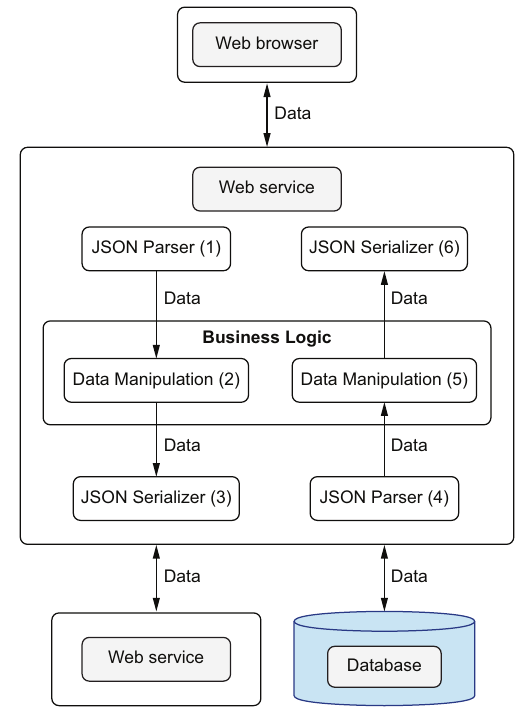

# ۱۱. سرویس‌های وب

[← ۱۰. عملیات پایگاه داده](10-database-operations.md) · [کتاب](../README.md) · [۱۲. اعتبارسنجی پیشرفته‌ی داده →](12-advanced-data-validation.md)

## خلاصه

سنگ‌نشان پسین **غنی کردن خبر کتاب** است. نتیجه‌های جست‌وجو باید در دسترس بودن از پایگاه داده را با خبر گسترده از **Open Library Books API** کنار هم بگذارند. آن API برای برخی کتاب‌ها ده‌ها فیلد و برای برخی دو سه فیلد برمی‌گرداند، پس داده‌اش تنک و پیش‌بینی‌ناپذیر است (p. 221). اصل جو این است که **درون سیستم‌هایمان را همان‌طور بسازیم که بیرونشان را**. مؤلفه‌هایی که سر سیم‌اند داده‌ی زبان‌مستقل مانند JSON مبادله می‌کنند. مؤلفه‌های درون برنامه هم باید همان‌طور مجموعه‌های داده‌ی عمومی و immutable مبادله کنند، پس تنها نام فیلدها را می‌دانند، نه تعریف کلاس یکدیگر را. این سست‌جفتشان نگه می‌دارد (pp. 220–223).

آن endpoint درخواست جست‌وجوی client را، با `title` و همان `fields`ی که برمی‌گرداند، به‌شکل mapی اعتبارسنجی‌شده می‌گیرد (pp. 225–227). بعد سه کار می‌کند:

- **هر کتابی را از Open Library می‌آورد،** اعتبارسنجی می‌کند، و با دو بار `_.pick` تنها فیلدهای به‌کار‌آمده و خواسته را نگه می‌دارد (pp. 227–231).
- **خبر را پیش می‌فرستد** بی بازکردنش، مانند پیک‌هایی که نباید نامه‌ی زیر دستشان را بخوانند (pp. 231–232).
- **خروجی پایگاه داده و Open Library را کنار هم می‌گذارد.** جو تودرتو کردن و درهم‌آمیختن را می‌سنجد (جدول ۱۱.۱)، و تئو یک `joinArrays` عمومی با `_.keyBy` و `_.merge` می‌نویسد (pp. 232–239).

پروژه سر وقت تحویل می‌شود. تئو ارتقا می‌گیرد و هدیه‌های فرزندان جو را می‌خرد: پهپاد DJI Mavic Air 2 برای نریا و AirPods Pro برای اورلیا (p. 244).

## نکته‌های کلیدی

- **درون را مانند بیرون بسازید:** مؤلفه‌های درونی با داده‌ی عمومی گفت‌وگو می‌کنند، همان‌طور که سرویس‌ها سر سیم با JSON (pp. 222–223).
- **با کلاس، مؤلفه‌ای باید تعریف کلاس آن یکی را وارد کند تا داده‌اش را بخواند.** با داده‌ی عمومی، تنها نام فیلدها را می‌خواهد، که سست‌جفتی است (p. 223).
- **جریان داده‌ی سرویسی وب سرتاپا داده است:** باز کردن، دست‌کاری داده، سریالی کردن به سوی سرچشمه‌ها، باز کردن پاسخشان، دست‌کاری داده، سریالی کردن پاسخ (شکل ۱۱.۳، ص. ۲۲۴).
- **بگذارید client فیلدها را برگزیند** با یک endpoint و فهرستی `fields`، به‌جای یک endpoint برای هر client و صفحه (p. 225).
- **داده‌ی سرویس‌های بیرونی را** پیش از به کار بردنش اعتبارسنجی کنید، این‌جا با `allOf` و `anyOf` برای قاعده‌ی ISBN (pp. 229–230).
- **خبر را پیش بفرستید** در ساختارهای عمومی، به‌جای ساختن کلاس‌هایی مانند `DBBook` و `OpenLibraryBook` و `CombinedBook` (pp. 231–232).
- **تودرتو کردن در برابر درهم‌آمیختن** (جدول ۱۱.۱، ص. ۲۳۲): تودرتو کردن چرخاندن ناسازی نمی‌خواهد ولی تخت نیست؛ و درهم‌آمیختن تخت است ولی چرخاندن ناسازی می‌خواهد.
- **منطق کسب‌وکار بیشتر وقت‌ها دست‌کاری عمومی داده است:** توابع `_.pick` و `_.keyBy` و `_.merge` و `_.values` تابع `joinArrays` را می‌سازند (pp. 236–237).
- **کلاس‌ها به‌شکل گرد آمدن تابع‌های بی‌state** که روی entityهای همانند دامنه کار می‌کنند، خیلی کم‌پیچیده‌ترند (p. 243).

## فهرست بخش‌ها

*از فهرست خود کتاب، یعنی bookmarkهای PDF؛ شماره‌ی صفحه‌ها چاپی‌اند.*

- ۱۱.۱ درخواست ویژگی دیگری — ص. ۲۲۱
- ۱۱.۲ ساختن درون مانند بیرون — ص. ۲۲۲
- ۱۱.۳ نمایاندن درخواست client به‌شکل map — ص. ۲۲۵
- ۱۱.۴ نمایاندن پاسخ سرور به‌شکل map — ص. ۲۲۷
- ۱۱.۵ پیش فرستادن خبر — ص. ۲۳۱
- ۱۱.۶ غنی کردن نتیجه‌ی جست‌وجو سر کار — ص. ۲۳۴
- خلاصه — ص. ۲۴۴

## یادداشت‌ها

کد JavaScript این فصل، مانند فصل ۱۰، چنان نوشته شده که گویی I/O synchronous است؛ و کد واقعی از `async` و `await` کار می‌کشد (p. 230).

### ۱۱.۱ درخواست ویژگی دیگری

پس از تحویل سر وقت سنگ‌نشان پایگاه داده، نانسی زمان تخمینی غنی کردن با Open Library Books API را می‌خواهد. شمار صفحه و وزن و قالب فیزیکی و موضوع‌ها و مانند آن، جای خبر کتاب پایگاه داده را می‌گیرند، جز در دسترس بودن (p. 221).

### ۱۱.۲ ساختن درون مانند بیرون

قدم‌های جریان داده درون سرویسی وب (p. 222):

1. درخواستی از clientی بگیرید.
2. منطق کسب‌وکار را روی آن درخواست پیاده کنید.
3. داده را از سرچشمه‌های بیرونی بیاورید، مانند پایگاه داده و سرویس‌های وب دیگر.
4. منطق کسب‌وکار را روی پاسخ سرچشمه‌های بیرونی پیاده کنید.
5. پاسخ را به client بفرستید.

سر سیم، قالب داده که بیشتر وقت‌ها JSON است، به زبان مؤلفه‌ها بسته نیست. درون برنامه، OOP سنتی آن اصطلاح را می‌شکند: برای دسترسی به عضوی از کلاسی، مؤلفه‌ای باید تعریف آن کلاس را وارد کند. مؤلفه‌های DOP با مجموعه‌های داده‌ی عمومی گفت‌وگو می‌کنند، که هیچ دانشی از درونه‌های مؤلفه‌های دیگر نمی‌خواهد، تنها نام فیلدها (p. 223).

*Figure 11.3 (p. 224): نقاشی تئو، که تنها کشیدش وقتی جو تلفنی داشت — داده میان هر دو قدمی عمومی می‌ماند، در هر دو سو.*

> **In practice:** prediction API ما درخواست JSON می‌گیرد و پاسخ JSON می‌دهد؛ اگر درونش هم map باشد، تبدیل لایه‌ای لازم نیست.
>
> **Your turn:** چرا پاسخ API را مستقیم از map نتیجه‌ی کوئری می‌سازید و برای هر endpoint کلاس DTO نمی‌نویسید؟
>
> *Answer:* افزودن فیلد به پاسخ فقط کوئری را عوض می‌کند و schema پاسخ را با JSON Schema در مرز اعتبارسنجی می‌کنید. کتاب داده‌ی درون را هم‌شکل داده‌ی بیرون می‌خواهد تا ترجمه حذف شود (pp. 222–225).

### ۱۱.۳ نمایاندن درخواست client به‌شکل map

نقش client باید تصمیم بگیرد کدام فیلدهای Open Library آورده شوند؟ تئو نخست endpointهای جدا برای موبایل و دسکتاپ پیش می‌گذارد. جو صفحه‌های خروجی گسترده و پایه را می‌افزاید، که چهار endpoint می‌شد، و تئو به یک endpoint تنها رضا می‌دهد که می‌گذارد client برگزیند (p. 225). بار آن `{"title": "habit", "fields": ["title", "weight", "number_of_pages"]}` است (listing ۱۱.۱). چارچوب‌های وب معمولاً بازش می‌کنند: Express یا Spring یا Django یا Ruby on Rails یا ASP.NET. دستی، در JavaScript `JSON.parse` است و در Java `fromJson(s, Map.class)` از Gson (listingهای ۱۱.۲ و ۱۱.۳، ص. ۲۲۶). طرح درخواست مقدار `fields` را به `enum`ی از فیلدهایی می‌بندد که نانسی می‌خواهد نمایانده شوند (listingهای ۱۱.۴ و ۱۱.۵، صص. ۲۲۶–۲۲۷).

### ۱۱.۴ نمایاندن پاسخ سرور به‌شکل map

پرسش `GET https://openlibrary.org/isbn/978-1982137274.json` فیلدهای زیادی برای *7 Habits of Highly Effective People* برمی‌گرداند: کلید نویسنده‌ها و `created` و `full_title` و `isbn_13` و زبان‌ها و `number_of_pages` که ۴۳۲ است و `publish_date` که ۲۰۲۰ است و `publishers` و بازنگری‌ها و `subtitle` و `title` و `works` و بیشتر (listing ۱۱.۶، صص. ۲۲۷–۲۲۸).

**صافی دوباره‌ی فیلد** (pp. 229–231): تنها فیلدهایی را که نانسی روا می‌دارد نگه دارید، بعد تنها آن‌هایی را که client خواسته. تابع `OpenLibraryDataSource.bookInfo` آن را در چهار قدم می‌کند (listing ۱۱.۹):

1. پاسخ را بیاورید و باز کنید.
2. آن را با طرح Books API اعتبارسنجی کنید، که `allOf` و `anyOf`ش دست‌کم یک فیلد ISBN را اجبار می‌کند (listing ۱۱.۸). سر شکست، خطای «Internal error: Unexpected result from Open Books API» را بیندازید.
3. عبارت `_.pick(_.pick(rawInfo, relevantFields), requestedFields)` را پیاده کنید.
4. مقدار `isbn` را روی خروجی بگذارید، تا آن دو سرچشمه دیرتر کنار هم گذاشتنی باشند (p. 231).

> **Try it:** [جریان غنی کردن](../widgets/11-enrichment-flow.html) — فیلدهایی را که clientی می‌خواهد برگزینید و قدم‌به‌قدم از آن endpoint بگذرید: اعتبارسنجی درخواست، پرسش از پایگاه داده، آوردن و دوبار صافی کردن هر رکورد Open Library، و join کردن آن دو آرایه با ISBN.

### ۱۱.۵ پیش فرستادن خبر

در OOP سنتی، تئو برای هر گونه خبر کتاب کلاسی می‌ساخت: `DBBook` و `OpenLibraryBook` و `CombinedBook`. آن به رویکردی پویا نمی‌خورد که client فیلدها را تصمیم می‌گیرد، و کلاس‌ها وقتی داده تنها پیش فرستاده می‌شود هیچ ارزشی نمی‌افزایند (p. 231).

داستان جو (pp. 231–232): هوگو از دوستش ویلی می‌خواهد گل و نامه‌ای عاشقانه را به نامزدش آیریس برساند. ویلی با افتخار گزارش می‌دهد که سبک نوشتن هوگو را پسندیده؛ نامه را خواند «تا وظیفه‌ام را وفادارانه انجام دهم». روش OOP سنتی مانند ویلی است: برای پیش فرستادن خبر، برنامه‌نویسان OOP «نامه را باز می‌کنند» و با کلاس‌های ویژه می‌نمایانندش. روش DOP آن را در ساختارهای داده‌ی عمومی پیش می‌فرستد.

| | حسن | عیب (جدول ۱۱.۱، ص. ۲۳۲) |
|---|---|---|
| تودرتو کردن با فیلد `extendedInfo` | نیازی به چرخاندن ناسازی نیست | خروجی تخت نیست |
| درهم‌آمیختن | خروجی تخت است | چرخاندن ناسازی لازم است |

تئو امید دارد که آن دو map هیچ فیلدی را شریک نباشند، پس با `_.merge` از فصل ۵ درهم می‌آمیزند (listingهای ۱۱.۱۰ تا ۱۱.۱۲، صص. ۲۳۲–۲۳۳). پایگاه داده `isbn` و `available` را می‌دهد؛ و Open Library باقی را. طرح پاسخ سه فیلد `title` و `isbn` و `available` را اجبار می‌کند (listing ۱۱.۱۳، صص. ۲۳۳–۲۳۴).

> **Try it:** [تودرتو یا درهم](../widgets/11-nest-or-merge.html) — رکوردی از پایگاه داده را با رکوردی از Open Library تودرتو یا درهم‌آمیخته کنار هم بگذارید، فیلدی بیفزایید که هر دو سو شریکند، و برگزینید کدام سو ناسازی را می‌برد.

### ۱۱.۶ غنی کردن نتیجه‌ی جست‌وجو سر کار

قدم‌های جریان داده‌ی غنی کردن (p. 234):

1. درخواستی از clientی بگیرید.
2. آن پرسش و فیلدهایی که باید از Open Library آورده شوند را بیرون بکشید.
3. کتاب‌هایی را که با آن پرسش می‌خوانند از پایگاه داده بیاورید.
4. برای هر ISBN خورنده‌ای خبر را از Open Library بیاورید.
5. فیلدهای لازم را از پاسخ‌های Open Library بیرون بکشید.
6. خبر پایگاه داده را با خبر Open Library کنار هم بگذارید.
7. پاسخ را به client بفرستید.

- **بخش پایگاه داده** تنها `isbn` و `available` را می‌خواهد، بی هیچ join (listing ۱۱.۱۴، صص. ۲۳۴–۲۳۵).
- **مفهوم interface Open Library** پرسش دسته‌ای ندارد، پس `multipleBookInfo` تابع `bookInfo` را روی ISBNها می‌نگارد. کتاب تظاهر می‌کند که `_.map` با تابع‌های asynchronous کار می‌کند؛ و کد واقعی از `Promise.all` کار می‌کشد تا درخواست‌ها را موازی بفرستد (listing ۱۱.۱۵، صص. ۲۳۵–۲۳۶).
- **عمل join کردن:** تئو نمی‌تواند فرض بگیرد هر دو آرایه کتاب‌ها را به همان ترتیب می‌آورند، و دو hash map کلیدخورده با ISBN آرزو می‌کند. تابع `_.keyBy` می‌سازدشان؛ مانند `_.groupBy` است ولی فرض می‌گیرد هر دسته یک عضو دارد و آخری را نگه می‌دارد (listingهای ۱۱.۱۶ و ۱۱.۱۷، صص. ۲۳۶–۲۳۷). تابع عمومی `joinArrays(a, b, keyA, keyB)` هر دو آرایه را کلید می‌زند، آن دو map را درهم می‌آمیزد، و مقدارها را برمی‌گرداند (listingهای ۱۱.۱۸ و ۱۱.۱۹، صص. ۲۳۷–۲۳۹). نام کلیدها می‌تواند میان آن دو آرایه فرق کند.
- **آن endpoint** درخواست را اعتبارسنجی می‌کند، می‌آورد، join می‌کند، پاسخ را اعتبارسنجی و برمی‌گرداند. تابع `Library.searchBooksByTitle` آن را با `JSON.parse` و `JSON.stringify` می‌پوشاند (listingهای ۱۱.۲۰ تا ۱۱.۲۵، صص. ۲۳۹–۲۴۳).

تئو می‌اندیشد که کلاس‌ها وقتی تنها تابع‌های بی‌state روی entityهای همانند را گرد می‌کنند خیلی کم‌پیچیده‌ترند (p. 243). جو گزارش می‌دهد که خواندن *The Power of Habit* جویدن ناخنش را بس کرد (p. 243).

**تحویل سر وقت** (p. 244): تئو داستان هیزم‌شکن را یاد می‌آورد؛ وقت گذاشت تا اره‌اش را تیز کند. پروژه کامیاب می‌شود و تئو ارتقا می‌گیرد. در Westfield San Francisco Center هدیه‌هایی را که به فرزندان جو بدهکار است می‌خرد، و گردنبندی و گوشواره‌ای برای همسرش جین.

> **Vault note:** listingهای آن endpoint چند لغزش دارند که کد را همان‌طور که چاپ شده از اجرا بازمی‌دارد:
>
> - مفهوم listing ۱۱.۱۵ مقدار `bookInfoSchema` را با `dbSearchResultSchema` اعتبارسنجی می‌کند به‌جای `rawInfo` را با `bookInfoSchema`؛ و listing ۱۱.۲۲ درست داردش.
> - تابع `multipleBookInfo` آرگومان‌های `_.map` را برگشته می‌فرستد.
> - آن SQL چنین می‌خواند: `WHERE title = like '%$1%'`.
> - مفهوم listing ۱۱.۲۴ آن enum از `fields` را `"type": [...]` می‌نویسد.
> - همه‌ی listingهای ۱۱.۲۰ و ۱۱.۲۵ تابع `joinArrays` را بی دو نام کلیدش صدا می‌زنند، `request` را به‌جای پاسخ اعتبارسنجی می‌کنند، و برای پاسخی آرایه‌ای طرح شیئی به کار می‌برند.
> - تابع `Library.searchBooksByTitle` تابع `Catalog.searchBooksByTitle` را صدا می‌زند، نه `enrichedSearchBooksByTitle` را.
>
> داده‌ی تست در listing ۱۱.۱۹ هم به هر رکورد Open Library عنوان آن یکی کتاب را می‌دهد. کد فیلدهای ناساز `title` را درهم می‌آمیزد و مقدار Open Library می‌برد، که همان ناسازی است که درهم‌آمیختن قرار بود از آن بپرهیزد (pp. 235–243). [آزمایش lab](../lab/11-join-arrays/README.md) versionی تصحیح‌شده را اجرا می‌کند.

> **Run it:** [آزمایش join](../lab/11-join-arrays/README.md) توابع `pick` و `keyBy` و `joinArrays` را به Python در برابر Open Libraryی ساختگی پیاده می‌کند و آن ناسازی درهم‌آمیزی در listing ۱۱.۱۹ را نشان می‌دهد.

> **In practice:** سرویس پیش‌بینی feature را از ClickHouse می‌خواند و پاسخ را با داده‌ی دیگر غنی می‌کند، همان کاری که کتاب با سرویس بیرونی می‌کند.
>
> **Your turn:** اگر سرویس غنی‌کننده کند باشد، پاسخ API چه کند؟
>
> *Answer:* با timeout و بدون فیلد غنی‌شده برگردد، یا غنی‌سازی را از پیش در Gold انجام دهید. وقتی غنی‌سازی تابعی روی map است، حذف یا جابه‌جایی‌اش ساده است (pp. 234–244).

## بده‌بستان‌ها در یک نگاه

| گزینش | سود | خرج |
|---|---|---|
| کلاسی برای هر گونه داده، مانند `DBBook` و `CombinedBook` | گونه‌ها شکل‌ها را مستند می‌کنند | هر مؤلفه‌ای کلاس‌های دیگران را وارد می‌کند؛ یعنی «باز کردن نامه» (pp. 223, 231) |
| داده‌ی عمومی که پیش فرستاده می‌شود | سست‌جفتی؛ و منطق کسب‌وکار عمومی | شکل‌ها در طرح‌ها می‌نشینند، نه در گونه‌ها |
| یک endpoint با `fields` برگزیده‌ی client | بی هیچ endpointی برای هر client و صفحه (p. 225) | شکل پاسخ‌ها فرق می‌کند؛ و طرح‌ها باید فیلدهای اختیاری را روا بدارند |
| تودرتو کردن سرچشمه‌ها | بی هیچ ناسازی | تخت نیست (p. 232) |
| درهم‌آمیختن سرچشمه‌ها | خروجی تخت | ناسازی: با `_.merge`، سرچشمه‌ی دیرتر خاموش می‌برد |
| یک درخواست برای هر کتابی | با APIی بی پرسش دسته‌ای کار می‌کند | N صدا زدن برای هر جست‌وجو؛ موازی‌کاری می‌خواهد (p. 235) |

## فراتر از کتاب

- **عبارت «درون را مانند بیرون بسازید»** ایده‌های «هسته‌ی تابعی» و «مقدارها به‌شکل مرز» از جامعه‌ی Clojure و سخنرانی «Boundaries» گری برنهارت (۲۰۱۲) را بازمی‌تاباند. با مرزهای ماژول درونی مانند مرزهای شبکه رفتار کنید: داده تو، داده بیرون.
- **ناسازی درهم‌آمیزی، به‌عمد.** تابع `_.merge` بازگشتی و راست‌گراست: آرگومان دوم در هر برگی می‌برد. تابع `_.mergeWith` سفارشی‌کننده‌ای می‌گیرد تا برای هر کلیدی تصمیم بگیرد. سیاستی رایج این است که بگذارید سرچشمه‌ی موثق برای هر فیلدی ببرد، مثلاً پایگاه داده برای در دسترس بودن و Open Library برای توضیح‌ها، و سر همپوشانی نامنتظر شکست بخورد.
- **تابع `_.keyBy` دوباره‌ها را می‌اندازد.** اگر پایگاه داده دو ردیف با همان یک ISBN برگرداند، تابع `_.keyBy` تنها آخری را نگه می‌دارد، خاموش. یک `groupBy` و پس از آن ادعای اینکه هر دسته یک عضو دارد، مسئله‌های داده را بر مرز می‌گیرد.
- **معنای join.** تابع `joinArrays` مانند full outer join رفتار می‌کند. کتابی که از Open Library جاافتاده باز پیدا می‌شود، بی فیلدهای گسترده؛ و رکوردی از Open Library بی ردیفی در پایگاه داده هم پیدا می‌شود، بی `available`، که بعد طرح پاسخ ردش می‌کرد. یک inner join، که تنها کلیدهای موجود در هر دو را نگه دارد، بیشتر وقت‌ها همان است که endpointی می‌خواهد.
- **بهای پاشیدن.** یک درخواست Open Library برای هر برآمدی، تأخیر و خطر سقف نرخ را چند برابر می‌کند. cache کردن پاسخ‌ها با ISBN، مانند cacheی atom‌محور فصل ۸، همراه طبیعی این endpoint است.

## پیوندها

- **طرح درخواست و پاسخ:** [۷. اعتبارسنجی پایه‌ی داده](07-basic-data-validation.md) همان طرح‌های درخواست جست‌وجو و Books API را نوشت که این‌جا باز به کار رفته‌اند.
- **سوی پایگاه داده:** [۱۰. عملیات پایگاه داده](10-database-operations.md).
- **تابع `_.merge`** نخست برای وصله‌ها در [۵. کنترل پایه‌ی concurrency](05-basic-concurrency-control.md) به کار رفت.
- **پسین:** بخش ۳ با [۱۲. اعتبارسنجی پیشرفته‌ی داده](12-advanced-data-validation.md) گشوده می‌شود.
- **Run it:** [join کردن سرچشمه‌ها با کلید](../lab/11-join-arrays/README.md) — صافی دوباره‌ی فیلد، تابع `keyBy`، و outer joinی با گزارش صریح ناسازی.

## خودتان را بسنجید

1. عبارت «درون سیستم‌هایمان را همان‌طور بسازیم که بیرونشان را» چه معنا دارد؟
   

پاسخ
مؤلفه‌های درونی برنامه باید با داده‌ی مؤلفه‌مستقل، یعنی مجموعه‌های عمومی و تغییرناپذیر، گفت‌وگو کنند، همان‌طور که سرویس‌ها سر سیم با قالبی زبان‌مستقل مانند JSON (pp. 220–223).

2. بنا بر جو، چرا مؤلفه‌های DOP سست‌جفتند؟
   

پاسخ
هیچ دانشی از درونه‌های مؤلفه‌های دیگر نمی‌خواهند، تنها نام فیلدها. با کلاس، مؤلفه‌ای باید تعریف کلاس را وارد کند تا به عضوی دسترسی یابد (p. 223).

3. چرا تئو دو بار `_.pick` به کار می‌برد؟
   

پاسخ
یک بار برای نگه داشتن تنها فیلدهایی که نانسی می‌خواهد نمایانده شوند، و یک بار برای نگه داشتن تنها آن‌هایی که client خواسته (pp. 229–230).

4. نکته‌ی داستان هوگو و ویلی و آن نامه چیست؟
   

پاسخ
ویلی نامه را خواند تا «وظیفه‌اش را وفادارانه انجام دهد»، مانند برنامه‌نویسان OOP که داده را باز می‌کنند تا با کلاس‌های ویژه بنمایانندش، حتی وقتی تنها پیش می‌فرستندش. روش DOP خبر را در ساختارهای عمومی پیش می‌فرستد (pp. 231–232).

5. تودرتو کردن و درهم‌آمیختن دو map را بسنجید.
   

پاسخ
تودرتو کردن، یعنی افزودن فیلد `extendedInfo`، چرخاندن ناسازی نمی‌خواهد ولی خروجی تخت نیست. درهم‌آمیختن خروجیی تخت می‌دهد ولی چرخاندن فیلدهای موجود در هر دو map را می‌خواهد (جدول ۱۱.۱، ص. ۲۳۲).

6. تابع `joinArrays` چطور کار می‌کند، و چرا به `_.keyBy` نیاز دارد؟
   

پاسخ
تضمین نیست که آن دو آرایه کتاب‌ها را به همان ترتیب بیاورند، پس هر کدام را با `_.keyBy` به mapی کلیدخورده با فیلد شناسه‌اش بدل می‌کند. بعد آن mapها را درهم می‌آمیزد و مقدارهایشان را برمی‌گرداند (pp. 236–237).

