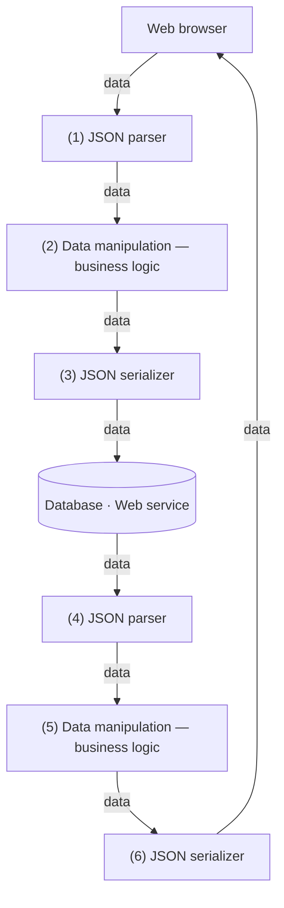

# 11. Web services

[← 10. Database operations](10-database-operations.md) · [Book](../README.md) · [12. Advanced data validation →](12-advanced-data-validation.md)

## Summary

The next milestone is **book information enrichment**. Search results should combine availability from the database with extended information from the **Open Library Books API**. That API returns dozens of fields for some books and two or three for others, so its data is sparse and unpredictable (p. 221). Joe's principle is **build the insides of our systems like we build the outsides**. Components on the wire exchange language-independent data such as JSON. Components inside a program should likewise exchange generic, immutable data collections, so they know only field names, not each other's class definitions. That keeps them loosely coupled (pp. 220–223).

The endpoint takes the client's search request, with `title` and the `fields` to return, as a validated map (pp. 225–227). It then does three things:

- **Fetches each book from Open Library,** validates it, and keeps only the relevant and requested fields with `_.pick` twice (pp. 227–231).
- **Passes the information forward** without opening it, like a messenger who shouldn't read the letter he carries (pp. 231–232).
- **Combines the database and Open Library results.** Joe compares nesting and merging (table 11.1), and Theo writes a generic `joinArrays` with `_.keyBy` and `_.merge` (pp. 232–239).

The project is delivered on time. Theo is promoted and buys Joe's children their gifts: a DJI Mavic Air 2 drone for Neriah and AirPods Pro for Aurelia (p. 244).

## Key takeaways

- **Build the insides like the outsides:** inner components communicate with generic data, the way services communicate over the wire with JSON (pp. 222–223).
- **With classes, a component must import another's class definitions to read its data.** With generic data, it needs only the field names, which is loose coupling (p. 223).
- **A web service's data flow is data all the way:** parse, data manipulation, serialize to the sources, parse their responses, data manipulation, serialize the response (figure 11.3, p. 224).
- **Let the client choose fields** with one endpoint and a `fields` list, instead of an endpoint per client and screen (p. 225).
- **Validate data from external services**, here with `allOf`/`anyOf` for the ISBN rule, before using it (pp. 229–230).
- **Pass information forward** in generic structures instead of creating classes like `DBBook`, `OpenLibraryBook` and `CombinedBook` (pp. 231–232).
- **Nesting vs merging** (table 11.1, p. 232): nesting needs no conflict handling but isn't flat; merging is flat but needs conflict handling.
- **Business logic is often generic data manipulation:** `_.pick`, `_.keyBy`, `_.merge` and `_.values` make `joinArrays` (pp. 236–237).
- **Classes are much less complex as aggregates of stateless functions** that operate on similar domain entities (p. 243).

## Section outline

*From the book’s own table of contents (PDF bookmarks); printed page numbers.*

- 11.1 Another feature request — p. 221
- 11.2 Building the insides like the outsides — p. 222
- 11.3 Representing a client request as a map — p. 225
- 11.4 Representing a server response as a map — p. 227
- 11.5 Passing information forward — p. 231
- 11.6 Search result enrichment in action — p. 234
- Summary — p. 244

## Notes

The JavaScript in this chapter, as in chapter 10, is written as if I/O were synchronous; real code uses `async`/`await` (p. 230).

### 11.1 Another feature request

After the database milestone is delivered on time, Nancy wants an ETA for enrichment with the Open Library Books API. Number of pages, weight, physical format, topics and so on replace the database's book information, except for availability (p. 221).

### 11.2 Building the insides like the outsides

The steps of the data flow inside a web service (p. 222):

1. Receive a request from a client.
2. Apply business logic to the request.
3. Fetch data from external sources, such as the database and other web services.
4. Apply business logic to the responses from external sources.
5. Send the response to the client.

Over the wire, the data format, often JSON, doesn't depend on the components' languages. Inside a program, traditional OOP breaks that idiom: to access a class member, a component must import the class definition. DOP components communicate with generic data collections, which need no knowledge of other components' internals, only the names of the fields (p. 223).

*Redrawn from figure 11.3 (p. 224), which Theo draws alone while Joe takes a call.*

### 11.3 Representing a client request as a map

Should the client decide which Open Library fields to retrieve? Theo first proposes separate endpoints for mobile and desktop. Joe adds extended and basic result screens, which would make four endpoints, and Theo agrees to a single endpoint that lets the client choose (p. 225). The payload is `{"title": "habit", "fields": ["title", "weight", "number_of_pages"]}` (listing 11.1). Web frameworks usually parse it: Express, Spring, Django, Ruby on Rails or ASP.NET. Manually, it's `JSON.parse` in JavaScript or Gson's `fromJson(s, Map.class)` in Java (listings 11.2–11.3, p. 226). The request schema restricts `fields` to an `enum` of the fields Nancy wants exposed (listings 11.4–11.5, pp. 226–227).

### 11.4 Representing a server response as a map

`GET https://openlibrary.org/isbn/978-1982137274.json` returns many fields for *7 Habits of Highly Effective People*: author keys, `created`, `full_title`, `isbn_13`, languages, `number_of_pages` (432), `publish_date` (2020), `publishers`, revisions, `subtitle`, `title`, `works`, and more (listing 11.6, pp. 227–228).

**Double field filtering** (pp. 229–231): keep only the fields Nancy allows, then only those the client requested. `OpenLibraryDataSource.bookInfo` does it in four steps (listing 11.9):

1. Fetch and parse the response.
2. Validate it against the Books API schema, whose `allOf`/`anyOf` requires at least one ISBN field (listing 11.8). On failure, throw "Internal error: Unexpected result from Open Books API".
3. Apply `_.pick(_.pick(rawInfo, relevantFields), requestedFields)`.
4. Set `isbn` on the result, so the two sources can later be combined (p. 231).

> **Try it:** [Enrichment flow](../widgets/11-enrichment-flow.html) — choose the fields a client requests and step through the endpoint: validate the request, query the database, fetch and double-filter each Open Library record, and join the two arrays by ISBN.

### 11.5 Passing information forward

In traditional OOP, Theo would create a class for each kind of book information: `DBBook`, `OpenLibraryBook` and `CombinedBook`. That doesn't fit a dynamic approach where the client decides the fields, and classes add no value when data is just passed forward (p. 231).

Joe's story (pp. 231–232): Hugo asks his friend Willy to deliver flowers and a love letter to his fiancée Iris. Willy proudly reports that he admired Hugo's writing style; he read the letter "to fulfill my duty faithfully." Traditional OOP is like Willy: to pass information forward, OOP developers "open the letter" and represent it with specific classes. DOP passes it forward in generic data structures.

| | Advantages | Disadvantages (table 11.1, p. 232) |
|---|---|---|
| Nesting (`extendedInfo` field) | No need to handle conflicts | Result is not flat |
| Merging | Result is flat | Need to handle conflicts |

Theo hopes the two maps share no fields, so they merge, with `_.merge` from chapter 5 (listings 11.10–11.12, pp. 232–233). The database contributes `isbn` and `available`; Open Library the rest. The response schema requires `title`, `isbn` and `available` (listing 11.13, pp. 233–234).

> **Try it:** [Nest or merge](../widgets/11-nest-or-merge.html) — combine a database record with an Open Library record by nesting or merging, add a field both sides share, and choose which side wins the conflict.

### 11.6 Search result enrichment in action

The steps of the enrichment data flow (p. 234):

1. Receive a request from a client.
2. Extract the query and the fields to fetch from Open Library.
3. Retrieve from the database the books that match the query.
4. Fetch information from Open Library for each matching ISBN.
5. Extract the required fields from the Open Library responses.
6. Combine the database information with the Open Library information.
7. Send the response to the client.

- **The database part** needs only `isbn` and `available`, with no join (listing 11.14, pp. 234–235).
- **Open Library** has no batch query, so `multipleBookInfo` maps `bookInfo` over the ISBNs. The book pretends `_.map` works with asynchronous functions; real code would use `Promise.all` to send the requests in parallel (listing 11.15, pp. 235–236).
- **Joining:** Theo can't assume both arrays list the books in the same order, and wishes for two hash maps keyed by ISBN. `_.keyBy` makes them; it is like `_.groupBy` but assumes one element per group, keeping the last (listings 11.16–11.17, pp. 236–237). The generic `joinArrays(a, b, keyA, keyB)` keys both arrays, merges the two maps, and returns the values (listings 11.18–11.19, pp. 237–239). The key names can differ between the arrays.
- **The endpoint** validates the request, fetches, joins, validates the response and returns it. `Library.searchBooksByTitle` wraps it with `JSON.parse` and `JSON.stringify` (listings 11.20–11.25, pp. 239–243).

Theo reflects that classes are much less complex when they only aggregate stateless functions over similar entities (p. 243). Joe reports that reading *The Power of Habit* stopped him biting his nails (p. 243).

**Delivering on time** (p. 244): Theo remembers the woodcutter story; he took the time to sharpen his saw. The project succeeds and Theo is promoted. At the Westfield San Francisco Center he buys the gifts he owes Joe's children, and a necklace and earrings for his wife Jane.

> **Vault note:** the endpoint listings contain several slips that would stop the code running as printed:
>
> - Listing 11.15 validates `bookInfoSchema` against `dbSearchResultSchema` instead of `rawInfo` against `bookInfoSchema`; listing 11.22 has it right.
> - `multipleBookInfo` passes `_.map` its arguments in reverse order.
> - The SQL reads `WHERE title = like '%$1%'`.
> - Listing 11.24 writes the `fields` enum as `"type": [...]`.
> - Listings 11.20 and 11.25 call `joinArrays` without its two key names, validate `request` instead of the response, and use an object schema for an array response.
> - `Library.searchBooksByTitle` calls `Catalog.searchBooksByTitle` rather than `enrichedSearchBooksByTitle`.
>
> The test data in listing 11.19 also gives each Open Library record the other book's title. The code merges the conflicting `title` fields with the Open Library value winning, which is the conflict merging was supposed to avoid (pp. 235–243). The [lab](../lab/11-join-arrays/README.md) runs a corrected version.

> **Run it:** the [join experiment](../lab/11-join-arrays/README.md) implements `pick`, `keyBy` and `joinArrays` in Python against a mocked Open Library and shows the merge conflict in listing 11.19.

## Trade-offs at a glance

| Choice | Benefit | Cost |
|---|---|---|
| A class per kind of data (`DBBook`, `CombinedBook`) | Types document shapes | Every component imports others' classes; "opening the letter" (pp. 223, 231) |
| Generic data passed forward | Loose coupling; generic business logic | Shapes live in schemas, not types |
| One endpoint with client-chosen `fields` | No endpoint per client and screen (p. 225) | Responses vary in shape; schemas must allow optional fields |
| Nesting sources | No conflicts | Not flat (p. 232) |
| Merging sources | Flat result | Conflicts: with `_.merge`, the later source silently wins |
| One request per book | Works with an API without batch queries | N calls per search; needs parallelism (p. 235) |

## Beyond the book

- **"Build the insides like the outsides"** echoes the "functional core" and "values as the boundary" ideas of Clojure's community and Gary Bernhardt's "Boundaries" talk (2012). Treat internal module boundaries like network boundaries: data in, data out.
- **Merge conflicts, done deliberately.** `_.merge` is recursive and right-biased: the second argument wins at each leaf. `_.mergeWith` takes a customizer to decide per key. A common policy is to let the authoritative source win per field, such as the database for availability and Open Library for descriptions, and to fail on unexpected overlaps.
- **`_.keyBy` drops duplicates.** If the database returns two rows with the same ISBN, `_.keyBy` keeps only the last, silently. A `groupBy` followed by an assertion that each group has one element catches data problems at the boundary.
- **Join semantics.** `joinArrays` behaves like a full outer join. A book missing from Open Library still appears, without extended fields; an Open Library record with no database row appears too, without `available`, which the response schema would then reject. An inner join, keeping only keys present in both, is often what an endpoint wants.
- **Fan-out cost.** One Open Library request per result multiplies latency and the risk of rate limits. Caching responses by ISBN, as with chapter 8's atom-based cache, is the natural companion to this endpoint.

## Connections

- **Request and response schemas:** [7. Basic data validation](07-basic-data-validation.md) wrote the search request and Books API schemas reused here.
- **The database side:** [10. Database operations](10-database-operations.md).
- **`_.merge`** was first used for patches in [5. Basic concurrency control](05-basic-concurrency-control.md).
- **Next:** part 3 opens with [12. Advanced data validation](12-advanced-data-validation.md).
- **Run it:** [Joining sources by key](../lab/11-join-arrays/README.md) — double field filtering, `keyBy`, and an outer join with explicit conflict reporting.

## Check yourself

1. What does "build the insides of our systems like we build the outsides" mean?
   

Answer
Inner components of a program should communicate with component-independent data, generic immutable collections, the way services communicate over the wire with a language-independent format like JSON (pp. 220–223).

2. Why are DOP components loosely coupled, according to Joe?
   

Answer
They need no knowledge of other components' internals, only field names. With classes, a component must import the class definition to access a member (p. 223).

3. Why does Theo use `_.pick` twice?
   

Answer
Once to keep only the fields Nancy wants exposed, and once to keep only those the client requested (pp. 229–230).

4. What is the point of the story of Hugo, Willy and the letter?
   

Answer
Willy read the letter to "fulfill his duty faithfully," like OOP developers who open data to represent it with specific classes even when they only pass it forward. DOP passes information forward in generic structures (pp. 231–232).

5. Compare nesting and merging two maps.
   

Answer
Nesting, adding an `extendedInfo` field, needs no conflict handling but the result isn't flat. Merging gives a flat result but requires handling fields present in both maps (table 11.1, p. 232).

6. How does `joinArrays` work, and why does it need `_.keyBy`?
   

Answer
The two arrays aren't guaranteed to list books in the same order, so it turns each into a map keyed by its ID field with `_.keyBy`. It then merges the maps and returns their values (pp. 236–237).

