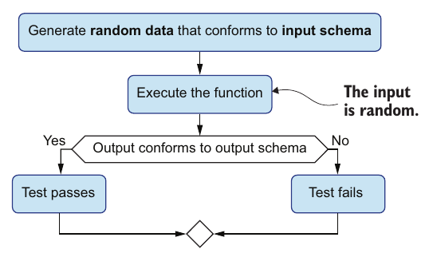

# ۱۲. اعتبارسنجی پیشرفته‌ی داده

[← ۱۱. سرویس‌های وب](11-web-services.md) · [کتاب](../README.md) · [۱۳. polymorphism →](13-polymorphism.md)

## خلاصه

بخش ۳ یک ماه دیرتر آغاز می‌شود، در فاز نگه‌داشت. مونیکا دیو را به Klafim می‌سپارد، و جو از تئو می‌خواهد راهنمایی‌اش کند: «دانش هیچ‌وقت کامل نیست»، و DOP آن‌قدر ساده است که زمینی حاصلخیز برای ابداع باشد (pp. 245–246). کارهای نخست دیو خوب پیش می‌رود، ولی با بزرگ شدن کدبیس، تابع‌هایی که تنها داده‌ی عمومی می‌گیرند و برمی‌گردانند سخت به کار می‌آیند. روشن نیست آرگومانی چه شکلی باید داشته باشد، و داده‌ی نامعتبر هیچ خطای معناداری نمی‌دهد (pp. 247–248).

چاره همان جدایی طرح از نمایش است که بر مرزها بود، حالا روی **آرگومان‌ها و مقدار بازگشتی تابع** پیاده (pp. 248–257):

- **آرگومان‌ها** به‌شکل tuple اعتبارسنجی می‌شوند، با `prefixItems`.
- **همه‌ی indexها** به‌شکل map همگن اعتبارسنجی می‌شوند، با `additionalProperties` که طرحی می‌گیرد.
- **آن سنجش‌ها** تنها در توسعه اجرا می‌شوند، پناه‌گرفته زیر پرچم `dev()`، مانند assertion در Java.

چون اعتبارسنجی سر اجرا روی خود داده اجرا می‌شود، **فراتر از گونه‌های ایستا** می‌رود: بازه‌ی عددی، عبارت باقاعده با `pattern`، و قالب‌های از پیش تعریف‌شده مانند `date` (pp. 257–260). جو دو پاداش می‌افزاید (pp. 260–268):

- **نمودار مدل داده‌ی تولیدشده:** کتابخانه‌ی Malli آن طرح را به PlantUML بدل می‌کند.
- **تست unit طرح‌محور:** ابزار JSON Schema Faker آرگومان‌های معتبر تصادفی می‌سازد، و سنجش مقدار بازگشتی خود تابع نقش ادعا را بازی می‌کند. اشکالی واقعی را می‌گیرد، جایی که نویسنده‌ای جاافتاده از شاخص، نام‌هایی `undefined` می‌سازد.

دیو با هدیه‌ی خودش لطف را برمی‌گرداند، یعنی برگه‌ی تقلب پیشرفته‌ی JSON Schema (pp. 269–270).

## نکته‌های کلیدی

- **اعتبارسنجی درون سیستم برای آسانی توسعه است** در dev و تست و staging؛ و بر مرزها نگهبانی در production است (جدول ۱۲.۱، ص. ۲۴۸).
- **در production خاموشش کنید**: داده‌ی مرزی از پیش اعتبارسنجی شده بود، پس اعتبارسنجی دوباره سر هر صدا زدنی زیادی است و به کارایی خرج می‌دهد (pp. 254–255).
- **با اعتبارسنجی داده مانند تست unit رفتار کنید:** آرگومان تابع‌هایی را اعتبارسنجی کنید که برایشان تست unit می‌نوشتید، نه هر تابعی (p. 255).
- **آرگومان‌ها tupleاند**: آرایه‌ای با اندازه‌ی ثابت که عضوهایش شکل‌های مختلف دارند، نوشته‌شده با `prefixItems` (pp. 253–254).
- **همه‌ی mapهای رشته‌ای همگن**، یعنی index‌ها، با `type: object` بی هیچ `properties` و با `additionalProperties`ی که روی طرحی گذاشته شده نوشته می‌شوند (pp. 252–253).
- **طرح‌های تودرتو را در متغیر ذخیره کنید** تا طرح‌های پیچیده خواندنی بمانند (p. 252).
- **فراتر از گونه‌های ایستا:** کلیدواژه‌های `minimum` و `maximum` و `pattern` و `format`. گونه‌های ایستا سر کامپایل و تنها با خبر گونه سنجیده می‌شوند؛ و طرح‌ها سر اجرا در برابر خود داده (pp. 257–258).
- **طرح‌ها نمودار و تست می‌سازند**: کتابخانه‌ی Malli با PlantUML برای نمودار، و JSON Schema Faker برای ورودی‌های معتبر تصادفی (pp. 260–268).

## فهرست بخش‌ها

*از فهرست خود کتاب، یعنی bookmarkهای PDF؛ شماره‌ی صفحه‌ها چاپی‌اند.*

- ۱۲.۱ اعتبارسنجی آرگومان تابع — ص. ۲۴۸
- ۱۲.۲ اعتبارسنجی مقدار بازگشتی — ص. ۲۵۵
- ۱۲.۳ اعتبارسنجی پیشرفته‌ی داده — ص. ۲۵۷
- ۱۲.۴ ساختن خودکار نمودار مدل داده — ص. ۲۶۰
- ۱۲.۵ ساختن خودکار تست unit طرح‌محور — ص. ۲۶۲
- ۱۲.۶ هدیه‌ای تازه — ص. ۲۶۹
- خلاصه — ص. ۲۷۰

## یادداشت‌ها

کارهای نخست دیو سه endpoint تازه‌ی HTTP است: گرفتن catalog به‌شکل CSV، جستن کتاب با نویسنده، و امتیاز دادن به کتاب (p. 248). او هر درخواست و پرسش پایگاه داده و پاسخ بیرونی را بر مرزها اعتبارسنجی کرد. production خوب کار می‌کند، ولی سر توسعه نمی‌تواند بگوید آرگومان تابعی چه شکلی باید داشته باشد، و اشتباه‌ها خطاهای ناروشن می‌دهند (p. 248).

| گونه‌ی اعتبارسنجی | هدف | محیط (جدول ۱۲.۱، ص. ۲۴۸) |
|---|---|---|
| مرزها | نگهبان | production |
| درون | آسانی توسعه | dev |

### ۱۲.۱ اعتبارسنجی آرگومان تابع

مثال همان `Catalog.searchBooksByTitle(catalogData, query)` در حافظه است. از version پایگاه داده جالب‌تر است، چون هم catalog را می‌گیرد هم آن پرسش را (listing ۱۲.۱، صص. ۲۴۹–۲۵۰). مقدار `query` رشته‌ای است؛ و `catalogData` از مدل داده‌ی catalog در شکل ۱۲.۱ پی می‌گیرد (p. 250). تئو برگه‌ی تقلب جو را به دیو می‌دهد، که تا حالا «خوب کار کرده» و «کمی پاره و پرچین‌وچروک» است (p. 250).

طرح‌ها در چهار قدم بالا می‌آیند:

| طرح | نکته‌های به‌کار‌آمده |
|---|---|
| `authorSchema` (listing ۱۲.۳، ص. ۲۵۱) | فیلدهای `id` و `name` و `bookIsbns` همه اجباری‌اند |
| `bookItemSchema` و `bookSchema` (listing ۱۲.۴، صص. ۲۵۱–۲۵۲) | طرح تودرتو در متغیری ذخیره شده؛ و `publicationYear` اجباری نیست، چون برخی کتاب‌ها ندارندش، که از عضوهای nullable کلاس آسان‌تر است |
| `catalogSchema` (listing ۱۲.۶، ص. ۲۵۳) | مقدارهای `booksByIsbn` و `authorsById` شاخصند: `{"type": "object", "additionalProperties": bookSchema}` |
| `searchBooksArgsSchema` (listing ۱۲.۸، ص. ۲۵۴) | یک tuple: `{"type": "array", "prefixItems": [catalogSchema, {"type": "string"}]}` |

**همه‌ی mapهای همگن.** رکوردها map ناهمگن‌اند: نام فیلد دانسته، مقدارهایی با شکل‌های مختلف. indexها map همگن‌اند: نام فیلد نادانسته، مقدارهایی با شکلی مشترک (p. 252). کلیدواژه‌ی `additionalProperties` معمولاً بولی است، ولی می‌تواند طرحی هم باشد که خاصیت‌های نگفته در آن طرح باید برآورندش. پس mapی همگن، mapی است بی هیچ خاصیت از پیش تعریف‌شده، که همه‌ی خاصیت‌های افزوده‌اش با آن می‌خوانند (listing ۱۲.۵، صص. ۲۵۲–۲۵۳).

**جا زدنش** (listing ۱۲.۹، صص. ۲۵۴–۲۵۵): سر تابع، عبارت `if (dev()) { validate([catalogData, query]) }`، که خطای «searchBooksByTitle called with invalid arguments: …» را با متن خطا می‌اندازد. تابع `dev()` در هر محیطی جز production درست برمی‌گرداند، در تست و staging هم. دیو آن را به assertionهای Java می‌ماند، که در production خاموشند (p. 255).

> **Try it:** [اعتبارسنجی درون سیستم](../widgets/12-dev-validation.html) — تابع `searchBooksByTitle` را با catalogها و پرسش‌های معتبر و شکسته صدا بزنید، تابع `dev()` را روشن و خاموش کنید، و ببینید سنجش آرگومان و مقدار بازگشتی هر اشتباهی را گزارش می‌کند یا از آن می‌پرد.

> **In practice:** اعتبارسنجی آرگومان در محیط توسعه و CI، و خاموش کردنش در production، همان کاری است که کتاب برای کارایی پیشنهاد می‌کند.
>
> **Your turn:** transform مهمی در loader دارید که ورودی‌اش را با schema چک می‌کند و ۲۰٪ زمان اجرا را می‌گیرد. چه می‌کنید؟
>
> *Answer:* در GitLab CI و محیط staging روشن نگه دارید و در production با یک متغیر محیطی خاموش کنید، ولی اعتبارسنجی مرز، یعنی schema contract در dlt، را همیشه روشن بگذارید (pp. 250–255).

### ۱۲.۲ اعتبارسنجی مقدار بازگشتی

مقدار بازگشتی آرایه‌ای از خبر کتاب با `title` و `isbn` و `authorNames` است، که همه اجباری‌اند (listing ۱۲.۱۰، ص. ۲۵۶). listing ۱۲.۱۱ آن را ته تابع می‌سنجد، باز تنها در dev، و خطای «searchBooksByTitle returned an invalid value: …» را می‌اندازد (pp. 256–257).

### ۱۲.۳ اعتبارسنجی پیشرفته‌ی داده

«دل‌دار باش، فراتر از گونه‌ها برو» (p. 257). قیدهای تازه (pp. 257–260):

| قید | طرح | نمونه |
|---|---|---|
| سال نشری پس از ۱۹۰۰ و نه دیرتر از سال کنونی | عبارت `{"type": "integer", "minimum": 1900, "maximum": 2021}` | ۱۲.۱۲ |
| شناسه‌ی نسخه‌ی کتابی که UUID است | عبارت `{"type": "string", "pattern": "[0-9a-fA-F]{8}-…-[0-9a-fA-F]{12}"}` | ۱۲.۱۳ و ۱۲.۱۴ |
| تاریخ خریدی | عبارت `{"type": "string", "format": "date"}` | ۱۲.۱۵ |
| شماره‌ی ISBN و شناسه‌ی کتابخانه و شناسه‌ی نویسنده | عبارت باقاعده‌ی ساده‌شده، مانند `^[0-9-]{10,20}$` برای ISBN | ۱۲.۱۶ |

چرا این با گونه‌های OOP شدنی نیست؟ دیو درش می‌آورد. سنجش ایستای گونه سر کامپایل اجرا می‌شود، تنها با خبر گونه؛ و اعتبارسنجی DOP سر اجرا، با خود داده، پس می‌تواند فراتر از گونه‌ها برود (p. 257). کتاب یاد می‌کند که کد OOP البته می‌تواند اعتبارسنجی دست‌ساز سر اجرا بکند؛ آن سنجیدن میان طرح و گونه‌های ایستاست. و بنا بر مشخصه‌ی JSON Schema، کلیدواژه‌ی `format` تنها حاشیه‌نویسی است، ولی در کار واقعی کتابخانه‌های اعتبارسنجی برای اعتبارسنجی به کارش می‌برند (p. 258). listingهای ۱۲.۱۶ و ۱۲.۱۷ طرح پالوده‌ی catalog را سوار می‌کنند (pp. 259–260).

> **Vault note:** در listing ۱۲.۱۶ آن `bookItemSchema` پالوده، طرح فیلدهایش را زیر `additionalProperties` می‌گذارد به‌جای `properties`، و listing ۱۲.۱۷ یک‌راست برای `bookItems` به کارش می‌برد به‌جای آنکه `items` آرایه‌ای باشد. همان‌طور که چاپ شده، مقدار `bookItems` mapی از هر چیزی می‌شود، و همین است که داده‌ی ساخته در listing ۱۲.۲۰ مقدار `bookItems` را شیئی با کلیدهایی مانند `"ullamco5"` دارد. آن `authorSchema` پالوده هم `"type": "array"` را برای `bookIsbns` جا می‌اندازد (pp. 259–260). widget و lab از طرح خواسته کار می‌کشند.

### ۱۲.۴ ساختن خودکار نمودار مدل داده

فردا جو سر می‌زند. دیو می‌پذیرد که طرح‌ها از نوشتن کلاسی برای آرگومان تابع کم‌راحت‌ترند، ولی فراتر رفتن از گونه‌های ایستا جبرانش می‌کند. تئو می‌افزاید که هر تابعی اعتبارسنجی نمی‌خواهد (p. 260). ترفند نخست جو: ابزارها یک JSON Schema را به قالب متنی مدل داده بدل می‌کنند، که بعد به‌شکل تصویر رندر می‌شود. قالب محبوب جو **PlantUML** است؛ از JSON Schema Viewer و Malli هم کار کشیده (p. 260). کتابخانه‌ی Malli از طرح catalog قالب PlantUML می‌سازد (listing ۱۲.۱۸، ص. ۲۶۱)، و چسباندنش در PlantText شکل ۱۲.۲ را رندر می‌کند (pp. 261–262).

دو مرز (p. 262):

- **همه‌ی entityها `Entity1` و `Entity2` و مانند آن نام می‌گیرند**، چون یک JSON Schema هیچ راهی به نام دادن به طرحی ندارد.
- **قیدهای افزوده نشان داده نمی‌شوند**، مانند بازه‌ی سال و الگوی ISBN، چون بخشی از مدل داده نیستند.

### ۱۲.۵ ساختن خودکار تست unit طرح‌محور

همین که تابعی طرح‌هایی برای آرگومان‌ها و مقدار بازگشتی‌اش داشته باشد، تست unit ماشینی است (p. 263):

*Figure 12.3 (p. 263): آن طرح‌ها هم سازنده‌ی ورودی‌اند هم سنگ محک، پس هیچ مثالی دستی نوشتنی نیست.*

**ابزار JSON Schema Faker** داده‌ی خورنده می‌سازد. سر هر صدا زدنی UUIDی دیگر می‌دهد (listing ۱۲.۱۹)، و برای طرح catalog آن catalog تصادفی درازی (listing ۱۲.۲۰، صص. ۲۶۳–۲۶۵). از ISBNهای عجیبی که می‌سازد، جو می‌بیند آن عبارت‌های باقاعده اشکال دارند: «از عبارت باقاعده بدم می‌آید!» دیو می‌گوید (p. 265).

آن تست در چهار نمونه تکامل می‌یابد (pp. 265–268):

1. **تابع را صدا بزنید** با آرگومان‌های ساخته. هیچ ادعای صریحی نیست، چون سنجش بازگشت dev خود تابع خطا می‌اندازد (listingهای ۱۲.۲۱ و ۱۲.۲۲).
2. **درست یا غلط برگردانید**، با گرفتن آن استثنا (listing ۱۲.۲۳).
3. **آن پرسش را خورنده کنید:** حرف نخست عنوان کتاب نخست ساخته را به کار ببرید، تا جست‌وجو دست‌کم یک کتاب بیابد. جو می‌گوید داده‌ی تصادفی کم به چنین دست‌کاری‌ای نیاز دارد (listing ۱۲.۲۴).
4. **خطا را log کنید** وقتی تست شکست می‌خورد (listingهای ۱۲.۲۵ تا ۱۲.۲۷).

آن log اشکال را رو می‌کند. کتاب‌های catalog تصادفی نویسنده‌هایی را گواه می‌آورند که در `authorsById` نیستند، پس `authorNames` مقدار `undefined` دارد جایی که طرح رشته چشم دارد. چاره‌ی دیو مقداری پیش‌فرض به `_.get` می‌فرستد، یعنی `"Not available"`، و آن تست رد می‌شود (listingهای ۱۲.۲۸ و ۱۲.۲۹، ص. ۲۶۸).

> **Try it:** [تست‌های طرح‌محور](../widgets/12-schema-based-test.html) — catalogهای تصادفی را با seed از آن طرح بسازید، جست‌وجو را اجرا کنید، ببینید سنجش مقدار بازگشتی سر نویسنده‌های جاافتاده شکست می‌خورد، بعد چاره‌ی دیو را پیاده و باز اجرا کنید.

دیو هنوز یک ویژگی OOP را دلش می‌خواهد: تکمیل خودکار نام فیلدها. جو می‌گوید تنها در Clojure هست، از راه درهم شدن clj-kondo با Malli. ابزارهای IntelliJ و Visual Studio Code از پیش فایل‌های JSON را با JSON Schema اعتبارسنجی می‌کنند، پس چشم دارد پشتیبانی آرگومان تابع هم پی بیاید (pp. 268–269).

> **Run it:** [آزمایش تست طرح‌محور](../lab/12-schema-based-tests/README.md) catalogهای تصادفی با seed را از طرح این فصل می‌سازد، جست‌وجو را با اعتبارسنجی مقدار بازگشتی اجرا می‌کند، و می‌شمارد که version اصلی و تصحیح‌شده چند بار شکست می‌خورند.

> **In practice:** از schema می‌شود داده‌ی تست ساخت: هر ستون نوع و محدوده‌ای دارد.
>
> **Your turn:** چطور transformهای Silver را با داده‌ای آزمایش می‌کنید که کسی دستی ننوشته؟
>
> *Answer:* از schema جدول یا JSON Schema ورودی، رکوردهای تصادفی با seed ثابت بسازید و ویژگی‌هایی را چک کنید که برای هر ورودی برقرارند، مثل «شمار ردیف خروجی بیشتر از ورودی نیست». کتاب همین را با تولید خودکار تست از طرح نشان می‌دهد (pp. 263–269).

### ۱۲.۶ هدیه‌ای تازه

دیو **برگه‌ی تقلب پیشرفته‌ی JSON Schema** خودش را می‌سازد، پیچیده در روبانی آبی روشن و آراسته با کامپیوترهای کوچک در یک سو و کیبورد و موش در آن یکی (p. 269). به مال جو می‌افزاید (listingهای ۱۲.۳۰ و ۱۲.۳۱، صص. ۲۶۹–۲۷۰):

- بازه‌ای صحیح: مقدار `myAge` از ۰ تا ۱۲۰.
- قالبی تاریخ: مقدار `myBirthday`.
- الگویی: مقدار `myLetters` با `[a-zA-Z]*`.
- یک map همگن: مقدار `myNumberMap` از راه `additionalProperties`.
- یک tuple: مقدار `myTuple` از راه `prefixItems`.

## بده‌بستان‌ها در یک نگاه

| گزینش | سود | خرج |
|---|---|---|
| گونه‌های ایستا در OOP | سنجش سر کامپایل؛ و تکمیل خودکار IDE (p. 268) | تنها خبر گونه؛ بی هیچ بازه و الگو |
| طرح آرگومان و بازگشت در DOP | شکل‌ها را مستند می‌کند؛ خطای معنادار؛ فراتر از گونه‌ها | از کلاسی کم‌راحت‌تر (p. 260)؛ و دستی نگه داشته می‌شود |
| اعتبارسنجی تنها در dev | بی هیچ بهایی در production (p. 255) | production تنها به اعتبارسنجی مرزی تکیه دارد |
| اعتبارسنجی هر تابعی | بیشترین پوشش | زیادی است؛ کتاب تنها تابع‌هایی را اعتبارسنجی می‌کند که تست unit می‌نوشتید (p. 255) |
| نمودارهای ساخته | همیشه با طرح هم‌گام | نام entityهای بی‌نام؛ و قیدهای پنهان (p. 262) |
| تست‌های ساخته | اشکال‌ها را روی ورودی‌هایی می‌یابد که کسی ننوشته (p. 268) | داده‌ی تصادفی شاید دست‌کاری بخواهد؛ و خود طرح‌ها می‌توانند غلط باشند (p. 265) |

## فراتر از کتاب

- **همه‌ی tupleها درازی می‌خواهند.** کلیدواژه‌ی `prefixItems` عضوهای نخست را قید می‌کند، ولی آرایه‌ای سه‌عضوی باز اعتبار می‌گیرد مگر آن طرح `"items": false` یا `maxItems: 2` و `minItems: 2` را بیفزاید. برای سنجش آرگومان، همین است که صداکننده‌ای را می‌گیرد که آرگومانی افزوده می‌فرستد.
- **الگوهایتان را لنگر بزنید.** کلیدواژه‌ی `pattern` در JSON Schema هر جای رشته را می‌خواند مگر لنگر خورده باشد. الگوی UUID در listing ۱۲.۱۴ و الگوی شناسه‌ی نویسنده `[a-z-]{2,50}` هر رشته‌ای را می‌پذیرند که خوانشی *درونش* باشد، پس دومی رشته‌ی `"!!!ab"` را هم می‌پذیرد. پوشاندنشان در `^…$` آن‌ها را همان می‌کند که می‌گویند.
- **قالب‌ها در Ajv.** از Ajv version ۷، اعتبارسنجی `format` از بسته‌ای جدا می‌آید، یعنی `ajv-formats`؛ و بی آن، Ajv بسته به گزینه‌هایش یا قالب‌های ناشناس را نشنیده می‌گیرد یا سر کامپایل شکست می‌خورد. همین سوی عملی آن یادداشت کتاب است که `format` رسماً تنها حاشیه‌نویسی است.
- **باز هم تست خاصیت‌محور.** آن تست طرح‌محور، تست خاصیت‌محور با خاصیت «خروجی با طرح خروجی می‌خواند» است. ابزارهایی مانند fast-check و Hypothesis *آب کردن* را می‌افزایند: وقتی ورودی تصادفی شکست می‌خورد، کوچک‌ترین ورودی شکست‌خورده را می‌جویند، این‌جا به‌احتمال catalogی با یک کتاب و یک نویسنده‌ی جاافتاده.
- **ابزارهای spec و Malli در Clojure** همان رویکرد را بومی می‌گیرند. تابع `instrument` آرگومان تابع را در توسعه می‌سنجد، سازنده‌ها از همان specها می‌آیند، و ابزارهایی مانند clj-kondo آن طرح‌ها را برای بازخورد ویرایشگر می‌خوانند، همان تکمیل خودکاری که دیو دلش می‌خواهد.
- **سال‌های سخت‌کدشده بد پیر می‌شوند.** مقدار `"maximum": 2021` کتاب‌های تازه از ۲۰۲۲ به بعد را رد می‌کند. طرحی نمی‌تواند «سال کنونی» را بگوید، پس معمولاً سر بالا آمدن ساخته یا در کد سنجیده می‌شود.

## پیوندها

- **اعتبارسنجی مرزی و آن برگه‌ی تقلب نخست:** [۷. اعتبارسنجی پایه‌ی داده](07-basic-data-validation.md).
- **تست unit دستی:** [۶. تست‌های unit](06-unit-tests.md)؛ و این فصل از طرح‌ها می‌سازدشان.
- **رکوردها و indexها:** همان mapهای ناهمگن در برابر همگن از [۳. دست‌کاری پایه‌ی داده](03-basic-data-manipulation.md)، که حالا به JSON Schema گفته شده‌اند.
- **پسین:** [۱۳. polymorphism](13-polymorphism.md).
- **Run it:** [تست‌های طرح‌محور](../lab/12-schema-based-tests/README.md) — catalogهای تصادفی با seed، اعتبارسنجی مقدار بازگشتی، و آن چاره‌ی `"Not available"`.

## خودتان را بسنجید

1. اعتبارسنجی درون سیستم از اعتبارسنجی بر مرزها چه فرقی دارد؟
   

پاسخ
بر مرزها نگهبانی است که داده‌ی نامعتبر را در production بیرون نگه می‌دارد. درون، با صریح کردن شکل آرگومان‌ها و دادن خطای معنادار توسعه را آسان می‌کند، و تنها بیرون production اجرا می‌شود (جدول ۱۲.۱، صص. ۲۴۸ و ۲۵۴–۲۵۵).

2. چرا اعتبارسنجی درون را در production خاموش کنیم؟
   

پاسخ
داده از پیش بر مرزی از سیستم اعتبارسنجی شده بود، پس اعتبارسنجی دوباره‌اش سر هر صدا زدنی زیادی است و به کارایی می‌زند (pp. 254–255).

3. طرح mapی رشته‌ای و همگن، مانند `booksByIsbn`، را چطور می‌نویسید؟
   

پاسخ
عبارت `{"type": "object", "additionalProperties": bookSchema}`: بی هیچ خاصیت از پیش تعریف‌شده، و هر خاصیت افزوده‌ای باید با طرح مقدار بخواند (pp. 252–253).

4. آرگومان‌های یک تابع در JSON Schema چطور وصف می‌شوند؟
   

پاسخ
به‌شکل tuple، یعنی آرایه‌ای که عضوهایش شکل‌های مختلف دارند، با `prefixItems`؛ مثلاً `[catalogSchema, {"type": "string"}]` برای `searchBooksByTitle` (pp. 253–254).

5. چرا طرح‌ها می‌توانند «فراتر از گونه‌های ایستا» بروند؟
   

پاسخ
سر اجرا در برابر خود داده سنجیده می‌شوند، در حالی که گونه‌های ایستا سر کامپایل و تنها با خبر گونه. پس بازه با `minimum` و `maximum`، و عبارت باقاعده با `pattern`، و قالب مانند `date` شدنی‌اند (pp. 257–258).

6. جریان تستی unit و طرح‌محور و آن اشکالی که یافت را وصف کنید.
   

پاسخ
آرگومان‌های تصادفی بسازید که با طرح ورودی می‌خوانند، تابع را اجرا کنید، و بسنجید که خروجی با طرح خروجی می‌خواند (شکل ۱۲.۳). یافت که نویسنده‌های جاافتاده از `authorsById` نام نویسنده‌ی `undefined` می‌دادند؛ و آن چاره پیش‌فرض `"Not available"` را برمی‌گرداند (pp. 263–268).

7. چرا نمودار ساخته‌ی PlantUML به entityهایش نام `Entity1` و `Entity2` و مانند آن می‌دهد؟
   

پاسخ
قالب JSON Schema هیچ راهی به نام دادن به طرحی ندارد، پس Malli ناچار است نام بسازد (p. 262).

