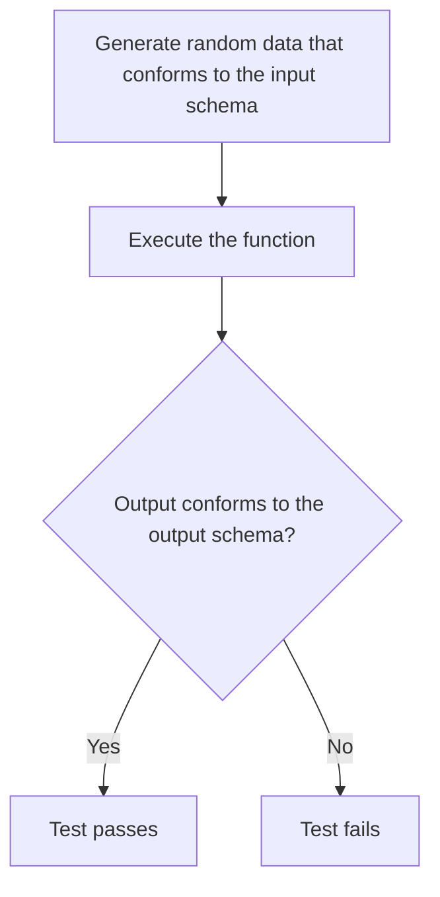

# 12. Advanced data validation

[← 11. Web services](11-web-services.md) · [Book](../README.md) · [13. Polymorphism →](13-polymorphism.md)

## Summary

Part 3 starts a month later, in the maintenance phase. Monica assigns Dave to Klafim, and Joe asks Theo to mentor him: "Knowledge is never complete," and DOP is simple enough to be fertile ground for invention (pp. 245–246). Dave's first tasks go well, but as the code base grows, functions that receive and return only generic data are hard to use. It's unclear what shape an argument should have, and invalid data gives no meaningful error (pp. 247–248).

The fix is the same separation of schema and representation as at the boundaries, now applied to **function arguments and return values** (pp. 248–257):

- **Arguments** are validated as a tuple, using `prefixItems`.
- **Indexes** are validated as homogeneous maps, using `additionalProperties` with a schema.
- **The checks** run only in development, guarded by a `dev()` flag, like Java assertions.

Because validation runs on the data itself at run time, it goes **beyond static types**: number ranges, regular expressions with `pattern`, and predefined formats such as `date` (pp. 257–260). Joe adds two bonuses (pp. 260–268):

- **Generated data model diagrams:** Malli turns the schema into PlantUML.
- **Schema-based unit tests:** JSON Schema Faker generates random valid arguments, and the function's own return-value check acts as the assertion. It catches a real bug, where an author missing from the index produces `undefined` names.

Dave returns the favour with his own gift, an advanced JSON Schema cheat sheet (pp. 269–270).

## Key takeaways

- **Validation inside the system is for ease of development** (dev, testing, staging); at the boundaries it is a guardian in production (table 12.1, p. 248).
- **Disable it in production**: boundary data was already validated, so revalidating on every call is superfluous and costs performance (pp. 254–255).
- **Treat data validation like unit tests:** validate the arguments of the functions you'd write unit tests for, not every function (p. 255).
- **Arguments are a tuple**: an array of fixed size whose elements have different shapes, written with `prefixItems` (pp. 253–254).
- **Homogeneous string maps** (indexes) are `type: object` with no `properties` and `additionalProperties` set to a schema (pp. 252–253).
- **Store nested schemas in variables** to keep complex schemas readable (p. 252).
- **Beyond static types:** `minimum`/`maximum`, `pattern` and `format`. Static types are checked at compile time with only type information; schemas are checked at run time against the data itself (pp. 257–258).
- **Schemas generate diagrams and tests**: Malli with PlantUML for diagrams, JSON Schema Faker for random valid inputs (pp. 260–268).

## Section outline

*From the book’s own table of contents (PDF bookmarks); printed page numbers.*

- 12.1 Function arguments validation — p. 248
- 12.2 Return value validation — p. 255
- 12.3 Advanced data validation — p. 257
- 12.4 Automatic generation of data model diagrams — p. 260
- 12.5 Automatic generation of schema-based unit tests — p. 262
- 12.6 A new gift — p. 269
- Summary — p. 270

## Notes

Dave's first tasks are three new HTTP endpoints: download the catalog as CSV, search books by author, and rate books (p. 248). He validated every request, database query and external response at the boundaries. Production works well, but during development he can't tell what shape a function's arguments should have, and mistakes give unclear errors (p. 248).

| Kind of validation | Purpose | Environment (table 12.1, p. 248) |
|---|---|---|
| Boundaries | Guardian | Production |
| Inside | Ease of development | Dev |

### 12.1 Function arguments validation

The example is the in-memory `Catalog.searchBooksByTitle(catalogData, query)`. It's more interesting than the database version, because it receives the catalog as well as the query (listing 12.1, pp. 249–250). `query` is a string; `catalogData` follows the catalog data model of figure 12.1 (p. 250). Theo hands Dave Joe's cheat sheet, by now "well-worn," "a bit torn and quite wrinkled" (p. 250).

The schemas build up in four steps:

| Schema | Points of interest |
|---|---|
| `authorSchema` (listing 12.3, p. 251) | `id`, `name`, `bookIsbns` all required |
| `bookItemSchema`, `bookSchema` (listing 12.4, pp. 251–252) | Nested schema stored in a variable; `publicationYear` not required, since some books lack it, which is easier than nullable class members |
| `catalogSchema` (listing 12.6, p. 253) | `booksByIsbn` and `authorsById` are indexes: `{"type": "object", "additionalProperties": bookSchema}` |
| `searchBooksArgsSchema` (listing 12.8, p. 254) | A tuple: `{"type": "array", "prefixItems": [catalogSchema, {"type": "string"}]}` |

**Homogeneous maps.** Records are heterogeneous maps: known field names, differently shaped values. Indexes are homogeneous maps: unknown field names, values of a common shape (p. 252). `additionalProperties` is usually a Boolean, but it can also be a schema that properties not mentioned in the schema must satisfy. A homogeneous map is then a map with no predefined properties, whose additional properties all conform (listing 12.5, pp. 252–253).

**Plugging it in** (listing 12.9, pp. 254–255): at the top of the function, `if (dev()) { validate([catalogData, query]) }`, throwing "searchBooksByTitle called with invalid arguments: …" with the error text. `dev()` returns true in every environment except production, including testing and staging. Dave compares it to Java assertions, which are disabled in production (p. 255).

> **Try it:** [Validation inside the system](../widgets/12-dev-validation.html) — call `searchBooksByTitle` with valid and broken catalogs and queries, toggle `dev()`, and see the argument and return-value checks report, or skip, each mistake.

### 12.2 Return value validation

The return value is an array of book infos with `title`, `isbn` and `authorNames`, all required (listing 12.10, p. 256). Listing 12.11 checks it at the end of the function, also only in dev, throwing "searchBooksByTitle returned an invalid value: …" (pp. 256–257).

### 12.3 Advanced data validation

"Be courageous, go beyond types" (p. 257). The new constraints (pp. 257–260):

| Constraint | Schema | Listing |
|---|---|---|
| A publication year after 1900 and no later than the current year | `{"type": "integer", "minimum": 1900, "maximum": 2021}` | 12.12 |
| A book item ID that is a UUID | `{"type": "string", "pattern": "[0-9a-fA-F]{8}-…-[0-9a-fA-F]{12}"}` | 12.13–12.14 |
| A purchase date | `{"type": "string", "format": "date"}` | 12.15 |
| ISBN, library ID, author ID | Simplified regular expressions, such as `^[0-9-]{10,20}$` for ISBNs | 12.16 |

Why isn't this possible with OOP types? Dave works it out. Static type checking runs at compile time, with only type information; DOP's validation runs at run time, with the data itself, so it can go beyond types (p. 257). The book notes that OOP code can of course do custom run-time validation; the comparison is between schemas and static types. Also, according to the JSON Schema specification, `format` is only an annotation, but in practice validation libraries use it to validate (p. 258). Listings 12.16–12.17 assemble the refined catalog schema (pp. 259–260).

> **Vault note:** in listing 12.16 the refined `bookItemSchema` puts its field schemas under `additionalProperties` instead of `properties`, and listing 12.17 uses it directly for `bookItems` instead of as an array's `items`. As printed, `bookItems` becomes a map of anything, which is why the generated data in listing 12.20 has `bookItems` as an object with keys like `"ullamco5"`. The refined `authorSchema` also leaves out `"type": "array"` for `bookIsbns` (pp. 259–260). The widget and the lab use the intended schema.

### 12.4 Automatic generation of data model diagrams

The next day Joe visits. Dave admits that schemas are less convenient than writing a class for function arguments, but going beyond static types makes up for it. Theo adds that not every function needs validation (p. 260). Joe's first trick: tools turn a JSON Schema into a plain-text data model format, which can then be rendered as an image. Joe's favourite format is **PlantUML**; he has also used JSON Schema Viewer and Malli (p. 260). Malli generates PlantUML from the catalog schema (listing 12.18, p. 261), and pasting it into PlantText renders figure 12.2 (pp. 261–262).

Two limitations (p. 262):

- **The entities are named `Entity1`, `Entity2`, …**, because a JSON Schema has no way to name a schema.
- **The extra constraints aren't shown**, such as the year range and the ISBN pattern, because they aren't part of the data model.

### 12.5 Automatic generation of schema-based unit tests

Once a function has schemas for its arguments and return value, a unit test is mechanical (p. 263):

*Redrawn from figure 12.3 (p. 263).*

**JSON Schema Faker** generates conforming data. It gives a different UUID on each call (listing 12.19), and a long random catalog for the catalog schema (listing 12.20, pp. 263–265). From the odd ISBNs it produces, Joe sees that the regular expressions have bugs: "I hate regular expressions!" says Dave (p. 265).

The test evolves over four listings (pp. 265–268):

1. **Call the function** with generated arguments. There's no explicit assertion, because the function's own dev-mode return check throws (listings 12.21–12.22).
2. **Return true or false**, catching the exception (listing 12.23).
3. **Make the query match:** use the first letter of the first generated book's title, so the search finds at least one book. Joe says random data seldom needs such tweaking (listing 12.24).
4. **Log the error** when the test fails (listings 12.25–12.27).

The log reveals the bug. The random catalog's books cite authors that aren't in `authorsById`, so `authorNames` contains `undefined` where the schema expects strings. Dave's fix passes a default to `_.get`, `"Not available"`, and the test passes (listings 12.28–12.29, p. 268).

> **Try it:** [Schema-based tests](../widgets/12-schema-based-test.html) — generate random catalogs from the schema with a seed, run the search, watch the return-value check fail on missing authors, then apply Dave's fix and rerun.

Dave still misses one OOP feature: autocompletion of field names. Joe says it exists only in Clojure, via clj-kondo's integration with Malli. IntelliJ and Visual Studio Code already validate JSON files against JSON Schemas, so he expects function-argument support to follow (pp. 268–269).

> **Run it:** the [schema-based testing experiment](../lab/12-schema-based-tests/README.md) generates seeded random catalogs from the chapter's schema, runs the search with return-value validation, and counts how often the original and fixed versions fail.

### 12.6 A new gift

Dave makes his own **advanced JSON Schema cheat sheet**, wrapped in a light blue ribbon and decorated with little computers on one side and keyboards and mice on the other (p. 269). It adds to Joe's (listings 12.30–12.31, pp. 269–270):

- An integer range: `myAge`, 0 to 120.
- A date format: `myBirthday`.
- A pattern: `myLetters`, `[a-zA-Z]*`.
- A homogeneous map: `myNumberMap`, via `additionalProperties`.
- A tuple: `myTuple`, via `prefixItems`.

## Trade-offs at a glance

| Choice | Benefit | Cost |
|---|---|---|
| Static types (OOP) | Compile-time checking; IDE autocompletion (p. 268) | Only type information; no ranges or patterns |
| Argument and return schemas (DOP) | Documents shapes; meaningful errors; beyond types | Less convenient than a class (p. 260); maintained by hand |
| Validate in dev only | No production cost (p. 255) | Production relies on boundary validation alone |
| Validate every function | Maximum coverage | Superfluous; the book validates only functions you'd unit test (p. 255) |
| Generated diagrams | Always in sync with the schema | Anonymous entity names; constraints hidden (p. 262) |
| Generated tests | Find bugs on inputs nobody wrote (p. 268) | Random data may need tweaks; the schemas themselves can be wrong (p. 265) |

## Beyond the book

- **Tuples need a length.** `prefixItems` constrains the first elements, but a three-element array still validates unless the schema adds `"items": false` (or `maxItems: 2`) and `minItems: 2`. For argument checking, that catches a caller passing an extra argument.
- **Anchor your patterns.** JSON Schema's `pattern` matches anywhere in the string unless anchored. The UUID pattern in listing 12.14 and the author-ID pattern `[a-z-]{2,50}` accept any string that *contains* a match, so `"!!!ab"` passes the latter. Wrapping them in `^…$` makes them mean what they say.
- **Formats in Ajv.** Since Ajv v7, `format` validation comes from a separate package, `ajv-formats`; without it, Ajv either ignores unknown formats or fails at compile time, depending on its options. That is the practical side of the book's note that `format` is officially just an annotation.
- **Property-based testing, again.** The schema-based test is property-based testing with the property "output conforms to the output schema." Tools like fast-check and Hypothesis add *shrinking*: when a random input fails, they search for the smallest failing input, here likely a catalog with one book and one missing author.
- **Clojure's spec and Malli** take the same approach natively. `instrument` checks function arguments in development, generators come from the specs, and tooling such as clj-kondo reads the schemas for editor feedback, the autocompletion Dave misses.
- **Hard-coded years age badly.** `"maximum": 2021` will reject new books from 2022 onward. A schema can't express "the current year," so it's usually generated at startup or checked in code.

## Connections

- **Boundary validation and the first cheat sheet:** [7. Basic data validation](07-basic-data-validation.md).
- **Unit tests by hand:** [6. Unit tests](06-unit-tests.md); this chapter generates them from schemas.
- **Records and indexes:** the heterogeneous vs homogeneous maps of [3. Basic data manipulation](03-basic-data-manipulation.md), now expressed in JSON Schema.
- **Next:** [13. Polymorphism](13-polymorphism.md).
- **Run it:** [Schema-based tests](../lab/12-schema-based-tests/README.md) — seeded random catalogs, return-value validation, and the `"Not available"` fix.

## Check yourself

1. How does validation inside the system differ from validation at the boundaries?
   

Answer
At the boundaries it is a guardian that keeps invalid data out in production. Inside, it eases development by making argument shapes explicit and giving meaningful errors, and it runs only outside production (table 12.1, pp. 248, 254–255).

2. Why disable inside validation in production?
   

Answer
The data was already validated at a system boundary, so validating it again on every call is superfluous and hurts performance (pp. 254–255).

3. How do you write the schema of a homogeneous string map, such as `booksByIsbn`?
   

Answer
`{"type": "object", "additionalProperties": bookSchema}`: no predefined properties, and every additional property must conform to the value schema (pp. 252–253).

4. How are a function's arguments described in JSON Schema?
   

Answer
As a tuple, an array whose elements have different shapes, using `prefixItems`, for example `[catalogSchema, {"type": "string"}]` for `searchBooksByTitle` (pp. 253–254).

5. Why can schemas go "beyond static types"?
   

Answer
They're checked at run time against the actual data, while static types are checked at compile time with only type information. So ranges (`minimum`/`maximum`), regular expressions (`pattern`) and formats (`date`) are possible (pp. 257–258).

6. Describe the flow of a schema-based unit test, and the bug it found.
   

Answer
Generate random arguments that conform to the input schema, run the function, and check that the output conforms to the output schema (figure 12.3). It found that authors missing from `authorsById` gave `undefined` author names; the fix returns `"Not available"` by default (pp. 263–268).

7. Why does the generated PlantUML diagram name its entities `Entity1`, `Entity2`, …?
   

Answer
JSON Schema has no way to give a schema a name, so Malli has to generate names (p. 262).

