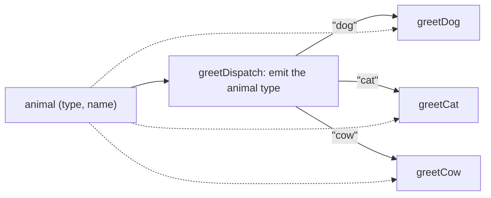

# 13. Polymorphism

[← 12. Advanced data validation](12-advanced-data-validation.md) · [Book](../README.md) · [14. Advanced data manipulation →](14-advanced-data-manipulation.md)

## Summary

Dave misses another OOP feature, polymorphism. On a day at his parents' house in the countryside, he and Theo distill what it is for: **extensibility**, adding a new case without changing existing code. A `switch` on a `type` field gives different behaviours but fails that test (pp. 273–277).

DOP gets polymorphism without objects through **multimethods** (pp. 277–281):

- **A dispatch function** defines the signature, validates the arguments and emits a dispatch value.
- **A set of methods** provide one implementation per dispatch value.
- **Method declarations are decoupled** from the multimethod's initialization, just as classes are from an interface, so new cases can live in other modules.
- **A default method** handles unknown dispatch values.

Because the dispatch function can emit *any* value, multimethods go beyond OOP (pp. 281–288):

- **Single dispatch** emits an argument's `type` field, mimicking class-based polymorphism.
- **Multiple dispatch** emits a value built from several arguments: an animal's type and a language's type.
- **Dynamic dispatch** emits a value computed at run time: whether the animal's name is long.

Joe lists multimethod libraries for Python, Ruby, Java and C# (p. 289). Back at the office, Dave uses a multimethod for a real feature: author names formatted in HTML or Markdown, in italic, bold or both, depending on how many books the author wrote (pp. 289–293).

## Key takeaways

- **The main benefit of polymorphism is extensibility** (p. 277).
- **A multimethod = a dispatch function + methods.** The arguments go to both (pp. 277–278).
- **The dispatch function does three things:** defines the signature, validates the arguments, emits a dispatch value (p. 279).
- **Internally it's a hash map** from dispatch values to methods; calling the multimethod looks up the dispatched value (p. 280).
- **Multimethods are called like regular functions**, and support a default implementation (pp. 280–281).
- **Multiple dispatch**: the value depends on several arguments, and the order of its elements must match the methods' wiring (p. 285).
- **Dynamic dispatch**: the value goes beyond the arguments' static types, such as a number or a Boolean (p. 286).
- **Libraries differ** in whether they work with generic data structures: JavaScript, Python and Ruby libraries do; Java's and C#'s don't (p. 289).

## Section outline

*From the book’s own table of contents (PDF bookmarks); printed page numbers.*

- 13.1 The essence of polymorphism — p. 273
- 13.2 Multimethods with single dispatch — p. 277
- 13.3 Multimethods with multiple dispatch — p. 281
- 13.4 Multimethods with dynamic dispatch — p. 286
- 13.5 Integrating multimethods in a production system — p. 289
- Summary — p. 294

## Notes

The chapter shows three kinds of polymorphism, all with the same running example of animals that greet by making a sound and saying their name (p. 273). The animals are maps with `type` and `name` (listing 13.3, p. 275):

| Map | `type` | `name` |
|---|---|---|
| `myDog` | `"dog"` | `"Fido"` |
| `myCat` | `"cat"` | `"Milo"` |
| `myCow` | `"cow"` | `"Clarabelle"` |

### 13.1 The essence of polymorphism

In OOP, Dave defines an `IAnimal` interface with a `greet` method, implemented by `Dog`, `Cat` and `Cow` (listing 13.1, p. 274). Polymorphism, he says, decouples an interface from its implementations (p. 273). Theo challenges him: what's the fundamental difference with a `switch` on `animal.type`? (listing 13.2, p. 274)

Dave's objections, and Theo's answers:

| Objection | Theo's fix |
|---|---|
| An invalid map breaks `greet` | Validate with `animalSchema` (listing 13.4, p. 275) |
| Changing one animal's greeting means editing code for all animals | One function per animal, called from the switch (listing 13.5, p. 276) |
| Adding a new animal means modifying the original code | No fix: a switch can't do that, while OOP can add a class (p. 277) |

So the real benefit is the third one, extensibility (p. 277). The book adds that switch statements like these shouldn't be used in production; they're only a didactic step (p. 276). Theo asks Joe, who's about to give a talk at a tech conference, and gets one hint: look at multimethods (p. 277).

> **Vault note:** the Java in listing 13.1 refers to `animal.name` inside each class, where only `name` (or `this.name`) is in scope, so it wouldn't compile as printed (p. 274).

### 13.2 Multimethods with single dispatch

A multimethod has a **dispatch function** and **a set of methods** (p. 277). For `greet`, `greetDispatch` emits the animal's type, and each value is handled by `greetDog`, `greetCat` or `greetCow` (figure 13.1, p. 278):

*Redrawn from figure 13.1 (p. 278). The dotted arrows show that the arguments also reach the methods.*

The example uses the JavaScript **arrows/multimethod** library: `multi` creates a multimethod, `method` adds a method (p. 278).

| Step | Code | Listing |
|---|---|---|
| Initialization | `var greet = multi(greetDispatch);`, where `greetDispatch` validates `animal` in dev and returns `animal.type` | 13.6, pp. 278–279 |
| Method declaration | `greet = method("dog", greetDog)(greet);` | 13.7, p. 279 |
| More methods | the same for `"cat"` and `"cow"` | 13.8–13.9, pp. 279–280 |
| Call | `greet(myDog)` → `"Woof woof! My name is Fido"` | 13.10, p. 280 |
| Default | `greet = method(greetDefault)(greet);` with no dispatch value; `greet(myHorse)` → `"My name is Horace"` | 13.11–13.12, p. 281 |

Points from the dialogue (pp. 279–281):

- **Method declarations needn't be in the same module** as the initialization. That decoupling is what makes multimethods extensible.
- **Naming convention:** the multimethod's name as prefix, `Dispatch` as the dispatch function's suffix, a specific suffix per method. Names aren't important to the mechanism.
- **Under the hood**, a hash map from dispatched values to methods.
- **Validation in the dispatch function** is a best practice, not mandatory. Without a matching method or default, the library throws a `NoMethodError`.

> **Try it:** [Multimethod dispatch](../widgets/13-multimethod-dispatch.html) — pick an animal, a language and a name, switch between single, multiple and dynamic dispatch, and watch the dispatch value being looked up in the method table; add a new animal's method or a default without touching the others.

### 13.3 Multimethods with multiple dispatch

Dave's general diagram makes the point: the dispatch function can emit **any value**, for example the types of two arguments (figure 13.2, pp. 281–282). Theo makes the animals polyglot. Languages are maps too, `{type: "fr", name: "Français"}` and `{type: "en", name: "English"}`, with their own schema (listings 13.13–13.14, p. 282).

`greetLangDispatch(animal, language)` validates both arguments as a tuple with `prefixItems` and returns `[animal.type, language.type]` (listing 13.15, pp. 283–284). Three animals times two languages give six methods, such as `method(["dog", "fr"], greetLangDogFr)` (figure 13.3; listing 13.16, pp. 283–285). The French methods use French onomatopoeia, "Ouaf Ouaf", "Miaou" and "Meuh" (p. 285).

| Call (listing 13.17, pp. 285–286) | Output |
|---|---|
| `greetLang(myDog, french)` | "Ouaf Ouaf! Je m'appelle Fido et je parle Français" |
| `greetLang(myCat, english)` | "Meow! I am Milo and I speak English" |
| `greetLang(myCow, french)` | "Meuh! Appelle moi Clarabelle et je parle Français" |

The order of the elements in the dispatch array doesn't matter, but it must be consistent with the wiring of the methods (pp. 284–285). Dave agrees that this is more powerful than OOP polymorphism (p. 286).

### 13.4 Multimethods with dynamic dispatch

**Dynamic dispatch** is when the dispatch function returns a value that goes beyond its arguments' static types, such as a number or a Boolean (p. 286). Theo invents *dysmakrylexia*, difficulty pronouncing long words: animals whose name has more than five letters can't say it (p. 286).

`dysGreetDispatch` returns `[animal.type, animal.name.length > 5]` (listing 13.18, p. 287), with six methods: the `true` ones mention the name, the `false` ones only make the sound (figure 13.4; listing 13.19, pp. 287–288). In listing 13.20, Fido and Milo say only "Woof woof!" and "Meow!", while Clarabelle says "Moo! Call me Clarabelle" (p. 288).

> **Vault note:** the dispatch box in figure 13.4 is labelled with figure 13.3's text (`dysGreetLangDispatch`, "animal, language", "Emit the animal and the language types"), though `dysGreet` takes only an animal and emits its type and whether the name is long. Note also the inversion: a *long* name is the case that *mentions* the name (pp. 287–288).

Joe's email on multimethods in other languages (p. 289):

| Language | Library | Generic data structures |
|---|---|---|
| JavaScript | arrows/multimethod | Yes |
| Java | Java Multimethod Framework | No |
| C# | Native, via `dynamic` | No |
| Python | multimethods | Yes |
| Ruby | Ruby multimethods | Yes |

### 13.5 Integrating multimethods in a production system

Nancy calls with a "tiny" feature. Since the DOP refactoring, tiny usually is easy (p. 289). Librarians should see authors, ordered by last name, in **HTML** or **Markdown**, with names formatted by how many books they've written (table 13.1, p. 290):

| Number of books | Prolificity level | Italic | Bold | HTML | Markdown |
|---|---|---|---|---|---|
| 10 or fewer | `low` | Yes | No | `<i>…</i>` | `*…*` |
| 11 to 50 | `medium` | No | Yes | `<b>…</b>` | `**…**` |
| 51 or more | `high` | Yes | Yes | `<b><i>…</i></b>` | `***…***` |

Theo delegates it to Dave, who sees it as dysmakrylexia again, with the length of an array instead of a string (p. 290). He represents a format as a plain string, `"markdown"` or `"html"`, rather than a map (p. 290), and builds `Author.myName` (pp. 291–293):

1. **A helper**, `Author.prolificityLevel(author)`, counts `bookIsbns` with `_.size` and returns `"low"`, `"medium"` or `"high"` (listing 13.23).
2. **The dispatch function** validates `[author, format]` and returns `[Author.prolificityLevel(author), format]` (listing 13.23).
3. **Six methods**, one per level and format (listings 13.25 and 13.27).

Testing with "a mysterious author," Yehonathan Sharvit, with the ISBN of a data-oriented programming book, gives `"<i>Yehonathan Sharvit</i>"` and `"*Yehonathan Sharvit*"` (listings 13.28–13.29, p. 293).

> **Try it:** [Author names by prolificity](../widgets/13-author-name.html) — drag the number of books across the 10/11 and 50/51 boundaries and switch formats to see the dispatch value, the chosen method and the rendered name.

> **Vault note:** listing 13.21's `textFormatSchema` isn't a valid schema for a string (it lists `name` and `type` as if they were properties, with no `"type"` or `"properties"`); the args schema in listing 13.23 uses `{"enum": ["markdown", "html"]}` instead. Listing 13.24 also shows `<i>Yehonathan Sharvit<i>` without the closing slash (pp. 290–292).

## Trade-offs at a glance

| Approach | Extensible without editing? | Dispatch on | Works on generic maps? |
|---|---|---|---|
| `switch` on `type` | No (p. 277) | One field | Yes |
| OOP interface | Yes, add a class | The receiver's class | No, needs classes |
| Single-dispatch multimethod | Yes, add a method | One argument's value | Yes |
| Multiple-dispatch multimethod | Yes | Several arguments' values (p. 285) | Yes |
| Dynamic-dispatch multimethod | Yes | Any computed value (p. 286) | Yes |

## Beyond the book

- **Clojure has multimethods built in.** `defmulti` names the dispatch function, `defmethod` adds methods, `:default` is the fallback, and hierarchies (`derive`, `isa?`) let a method handle a family of values, which a plain hash-map lookup can't.
- **The expression problem.** Philip Wadler's name for the tension Dave and Theo uncover: OOP makes it easy to add types (classes) but hard to add operations; a switch makes it easy to add operations but hard to add types. Multimethods, like Clojure's protocols, let you add both without editing existing code.
- **Python's `functools.singledispatch`** dispatches on the class of the first argument, so it gives single dispatch on types, not on values in a map. Dispatching on a value from a dict needs a library like the one Joe mentions, or a hand-rolled dict of functions.
- **Ambiguity grows with multiple dispatch.** With exact-match dispatch values, as in the book, there's no ambiguity. Systems with inheritance among dispatch values (CLOS, Julia, Clojure hierarchies) must decide which method is "more specific", and may need tie-breaking rules such as Clojure's `prefer-method`.
- **Pattern matching** (`match` in Python 3.10+, Scala, Rust) is a modern, closed alternative to the switch: concise and exhaustively checked in some languages, but still not open to extension from another module.

## Connections

- **The argument tuple schema** comes from [12. Advanced data validation](12-advanced-data-validation.md).
- **Why data is generic maps** in the first place: [3. Basic data manipulation](03-basic-data-manipulation.md).
- **Next:** [14. Advanced data manipulation](14-advanced-data-manipulation.md).
- **Run it:** [Multimethods from scratch](../lab/13-multimethods/README.md) — a tiny `multi`/`method` in Python, with single, multiple and dynamic dispatch, a default method, and the author-name boundaries.

## Check yourself

1. Why isn't a `switch` on `animal.type` enough, even with validation and one function per animal?
   

Answer
Adding a new animal still requires modifying the original code. The main benefit of polymorphism is extensibility, which the switch lacks (pp. 276–277).

2. What are the three responsibilities of a multimethod's dispatch function?
   

Answer
Defining the signature of the multimethod, validating the arguments, and emitting a dispatch value (p. 279).

3. What makes multimethods extensible?
   

Answer
Method declarations are decoupled from the multimethod's initialization, so a method for a new dispatch value can be added anywhere, even in another module, without changing existing code (p. 279).

4. How does a multimethod work under the hood?
   

Answer
It keeps a hash map from dispatch values to methods. Adding a method adds an entry; calling the multimethod runs the dispatch function and looks up its value (p. 280).

5. What happens if no method matches the dispatch value?
   

Answer
The default implementation runs if one was declared, by passing a single function to `method`; otherwise the arrows/multimethod library throws a `NoMethodError` (pp. 280–281).

6. What's the difference between multiple dispatch and dynamic dispatch?
   

Answer
Multiple dispatch: the dispatch value depends on several arguments, such as `[animal.type, language.type]`. Dynamic dispatch: the value goes beyond the arguments' static types, such as a Boolean computed from the name's length (pp. 285–287).

7. Which method handles an author with exactly 11 books, in Markdown? With 51?
   

Answer
11 books is `medium`, so `authorNameMediumMarkdown`, giving `**name**`; 51 is `high`, giving `***name***` (table 13.1; listings 13.23, 13.27).

