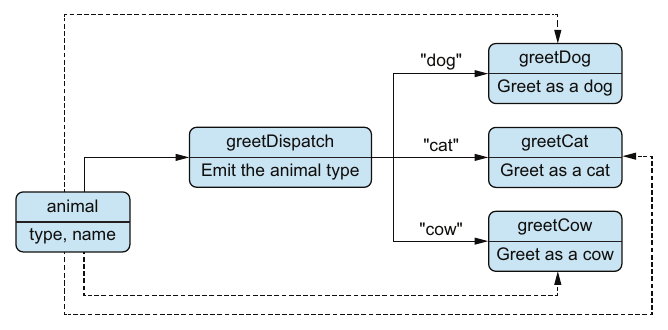

# ۱۳. polymorphism

[← ۱۲. اعتبارسنجی پیشرفته‌ی داده](12-advanced-data-validation.md) · [کتاب](../README.md) · [۱۴. دست‌کاری پیشرفته‌ی داده →](14-advanced-data-manipulation.md)

## خلاصه

دیو ویژگی دیگری از OOP را دلش می‌خواهد، یعنی polymorphism. روزی در خانه‌ی پدرومادرش در حومه، او و تئو چکیده می‌کنند که polymorphism برای چیست: **گسترش‌پذیری**، یعنی افزودن موردی تازه بی عوض کردن کد موجود. یک `switch` روی فیلد `type` رفتارهای مختلف می‌دهد ولی آن سنجش را رد نمی‌کند (pp. 273–277).

روش DOP polymorphism را بی شیء از راه **multimethod** به دست می‌آورد (pp. 277–281):

- **تابعی توزیع‌کننده** امضا را تعریف می‌کند، آرگومان‌ها را اعتبارسنجی، و مقداری توزیعی می‌دهد.
- **مجموعه‌ای از متدها** برای هر مقدار توزیعی یک پیاده‌سازی می‌دهند.
- **اعلام متدها از راه انداختن multimethod جداست**، همان‌طور که کلاس‌ها از interfaceی جدایند، پس موردهای تازه می‌توانند در ماژول‌های دیگر بنشینند.
- **متدی پیش‌فرض** مقدارهای توزیعی ناشناس را می‌چرخاند.

چون آن تابع توزیع‌کننده می‌تواند *هر* مقداری بدهد، multimethodها از OOP فراتر می‌روند (pp. 281–288):

- **توزیع یگانه** فیلد `type` آرگومانی را می‌دهد، که polymorphism کلاس‌محور را تقلید می‌کند.
- **توزیع چندگانه** مقداری ساخته از چند آرگومان می‌دهد: گونه‌ی جانوری و گونه‌ی زبانی.
- **توزیع پویا** مقداری می‌دهد که سر اجرا حساب شده: اینکه نام جانور درازست یا نه.

جو کتابخانه‌های multimethod را برای Python و Ruby و Java و C# فهرست می‌کند (p. 289). در دفتر، دیو multimethodی را برای ویژگی‌ای واقعی به کار می‌برد: نام نویسنده‌ها که به HTML یا Markdown و به‌شکل ایتالیک یا توپر یا هر دو قالب می‌گیرند، بسته به آنکه آن نویسنده چند کتاب نوشته (pp. 289–293).

## نکته‌های کلیدی

- **سود اصلی polymorphism گسترش‌پذیری است** (p. 277).
- **هر multimethodی یک تابع توزیع‌کننده به‌علاوه‌ی متدهاست.** آرگومان‌ها به هر دو می‌روند (pp. 277–278).
- **آن تابع توزیع‌کننده سه کار می‌کند:** امضا را تعریف می‌کند، آرگومان‌ها را اعتبارسنجی، و مقداری توزیعی می‌دهد (p. 279).
- **درونش hash mapی است** از مقدارهای توزیعی به متدها؛ و صدا زدن آن multimethod مقدار توزیع‌شده را بالا می‌کشد (p. 280).
- **همه‌ی multimethodها مانند تابع‌های معمولی صدا زده می‌شوند**، و از پیاده‌سازی پیش‌فرض پشتیبانی می‌کنند (pp. 280–281).
- **توزیع چندگانه**: آن مقدار به چند آرگومان بسته است، و ترتیب عضوهایش باید با سیم‌کشی متدها بخواند (p. 285).
- **توزیع پویا**: آن مقدار از گونه‌های ایستای آرگومان‌ها فراتر می‌رود، مانند عددی یا بولی (p. 286).
- **کتابخانه‌ها فرق دارند** در اینکه با ساختارهای داده‌ی عمومی کار می‌کنند یا نه: کتابخانه‌های JavaScript و Python و Ruby می‌کنند؛ و مال Java و C# نه (p. 289).

## فهرست بخش‌ها

*از فهرست خود کتاب، یعنی bookmarkهای PDF؛ شماره‌ی صفحه‌ها چاپی‌اند.*

- ۱۳.۱ چکیده‌ی polymorphism — ص. ۲۷۳
- ۱۳.۲ multimethodها با توزیع یگانه — ص. ۲۷۷
- ۱۳.۳ multimethodها با توزیع چندگانه — ص. ۲۸۱
- ۱۳.۴ multimethodها با توزیع پویا — ص. ۲۸۶
- ۱۳.۵ درهم کردن multimethodها در سیستمی production — ص. ۲۸۹
- خلاصه — ص. ۲۹۴

## یادداشت‌ها

فصل سه گونه polymorphism را نشان می‌دهد، همه با همان یک مثال جاری از جانورانی که با صدا در آوردن و گفتن نامشان سلام می‌کنند (p. 273). جانوران mapاند با `type` و `name` (listing ۱۳.۳، ص. ۲۷۵):

| map | `type` | `name` |
|---|---|---|
| `myDog` | `"dog"` | `"Fido"` |
| `myCat` | `"cat"` | `"Milo"` |
| `myCow` | `"cow"` | `"Clarabelle"` |

### ۱۳.۱ چکیده‌ی polymorphism

در OOP، دیو interfaceی `IAnimal` با متد `greet` تعریف می‌کند، که کلاس‌های `Dog` و `Cat` و `Cow` پیاده‌اش می‌کنند (listing ۱۳.۱، ص. ۲۷۴). می‌گوید polymorphism interfaceی را از پیاده‌سازی‌هایش جدا می‌کند (p. 273). تئو به چالشش می‌کشد: تفاوت بنیادینش با یک `switch` روی `animal.type` چیست؟ (listing ۱۳.۲، ص. ۲۷۴)

ایرادهای دیو و پاسخ‌های تئو:

| ایراد | چاره‌ی تئو |
|---|---|
| mapی نامعتبر تابع `greet` را می‌شکند | با `animalSchema` اعتبارسنجی کنید (listing ۱۳.۴، ص. ۲۷۵) |
| عوض کردن سلام یک جانور یعنی ویرایش کد همه‌ی جانوران | یک تابع برای هر جانوری، که از آن switch صدا زده شود (listing ۱۳.۵، ص. ۲۷۶) |
| افزودن جانوری تازه یعنی دست‌کاری کد اصلی | بی چاره: switch نمی‌تواند چنین کند، در حالی که OOP می‌تواند کلاسی بیفزاید (p. 277) |

پس سود واقعی همان سومی است، یعنی گسترش‌پذیری (p. 277). کتاب می‌افزاید که switchهایی مانند این‌ها در production نباید به کار روند؛ تنها قدمی آموزشی‌اند (p. 276). تئو از جو می‌پرسد، که سر سخنرانی در کنفرانسی فنی است، و یک نشانه می‌گیرد: به multimethodها نگاه کن (p. 277).

> **Vault note:** کد Java در listing ۱۳.۱ درون هر کلاسی به `animal.name` ارجاع می‌دهد، جایی که تنها `name` یا `this.name` در دامنه است، پس همان‌طور که چاپ شده کامپایل نمی‌شد (p. 274).

### ۱۳.۲ multimethodها با توزیع یگانه

هر multimethodی یک **تابع توزیع‌کننده** و **مجموعه‌ای از متدها** دارد (p. 277). برای `greet`، تابع `greetDispatch` گونه‌ی جانور را می‌دهد، و هر مقداری را یکی از `greetDog` یا `greetCat` یا `greetCow` می‌چرخاند (شکل ۱۳.۱، ص. ۲۷۸):

*Figure 13.1 (p. 278): آن تابع توزیع‌کننده تنها متدی را برمی‌گزیند؛ و آرگومان‌ها دست‌نخورده به متد برگزیده می‌روند.*

مثال از کتابخانه‌ی **arrows/multimethod** در JavaScript کار می‌کشد: تابع `multi` یک multimethod می‌سازد، و `method` متدی می‌افزاید (p. 278).

| قدم | کد | نمونه |
|---|---|---|
| راه انداختن | عبارت `var greet = multi(greetDispatch);`، که در آن `greetDispatch` مقدار `animal` را در dev اعتبارسنجی و `animal.type` را برمی‌گرداند | ۱۳.۶، صص. ۲۷۸–۲۷۹ |
| اعلام متد | عبارت `greet = method("dog", greetDog)(greet);` | ۱۳.۷، ص. ۲۷۹ |
| متدهای بیشتر | همان برای `"cat"` و `"cow"` | ۱۳.۸ و ۱۳.۹، صص. ۲۷۹–۲۸۰ |
| صدا زدن | عبارت `greet(myDog)` که `"Woof woof! My name is Fido"` می‌دهد | ۱۳.۱۰، ص. ۲۸۰ |
| پیش‌فرض | عبارت `greet = method(greetDefault)(greet);` بی هیچ مقدار توزیعی؛ و `greet(myHorse)` که `"My name is Horace"` می‌دهد | ۱۳.۱۱ و ۱۳.۱۲، ص. ۲۸۱ |

نکته‌هایی از گفت‌وگو (pp. 279–281):

- **اعلام متدها لازم نیست در همان ماژول** راه انداختن باشد. همان جدایی است که multimethodها را گسترش‌پذیر می‌کند.
- **عرف نام‌گذاری:** نام آن multimethod به‌شکل پیشوند، واژه‌ی `Dispatch` به‌شکل پسوند تابع توزیع‌کننده، و پسوندی ویژه برای هر متدی. نام‌ها برای آن سازوکار مهم نیستند.
- **زیر کاپوت**، hash mapی از مقدارهای توزیع‌شده به متدها.
- **اعتبارسنجی در تابع توزیع‌کننده** بهترین روش است، نه اجباری. بی متدی خورنده یا پیش‌فرضی، آن کتابخانه خطای `NoMethodError` می‌اندازد.

> **Try it:** [توزیع multimethod](../widgets/13-multimethod-dispatch.html) — جانوری و زبانی و نامی برگزینید، میان توزیع یگانه و چندگانه و پویا سوئیچ کنید، و ببینید مقدار توزیعی چطور در جدول متدها بالا کشیده می‌شود؛ متدی برای جانوری تازه یا پیش‌فرضی بیفزایید بی دست زدن به بقیه.

> **In practice:** loader برای هر نوع منبع، PostgreSQL، MySQL یا API، رفتار متفاوت دارد؛ توزیع بر اساس یک فیلد config کافی است.
>
> **Your turn:** چرا `extract(source)` با یک dict از `source["type"]` به تابع بهتر از سلسله‌مراتب کلاس است؟
>
> *Answer:* افزودن نوع تازه یک تابع و یک ردیف در dict است و منبع‌ها داده‌ی ساده می‌مانند. multimethod توزیع را از داده می‌خواند، نه از نوع کلاس (pp. 277–281).

### ۱۳.۳ multimethodها با توزیع چندگانه

نمودار کلی دیو نکته را می‌رساند: آن تابع توزیع‌کننده می‌تواند **هر مقداری** بدهد، مثلاً گونه‌ی دو آرگومان (شکل ۱۳.۲، صص. ۲۸۱–۲۸۲). تئو جانوران را چندزبانه می‌کند. زبان‌ها هم mapاند، یعنی `{type: "fr", name: "Français"}` و `{type: "en", name: "English"}`، با طرح خودشان (listingهای ۱۳.۱۳ و ۱۳.۱۴، ص. ۲۸۲).

تابع `greetLangDispatch(animal, language)` هر دو آرگومان را به‌شکل tuple با `prefixItems` اعتبارسنجی و `[animal.type, language.type]` را برمی‌گرداند (listing ۱۳.۱۵، صص. ۲۸۳–۲۸۴). سه جانور ضرب در دو زبان شش متد می‌دهد، مانند `method(["dog", "fr"], greetLangDogFr)` (شکل ۱۳.۳؛ listing ۱۳.۱۶، صص. ۲۸۳–۲۸۵). متدهای فرانسوی از آوانمایی فرانسوی کار می‌کشند، یعنی «Ouaf Ouaf» و «Miaou» و «Meuh» (p. 285).

| صدا زدن (listing ۱۳.۱۷، صص. ۲۸۵–۲۸۶) | خروجی |
|---|---|
| `greetLang(myDog, french)` | «Ouaf Ouaf! Je m'appelle Fido et je parle Français» |
| `greetLang(myCat, english)` | «Meow! I am Milo and I speak English» |
| `greetLang(myCow, french)` | «Meuh! Appelle moi Clarabelle et je parle Français» |

ترتیب عضوهای آن آرایه‌ی توزیعی مهم نیست، ولی باید با سیم‌کشی متدها سازگار باشد (pp. 284–285). دیو می‌پذیرد که این از polymorphism OOP نیرومندتر است (p. 286).

### ۱۳.۴ multimethodها با توزیع پویا

**توزیع پویا** وقتی است که آن تابع توزیع‌کننده مقداری برمی‌گرداند که از گونه‌های ایستای آرگومان‌هایش فراتر می‌رود، مانند عددی یا بولی (p. 286). تئو *dysmakrylexia* را ابداع می‌کند، یعنی دشواری تلفظ واژه‌های دراز: جانورانی که نامشان بیش از پنج حرف دارد نمی‌توانند بگویندش (p. 286).

تابع `dysGreetDispatch` مقدار `[animal.type, animal.name.length > 5]` را برمی‌گرداند (listing ۱۳.۱۸، ص. ۲۸۷)، با شش متد: آن‌های `true` نام را یاد می‌کنند، و آن‌های `false` تنها صدا در می‌آورند (شکل ۱۳.۴؛ listing ۱۳.۱۹، صص. ۲۸۷–۲۸۸). در listing ۱۳.۲۰، فیدو و مایلو تنها «Woof woof!» و «Meow!» می‌گویند، در حالی که کلارابل «Moo! Call me Clarabelle» می‌گوید (p. 288).

> **Vault note:** جعبه‌ی توزیع در شکل ۱۳.۴ با متن شکل ۱۳.۳ برچسب خورده، یعنی `dysGreetLangDispatch` و «animal, language» و «Emit the animal and the language types»، گرچه `dysGreet` تنها جانوری می‌گیرد و گونه‌اش و دراز بودن نام را می‌دهد. آن برگشتگی را هم یاد بدارید: نام *دراز* همان موردی است که نام را *یاد می‌کند* (pp. 287–288).

ایمیل جو در باب multimethodها در زبان‌های دیگر (p. 289):

| زبان | کتابخانه | ساختارهای داده‌ی عمومی |
|---|---|---|
| JavaScript | arrows/multimethod | بله |
| Java | Java Multimethod Framework | نه |
| C# | بومی، از راه `dynamic` | نه |
| Python | multimethods | بله |
| Ruby | Ruby multimethods | بله |

### ۱۳.۵ درهم کردن multimethodها در سیستمی production

نانسی با ویژگی‌ای «ناچیز» تلفن می‌زند. از بازآرایی DOP به بعد، ناچیز معمولاً آسان است (p. 289). کتابدارها باید نویسنده‌ها را، چیده به نام خانوادگی، در **HTML** یا **Markdown** ببینند، با نام‌هایی که بسته به شمار کتاب‌های نوشته‌شان قالب گرفته‌اند (جدول ۱۳.۱، ص. ۲۹۰):

| شمار کتاب | سطح پرکاری | ایتالیک | توپر | HTML | Markdown |
|---|---|---|---|---|---|
| ۱۰ یا کم‌تر | `low` | بله | نه | `<i>…</i>` | `*…*` |
| ۱۱ تا ۵۰ | `medium` | نه | بله | `<b>…</b>` | `**…**` |
| ۵۱ یا بیشتر | `high` | بله | بله | `<b><i>…</i></b>` | `***…***` |

تئو آن را به دیو وامی‌گذارد، که باز dysmakrylexia می‌بیندش، با درازی آرایه‌ای به‌جای رشته‌ای (p. 290). قالب را به‌شکل رشته‌ای خالی می‌نمایاند، یعنی `"markdown"` یا `"html"`، نه mapی (p. 290)، و تابع `Author.myName` را می‌سازد (pp. 291–293):

1. **یاری‌دهنده‌ای**، یعنی `Author.prolificityLevel(author)`، مقدار `bookIsbns` را با `_.size` می‌شمارد و `"low"` یا `"medium"` یا `"high"` برمی‌گرداند (listing ۱۳.۲۳).
2. **آن تابع توزیع‌کننده** مقدار `[author, format]` را اعتبارسنجی و `[Author.prolificityLevel(author), format]` را برمی‌گرداند (listing ۱۳.۲۳).
3. **شش متد**، یکی برای هر سطح و قالبی (listingهای ۱۳.۲۵ و ۱۳.۲۷).

آزمودن با «نویسنده‌ای رازآلود»، یعهونتان شارویت، با ISBN کتابی در باب برنامه‌نویسی داده‌گرا، مقدارهای `"<i>Yehonathan Sharvit</i>"` و `"*Yehonathan Sharvit*"` را می‌دهد (listingهای ۱۳.۲۸ و ۱۳.۲۹، ص. ۲۹۳).

> **Try it:** [نام نویسنده بر پایه‌ی پرکاری](../widgets/13-author-name.html) — شمار کتاب‌ها را از مرزهای ۱۰ و ۱۱ و ۵۰ و ۵۱ بگذرانید و قالب‌ها را سوئیچ کنید تا مقدار توزیعی و متد برگزیده و نام رندرشده را ببینید.

> **Vault note:** مقدار `textFormatSchema` در listing ۱۳.۲۱ طرحی معتبر برای رشته نیست؛ فیلدهای `name` و `type` را چنان فهرست می‌کند که گویی خاصیتند، بی هیچ `"type"` یا `"properties"`. طرح آرگومان‌ها در listing ۱۳.۲۳ در عوض `{"enum": ["markdown", "html"]}` را به کار می‌برد. listing ۱۳.۲۴ هم `<i>Yehonathan Sharvit<i>` را بی ممیز پایانی نشان می‌دهد (pp. 290–292).

> **In practice:** هر جا رفتار بر اساس داده عوض می‌شود، جدول توزیع هم جزو کد است و باید تست شود.
>
> **Your turn:** کسی نوع منبع تازه‌ای در YAML اضافه کرده ولی تابعش را نه. کِی متوجه می‌شوید؟
>
> *Answer:* اگر تابع پیش‌فرض خطای روشن بدهد، در اولین اجرا؛ بهتر است در GitLab CI تستی همه‌ی نوع‌های YAML را با کلیدهای جدول توزیع مقایسه کند تا پیش از merge پیدا شود (pp. 289–293).

## بده‌بستان‌ها در یک نگاه

| رویکرد | بی ویرایش گسترش‌پذیر؟ | توزیع بر پایه‌ی | روی mapهای عمومی کار می‌کند؟ |
|---|---|---|---|
| یک `switch` روی `type` | نه (p. 277) | یک فیلد | بله |
| interfaceی از OOP | بله، کلاسی بیفزایید | کلاس گیرنده | نه، کلاس می‌خواهد |
| multimethod با توزیع یگانه | بله، متدی بیفزایید | مقدار یک آرگومان | بله |
| multimethod با توزیع چندگانه | بله | مقدار چند آرگومان (p. 285) | بله |
| multimethod با توزیع پویا | بله | هر مقدار حساب‌شده‌ای (p. 286) | بله |

## فراتر از کتاب

- **زبان Clojure multimethodها را توکار دارد.** تابع `defmulti` تابع توزیع‌کننده را نام می‌دهد، `defmethod` متد می‌افزاید، کلیدواژه‌ی `:default` پشتوانه است، و سلسله‌مراتب با `derive` و `isa?` می‌گذارد متدی خانواده‌ای از مقدارها را بچرخاند، که بالا کشیدن سرراست از hash map نمی‌تواند.
- **مسئله‌ی عبارت.** نام فیلیپ وادلر برای همان کشاکشی که دیو و تئو رویش می‌کنند: روش OOP افزودن گونه‌ها یا کلاس‌ها را آسان می‌کند ولی افزودن عمل‌ها را سخت؛ و switch افزودن عمل‌ها را آسان می‌کند ولی افزودن گونه‌ها را سخت. multimethodها، مانند protocolهای Clojure، می‌گذارند هر دو را بی ویرایش کد موجود بیفزایید.
- **تابع `functools.singledispatch` در Python** بر پایه‌ی کلاس آرگومان نخست توزیع می‌کند، پس توزیع یگانه روی گونه‌ها می‌دهد، نه روی مقدارهای درون mapی. توزیع بر پایه‌ی مقداری از dict، کتابخانه‌ای مانند آنچه جو یاد می‌کند یا dictی دست‌ساز از تابع می‌خواهد.
- **دوپهلویی با توزیع چندگانه بیشتر می‌شود.** با مقدارهای توزیعی دقیق‌خوان، مانند کتاب، هیچ دوپهلویی نیست. سیستم‌هایی که میان مقدارهای توزیعی وراثت دارند، مانند CLOS و Julia و سلسله‌مراتب Clojure، باید تصمیم بگیرند کدام متد «ویژه‌تر» است، و شاید قاعده‌ی گره‌گشایی مانند `prefer-method` در Clojure بخواهند.
- **خوانش الگو** یعنی `match` در Python ۳.۱۰ به بعد و Scala و Rust، بدیلی نو و بسته برای switch است: موجز و در برخی زبان‌ها فراگیر سنجیده، ولی باز به گسترش از ماژولی دیگر باز نیست.

## پیوندها

- **طرح tuple آرگومان‌ها** از [۱۲. اعتبارسنجی پیشرفته‌ی داده](12-advanced-data-validation.md) می‌آید.
- **چرا داده از اساس mapهای عمومی است:** [۳. دست‌کاری پایه‌ی داده](03-basic-data-manipulation.md).
- **پسین:** [۱۴. دست‌کاری پیشرفته‌ی داده](14-advanced-data-manipulation.md).
- **Run it:** [multimethodها از صفر](../lab/13-multimethods/README.md) — یک `multi` و `method` ناچیز به Python، با توزیع یگانه و چندگانه و پویا، متدی پیش‌فرض، و مرزهای نام نویسنده.

## خودتان را بسنجید

1. چرا یک `switch` روی `animal.type` بس نیست، حتی با اعتبارسنجی و یک تابع برای هر جانوری؟
   

پاسخ
افزودن جانوری تازه باز دست‌کاری کد اصلی را می‌خواهد. سود اصلی polymorphism گسترش‌پذیری است، که آن switch ندارد (pp. 276–277).

2. سه مسئولیت تابع توزیع‌کننده‌ی یک multimethod کدامند؟
   

پاسخ
تعریف کردن امضای آن multimethod، اعتبارسنجی آرگومان‌ها، و دادن مقداری توزیعی (p. 279).

3. چه چیزی multimethodها را گسترش‌پذیر می‌کند؟
   

پاسخ
اعلام متدها از راه انداختن آن multimethod جداست، پس متدی برای مقدار توزیعی تازه هر جایی، حتی در ماژولی دیگر، افزودنی است، بی عوض کردن کد موجود (p. 279).

4. یک multimethod زیر کاپوت چطور کار می‌کند؟
   

پاسخ
عمل hash mapی از مقدارهای توزیعی به متدها نگه می‌دارد. افزودن متدی entryی می‌افزاید؛ و صدا زدن آن multimethod تابع توزیع‌کننده را اجرا و مقدارش را بالا می‌کشد (p. 280).

5. اگر هیچ متدی با مقدار توزیعی نخواند چه می‌شود؟
   

پاسخ
اگر پیاده‌سازی پیش‌فرضی با فرستادن تابعی تنها به `method` اعلام شده باشد اجرا می‌شود؛ وگرنه کتابخانه‌ی arrows/multimethod خطای `NoMethodError` می‌اندازد (pp. 280–281).

6. تفاوت توزیع چندگانه و توزیع پویا چیست؟
   

پاسخ
توزیع چندگانه: آن مقدار توزیعی به چند آرگومان بسته است، مانند `[animal.type, language.type]`. توزیع پویا: آن مقدار از گونه‌های ایستای آرگومان‌ها فراتر می‌رود، مانند بولی‌ای حساب‌شده از درازی نام (pp. 285–287).

7. کدام متد نویسنده‌ای با دقیقاً ۱۱ کتاب را در Markdown می‌چرخاند؟ و با ۵۱ کتاب؟
   

پاسخ
شمار ۱۱ کتاب `medium` است، پس `authorNameMediumMarkdown` که `**name**` می‌دهد؛ و ۵۱ همان `high` است، که `***name***` می‌دهد (جدول ۱۳.۱؛ listingهای ۱۳.۲۳ و ۱۳.۲۷).

