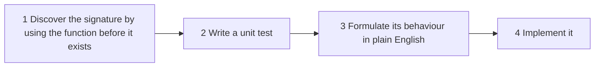

# 14. Advanced data manipulation

[← 13. Polymorphism](13-polymorphism.md) · [Book](../README.md) · [15. Debugging →](15-debugging.md)

## Summary

When business logic involves advanced data processing, the generic functions of the language and of libraries may not be enough. Instead of mixing data manipulation details into business logic, **write your own generic data manipulation functions** and express the logic with them. The business code becomes concise and conveys its intent (p. 295).

Dave, now mostly autonomous, builds four such tools while fixing a bug and three admin features (pp. 296–309):

| Tool | Problem it solves | Built from |
|---|---|---|
| `update(map, path, fun)` | Remove duplicate author names; any "next value from the current value" | `_.get`, `_.set` |
| `flatMap(coll, f)` | List all author IDs from books | `_.flatten`, `_.map` |
| `countByBoolField(coll, field, keyTrue, keyFalse)` | The book lending ratio | `_.reduce`, `update`, `inc` |
| `unwind(map, field)` | Group book items by library, keeping each book's title and ISBN | `_.map`, `_.set` |

Joe's advice on the phone from a taxi is to "put the cart before the horse": write the business logic as if the tool existed, to discover its signature (p. 297). The chapter's summary turns that into a four-step process (p. 310):



*The four steps from the chapter summary (p. 310).*

## Key takeaways

- **Separate business logic from data manipulation**: the code becomes concise and conveys its intent (p. 310).
- **Find a tool's signature by using it first**, in the most convenient way (p. 297).
- **Keep tools generic**: `update` receives the updating function, such as `_.uniq`, rather than knowing about duplicates (p. 297).
- **Formulate the behaviour in plain English** before implementing (p. 298).
- **It's not about code size**; it's the clarity of intent and the power of naming things (p. 301).
- **Pick the least generic utility function that solves your problem**: `forEach` is a Swiss army knife (p. 303).
- **Hide `_.reduce`** and other low-level functions behind well-named utilities; don't use them in business logic (p. 304).
- **Write a unit test before implementing a complicated function** (p. 307).

## Section outline

*From the book’s own table of contents (PDF bookmarks); printed page numbers.*

- 14.1 Updating a value in a map with eloquence — p. 296
- 14.2 Manipulating nested data — p. 299
- 14.3 Using the best tool for the job — p. 301
- 14.4 Unwinding at ease — p. 305
- Summary — p. 310

## Notes

Dave's code quality standards are high: even when his code works, he's often unhappy with its readability (p. 296). Each section starts with code he doesn't like and ends with a named tool.

### 14.1 Updating a value in a map with eloquence

The bug: the Open Library API sometimes returns duplicate author names, which are passed through to the client (p. 296). Dave's fix gets the authors, applies `_.uniq` and sets them back (listing 14.1). Theo finds it tedious because the next value is based on the current one (p. 296).

Joe's advice, on the phone from a taxi back from his conference talk, is to write a generic `update` (pp. 296–297):

1. **Use it first.** `removeAuthorDuplicates` becomes `return update(book, "authors", _.uniq);` (listing 14.2, p. 298).
2. **Say it in English.** `update` receives `map`, `path` and `fun`, and returns a new version of `map` where `path` is associated with `fun(currentValue)` (figure 14.1, p. 298).
3. **Implement it** (listing 14.3, p. 298):

```js
function update(map, path, fun) {
  var currentValue = _.get(map, path);
  var nextValue = fun(currentValue);
  return _.set(map, path, nextValue);
}
```

Doubling an income, `update(m, "income", x => x * 2)`, turns 100000 into 200000 (listing 14.4, p. 299). A footnote says Lodash provides its own `update`; the book writes one for teaching (p. 297).

> **Vault note:** `update` and `unwind` are correct only because `_.set` here is the immutable version from Lodash FP (chapter 4, pp. 75–76). With default Lodash, `_.set` mutates and returns the same object, so `update` would change its input, and `unwind` would return several references to one map, each holding the last element.

### 14.2 Manipulating nested data

Nancy asks for three admin features: list all book author IDs, calculate the book lending ratio, and group books by physical library, all by the end of the week (p. 299).

| Version | Result | Listing |
|---|---|---|
| `_.map(books, "authorIds")` | An array of arrays, `[["sean-covey", "stephen-covey"], ["alan-moore", "dave-gibbons"]]` | 14.5–14.6, p. 300 |
| `_.flatten(_.map(books, "authorIds"))` | A flat array of IDs | 14.7, p. 300 |
| `flatMap(books, "authorIds")` | The same, with a named tool | 14.8–14.9, pp. 300–301 |

Dave finds such a small function odd, and the two versions similar. Theo asks him to pass "that thing on your desk that's used for writing" to show the cost of describing instead of naming: the point is clarity of intent, not code size (p. 301).

### 14.3 Using the best tool for the job

The lending ratio works on books with nested `bookItems`, each with `id`, `libId` and `isLent` (listing 14.10, pp. 301–302). The book's sample has three items, two of them lent.

| Version | What the business logic shows | Listing |
|---|---|---|
| `_.forEach` incrementing `lent` and `notLent` variables | Iteration and mutation | 14.11, p. 302 |
| `_.reduce` with `{lent: 0, notLent: 0}` | A fold; still low-level | 14.12, p. 303 |
| `countByBoolField(bookItems, "isLent", "lent", "notLent")` | What's being counted | 14.13, p. 304 |

Theo doesn't like *any* code with `forEach`: it's too generic. Genericity is good when *building* a utility; when *using* one, choose the least generic function that solves the problem. He uses a screwdriver, not a Swiss army knife, to open his drone, and anyone watching knows he's turning a screw (p. 303). Putting the two counters in a map lets the `reduce` be hidden behind a named function (p. 304).

Dave writes a unit test first: four maps with `a` true three times give `{"aTrue": 3, "aFalse": 1}` (listing 14.14, pp. 304–305). The implementation reduces with `update(res, keyTrue, inc)` or `update(res, keyFalse, inc)`, starting from a map with both keys at 0 (listing 14.15, p. 305).

> **Try it:** [The least generic tool](../widgets/14-least-generic.html) — toggle book items lent or not and switch between the `forEach`, `reduce` and `countByBoolField` versions of `lendingRatio`: the ratio stays the same, while the business logic shrinks to what it means.

### 14.4 Unwinding at ease

Grouping by library is harder: the work is on book items, but each item lacks its book's title and ISBN (p. 307). Dave's unit test expects a map from `libId` to entries that keep `isbn` and `title`, with `bookItems` holding a *single* item (listing 14.16, pp. 306–307).

Theo recalls MongoDB's **`$unwind`** operator from an online-store query, where a cart with `customer-id` and an `items` array became one document per item (figure 14.2, pp. 307–308). Given a map with an array field, `unwind` returns one map per element, the same map with the field associated to that element. Dave writes the business logic first, then the test and the tool (pp. 308–309):

| Step | Code | Listing |
|---|---|---|
| Usage | `flatMap(books, book => unwind(book, "bookItems"))`, then `_.groupBy(bookItems, "bookItems.libId")` | 14.17, p. 308 |
| Test | Joe's cart → two maps, each with `customer-id` and one item | 14.18, p. 309 |
| Implementation | `_.map(_.get(map, field), elem => _.set(map, field, elem))` | 14.19, p. 309 |

Because data is immutable, there's no need to clone the map for each element (p. 309).

> **Try it:** [Unwind and group](../widgets/14-unwind.html) — step through `unwind` on each book, then `groupBy` on `bookItems.libId`, and watch title and ISBN travel with every item; add an item to a new library.

> **Vault note:** the function is called `booksByRack` in listings 14.16–14.17 but `booksByLib` in the dialogue (p. 307).

## Trade-offs at a glance

| Choice | Benefit | Cost |
|---|---|---|
| Inline `_.get` / `_.set` / `_.reduce` | No extra functions | Business intent buried in mechanics |
| Named custom tools (`update`, `flatMap`, …) | Concise, intent-revealing business code (p. 310) | More small functions to know and maintain |
| Very generic utilities (`forEach`) | Can do anything | Convey nothing about intent (p. 303) |
| Least generic utility | Intent is obvious | Must exist, or be written |
| Writing your own vs Lodash's `update`, `flatMap` | Teaches the design steps (pp. 297, 300) | Duplicates library functions in real code |

## Beyond the book

- **Lodash already has them.** `_.update`, `_.flatMap` and `_.countBy` exist, though `_.countBy` counts by the *value* returned, giving `{"true": 2, "false": 1}` rather than custom key names. In practice, write your own tool only when no library function says what you mean.
- **Clojure's `update` and `update-in`** are the same idea built into the language, and they're used constantly with `inc`, `conj` or `dissoc`. Clojure's `frequencies` and `group-by` cover `countByBoolField` and `groupBy`.
- **`$unwind` in SQL** is a lateral join over an array: PostgreSQL's `unnest` or `jsonb_array_elements` in a `LATERAL` join, and in pandas, `DataFrame.explode`.
- **Empty arrays disappear.** `unwind` on a book with no items returns no maps, so that book vanishes from the grouping, which is also what MongoDB's `$unwind` does by default (unless `preserveNullAndEmptyArrays` is set).
- **Ratio of zero items.** `lendingRatio` divides by `lent + notLent`, so a catalog with no book items returns `NaN` in JavaScript. A named tool is a natural place to decide that edge case once.

## Connections

- **Immutable `_.set`** and structural sharing: [4. State management](04-state-management.md).
- **Unit tests for data in, data out:** [6. Unit tests](06-unit-tests.md).
- **Nested data and `groupBy`** in queries: [3. Basic data manipulation](03-basic-data-manipulation.md) and [10. Database operations](10-database-operations.md).
- **Next:** [15. Debugging](15-debugging.md).
- **Run it:** [Custom data tools](../lab/14-custom-data-tools/README.md) — `update`, `flat_map`, `count_by_bool_field` and `unwind` in Python, run on the chapter's books, plus what happens to `unwind` when `set` mutates.

## Check yourself

1. What is the best way to find the signature of a custom data manipulation function?
   <details><summary>Answer</summary>Think about the most convenient way to use it: write the business logic as if it already existed, "putting the cart before the horse" (p. 297).</details>
2. Define `update` in plain English.
   <details><summary>Answer</summary>It receives a map, a path and a function, and returns a new version of the map where the path is associated with the function applied to the path's current value (p. 298).</details>
3. If `flatMap` is only `_.flatten(_.map(coll, f))`, why write it?
   <details><summary>Answer</summary>It's not about code size but clarity of intent and the power of naming things, like asking for "the pen" instead of "that thing used for writing" (p. 301).</details>
4. Why does Theo dislike `forEach` in business logic?
   <details><summary>Answer</summary>It's too generic, a Swiss army knife. When using utilities, pick the least generic one that solves the problem, so the code conveys its intent (p. 303).</details>
5. What does `unwind(map, field)` return?
   <details><summary>Answer</summary>An array with one map per element of the array at `field`: each is the original map with `field` associated to that single element (figure 14.2; listing 14.19, pp. 307–309).</details>
6. Why does `unwind` not need to clone the map for each element?
   <details><summary>Answer</summary>Data is immutable, so `_.set` returns a new version each time and the shared parts can't change (p. 309).</details>
7. List the four steps for designing a custom data manipulation function.
   <details><summary>Answer</summary>Discover the signature by using the function before it is implemented; write a unit test; formulate the behaviour in plain English; implement it (p. 310).</details>
