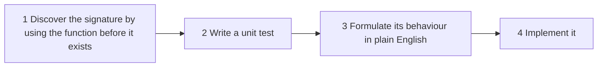

# ۱۴. دست‌کاری پیشرفته‌ی داده

[← ۱۳. polymorphism](13-polymorphism.md) · [کتاب](../README.md) · [۱۵. اشکال‌زدایی →](15-debugging.md)

## خلاصه

وقتی منطق کسب‌وکار پردازش پیشرفته‌ی داده را درگیر می‌کند، تابع‌های عمومی زبان و کتابخانه‌ها شاید بس نباشند. به‌جای قاطی کردن ریزکاری دست‌کاری داده در منطق کسب‌وکار، **تابع‌های عمومی دست‌کاری داده‌ی خودتان را بنویسید** و منطق را با آن‌ها بگویید. کد کسب‌وکار موجز می‌شود و قصدش را می‌رساند (p. 295).

دیو، که حالا بیشتر خودگردان است، سر درست کردن اشکالی و سه ویژگی مدیریتی چهار ابزار از این دست می‌سازد (pp. 296–309):

| ابزار | مسئله‌ای که حلش می‌کند | ساخته از |
|---|---|---|
| `update(map, path, fun)` | برداشتن نام نویسنده‌های دوباره؛ و هر «مقدار پسین از مقدار کنونی» | توابع `_.get` و `_.set` |
| `flatMap(coll, f)` | فهرست کردن همه‌ی شناسه‌ی نویسنده‌ها از کتاب‌ها | توابع `_.flatten` و `_.map` |
| `countByBoolField(coll, field, keyTrue, keyFalse)` | نسبت قرض کتاب | توابع `_.reduce` و `update` و `inc` |
| `unwind(map, field)` | گروه کردن نسخه‌های کتاب با کتابخانه، با نگه داشتن عنوان و ISBN هر کتابی | توابع `_.map` و `_.set` |

پند جو، تلفنی از تاکسی، این است که «گاری را پیش اسب ببند»: منطق کسب‌وکار را چنان بنویسید که گویی آن ابزار هست، تا امضایش را کشف کنید (p. 297). خلاصه‌ی فصل آن را به فرایندی چهارقدمی بدل می‌کند (p. 310):



*آن چهار قدم از خلاصه‌ی فصل (p. 310).*

## نکته‌های کلیدی

- **منطق کسب‌وکار را از دست‌کاری داده جدا کنید**: کد موجز می‌شود و قصدش را می‌رساند (p. 310).
- **امضای ابزاری را با نخست به کار بردنش بیابید**، به راحت‌ترین شکل (p. 297).
- **ابزارها را عمومی نگه دارید**: تابع `update` همان تابع به‌روزکننده را می‌گیرد، مانند `_.uniq`، نه آنکه از دوباره‌ها خبر داشته باشد (p. 297).
- **رفتار را به زبان ساده بگویید** پیش از پیاده کردن (p. 298).
- **سر اندازه‌ی کد نیست**؛ سر روشنی قصد و نیروی نام دادن به چیزهاست (p. 301).
- **کم‌عمومی‌ترین تابع سودمندی را که مسئله‌تان را حل می‌کند برگزینید**: تابع `forEach` چاقوی سوئیسی است (p. 303).
- **تابع `_.reduce` را پنهان کنید** و تابع‌های سطح‌پایین دیگر را پشت ابزارهای خوش‌نام؛ در منطق کسب‌وکار به کارشان نبرید (p. 304).
- **پیش از پیاده کردن تابعی بغرنج تستی unit بنویسید** (p. 307).

## فهرست بخش‌ها

*از فهرست خود کتاب، یعنی bookmarkهای PDF؛ شماره‌ی صفحه‌ها چاپی‌اند.*

- ۱۴.۱ به‌روز کردن مقداری در mapی با شیوایی — ص. ۲۹۶
- ۱۴.۲ دست‌کاری داده‌ی تودرتو — ص. ۲۹۹
- ۱۴.۳ به کار بردن بهترین ابزار برای کار — ص. ۳۰۱
- ۱۴.۴ باز کردن با آسودگی — ص. ۳۰۵
- خلاصه — ص. ۳۱۰

## یادداشت‌ها

معیارهای کیفیت کد دیو بالاست: حتی وقتی کدش کار می‌کند، بیشتر وقت‌ها از خواندنی بودنش ناخشنود است (p. 296). هر بخشی با کدی آغاز می‌شود که دوستش ندارد و با ابزاری نام‌دار تمام.

### ۱۴.۱ به‌روز کردن مقداری در mapی با شیوایی

اشکال: interface Open Library API گاهی نام نویسنده‌های دوباره برمی‌گرداند، که به client رد می‌شوند (p. 296). چاره‌ی دیو نویسنده‌ها را می‌گیرد، `_.uniq` را پیاده می‌کند و بازشان می‌گذارد (listing ۱۴.۱). تئو آن را خسته‌کننده می‌یابد چون مقدار پسین روی مقدار کنونی نشسته (p. 296).

پند جو، تلفنی از تاکسی سر بازگشت از سخنرانی کنفرانسش، نوشتن یک `update` عمومی است (pp. 296–297):

1. **نخست به کارش ببرید.** تابع `removeAuthorDuplicates` به `return update(book, "authors", _.uniq);` بدل می‌شود (listing ۱۴.۲، ص. ۲۹۸).
2. **به زبان ساده بگوییدش.** تابع `update` مقدارهای `map` و `path` و `fun` را می‌گیرد، و versionی تازه از `map` برمی‌گرداند که در آن `path` با `fun(currentValue)` تداعی شده (شکل ۱۴.۱، ص. ۲۹۸).
3. **پیاده‌اش کنید** (listing ۱۴.۳، ص. ۲۹۸):

```js
function update(map, path, fun) {
  var currentValue = _.get(map, path);
  var nextValue = fun(currentValue);
  return _.set(map, path, nextValue);
}
```

دو برابر کردن درآمدی، یعنی `update(m, "income", x => x * 2)`، مقدار ۱۰۰۰۰۰ را ۲۰۰۰۰۰ می‌کند (listing ۱۴.۴، ص. ۲۹۹). پانویسی می‌گوید Lodash خودش `update` را می‌دهد؛ و کتاب برای آموزش یکی می‌نویسد (p. 297).

> **Vault note:** توابع `update` و `unwind` تنها از آن درستند که `_.set` این‌جا همان version immutable از Lodash FP است (فصل ۴، صص. ۷۵–۷۶). با Lodash پیش‌فرض، تابع `_.set` mutation می‌دهد و همان شیء را برمی‌گرداند، پس `update` ورودی‌اش را عوض می‌کرد، و `unwind` چند ارجاع به یک map برمی‌گرداند که هر کدام عضو آخر را دارد.

### ۱۴.۲ دست‌کاری داده‌ی تودرتو

نانسی سه ویژگی مدیریتی می‌خواهد: فهرست کردن همه‌ی شناسه‌ی نویسنده‌های کتاب، حساب کردن نسبت قرض کتاب، و گروه کردن کتاب‌ها با کتابخانه‌ی فیزیکی، همه تا پایان هفته (p. 299).

| version | خروجی | نمونه |
|---|---|---|
| `_.map(books, "authorIds")` | آرایه‌ای از آرایه، یعنی `[["sean-covey", "stephen-covey"], ["alan-moore", "dave-gibbons"]]` | ۱۴.۵ و ۱۴.۶، ص. ۳۰۰ |
| `_.flatten(_.map(books, "authorIds"))` | آرایه‌ای تخت از شناسه‌ها | ۱۴.۷، ص. ۳۰۰ |
| `flatMap(books, "authorIds")` | همان، با ابزاری نام‌دار | ۱۴.۸ و ۱۴.۹، صص. ۳۰۰–۳۰۱ |

دیو تابعی این‌قدر کوچک را عجیب می‌یابد، و آن دو version را همانند. تئو از او می‌خواهد «آن چیزی را که روی میزت است و برای نوشتن به کار می‌رود» بدهد تا بهای وصف کردن به‌جای نام دادن را نشان دهد: نکته روشنی قصد است، نه اندازه‌ی کد (p. 301).

> **In practice:** پاسخ APIهای منبع اغلب JSON تودرتوست و dlt آن را به جدول‌های فرزند تخت می‌کند.
>
> **Your turn:** یک منبع آرایه‌ای از آیتم‌ها در هر سفارش برمی‌گرداند. در Bronze چه می‌بینید و در Silver چه می‌کنید؟
>
> *Answer:* dlt یک جدول فرزند با کلید والد می‌سازد؛ در Silver دو جدول را join می‌کنید یا آیتم‌ها را در ستون `Array` یا `Nested` در ClickHouse نگه می‌دارید. تابع‌های مسیرمحور روی داده‌ی تودرتو همان ابزاری‌اند که کتاب برای این کار پیشنهاد می‌کند (pp. 299–301).

### ۱۴.۳ به کار بردن بهترین ابزار برای کار

نسبت قرض روی کتاب‌هایی با `bookItems` تودرتو کار می‌کند، که هر کدام `id` و `libId` و `isLent` دارد (listing ۱۴.۱۰، صص. ۳۰۱–۳۰۲). نمونه‌ی کتاب سه نسخه دارد که دوتایشان قرض رفته‌اند.

| version | منطق کسب‌وکار چه نشان می‌دهد | نمونه |
|---|---|---|
| تابع `_.forEach` که متغیرهای `lent` و `notLent` را می‌افزاید | گشتن و mutation | ۱۴.۱۱، ص. ۳۰۲ |
| تابع `_.reduce` با `{lent: 0, notLent: 0}` | تا کردنی؛ هنوز سطح‌پایین | ۱۴.۱۲، ص. ۳۰۳ |
| تابع `countByBoolField(bookItems, "isLent", "lent", "notLent")` | آنچه شمرده می‌شود | ۱۴.۱۳، ص. ۳۰۴ |

تئو *هیچ* کدی با `forEach` را دوست ندارد: خیلی عمومی است. عمومیت وقتی خوب است که ابزاری سودمندی *می‌سازید*؛ و سر *به کار بردن* یکی، کم‌عمومی‌ترین تابعی را برگزینید که مسئله را حل می‌کند. برای باز کردن پهپادش پیچ‌گوشتی به کار می‌برد، نه چاقوی سوئیسی، و هر که ببیند می‌داند دارد پیچی می‌چرخاند (p. 303). گذاشتن آن دو شمارنده در mapی می‌گذارد آن `reduce` پشت تابعی نام‌دار پنهان شود (p. 304).

دیو نخست تستی unit می‌نویسد: چهار map که `a` در سه‌تایشان درست است، مقدار `{"aTrue": 3, "aFalse": 1}` می‌دهد (listing ۱۴.۱۴، صص. ۳۰۴–۳۰۵). آن پیاده‌سازی با `update(res, keyTrue, inc)` یا `update(res, keyFalse, inc)` تحویل می‌برد، از mapی که هر دو کلیدش ۰ است آغاز (listing ۱۴.۱۵، ص. ۳۰۵).

> **Try it:** [کم‌عمومی‌ترین ابزار](../widgets/14-least-generic.html) — نسخه‌های کتاب را قرض‌رفته یا نرفته کنید و میان versionهای `forEach` و `reduce` و `countByBoolField` از `lendingRatio` سوئیچ کنید: آن نسبت همان می‌ماند، در حالی که منطق کسب‌وکار به معنایش آب می‌رود.

> **In practice:** Lodash در کتاب همان نقشی را دارد که در stack ما تابع‌های آرایه و JSON در ClickHouse و کتابخانه‌ی استاندارد Python دارند.
>
> **Your turn:** پیش از نوشتن تابع تازه برای دست‌کاری JSON در Python، چه چیزی را چک می‌کنید؟
>
> *Answer:* این‌که کار با تابع‌های داخلی ClickHouse، مثل `JSONExtract` و `arrayMap`، در خود کوئری شدنی است، یا تابعی در کتابخانه‌ی مشترک تیم هست. تابع عمومی موجود را پیدا کنید پیش از نوشتن تابع تازه (pp. 303–305).

### ۱۴.۴ باز کردن با آسودگی

گروه کردن با کتابخانه سخت‌تر است: کار روی نسخه‌های کتاب است، ولی هر نسخه‌ای عنوان و ISBN کتابش را ندارد (p. 307). تست unit دیو mapی از `libId` به entryهایی چشم دارد که `isbn` و `title` را نگه می‌دارند، با `bookItems`ی که *یک* نسخه دارد (listing ۱۴.۱۶، صص. ۳۰۶–۳۰۷).

تئو عملگر **`$unwind`** از MongoDB را یاد می‌آورد، از پرسشی در فروشگاهی آنلاین، که سبدی با `customer-id` و آرایه‌ی `items` به یک سند برای هر نسخه بدل شد (شکل ۱۴.۲، صص. ۳۰۷–۳۰۸). اگر mapی با فیلدی آرایه‌ای داده شود، تابع `unwind` یک map برای هر عضوی برمی‌گرداند، یعنی همان map با فیلدی که به آن عضو تداعی شده. دیو نخست منطق کسب‌وکار را می‌نویسد، بعد تست و ابزار را (pp. 308–309):

| قدم | کد | نمونه |
|---|---|---|
| کاربرد | عبارت `flatMap(books, book => unwind(book, "bookItems"))`، بعد `_.groupBy(bookItems, "bookItems.libId")` | ۱۴.۱۷، ص. ۳۰۸ |
| تست | سبد جو که به دو map بدل می‌شود، هر کدام با `customer-id` و یک نسخه | ۱۴.۱۸، ص. ۳۰۹ |
| پیاده‌سازی | عبارت `_.map(_.get(map, field), elem => _.set(map, field, elem))` | ۱۴.۱۹، ص. ۳۰۹ |

چون داده immutable است، نیازی نیست آن map برای هر عضوی کلون شود (p. 309).

> **Try it:** [باز کردن و گروه کردن](../widgets/14-unwind.html) — تابع `unwind` را روی هر کتابی قدم‌به‌قدم ببینید، بعد `groupBy` را روی `bookItems.libId`، و تماشا کنید عنوان و ISBN با هر نسخه‌ای سفر می‌کنند؛ نسخه‌ای به کتابخانه‌ای تازه بیفزایید.

> **Vault note:** آن تابع در listingهای ۱۴.۱۶ و ۱۴.۱۷ `booksByRack` نامیده می‌شود ولی در گفت‌وگو `booksByLib` (p. 307).

## بده‌بستان‌ها در یک نگاه

| گزینش | سود | خرج |
|---|---|---|
| توابع `_.get` و `_.set` و `_.reduce` درون‌خطی | بی هیچ تابع افزوده | قصد کسب‌وکار زیر سازوکار گم می‌شود |
| ابزارهای دست‌ساز نام‌دار مانند `update` و `flatMap` | کد کسب‌وکار موجز و قصدنما (p. 310) | تابع‌های کوچک بیشتری که باید دانست و نگه داشت |
| ابزارهای سودمندی خیلی عمومی مانند `forEach` | هر کاری می‌توانند | هیچ از قصد نمی‌رسانند (p. 303) |
| کم‌عمومی‌ترین ابزار سودمندی | قصد آشکار است | باید باشد، یا نوشته شود |
| نوشتن مال خودتان در برابر `update` و `flatMap` از Lodash | قدم‌های طراحی را می‌آموزد (pp. 297, 300) | در کد واقعی تابع‌های کتابخانه را دوباره می‌گوید |

## فراتر از کتاب

- **کتابخانه‌ی Lodash از پیش داردشان.** توابع `_.update` و `_.flatMap` و `_.countBy` هستند، گرچه `_.countBy` با *مقدار* برگشته می‌شمارد و `{"true": 2, "false": 1}` می‌دهد، نه نام کلیدهای دست‌ساز. در کار واقعی، ابزار خودتان را تنها وقتی بنویسید که هیچ تابع کتابخانه‌ای آنچه می‌خواهید را نمی‌گوید.
- **توابع `update` و `update-in` در Clojure** همان ایده‌اند که در خود زبان ساخته شده، و همیشه با `inc` یا `conj` یا `dissoc` به کار می‌روند. توابع `frequencies` و `group-by` در Clojure جای `countByBoolField` و `groupBy` را می‌پوشانند.
- **عملگر `$unwind` در SQL** joinی جانبی روی آرایه است: تابع `unnest` یا `jsonb_array_elements` در PostgreSQL درون joinی `LATERAL`، و در pandas متد `DataFrame.explode`.
- **آرایه‌های تهی ناپدید می‌شوند.** تابع `unwind` روی کتابی بی هیچ نسخه‌ای هیچ mapی برنمی‌گرداند، پس آن کتاب از گروه کردن غیب می‌شود، که عملگر `$unwind` در MongoDB هم پیش‌فرض همان را می‌کند، مگر `preserveNullAndEmptyArrays` گذاشته شود.
- **نسبت صفر نسخه.** تابع `lendingRatio` بر `lent + notLent` بخش می‌کند، پس catalogی بی هیچ نسخه‌ی کتابی در JavaScript مقدار `NaN` برمی‌گرداند. ابزاری نام‌دار جای طبیعی تصمیم گرفتن یک‌باره‌ی آن مورد لبه است.

## پیوندها

- **تابع `_.set` immutable** و شریک شدن ساختاری: [۴. مدیریت state](04-state-management.md).
- **تست unit برای داده تو، داده بیرون:** [۶. تست‌های unit](06-unit-tests.md).
- **داده‌ی تودرتو و `groupBy`** در پرسش‌ها: [۳. دست‌کاری پایه‌ی داده](03-basic-data-manipulation.md) و [۱۰. عملیات پایگاه داده](10-database-operations.md).
- **پسین:** [۱۵. اشکال‌زدایی](15-debugging.md).
- **Run it:** [ابزارهای دست‌ساز داده](../lab/14-custom-data-tools/README.md) — توابع `update` و `flat_map` و `count_by_bool_field` و `unwind` به Python، اجراشده روی کتاب‌های این فصل، به‌علاوه‌ی آنچه بر `unwind` می‌گذرد وقتی `set` mutation می‌دهد.

## خودتان را بسنجید

1. بهترین راه یافتن امضای تابعی دست‌ساز از دست‌کاری داده چیست؟
   <details><summary>پاسخ</summary>به راحت‌ترین راه به کار بردنش بیندیشید: منطق کسب‌وکار را چنان بنویسید که گویی از پیش هست، یعنی «گاری را پیش اسب بستن» (p. 297).</details>
2. تابع `update` را به زبان ساده تعریف کنید.
   <details><summary>پاسخ</summary>یک map و مسیری و تابعی می‌گیرد، و versionی تازه از آن map برمی‌گرداند که در آن مسیر با همان تابع پیاده‌شده روی مقدار کنونی مسیر تداعی شده (p. 298).</details>
3. اگر `flatMap` تنها `_.flatten(_.map(coll, f))` است، چرا بنویسیمش؟
   <details><summary>پاسخ</summary>سر اندازه‌ی کد نیست، سر روشنی قصد و نیروی نام دادن به چیزهاست، مانند خواستن «خودکار» به‌جای «آن چیزی که برای نوشتن به کار می‌رود» (p. 301).</details>
4. چرا تئو تابع `forEach` را در منطق کسب‌وکار دوست ندارد؟
   <details><summary>پاسخ</summary>خیلی عمومی است، چاقویی سوئیسی. سر به کار بردن ابزارهای سودمندی، کم‌عمومی‌ترین را برگزینید که مسئله را حل می‌کند، تا کد قصدش را برساند (p. 303).</details>
5. تابع `unwind(map, field)` چه برمی‌گرداند؟
   <details><summary>پاسخ</summary>آرایه‌ای با یک map برای هر عضوی از آرایه‌ی زیر `field`: هر کدام همان map اصلی است که `field`ش به آن یک عضو تداعی شده (شکل ۱۴.۲؛ listing ۱۴.۱۹، صص. ۳۰۷–۳۰۹).</details>
6. چرا `unwind` لازم نیست آن map را برای هر عضوی کلون کند؟
   <details><summary>پاسخ</summary>داده immutable است، پس `_.set` هر بار versionی تازه برمی‌گرداند و بخش‌های شریک نمی‌توانند عوض شوند (p. 309).</details>
7. چهار قدم طراحی تابعی دست‌ساز از دست‌کاری داده را فهرست کنید.
   <details><summary>پاسخ</summary>امضا را با به کار بردن تابع پیش از پیاده شدنش کشف کنید؛ تستی unit بنویسید؛ رفتار را به زبان ساده بگویید؛ پیاده‌اش کنید (p. 310).</details>
