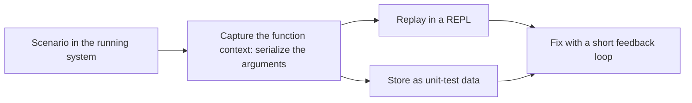

# ۱۵. اشکال‌زدایی

[← ۱۴. دست‌کاری پیشرفته‌ی داده](14-advanced-data-manipulation.md) · [کتاب](../README.md)

## خلاصه

هر اشکال‌زدایی می‌گذارد کد را قدم‌به‌قدم بگذرانید تا خطی را بیابید که اشکال را می‌سازد، ولی نمی‌گذارد آن صحنه را **بازتولید** کنید. در DOP، می‌توانید زمینه‌ی صحنه‌ای را بگیرید و در فرایندی جدا یا REPLی یا تستی unit replayش کنید، با حلقه‌ی بازخوردی کوتاه میان هر چاره و خروجیش (p. 311).

تئو Albatross را ترک می‌کند، و دیو مسئول DOP خواهد بود. نشست آخرشان در Exploratorium است، جایی که تئو ابداع خودش را شریک می‌شود (pp. 312–314):

- **قطعیت:** در ماژول‌هایی که با داده‌ی immutable سروکار دارند، همان آرگومان‌ها همیشه همان مقدار بازگشتی را می‌دهند. تنها `SystemState` با state سروکار دارد.
- **زمینه‌ی تابع** مقدار آرگومان‌هایی است که تابعی با آن‌ها صدا زده می‌شود. در DOP، همین همه‌اش است.
- **دو شرط بازتولیدپذیری:** تغییرناپذیری، و آسانی سریالی کردن و باز کردن، که ساختارهای داده‌ی عمومی می‌دهندش.

باقی فصل این را پیاده می‌کند (pp. 314–329):

- **کد گرفتن زمینه** آرگومان‌ها را سر تابع چاپ می‌کند. به JSON سریالی می‌شود، چون وگرنه رشته‌ها گیومه و گریزهایشان را گم می‌کنند.
- **عمل replay در REPL.** آن جست‌وجوی بهبودیافته‌ی کتاب، یعنی پیشوند هر واژه‌ای از عنوان، در REPL در برابر catalogی گرفته‌شده توسعه می‌یابد.
- **داده‌ی گرفته‌شده تست unit می‌شود.** در فایل‌های JSON نوشته می‌شود که با زمینه و UUID نام گرفته‌اند، ناهمگام، که ایمن است چون آن داده نمی‌تواند عوض شود.

سرچشمه‌های داده‌ی بیرونی می‌توانند بازتولیدپذیری را بشکنند، مگر آن پایگاه داده immutable باشد، مانند Datomic. سر اشکال‌زدایی محلی، داده هر طور که باشد کم عوض می‌شود (pp. 329–330). در میهمانی خداحافظی تئو، می‌گوید که دارد وقفه‌ای می‌گیرد تا سفر کند، و شاید کتابی در باب DOP بنویسد (pp. 330–331).

## نکته‌های کلیدی

- **در ماژول‌هایی که با داده‌ی immutable سروکار دارند، رفتار تابع قطعی است** (p. 312).
- **در DOP، زمینه‌ی تابع از مقدار آرگومان‌های تابع ساخته می‌شود** (p. 313).
- **دو شرط بازتولیدپذیری immutability و آسانی سریالی کردن و باز کردن است** (p. 314).
- **رشته‌های گرفته‌شده را به JSON سریالی کنید**، تا گیومه و ممیز معکوسشان را نگه دارند؛ و JSON برای هر داده‌ای، بدوی یا مجموعه، کار می‌کند (pp. 317–318).
- **بازتولیدپذیری می‌گذارد صحنه‌ای را در محیطی دست‌نخورده بازتولید کنید** (p. 319).
- **سر تکرار کردن آن endpoint را نزنید**؛ از حلقه‌ی بازخورد کوتاه‌تر REPL کار بکشید، بعد که درست شد سرتاسر تست کنید (pp. 320, 329).
- **داده‌ی گرفته‌شده ورودی تست unit می‌شود**: دیگر ساختن دستی catalogهای تودرتو نیست (p. 321).
- **داده‌ی گرفته‌شده را asynchronous بنویسید** تا کار واقعی کند نشود؛ و immutability تضمین می‌کند که آن داده سر نوشته شدن عوض نمی‌شود (pp. 323, 326).

## فهرست بخش‌ها

*از فهرست خود کتاب، یعنی bookmarkهای PDF؛ شماره‌ی صفحه‌ها چاپی‌اند.*

- ۱۵.۱ قطعیت در برنامه‌نویسی — ص. ۳۱۲
- ۱۵.۲ بازتولیدپذیری با عدد و رشته — ص. ۳۱۴
- ۱۵.۳ بازتولیدپذیری با هر داده‌ای — ص. ۳۱۸
- ۱۵.۴ تست‌های unit — ص. ۳۲۱
- ۱۵.۵ سروکار داشتن با سرچشمه‌های داده‌ی بیرونی — ص. ۳۲۹
- خداحافظی — ص. ۳۳۰
- خلاصه — ص. ۳۳۱

## یادداشت‌ها

چند ماه بعد، تئو به دیو تلفن می‌زند. دارد Albatross را ترک می‌کند، و پس از رأی‌زنی با مدیریت، دیو مسئول DOP خواهد بود. تئو او را به نشست کاری آخری در موزه‌ی علم Exploratorium می‌خواند، جایی که تئو می‌پندارد پیوندی میان DOP و دانش یافته (p. 312).

### ۱۵.۱ قطعیت در برنامه‌نویسی

آیا همان علت همیشه همان اثر را می‌سازد؟ وگرنه، دیو می‌گوید، هر بار که سوار آسانسور می‌شد می‌ترسید (p. 312). در برنامه‌نویسی، **علت‌ها را آرگومان تابع و اثرها را مقدار بازگشتی بگیرید**، و اثرهای جانبی را کنار بگذارید (p. 312).

| نگرانی | پاسخ (pp. 312–314) |
|---|---|
| مقدار state می‌تواند همان آرگومان‌ها را به خروجی‌های مختلف برساند | ماژول‌هایی را که با state سروکار دارند کمینه کنید: تنها `SystemState` می‌کند؛ و باقی داده‌ی immutable است |
| برای replay صدا زدنی چه باید گرفته شود؟ | **زمینه‌ی تابع**: به‌طور کلی آرگومان‌ها به‌علاوه‌ی state برنامه؛ و در DOP، تنها آرگومان‌ها |
| mapی تودرتو و بسیار بزرگ را چطور از اشکال‌زدایی بگیریم؟ | کنسول Chrome گزینه‌ی Copy دارد؛ یا به JSON سریالی کنید، بچسبانید، و باز کنید |
| کجا replay کنیم؟ | یک **REPL**، شاید در فرایندی جدا: «آزمایشگاهی علمی» |

هر REPLی محیطی برنامه‌نویسی است که تکه‌هایی کد را اجرا و خروجی را نشان می‌دهد (p. 313). جدول ۱۵.۱ برای هر زبانی یکی می‌آورد: کنسول مرورگر، interface Node CLI، ابزار JShell، REPL از C#، مفسر Python و Interactive Ruby (p. 313).

*خلاصه‌ی vault از جریان این فصل (pp. 311, 319, 321).*

### ۱۵.۲ بازتولیدپذیری با عدد و رشته

هیچ اشکال‌زدایی لازم نیست: **کد گرفتن زمینه** را سر تابع بیفزایید، که آرگومان‌هایش را چاپ می‌کند (p. 314).

| تابع | کد گرفتن | چه غلط در می‌آید | نمونه |
|---|---|---|---|
| `nthDigit(a, n)` از Stack Overflow | عبارت `console.log(a); console.log(n);` | هیچ: عددی عدد است | ۱۵.۱ و ۱۵.۲، ص. ۳۱۵ |
| `hasWordStartingWith(sentence, prefix)` | عبارت `console.log(sentence)` | رشته‌های چاپ‌شده گیومه و گیومه‌های گریزخورده‌شان را گم می‌کنند | ۱۵.۳ تا ۱۵.۵، صص. ۳۱۶–۳۱۷ |
| همان | عبارت `console.log(JSON.stringify(sentence))` | هیچ: گیومه و ممیز معکوس نگه داشته می‌شوند | ۱۵.۶ و ۱۵.۷، ص. ۳۱۷ |

تابع `hasWordStartingWith` آن جمله را سر فاصله‌ها می‌شکند و از `_.find` کار می‌کشد، نه `_.filter` که هر واژه‌ای را می‌پرداخت به‌جای ایستادن سر نخستین خوانش (p. 316). رشته‌ها، مانند عددها، JSON معتبرند، و سریالی کردن JSON برای هر داده‌ای کار می‌کند (pp. 317–318).

### ۱۵.۳ بازتولیدپذیری با هر داده‌ای

«چکیده‌ی DOP این است که با داده مانند شهروندی درجه‌یک رفتار می‌کند»، پس هر صحنه‌ای از داده همان‌قدر بازتولیدپذیر است که صحنه‌ای با عدد و رشته (p. 318). نانسی ایده‌ی جست‌وجویی بهبودیافته را می‌پسندد که پیشوند *هر* واژه‌ای از عنوانی را می‌خواند (p. 318).

1. **بگیرید.** تابع `Catalog.searchBooksByTitle` مقدار `JSON.stringify` از `catalogData` و `query` را log می‌کند (listing ۱۵.۸، ص. ۳۱۸). جست‌وجوی «Watch» catalogی درازِ یک‌خطی با *7 Habits of Highly Effective People* و *Watchmen* چاپ می‌کند (listing ۱۵.۹، ص. ۳۱۹).
2. **عمل replay کنید.** هر دو را در REPL بچسبانید و آن تابع را صدا بزنید (listing ۱۵.۱۰، ص. ۳۱۹).
3. **در REPL تکرار کنید.** مقدار «Habit» خروجی `[]` می‌دهد، چون آن عنوان با «7 Habits» آغاز می‌شود (listing ۱۵.۱۱). version بهبودیافته با `hasWordStartingWith` صافی می‌کند و آن کتاب را می‌یابد (listingهای ۱۵.۱۲ و ۱۵.۱۳، صص. ۳۲۰–۳۲۱).

تئو دیو را از زدن آن endpoint بازمی‌دارد: REPL بازخورد خیلی تندتری می‌دهد، و بازتولید شرط‌های زندگی واقعی در محیطی کارآمدتر سود اصلی بازتولیدپذیری است (p. 320). از چهار پرسش آزمایشی تئو، «abit» و «bit» درست هیچ نمی‌یابند، ولی «habit» و «7 Habits» هم شکست می‌خورند (p. 321).

> **Try it:** [گرفتن و replay](../widgets/15-capture-replay.html) — آن endpoint جست‌وجو را بزنید، گرفتن با `console.log` را با `JSON.stringify` بسنجید، آن زمینه‌ی گرفته‌شده را در REPLی ساختگی replay کنید، و میان سه version جست‌وجو سوئیچ کنید تا ببینید از آن هشت پرسش کدام رد می‌شوند.

> **In practice:** وقتی task در Airflow روی داده‌ی یک روز fail می‌شود، بازتولید یعنی همان ورودی را دوباره داشته باشید.
>
> **Your turn:** چرا Parquet staging برای debug کردن ارزشمند است؟
>
> *Answer:* ورودی دقیق آن اجرا را نگه می‌دارد؛ می‌شود آن را در JupyterHub بار کرد و transform را روی همان داده دوباره اجرا کرد. با تابع‌های خالص، همان ورودی همان خطا را می‌دهد (pp. 318–321).

### ۱۵.۴ تست‌های unit

تست‌های unit در DOP تابعی را با داده صدا می‌زنند و داده‌ی بازگشتی را می‌سنجند، ولی ساختن دستی catalogهای تودرتو هیچ خوشی نداشت. در عوض، **سیستم را در شرط‌های زیر تست بگذارید، داده را درون تابع بگیرید، و در تست به کارش ببرید** (p. 321). listing ۱۵.۱۴ آن catalog گرفته‌شده را درون‌خطی می‌چسباند؛ و جست‌وجوی «Habit» باید آن کتاب را با نویسنده‌های «Sean Covey» و «Stephen Covey» برگرداند (pp. 321–322).

برای پرهیز از کپی و چسباندن، داده‌ی گرفته‌شده را در فایل‌هایی زیر درخت فایل تست‌های unit بنویسید (pp. 322–326):

| تکه | طرح | نمونه |
|---|---|---|
| نام فایل | زمینه‌ای یعنی نام آن تابع به‌علاوه‌ی UUIDی، زیر `test-data/`، با پسوند `.json`؛ و کتابخانه‌های UUID هر زبانی در جدول ۱۵.۲ | ۱۵.۱۵، صص. ۳۲۲–۳۲۳ |
| `dumpData(data, context)` | تابع `JSON.stringify`، بعد `fs.writeFile` به‌شکل **asynchronous**، که سر تمام شدن آن مسیر را log می‌کند | ۱۵.۱۶، ص. ۳۲۳ |
| گرفتن | عبارت `dumpData([catalogData, query], 'searchBooksByTitle')` | ۱۵.۱۷ و ۱۵.۱۸، صص. ۳۲۳–۳۲۴ |
| خواندنی بودن | عبارت `JSON.stringify(data, null, 2)` برای تودرفتگی دو فاصله‌ای | ۱۵.۲۰ و ۱۵.۲۱، صص. ۳۲۴–۳۲۵ |
| `readData(path)` | عبارت `JSON.parse(fs.readFileSync(path))` به‌شکل **synchronous**، چون تست نمی‌تواند پیش از خوانده شدن داده اجرا شود | ۱۵.۲۲ و ۱۵.۲۳، ص. ۳۲۶ |

سر آنکه تئو چای می‌آورد، چون *The Power of Habit* از چارلز داهیگ را می‌خواند تا قهوه‌اش را کم کند، دیو می‌پرسد: اگر آن تابع داده را سر asynchronous نوشته شدنش دست‌کاری کند چه؟ سر نمایشگاه Wind Arrows در می‌آورد که نمی‌تواند، چون در DOP داده هیچ‌وقت mutation نمی‌گیرد (p. 326). داده‌ی درون‌خطی وقتی کمینه است بهتر است، و فایلی وقتی چشم‌گیر (p. 327).

**آن چاره** (pp. 327–328): هر دو عنوان و پرسش را حرف‌کوچک کنید، و از فرانویسه‌ی مرز واژه‌ی `\b` کار بکشید، تا `\b7 habits` و `\bhabits of` پیشوندی را حتی سر چند واژه بخوانند (listing ۱۵.۲۴). تئو یک تست برای پرسش‌هایی می‌نویسد که باید آن کتاب را بیابند و یکی برای آن‌هایی که نباید (listingهای ۱۵.۲۵ و ۱۵.۲۶، ص. ۳۲۸):

| باید آن کتاب را برگرداند | باید هیچ برنگرداند |
|---|---|
| مقدارهای «Habit» و «habit» و «7 Habit» و «habits of» | مقدارهای «abit» و «bit» و «7 abit» و «habit of» |

تست‌ها رد می‌شوند، و تنها پس از آن دیو آن endpoint را با «7 Habit» می‌زند، تا سیستم را سرتاسر تست کند (p. 329).

> **Vault note:** همان‌طور که چاپ شده، listing ۱۵.۱۵ یک UUID می‌سازد ولی هیچ‌وقت به‌هم‌چسبانی‌اش نمی‌کند، پس هر فایلی `searchBooksByTitle-.json` نام می‌گرفت و از روی آخری می‌نوشت (p. 323). listing ۱۵.۲۳ هم برای همان سنجشی که listing ۱۵.۱۴ آن را `true` نشان می‌دهد، `// → false` نشان می‌دهد، بی هیچ توضیحی (pp. 322, 327). و تابع `_.every` در listingهای ۱۵.۲۵ و ۱۵.۲۶ یک بولی تنها برمی‌گرداند، نه `[true, true, true, true]` (p. 328). آزمایش lab آن نام فایل را درست می‌کند.

> **Run it:** [آزمایش گرفتن و replay](../lab/15-capture-replay/README.md) زمینه‌ی تابعی را در فایلی JSON می‌ریزد که با زمینه و UUID نام گرفته، replayش می‌کند، آن هشت پرسش را روی سه version جست‌وجو اجرا، و نشان می‌دهد ریختن asynchronous چه ثبت می‌کند وقتی داده میان کار mutation بگیرد.

### ۱۵.۵ سروکار داشتن با سرچشمه‌های داده‌ی بیرونی

زمینه‌ی تابع می‌تواند همان باشد، ولی پایگاه داده‌ای یا سرویسی می‌تواند به همان پرسش فرق‌دار پاسخ دهد (p. 329). پاسخ‌های تئو (pp. 329–330):

- **پایگاه‌های داده‌ی immutable**، که تابعی یا تنها-افزودنی هم نامیده می‌شوند. رکوردها timestampهای خودکارساخته می‌برند؛ به‌روزرسانی‌ها version تازه می‌سازند؛ و پرسش‌ها بازه‌ای از زمان می‌برند و روی عکسی اجرا می‌شوند که هیچ‌وقت عوض نمی‌شود. برخی بانک‌های دیجیتال از Datomic کار می‌کشند.
- **در کار واقعی**، سر اشکال‌زدایی محلی، تنها شما سیستم را به کار می‌برید، پس داده میان زدن و replay عوض نمی‌شود.

همانندی دیو، که برای آن موزه هم می‌خورد: سرچشمه‌های داده‌ی بیرونی مانند متغیرهای پنهان در فیزیک کوانتومند، که در نظر می‌توانند آزمایشی را دگر کنند در حالی که جهان بزرگ استوار می‌نماید (p. 330). تئو به او تی‌شرتی با عکس اینشتین و آلن کی می‌دهد. نقل کی: «آخرین کاری که می‌خواهید بکنید ور رفتن با state درونی است» (p. 330).

> **Try it:** [بازتولیدپذیر یا نه؟](../widgets/15-reproducibility.html) — صدا زدنی گرفته‌شده را replay کنید در حالی که mutation سر ریختن ناهمگام، پایگاه داده‌ی mutable در برابر تغییرناپذیر، و عوض کردن داده از سوی کاربران دیگر را روشن و خاموش می‌کنید، و ببینید خروجی replay‌شده کِی هنوز با اصل می‌خواند.

> **In practice:** دیتابیس منبع بیرون از کنترل ماست و هر بار ممکن است داده‌ی دیگری برگرداند.
>
> **Your turn:** باگی فقط با داده‌ی production ظاهر می‌شود. چطور آن را به تست تبدیل می‌کنید بی‌آن‌که PII وارد repo شود؟
>
> *Answer:* رکوردهای مشکل‌ساز را از Bronze که PIIاش hash شده بردارید، کوچک و بی‌نام کنید و در fixture تست بگذارید؛ کتاب داده‌ی بیرونی را ضبط و در تست replay می‌کند تا قطعیت برگردد (pp. 329–330).

### خداحافظی

در میهمانی خداحافظی تئو یک هفته بعد، جو برای نخستین بار نانسی را می‌بیند، و تئو به او می‌گوید که Klafim به برکت جو به مهلت‌هایش رسید (p. 330). تئو وقفه‌ای می‌گیرد تا چند ماه سفر کند، و به نوشتن کتابی در باب سفر DOPش می‌اندیشد. همه جامی بالا می‌برند: «به سلامتی! به سلامتی کتابی کامیاب» (pp. 330–331).

## بده‌بستان‌ها در یک نگاه

| رویکرد | قوت | ضعف |
|---|---|---|
| اشکال‌زدا و نقطه‌های شکست | بی هیچ تغییر کد؛ هر چیزی را بازرسی می‌کند | آن صحنه را بازتولید نمی‌کند (p. 311) |
| گرفتن در کنسول و replay در REPL | حلقه‌ی بازخورد کوتاه (p. 320) | کپی و چسباندن؛ و JSON یک‌خطی ناخواندنی (p. 319) |
| گرفتن در فایل | داده‌ی تست unit می‌شود (p. 322) | فایل‌های زیادی که باید نام داد و مدیریت کرد |
| داده‌ی تست درون‌خطی | در تست دیدنی است (p. 327) | وقتی بزرگ باشد سخت‌خوان است |
| ریختن asynchronous | کار واقعی را کند نمی‌کند (p. 323) | تنها از آن ایمن است که داده immutable است (p. 326) |
| سرچشمه‌های بیرونی mutable | پایگاه‌های داده‌ی معمول | replayها در نظر می‌توانند فرق کنند (p. 330) |
| پایگاه داده‌ی immutable مانند Datomic | همان پرسش، همان پاسخ (p. 329) | گونه‌ای دیگر از پایگاه داده |

## فراتر از کتاب

- **ورودی کاربر را در عبارت باقاعده گریز بدهید.** عبارت `new RegExp("\\b" + prefix)` روی پرسش‌هایی با نویسه‌های ویژه می‌شکند: مقدار «C++» خطای عبارت باقاعده‌ی نامعتبر می‌اندازد و «(» هم. گریز دادن، یعنی `prefix.replace(/[.*+?^${}()|[\]\\]/g, "\\$&")`، آن جست‌وجو را خوانش پیشوندی نگه می‌دارد.
- **فرانویسه‌ی `\b` در JavaScript تنها ASCII است.** بی پرچم `u` و چرخاندن Unicode‌آگاه، مرزهای واژه حرف‌های تکیه‌دار را نشنیده می‌گیرند، پس پیشوندی پس از «é» می‌تواند میان واژه بخورد. عنوان‌های زبان‌های دیگر مراقبت می‌خواهند.
- **هر چیزی سریالی نمی‌شود.** تاریخ‌ها رشته می‌شوند، مقدار `undefined` ناپدید می‌شود، نوع‌های `Map` و `Set` و `BigInt` از `JSON.stringify` رفت‌وبرگشت نمی‌کنند، و ساختارهای چرخه‌ای خطا می‌اندازند. پافشاری DOP بر map و آرایه و بدوی خالی همان است که گرفتن را قابل اعتماد می‌کند.
- **تست snapshot و فایل طلایی** نام صنعتی همان تست‌های داده‌ی گرفته‌شده است: snapshotهای Jest، ابزار `syrupy` در Python یا approval test. ابزارهای ضبط و replay برای HTTP، مانند VCR یا Polly.js، همان را برای سرویس‌های بیرونی می‌کنند.
- **داده‌ی حساس.** زمینه‌های گرفته‌شده از production می‌توانند داده‌ی شخصی داشته باشند؛ پیش از commit کردنشان در درخت تست پاکشان کنید یا ساختگی بسازید.
- **تست شبیه‌سازی قطعی** فراتر می‌رود: سیستم‌هایی مانند FoundationDB زمان و تصادف و شبکه را کنترل می‌کنند، پس کل یک اجرای توزیع‌شده از seedی replay‌شدنی است.

## پیوندها

- **مفهوم immutability و ماژول `SystemState`:** [۴. مدیریت state](04-state-management.md).
- **تست‌های unit در DOP:** [۶. تست‌های unit](06-unit-tests.md)؛ و ورودی‌های ساخته از طرح در [۱۲. اعتبارسنجی پیشرفته‌ی داده](12-advanced-data-validation.md).
- **تاریخ آن تابع جست‌وجو:** [۳. دست‌کاری پایه‌ی داده](03-basic-data-manipulation.md).
- **داده‌ی persistent و زمان‌آگاه:** [۹. ساختارهای داده‌ی persistent](09-persistent-data-structures.md).
- **Run it:** [گرفتن و replay](../lab/15-capture-replay/README.md) — ریختن و بازپخش، آن سه version جست‌وجو، و مسابقه‌ی ریختن asynchronous با داده‌ی mutable.

## خودتان را بسنجید

1. چرا رفتار تابع در بیشتر ماژول‌های DOP قطعی است؟
   

پاسخ
تنها با داده‌ی immutable سروکار دارند؛ و تنها `SystemState` با state سروکار دارد. پس همان آرگومان‌ها همیشه به همان مقدار بازگشتی می‌رسند (p. 312).

2. زمینه‌ی تابع چیست، و در DOP از چه ساخته می‌شود؟
   

پاسخ
مقدارهایی که تابعی با آن‌ها صدا زده می‌شود. به‌طور کلی آرگومان‌ها و state برنامه را درگیر می‌کند؛ و در DOP، تنها مقدار آرگومان‌ها (p. 313).

3. دو شرط بازتولیدپذیری کدامند؟
   

پاسخ
مفهوم immutability و آسانی سریالی کردن و باز کردن (p. 314).

4. چرا رشته‌ها را با `JSON.stringify` بگیریم و نه با `console.log`؟
   

پاسخ
تابع `console.log` محتوای رشته‌ای را بی گیومه و ممیزهای معکوس گریزش چاپ می‌کند، پس همان‌طور بازچسباندنی نیست. سریالی کردن JSON نگهشان می‌دارد (p. 317).

5. چرا تئو دیو را سر درست کردن جست‌وجو از زدن آن endpoint بازمی‌دارد؟
   

پاسخ
سیستم REPL بازخورد خیلی تندتری می‌دهد؛ و بازتولید شرط‌های واقعی در محیطی کارآمدتر سود اصلی بازتولیدپذیری است. تست سرتاسر همین که آن چاره تمام شد می‌آید (pp. 320, 329).

6. داده‌ی گرفته‌شده asynchronous نوشته می‌شود. چرا این ایمن است؟
   

پاسخ
در DOP داده هیچ‌وقت mutation نمی‌گیرد، پس آن تابع نمی‌تواند داده را سر نوشته شدنش عوض کند (p. 326).

7. چرا «habit» و «7 Habits» با نخستین جست‌وجوی بهبودیافته شکست می‌خورند، و دیو چطور درستش می‌کند؟
   

پاسخ
آن جست‌وجو به بزرگی و کوچکی حرف حساس است، و هر بار یک واژه را می‌سنجد، پس پیشوندی دوواژه‌ای هیچ‌وقت نمی‌خورد. دیو هر دو رشته را حرف‌کوچک می‌کند و عبارت باقاعده‌ی `\b` به‌علاوه‌ی پیشوند را می‌خواند (pp. 321, 327–328).

8. چطور پایگاه داده‌ای می‌تواند هم نوشتنی باشد هم تغییرناپذیر؟
   

پاسخ
رکوردها timestamp می‌گیرند؛ به‌روزرسانی‌ها version تازه می‌سازند؛ و پرسش‌ها بازه‌ای از زمان می‌برند و روی عکسی اجرا می‌شوند که هیچ‌وقت عوض نمی‌شود، پس همان پرسش همیشه همان پاسخ را برمی‌گرداند، مانند Datomic (pp. 329–330).

