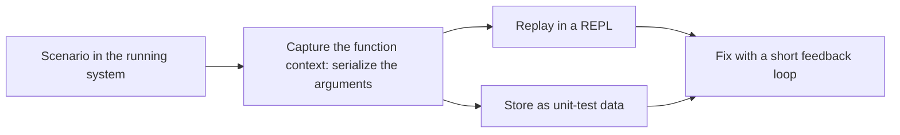

# 15. Debugging

[← 14. Advanced data manipulation](14-advanced-data-manipulation.md) · [Book](../README.md)

## Summary

A debugger lets you step through code to find the line that causes a bug, but it doesn't let you **reproduce** the scenario. In DOP, you can capture the context of a scenario and replay it in a separate process, a REPL or a unit test, with a short feedback loop between each fix and its result (p. 311).

Theo is leaving Albatross, and Dave will be in charge of DOP. Their last session is at the Exploratorium, where Theo shares his own innovation (pp. 312–314):

- **Determinism:** in modules that deal with immutable data, the same arguments always give the same return value. Only `SystemState` deals with state.
- **The function context** is the values of the arguments a function is called with. In DOP, that is all there is.
- **Two conditions for reproducibility:** immutability, and ease of serialization and deserialization, which generic data structures provide.

The rest of the chapter applies this (pp. 314–329):

- **Context-capturing code** prints the arguments at the top of a function. It is serialized to JSON, because strings lose their quotes and escapes otherwise.
- **Replay in the REPL.** The improved book search, a prefix of any word in the title, is developed in the REPL against a captured catalog.
- **Captured data becomes unit tests.** It is written to JSON files named by context and UUID, asynchronously, which is safe because the data can't change.

External data sources can break reproducibility, unless the database is immutable, like Datomic. In local debugging, data rarely changes anyway (pp. 329–330). At Theo's farewell party, he says he's taking a break to travel, and may write a book about DOP (pp. 330–331).

## Key takeaways

- **In modules that deal with immutable data, function behaviour is deterministic** (p. 312).
- **In DOP, the function context is made of the values of the function arguments** (p. 313).
- **The two conditions for reproducibility are immutability and ease of (de)serialization** (p. 314).
- **Serialize captured strings to JSON**, so they keep their quotes and backslashes; JSON works for any data, primitive or collection (pp. 317–318).
- **Reproducibility lets you reproduce a scenario in a pristine environment** (p. 319).
- **Don't trigger the endpoint while iterating**; use the REPL's shorter feedback loop, then test end to end once fixed (pp. 320, 329).
- **Captured data makes unit test input**: no more building nested catalogs by hand (p. 321).
- **Write captured data asynchronously** so the real work isn't slowed; immutability guarantees the data doesn't change while it's written (pp. 323, 326).

## Section outline

*From the book’s own table of contents (PDF bookmarks); printed page numbers.*

- 15.1 Determinism in programming — p. 312
- 15.2 Reproducibility with numbers and strings — p. 314
- 15.3 Reproducibility with any data — p. 318
- 15.4 Unit tests — p. 321
- 15.5 Dealing with external data sources — p. 329
- Farewell — p. 330
- Summary — p. 331

## Notes

A few months on, Theo calls Dave. He's leaving Albatross, and, after consulting management, Dave will be in charge of DOP. Theo invites him for a last work session at the Exploratorium Museum of Science, where Theo thinks he has found a connection between DOP and science (p. 312).

### 15.1 Determinism in programming

Does the same cause always produce the same effect? Otherwise, Dave says, he'd be scared every time he took an elevator (p. 312). In programming, take **causes as function arguments and effects as return values**, leaving side effects aside (p. 312).

| Concern | Answer (pp. 312–314) |
|---|---|
| State can make the same arguments give different results | Minimize the modules that deal with state: only `SystemState` does; the rest is immutable data |
| What must be captured to replay a call? | The **function context**: in general arguments plus program state; in DOP, only the arguments |
| How to capture a huge nested map from a debugger? | Chrome's console has a Copy option; or serialize to JSON, paste, and deserialize |
| Where to replay? | A **REPL**, possibly in a separate process: "a scientific lab" |

The REPL is a programming environment that executes pieces of code and displays the result (p. 313). Table 15.1 lists one per language: the browser console, the Node CLI, JShell, the C# REPL, the Python interpreter and Interactive Ruby (p. 313).

*The vault's summary of the chapter's flow (pp. 311, 319, 321).*

### 15.2 Reproducibility with numbers and strings

No debugger is needed: add **context-capturing code** at the beginning of the function, printing its arguments (p. 314).

| Function | Capturing code | What goes wrong | Listing |
|---|---|---|---|
| `nthDigit(a, n)`, from Stack Overflow | `console.log(a); console.log(n);` | Nothing: a number is a number | 15.1–15.2, pp. 315 |
| `hasWordStartingWith(sentence, prefix)` | `console.log(sentence)` | Printed strings lose their quotes and escaped quotes | 15.3–15.5, pp. 316–317 |
| the same | `console.log(JSON.stringify(sentence))` | Nothing: quotes and backslashes are kept | 15.6–15.7, p. 317 |

`hasWordStartingWith` splits the sentence on spaces and uses `_.find` rather than `_.filter`, which would process every word instead of stopping at the first match (p. 316). Strings, like numbers, are valid JSON, and JSON serialization works for any data (pp. 317–318).

### 15.3 Reproducibility with any data

"The essence of DOP is that it treats data as a first-class citizen," so any data scenario is as reproducible as one with numbers and strings (p. 318). Nancy likes the idea of an improved search that matches a prefix of *any* word in a title (p. 318).

1. **Capture.** `Catalog.searchBooksByTitle` logs `JSON.stringify` of `catalogData` and `query` (listing 15.8, p. 318). Searching "Watch" prints a long one-line catalog with *7 Habits of Highly Effective People* and *Watchmen* (listing 15.9, p. 319).
2. **Replay.** Paste both into the REPL and call the function (listing 15.10, p. 319).
3. **Iterate in the REPL.** "Habit" returns `[]`, because the title starts with "7 Habits" (listing 15.11). The improved version filters with `hasWordStartingWith` and finds the book (listings 15.12–15.13, pp. 320–321).

Theo stops Dave from triggering the endpoint: the REPL gives much quicker feedback, and reproducing real-life conditions in a more effective environment is the main benefit of reproducibility (p. 320). Of Theo's four test queries, "abit" and "bit" correctly find nothing, but "habit" and "7 Habits" fail too (p. 321).

> **Try it:** [Capture and replay](../widgets/15-capture-replay.html) — trigger the search endpoint, compare `console.log` with `JSON.stringify` capture, replay the captured context in a mock REPL, and switch between the three versions of the search to see which of the eight queries pass.

### 15.4 Unit tests

DOP unit tests call a function with data and compare the returned data, but building nested catalogs by hand was no pleasure. Instead, **put the system in the conditions to test, capture the data inside the function, and use it in the test** (p. 321). Listing 15.14 pastes the captured catalog inline; searching "Habit" should return the book with authors "Sean Covey" and "Stephen Covey" (pp. 321–322).

To avoid copying and pasting, write the captured data to files under the unit tests' file tree (pp. 322–326):

| Piece | Design | Listing |
|---|---|---|
| File name | A context (the function's name) plus a UUID, under `test-data/`, `.json` extension; UUID libraries per language in table 15.2 | 15.15, pp. 322–323 |
| `dumpData(data, context)` | `JSON.stringify`, then `fs.writeFile` **asynchronously**, logging the path when done | 15.16, p. 323 |
| Capture | `dumpData([catalogData, query], 'searchBooksByTitle')` | 15.17–15.18, pp. 323–324 |
| Readability | `JSON.stringify(data, null, 2)` for two-space indentation | 15.20–15.21, pp. 324–325 |
| `readData(path)` | `JSON.parse(fs.readFileSync(path))`, **synchronously**, since the test can't run before the data is read | 15.22–15.23, p. 326 |

While Theo fetches tea (he's reading Charles Duhigg's *The Power of Habit* to cut down on coffee), Dave wonders: what if the function modifies the data while it's being written asynchronously? At the Wind Arrows exhibit, he realizes it can't, because in DOP data is never mutated (p. 326). Inline data is better when it is minimal, and a file when it's substantial (p. 327).

**The fix** (pp. 327–328): lowercase both title and query, and use the `\b` word-boundary metacharacter, so `\b7 habits` and `\bhabits of` match a prefix even across several words (listing 15.24). Theo writes one test for the queries that should find the book and one for those that shouldn't (listings 15.25–15.26, p. 328):

| Should return the book | Should return nothing |
|---|---|
| "Habit", "habit", "7 Habit", "habits of" | "abit", "bit", "7 abit", "habit of" |

The tests pass, and only then does Dave trigger the endpoint with "7 Habit", to test the system end to end (p. 329).

> **Vault note:** as printed, listing 15.15 generates a UUID but never concatenates it, so every file would be named `searchBooksByTitle-.json` and overwrite the last (p. 323). Listing 15.23 shows `// → false` for the same comparison listing 15.14 shows as `true`, without comment (pp. 322, 327). And `_.every` in listings 15.25–15.26 returns a single Boolean, not `[true, true, true, true]` (p. 328). The lab fixes the file name.

> **Run it:** the [capture-and-replay experiment](../lab/15-capture-replay/README.md) dumps a function context to a JSON file named by context and UUID, replays it, runs the eight queries against the three search versions, and shows what an asynchronous dump records when the data is mutated meanwhile.

### 15.5 Dealing with external data sources

The function context may be identical, but a database or service can answer the same query differently (p. 329). Theo's answers (pp. 329–330):

- **Immutable databases**, also called functional or append-only. Records carry automatically generated timestamps; updates create new versions; queries carry a time range and run on a snapshot that never changes. Datomic is used by some digital banks.
- **In practice**, when debugging locally, you are the only one using the system, so the data doesn't change between triggering and replaying.

Dave's analogy, fitting for the museum: external data sources are like hidden variables in quantum physics, which in theory can alter an experiment while the macro world looks stable (p. 330). Theo gives him a T-shirt with Einstein and Alan Kay on it. Kay's quote: "The last thing you want to do is to mess with internal state" (p. 330).

> **Try it:** [Reproducible or not?](../widgets/15-reproducibility.html) — replay a captured call while toggling mutation during an async dump, a mutable vs immutable database, and other users changing data, and see when the replayed result still matches the original.

### Farewell

At Theo's farewell party a week later, Joe meets Nancy for the first time, and Theo tells her that Klafim met its deadlines thanks to Joe (p. 330). Theo is taking a break to travel for a couple of months, and is thinking of writing a book about his DOP journey. Everyone raises a glass: "Cheers! Here's to a successful book" (pp. 330–331).

## Trade-offs at a glance

| Approach | Strength | Weakness |
|---|---|---|
| Debugger and breakpoints | No code changes; inspect anything | Doesn't reproduce the scenario (p. 311) |
| Capture to the console, replay in the REPL | Short feedback loop (p. 320) | Copying and pasting; unreadable one-line JSON (p. 319) |
| Capture to files | Becomes unit-test data (p. 322) | Many files to name and manage |
| Inline test data | Visible in the test (p. 327) | Hard to read when large |
| Asynchronous dump | Doesn't slow the real work (p. 323) | Only safe because data is immutable (p. 326) |
| Mutable external sources | The usual databases | Replays may differ, in theory (p. 330) |
| Immutable database (Datomic) | Same query, same answer (p. 329) | A different kind of database |

## Beyond the book

- **Escape user input in regular expressions.** `new RegExp("\\b" + prefix)` breaks on queries with special characters: "C++" throws an invalid-regex error and "(" too. Escaping (`prefix.replace(/[.*+?^${}()|[\]\\]/g, "\\$&")`) keeps the search a prefix match.
- **`\b` is ASCII-only in JavaScript.** Without the `u` flag and Unicode-aware handling, word boundaries ignore accented letters, so a prefix after "é" may match mid-word. Titles in other languages need care.
- **Not everything serializes.** Dates become strings, `undefined` disappears, `Map`, `Set` and `BigInt` don't round-trip through `JSON.stringify`, and cyclic structures throw. DOP's insistence on plain maps, arrays and primitives is what makes capturing reliable.
- **Snapshot and golden-file testing** are the industry name for the captured-data tests: Jest snapshots, Python's `syrupy` or approval tests. Record-and-replay tools for HTTP, such as VCR or Polly.js, do the same for external services.
- **Sensitive data.** Captured production contexts can contain personal data; scrub or synthesize before committing them to a test tree.
- **Deterministic simulation testing** goes further: systems like FoundationDB control time, randomness and the network, so a whole distributed run can be replayed from a seed.

## Connections

- **Immutability and the `SystemState` module:** [4. State management](04-state-management.md).
- **Unit tests in DOP:** [6. Unit tests](06-unit-tests.md); schema-generated inputs in [12. Advanced data validation](12-advanced-data-validation.md).
- **The search function's history:** [3. Basic data manipulation](03-basic-data-manipulation.md).
- **Persistent, time-aware data:** [9. Persistent data structures](09-persistent-data-structures.md).
- **Run it:** [Capture and replay](../lab/15-capture-replay/README.md) — dump, replay, the three search versions, and the async-dump race with mutable data.

## Check yourself

1. Why is function behaviour deterministic in most DOP modules?
   

Answer
They deal only with immutable data; only `SystemState` deals with state. So the same arguments always lead to the same return values (p. 312).

2. What is a function context, and what does it consist of in DOP?
   

Answer
The values a function is called with. In general it involves the arguments and the program state; in DOP, only the arguments' values (p. 313).

3. What are the two conditions for reproducibility?
   

Answer
Immutability and ease of serialization and deserialization (p. 314).

4. Why capture strings with `JSON.stringify` rather than `console.log`?
   

Answer
`console.log` prints a string's content without its quotes and escape backslashes, so it can't be pasted back as-is. JSON serialization keeps them (pp. 317).

5. Why does Theo stop Dave from triggering the search endpoint while fixing the search?
   

Answer
The REPL gives much quicker feedback; reproducing real conditions in a more effective environment is the main benefit of reproducibility. The end-to-end test comes once the fix is done (pp. 320, 329).

6. Captured data is written asynchronously. Why is that safe?
   

Answer
In DOP data is never mutated, so the function can't change the data while it's being written (p. 326).

7. Why do "habit" and "7 Habits" fail with the first improved search, and how does Dave fix it?
   

Answer
The search is case-sensitive, and it checks one word at a time, so a two-word prefix never matches. Dave lowercases both strings and matches a regex `\b` + prefix (pp. 321, 327–328).

8. How can a database be both writable and immutable?
   

Answer
Records get timestamps; updates create new versions; queries carry a time range and run on a snapshot that never changes, so the same query always returns the same response, as in Datomic (pp. 329–330).

